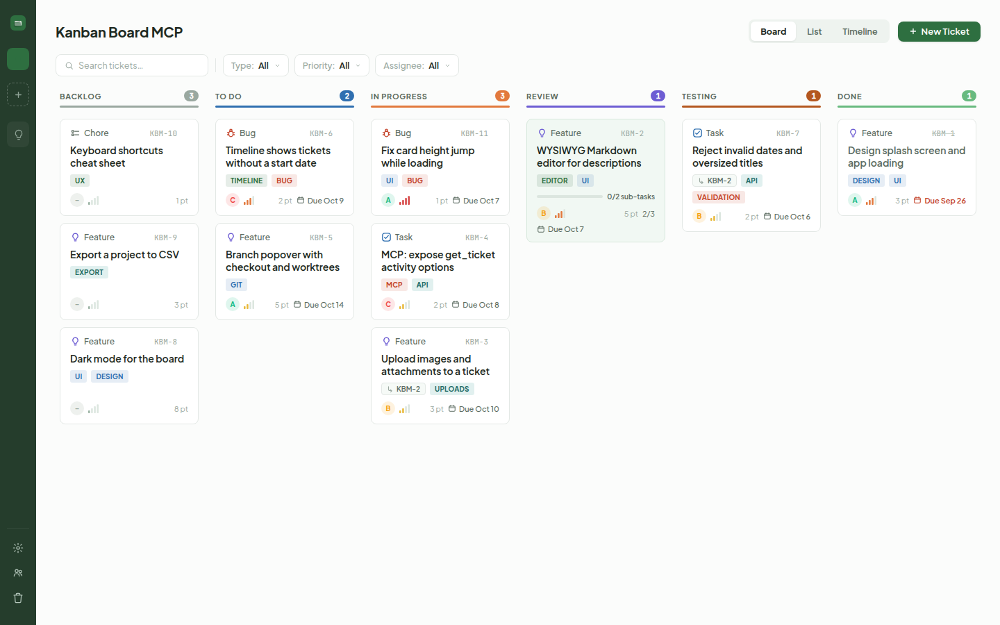
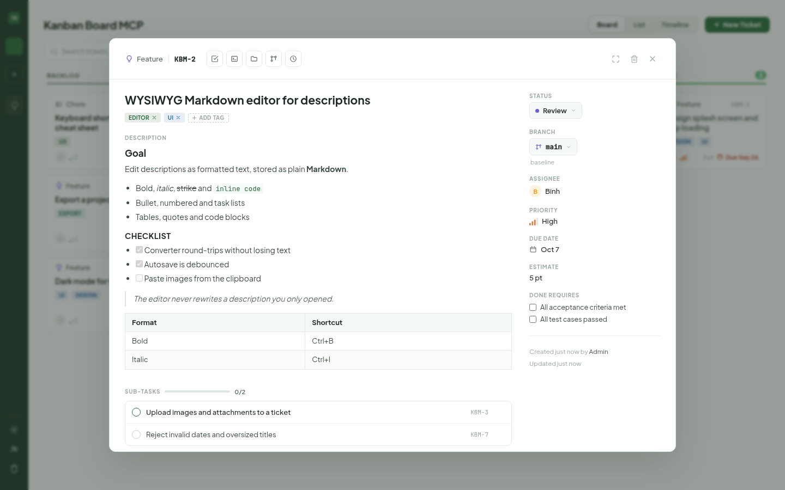
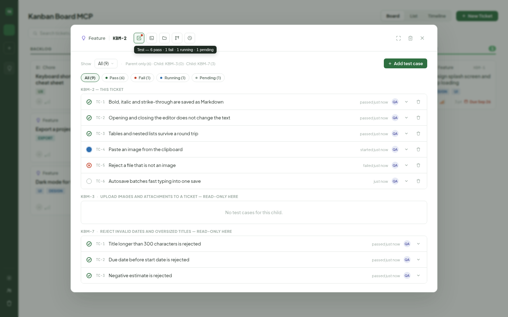
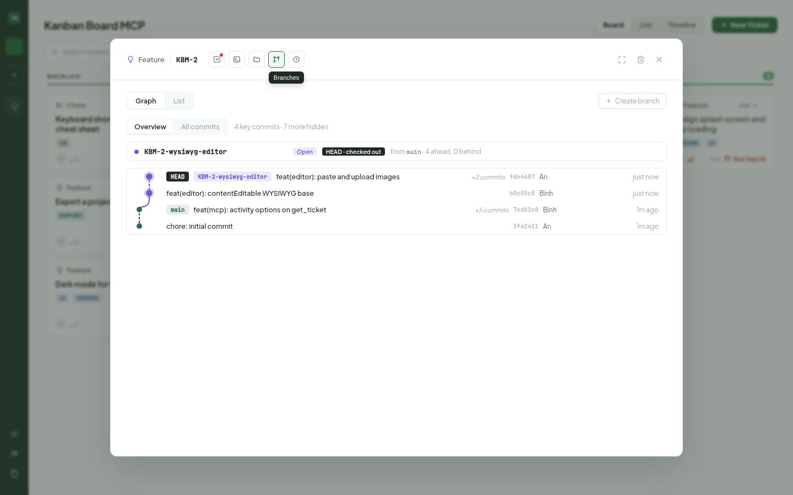
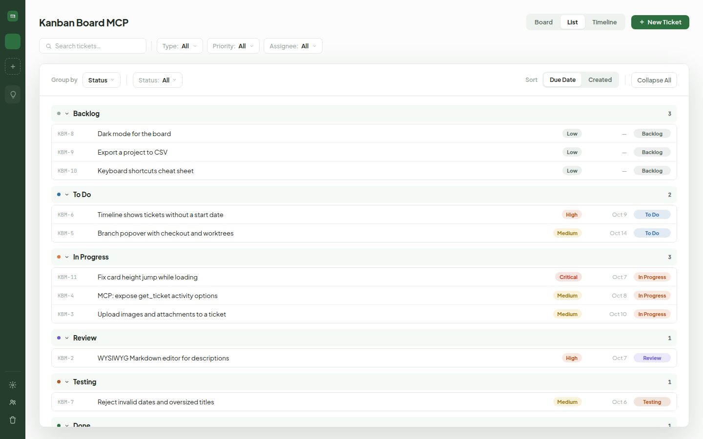
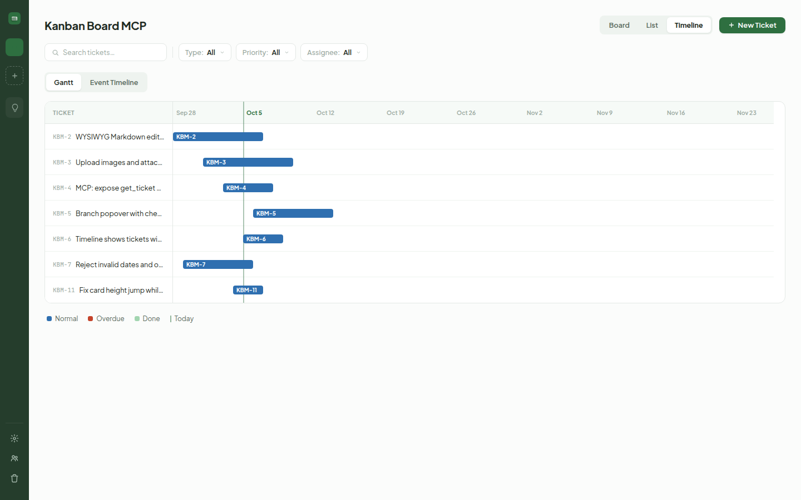

<p align="center">
  
</p>

<h1 align="center">Kanban Board MCP</h1>

<p align="center">
  A personal Kanban board with a polished React UI and a Python MCP server — built for AI agent integration.
</p>

<p align="center">
  <a href="https://github.com/iamcaominhtien/kanban-board-mcp/releases/latest"></a>
  
  
  
  
  
  
  
</p>

---

## Features

- **Board, List and Timeline** views with drag and drop, filters (type, priority, assignee), search, and **Review / Testing** statuses.
- **Rich ticket detail**: WYSIWYG Markdown description (tables, task lists, code, pasted or uploaded images), acceptance criteria, sub-tickets, comments, blocks and links, estimates, dates, assignees and "Done requires" guards.
- **Docs space** per project: a page tree with a WYSIWYG editor stored as Markdown, drafts, versions with diff and restore, `[[page#section]]` and ticket-key references with backlinks, and a Recycle Bin.
- **Test cases** with pass / fail / running state per ticket and child ticket.
- **Real git branches**: link a ticket to a branch, see its commit graph against `main`, check it out, and use git worktrees.
- **Per-ticket Workspace** (a scratch folder with a file manager) and **Debug Space** (a journal of attempts, blockers and fixes).
- **Activity log** of who changed what (you, an AI agent, or a named member), with filters.
- **Idea Space** (workspace level, with a project switcher): quick capture (Alt+N, or "Make idea" on highlighted text), an Inbox with keyboard triage (Keep, Park, Merge, Archive) and duplicate suggestions, ideas as pages with assumptions, evidence, a research log, a workspace folder and activity, readiness worked out from the assumptions, list / stages / matrix views, and a promote preview that carries what the idea learned into the ticket. Optional AI help (triage advice, shape an idea, ask, weekly digest) is on by default and can be switched off per project in Settings › Idea Space; it only works once the project has a Board AI member.
- **Sketch** (offline paint-style drawing, no extra dependency): `/draw` in Docs pages, ideas, ticket descriptions and comments, and "Draw on it" on any picture in the file viewer. Layers, fill, brush, text, crop, 100+ undo steps, pen and touch. An **AI** chat (one kept conversation per sketch, with pictures and files you paste or attach) answers about the drawing, brainstorms ideas, or proposes shapes for a new "AI" layer that you accept or discard; an AI agent can also edit a sketch as files over MCP. Details in [`docs/specs/sketch-tool.md`](docs/specs/sketch-tool.md).
- **Canvas** (boards on one large plane, a peer of Sketch and Diagram): lay HTML pages, pictures, Sketches and Diagrams (called *frames*) side by side with notes, arrows, labels and comments, in a ticket, a comment, an idea or a Docs page of its own. Frames render in a locked frame (no scripts, no outside requests); changing a frame's source takes a lock for that one frame while layout, notes and comments merge by item, so two people can arrange at once. Large view, Present, history with compare and restore, ZIP / PNG / PDF export. An AI member can comment and **propose** a changed frame that a person accepts or rejects (also over MCP, with no new tool). Details in [`docs/specs/canvas.md`](docs/specs/canvas.md).
- **AI where you work**: a chat docked in the ticket page, an `@` that says what the mention will do, and AI in every editor (`/ai`, Ctrl+J, a selection bar, a draft over the text). One switch per project. Details in [`docs/specs/ai-where-you-work.md`](docs/specs/ai-where-you-work.md).
- **AI members**: add Claude Code (your signed-in CLI) or an API-key model as a member, assign it tickets or @mention it; it works through a real run with live steps, asks back when it needs a decision, stops at Review, and every action goes through permissions, approvals, budgets, a kill switch and an audit log.
- **Board AI**: an Ask AI dock (Ctrl/Cmd+J) that answers about the board, a ticket or a doc and proposes changes as drafts you apply yourself; Draft with AI for new tickets, Improve description, Split with AI, test cases tied to acceptance criteria, a daily board-health digest, and Docs AI (Ask the docs with cited answers, a page AI menu, Check this page, Write with AI, AI members that edit pages (or propose edits), @AI in comment threads, Draw a diagram, freshness checks and Docs health; on by default, off per project in Settings).
- **AI schedules**: let an AI member work on a ticket at a set time, once or on repeat, with "done when" checks (criteria, a test command, summary, branch) and a second AI that reviews the result; a pass moves the ticket to Review, never further. Shown in a Schedules tab (list and week), on the ticket and on its card.
- **MCP server for AI agents**: 12 tools over stdio or HTTP, with clear descriptions, annotations and fix-it error messages.
- **Splash screen and loading states** on web and desktop, plus an update-required notice when the UI is too old for the server.
- **Local-first**: SQLite, no external services; also packaged as an Electron desktop app.

## What's Inside

| | |
|---|---|
| **UI** | React 18 + Vite + TypeScript, CSS Modules, drag-and-drop (`@dnd-kit`) |
| **Server** | Python, FastAPI, MCP (Model Context Protocol), SQLite via SQLModel |
| **Storage** | Local-first — SQLite, no external services |

## Screenshots

### Board View


### Ticket Detail — WYSIWYG Markdown with images
Write rich text (tables, task lists, code, pasted images); it is stored as plain Markdown.



### Test Cases
Track pass / fail / running per ticket, including child tickets, and optionally block *Done* until every case passes.



### Git Branches
Link a ticket to a real branch, see its commits against `main`, and check it out from the UI.



### List View


### Timeline / Gantt


## Quick Start

### UI (Frontend)
```bash
cd ui
npm install
npm run dev        # http://localhost:5173
```

### MCP Server (Backend)

Requires Python 3.12+ and [uv](https://docs.astral.sh/uv/). The database is created and migrated automatically on first start.

```bash
cd server
uv sync
uv run uvicorn main:app --reload --port 8000
```

## MCP Tools

The server exposes **12 tools** for AI agents over MCP (17 with the Idea Space tools enabled); `ai_run` only works inside a run the board started for an AI member, and `ai_schedules` and the acting half of `ai_team` refuse calls from inside a run. The write tools each cover one area and take an `action`; every action's parameters are listed in the tool description, and a wrong call is answered with what that action accepts. The code is the `server/kanban_mcp/` package: `tools/` (the 12 tools), `operations/` (one function per verb, grouped by area), `common.py`, `registry.py`, `instructions.py`. AI members live in `server/services/ai/` (members, runs and the CLI runner, the API agent loop, the permission guard, approvals, audit).

| Tool | Read / write | What it does |
|---|---|---|
| `get_projects` | read | All projects, or one project with its members (`project_id`) |
| `list_tickets` | read | Compact, paginated summaries (`status`, `priority`, `q`, `limit`/`offset`; `detail=true` for full objects) |
| `get_ticket` | read | Everything about one ticket plus its 10 most recent activity entries (long texts shortened); `activity_limit=N` (0 = none, negative = the whole history in full), `activity_since=<ISO time>`, or `view='comments'` for just the discussion |
| `docs_read` | read | Docs page tree: `list`, `get`, `search` (full-text, with snippets), `versions`, `version` (optionally a diff), `recycle_bin`, `check_links`, `comments`, `diagrams` (draw.io drawings in a project), `diagram` (writes a diagram's `.drawio` file to a local path to edit), `sketches` (freehand sketches in a project), `sketch` (writes a sketch's PNG and editable `.sketch.json` to local paths to edit) |
| `manage_project` | write | `create`, `update` (name, color, linked git repo, worktree defaults), `add_member`, `remove_member` |
| `manage_ticket` | write | `create` (with `parent_id` for a sub-ticket), `update` (fields, status moves, assignee, dates, "Done requires" guards, `clear_fields`), `delete`, `workspace` (the ticket's scratch folder), `block`, `unblock`, `link`, `unlink`, `link_doc`, `unlink_doc` |
| `ticket_items` | write | Lists inside a ticket, chosen with `item`: `comment` (add, update, delete, restore), `work_log` (the Debug Space journal), `criterion` (acceptance criteria), `sub_task` (checklist steps), `test_case` |
| `ticket_branches` | write | `add`, `update`, `delete`, `checkout`: real git branches when the project has a linked repo |
| `docs_write` | write | `create`, `update` (a stale `base_version` is rejected; optional `title` renames and rewrites `[[links]]`), `move`, `duplicate`, `delete` (to the Recycle Bin), `restore`, `restore_version`, `import` (a local `.md` file or folder), `diagram_create` / `diagram_save` (a local `.drawio` file; a stale `base_version` is rejected; an optional `svg_path` is used as the preview), `diagram_delete`, `diagram_restore`, `sketch_create` / `sketch_save` (a local PNG and its `.sketch.json`; a stale `base_version` is rejected; at most 4096 px, 10 layers, 10 MB) |
| `ai_run` | write | Only inside a run the board started for an AI member: `ask` (a question for the person it acts for; the run waits and resumes with the answer), `report` (its summary and criteria claims) |
| `ai_schedules` | destructive | AI schedules: `list`, `get`, `create`, `update`, `pause`, `resume`, `delete`, `run_now`; settings go in `fields` (AI member, once or repeat, time zone, done-when checks, AI review, limits) |
| `ai_team` | write | The board's AI team. Read: `members` (status, limits in use, spend), `member` (full detail, 14-day usage), `usage`, `runs`, `run` (steps, files, question, cost), `approvals` (read only), `docs_jobs`. Act: `ask` (wake an AI on a ticket, or in a Docs thread; `intent` ask, work or notify. An `@mention` in a comment posted through MCP does **not** wake an AI), `cancel` / `retry` / `answer` a run, `pause` / `resume` a member, `create_member` / `update_member` (no keys, folders, Bypass permissions or ceiling past Review). Approvals are decided in the board; the acts are refused inside an AI run |

**Diagram previews.** A diagram an agent saves gets its picture from the draw.io editor itself, in a hidden browser: the desktop app's own executable (`KANBAN_EXPORT_CMD`, set for you), or a Chrome / Chromium / Edge on the machine (`KANBAN_CHROME_PATH` to point at one). It needs the editor address from Settings › Diagrams (the self-hosted draw.io); the public diagrams.net is never used unless `KANBAN_DIAGRAM_EXPORT=public`, and `KANBAN_DIAGRAM_EXPORT=off` switches this off. Without either, the server draws a plain preview and the diagram footer says "Simple preview" until someone opens it in the editor and saves.

**Idea Space** (hidden from MCP by default: set `KANBAN_MCP_IDEA_TOOLS=1` to expose these 5 tools; the web UI and REST API are unaffected)
- `list_idea_tickets`, `get_idea_ticket`, `list_idea_assumptions`, `get_idea_activity_trail`: read ideas, their assumptions and their history.
- `create_idea_ticket`: suggest an idea. It lands in the Inbox, marked as suggested by AI with your reason and the ticket you were working on. AI members cannot move, edit, merge, archive, delete or promote an idea; a person does that in the app.

**Conventions agents can rely on**
- The server sends usage instructions on connect (IDs, statuses, flow), and every tool carries read-only / destructive annotations (a write tool that has a `delete` action is marked destructive as a whole).
- Failures are real tool errors (`isError`) whose message says how to fix the call (and lists the valid ids); nothing fails silently.
- Tools that change a ticket return it without its activity log (large); sub-items can be addressed by id, test-case code (`TC-2`) or branch name.
- Omitted optional arguments mean "unchanged"; use `clear_fields` (on `manage_ticket` `update`) to empty a field. Changes are attributed to the AI agent in the Activity tab.

## Connecting AI Agents

### Easiest — Settings → MCP integrations

Open **Settings** in the app and use **MCP integrations** to install the server into **Claude Code** (runs `claude mcp add` in the User, Project or Local scope) or **Antigravity** (merges a `kanban` entry into `~/.gemini/config/mcp_config.json` or `.agents/mcp_config.json`). Each row also offers Copy command / Copy JSON, Test connection and Remove, and only ever touches the `kanban` entry. The manual options below do the same thing by hand.

### Option 1 — Stdio (recommended for VS Code / Claude Desktop)

The server launches as a subprocess — no manual startup needed. The database schema is created automatically on first run.

Add to VS Code `mcp.json` or Claude Desktop config:
```json
{
  "servers": {
    "kanban": {
      "type": "stdio",
      "command": "uv",
      "args": ["--directory", "/path/to/kanban-board-mcp/server", "run", "mcp_stdio.py"]
    }
  }
}
```

### Option 2 — HTTP (when running the full server)

Start the server first:
```bash
cd server && uv run uvicorn main:app --port 8000
```

Then connect any MCP-compatible client to `http://localhost:8000/mcp/` (note the trailing slash — the mount only matches with it).

## Desktop App

The desktop app packages the full stack (React UI + FastAPI server + MCP stdio) into a single installable application via Electron. Download the installer from the [latest release](https://github.com/iamcaominhtien/kanban-board-mcp/releases/latest); the badge at the top shows its version, so this page needs no edit when a new one comes out.

| Platform | Artifact |
|---|---|
| **macOS** (x64 + arm64) | DMG |
| **Windows** (x64) | NSIS installer |
| **Linux** | Not yet supported |

You can also build it yourself: `./build-desktop.sh`.

> **macOS note:** the app is not notarized — right-click → Open on first launch.

## More Docs
- [Server README](server/README.md)
- [UI README](ui/README.md)
- [Architecture](docs/arch/backend-architecture.md)
- [AI guideline (Vietnamese, PDF)](docs/guideline/ai/huong-dan-dung-ai.pdf): setup, writing prompts, assigning work, safety ([how to update](docs/guideline/README.md))
- [Changelog](CHANGELOG.md)

