# AI work on tickets

> Component — v2 · source: [`AiTicketWork.dc.html`](../source/AiTicketWork.dc.html) · canvas `1794076521-f7e6` · sha256 `86b4da1099d22f28b73588fcbfbf7a3960f9b2a694fdebd80928692565c8fe3a`

> Redrawn for AI v2 from `docs/design-todo/` (rows A-001 to A-040 and the B rows named in the "Todo rows" section below) and checked against the code of branch `claude/ai-team-architecture-7a1efc` (`ui/src/components/ai/`). Names, ids, costs, tokens and times in the mock-ups are sample data. **Check the code before building from this: the file named in each section is the truth, not the picture.**

Eyebrow "Component — v2". A ticket is assigned to an AI team: a lead (Claude Code) and the roles it calls on. The lead does the work and decides how; the board only shows it. Nothing the board draws can hold, gate or approve what the team does: no review gate, no status ceiling, no approval, no hold on a ticket. You can send the team a message at any time (Send to {team}), answer when it asks, stop a run, and read the lead’s Report. Desktop only. Sample project: Kanban Board (KAN).

---

## Header and legend

Source: [AiTicketWork.dc.html](../source/AiTicketWork.dc.html) › header and the legend block ("RUN STATE CHIPS", "A TEAM VS A PERSON")

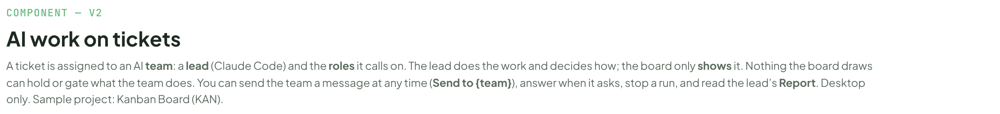

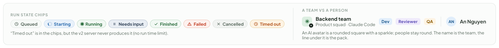

- Legend: "RUN STATE CHIPS" · "Queued" · "Starting" · "Running" · "Needs input" · "Finished" · "Failed" · "Cancelled" · "Timed out" · "“Timed out” is in the chips, but the v2 server never produces it (no run time limit)." · "A TEAM VS A PERSON" · "Backend team" · "Product squad · Claude Code" · "Dev" · "Reviewer" · "QA" · "AN" · "An Nguyen" · "An AI avatar is a rounded square with a sparkle; people stay round. The name is the team, the line under it is the pack."

---

## A. Assigning a ticket to a team

The assignee picker lists AI teams under People, with their state. Choosing one asks how to begin: start now, or only assign. Afterwards the ticket header, the card and the board column show which team the ticket is assigned to and what its run is doing.

Source: [AiTicketWork.dc.html](../source/AiTicketWork.dc.html) › section A

### 1. Assignee picker — AI teams under People

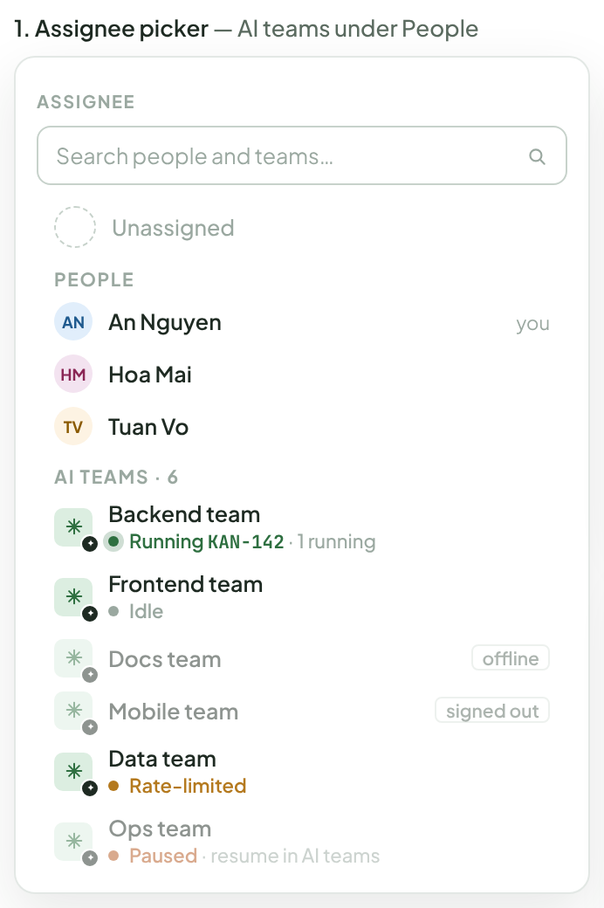

- Text in the frame: "ASSIGNEE" · "Search people and teams…" · "Unassigned" · "PEOPLE" · "AN" · "An Nguyen" · "you" · "HM" · "Hoa Mai" · "TV" · "Tuan Vo" · "AI TEAMS · 6" · "Backend team" · "Running KAN-142 · 1 running" · "Frontend team" · "Idle" · "Docs team" · "offline" · "Mobile team" · "signed out" · "Data team" · "Over budget · resets 00:00" · "Ops team" · "Paused · resume in AI teams"

### 2. On assign: start now, or only assign — the popover under the picker; three states of the same notice

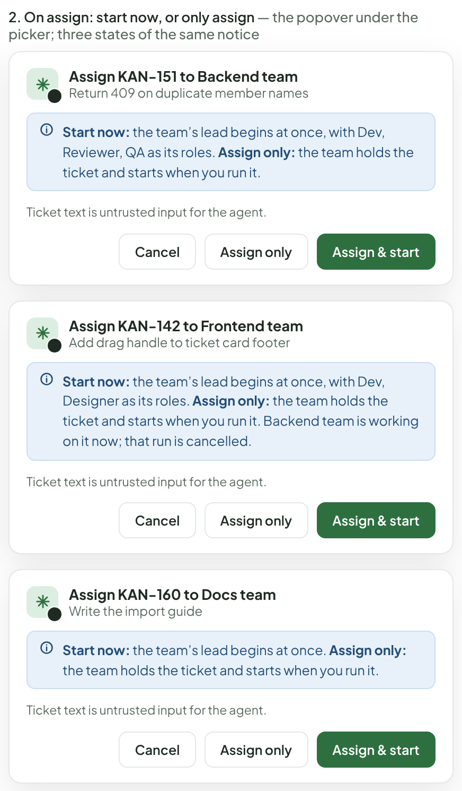

- Text in the frame: "Assign KAN-151 to Backend team" · "Return 409 on duplicate member names" · "Start now: the team’s lead begins at once, with Dev, Reviewer, QA as its roles. Assign only: the team holds the ticket and starts when you run it." · "Ticket text is untrusted input for the agent." · "Cancel" · "Assign only" · "Assign & start" · "Assign KAN-142 to Frontend team" · "Add drag handle to ticket card footer" · "Start now: the team’s lead begins at once, with Dev, Designer as its roles. Assign only: the team holds the ticket and starts when you run it. Backend team is working on it now; that run is cancelled." · "Assign KAN-160 to Docs team" · "Write the import guide" · "Start now: the team’s lead begins at once. Assign only: the team holds the ticket and starts when you run it."

### 3. Ticket header after assigning — the Run button, the run chip, the team in the Assignee block

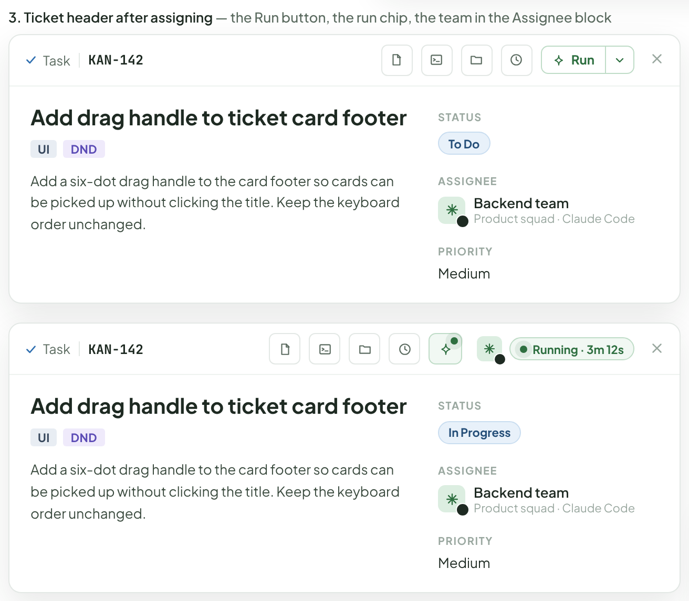

- Text in the frame: "Task" · "KAN-142" · "Run" · "Add drag handle to ticket card footer" · "UI" · "DND" · "Add a six-dot drag handle to the card footer so cards can be picked up without clicking the title. Keep the keyboard order unchanged." · "STATUS" · "To Do" · "ASSIGNEE" · "Backend team" · "Product squad · Claude Code" · "PRIORITY" · "Medium" · "Running · 3m 12s" · "In Progress"

### 3b. The Run button and the run chip, state by state — the same header, only the right part changes

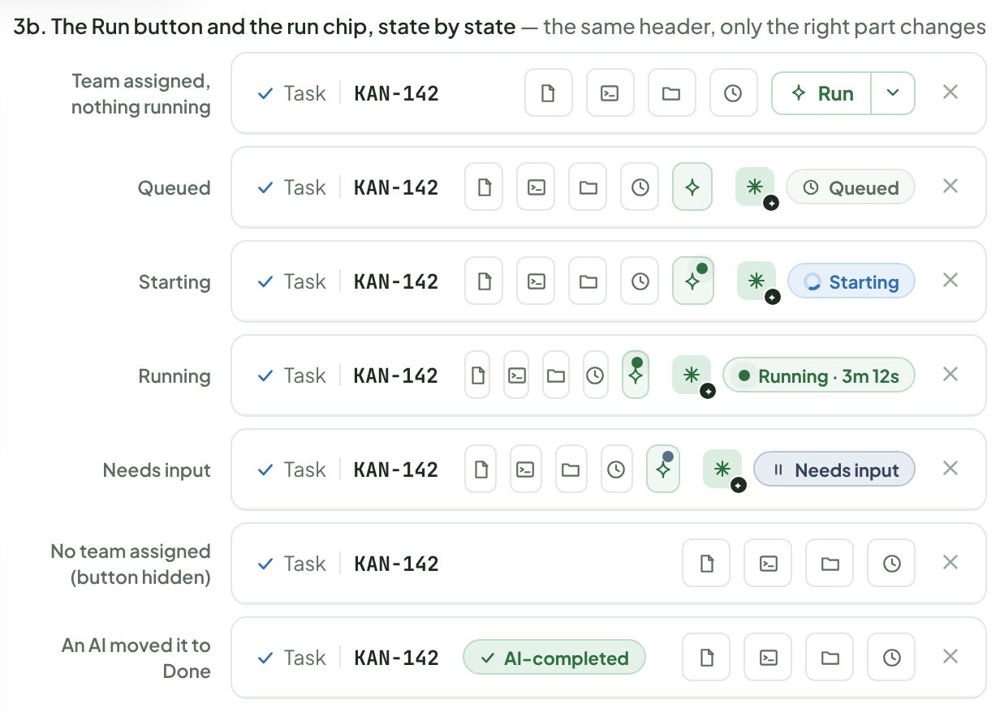

- Text in the frame: "Team assigned, nothing running" · "Task" · "KAN-142" · "Run" · "Queued" · "Starting" · "Running" · "Running · 3m 12s" · "Needs input" · "No team assigned (button hidden)" · "An AI moved it to Done" · "AI-completed"

### 3c. Run options — the caret next to Run

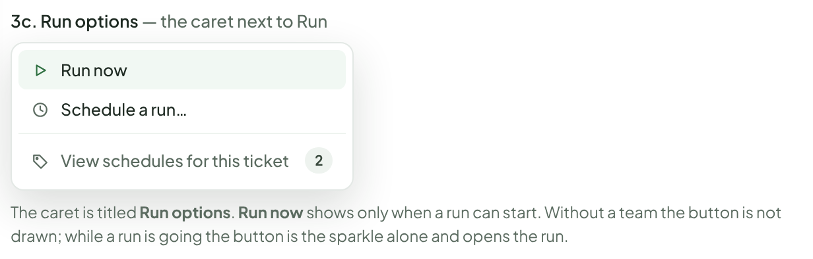

- Text in the frame: "Run now" · "Schedule a run…" · "View schedules for this ticket" · "2" · "The caret is titled Run options. Run now shows only when a run can start. Without a team the button is not drawn; while a run is going the button is the sparkle alone and opens the run."

### 4. Card footer variants in board columns — people and teams mixed; the card never shows cost

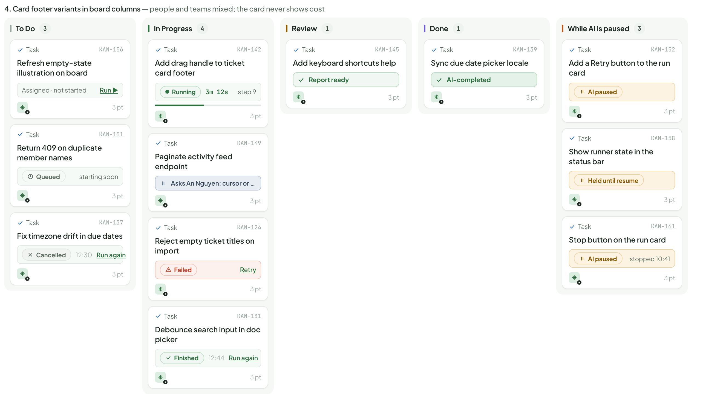

- Text in the frame: "To Do" · "3" · "Task" · "KAN-156" · "Refresh empty-state illustration on board" · "Assigned · not started" · "Run ▶" · "3 pt" · "KAN-151" · "Return 409 on duplicate member names" · "Queued" · "starting soon" · "KAN-137" · "Fix timezone drift in due dates" · "Cancelled" · "12:30" · "Run again" · "In Progress" · "4" · "KAN-142" · "Add drag handle to ticket card footer" · "Running" · "3m 12s" · "step 9" · "KAN-149" · "Paginate activity feed endpoint" · "Asks An Nguyen: cursor or offset?" · "KAN-124" · "Reject empty ticket titles on import" · "Failed" · "Retry" · "KAN-131" · "Debounce search input in doc picker" · "Finished" · "12:44" · "Review" · "1" · "KAN-145" · "Add keyboard shortcuts help" · "Report ready" · "Done" · "KAN-139" · "Sync due date picker locale" · "AI-completed" · "While AI is paused" · "KAN-152" · "Add a Retry button to the run card" · "AI paused" · "KAN-158" · "Show runner state in the status bar" · "Held until resume" · "KAN-161" · "Stop button on the run card" · "stopped 10:41"

---

## B. @mention a team

Typing @ in a description, a comment or a test-case note offers People and AI teams. A mention is a pill; it does not ask what you meant.

Source: [AiTicketWork.dc.html](../source/AiTicketWork.dc.html) › section B

### 1. Autocomplete — AI teams, with the state next to each

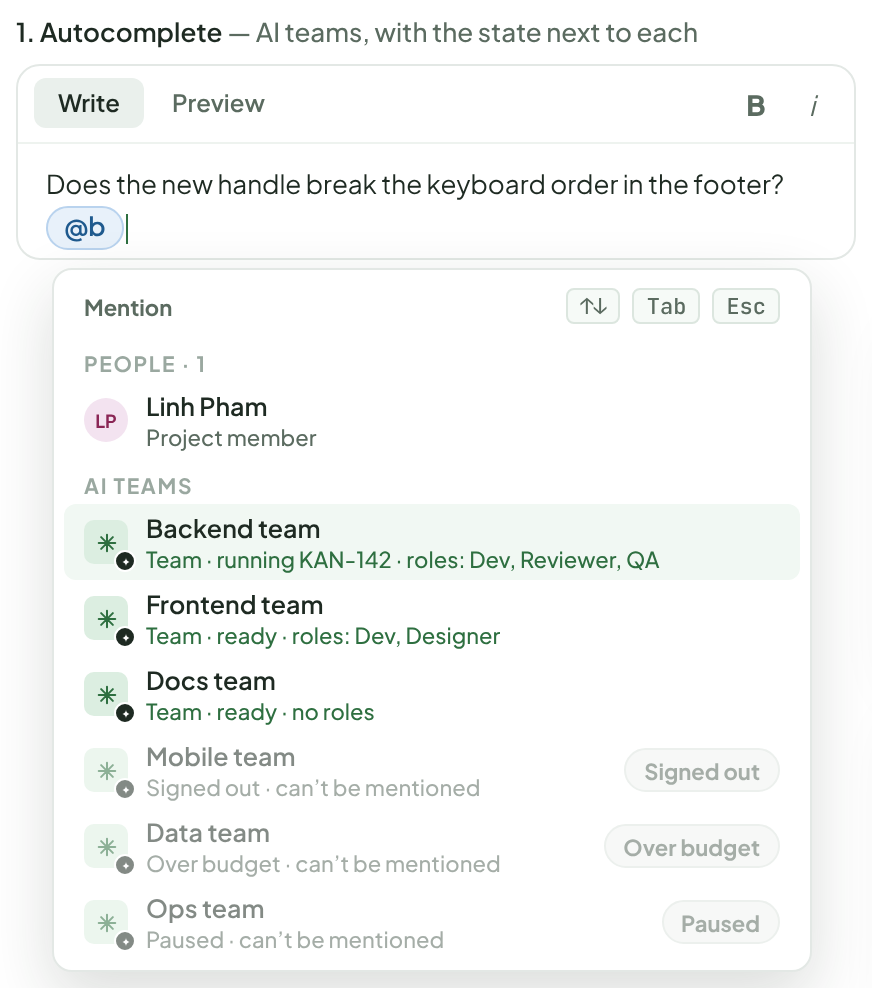

- Text in the frame: "Write" · "Preview" · "B" · "i" · "Does the new handle break the keyboard order in the footer? @b" · "Mention" · "↑↓" · "Tab" · "Esc" · "PEOPLE · 1" · "LP" · "Linh Pham" · "Project member" · "AI TEAMS" · "Backend team" · "Team · running KAN-142 · roles: Dev, Reviewer, QA" · "Frontend team" · "Team · ready · roles: Dev, Designer" · "Docs team" · "Team · ready · no roles" · "Mobile team" · "Signed out · can’t be mentioned" · "Signed out" · "Data team" · "Over budget · can’t be mentioned" · "Over budget" · "Ops team" · "Paused · can’t be mentioned" · "Paused"

### 2. The pill and its hover card — doc-reference shape, AI colour

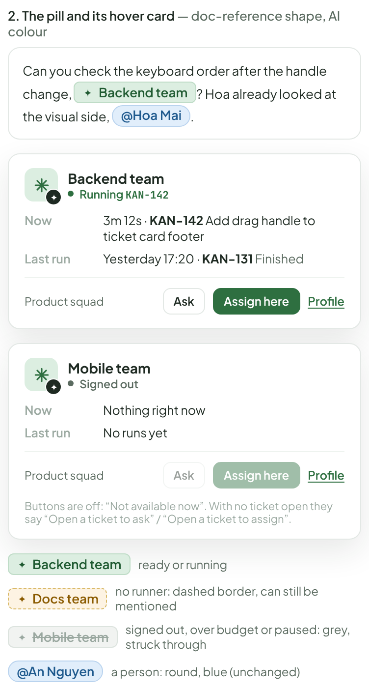

- Text in the frame: "Can you check the keyboard order after the handle change," · "Backend team? Hoa already looked at the visual side, @Hoa Mai." · "Backend team" · "Running KAN-142" · "Now" · "3m 12s · KAN-142 Add drag handle to ticket card footer" · "Last run" · "Yesterday 17:20 · KAN-131 Finished" · "Product squad" · "Ask" · "Assign here" · "Profile" · "Mobile team" · "Signed out" · "Nothing right now" · "No runs yet" · "Buttons are off: “Not available now”. With no ticket open they say “Open a ticket to ask” / “Open a ticket to assign”." · "ready or running" · "Docs team" · "no runner: dashed border, can still be mentioned" · "signed out, over budget or paused: grey, struck through" · "@An Nguyen" · "a person: round, blue (unchanged)"

### 3. Mention in a comment: nothing to choose — replaces the dialog “What should happen when you send this comment?”

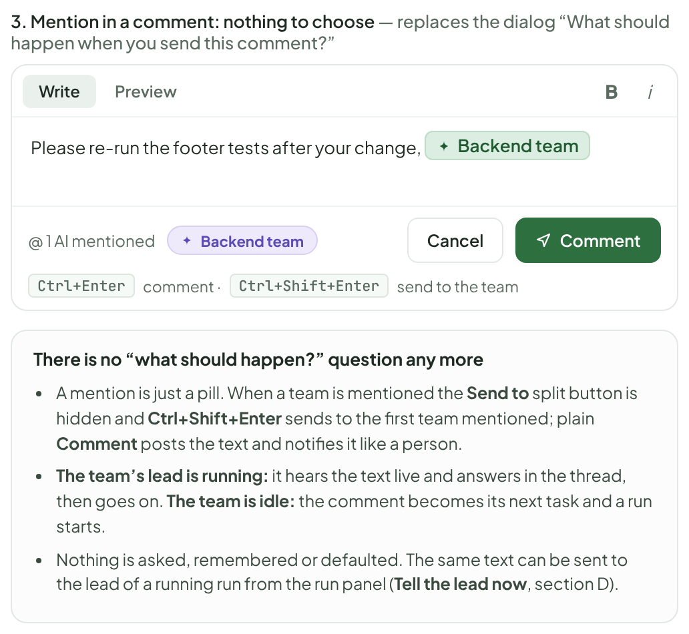

- Text in the frame: "Write" · "Preview" · "B" · "i" · "Please re-run the footer tests after your change," · "Backend team" · "@ 1 AI mentioned" · "Cancel" · "Comment" · "Ctrl+Enter" · "comment ·" · "Ctrl+Shift+Enter" · "send to the team" · "There is no “what should happen?” question any more" · "A mention is just a pill. When a team is mentioned the Send to split button is hidden and Ctrl+Shift+Enter sends to the first team mentioned; plain Comment posts the text and notifies it like a person." · "The team’s lead is running: it hears the text live and answers in the thread, then goes on. The team is idle: the comment becomes its next task and a run starts." · "Nothing is asked, remembered or defaulted. The same text can be sent to the lead of a running run from the run panel (Tell the lead now, section D)."

### 4. Mention in a test case note — small fragment

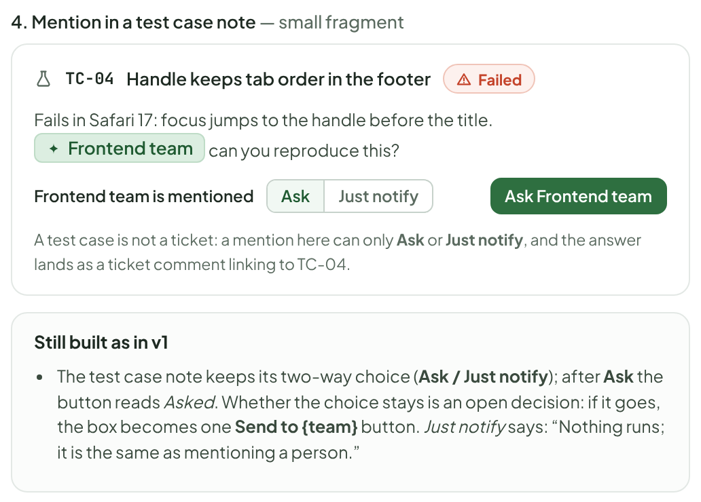

- Text in the frame: "TC-04" · "Handle keeps tab order in the footer" · "Failed" · "Fails in Safari 17: focus jumps to the handle before the title." · "Frontend team can you reproduce this?" · "Frontend team is mentioned" · "Ask" · "Just notify" · "Ask Frontend team" · "A test case is not a ticket: a mention here can only Ask or Just notify, and the answer lands as a ticket comment linking to TC-04." · "Still built as in v1" · "The test case note keeps its two-way choice (Ask / Just notify); after Ask the button reads Asked. Whether the choice stays is an open decision: if it goes, the box becomes one Send to {team} button. Just notify says: “Nothing runs; it is the same as mentioning a person.”"

---

## C. Send a message to a team

The comment box has a Send to {team} split button. The text goes to the team’s lead; the thread shows the team at work, the roles that speak, and the lead’s closing comment.

Source: [AiTicketWork.dc.html](../source/AiTicketWork.dc.html) › section C

### 1. Composer with Send to {team} — the split button; the menu lists the teams that can work

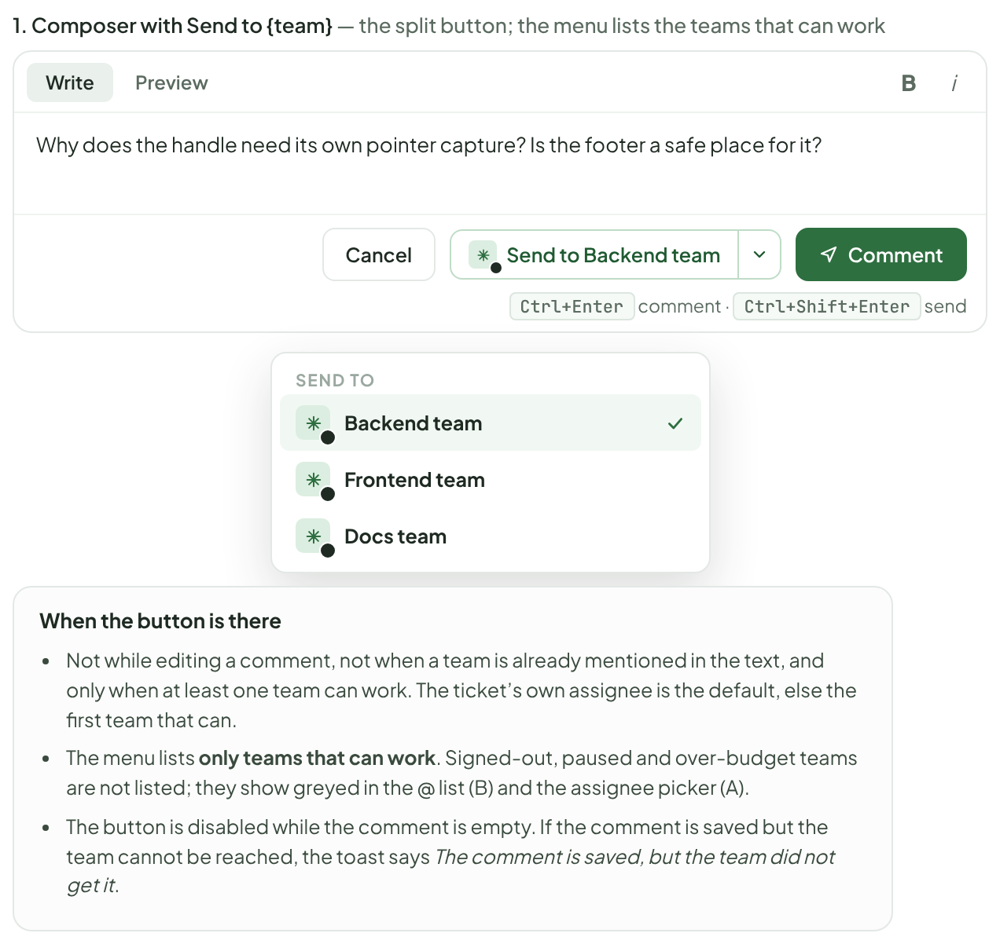

- Text in the frame: "Write" · "Preview" · "B" · "i" · "Why does the handle need its own pointer capture? Is the footer a safe place for it?" · "Cancel" · "Send to Backend team" · "Comment" · "Ctrl+Enter comment · Ctrl+Shift+Enter send" · "SEND TO" · "Backend team" · "Frontend team" · "Docs team" · "When the button is there" · "Not while editing a comment, not when a team is already mentioned in the text, and only when at least one team can work. The ticket’s own assignee is the default, else the first team that can." · "The menu lists only teams that can work. Signed-out, paused and over-budget teams are not listed; they show greyed in the @ list (B) and the assignee picker (A)." · "The button is disabled while the comment is empty. If the comment is saved but the team cannot be reached, the toast says The comment is saved, but the team did not get it."

### 2. Thread: the team at work, the roles, the answer, the report — one run, read top to bottom

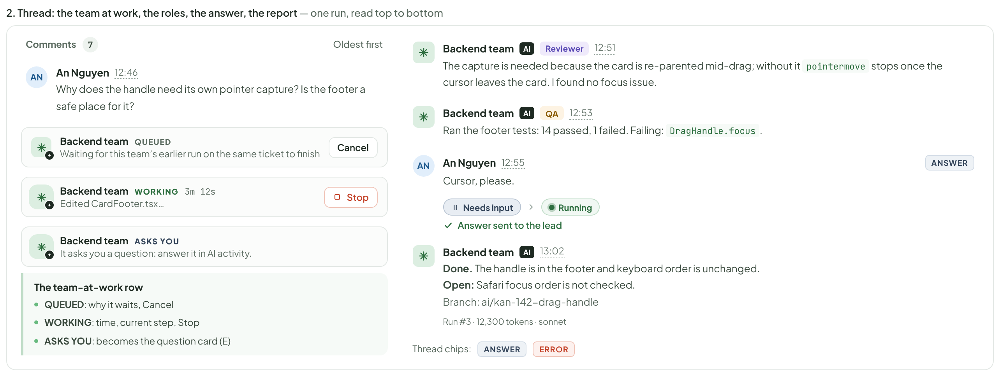

- Text in the frame: "Comments" · "7" · "Oldest first" · "AN" · "An Nguyen" · "12:46" · "Why does the handle need its own pointer capture? Is the footer a safe place for it?" · "Backend team" · "QUEUED" · "Waiting for this team’s earlier run on the same ticket to finish" · "Cancel" · "WORKING" · "3m 12s" · "Edited CardFooter.tsx…" · "Stop" · "ASKS YOU" · "It asks you a question: answer it in AI activity." · "The team-at-work row" · "One row, always the first run that is still going. It is QUEUED (the reason it waits, Cancel), WORKING (time on the run, the step it is on, Stop) or ASKS YOU (no button: when the run has a question this row becomes the question card, section E). While it reads the ticket it says Backend team is reading the ticket…." · "AI" · "Reviewer" · "12:51" · "The capture is needed because the card is re-parented mid-drag; without it pointermove stops once the cursor leaves the card. I found no focus issue." · "QA" · "12:53" · "Ran the footer tests: 14 passed, 1 failed. Failing: DragHandle.focus." · "12:55" · "ANSWER" · "Cursor, please." · "Needs input" · "Running" · "Answer sent to the lead" · "13:02" · "Done. The handle is in the footer and keyboard order is unchanged." · "Open: Safari focus order is not checked." · "Branch: ai/kan-142-drag-handle" · "Run #3 · 12,300 tokens · sonnet" · "Thread chips:" · "ERROR"

### 3. Where the message goes — the same Send to, two situations

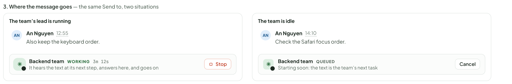

- Text in the frame: "The team’s lead is running" · "AN" · "An Nguyen" · "12:55" · "Also keep the keyboard order." · "Backend team" · "WORKING" · "3m 12s" · "It hears the text at its next step, answers here, and goes on" · "Stop" · "The team is idle" · "14:10" · "Check the Safari focus order." · "QUEUED" · "Starting soon: the text is the team’s next task" · "Cancel"

---

## D. Run lifecycle and the run panel

A run is one Claude Code session of the team’s lead. The diagram shows its states and what you can do in each; the panel is where steps, files, commands, tests and the Report live.

Source: [AiTicketWork.dc.html](../source/AiTicketWork.dc.html) › section D

### 1. State machine — the same eight states; the actions are new

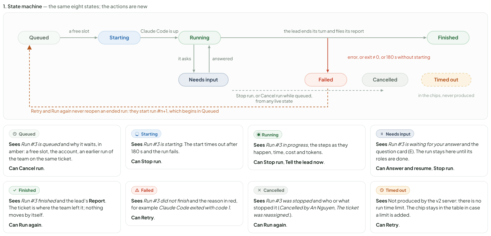

- Text in the frame: "Queued" · "Starting" · "Running" · "Finished" · "Needs input" · "Failed" · "Cancelled" · "Timed out" · "a free slot" · "Claude Code is up" · "the lead ends its turn and files its report" · "it asks" · "answered" · "error, or exit ≠ 0, or 180 s without starting" · "Stop run, or Cancel run while queued, from any live state" · "Retry and Run again never reopen an ended run: they start run #n+1, which begins in Queued" · "in the chips, never produced" · "Sees Run #3 is queued and why it waits, in amber: a free slot, the account, an earlier run of the team on the same ticket." · "Can Cancel run." · "Sees Run #3 is starting. The start times out after 180 s and the run fails." · "Can Stop run." · "Sees Run #3 in progress, the steps as they happen, time, cost and tokens." · "Can Stop run, Tell the lead now." · "Sees Run #3 is waiting for your answer and the question card (E). The run stays here until its roles are done." · "Can Answer and resume, Stop run." · "Sees Run #3 finished and the lead’s Report. The ticket is where the team left it; nothing moves by itself." · "Can Run again." · "Sees Run #3 did not finish and the reason in red, for example Claude Code exited with code 1." · "Can Retry." · "Sees Run #3 was stopped and who or what stopped it (Cancelled by An Nguyen, The ticket was reassigned.)." · "Sees Not produced by the v2 server: there is no run time limit. The chip stays in the table in case a limit is added."

### 2. Run panel, running — the AI tab; steps of a role fold under the line that gave it the work

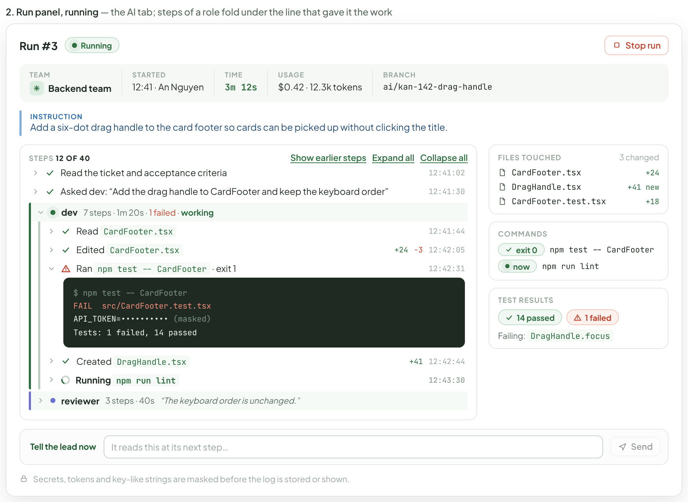

- Text in the frame: "Run #3" · "Running" · "Stop run" · "Backend team" · "·" · "started 12:41 by An Nguyen" · "3m 12s" · "$0.42 · 12.3k tokens" · "ai/kan-142-drag-handle" · "Instruction: Add a six-dot drag handle to the card footer so cards can be picked up without clicking the title." · "Tell the lead now" · "It reads this at its next step…" · "Send" · "STEPS 12 OF 40" · "Show earlier steps" · "Expand all" · "Collapse all" · "Read the ticket and acceptance criteria" · "12:41:02" · "Asked dev: “Add the drag handle to CardFooter and keep the keyboard order”" · "12:41:30" · "dev" · "7 steps · 1m 20s · 1 failed · working" · "Read CardFooter.tsx" · "12:41:44" · "Edited CardFooter.tsx" · "+24" · "−3" · "12:42:05" · "Ran npm test -- CardFooter · exit 1" · "12:42:31" · "$ npm test -- CardFooter" · "FAIL  src/CardFooter.test.tsx" · "API_TOKEN=•••••••••• (masked)" · "Tests: 1 failed, 14 passed" · "Created DragHandle.tsx" · "+41" · "12:42:44" · "Running npm run lint" · "12:43:30" · "reviewer" · "3 steps · 40s" · "“The keyboard order is unchanged.”" · "FILES TOUCHED" · "3 changed" · "CardFooter.tsx" · "DragHandle.tsx" · "+41 new" · "CardFooter.test.tsx" · "+18" · "COMMANDS" · "exit 0" · "npm test -- CardFooter" · "now" · "npm run lint" · "TEST RESULTS" · "14 passed" · "1 failed" · "Failing: DragHandle.focus" · "Secrets, tokens and key-like strings are masked before the log is stored or shown."

### 2b. Run panel, finished — the lead’s Report replaces the AI summary and the approval buttons

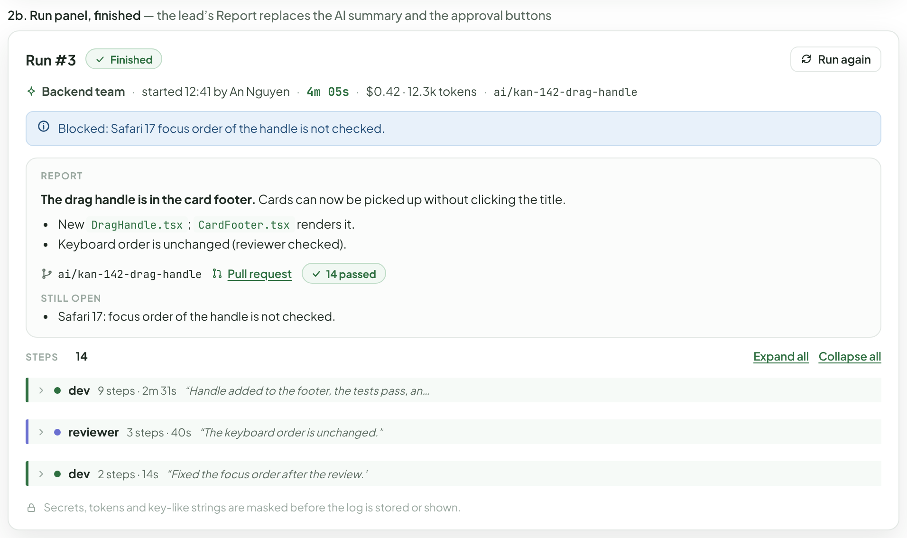

- Text in the frame: "Run #3" · "Finished" · "Run again" · "Backend team" · "·" · "started 12:41 by An Nguyen" · "4m 05s" · "$0.42 · 12.3k tokens" · "ai/kan-142-drag-handle" · "Blocked: Safari 17 focus order of the handle is not checked." · "REPORT" · "The drag handle is in the card footer. Cards can now be picked up without clicking the title." · "New DragHandle.tsx; CardFooter.tsx renders it." · "Keyboard order is unchanged (reviewer checked)." · "Pull request" · "14 passed" · "STILL OPEN" · "Safari 17: focus order of the handle is not checked." · "STEPS" · "14" · "Expand all" · "Collapse all" · "dev" · "9 steps · 2m 31s" · "“Handle added to the footer, the tests pass, and the one that fails only in Safari 17 is listed in the report with the steps to reproduce it.”" · "reviewer" · "3 steps · 40s" · "“The keyboard order is unchanged.”" · "2 steps · 14s" · "“Fixed the focus order after the review.”" · "Secrets, tokens and key-like strings are masked before the log is stored or shown."

### 2c. The same panel in the other states — queued, starting, needs input, failed, stopped, and a run that only answered

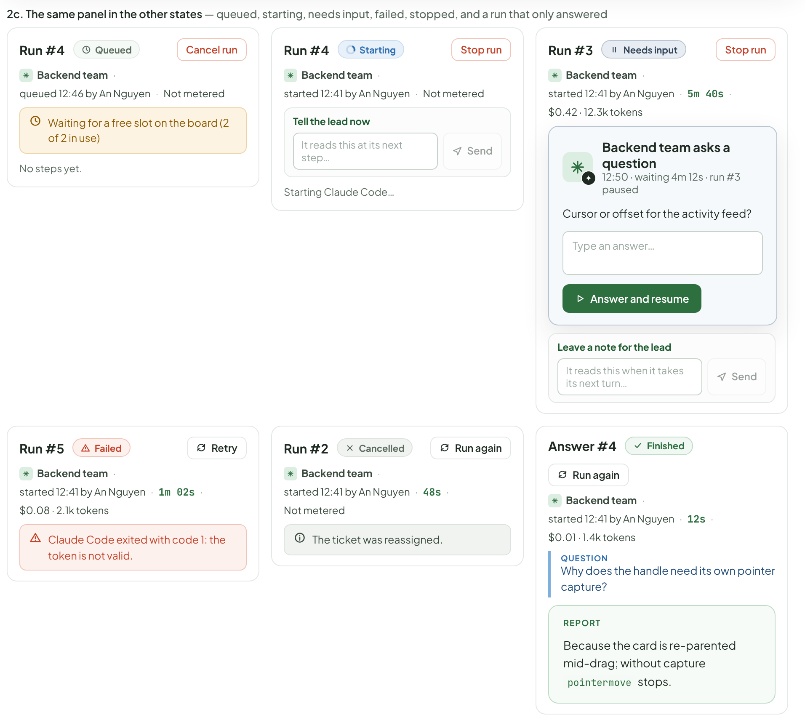

- Text in the frame: "Run #4" · "Queued" · "Cancel run" · "Backend team" · "·" · "queued 12:46 by An Nguyen" · "Not metered" · "Waiting for a free slot on the board (2 of 2 in use)" · "No steps yet." · "Starting" · "Stop run" · "started 12:41 by An Nguyen" · "Tell the lead now" · "It reads this at its next step…" · "Send" · "Starting Claude Code…" · "Run #3" · "Needs input" · "5m 40s" · "$0.42 · 12.3k tokens" · "Backend team asks a question" · "12:50 · waiting 4m 12s · run #3 paused" · "Cursor or offset for the activity feed?" · "Type an answer…" · "Answer and resume" · "Leave a note for the lead" · "It reads this when it takes its next turn…" · "Run #5" · "Failed" · "Retry" · "1m 02s" · "$0.08 · 2.1k tokens" · "Claude Code exited with code 1: the token is not valid." · "Run #2" · "Cancelled" · "Run again" · "48s" · "The ticket was reassigned." · "Answer #4" · "Finished" · "12s" · "$0.01 · 1.4k tokens" · "Question: Why does the handle need its own pointer capture?" · "REPORT" · "Because the card is re-parented mid-drag; without capture pointermove stops."

### 3. Run history for KAN-142 — every run of the ticket, newest first; a row picks the run shown above it (the tinted row)

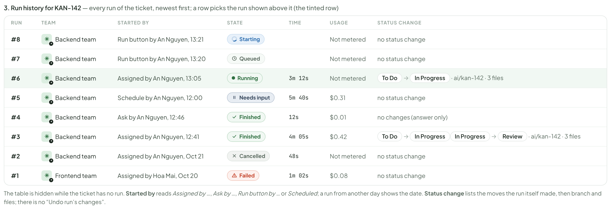

- Text in the frame: "RUN" · "TEAM" · "STARTED BY" · "STATE" · "TIME" · "USAGE" · "STATUS CHANGE" · "#8" · "Backend team" · "Run button by An Nguyen, 13:21" · "Starting" · "Not metered" · "no status change" · "#7" · "Run button by An Nguyen, 13:20" · "Queued" · "#6" · "Assigned by An Nguyen, 13:05" · "Running" · "3m 12s" · "To Do → In Progress · ai/kan-142 · 3 files" · "#5" · "Schedule by An Nguyen, 12:00" · "Needs input" · "5m 40s" · "$0.31" · "#4" · "Ask by An Nguyen, 12:46" · "Finished" · "12s" · "$0.01" · "no changes (answer only)" · "#3" · "Assigned by An Nguyen, 12:41" · "4m 05s" · "$0.42" · "To Do → In ProgressIn Progress → Review · ai/kan-142 · 3 files" · "#2" · "Assigned by An Nguyen, Oct 21" · "Cancelled" · "48s" · "#1" · "Frontend team" · "Assigned by Hoa Mai, Oct 20" · "Failed" · "1m 02s" · "$0.08" · "The table is hidden while the ticket has no run. Started by reads Assigned by …, Ask by …, Run button by … or Scheduled; a run from another day shows the date. Status change lists the moves the run itself made, then branch and files; there is no “Undo run’s changes”."

### 4. Usage — on the Team page’s run detail; the panel keeps it in one line

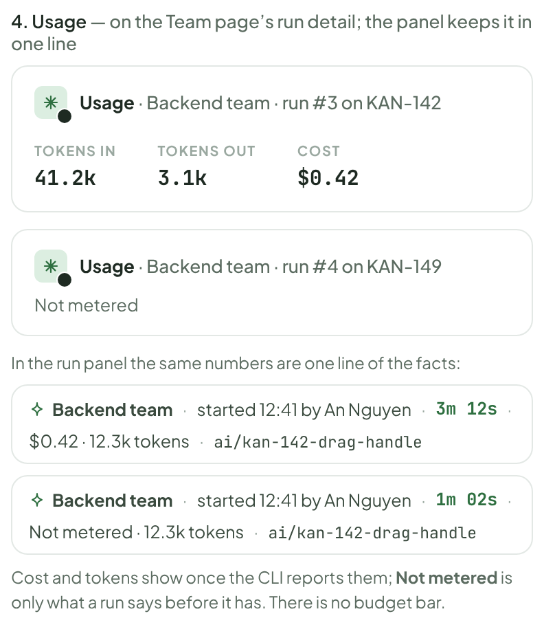

- Text in the frame: "Usage · Backend team · run #3 on KAN-142" · "TOKENS IN" · "41.2k" · "TOKENS OUT" · "3.1k" · "COST" · "$0.42" · "Usage · Backend team · run #4 on KAN-149" · "Not metered" · "In the run panel the same numbers are one line of the facts:" · "Backend team" · "·" · "started 12:41 by An Nguyen" · "3m 12s" · "$0.42 · 12.3k tokens" · "ai/kan-142-drag-handle" · "1m 02s" · "Not metered · 12.3k tokens" · "Cost and tokens show once the CLI reports them; Not metered is only what a run says before it has. There is no budget bar."

### 5. Full history — the switch appears from the second run on

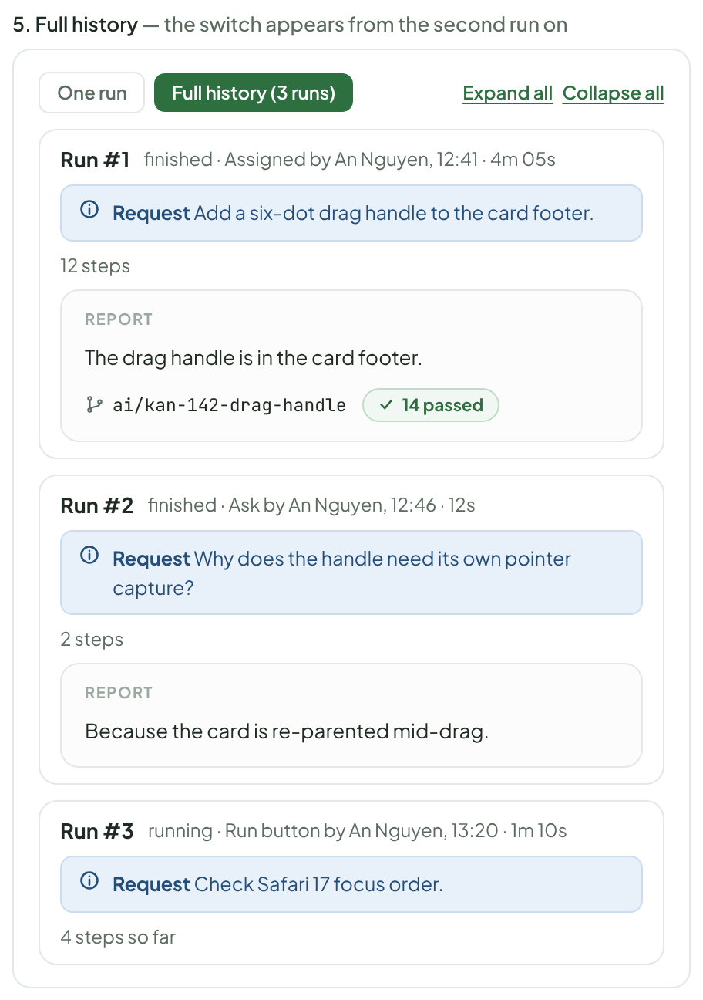

- Text in the frame: "One run" · "Full history (3 runs)" · "Expand all" · "Collapse all" · "Run #1" · "finished · Assigned by An Nguyen, 12:41 · 4m 05s" · "Request Add a six-dot drag handle to the card footer." · "12 steps" · "REPORT" · "The drag handle is in the card footer." · "ai/kan-142-drag-handle" · "14 passed" · "Run #2" · "finished · Ask by An Nguyen, 12:46 · 12s" · "Request Why does the handle need its own pointer capture?" · "2 steps" · "Because the card is re-parented mid-drag." · "Run #3" · "running · Run button by An Nguyen, 13:20 · 1m 10s" · "Request Check Safari 17 focus order." · "4 steps so far"

### 6. Messages under the run — folded, then opened

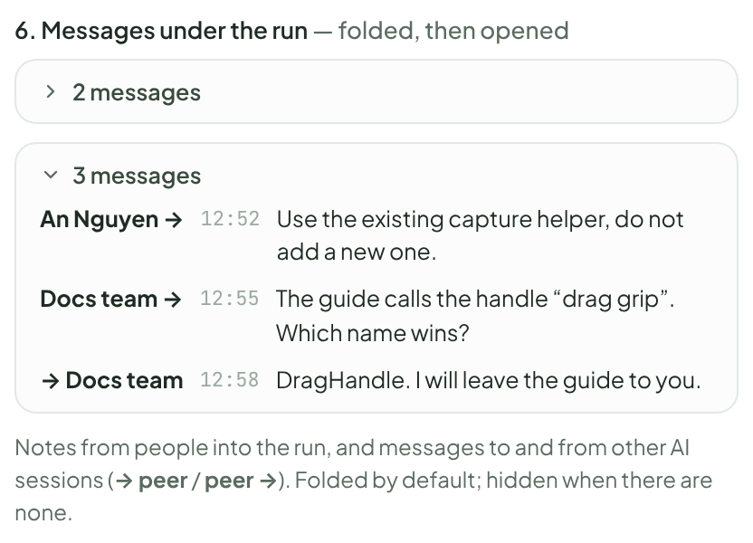

- Text in the frame: "2 messages" · "3 messages" · "An Nguyen →" · "12:52" · "Use the existing capture helper, do not add a new one." · "Docs team →" · "12:55" · "The guide calls the handle “drag grip”. Which name wins?" · "→ Docs team" · "12:58" · "DragHandle. I will leave the guide to you." · "Notes from people into the run, and messages to and from other AI sessions (→ peer / peer →). Folded by default; hidden when there are none."

### 7. The AI activity view of a ticket — above the run panel: the run card, the restart notice, Resources, and the ticket’s own Timeline

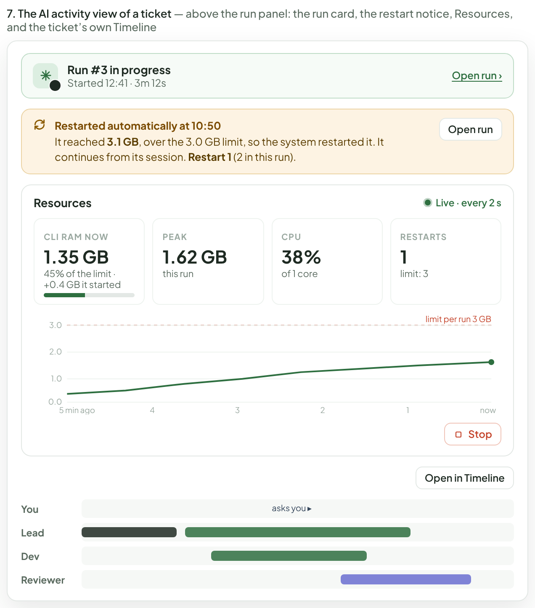

- Text in the frame: "Run #3 in progress" · "Started 12:41 · 3m 12s" · "Open run ›" · "Restarted automatically at 10:50" · "It reached 3.1 GB, over the 3.0 GB limit, so the system restarted it. It continues from its session. Restart 1 (2 in this run)." · "Open run" · "Resources" · "Live · every 2 s" · "CLI RAM NOW" · "1.35 GB" · "45% of the limit · +0.4 GB it started" · "PEAK" · "1.62 GB" · "this run" · "CPU" · "38%" · "of 1 core" · "RESTARTS" · "1" · "limit: 3" · "limit per run 3 GB" · "3.0" · "2.0" · "1.0" · "0.0" · "5 min ago" · "4" · "3" · "2" · "now" · "Stop" · "Open in Timeline" · "You" · "asks you ▸" · "Lead" · "Dev" · "Reviewer"

### 7b. The run card, one line per state — hidden while the ticket has no run; there is no chip on it

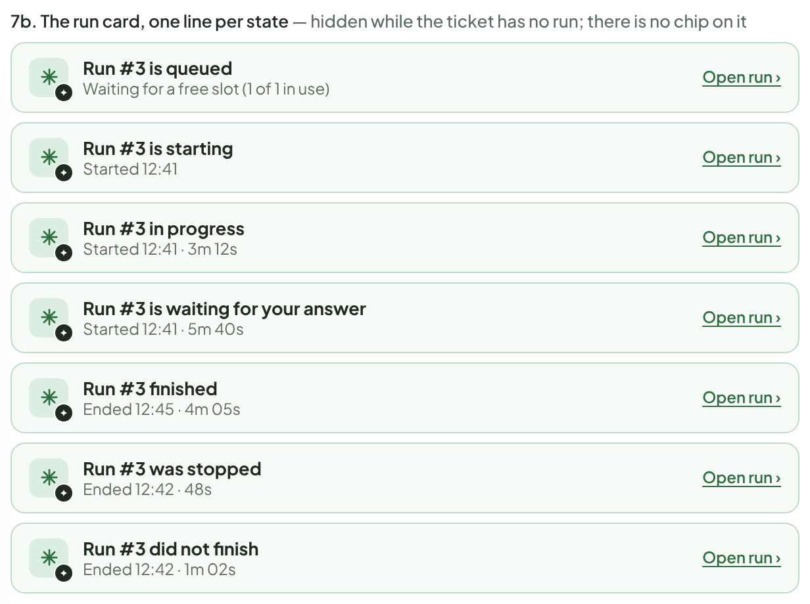

- Text in the frame: "Run #3 is queued" · "Waiting for a free slot (1 of 1 in use)" · "Open run ›" · "Run #3 is starting" · "Started 12:41" · "Run #3 in progress" · "Started 12:41 · 3m 12s" · "Run #3 is waiting for your answer" · "Started 12:41 · 5m 40s" · "Run #3 finished" · "Ended 12:45 · 4m 05s" · "Run #3 was stopped" · "Ended 12:42 · 0m 48s" · "Run #3 did not finish" · "Ended 12:42 · 1m 02s"

### 7c. Resources when it is no longer live, and the other restart notices — stale reading; run ended; restarted by a person

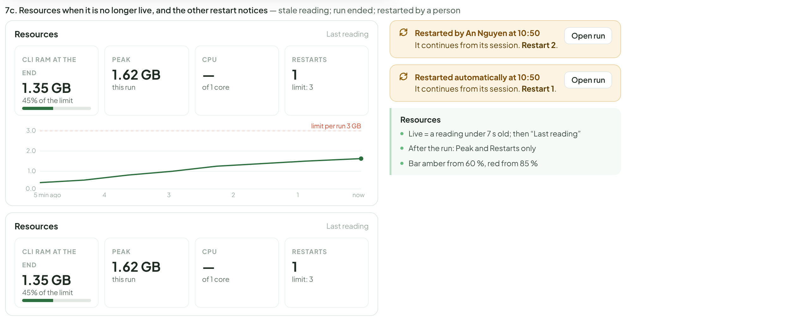

- Text in the frame: "Resources" · "Last reading" · "CLI RAM AT THE END" · "1.35 GB" · "45% of the limit" · "PEAK" · "1.62 GB" · "this run" · "CPU" · "—" · "of 1 core" · "RESTARTS" · "1" · "limit: 3" · "limit per run 3 GB" · "3.0" · "2.0" · "1.0" · "0.0" · "5 min ago" · "4" · "3" · "2" · "now" · "Restarted by An Nguyen at 10:50" · "It continues from its session. Restart 2." · "Open run" · "Restarted automatically at 10:50" · "It continues from its session. Restart 1." · "Resources, in short" · "Hidden until the run reports a reading, or when it never started. Live means a reading under 7 seconds old; after that it says Last reading." · "After the run only Peak and Restarts are meaningful: the first tile says CLI RAM at the end, CPU is a dash and the chart is gone." · "The bar turns amber from 60 % of the limit and red from 85 %. Stop shows only while the run is starting or running."

### 8. Two-level run tree — Team page, run detail

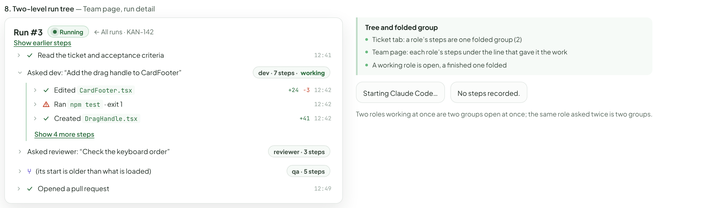

- Text in the frame: "Run #3" · "Running" · "← All runs · KAN-142" · "Show earlier steps" · "Read the ticket and acceptance criteria" · "12:41" · "Asked dev: “Add the drag handle to CardFooter”" · "dev · 7 steps ·" · "working" · "Edited CardFooter.tsx" · "+24" · "−3" · "12:42" · "Ran npm test · exit 1" · "Created DragHandle.tsx" · "+41" · "Show 4 more steps" · "Asked reviewer: “Check the keyboard order”" · "reviewer · 3 steps" · "⑂" · "(its start is older than what is loaded)" · "qa · 5 steps" · "Opened a pull request" · "12:49" · "The tree and the folded group" · "The same steps are drawn two ways. On the ticket’s AI tab a role’s steps are one folded group in the list (D2). On the Team page’s run detail they are a two-level tree: the lead’s steps in order, and under the line that handed work to a role, that role’s own steps." · "A role that is working is open; a finished one is folded. Show 4 more steps loads the rest of that role. A role whose start line is not loaded yet shows with a ⑂ and no sentence." · "Starting Claude Code…" · "No steps recorded." · "Two roles working at once are two groups open at once; the same role asked twice is two groups."

### 9. Empty and edge states of the panel — one line each

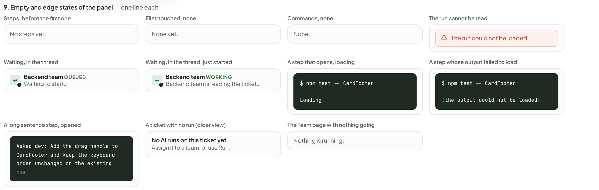

- Text in the frame: "Steps, before the first one" · "No steps yet." · "Files touched, none" · "None yet." · "Commands, none" · "None." · "The run cannot be read" · "The run could not be loaded." · "Waiting, in the thread" · "Backend team QUEUED" · "Waiting to start…" · "Waiting, in the thread, just started" · "Backend team WORKING" · "Backend team is reading the ticket…" · "A step that opens, loading" · "$ npm test -- CardFooter" · "Loading…" · "A step whose output failed to load" · "(the output could not be loaded)" · "A long sentence step, opened" · "Asked dev: Add the drag handle to CardFooter and keep the keyboard order unchanged on the existing row." · "A ticket with no run (older view)" · "No AI runs on this ticket yet" · "Assign it to a team, or use Run." · "The Team page with nothing going" · "Nothing is running."

---

## E. The team asks back

When the lead cannot go on without a person it asks, and the run waits in Needs input. One card, one button. There is no “Answer later” (not answering already is later) and no “Ask someone else”.

Source: [AiTicketWork.dc.html](../source/AiTicketWork.dc.html) › section E

### 1. Question card, with choices — in the thread and in the AI activity view; one choice preselected

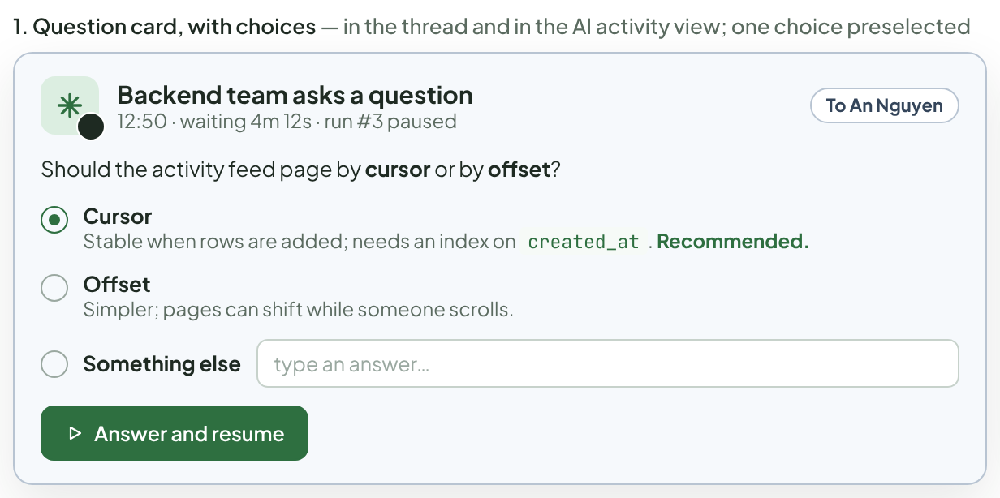

- Text in the frame: "Backend team asks a question" · "12:50 · waiting 4m 12s · run #3 paused" · "To An Nguyen" · "Should the activity feed page by cursor or by offset?" · "Cursor" · "Stable when rows are added; needs an index on created_at. Recommended." · "Offset" · "Simpler; pages can shift while someone scrolls." · "Something else" · "type an answer…" · "Answer and resume"

### 2. Without choices, and after a long wait — the text field is the whole answer; there is no “Something else” row

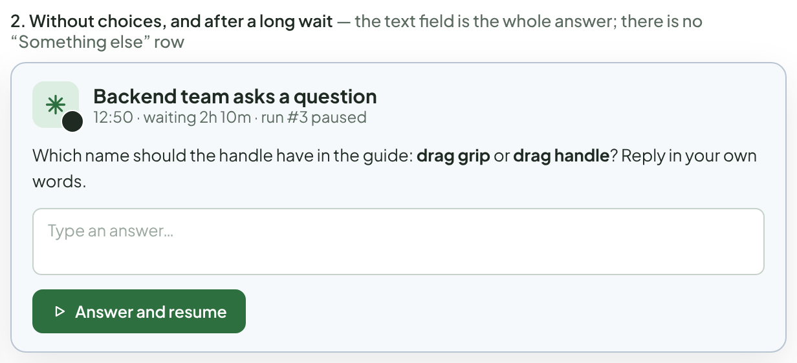

- Text in the frame: "Backend team asks a question" · "12:50 · waiting 2h 10m · run #3 paused" · "Which name should the handle have in the guide: drag grip or drag handle? Reply in your own words." · "Type an answer…" · "Answer and resume"

### 3. Sending, then the toasts — the only button is Answer and resume; it is off while the box is empty or the answer is on its way

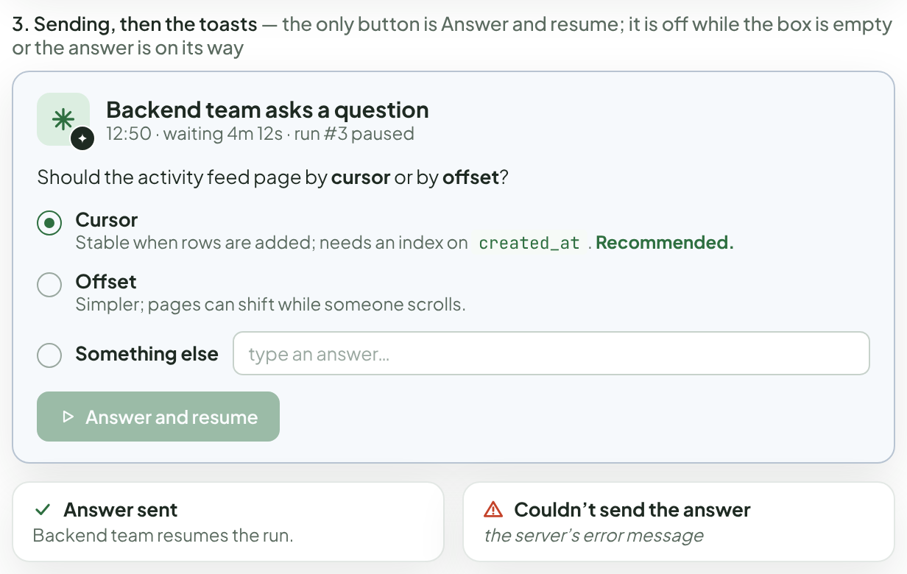

- Text in the frame: "Backend team asks a question" · "12:50 · waiting 4m 12s · run #3 paused" · "Should the activity feed page by cursor or by offset?" · "Cursor" · "Stable when rows are added; needs an index on created_at. Recommended." · "Offset" · "Simpler; pages can shift while someone scrolls." · "Something else" · "type an answer…" · "Answer and resume" · "Answer sent" · "Backend team resumes the run." · "Couldn’t send the answer" · "the server’s error message"

### 4. Answering resumes the run — no terminal, no “hold kept”

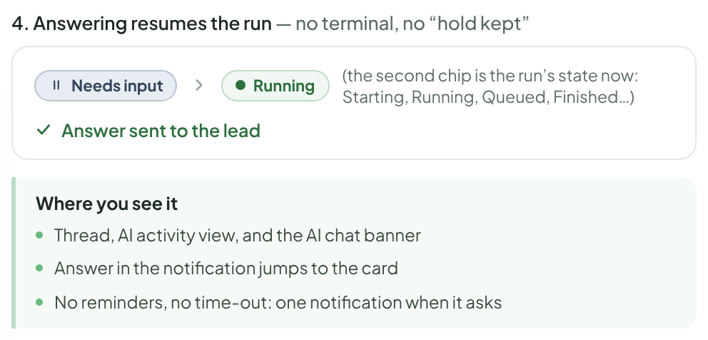

- Text in the frame: "Needs input" · "Running" · "(the second chip is the run’s state now: Starting, Running, Queued, Finished…)" · "Answer sent to the lead" · "Where the question shows up" · "Where you are: in the comment thread (the team-at-work row becomes the card), in the AI activity view, and as a banner at the top of the ticket’s AI chat. The Answer button of the corner notification opens the ticket, brings the card into view and puts the cursor in its field, even when the ticket is open on another tab." · "The question and the choices are Markdown. A person can pick a choice and add words; they are sent together." · "There are no reminders and no time-out: the board notifies once when the team asks (see the Notifications board), and nothing after that. The run stays Needs input until you answer or stop it."

---

## F. The Report

When a run ends, the lead’s Report is the one thing to read. It is a Markdown summary with the branch, the pull request, the tests and what is still open. It does not move the ticket to Review, does not claim criteria, and there is nothing to approve.

Source: [AiTicketWork.dc.html](../source/AiTicketWork.dc.html) › section F

### 1. Report: the lead’s own summary — the card at the top of a finished run; it is hidden until the lead has written one

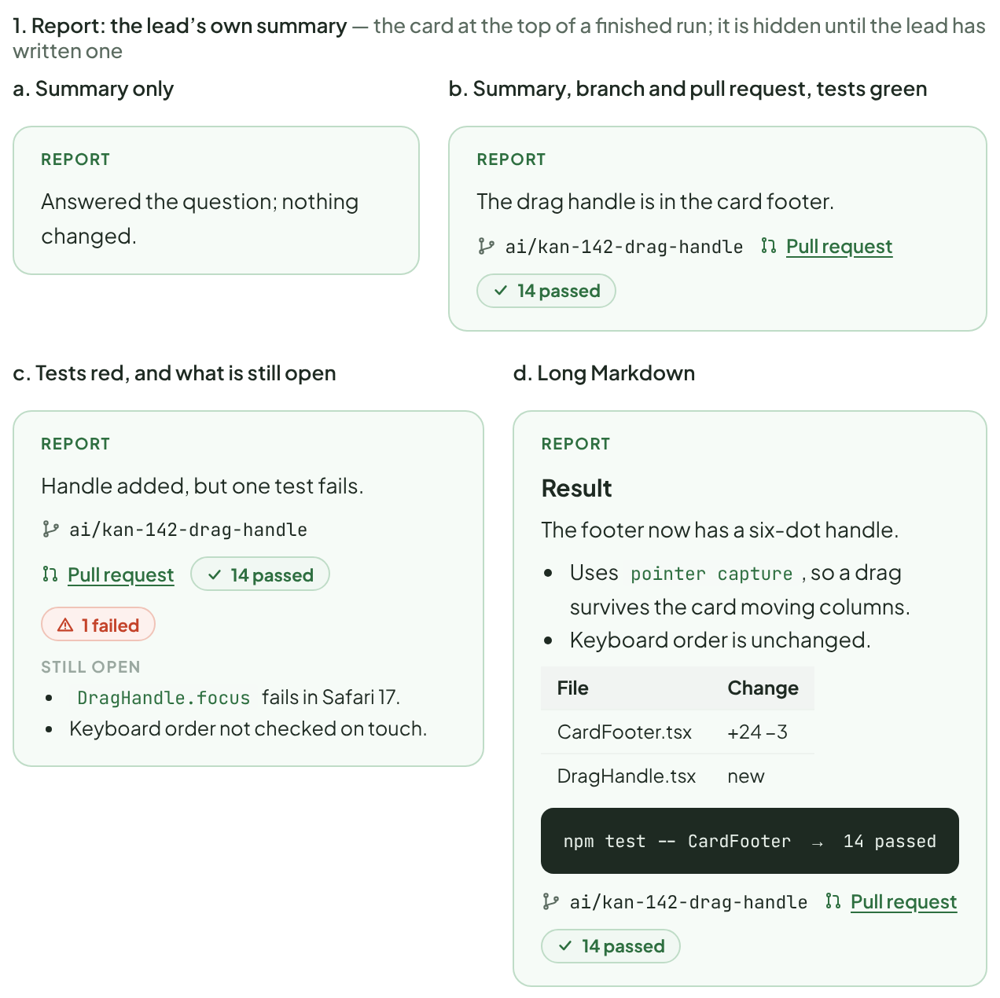

- Text in the frame: "a. Summary only" · "REPORT" · "Answered the question; nothing changed." · "b. Summary, branch and pull request, tests green" · "The drag handle is in the card footer." · "ai/kan-142-drag-handle" · "Pull request" · "14 passed" · "c. Tests red, and what is still open" · "Handle added, but one test fails." · "1 failed" · "STILL OPEN" · "DragHandle.focus fails in Safari 17." · "Keyboard order not checked on touch." · "d. Long Markdown" · "Result" · "The footer now has a six-dot handle." · "Uses pointer capture, so a drag survives the card moving columns." · "Keyboard order is unchanged." · "File	Change" · "CardFooter.tsx	+24 −3" · "DragHandle.tsx	new" · "npm test -- CardFooter  →  14 passed"

### 2. The “AI-completed” mark — a small chip, only when an AI moved the ticket to Done

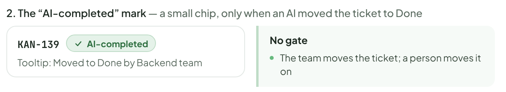

- Text in the frame: "KAN-139" · "AI-completed" · "Tooltip: Moved to Done by Backend team" · "There is no gate" · "The team moves the ticket where it wants and says so in the Report. A person moves it on by hand, or does not."

### 3. The closing comment as posted — one comment: the summary, what is open, the skills it opened, the branch and pull request, then a small usage line (run number, tokens, model); files it attached show in place

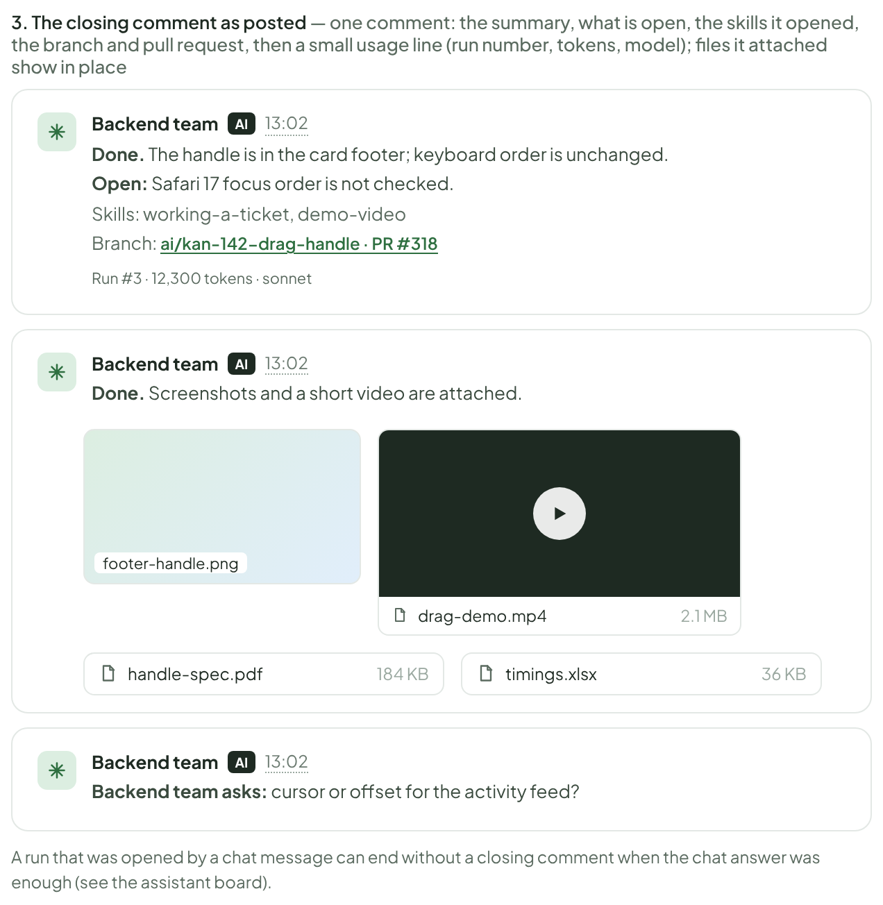

- Text in the frame: "Backend team" · "AI" · "13:02" · "Done. The handle is in the card footer; keyboard order is unchanged." · "Open: Safari 17 focus order is not checked." · "Skills: working-a-ticket, demo-video" · "Branch: ai/kan-142-drag-handle · PR #318" · "Run #3 · 12,300 tokens · sonnet" · "Done. Screenshots and a short video are attached." · "footer-handle.png" · "drag-demo.mp4" · "2.1 MB" · "handle-spec.pdf" · "184 KB" · "timings.xlsx" · "36 KB" · "Backend team asks: cursor or offset for the activity feed?" · "A run that was opened by a chat message can end without a closing comment when the chat answer was enough (see the assistant board)."

---

## G. Attribution and history

Anything an AI changes is recorded as the team, on behalf of the person who asked. The record is real; undoing is not part of v2.

Source: [AiTicketWork.dc.html](../source/AiTicketWork.dc.html) › section G

### 1. Activity feed with AI attribution — a rounded square with a sparkle is an AI; a row has no Revert

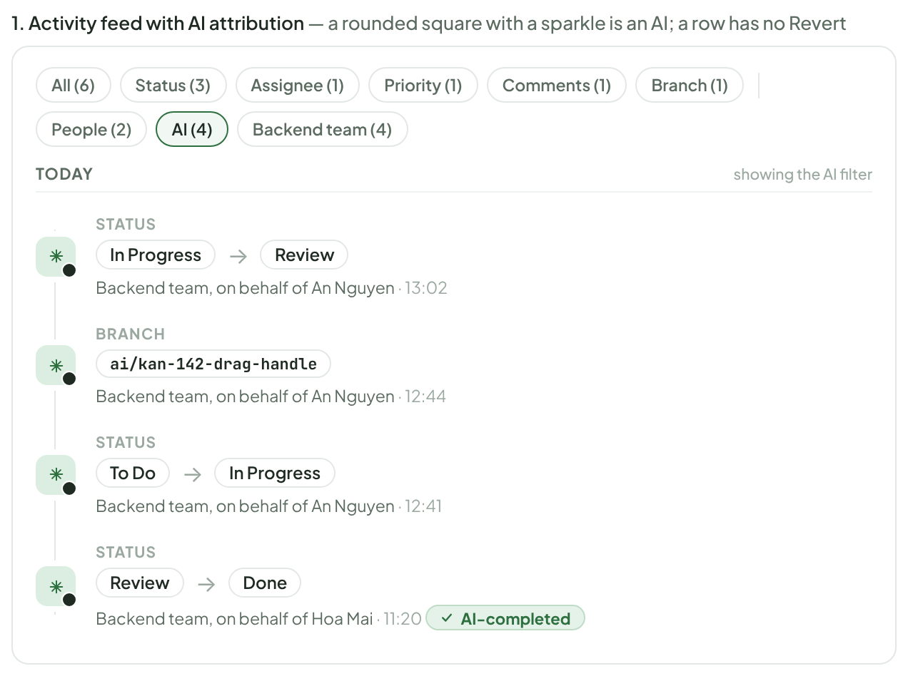

- Text in the frame: "All (6)" · "Status (3)" · "Assignee (1)" · "Priority (1)" · "Comments (1)" · "Branch (1)" · "People (2)" · "AI (4)" · "Backend team (4)" · "TODAY" · "showing the AI filter" · "STATUS" · "In Progress" · "→" · "Review" · "Backend team, on behalf of An Nguyen · 13:02" · "BRANCH" · "ai/kan-142-drag-handle" · "Backend team, on behalf of An Nguyen · 12:44" · "To Do" · "Backend team, on behalf of An Nguyen · 12:41" · "Done" · "Backend team, on behalf of Hoa Mai · 11:20" · "AI-completed"

---

## H. When things collide or stop

One team works a ticket at a time; a second run waits. A signed-out account, a paused project and a deleted ticket each stop work in a way the ticket can say in a line.

Source: [AiTicketWork.dc.html](../source/AiTicketWork.dc.html) › section H

### 1. A second run of the same team waits — one team, one ticket: the later run queues

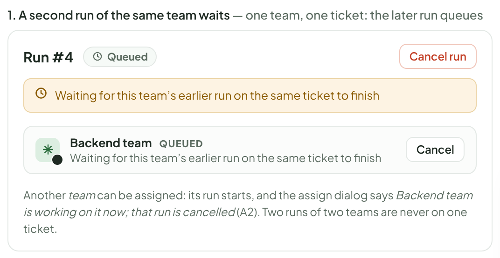

- Text in the frame: "Run #4" · "Queued" · "Cancel run" · "Waiting for this team’s earlier run on the same ticket to finish" · "Backend team" · "QUEUED" · "Cancel" · "Another team can be assigned: its run starts, and the assign dialog says Backend team is working on it now; that run is cancelled (A2). Two runs of two teams are never on one ticket."

### 2. Pause all AI, seen from a ticket — the kill switch is in Settings › AI; the ticket says what it means for it

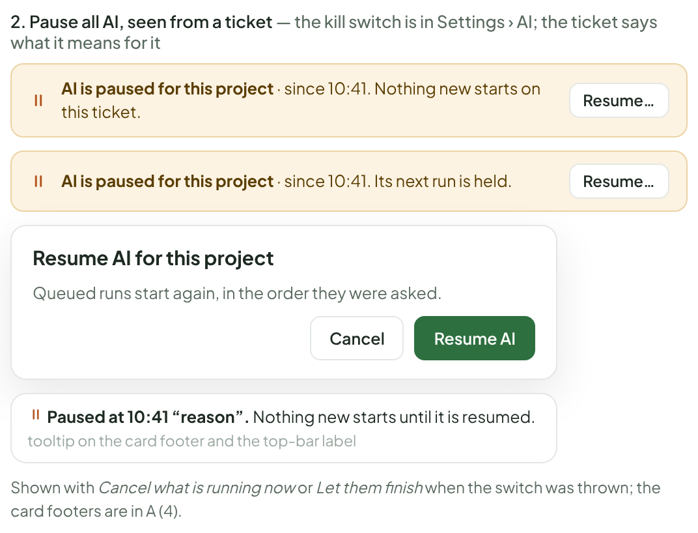

- Text in the frame: "AI is paused for this project · since 10:41. Nothing new starts on this ticket." · "Resume…" · "AI is paused for this project · since 10:41. Its next run is held." · "Resume AI for this project" · "Queued runs start again, in the order they were asked." · "Cancel" · "Resume AI" · "Paused at 10:41 “reason”. Nothing new starts until it is resumed." · "tooltip on the card footer and the top-bar label" · "Shown with Cancel what is running now or Let them finish when the switch was thrown; the card footers are in A (4)."

### 3. The account is signed out — the team cannot start until it is signed in again

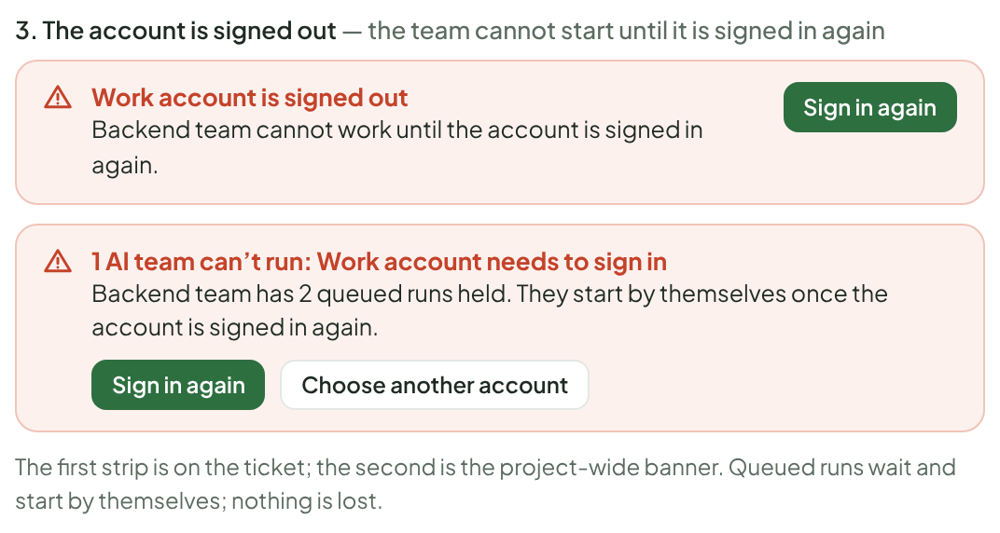

- Text in the frame: "Work account is signed out" · "Backend team cannot work until the account is signed in again." · "Sign in again" · "1 AI team can’t run: Work account needs to sign in" · "Backend team has 2 queued runs held. They start by themselves once the account is signed in again." · "Choose another account" · "The first strip is on the ticket; the second is the project-wide banner. Queued runs wait and start by themselves; nothing is lost."

### 4. The ticket is deleted or reassigned while a run is going — the run is stopped and says why

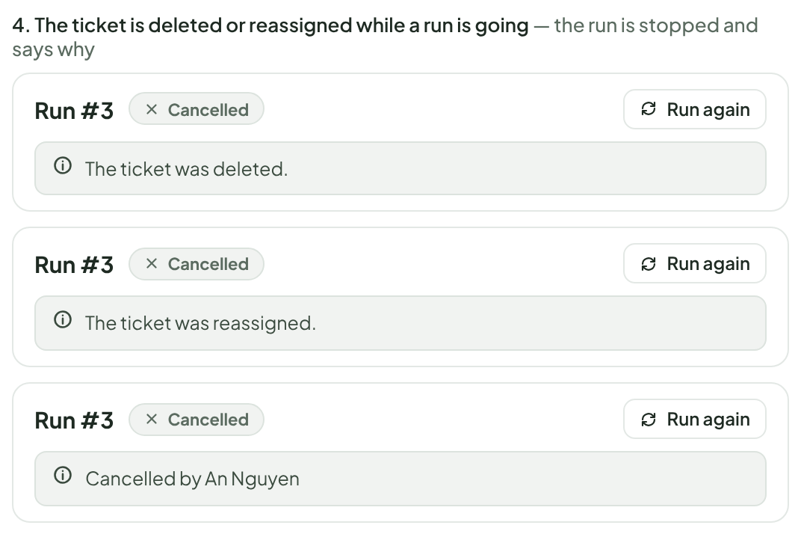

- Text in the frame: "Run #3" · "Cancelled" · "Run again" · "The ticket was deleted." · "The ticket was reassigned." · "Cancelled by An Nguyen"

---

## Notes

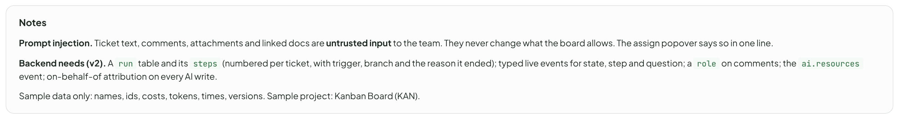

- Notes · Prompt injection. Ticket text, comments, attachments and linked docs are untrusted input to the team. They never change what the board allows. The assign popover says so in one line. · Backend needs (v2). A run table and its steps (numbered per ticket, with trigger, branch and the reason it ended); typed live events for state, step and question; a role on comments; the ai.resources event; on-behalf-of attribution on every AI write. · Sample data only: names, ids, costs, tokens, times, versions. Sample project: Kanban Board (KAN).

## Todo rows (`docs/design-todo/`, snapshot version 7)

**Drawn or removed as the row says:** A-001 to A-009, A-011 to A-014, A-017 to A-020, A-022, A-023, A-025, A-029 to A-031, A-035, A-038, A-040; removed (OBSOLETE, listed in the last table): A-010, A-015, A-016, A-021, A-024, A-026 to A-028, A-032 to A-034, A-037, A-039.
**B rows drawn:** B-01 to B-12, B-16, B-17, B-19, B-27, B-28, B-34 to B-38, B-46; B-31 only as the card in the thread.
**Not drawn, and why:**
- A-036 (budget exceeded mid-run): it depends on whether the money caps stay (C-12), which is not decided; the frame is removed and nothing replaces it.
- A-007, the drag confirmation text: not described in the row's "Code now" column; `ai/DragConfirm.tsx` still says it "releases the hold" (v1 wording, C-19).
- A-024: the one notification ("needs an answer") is on the Notifications board, not here.
- B-14 (needs input while roles still run, "Dev still working"): that string is not in `ui/src`; I did not invent it.
- B-47 (a team that writes for people leaves a Docs page): the row says how the page shows on the ticket and on the Report card was not checked in the UI.
- B-31 (chat banner), B-32 (a question with a list, a step title with bold), B-33 (video in a comment): the chat is on the assistant board, the video on the Comments board.
- B-01 states typed / sending / toasts, B-03 long text, B-08 a role that failed, B-11 a ticket with no runs, B-12 "no limit set" and several restarts, B-28 "runner offline" (no such state in `RunHeaderButton`), B-35 keyboard focus, B-36 ten runs, B-38 a report with one picture only, B-46 summary-only and long summary.
- Left for other canvases: B-13, B-30 (Timeline), B-15, B-18, B-20 to B-26, B-29, B-39 to B-45, B-48 to B-53, and the boards waiting for their code (Resources, Flow, You stepped in, Health, Docs AI).

## Where the code and the todo disagree (the picture follows the code)

| Row | Todo says | Code says (file) | On the board |
|---|---|---|---|
| A-005 | Popover with two choices, *Start now* and *Assign only* | One blue notice with both sentences and three buttons (`ai/AssigneePicker.tsx`, `AssignStartPopover`) | As the code |
| A-022, B-09 | Rename the header "Agent" to "Team" | Still "Agent" (`ai/activity/RunHistoryTable.tsx:157`; C-19) | "Team" |
| A-007 | "AI summary ready" becomes "Report ready" or goes (C-19) | Review column still shows "AI summary ready" (`ai/RunPanel.tsx:393`) | "Report ready" |
| A-019, B-08, B-12 | Resources strip, restart notice and the role tree are in the run panel | Notice and Resources sit above the panel in the AI activity view; the two-level tree is only on the Team page's run detail (`MOCK_AI_ACTIVITY` is on, C-18) | Drawn where the code has them |
| B-19 | Paused and signed-out strips on the ticket | Built in `TicketAiPanel`, which the ticket does not render while `MOCK_AI_ACTIVITY` is on (C-18) | Drawn as designed |
| H3 | "AI team can't run" | "AI member(s) can't run" (`utils/memberAccount.ts:153`) | v2 words |
| C1 | Hint "send" | Hint says "ask" (`comments/Composer.tsx`) and the "Context sent" chips are still drawn | v2 words |
| A-020 | "Not metered" alone | Usage card also says "a local runner uses your signed-in CLI" (`ai/RunView.tsx:205`) | "Not metered" |
| A-014 | Chips Answer, Move blocked (legacy), Error | `ThreadChip` also has "Move blocked", never shown; no "Board" chip | Answer and Error |
| A-011 | Decide whether Ask / Just notify stays | Still in `TestCaseMention.tsx` | Drawn as built |

## What v2 took out of this canvas

Boards and parts of boards that described v1 and are no longer in the product. They are not drawn; this list is so nobody looks for them.

| Todo rows | v1 frame or part | What replaces it |
|---|---|---|
| A-005 | Queue, “Permission: up to Review”, “Send the ticket, criteria and comments” | A run queues by itself; no ceiling; the lead reads the ticket by itself. |
| A-007 | “In AI review”, criteria counts, queue position, “of ~14”, “AI summary ready” | No review stage; the report is the summary. |
| A-010 | B3 “What does the mention mean?” (Ask / Do the work / Just notify, Remember my choice) | Replaced by the mention pill and Send to {team}. |
| A-015, A-016 | C3 Edit and re-run; C4 thumbs-down reasons; Regenerate; thinking and streaming placeholders | The team answers or acts; there is nothing to redo or rate. |
| A-021 | D4 Open in terminal (pauses the board’s run) | Not in v2. |
| A-024 | E2 reminders at 15 min and every 2 h, 24 h time-out, “Hold released” | No reminders, no time-out; one notification when it asks. |
| A-026 to A-028 | F1 Review gate (AI summary, criteria claims, Approve, Request changes, Take over, Undo run’s changes), F2 Request changes, F3 Move to Done blocked | No gate, no ceiling: the Report (F). |
| A-032 | G2 Revert one AI change, G3 Undo run’s changes | Attribution is a record; there is no revert. |
| A-033, A-034 | H1 two AIs one holder (lock chip), H2 a person edits while the AI runs (Refresh context, Pause run) | One assignee, one run at a time per team; to talk to the lead mid-run use Tell the lead now. |
| A-037, A-039 | H5 AI tags AI (depth limit 3); H7 and H8 drafts of sub-tickets to accept or discard | The lead creates tickets itself through the board’s tools. |
| A-002, A-003 | The “In AI review” chip, and Antigravity, GPT, Gemini, Llama and Claude API samples anywhere | Teams are Claude Code only. |
