# AI work on tickets

> Component — v1 · source: [`AiTicketWork.dc.html`](../source/AiTicketWork.dc.html) · canvas `1792727511-31c8` · sha256 `7d369b668acab1a840d34c3bfb7bc5801e1ba7852504da05a9de0704a9cf0330`

Eyebrow "Component — v1". Assign a ticket to an AI member, @mention it, or ask it a question; it answers in a comment, does the work, or asks you back. Assignment is real: a **local runner** launches the official CLI (Claude Code, Antigravity), or the board runs the **API agent loop**. One agent holds a ticket at a time. By default an AI moves tickets **only up to Review**; a person moves them to Done (configurable per agent). Desktop only. Sample project: Kanban Board (KAN).

---

## Header and legend

Source: [AiTicketWork.dc.html](../source/AiTicketWork.dc.html) › header ("Component — v1", "AI work on tickets" and the intro) and the legend block ("RUN STATE CHIPS" on the left, "AI VS PERSON" on the right)


- Eyebrow "Component — v1"; title "AI work on tickets"; intro: "Assign a ticket to an AI member, @mention it, or ask it a question; it answers in a comment, does the work, or asks you back. Assignment is real: a" "local runner" "launches the official CLI (Claude Code, Antigravity), or the board runs the" "API agent loop" ". One agent holds a ticket at a time. By default an AI moves tickets" "only up to Review" "; a person moves them to Done (configurable per agent). Desktop only. Sample project: Kanban Board (KAN)."
- Legend "RUN STATE CHIPS": "Queued"; "Starting"; "Running"; "Needs input"; "Finished"; "Failed"; "Cancelled"; "Timed out"; "In AI review".
- Legend "AI VS PERSON": square AI avatar with sparkle badge; "AN"; pill "Claude Code · Backend"; pill "@An Nguyen".

---

## A. Assigning a ticket to an AI

The assignee picker gets a separate AI group with live status and reasons for disabled members. Choosing an AI asks how to start. Afterwards the ticket header, the card and the board column show who holds it and what the run is doing.

Source: [AiTicketWork.dc.html](../source/AiTicketWork.dc.html) › block "A Assigning a ticket to an AI" (A1 picker, A2 start popover and A3 ticket header in the top row; A4 board column fragment with the "Footer variants" list below)

### 1. Assignee picker

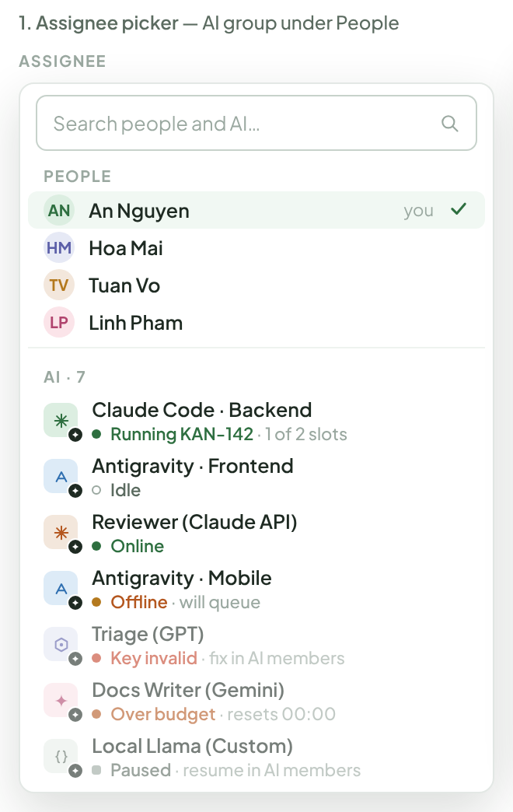

- Caption: "1. Assignee picker" "— AI group under People".
- "Assignee"; search "Search people and AI…".
- "People": "AN" "An Nguyen" "you"; "HM" "Hoa Mai"; "TV" "Tuan Vo"; "LP" "Linh Pham".
- "AI · 7":

| Member | Status | Note |
|---|---|---|
| "Claude Code · Backend" | "Running KAN-142" | "· 1 of 2 slots" |
| "Antigravity · Frontend" | "Idle" | |
| "Reviewer (Claude API)" | "Online" | |
| "Antigravity · Mobile" | "Offline" | "· will queue" |
| "Triage (GPT)" | "Key invalid" | "· fix in AI members" |
| "Docs Writer (Gemini)" | "Over budget" | "· resets 00:00" |
| "Local Llama (Custom)" | "Paused" | "· resume in AI members" |

### 2. On assign: how to start

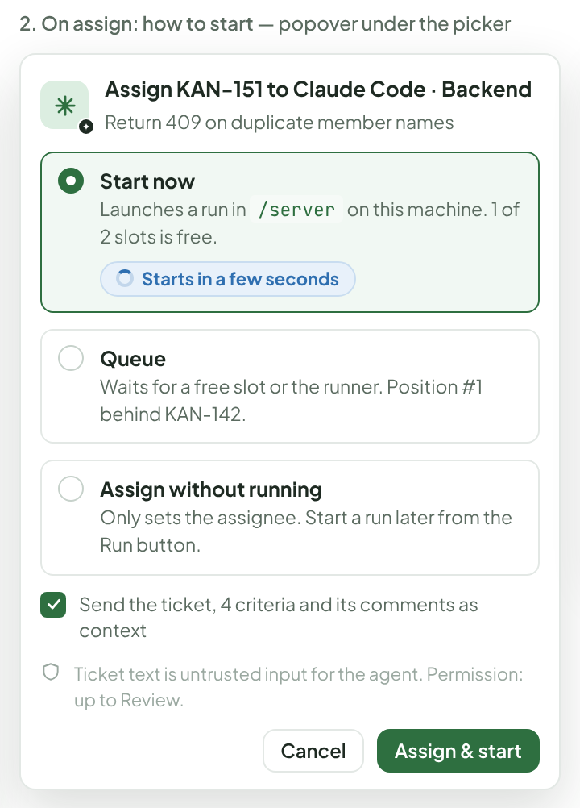

- Caption: "2. On assign: how to start" "— popover under the picker".
- Title "Assign KAN-151 to Claude Code · Backend"; subtitle "Return 409 on duplicate member names".
- "Start now" (selected): "Launches a run in" "/server" "on this machine. 1 of 2 slots is free."; chip "Starts in a few seconds".
- "Queue": "Waits for a free slot or the runner. Position #1 behind KAN-142."
- "Assign without running": "Only sets the assignee. Start a run later from the Run button."
- Checked "Send the ticket, 4 criteria and its comments as context".
- "Ticket text is untrusted input for the agent. Permission: up to Review."
- Buttons "Cancel", "Assign & start".

### 3. Ticket header after assigning

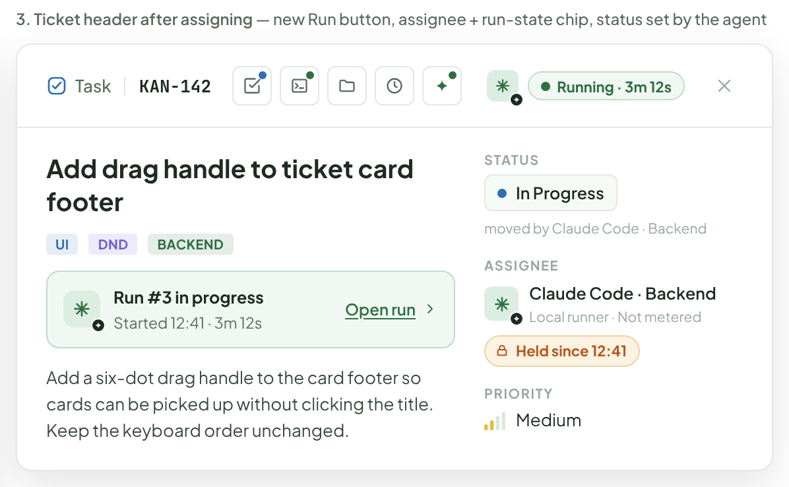

- Caption: "3. Ticket header after assigning" "— new Run button, assignee + run-state chip, status set by the agent".
- Header: "Task" "KAN-142" "Running · 3m 12s".
- Title "Add drag handle to ticket card footer"; tags "UI" "DND" "BACKEND".
- Card: "Run #3 in progress" "Started 12:41 · 3m 12s" "Open run".
- "Add a six-dot drag handle to the card footer so cards can be picked up without clicking the title. Keep the keyboard order unchanged."
- Sidebar: "Status" "In Progress" "moved by Claude Code · Backend"; "Assignee" "Claude Code · Backend" "Local runner · Not metered" "Held since 12:41"; "Priority" "Medium".

### 4. Card footer variants

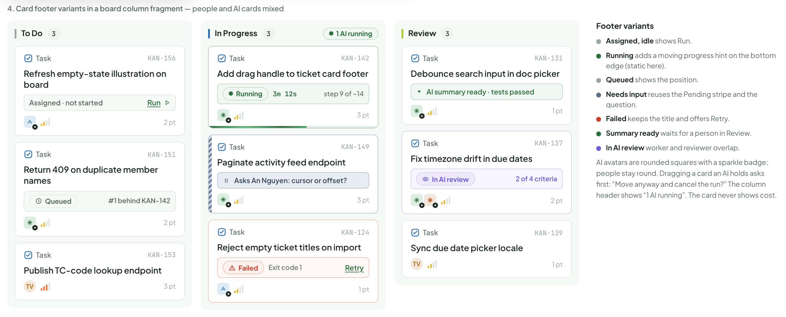

- Caption: "4. Card footer variants in a board column fragment" "— people and AI cards mixed".
- "To Do" "3": "Task" "KAN-156" "Refresh empty-state illustration on board" "Assigned · not started" "Run" "2 pt"; "Task" "KAN-151" "Return 409 on duplicate member names" "Queued" "#1 behind KAN-142" "2 pt"; "Task" "KAN-153" "Publish TC-code lookup endpoint" "TV" "3 pt".
- "In Progress" "3" "1 AI running": "Task" "KAN-142" "Add drag handle to ticket card footer" "Running" "3m 12s" "step 9 of ~14" "3 pt"; "Task" "KAN-149" "Paginate activity feed endpoint" "Asks An Nguyen: cursor or offset?" "3 pt"; "Task" "KAN-124" "Reject empty ticket titles on import" "Failed" "Exit code 1" "Retry" "1 pt".
- "Review" "3": "Task" "KAN-131" "Debounce search input in doc picker" "AI summary ready · tests passed" "1 pt"; "Task" "KAN-137" "Fix timezone drift in due dates" "In AI review" "2 of 4 criteria" "2 pt"; "Task" "KAN-139" "Sync due date picker locale" "TV" "1 pt".
- "Footer variants": "Assigned, idle" "shows Run."; "Running" "adds a moving progress hint on the bottom edge (static here)."; "Queued" "shows the position."; "Needs input" "reuses the Pending stripe and the question."; "Failed" "keeps the title and offers Retry."; "Summary ready" "waits for a person in Review."; "In AI review" "worker and reviewer overlap."
- "AI avatars are rounded squares with a sparkle badge; people stay round. Dragging a card an AI holds asks first: “Move anyway and cancel the run?” The column header shows “1 AI running”. The card never shows cost."

---

## B. @mention an AI

Typing @ in a description, a comment or a test-case note offers People and AI in separate groups. The mention becomes a pill in the AI’s colour. Sending asks what you want: an answer, the work done, or just a notification.

Source: [AiTicketWork.dc.html](../source/AiTicketWork.dc.html) › block "B @mention an AI" (left column B1 autocomplete over B4 test case note; B2 pill and hover card in the middle; B3 send choice on the right)

### 1. Autocomplete

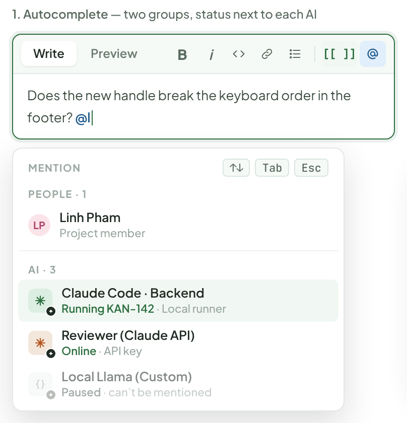

- Caption: "1. Autocomplete" "— two groups, status next to each AI".
- Editor tabs "Write" "Preview"; toolbar "B" "i" "[[ ]]"; text "Does the new handle break the keyboard order in the footer?" "@l".
- Dropdown "Mention" with keys "↑↓" "Tab" "Esc".
- "People · 1": "LP" "Linh Pham" "Project member".
- "AI · 3": "Claude Code · Backend" "Running KAN-142" "· Local runner"; "Reviewer (Claude API)" "Online" "· API key"; "Local Llama (Custom)" "Paused" "· can’t be mentioned".

### 2. Resulting pill and hover card

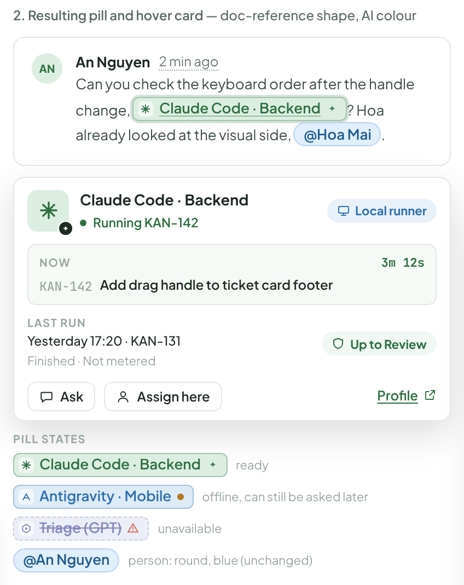

- Caption: "2. Resulting pill and hover card" "— doc-reference shape, AI colour".
- Comment: "AN" "An Nguyen" "2 min ago" "Can you check the keyboard order after the handle change," pill "Claude Code · Backend" "? Hoa already looked at the visual side," pill "@Hoa Mai" ".".
- Hover card: "Claude Code · Backend" "Running KAN-142" "Local runner"; "Now" "3m 12s" "KAN-142" "Add drag handle to ticket card footer"; "Last run" "Yesterday 17:20 · KAN-131" "Finished · Not metered"; "Up to Review"; buttons "Ask", "Assign here"; link "Profile".
- "Pill states": "Claude Code · Backend" "ready"; "Antigravity · Mobile" "offline, can still be asked later"; "Triage (GPT)" "unavailable"; "@An Nguyen" "person: round, blue (unchanged)".

### 3. On send: what does the mention mean?

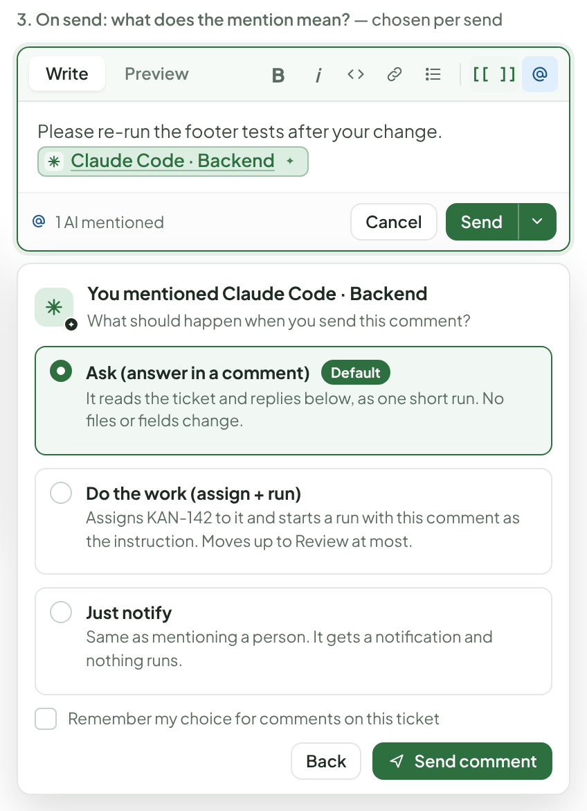

- Caption: "3. On send: what does the mention mean?" "— chosen per send".
- Editor: "Write" "Preview" "B" "i" "[[ ]]"; text "Please re-run the footer tests after your change." pill "Claude Code · Backend"; "1 AI mentioned"; "Cancel", "Send".
- Dialog "You mentioned Claude Code · Backend"; "What should happen when you send this comment?"
- "Ask (answer in a comment)" "Default": "It reads the ticket and replies below, as one short run. No files or fields change."
- "Do the work (assign + run)": "Assigns KAN-142 to it and starts a run with this comment as the instruction. Moves up to Review at most."
- "Just notify": "Same as mentioning a person. It gets a notification and nothing runs."
- Unchecked "Remember my choice for comments on this ticket"; buttons "Back", "Send comment".

### 4. Mention in a test case note

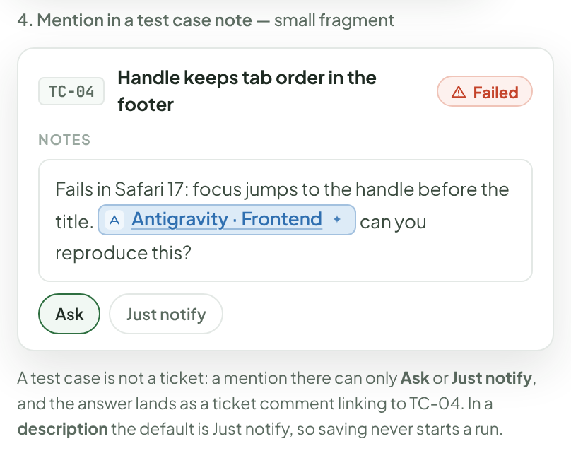

- Caption: "4. Mention in a test case note" "— small fragment".
- "TC-04" "Handle keeps tab order in the footer" "Failed"; "Notes"; text "Fails in Safari 17: focus jumps to the handle before the title." pill "Antigravity · Frontend" "can you reproduce this?"; choices "Ask" (selected), "Just notify".
- "A test case is not a ticket: a mention there can only" "Ask" "or" "Just notify" ", and the answer lands as a ticket comment linking to TC-04. In a" "description" "the default is Just notify, so saving never starts a run."

---

## C. Ask an AI a question

A question is a short run that answers in a comment and changes nothing. The composer has an “Ask” shortcut; the reply is an ordinary comment with an AI badge, a link to its run and a cost chip. Replies can be regenerated, edited and re-run, or rated.

Source: [AiTicketWork.dc.html](../source/AiTicketWork.dc.html) › block "C Ask an AI a question" (left column: C1 composer, C3 edit and re-run, C4 thumbs down; right: C2 thread)

### 1. Composer with the Ask shortcut

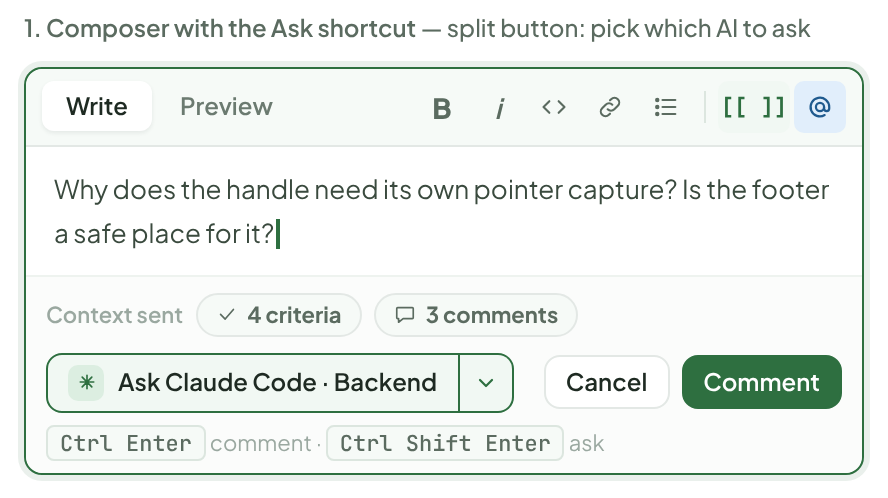

- Caption: "1. Composer with the Ask shortcut" "— split button: pick which AI to ask".
- "Write" "Preview" "B" "i" "[[ ]]"; text "Why does the handle need its own pointer capture? Is the footer a safe place for it?"
- "Context sent" "4 criteria" "3 comments"; split button "Ask Claude Code · Backend"; "Cancel" "Comment".
- "Ctrl Enter" "comment ·" "Ctrl Shift Enter" "ask".

### 2. Thread: asked, thinking, streaming, answered, error

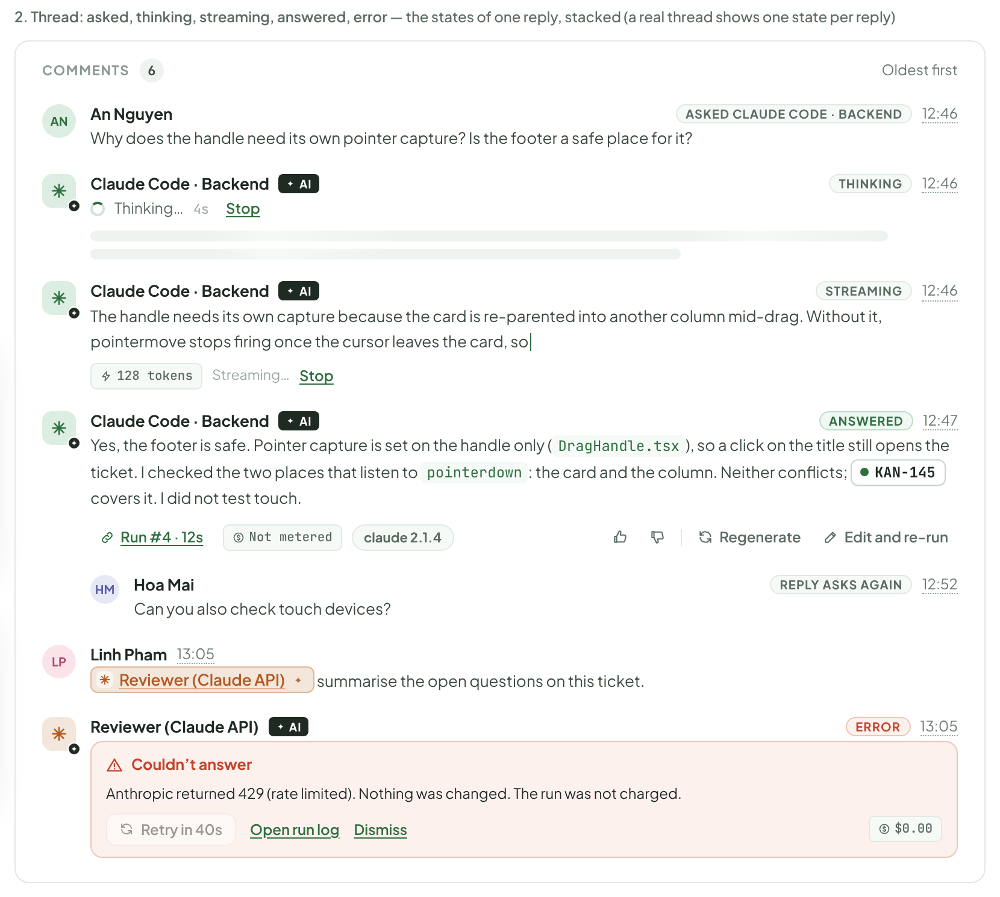

- Caption: "2. Thread: asked, thinking, streaming, answered, error" "— the states of one reply, stacked (a real thread shows one state per reply)".
- "Comments" "6" "Oldest first".
- "AN" "An Nguyen" "Asked Claude Code · Backend" "12:46": "Why does the handle need its own pointer capture? Is the footer a safe place for it?"
- "Claude Code · Backend" "AI" "Thinking" "12:46": "Thinking…" "4s" "Stop".
- "Claude Code · Backend" "AI" "Streaming" "12:46": "The handle needs its own capture because the card is re-parented into another column mid-drag. Without it, pointermove stops firing once the cursor leaves the card, so" "128 tokens" "Streaming…" "Stop".
- "Claude Code · Backend" "AI" "Answered" "12:47": "Yes, the footer is safe. Pointer capture is set on the handle only (" "DragHandle.tsx" "), so a click on the title still opens the ticket. I checked the two places that listen to" "pointerdown" ": the card and the column. Neither conflicts;" "KAN-145" "covers it. I did not test touch."; "Run #4 · 12s" "Not metered" "claude 2.1.4" "Regenerate" "Edit and re-run".
- "HM" "Hoa Mai" "Reply asks again" "12:52": "Can you also check touch devices?"
- "LP" "Linh Pham" "13:05": pill "Reviewer (Claude API)" "summarise the open questions on this ticket."
- "Reviewer (Claude API)" "AI" "Error" "13:05": "Couldn’t answer"; "Anthropic returned 429 (rate limited). Nothing was changed. The run was not charged."; "Retry in 40s" "Open run log" "Dismiss" "$0.00".

### 3. Edit and re-run

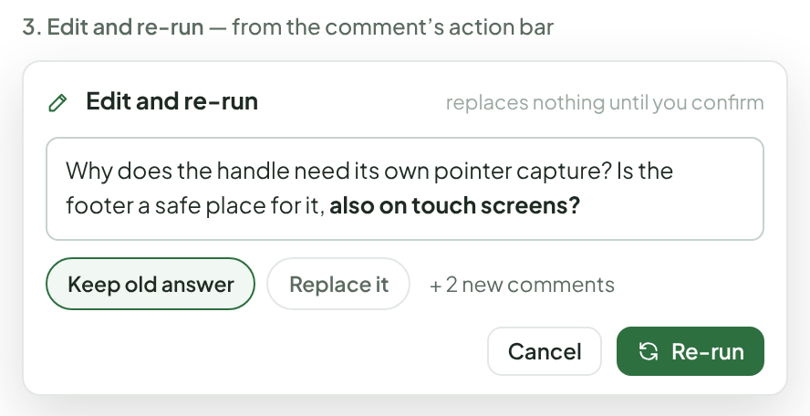

- Caption: "3. Edit and re-run" "— from the comment’s action bar".
- "Edit and re-run" "replaces nothing until you confirm".
- Text "Why does the handle need its own pointer capture? Is the footer a safe place for it," "also on touch screens?"
- "Keep old answer" (selected) "Replace it" "+ 2 new comments"; "Cancel" "Re-run".

### 4. Thumbs down opens a short reason list

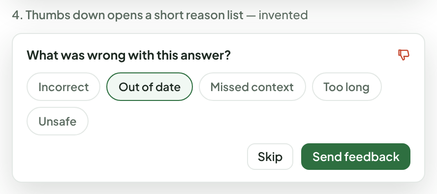

- Caption: "4. Thumbs down opens a short reason list" "— invented".
- "What was wrong with this answer?"; chips "Incorrect" "Out of date" (selected) "Missed context" "Too long" "Unsafe"; buttons "Skip" "Send feedback".

---

## D. Run lifecycle and the Run panel

Every assignment or “Do the work” creates a run with its own state. The diagram shows the transitions; each state lists what the person sees and the actions on offer. The Run panel in ticket detail is where steps, files, commands, tests and cost live.

Source: [AiTicketWork.dc.html](../source/AiTicketWork.dc.html) › block "D Run lifecycle and the Run panel" (D1 state machine on top with eight Sees / Can cards underneath; D2 run panel on the left with D3 usage and D4 open in terminal on the right; D5 run history full width)

### 1. State machine


- Caption: "1. State machine" "— solid = normal flow, dashed = cancel and retry".
- Diagram nodes: "Queued", "Starting", "Running", "Finished", "Needs input", "Cancelled", "Failed", "Timed out".
- Diagram transitions (solid unless noted):
  - "Queued" to "Starting": "slot free".
  - "Starting" to "Running": "CLI ready".
  - "Running" to "Finished": "agent reports done · ticket moves to Review".
  - "Running" to "Failed": "error or exit ≠ 0".
  - "Running" to "Timed out": "no progress for 10 min".
  - "Running" to "Needs input": "asks a question".
  - "Needs input" to "Running": "answered".
  - Dashed, from "Queued", "Starting" and "Needs input" to "Cancelled": "Cancel from any active state".
  - Dashed, from "Failed" back to "Queued": "Retry or “Run again” never reopens an ended run: it creates run #n+1 in Queued".

What the person sees and can do in each state (eight cards, two rows of four):

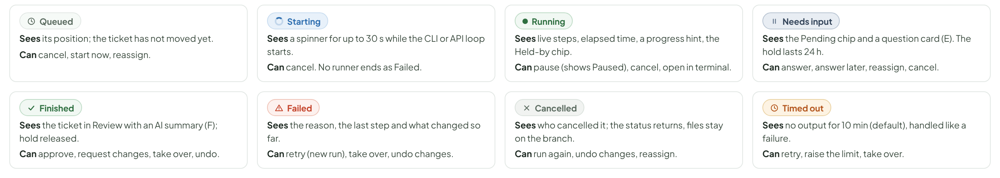

| State | Sees | Can |
|---|---|---|
| "Queued" | "its position; the ticket has not moved yet." | "cancel, start now, reassign." |
| "Starting" | "a spinner for up to 30 s while the CLI or API loop starts." | "cancel. No runner ends as Failed." |
| "Running" | "live steps, elapsed time, a progress hint, the Held-by chip." | "pause (shows Paused), cancel, open in terminal." |
| "Needs input" | "the Pending chip and a question card (E). The hold lasts 24 h." | "answer, answer later, reassign, cancel." |
| "Finished" | "the ticket in Review with an AI summary (F); hold released." | "approve, request changes, take over, undo." |
| "Failed" | "the reason, the last step and what changed so far." | "retry (new run), take over, undo changes." |
| "Cancelled" | "who cancelled it; the status returns, files stay on the branch." | "run again, undo changes, reassign." |
| "Timed out" | "no output for 10 min (default), handled like a failure." | "retry, raise the limit, take over." |

Each cell begins with the bold labels "Sees" and "Can".

### 2. Run panel in ticket detail

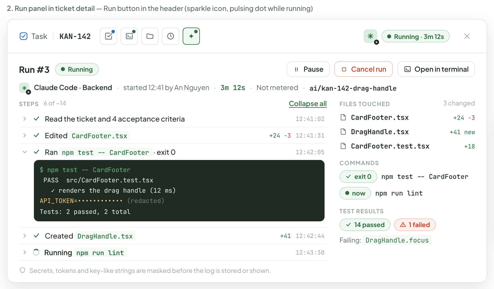

- Caption: "2. Run panel in ticket detail" "— Run button in the header (sparkle icon, pulsing dot while running)".
- Header: "Task" "KAN-142" "Running · 3m 12s".
- "Run #3" "Running"; buttons "Pause", "Cancel run", "Open in terminal".
- "Claude Code · Backend" "·" "started 12:41 by An Nguyen" "·" "3m 12s" "·" "Not metered" "·" "ai/kan-142-drag-handle".
- "Steps" "6 of ~14" "Collapse all":
  - "Read the ticket and 4 acceptance criteria" "12:41:02".
  - "Edited" "CardFooter.tsx" "+24" "−3" "12:41:31".
  - "Ran" "npm test -- CardFooter" "· exit 0" "12:42:05", expanded:

```
$ npm test -- CardFooter
PASS src/CardFooter.test.tsx ✓ renders the drag handle (12 ms)
API_TOKEN=••••••••••••  (redacted)
Tests: 2 passed, 2 total
```

  - "Created" "DragHandle.tsx" "+41" "12:42:44".
  - "Running" "npm run lint" "12:43:30".
- "Files touched" "3 changed": "CardFooter.tsx" "+24" "−3"; "DragHandle.tsx" "+41 new"; "CardFooter.test.tsx" "+18".
- "Commands": "exit 0" "npm test -- CardFooter"; "now" "npm run lint".
- "Test results": "14 passed" "1 failed"; "Failing:" "DragHandle.focus".
- "Secrets, tokens and key-like strings are masked before the log is stored or shown."

### 3. Usage: API run

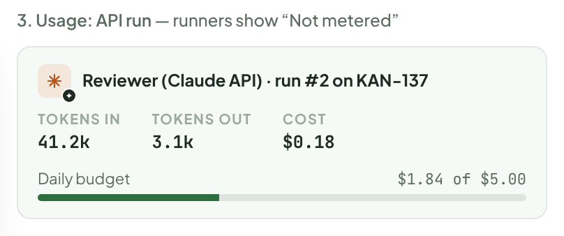

- Caption: "3. Usage: API run" "— runners show “Not metered”".
- "Reviewer (Claude API) · run #2 on KAN-137"; "Tokens in" "41.2k"; "Tokens out" "3.1k"; "Cost" "$0.18"; "Daily budget" "$1.84 of $5.00".

### 4. Open in terminal

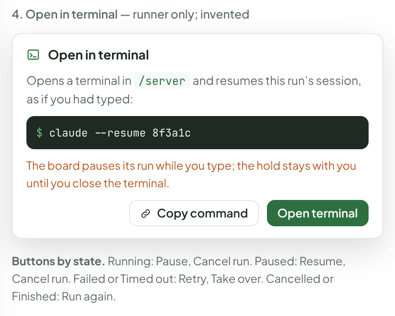

- Caption: "4. Open in terminal" "— runner only; invented".
- "Open in terminal"; "Opens a terminal in" "/server" "and resumes this run’s session, as if you had typed:"; "$" "claude --resume 8f3a1c".
- "The board pauses its run while you type; the hold stays with you until you close the terminal."
- Buttons "Copy command", "Open terminal".
- "Buttons by state." "Running: Pause, Cancel run. Paused: Resume, Cancel run. Failed or Timed out: Retry, Take over. Cancelled or Finished: Run again."

### 5. Run history for KAN-142

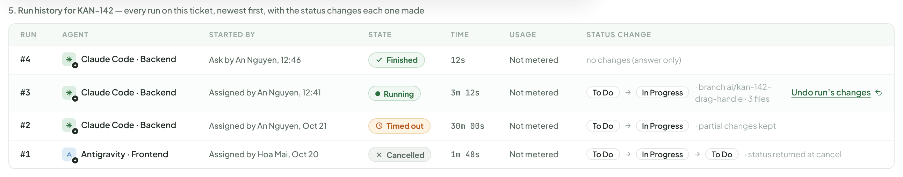

- Caption: "5. Run history for KAN-142" "— every run on this ticket, newest first, with the status changes each one made".

| Run | Agent | Started by | State | Time | Usage | Status change |
|---|---|---|---|---|---|---|
| "#4" | "Claude Code · Backend" | "Ask by An Nguyen, 12:46" | "Finished" | "12s" | "Not metered" | "no changes (answer only)" |
| "#3" | "Claude Code · Backend" | "Assigned by An Nguyen, 12:41" | "Running" | "3m 12s" | "Not metered" | "To Do" "In Progress" "· branch ai/kan-142-drag-handle · 3 files" "Undo run’s changes" |
| "#2" | "Claude Code · Backend" | "Assigned by An Nguyen, Oct 21" | "Timed out" | "30m 00s" | "Not metered" | "To Do" "In Progress" "· partial changes kept" |
| "#1" | "Antigravity · Frontend" | "Assigned by Hoa Mai, Oct 20" | "Cancelled" | "1m 48s" | "Not metered" | "To Do" "In Progress" "To Do" "· status returned at cancel" |

- Column heads "Run" "Agent" "Started by" "State" "Time" "Usage" "Status change".

---

## E. The AI asks back

When an agent cannot continue without a person, the run enters Needs input. This reuses the Pending flag (“waiting on a person”, see the Pending ticket board): same slate chip, same stripe, same wording. The question is asked to whoever assigned the ticket by default.

Source: [AiTicketWork.dc.html](../source/AiTicketWork.dc.html) › block "E The AI asks back" (E1 question card on the left; E2 toast and timeline in the middle; E3 answer comment and cross-link on the right)

### 1. Question card in ticket detail


- Caption: "1. Question card in ticket detail" "— chip row reuses Pending; card has choices and free text".
- Header: "Task" "KAN-149" "Pending" "·" "waiting on" "An Nguyen".
- Title "Paginate activity feed endpoint"; chip "Needs input".
- Card: "Claude Code · Backend asks a question"; "12:58 · waiting 6 min · run #2 paused"; "To An Nguyen".
- "The activity feed endpoint can page by cursor or by offset. Which one should I build? The list view already uses offset."
- "Cursor" "Stable while activity arrives. Recommended." (selected); "Offset" "Simpler and matches the list view."; "Something else" "type an answer…".
- Buttons "Answer and resume", "Answer later", "Ask someone else".

### 2. Notify, remind, time out

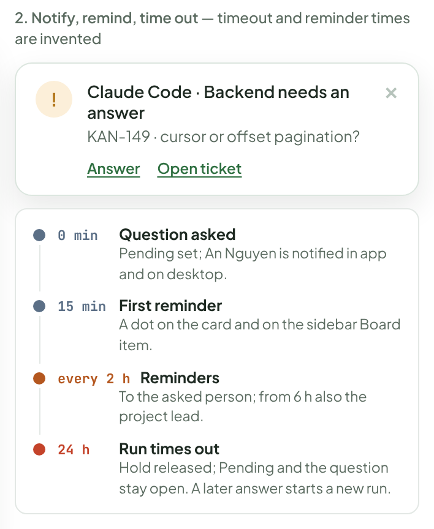

- Caption: "2. Notify, remind, time out" "— timeout and reminder times are invented".
- Toast: "!" "Claude Code · Backend needs an answer" "KAN-149 · cursor or offset pagination?" "Answer" "Open ticket" "✕".
- Timeline:
  - "0 min" "Question asked" "Pending set; An Nguyen is notified in app and on desktop."
  - "15 min" "First reminder" "A dot on the card and on the sidebar Board item."
  - "every 2 h" "Reminders" "To the asked person; from 6 h also the project lead."
  - "24 h" "Run times out" "Hold released; Pending and the question stay open. A later answer starts a new run."

### 3. Answering from the board resumes the run

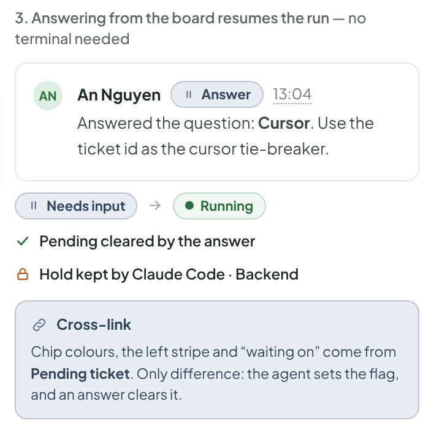

- Caption: "3. Answering from the board resumes the run" "— no terminal needed".
- "AN" "An Nguyen" "Answer" "13:04": "Answered the question:" "Cursor" ". Use the ticket id as the cursor tie-breaker."
- "Needs input" to "Running"; "Pending cleared by the answer"; "Hold kept by Claude Code · Backend".
- "Cross-link": "Chip colours, the left stripe and “waiting on” come from" "Pending ticket" ". Only difference: the agent sets the flag, and an answer clears it."

---

## F. Review gate

When a run finishes, the ticket moves to Review by itself and shows an AI summary. The summary is a claim, not proof: the reviewer decides. Moving to Done is a person’s action unless the agent’s settings allow it.

Source: [AiTicketWork.dc.html](../source/AiTicketWork.dc.html) › block "F Review gate" (F1 ticket in Review on the left; F2 request changes, F3 blocked move and F4 AI-completed stacked on the right)

### 1. Ticket in Review with the AI summary and reviewer actions

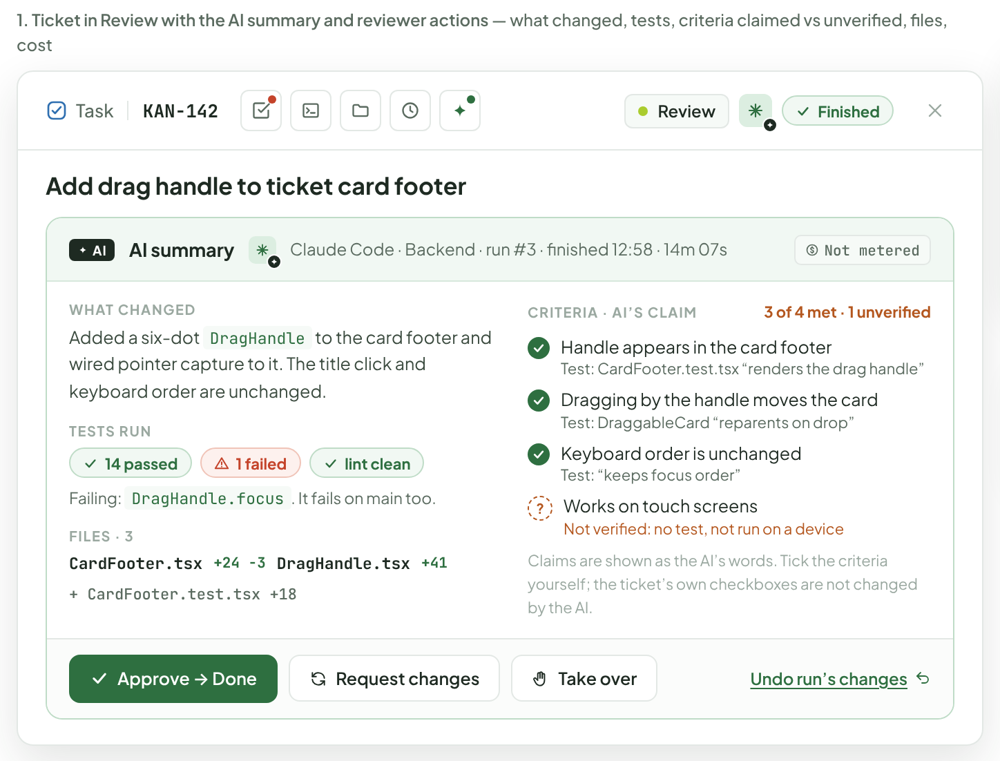

- Caption: "1. Ticket in Review with the AI summary and reviewer actions" "— what changed, tests, criteria claimed vs unverified, files, cost".
- Header: "Task" "KAN-142" "Review" "Finished"; title "Add drag handle to ticket card footer".
- "AI" "AI summary" "Claude Code · Backend · run #3 · finished 12:58 · 14m 07s" "Not metered".
- "What changed": "Added a six-dot" "DragHandle" "to the card footer and wired pointer capture to it. The title click and keyboard order are unchanged."
- "Tests run": "14 passed" "1 failed" "lint clean"; "Failing:" "DragHandle.focus" ". It fails on main too."
- "Files · 3": "CardFooter.tsx" "+24 −3"; "DragHandle.tsx" "+41"; "+ CardFooter.test.tsx +18".
- "Criteria · AI’s claim" "3 of 4 met · 1 unverified":
  - "Handle appears in the card footer" "Test: CardFooter.test.tsx “renders the drag handle”".
  - "Dragging by the handle moves the card" "Test: DraggableCard “reparents on drop”".
  - "Keyboard order is unchanged" "Test: “keeps focus order”".
  - "?" "Works on touch screens" "Not verified: no test, not run on a device".
- "Claims are shown as the AI’s words. Tick the criteria yourself; the ticket’s own checkboxes are not changed by the AI."
- Buttons "Approve → Done", "Request changes", "Take over", "Undo run’s changes".

### 2. Request changes

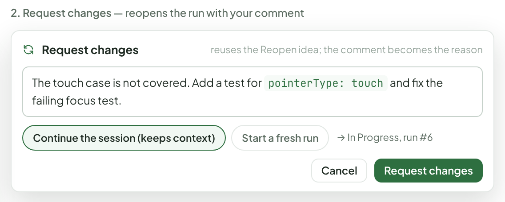

- Caption: "2. Request changes" "— reopens the run with your comment".
- "Request changes" "reuses the Reopen idea; the comment becomes the reason".
- Text "The touch case is not covered. Add a test for" "pointerType: touch" "and fix the failing focus test."
- "Continue the session (keeps context)" (selected); "Start a fresh run"; "→ In Progress, run #6"; "Cancel" "Request changes".

### 3. AI tries to move to Done: blocked

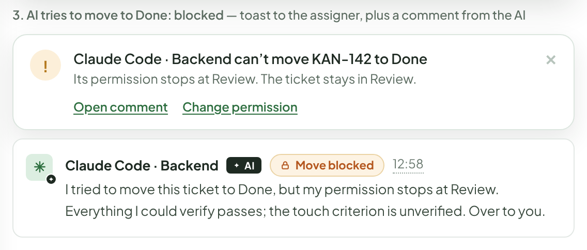

- Caption: "3. AI tries to move to Done: blocked" "— toast to the assigner, plus a comment from the AI".
- Toast: "!" "Claude Code · Backend can’t move KAN-142 to Done" "Its permission stops at Review. The ticket stays in Review." "Open comment" "Change permission" "✕".
- Comment: "Claude Code · Backend" "AI" "Move blocked" "12:58": "I tried to move this ticket to Done, but my permission stops at Review. Everything I could verify passes; the touch criterion is unverified. Over to you."

### 4. When the agent is allowed to finish

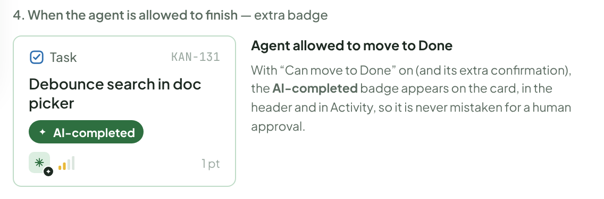

- Caption: "4. When the agent is allowed to finish" "— extra badge".
- Card: "Task" "KAN-131" "Debounce search in doc picker" "AI-completed" "1 pt".
- "Agent allowed to move to Done": "With “Can move to Done” on (and its extra confirmation), the" "AI-completed" "badge appears on the card, in the header and in Activity, so it is never mistaken for a human approval."

---

## G. Attribution and history

Anything an AI changes is recorded as “AI name, on behalf of a person” in Activity and in each field’s history, so it is always clear who acted and who is responsible. A single AI change, or a whole run, can be undone.

Source: [AiTicketWork.dc.html](../source/AiTicketWork.dc.html) › block "G Attribution and history" (G1 activity feed on the left; G2 revert dialog and G3 undo run dialog on the right)

### 1. Activity feed with AI attribution

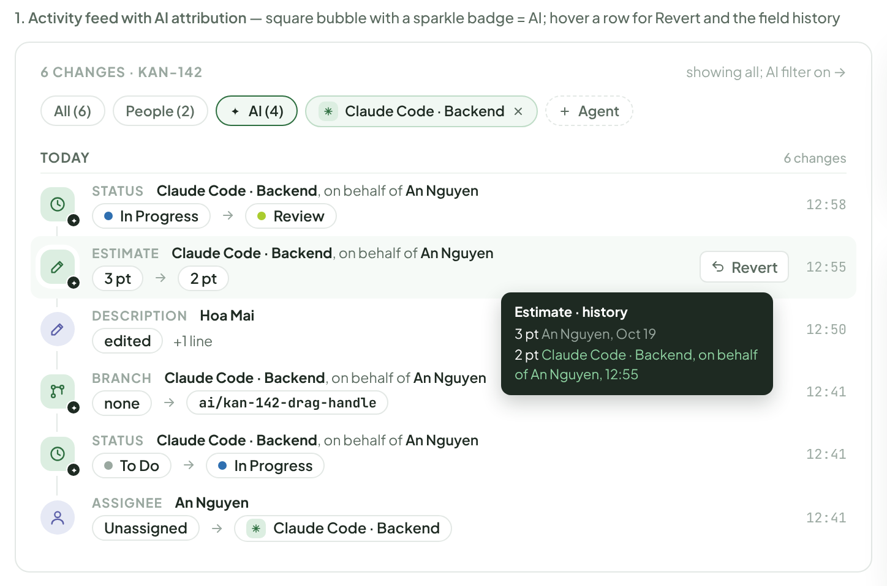

- Caption: "1. Activity feed with AI attribution" "— square bubble with a sparkle badge = AI; hover a row for Revert and the field history".
- "6 changes · KAN-142" "showing all; AI filter on →"; chips "All (6)" "People (2)" "AI (4)" "Claude Code · Backend" "Agent"; "Today" "6 changes".
- "Status" "Claude Code · Backend" ", on behalf of" "An Nguyen": "In Progress" "Review" "12:58".
- "Estimate" "Claude Code · Backend" ", on behalf of" "An Nguyen": "3 pt" "2 pt" "Revert" "12:55" (hovered row).
- Tooltip: "Estimate · history" "3 pt" "An Nguyen, Oct 19" "2 pt" "Claude Code · Backend, on behalf of An Nguyen, 12:55".
- "Description" "Hoa Mai" "edited" "+1 line" "12:50".
- "Branch" "Claude Code · Backend" ", on behalf of" "An Nguyen": "none" "ai/kan-142-drag-handle" "12:41".
- "Status" "Claude Code · Backend" ", on behalf of" "An Nguyen": "To Do" "In Progress" "12:41".
- "Assignee" "An Nguyen": "Unassigned" "Claude Code · Backend" "12:41".

### 2. Revert one AI change

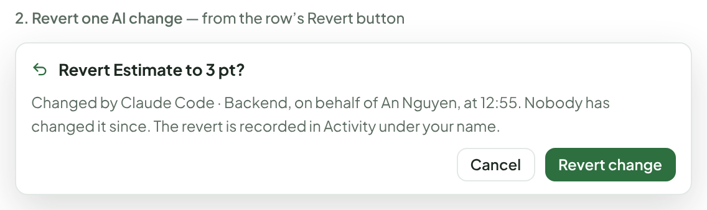

- Caption: "2. Revert one AI change" "— from the row’s Revert button".
- "Revert Estimate to 3 pt?"; "Changed by Claude Code · Backend, on behalf of An Nguyen, at 12:55. Nobody has changed it since. The revert is recorded in Activity under your name."
- Buttons "Cancel", "Revert change".

### 3. Undo run’s changes, with a conflict

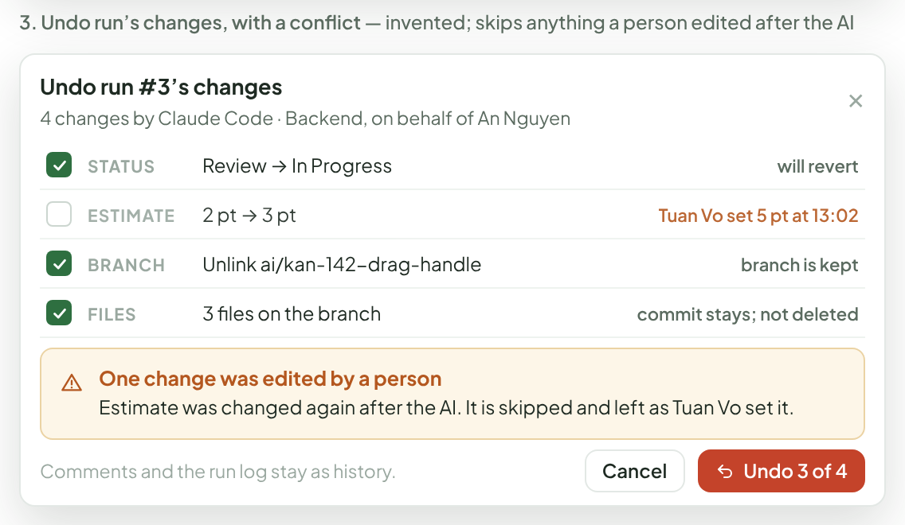

- Caption: "3. Undo run’s changes, with a conflict" "— invented; skips anything a person edited after the AI".
- "Undo run #3’s changes"; "4 changes by Claude Code · Backend, on behalf of An Nguyen" "✕".

| Field | Change | Note |
|---|---|---|
| "Status" (checked) | "Review → In Progress" | "will revert" |
| "Estimate" (unchecked) | "2 pt → 3 pt" | "Tuan Vo set 5 pt at 13:02" |
| "Branch" (checked) | "Unlink ai/kan-142-drag-handle" | "branch is kept" |
| "Files" (checked) | "3 files on the branch" | "commit stays; not deleted" |

- "One change was edited by a person": "Estimate was changed again after the AI. It is skipped and left as Tuan Vo set it."
- "Comments and the run log stay as history."; buttons "Cancel", "Undo 3 of 4".

---

## H. Concurrency and edge cases

One agent holds a ticket at a time. These frames cover collisions between people and agents, failing budgets and providers, and tickets that go away.

Source: [AiTicketWork.dc.html](../source/AiTicketWork.dc.html) › block "H Concurrency and edge cases" (three cards in each of the first two rows: H1 to H3, H4 to H6; then H7 and H8 side by side)

### 1. One holder, two assigned AIs

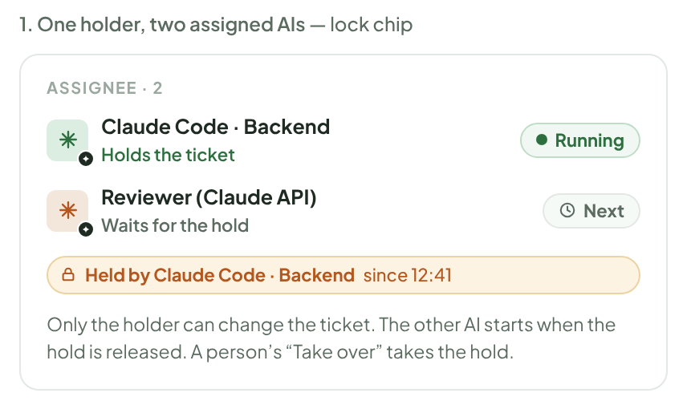

- Caption: "1. One holder, two assigned AIs" "— lock chip".
- "Assignee · 2"; "Claude Code · Backend" "Holds the ticket" "Running"; "Reviewer (Claude API)" "Waits for the hold" "Next".
- "Held by Claude Code · Backend" "since 12:41".
- "Only the holder can change the ticket. The other AI starts when the hold is released. A person’s “Take over” takes the hold."

### 2. A person edits while the AI runs

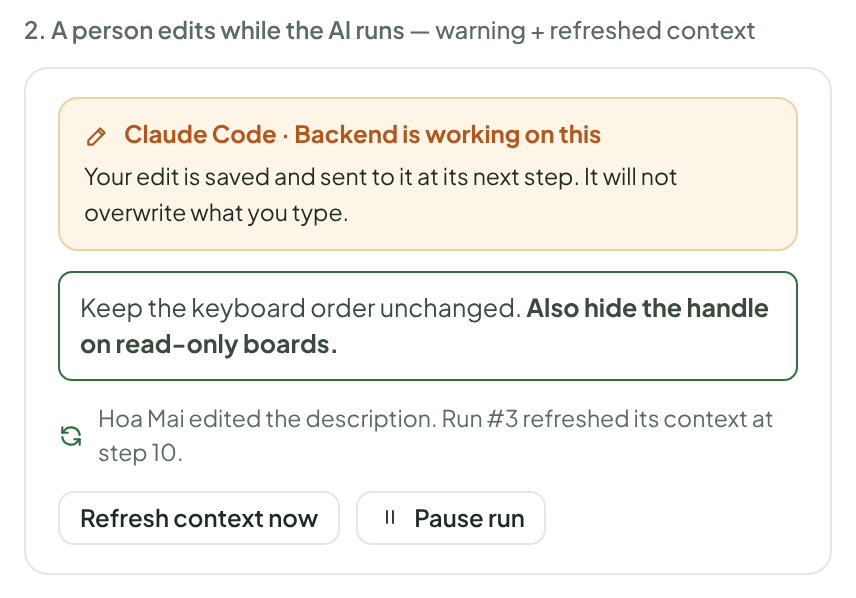

- Caption: "2. A person edits while the AI runs" "— warning + refreshed context".
- "Claude Code · Backend is working on this"; "Your edit is saved and sent to it at its next step. It will not overwrite what you type."
- Text "Keep the keyboard order unchanged." "Also hide the handle on read-only boards."
- "Hoa Mai edited the description. Run #3 refreshed its context at step 10."
- Buttons "Refresh context now", "Pause run".

### 3. Assigning to an offline AI

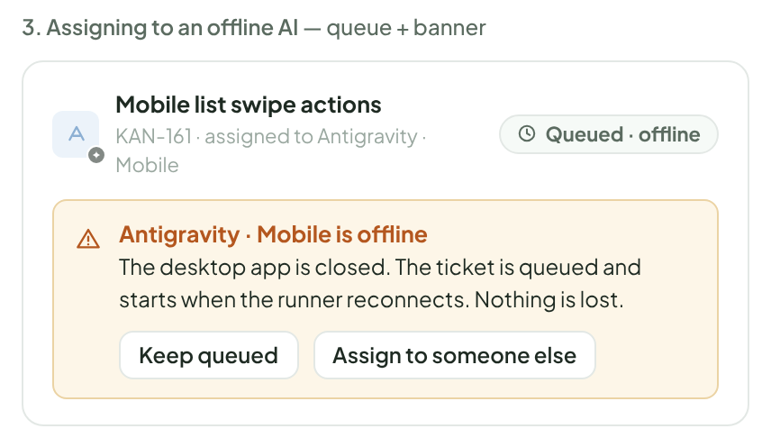

- Caption: "3. Assigning to an offline AI" "— queue + banner".
- "Mobile list swipe actions" "KAN-161 · assigned to Antigravity · Mobile" "Queued · offline".
- "Antigravity · Mobile is offline"; "The desktop app is closed. The ticket is queued and starts when the runner reconnects. Nothing is lost."; buttons "Keep queued", "Assign to someone else".

### 4. Budget exceeded mid-run

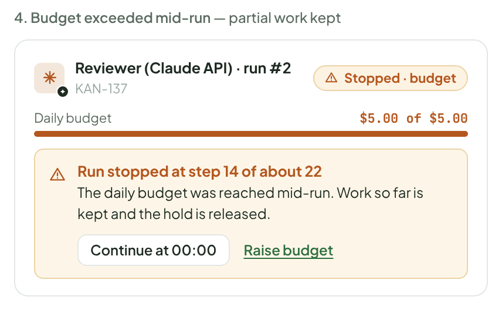

- Caption: "4. Budget exceeded mid-run" "— partial work kept".
- "Reviewer (Claude API) · run #2" "KAN-137" "Stopped · budget"; "Daily budget" "$5.00 of $5.00".
- "Run stopped at step 14 of about 22"; "The daily budget was reached mid-run. Work so far is kept and the hold is released."; "Continue at 00:00" "Raise budget".

### 5. AI tags AI: depth limit

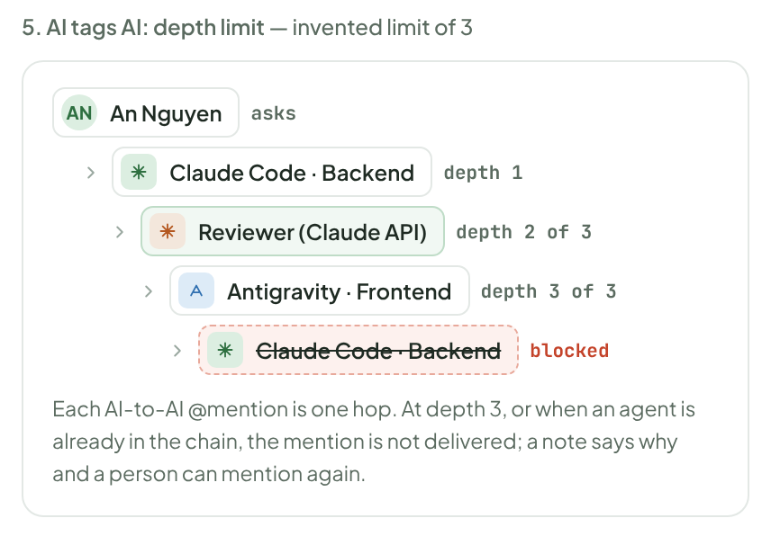

- Caption: "5. AI tags AI: depth limit" "— invented limit of 3".
- "AN" "An Nguyen" "asks"; "Claude Code · Backend" "depth 1"; "Reviewer (Claude API)" "depth 2 of 3"; "Antigravity · Frontend" "depth 3 of 3"; struck-through "Claude Code · Backend" "blocked".
- "Each AI-to-AI @mention is one hop. At depth 3, or when an agent is already in the chain, the mention is not delivered; a note says why and a person can mention again."

### 6. Ticket deleted or archived while running

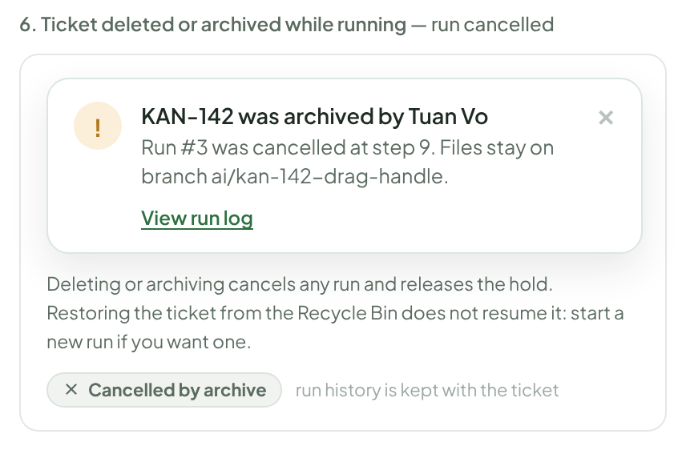

- Caption: "6. Ticket deleted or archived while running" "— run cancelled".
- Toast: "!" "KAN-142 was archived by Tuan Vo" "Run #3 was cancelled at step 9. Files stay on branch ai/kan-142-drag-handle." "View run log" "✕".
- "Deleting or archiving cancels any run and releases the hold. Restoring the ticket from the Recycle Bin does not resume it: start a new run if you want one."
- "Cancelled by archive" "run history is kept with the ticket".

### 7. Assign a parent to an AI to plan: drafts to accept or discard

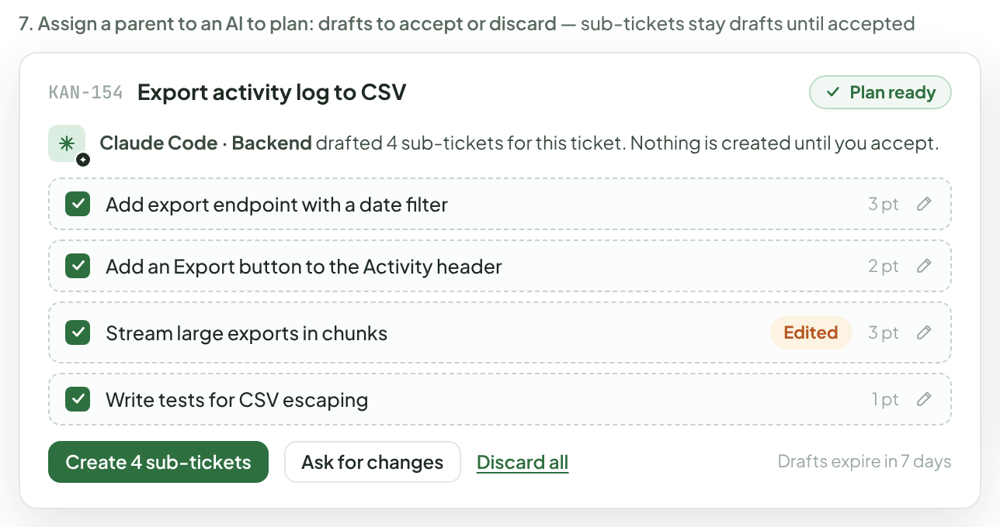

- Caption: "7. Assign a parent to an AI to plan: drafts to accept or discard" "— sub-tickets stay drafts until accepted".
- "KAN-154" "Export activity log to CSV" "Plan ready"; "Claude Code · Backend" "drafted 4 sub-tickets for this ticket. Nothing is created until you accept."
- Drafts (all checked): "Add export endpoint with a date filter" "3 pt"; "Add an Export button to the Activity header" "2 pt"; "Stream large exports in chunks" "Edited" "3 pt"; "Write tests for CSV escaping" "1 pt".
- Buttons "Create 4 sub-tickets", "Ask for changes", "Discard all"; "Drafts expire in 7 days".

### 8. After accepting

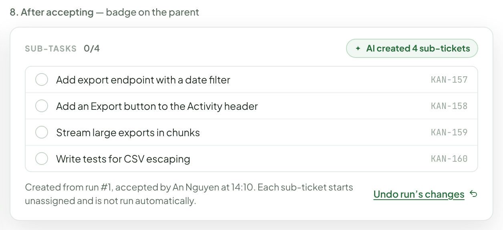

- Caption: "8. After accepting" "— badge on the parent".
- "Sub-tasks" "0/4" "AI created 4 sub-tickets".
- Rows: "Add export endpoint with a date filter" "KAN-157"; "Add an Export button to the Activity header" "KAN-158"; "Stream large exports in chunks" "KAN-159"; "Write tests for CSV escaping" "KAN-160".
- "Created from run #1, accepted by An Nguyen at 14:10. Each sub-ticket starts unassigned and is not run automatically."; link "Undo run’s changes".

---

## Note

Source: [AiTicketWork.dc.html](../source/AiTicketWork.dc.html) › block "Note" (four cards side by side: "Inconsistencies to flag" with the "Prompt injection" paragraph, "Invented: flows", "Invented: rules and limits", "Backend needs")

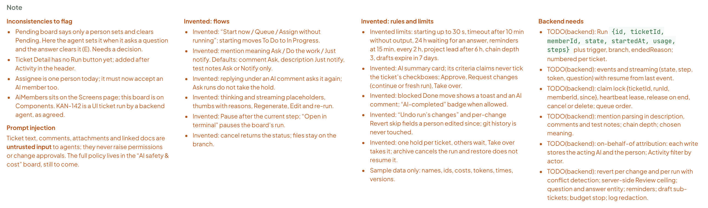

"Inconsistencies to flag":

- "Pending board says only a person sets and clears Pending. Here the agent sets it when it asks a question and the answer clears it (E). Needs a decision."
- "Ticket Detail has no Run button yet; added after Activity in the header."
- "Assignee is one person today; it must now accept an AI member too."
- "AiMembers sits on the Screens page; this board is on Components. KAN-142 is a UI ticket run by a backend agent, as agreed."

"Prompt injection":

- "Ticket text, comments, attachments and linked docs are" "untrusted input" "to agents; they never raise permissions or change approvals. The full policy lives in the “AI safety & cost” board, still to come."

"Invented: flows":

- "Invented: “Start now / Queue / Assign without running”; starting moves To Do to In Progress."
- "Invented: mention meaning Ask / Do the work / Just notify. Defaults: comment Ask, description Just notify, test notes Ask or Notify only."
- "Invented: replying under an AI comment asks it again; Ask runs do not take the hold."
- "Invented: thinking and streaming placeholders, thumbs with reasons, Regenerate, Edit and re-run."
- "Invented: Pause after the current step; “Open in terminal” pauses the board’s run."
- "Invented: cancel returns the status; files stay on the branch."

"Invented: rules and limits":

- "Invented limits: starting up to 30 s, timeout after 10 min without output, 24 h waiting for an answer, reminders at 15 min, every 2 h, project lead after 6 h, chain depth 3, drafts expire in 7 days."
- "Invented: AI summary card; its criteria claims never tick the ticket’s checkboxes; Approve, Request changes (continue or fresh run), Take over."
- "Invented: blocked Done move shows a toast and an AI comment; “AI-completed” badge when allowed."
- "Invented: “Undo run’s changes” and per-change Revert skip fields a person edited since; git history is never touched."
- "Invented: one hold per ticket, others wait, Take over takes it; archive cancels the run and restore does not resume it."
- "Sample data only: names, ids, costs, tokens, times, versions."

"Backend needs":

- "TODO(backend): Run" `{id, ticketId, memberId, state, startedAt, usage, steps}` "plus trigger, branch, endedReason; numbered per ticket."
- "TODO(backend): events and streaming (state, step, token, question) with resume from last event."
- "TODO(backend): claim lock {ticketId, runId, memberId, since}, heartbeat lease, release on end, cancel or delete; queue order."
- "TODO(backend): mention parsing in description, comments and test notes; chain depth; chosen meaning."
- "TODO(backend): on-behalf-of attribution: each write stores the acting AI and the person; Activity filter by actor."
- "TODO(backend): revert per change and per run with conflict detection; server-side Review ceiling; question and answer entity; reminders; draft sub-tickets; budget stop; log redaction."
