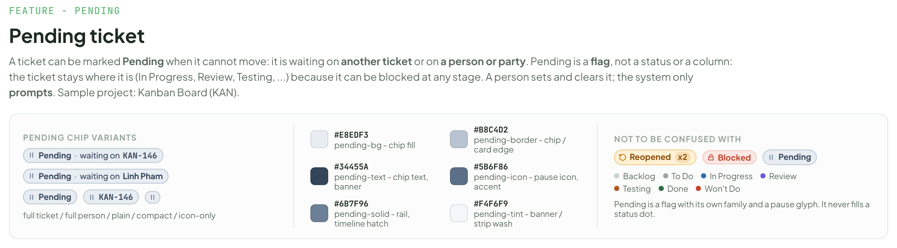
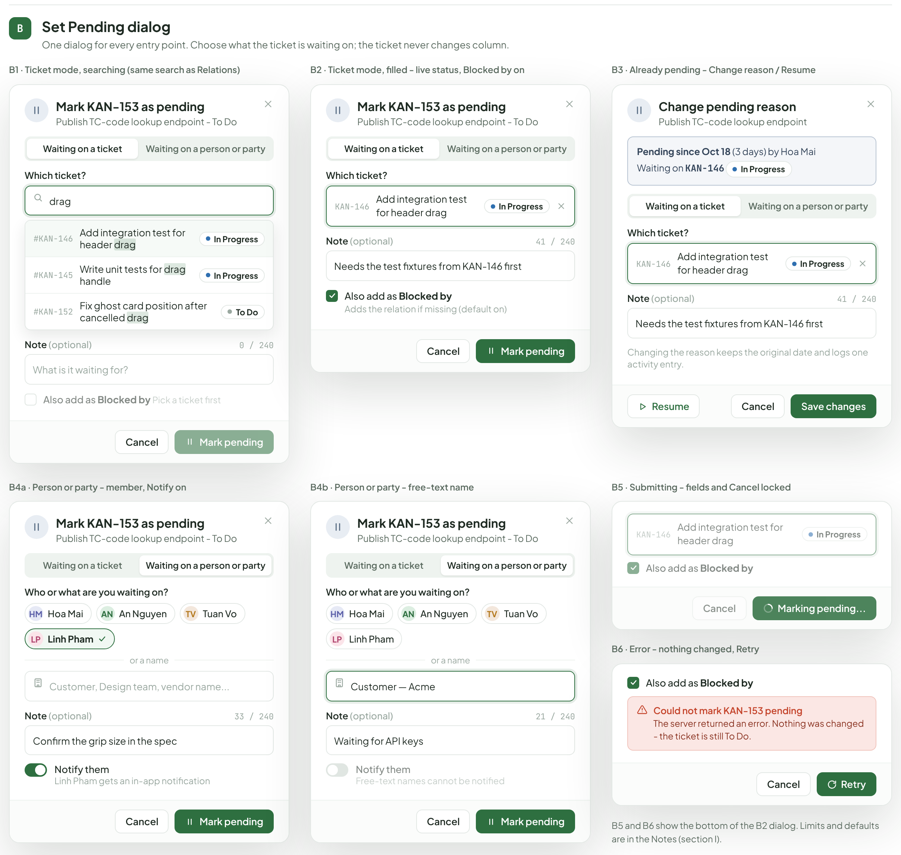
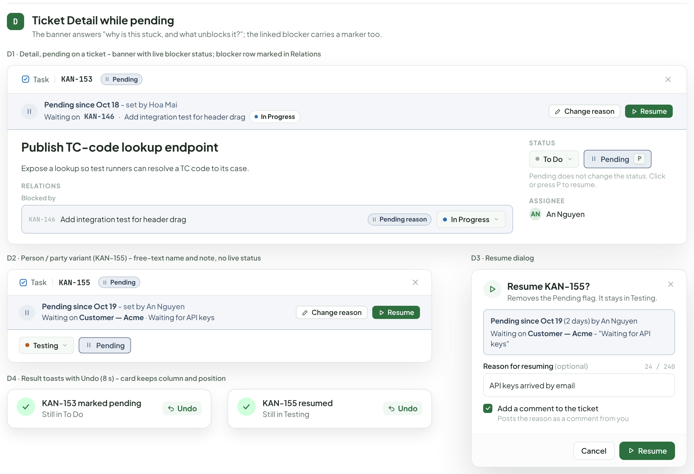
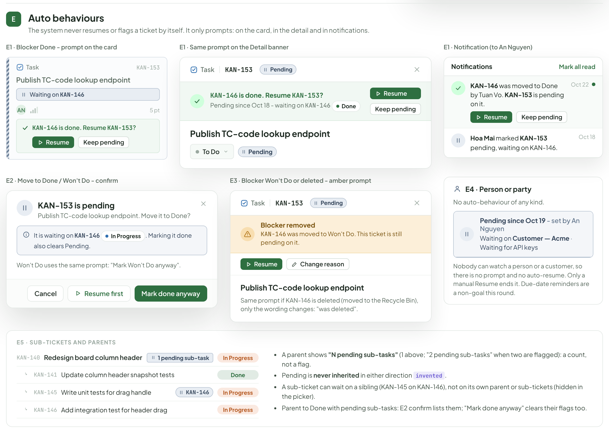
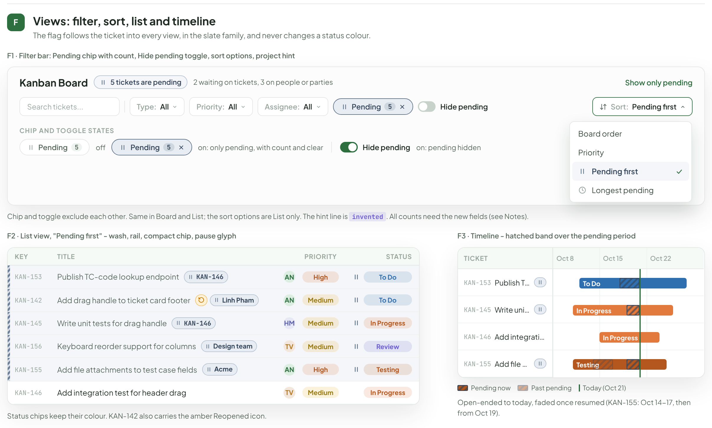
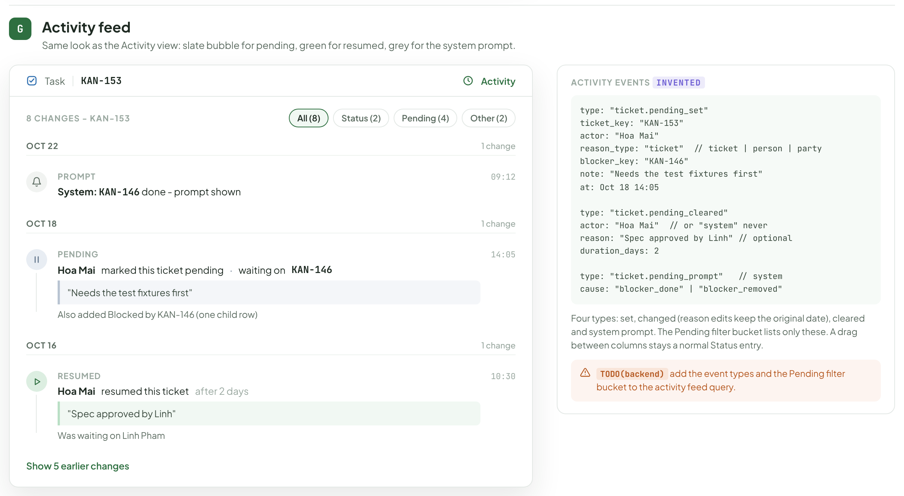
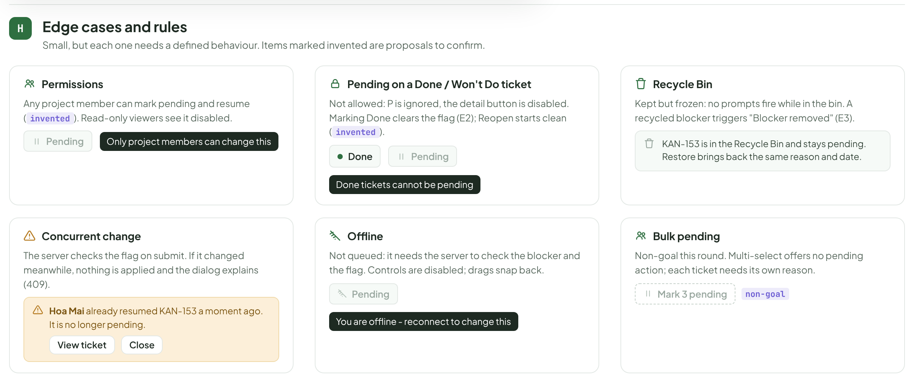
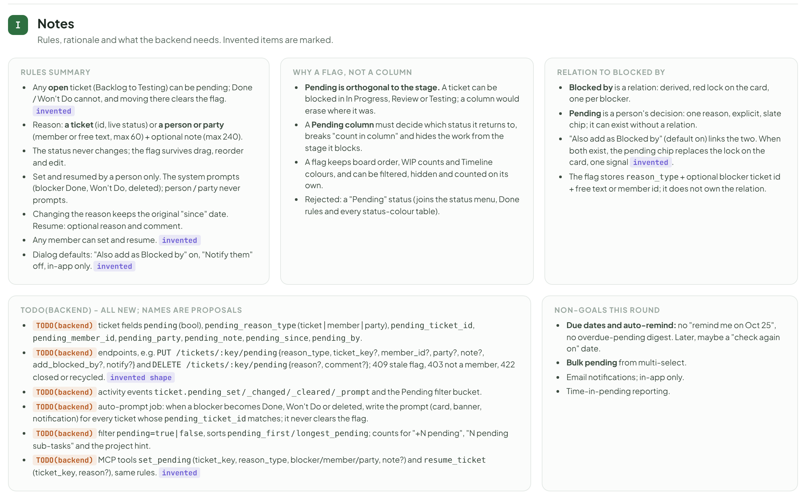

# Pending ticket

> Component — v1 · source: [`TicketPending.dc.html`](../source/TicketPending.dc.html) · canvas `1792584105-26d0` · sha256 `cb86f6a4af91b624b11ca30357241e5b873372bc120421904317cbde0760b863`

Eyebrow "Feature - Pending". A ticket can be marked **Pending** when it cannot move: it is waiting on **another ticket** or on **a person or party**. Pending is a **flag**, not a status or a column: the ticket stays where it is (In Progress, Review, Testing, ...) because it can be blocked at any stage. A person sets and clears it; the system only **prompts**. Sample project: Kanban Board (KAN).

---

## Pending chip variants

Source: [TicketPending.dc.html](../source/TicketPending.dc.html) › header ("Feature - Pending", "Pending ticket" and the intro) and the legend block "Pending chip variants" (chip sizes, slate colour tokens and "Not to be confused with")



- Eyebrow "Feature - Pending"; title "Pending ticket"; intro: "A ticket can be marked" "Pending" "when it cannot move: it is waiting on" "another ticket" "or on" "a person or party" ". Pending is a" "flag" ", not a status or a column: the ticket stays where it is (In Progress, Review, Testing, ...) because it can be blocked at any stage. A person sets and clears it; the system only" "prompts" ". Sample project: Kanban Board (KAN)."
- Legend "Pending chip variants": "Pending" "·" "waiting on" "KAN-146"; "Pending" "·" "waiting on" "Linh Pham"; "Pending"; "KAN-146"; icon-only; caption "full ticket / full person / plain / compact / icon-only".
- Colour tokens:

| Hex | Token |
|---|---|
| "#E8EDF3" | "pending-bg - chip fill" |
| "#B8C4D2" | "pending-border - chip / card edge" |
| "#34455A" | "pending-text - chip text, banner" |
| "#5B6F86" | "pending-icon - pause icon, accent" |
| "#6B7F96" | "pending-solid - rail, timeline hatch" |
| "#F4F6F9" | "pending-tint - banner / strip wash" |

- "Not to be confused with": "Reopened" "x2"; "Blocked"; "Pending"; status dots "Backlog", "To Do", "In Progress", "Review", "Testing", "Done", "Won't Do".
- "Pending is a flag with its own family and a pause glyph. It never fills a status dot."

---

## A. Set Pending: entry points

Pending is a flag: its own button and menu item, never in the status menu. Every path ends in the dialog (B).

Source: [TicketPending.dc.html](../source/TicketPending.dc.html) › block "A Set Pending: entry points" (A1 two card menus on top; A2 detail, pending-on button and status-menu note in the middle row; A3 keyboard, A4 relations suggestion and A4 rules at the bottom)


### A1. Card menus

- Caption: "A1 · Card ... menu, open ticket - "Mark as pending..." leads (P)".
- Column "In Progress" "2"; card "Task" "KAN-146" "Add integration test for header drag" "test" "TV" "3 pt".
- Menu: "Mark as pending..." "P"; "Open ticket"; "Copy link"; "Move to Recycle Bin".
- Caption: "A1 · Card ... menu, pending ticket - "Resume ticket", "Change reason..."".
- Column "In Progress" "2"; card "Task" "KAN-145" "Write unit tests for drag handle" "Waiting on" "KAN-146" "HM" "2 pt".
- Menu: "Resume ticket" "P"; "Change reason..."; "Open ticket"; "Copy link"; "Move to Recycle Bin".

### A2. Detail button and status menu

- Caption: "A2 · Detail, open ticket - "Pending" button beside the status select (P)".
- "Task" "KAN-153"; title "Publish TC-code lookup endpoint"; "Expose a lookup so test runners can resolve a TC code to its case."; "Status" "To Do" "Pending" "P"; "Created Oct 12 by Hoa Mai"; "Assignee" "AN" "An Nguyen".
- Caption: "A2 · Pending on - the button stays, filled".
- "Status" "To Do" "Pending" "P"; "Pending since Oct 18"; "Waiting on" "KAN-146"; "Pending is independent of the status"; "Assignee" "AN" "An Nguyen".
- Caption: "A2 · Status menu". "The status menu is" "unchanged" ": seven statuses, no Pending item. Pending is not a status."

### A3. Keyboard

- Caption: "A3 · Keyboard - P" with marker "invented".
- Tooltip "Mark as pending" "P"; button "Pending" "P"; "Hover the button to see the shortcut."
- Key table:

| Key | Behaviour |
|---|---|
| "P" | "Open the dialog (hovered card, open ticket)" |
| "P" "on pending" | "Opens Resume on a pending ticket" |
| "Esc" | "Cancel, nothing changes" |
| "Ctrl" "Enter" | "Submit from the note field" |
| "P" "on closed" | "Ignored on Done / Won't Do" |

### A4. Relations suggestion

- Caption: "A4 · Relations - inline suggestion after adding Blocked by".
- "Relations" "Blocked by"; row "KAN-146" "Add integration test for header drag" "In Progress".
- Suggestion: "KAN-146" "is not done yet. Mark this ticket as pending?"; buttons "Mark pending", "Not now".
- Caption: "A4 · Suggestion rules".
  - "Only for" "Blocked by" "to a target that is not Done / Won't Do, on a ticket not already pending."
  - "Mark pending" "= one click, no dialog; the relation exists, so "Also add as Blocked by" is skipped."
  - "Not now" "hides it for this relation; the Pending button still works."
  - "Adding "Blocks" from the blocker side prompts nobody."
  - "Row is" "invented" "."

---

## B. Set Pending dialog

One dialog for every entry point. Choose what the ticket is waiting on; the ticket never changes column.

Source: [TicketPending.dc.html](../source/TicketPending.dc.html) › block "B Set Pending dialog" (B1, B2, B3 in the top row; B4a, B4b and the stacked B5 / B6 in the bottom row)



Shared header of B1, B2, B4a and B4b: title "Mark KAN-153 as pending" with subtitle "Publish TC-code lookup endpoint - To Do"; segmented tabs "Waiting on a ticket" and "Waiting on a person or party".

### B1. Ticket mode, searching

- Caption: "B1 · Ticket mode, searching (same search as Relations)".
- "Which ticket?"; search text "drag".
- Results: "#KAN-146" "Add integration test for header" "drag" "In Progress"; "#KAN-145" "Write unit tests for" "drag" "handle" "In Progress"; "#KAN-152" "Fix ghost card position after cancelled" "drag" "To Do".
- "Note" "(optional)" "0 / 240"; placeholder "What is it waiting for?"
- "Also add as" "Blocked by" (unchecked) "Pick a ticket first"; "Cancel", "Mark pending" (disabled).

### B2. Ticket mode, filled

- Caption: "B2 · Ticket mode, filled - live status, Blocked by on".
- "Which ticket?"; chosen "KAN-146" "Add integration test for header drag" "In Progress".
- "Note" "(optional)" "41 / 240"; text "Needs the test fixtures from KAN-146 first".
- "Also add as" "Blocked by" (checked) "Adds the relation if missing (default on)"; "Cancel", "Mark pending".

### B3. Already pending

- Caption: "B3 · Already pending - Change reason / Resume".
- Title "Change pending reason"; subtitle "Publish TC-code lookup endpoint".
- Info box: "Pending since Oct 18" "(3 days) by Hoa Mai"; "Waiting on" "KAN-146" "In Progress".
- Tabs "Waiting on a ticket", "Waiting on a person or party"; "Which ticket?"; "KAN-146" "Add integration test for header drag" "In Progress".
- "Note" "(optional)" "41 / 240"; text "Needs the test fixtures from KAN-146 first".
- "Changing the reason keeps the original date and logs one activity entry."
- Buttons "Resume", "Cancel", "Save changes".

### B4a. Person or party, member

- Caption: "B4a · Person or party - member, Notify on".
- "Who or what are you waiting on?"; member chips "HM" "Hoa Mai", "AN" "An Nguyen", "TV" "Tuan Vo", "LP" "Linh Pham" (selected, ticked).
- Divider "or a name"; placeholder "Customer, Design team, vendor name..."
- "Note" "(optional)" "33 / 240"; text "Confirm the grip size in the spec".
- Toggle on: "Notify them" "Linh Pham gets an in-app notification"; "Cancel", "Mark pending".

### B4b. Person or party, free text

- Caption: "B4b · Person or party - free-text name".
- "Who or what are you waiting on?"; chips "HM" "Hoa Mai", "AN" "An Nguyen", "TV" "Tuan Vo", "LP" "Linh Pham"; "or a name"; text "Customer — Acme".
- "Note" "(optional)" "21 / 240"; text "Waiting for API keys".
- Toggle off: "Notify them" "Free-text names cannot be notified"; "Cancel", "Mark pending".

### B5. Submitting

- Caption: "B5 · Submitting - fields and Cancel locked".
- Locked chosen ticket "KAN-146" "Add integration test for header drag" "In Progress"; "Also add as" "Blocked by"; "Cancel" muted; primary "Marking pending...".

### B6. Error

- Caption: "B6 · Error - nothing changed, Retry".
- "Also add as" "Blocked by"; red box "Could not mark KAN-153 pending" "The server returned an error. Nothing was changed - the ticket is still To Do."; buttons "Cancel", "Retry".
- "B5 and B6 show the bottom of the B2 dialog. Limits and defaults are in the Notes (section I)."

---

## C. Result on the board

Pending changes how a card looks, not where it lives. It must read at a glance and not be mistaken for the red Blocked outline or the amber Reopened badge.

Source: [TicketPending.dc.html](../source/TicketPending.dc.html) › block "C Result on the board" (C1 three-column board with the KAN-155 hover tooltip; C2 full and collapsed cards, ticket-reason tooltip and Column count rule; C3 drag board and toast)


### C1. Board

- Caption: "C1 · Board - pending cards stay in their column: muted body, striped rail, slate reason strip. Hover tooltip on KAN-155".
- "In Progress" "2" "+1 pending": "Task" "KAN-146" "Add integration test for header drag" "test" "TV" "3 pt"; "Task" "KAN-140" "Redesign board column header" "1 pending sub-task" "AN" "3 pt" "1/3"; "Task" "KAN-145" "Write unit tests for drag handle" "Waiting on" "KAN-146" "HM" "2 pt".
- "Review" "1" "+1 pending": "Bug" "KAN-118" "Fix column scroll jump on card drop" "urgent" "TV" "2 pt"; "Feature" "KAN-156" "Keyboard reorder support for columns" "a11y" "Waiting on" "Design team" "TV" "3 pt".
- "Testing" "0" "+1 pending": "Task" "KAN-155" "Add file attachments to test case fields" "test" "Waiting on" "Customer — Acme" "AN" "4 pt" "2/4".
- Hover tooltip: "Pending" "Waiting on" "Customer — Acme" ""Waiting for API keys"" "Set by An Nguyen on Oct 19".
- "Card sizes shown: compact (KAN-145), with tags (KAN-156), with sub-task progress (KAN-155). Pending cards are not auto-sorted. KAN-140 is a parent with one pending sub-task (section E)."

### C2. Reopened and Pending on one card

- Caption: "C2 · Reopened and Pending on one card - full, and collapsed when narrow".
- Full: "Task" "Reopened" "x2" "Pending" "KAN-142" "Add drag handle to ticket card footer" "ui" "dnd" "Waiting on" "Linh Pham" "AN" "3 pt".
- Collapsed: "Task" "x2" "KAN-142" "Add drag handle to ticket card footer" "ui" "dnd" "Waiting on" "Linh Pham" "AN" "3 pt".
- "KAN-142 is in To Do (reopened Oct 21, see Reopen board), pending on Linh Pham. The amber badge is untouched; Pending adds the slate chip beside it."
- Caption: "C2 · Tooltip, ticket reason (hover or focus the strip)".
- Tooltip: "Pending" "Waiting on" "KAN-146" "- Add integration test for header drag" ""Needs the test fixtures first"" "Set by Hoa Mai on Oct 18" "In Progress" "live status of KAN-146".
- Card "Column count rule" "invented":
  - "The count chip counts" "active" "tickets; "+N pending" is added, hidden at 0. Example: 4 active + 1 pending = 5 cards, shown" "4 (+1 pending)" "."
  - "Only pending cards left:" "0 (+1 pending)" "(Testing above)."
  - "A WIP limit counts active tickets only" "invented" "."
  - "Dragging keeps flag, reason and date (C3)."

### C3. Drag to another column

- Caption: "C3 · Drag to another column keeps the flag, no prompt".
- "In Progress" "2": placeholder "KAN-145" "is being moved". "Review" "1": "Drop - stays pending"; dragged card "Task" "KAN-145" "Write unit tests for drag handle" "Waiting on" "KAN-146" "HM" "2 pt" with label "Still pending".
- Toast: "KAN-145 moved to Review" "Still pending - waiting on KAN-146" "Undo".

---

## D. Ticket Detail while pending

The banner answers "why is this stuck, and what unblocks it?"; the linked blocker carries a marker too.

Source: [TicketPending.dc.html](../source/TicketPending.dc.html) › block "D Ticket Detail while pending" (D1 full-width detail; D2 person variant and D4 toasts on the left below it, D3 Resume dialog on the right)



### D1. Pending on a ticket

- Caption: "D1 · Detail, pending on a ticket - banner with live blocker status; blocker row marked in Relations".
- Header "Task" "KAN-153" "Pending".
- Banner: "Pending since Oct 18" "- set by Hoa Mai"; "Waiting on" "KAN-146" "·" "Add integration test for header drag" "In Progress"; buttons "Change reason", "Resume".
- Title "Publish TC-code lookup endpoint"; "Expose a lookup so test runners can resolve a TC code to its case."
- "Relations" "Blocked by": "KAN-146" "Add integration test for header drag" "Pending reason" "In Progress".
- Sidebar: "Status" "To Do" "Pending" "P"; "Pending does not change the status. Click or press P to resume."; "Assignee" "AN" "An Nguyen".

### D2. Person / party variant

- Caption: "D2 · Person / party variant (KAN-155) - free-text name and note, no live status".
- "Task" "KAN-155" "Pending"; banner "Pending since Oct 19" "- set by An Nguyen"; "Waiting on" "Customer — Acme" "·" "Waiting for API keys"; "Change reason", "Resume"; status "Testing" "Pending".

### D4. Result toasts

- Caption: "D4 · Result toasts with Undo (8 s) - card keeps column and position".
- "KAN-153 marked pending" "Still in To Do" "Undo"; "KAN-155 resumed" "Still in Testing" "Undo".

### D3. Resume dialog

- Caption: "D3 · Resume dialog".
- "Resume KAN-155?" "Removes the Pending flag. It stays in Testing."
- Box: "Pending since Oct 19" "(2 days) by An Nguyen"; "Waiting on" "Customer — Acme" "- "Waiting for API keys"".
- "Reason for resuming" "(optional)" "24 / 240"; text "API keys arrived by email".
- Checked: "Add a comment to the ticket" "Posts the reason as a comment from you"; "Cancel", "Resume".

---

## E. Auto behaviours

The system never resumes or flags a ticket by itself. It only prompts: on the card, in the detail and in notifications.

Source: [TicketPending.dc.html](../source/TicketPending.dc.html) › block "E Auto behaviours" (three E1 variants on top; E2, E3 and E4 in the middle row; E5 card at the bottom)



### E1. Blocker Done

- Caption: "E1 · Blocker Done - prompt on the card".
- "Task" "KAN-153" "Publish TC-code lookup endpoint" "Waiting on" "KAN-146" "AN" "5 pt"; prompt "KAN-146" "is done. Resume" "KAN-153" "?"; buttons "Resume", "Keep pending".
- Caption: "E1 · Same prompt on the Detail banner".
- "Task" "KAN-153" "Pending"; "KAN-146" "is done. Resume" "KAN-153" "?"; "Pending since Oct 18 - waiting on" "KAN-146" "Done"; "Resume", "Keep pending"; title "Publish TC-code lookup endpoint"; "To Do" "Pending".
- Caption: "E1 · Notification (to An Nguyen)".
- "Notifications" "Mark all read"; "KAN-146" "was moved to Done by Tuan Vo." "KAN-153" "is pending on it." "Resume" "Keep pending" "Oct 22"; "Hoa Mai" "marked" "KAN-153" "pending, waiting on KAN-146." "Oct 18".

### E2. Move to Done / Won't Do

- Caption: "E2 · Move to Done / Won't Do - confirm".
- "KAN-153 is pending" "Publish TC-code lookup endpoint. Move it to Done?"
- Info: "It is waiting on" "KAN-146" "In Progress" ". Marking it done also clears Pending."
- "Won't Do uses the same prompt: "Mark Won't Do anyway"."
- Buttons "Cancel", "Resume first", "Mark done anyway".

### E3. Blocker Won't Do or deleted

- Caption: "E3 · Blocker Won't Do or deleted - amber prompt".
- "Task" "KAN-153" "Pending"; amber "Blocker removed" "KAN-146" "was moved to Won't Do. This ticket is still pending on it."; "Resume", "Change reason"; "Publish TC-code lookup endpoint".
- "Same prompt if KAN-146 is deleted (moved to the Recycle Bin), only the wording changes: "was deleted"."

### E4. Person or party

- "E4 · Person or party"; "No auto-behaviour of any kind."
- "Pending since Oct 19" "- set by An Nguyen"; "Waiting on" "Customer — Acme" "·" "Waiting for API keys".
- "Nobody can watch a person or a customer, so there is no prompt and no auto-resume. Only a manual Resume ends it. Due-date reminders are a non-goal this round."

### E5. Sub-tickets and parents

- "E5 · Sub-tickets and parents"; rows "KAN-140" "Redesign board column header" "1 pending sub-task" "In Progress"; "KAN-141" "Update column header snapshot tests" "Done"; "KAN-145" "Write unit tests for drag handle" "KAN-146" "In Progress"; "KAN-146" "Add integration test for header drag" "In Progress".
- "A parent shows" ""N pending sub-tasks"" "(1 above; "2 pending sub-tasks" when two are flagged): a count, not a flag."
- "Pending is" "never inherited" "in either direction" "invented" "."
- "A sub-ticket can wait on a sibling (KAN-145 on KAN-146), not on its own parent or sub-tickets (hidden in the picker)."
- "Parent to Done with pending sub-tasks: E2 confirm lists them; "Mark done anyway" clears their flags too."

---

## F. Views: filter, sort, list and timeline

The flag follows the ticket into every view, in the slate family, and never changes a status colour.

Source: [TicketPending.dc.html](../source/TicketPending.dc.html) › block "F Views: filter, sort, list and timeline" (F1 filter bar card with the sort menu open; F2 list view and F3 timeline side by side)



### F1. Filter bar

- Caption: "F1 · Filter bar: Pending chip with count, Hide pending toggle, sort options, project hint".
- "Kanban Board"; "5 tickets are pending"; "2 waiting on tickets, 3 on people or parties"; link "Show only pending".
- Filter bar: "Search tickets..."; "Type:" "All"; "Priority:" "All"; "Assignee:" "All"; chip "Pending" "5"; toggle "Hide pending"; "Sort:" "Pending first".
- Sort menu: "Board order", "Priority", "Pending first" (checked), "Longest pending".
- "Chip and toggle states": "Pending" "5" "off"; "Pending" "5" "on: only pending, with count and clear"; "Hide pending" "on: pending hidden".
- "Chip and toggle exclude each other. Same in Board and List; the sort options are List only. The hint line is" "invented" ". All counts need the new fields (see Notes)."

### F2. List view

- Caption: "F2 · List view, "Pending first" - wash, rail, compact chip, pause glyph".
- Columns "Key", "Title", "Priority", "Status".

| Key | Title | Chip | Assignee | Priority | Status |
|---|---|---|---|---|---|
| "KAN-153" | "Publish TC-code lookup endpoint" | "KAN-146" | "AN" | "High" | "To Do" |
| "KAN-142" | "Add drag handle to ticket card footer" | amber reopen icon, "Linh Pham" | "AN" | "Medium" | "To Do" |
| "KAN-145" | "Write unit tests for drag handle" | "KAN-146" | "HM" | "Medium" | "In Progress" |
| "KAN-156" | "Keyboard reorder support for columns" | "Design team" | "TV" | "Medium" | "Review" |
| "KAN-155" | "Add file attachments to test case fields" | "Acme" | "AN" | "High" | "Testing" |
| "KAN-146" | "Add integration test for header drag" | none | "TV" | "Medium" | "In Progress" |

- "Status chips keep their colour. KAN-142 also carries the amber Reopened icon."

### F3. Timeline

- Caption: "F3 · Timeline - hatched band over the pending period".
- Header "Ticket"; "Oct 8", "Oct 15", "Oct 22".
- Rows: "KAN-153" "Publish TC-code..." bar "To Do"; "KAN-145" "Write unit tests..." bar "In Progress"; "KAN-146" "Add integration..." bar "In Progress"; "KAN-155" "Add file attach..." bar "Testing".
- Legend: "Pending now"; "Past pending"; "Today (Oct 21)".
- "Open-ended to today, faded once resumed (KAN-155: Oct 14-17, then from Oct 19)."

---

## G. Activity feed

Same look as the Activity view: slate bubble for pending, green for resumed, grey for the system prompt.

Source: [TicketPending.dc.html](../source/TicketPending.dc.html) › block "G Activity feed" (Activity panel for KAN-153 on the left, "Activity events" card on the right)



- Header: "Task" "KAN-153" "Activity".
- "8 changes - KAN-153"; filter chips "All (8)", "Status (2)", "Pending (4)", "Other (2)".
- "Oct 22" "1 change": "Prompt" "System:" "KAN-146" "done - prompt shown" "09:12".
- "Oct 18" "1 change": "Pending" "Hoa Mai" "marked this ticket pending" "·" "waiting on" "KAN-146"; quote ""Needs the test fixtures first""; "Also added Blocked by KAN-146 (one child row)"; "14:05".
- "Oct 16" "1 change": "Resumed" "Hoa Mai" "resumed this ticket" "after 2 days"; quote ""Spec approved by Linh""; "Was waiting on Linh Pham"; "10:30".
- Link "Show 5 earlier changes".
- Right card: "Activity events" "invented":

```
type: "ticket.pending_set"
ticket_key: "KAN-153"
actor: "Hoa Mai"
reason_type: "ticket"  // ticket | person | party
blocker_key: "KAN-146"
note: "Needs the test fixtures first"
at: Oct 18 14:05

type: "ticket.pending_cleared"
actor: "Hoa Mai"  // or "system" never
reason: "Spec approved by Linh" // optional
duration_days: 2

type: "ticket.pending_prompt"   // system
cause: "blocker_done" | "blocker_removed"
```

- "Four types: set, changed (reason edits keep the original date), cleared and system prompt. The Pending filter bucket lists only these. A drag between columns stays a normal Status entry."
- "TODO(backend)" "add the event types and the Pending filter bucket to the activity feed query."

---

## H. Edge cases and rules

Small, but each one needs a defined behaviour. Items marked invented are proposals to confirm.

Source: [TicketPending.dc.html](../source/TicketPending.dc.html) › block "H Edge cases and rules" (six cards in two rows of three)



### Permissions

- "Any project member can mark pending and resume (" "invented" "). Read-only viewers see it disabled."
- Disabled "Pending"; tooltip "Only project members can change this".

### Pending on a Done / Won't Do ticket

- "Not allowed: P is ignored, the detail button is disabled. Marking Done clears the flag (E2); Reopen starts clean (" "invented" ")."
- "Done" "Pending" (disabled); tooltip "Done tickets cannot be pending".

### Recycle Bin

- "Kept but frozen: no prompts fire while in the bin. A recycled blocker triggers "Blocker removed" (E3)."
- "KAN-153 is in the Recycle Bin and stays pending. Restore brings back the same reason and date."

### Concurrent change

- "The server checks the flag on submit. If it changed meanwhile, nothing is applied and the dialog explains (409)."
- Amber box: "Hoa Mai" "already resumed KAN-153 a moment ago. It is no longer pending."; "View ticket", "Close".

### Offline

- "Not queued: it needs the server to check the blocker and the flag. Controls are disabled; drags snap back."
- Disabled "Pending"; tooltip "You are offline - reconnect to change this".

### Bulk pending

- "Non-goal this round. Multi-select offers no pending action; each ticket needs its own reason."
- Dashed "Mark 3 pending"; marker "non-goal".

---

## I. Notes

Rules, rationale and what the backend needs. Invented items are marked.

Source: [TicketPending.dc.html](../source/TicketPending.dc.html) › block "I Notes" (Rules summary, Why a flag not a column and Relation to Blocked by cards on top; the TODO(backend) list and Non-goals below). Reproduced in full under Note.



## Note

Rules summary:

- "Any" "open" "ticket (Backlog to Testing) can be pending; Done / Won't Do cannot, and moving there clears the flag." `invented`
- "Reason:" "a ticket" "(id, live status) or" "a person or party" "(member or free text, max 60) + optional note (max 240)."
- "The status never changes; the flag survives drag, reorder and edit."
- "Set and resumed by a person only. The system prompts (blocker Done, Won't Do, deleted); person / party never prompts."
- "Changing the reason keeps the original "since" date. Resume: optional reason and comment."
- "Any member can set and resume." `invented`
- Dialog defaults: "Also add as Blocked by" on, "Notify them" off, in-app only. `invented`

Why a flag, not a column:

- "Pending is orthogonal to the stage." "A ticket can be blocked in In Progress, Review or Testing; a column would erase where it was."
- "A" "Pending column" "must decide which status it returns to, breaks "count in column" and hides the work from the stage it blocks."
- "A flag keeps board order, WIP counts and Timeline colours, and can be filtered, hidden and counted on its own."
- "Rejected: a "Pending" status (joins the status menu, Done rules and every status-colour table)."

Relation to Blocked by:

- "Blocked by" "is a relation: derived, red lock on the card, one per blocker."
- "Pending" "is a person's decision: one reason, explicit, slate chip; it can exist without a relation."
- "Also add as Blocked by" (default on) links the two. When both exist, the pending chip replaces the lock on the card, one signal `invented`.
- "The flag stores" `reason_type` "+ optional blocker ticket id + free text or member id; it does not own the relation."

"TODO(backend) - all new; names are proposals":

- TODO(backend) ticket fields `pending` (bool), `pending_reason_type` (ticket \| member \| party), `pending_ticket_id`, `pending_member_id`, `pending_party`, `pending_note`, `pending_since`, `pending_by`.
- TODO(backend) endpoints, e.g. `PUT /tickets/:key/pending` {reason_type, ticket_key?, member_id?, party?, note?, add_blocked_by?, notify?} and `DELETE /tickets/:key/pending` {reason?, comment?}; 409 stale flag, 403 not a member, 422 closed or recycled. `invented shape`
- TODO(backend) activity events `ticket.pending_set` / `_changed` / `_cleared` / `_prompt` and the Pending filter bucket.
- TODO(backend) auto-prompt job: when a blocker becomes Done, Won't Do or deleted, write the prompt (card, banner, notification) for every ticket whose `pending_ticket_id` matches; it never clears the flag.
- TODO(backend) filter `pending=true|false`, sorts `pending_first` / `longest_pending`; counts for "+N pending", "N pending sub-tasks" and the project hint.
- TODO(backend) MCP tools `set_pending` (ticket_key, reason_type, blocker/member/party, note?) and `resume_ticket` (ticket_key, reason?), same rules. `invented`

Non-goals this round:

- "Due dates and auto-remind:" no "remind me on Oct 25", no overdue-pending digest. Later, maybe a "check again on" date.
- "Bulk pending" from multi-select.
- Email notifications; in-app only.
- Time-in-pending reporting.
