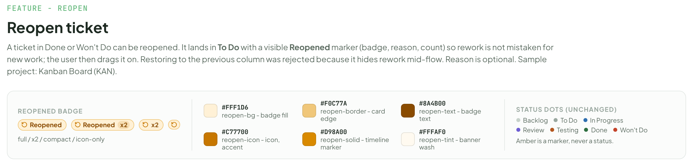
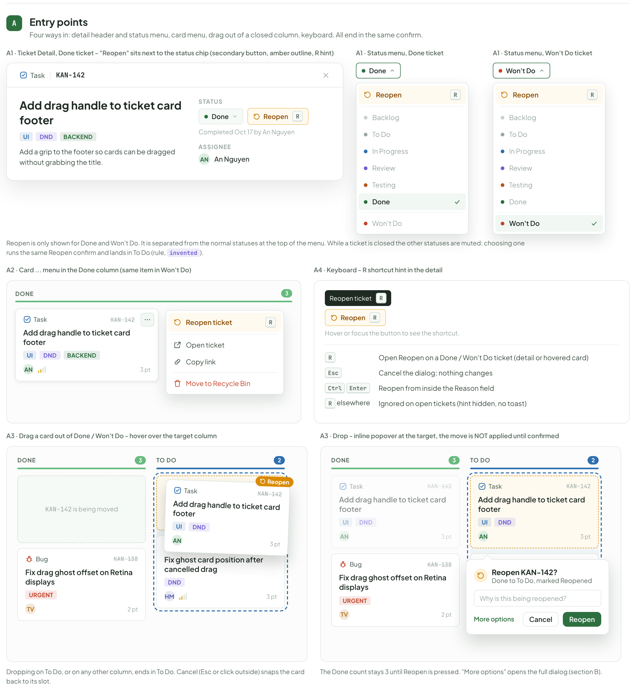
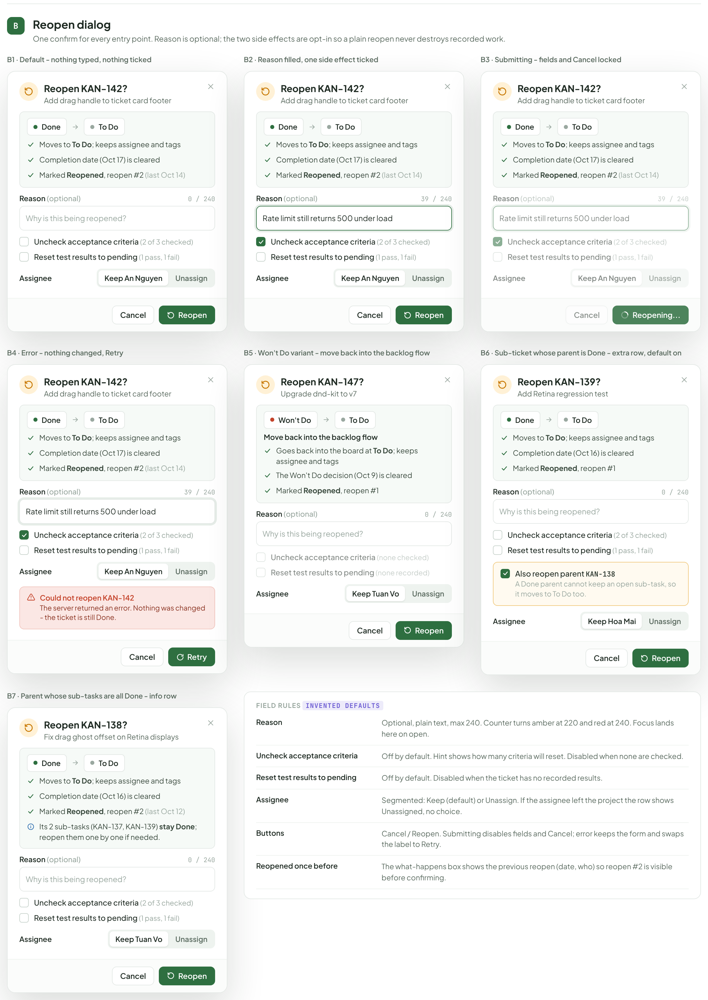
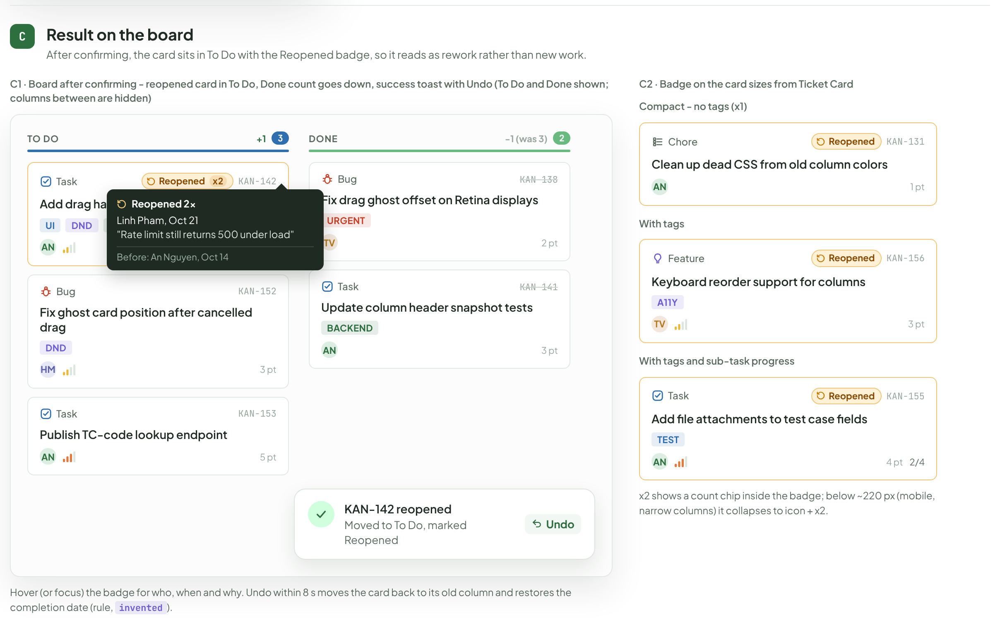
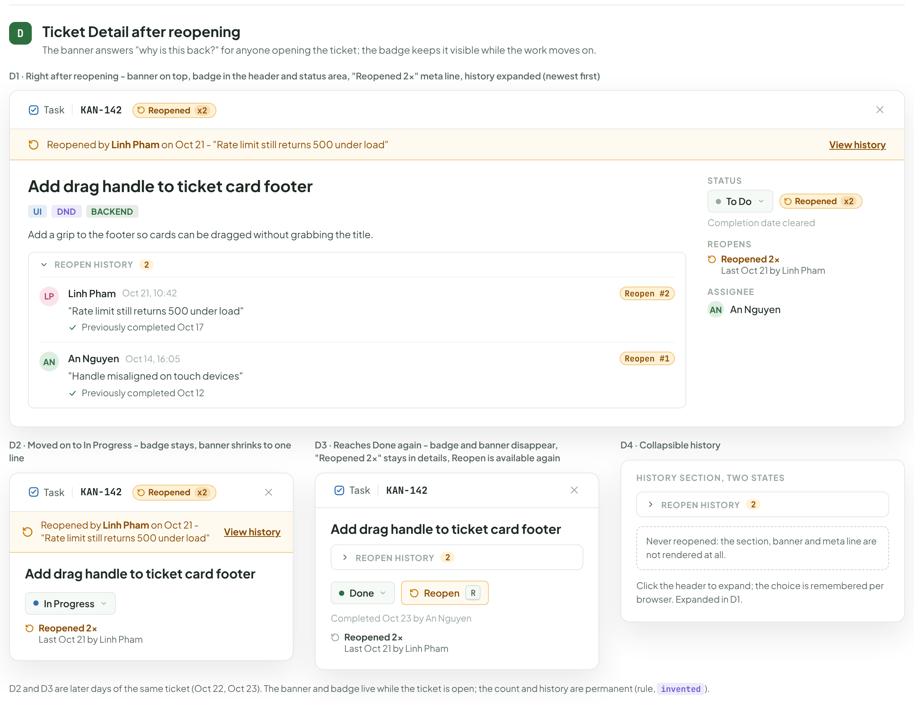
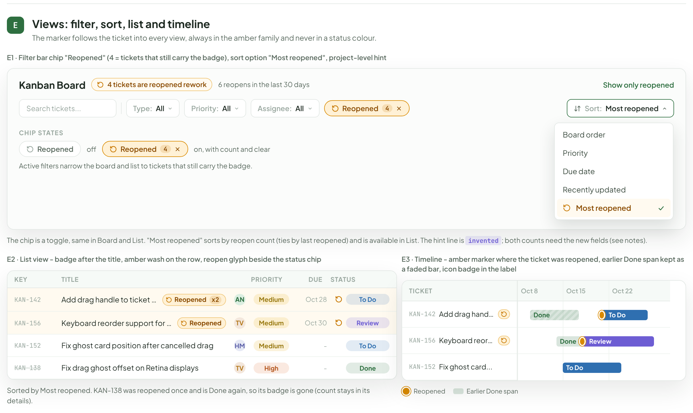
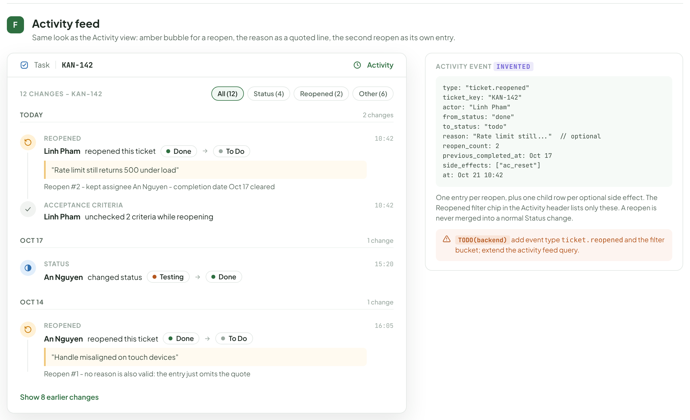
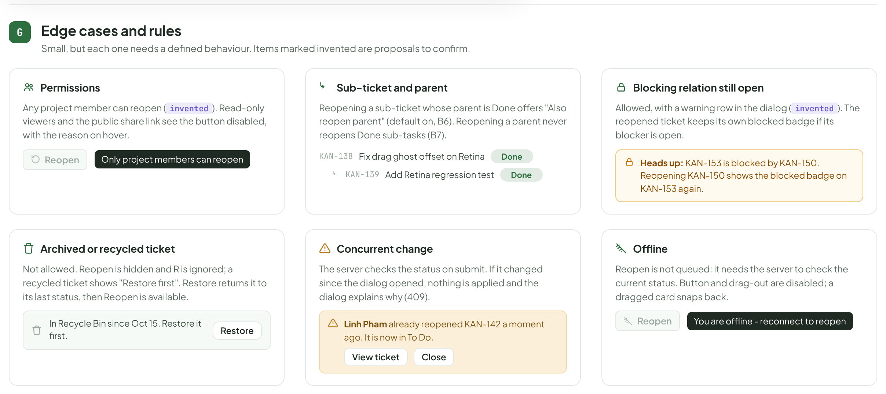
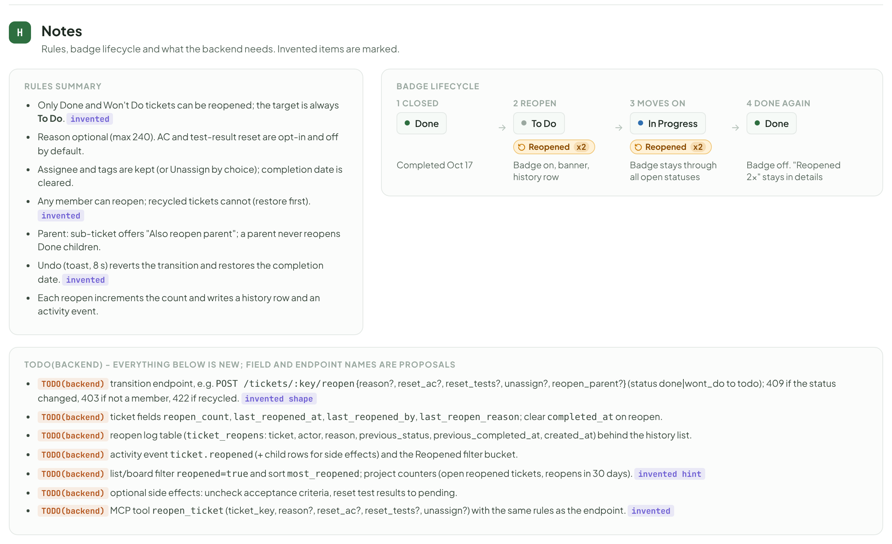

# Reopen ticket

> Component — v1 · source: [`TicketReopen.dc.html`](../source/TicketReopen.dc.html) · canvas `1792584105-26d0` · sha256 `5c5d6d5119493e22c4fbb223c279b1c4d1c998ee0b9d63f4c1a6772b23766aac`

Eyebrow "Feature - Reopen". A ticket in Done or Won't Do can be reopened. It lands in **To Do** with a visible **Reopened** marker (badge, reason, count) so rework is not mistaken for new work; the user then drags it on. Restoring to the previous column was rejected because it hides rework mid-flow. Reason is optional. Sample project: Kanban Board (KAN).

---

## Reopened badge

Source: [TicketReopen.dc.html](../source/TicketReopen.dc.html) › header ("Feature - Reopen", "Reopen ticket" and the intro) and the legend block "Reopened badge" (badge sizes, colour tokens and the unchanged status dots)



- Eyebrow "Feature - Reopen"; title "Reopen ticket"; intro: "A ticket in Done or Won't Do can be reopened. It lands in" "To Do" "with a visible" "Reopened" "marker (badge, reason, count) so rework is not mistaken for new work; the user then drags it on. Restoring to the previous column was rejected because it hides rework mid-flow. Reason is optional. Sample project: Kanban Board (KAN)."
- Legend "Reopened badge": badges "Reopened", "Reopened" "x2", "x2", icon-only; caption "full / x2 / compact / icon-only".
- Colour tokens:

| Hex | Token |
|---|---|
| "#FFF1D6" | "reopen-bg - badge fill" |
| "#F0C77A" | "reopen-border - card edge" |
| "#8A4B00" | "reopen-text - badge text" |
| "#C77700" | "reopen-icon - icon, accent" |
| "#D98A00" | "reopen-solid - timeline marker" |
| "#FFFAF0" | "reopen-tint - banner wash" |

- "Status dots (unchanged)": "Backlog", "To Do", "In Progress", "Review", "Testing", "Done", "Won't Do". "Amber is a marker, never a status."

---

## A. Entry points

Four ways in: detail header and status menu, card menu, drag out of a closed column, keyboard. All end in the same confirm.

Source: [TicketReopen.dc.html](../source/TicketReopen.dc.html) › block "A Entry points" (A1 detail card with two status menus on the right; A2 card menu and A4 keyboard in the middle row; two A3 drag boards at the bottom)



### A1. Ticket Detail and status menu

- Caption: "A1 · Ticket Detail, Done ticket - "Reopen" sits next to the status chip (secondary button, amber outline, R hint)".
- Header "Task" "KAN-142"; title "Add drag handle to ticket card footer"; tags "ui", "dnd", "backend"; description "Add a grip to the footer so cards can be dragged without grabbing the title."
- "Status" "Done" and button "Reopen" "R"; "Completed Oct 17 by An Nguyen". "Assignee" "AN" "An Nguyen".
- Caption "A1 · Status menu, Done ticket": "Done"; item "Reopen" "R"; "Backlog", "To Do", "In Progress", "Review", "Testing", "Done", "Won't Do".
- Caption "A1 · Status menu, Won't Do ticket": "Won't Do"; item "Reopen" "R"; "Backlog", "To Do", "In Progress", "Review", "Testing", "Done", "Won't Do".
- "Reopen is only shown for Done and Won't Do. It is separated from the normal statuses at the top of the menu. While a ticket is closed the other statuses are muted: choosing one runs the same Reopen confirm and lands in To Do (rule," "invented" ")."

### A2. Card menu

- Caption: "A2 · Card ... menu in the Done column (same item in Won't Do)".
- Column "Done" "3"; card "Task" "KAN-142" "Add drag handle to ticket card footer" "ui" "dnd" "backend" "AN" "3 pt".
- Menu: "Reopen ticket" "R"; "Open ticket"; "Copy link"; "Move to Recycle Bin".

### A4. Keyboard

- Caption: "A4 · Keyboard - R shortcut hint in the detail".
- Tooltip "Reopen ticket" "R"; button "Reopen" "R"; "Hover or focus the button to see the shortcut."
- Key table:

| Key | Behaviour |
|---|---|
| "R" | "Open Reopen on a Done / Won't Do ticket (detail or hovered card)" |
| "Esc" | "Cancel the dialog; nothing changes" |
| "Ctrl" "Enter" | "Reopen from inside the Reason field" |
| "R" "elsewhere" | "Ignored on open tickets (hint hidden, no toast)" |

### A3. Drag out of a closed column

- Caption: "A3 · Drag a card out of Done / Won't Do - hover over the target column".
- "Done" "3": placeholder "KAN-142" "is being moved"; card "Bug" "KAN-138" "Fix drag ghost offset on Retina displays" "urgent" "TV" "2 pt".
- "To Do" "2": amber label "Drop to reopen"; card "Bug" "KAN-152" "Fix ghost card position after cancelled drag" "dnd" "HM" "3 pt"; drag ghost "Task" "KAN-142" "Add drag handle to ticket card footer" "ui" "dnd" "AN" "3 pt" with label "Reopen".
- "Dropping on To Do, or on any other column, ends in To Do. Cancel (Esc or click outside) snaps the card back to its slot."
- Caption: "A3 · Drop - inline popover at the target, the move is NOT applied until confirmed".
- "Done" "3": dimmed "Task" "KAN-142" "Add drag handle to ticket card footer" "ui" "dnd" "AN" "3 pt"; "Bug" "KAN-138" "Fix drag ghost offset on Retina displays" "urgent" "TV" "2 pt".
- "To Do" "2": "Task" "KAN-142" "Add drag handle to ticket card footer" "ui" "dnd" "AN" "3 pt"; "Bug" "KAN-152" "Fix ghost card position after cancelled drag" "dnd" "HM" "3 pt".
- Popover: "Reopen KAN-142?" "Done to To Do, marked Reopened"; input placeholder "Why is this being reopened?"; "More options", "Cancel", "Reopen".
- "The Done count stays 3 until Reopen is pressed. "More options" opens the full dialog (section B)."

---

## B. Reopen dialog

One confirm for every entry point. Reason is optional; the two side effects are opt-in so a plain reopen never destroys recorded work.

Source: [TicketReopen.dc.html](../source/TicketReopen.dc.html) › block "B Reopen dialog" (seven dialog states B1 to B7 in a three-column grid, plus the "Field rules" card)



Shared body of B1 to B4, B6 and B7 (differences are listed per card): title "Reopen KAN-142?" with subtitle "Add drag handle to ticket card footer"; box "Done" to "To Do"; "Moves to" "To Do" "; keeps assignee and tags"; "Completion date (Oct 17) is cleared"; "Marked" "Reopened" ", reopen #2" "(last Oct 14)"; "Reason" "(optional)" with counter; "Uncheck acceptance criteria" "(2 of 3 checked)"; "Reset test results to pending" "(1 pass, 1 fail)"; "Assignee" "Keep An Nguyen" / "Unassign"; "Cancel", "Reopen".

### B1. Default

- Caption: "B1 · Default - nothing typed, nothing ticked".
- Counter "0 / 240"; placeholder "Why is this being reopened?"; both checkboxes empty.

### B2. Reason filled

- Caption: "B2 · Reason filled, one side effect ticked".
- Counter "39 / 240"; text "Rate limit still returns 500 under load"; "Uncheck acceptance criteria" ticked.

### B3. Submitting

- Caption: "B3 · Submitting - fields and Cancel locked".
- Counter "39 / 240"; text "Rate limit still returns 500 under load"; fields locked; "Cancel" muted; primary button "Reopening...".

### B4. Error

- Caption: "B4 · Error - nothing changed, Retry".
- Counter "39 / 240"; text "Rate limit still returns 500 under load".
- Red box: "Could not reopen KAN-142" "The server returned an error. Nothing was changed - the ticket is still Done."
- Buttons "Cancel", "Retry".

### B5. Won't Do variant

- Caption: "B5 · Won't Do variant - move back into the backlog flow".
- "Reopen KAN-147?" "Upgrade dnd-kit to v7"; "Won't Do" to "To Do".
- "Move back into the backlog flow"; "Goes back into the board at" "To Do" "; keeps assignee and tags"; "The Won't Do decision (Oct 9) is cleared"; "Marked" "Reopened" ", reopen #1".
- "Reason" "(optional)" "0 / 240" "Why is this being reopened?"
- "Uncheck acceptance criteria" "(none checked)"; "Reset test results to pending" "(none recorded)" (both disabled).
- "Assignee" "Keep Tuan Vo" "Unassign"; "Cancel", "Reopen".

### B6. Sub-ticket whose parent is Done

- Caption: "B6 · Sub-ticket whose parent is Done - extra row, default on".
- "Reopen KAN-139?" "Add Retina regression test"; "Done" to "To Do"; "Moves to" "To Do" "; keeps assignee and tags"; "Completion date (Oct 16) is cleared"; "Marked" "Reopened" ", reopen #1".
- "Reason" "(optional)" "0 / 240" "Why is this being reopened?"; "Uncheck acceptance criteria" "(2 of 3 checked)"; "Reset test results to pending" "(1 pass, 1 fail)".
- Amber row, ticked: "Also reopen parent" "KAN-138" "A Done parent cannot keep an open sub-task, so it moves to To Do too."
- "Assignee" "Keep Hoa Mai" "Unassign"; "Cancel", "Reopen".

### B7. Parent whose sub-tasks are all Done

- Caption: "B7 · Parent whose sub-tasks are all Done - info row".
- "Reopen KAN-138?" "Fix drag ghost offset on Retina displays"; "Done" to "To Do"; "Moves to" "To Do" "; keeps assignee and tags"; "Completion date (Oct 16) is cleared"; "Marked" "Reopened" ", reopen #2" "(last Oct 12)".
- Info row: "Its 2 sub-tasks (KAN-137, KAN-139)" "stay Done" "; reopen them one by one if needed."
- "Reason" "(optional)" "0 / 240" "Why is this being reopened?"; "Uncheck acceptance criteria" "(2 of 3 checked)"; "Reset test results to pending" "(1 pass, 1 fail)"; "Assignee" "Keep Tuan Vo" "Unassign"; "Cancel", "Reopen".

### Field rules

- "Field rules" "invented defaults".

| Field | Rule |
|---|---|
| "Reason" | "Optional, plain text, max 240. Counter turns amber at 220 and red at 240. Focus lands here on open." |
| "Uncheck acceptance criteria" | "Off by default. Hint shows how many criteria will reset. Disabled when none are checked." |
| "Reset test results to pending" | "Off by default. Disabled when the ticket has no recorded results." |
| "Assignee" | "Segmented: Keep" "(default) or Unassign. If the assignee left the project the row shows Unassigned, no choice." |
| "Buttons" | "Cancel / Reopen. Submitting disables fields and Cancel; error keeps the form and swaps the label to Retry." |
| "Reopened once before" | "The what-happens box shows the previous reopen (date, who) so reopen #2 is visible before confirming." |

---

## C. Result on the board

After confirming, the card sits in To Do with the Reopened badge, so it reads as rework rather than new work.

Source: [TicketReopen.dc.html](../source/TicketReopen.dc.html) › block "C Result on the board" (C1 two-column board with hover tooltip and toast on the left; C2 badge sizes on the right)



### C1. Board after confirming

- Caption: "C1 · Board after confirming - reopened card in To Do, Done count goes down, success toast with Undo (To Do and Done shown; columns between are hidden)".
- "To Do" "+1" "3": "Task" "Reopened" "x2" "KAN-142" "Add drag handle to ticket card footer" "ui" "dnd" "backend" "AN" "3 pt"; "Bug" "KAN-152" "Fix ghost card position after cancelled drag" "dnd" "HM" "3 pt"; "Task" "KAN-153" "Publish TC-code lookup endpoint" "AN" "5 pt".
- Hover tooltip: "Reopened 2x" "Linh Pham, Oct 21" ""Rate limit still returns 500 under load"" "Before: An Nguyen, Oct 14".
- "Done" "-1 (was 3)" "2": "Bug" "KAN-138" "Fix drag ghost offset on Retina displays" "urgent" "TV" "2 pt"; "Task" "KAN-141" "Update column header snapshot tests" "backend" "AN" "3 pt".
- Toast: "KAN-142 reopened" "Moved to To Do, marked Reopened" "Undo".
- "Hover (or focus) the badge for who, when and why. Undo within 8 s moves the card back to its old column and restores the completion date (rule," "invented" ")."

### C2. Badge on the card sizes from Ticket Card

- Caption: "C2 · Badge on the card sizes from Ticket Card".
- "Compact - no tags (x1)": "Chore" "Reopened" "KAN-131" "Clean up dead CSS from old column colors" "AN" "1 pt".
- "With tags": "Feature" "Reopened" "KAN-156" "Keyboard reorder support for columns" "a11y" "TV" "3 pt".
- "With tags and sub-task progress": "Task" "Reopened" "KAN-155" "Add file attachments to test case fields" "test" "AN" "4 pt" "2/4".
- "x2 shows a count chip inside the badge; below ~220 px (mobile, narrow columns) it collapses to icon + x2."

---

## D. Ticket Detail after reopening

The banner answers "why is this back?" for anyone opening the ticket; the badge keeps it visible while the work moves on.

Source: [TicketReopen.dc.html](../source/TicketReopen.dc.html) › block "D Ticket Detail after reopening" (D1 full-width detail; D2, D3 and D4 side by side below)



### D1. Right after reopening

- Caption: "D1 · Right after reopening - banner on top, badge in the header and status area, "Reopened 2x" meta line, history expanded (newest first)".
- Header "Task" "KAN-142" "Reopened" "x2".
- Banner: "Reopened by" "Linh Pham" "on Oct 21 - "Rate limit still returns 500 under load"" and link "View history".
- Title "Add drag handle to ticket card footer"; tags "ui", "dnd", "backend"; "Add a grip to the footer so cards can be dragged without grabbing the title."
- "REOPEN HISTORY" "2":
  - "LP" "Linh Pham" "Oct 21, 10:42" "Reopen #2" ""Rate limit still returns 500 under load"" "Previously completed Oct 17".
  - "AN" "An Nguyen" "Oct 14, 16:05" "Reopen #1" ""Handle misaligned on touch devices"" "Previously completed Oct 12".
- Sidebar: "Status" "To Do" "Reopened" "x2" "Completion date cleared"; "Reopens" "Reopened 2x" "Last Oct 21 by Linh Pham"; "Assignee" "AN" "An Nguyen".

### D2. Moved on to In Progress

- Caption: "D2 · Moved on to In Progress - badge stays, banner shrinks to one line".
- "Task" "KAN-142" "Reopened" "x2"; banner "Reopened by" "Linh Pham" "on Oct 21 - "Rate limit still returns 500 under load"" "View history".
- "Add drag handle to ticket card footer"; status "In Progress"; "Reopened 2x" "Last Oct 21 by Linh Pham".

### D3. Reaches Done again

- Caption: "D3 · Reaches Done again - badge and banner disappear, "Reopened 2x" stays in details, Reopen is available again".
- "Task" "KAN-142"; "Add drag handle to ticket card footer"; collapsed "REOPEN HISTORY" "2".
- "Done" "Reopen" "R"; "Completed Oct 23 by An Nguyen"; "Reopened 2x" "Last Oct 21 by Linh Pham".

### D4. Collapsible history

- Caption: "D4 · Collapsible history".
- Card "History section, two states": collapsed "REOPEN HISTORY" "2"; dashed box "Never reopened: the section, banner and meta line are not rendered at all."
- "Click the header to expand; the choice is remembered per browser. Expanded in D1."
- "D2 and D3 are later days of the same ticket (Oct 22, Oct 23). The banner and badge live while the ticket is open; the count and history are permanent (rule," "invented" ")."

---

## E. Views: filter, sort, list and timeline

The marker follows the ticket into every view, always in the amber family and never in a status colour.

Source: [TicketReopen.dc.html](../source/TicketReopen.dc.html) › block "E Views: filter, sort, list and timeline" (E1 filter bar card with the sort menu open; E2 list view and E3 timeline side by side)



### E1. Filter bar chip

- Caption: "E1 · Filter bar chip "Reopened" (4 = tickets that still carry the badge), sort option "Most reopened", project-level hint".
- "Kanban Board"; amber hint "4 tickets are reopened rework"; "6 reopens in the last 30 days"; link "Show only reopened".
- Filter bar: "Search tickets..."; "Type:" "All"; "Priority:" "All"; "Assignee:" "All"; chip "Reopened" "4"; "Sort:" "Most reopened".
- Sort menu: "Board order", "Priority", "Due date", "Recently updated", "Most reopened" (checked).
- "Chip states": "Reopened" "off"; "Reopened" "4" "on, with count and clear".
- "Active filters narrow the board and list to tickets that still carry the badge."
- "The chip is a toggle, same in Board and List. "Most reopened" sorts by reopen count (ties by last reopened) and is available in List. The hint line is" "invented" "; both counts need the new fields (see notes)."

### E2. List view

- Caption: "E2 · List view - badge after the title, amber wash on the row, reopen glyph beside the status chip".
- Columns "Key", "Title", "Priority", "Due", "Status".

| Key | Title | Badge | Assignee | Priority | Due | Status |
|---|---|---|---|---|---|---|
| "KAN-142" | "Add drag handle to ticket card footer" | "Reopened" "x2" | "AN" | "Medium" | "Oct 28" | "To Do" |
| "KAN-156" | "Keyboard reorder support for columns" | "Reopened" | "TV" | "Medium" | "Oct 30" | "Review" |
| "KAN-152" | "Fix ghost card position after cancelled drag" | none | "HM" | "Medium" | "-" | "To Do" |
| "KAN-138" | "Fix drag ghost offset on Retina displays" | none | "TV" | "High" | "-" | "Done" |

- "Sorted by Most reopened. KAN-138 was reopened once and is Done again, so its badge is gone (count stays in its details)."

### E3. Timeline

- Caption: "E3 · Timeline - amber marker where the ticket was reopened, earlier Done span kept as a faded bar, icon badge in the label".
- Header "Ticket"; "Oct 8", "Oct 15", "Oct 22".
- Rows: "KAN-142" "Add drag handle..." bars "Done" (faded), "To Do"; "KAN-156" "Keyboard reorder..." bars "Done", "Review"; "KAN-152" "Fix ghost card..." bar "To Do".
- Legend: "Reopened"; "Earlier Done span".

---

## F. Activity feed

Same look as the Activity view: amber bubble for a reopen, the reason as a quoted line, the second reopen as its own entry.

Source: [TicketReopen.dc.html](../source/TicketReopen.dc.html) › block "F Activity feed" (Activity panel for KAN-142 on the left, "Activity event" card on the right)



- Header: "Task" "KAN-142" "Activity".
- "12 changes - KAN-142"; filter chips "All (12)", "Status (4)", "Reopened (2)", "Other (6)".
- "Today" "2 changes":
  - "Reopened" "Linh Pham" "reopened this ticket" "Done" to "To Do"; quote ""Rate limit still returns 500 under load""; "Reopen #2 - kept assignee An Nguyen - completion date Oct 17 cleared"; "10:42".
  - "Acceptance criteria" "Linh Pham" "unchecked 2 criteria while reopening" "10:42".
- "Oct 17" "1 change": "Status" "An Nguyen" "changed status" "Testing" to "Done" "15:20".
- "Oct 14" "1 change": "Reopened" "An Nguyen" "reopened this ticket" "Done" to "To Do"; quote ""Handle misaligned on touch devices""; "Reopen #1 - no reason is also valid: the entry just omits the quote"; "16:05".
- Link "Show 8 earlier changes".
- Right card: "Activity event" "invented":

```
type: "ticket.reopened" ticket_key: "KAN-142" actor: "Linh Pham" from_status: "done" to_status: "todo" reason: "Rate limit still..." // optional reopen_count: 2 previous_completed_at: Oct 17 side_effects: ["ac_reset"] at: Oct 21 10:42
```

- "One entry per reopen, plus one child row per optional side effect. The Reopened filter chip in the Activity header lists only these. A reopen is never merged into a normal Status change."
- "TODO(backend)" "add event type" `ticket.reopened` "and the filter bucket; extend the activity feed query."

---

## G. Edge cases and rules

Small, but each one needs a defined behaviour. Items marked invented are proposals to confirm.

Source: [TicketReopen.dc.html](../source/TicketReopen.dc.html) › block "G Edge cases and rules" (six cards in two rows of three)



### Permissions

- "Any project member can reopen (" "invented" "). Read-only viewers and the public share link see the button disabled, with the reason on hover."
- Disabled button "Reopen"; tooltip "Only project members can reopen".

### Sub-ticket and parent

- "Reopening a sub-ticket whose parent is Done offers "Also reopen parent" (default on, B6). Reopening a parent never reopens Done sub-tasks (B7)."
- "KAN-138" "Fix drag ghost offset on Retina" "Done"; child "KAN-139" "Add Retina regression test" "Done".

### Blocking relation still open

- "Allowed, with a warning row in the dialog (" "invented" "). The reopened ticket keeps its own blocked badge if its blocker is open."
- Amber row: "Heads up:" "KAN-153 is blocked by KAN-150. Reopening KAN-150 shows the blocked badge on KAN-153 again."

### Archived or recycled ticket

- "Not allowed. Reopen is hidden and R is ignored; a recycled ticket shows "Restore first". Restore returns it to its last status, then Reopen is available."
- "In Recycle Bin since Oct 15. Restore it first." Button "Restore".

### Concurrent change

- "The server checks the status on submit. If it changed since the dialog opened, nothing is applied and the dialog explains why (409)."
- Amber box: "Linh Pham" "already reopened KAN-142 a moment ago. It is now in To Do." Buttons "View ticket", "Close".

### Offline

- "Reopen is not queued: it needs the server to check the current status. Button and drag-out are disabled; a dragged card snaps back."
- Disabled button "Reopen"; tooltip "You are offline - reconnect to reopen".

---

## H. Notes

Rules, badge lifecycle and what the backend needs. Invented items are marked.

Source: [TicketReopen.dc.html](../source/TicketReopen.dc.html) › block "H Notes" (Rules summary and Badge lifecycle cards on top, the TODO(backend) list below). Reproduced in full under Note.



## Note

Rules summary:

- Only Done and Won't Do tickets can be reopened; the target is always **To Do**. `invented`
- Reason optional (max 240). AC and test-result reset are opt-in and off by default.
- Assignee and tags are kept (or Unassign by choice); completion date is cleared.
- Any member can reopen; recycled tickets cannot (restore first). `invented`
- Parent: sub-ticket offers "Also reopen parent"; a parent never reopens Done children.
- Undo (toast, 8 s) reverts the transition and restores the completion date. `invented`
- Each reopen increments the count and writes a history row and an activity event.

Badge lifecycle:

| Step | Status | Badge | Caption |
|---|---|---|---|
| 1 Closed | "Done" | none | "Completed Oct 17" |
| 2 Reopen | "To Do" | "Reopened" "x2" | "Badge on, banner, history row" |
| 3 Moves on | "In Progress" | "Reopened" "x2" | "Badge stays through all open statuses" |
| 4 Done again | "Done" | none | "Badge off. "Reopened 2x" stays in details" |

"TODO(backend) - everything below is new; field and endpoint names are proposals":

- TODO(backend) transition endpoint, e.g. `POST /tickets/:key/reopen` {reason?, reset_ac?, reset_tests?, unassign?, reopen_parent?} (status done\|wont_do to todo); 409 if the status changed, 403 if not a member, 422 if recycled. `invented shape`
- TODO(backend) ticket fields `reopen_count`, `last_reopened_at`, `last_reopened_by`, `last_reopen_reason`; clear `completed_at` on reopen.
- TODO(backend) reopen log table (`ticket_reopens`: ticket, actor, reason, previous_status, previous_completed_at, created_at) behind the history list.
- TODO(backend) activity event `ticket.reopened` (+ child rows for side effects) and the Reopened filter bucket.
- TODO(backend) list/board filter `reopened=true` and sort `most_reopened`; project counters (open reopened tickets, reopens in 30 days). `invented hint`
- TODO(backend) optional side effects: uncheck acceptance criteria, reset test results to pending.
- TODO(backend) MCP tool `reopen_ticket` (ticket_key, reason?, reset_ac?, reset_tests?, unassign?) with the same rules as the endpoint. `invented`
