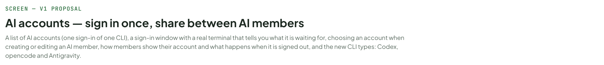
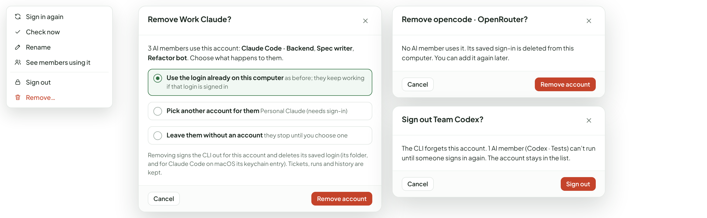
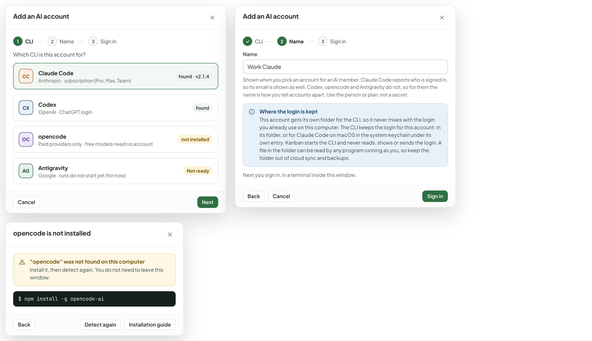
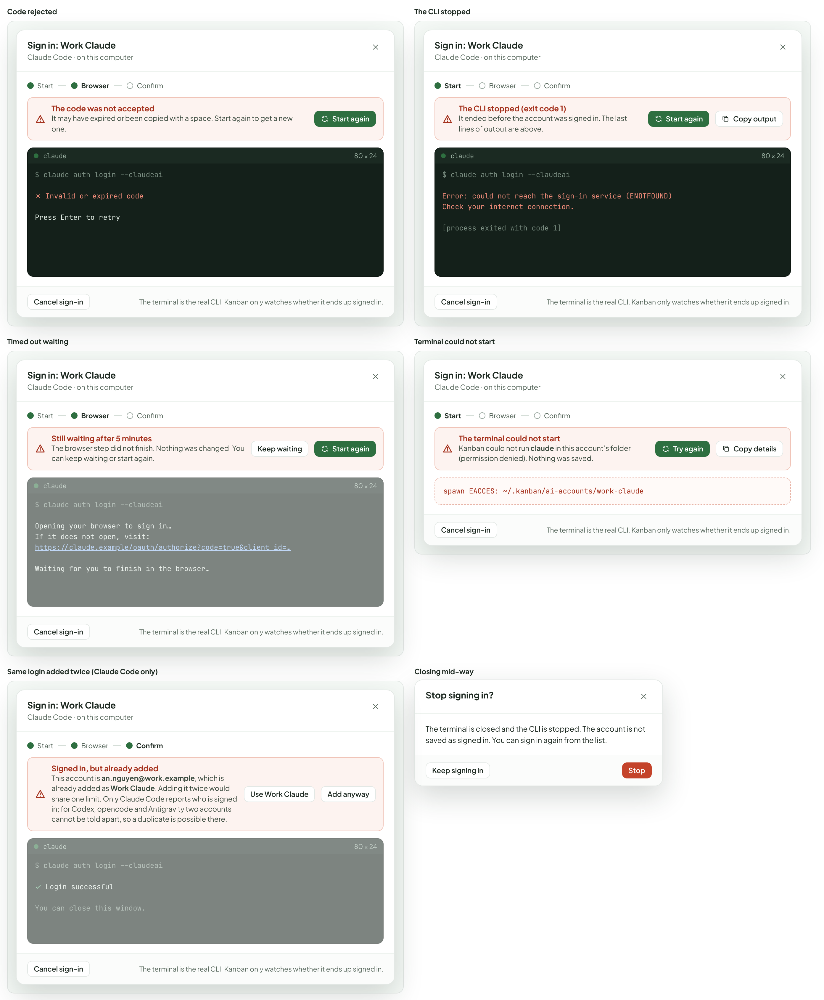
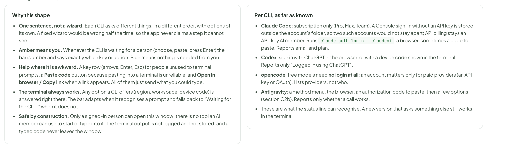
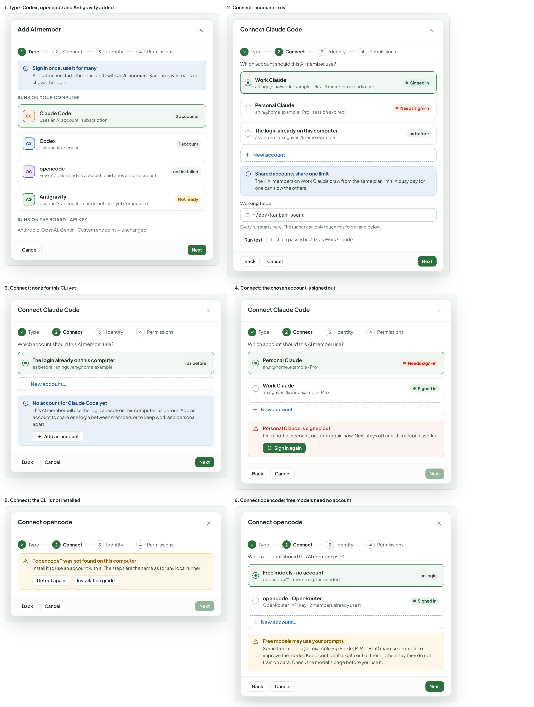
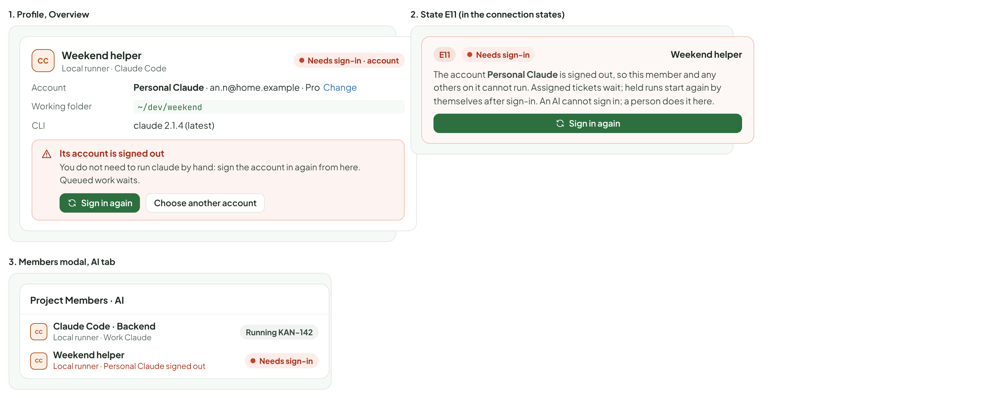
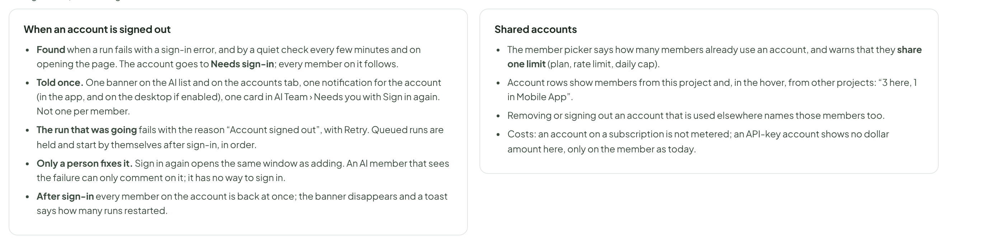
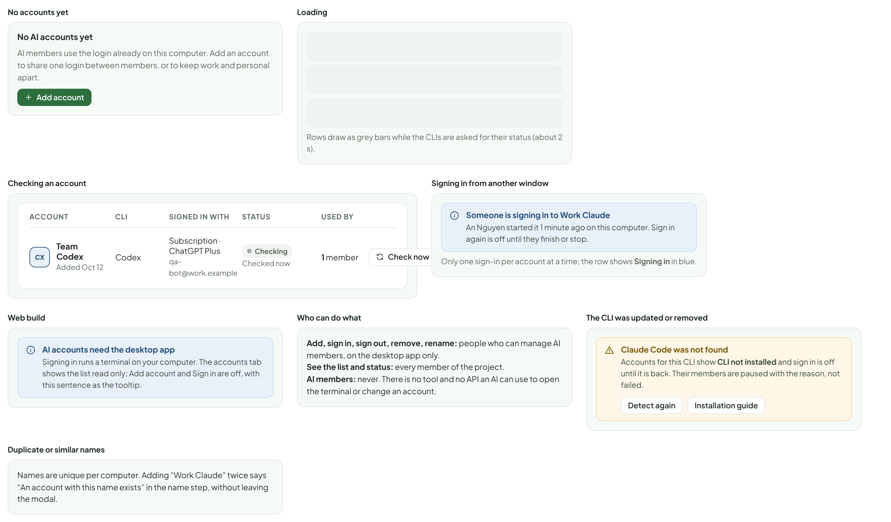
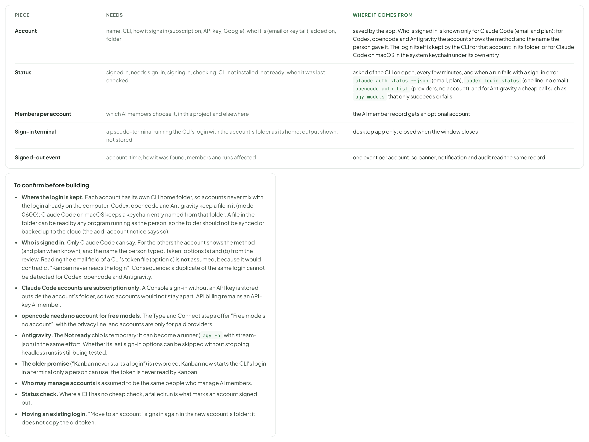

# AI accounts — sign in once, share between AI members

> SCREEN — V1 PROPOSAL · source: [`AiAccounts.dc.html`](../source/AiAccounts.dc.html) · canvas `1793441161-d562` · sha256 `bf2ba4a1b2b62ebdb827376b116e7c9dc7f5b85fda45614440bb7da2274c5a6c`

> Based on `main` and [ai-members.md](ai-members.md). Desktop only. Mock terminal text is illustrative: each CLI words its own prompts.

A list of AI accounts (one sign-in of one CLI), a sign-in window with a real terminal that tells you what it is waiting for, choosing an account when creating or editing an AI member, how members show their account and what happens when it is signed out, and the new CLI types: Codex, opencode and Antigravity.

Source: [AiAccounts.dc.html](../source/AiAccounts.dc.html) › header ("SCREEN — V1 PROPOSAL", "AI accounts — sign in once, share between AI members" and the intro)

---

## A. Where each piece lives, and why

Desktop only. An AI account is one sign-in of one CLI (Claude Code, Codex, opencode or Antigravity). Several AI members can pick the same account: sign in once, and when it expires fix it in one place. The older ways stay: the login already on this computer, and API keys for providers the board calls itself. Only a person can sign in; an AI has no way to open or use the terminal. Mock terminal text is illustrative: each CLI words its own prompts.

Source: [AiAccounts.dc.html](../source/AiAccounts.dc.html) › block "A. Where each piece lives, and why"

- Text in the frames: "REQUEST" · "PROPOSAL" · "WHY" · "1. The list" · "A third tab on the Members page, AI accounts, next to Humans and AI. A link “Manage AI accounts” in Settings › AI, beside “Manage AI members”." · "People and AI members already live on this page, and an account is something an AI member picks. No new sidebar item. An account belongs to this computer, not to a project, so the tab shows all of them and says how many members of this project use each." · "2. Add and sign in" · "A short modal in three steps: choose the CLI, name it, sign in. The sign-in step has a real terminal in the middle, a one-line status above it and the few actions that help below it." · "A modal because signing in is one task with a start and an end, and nothing else on the page matters meanwhile. A docked panel would invite people to keep working while a login waits for them in a corner." · "3. Choose when creating a member" · "In the Connect step, a list of accounts for that CLI with “Use the login already on this computer” kept as the last choice and New account… opening the same modal on top." · "The old way stays exactly as it was. Nobody has to create an account to keep working." · "4. Where a member shows its account, and signed out" · "A second line under the connection in the AI list, an Account row in the profile, a state card Account needs sign-in, and one banner and one notification per account, not per member." · "Three members on one account fail together; they should be told together and fixed once." · "5. New types" · "Codex, opencode and Antigravity in the Type step, under “Runs on your computer”. Each says whether the CLI is found and whether it has an account." · "opencode’s free models need no account, so opencode can be chosen without one. Antigravity is listed but its runs do not start yet; it carries a temporary Not ready chip and the Connect step says so."

---

## B1. AI accounts, the list

One row per account: its name, the CLI, what it is signed in with, whether it works, and how many AI members use it. The one that needs attention has its button in the row and a banner above, so it is found in either place. Signed-in accounts offer Check now; the menu holds the rest.

Source: [AiAccounts.dc.html](../source/AiAccounts.dc.html) › block "B1. AI accounts, the list"

- Text in the frames: "KANBAN" · "PROJECTS" · "Kanban Board" · "KAN" · "Mobile App" · "MOB" · "Marketing Site" · "MKT" · "Settings" · "Members" · "4 · 7 AI" · "Recycle Bin" · "3" · "Kanban Board / Members" · "Add AI member" · "Humans" · "4" · "AI" · "7" · "AI accounts" · "5" · "One sign-in of a CLI. Several AI members can use the same account; if it expires you fix it here, once. The login stays with the CLI; Kanban never reads or shows it." · "Add account" · "Personal Claude needs to sign in again" · "Its session expired 4 minutes ago. 1 AI member (Weekend helper) can’t run until someone signs in." · "Sign in again" · "ACCOUNTS" · "on this computer" · "SIGNED IN" · "of 5" · "NEED ATTENTION" · "1" · "Personal Claude" · "MEMBERS USING ONE" · "8" · "7 here, 1 in Mobile App" · "ACCOUNT" · "CLI" · "SIGNED IN WITH" · "STATUS" · "USED BY" · "CC" · "Work Claude" · "Added Oct 12" · "Claude Code" · "Subscription · Max" · "an.nguyen@work.example" · "Signed in" · "Checked 2 min ago" · "3 members" · "Check now" · "Subscription · Pro" · "an.n@home.example" · "Needs sign-in" · "Session expired. 1 member can’t run." · "1 member" · "CX" · "Team Codex" · "Codex" · "ChatGPT login" · "OC" · "opencode · OpenRouter" · "opencode" · "OpenRouter · API key" · "2 members" · "AG" · "Antigravity" · "Google sign-in" · "Not ready" · "Runs don’t start yet for this CLI." · "Logins already on this computer" · "What AI members use today when no account is chosen. Not managed here; they keep working as before." · "Claude Code · an.nguyen@home.example" · "Move to an account"

---

## B2. Row menu and the two ways to remove

Remove asks what should happen to the members using the account, so none is left half connected. Sign out keeps the account in the list.

Source: [AiAccounts.dc.html](../source/AiAccounts.dc.html) › block "B2. Row menu and the two ways to remove"

- Text in the frames: "Sign in again" · "Check now" · "Rename" · "See members using it" · "Sign out" · "Remove…" · "Remove Work Claude?" · "3 AI members use this account: Claude Code · Backend, Spec writer, Refactor bot. Choose what happens to them." · "Use the login already on this computer as before; they keep working if that login is signed in" · "Pick another account for them Personal Claude (needs sign-in)" · "Leave them without an account they stop until you choose one" · "Removing signs the CLI out for this account and deletes its saved login (its folder, and for Claude Code on macOS its keychain entry). Tickets, runs and history are kept." · "Cancel" · "Remove account" · "Remove opencode · OpenRouter?" · "No AI member uses it. Its saved sign-in is deleted from this computer. You can add it again later." · "Sign out Team Codex?" · "The CLI forgets this account. 1 AI member (Codex · Tests) can’t run until someone signs in again. The account stays in the list."

---

## C1. Add an account: CLI, then name

Three steps in one modal. A CLI that is not installed says so on its card and leads to the install step with Detect again, as the AI member flow already does.

Source: [AiAccounts.dc.html](../source/AiAccounts.dc.html) › block "C1. Add an account: CLI, then name"

- Text in the frames: "Add an AI account" · "1" · "CLI" · "2" · "Name" · "3" · "Sign in" · "Which CLI is this account for?" · "CC" · "Claude Code" · "Anthropic · subscription (Pro, Max, Team)" · "found · v2.1.4" · "CX" · "Codex" · "OpenAI · ChatGPT login" · "found" · "OC" · "opencode" · "Paid providers only · free models need no account" · "not installed" · "AG" · "Antigravity" · "Google · runs do not start yet (for now)" · "Not ready" · "Cancel" · "Next" · "Work Claude" · "Shown when you pick an account for an AI member. Claude Code reports who is signed in, so its email is shown as well. Codex, opencode and Antigravity do not, so for them the name is how you tell accounts apart. Use the person or plan, not a secret." · "Where the login is kept" · "This account gets its own folder for the CLI, so it never mixes with the login you already use on this computer. The CLI keeps the login for this account: in its folder, or for Claude Code on macOS in the system keychain under its own entry. Kanban starts the CLI and never reads, shows or sends the login. A file in the folder can be read by any program running as you, so keep the folder out of cloud sync and backups." · "Next you sign in, in a terminal inside this window." · "Back" · "opencode is not installed" · "“opencode” was not found on this computer" · "Install it, then detect again. You do not need to leave this window." · "$ npm install -g opencode-ai" · "Detect again" · "Installation guide"

---

## C2. The sign-in window, moment by moment

The whole task in one place. Above the terminal there is always one sentence that says what is happening and, in amber, when it is your turn; blue means the app or the browser is working. Small dots show roughly where you are (a CLI may skip steps, so only the steps that apply are drawn: for Claude Code there is no method menu). The terminal is the real thing and stays fully usable; the status line is a best-effort reading of it. Done is decided by asking the CLI who it is signed in as, never by reading the screen.

Source: [AiAccounts.dc.html](../source/AiAccounts.dc.html) › block "C2. The sign-in window, moment by moment"

![C2. The sign-in window, moment by moment: The whole task in one place. Above the terminal there is always one sentence that says what is happening and, in amber, when it is your turn; blue means the app or the browser is working. Small dots show roughly where you are (a CLI may skip steps, so only the steps that apply are drawn: for Claude Code there is no method menu). The terminal is the real thing and stays fully usable; the status line is a best-effort reading of it. Done is decided by asking the CLI who it is signed in as, never by reading the screen.](../images/ai-accounts/10-c2-the-sign-in-window-moment-by-moment.png)

- Text in the frames: "1. Starting" · "Sign in: Work Claude" · "Claude Code · on this computer" · "Start" · "Browser" · "Confirm" · "Starting the CLI" · "Opening a terminal and running claude in the folder made for this account." · "claude" · "80 × 24" · "$ claude auth login --claudeai" · "Starting…" · "Cancel sign-in" · "The terminal is the real CLI. Kanban only watches whether it ends up signed in." · "2. Browser step: link and Open in browser" · "Finish in your browser" · "A browser window should have opened. Sign in there and approve access. This window updates by itself." · "Open in browser" · "Copy link" · "Opening your browser to sign in…" · "If it does not open, visit:" · "https://claude.example/oauth/authorize?code=true&client_id=…" · "Waiting for you to finish in the browser…" · "3. Paste a code, if the CLI asks" · "Your turn: paste the code" · "The browser shows a code. Copy it, then click Paste code (or paste inside the terminal)." · "Paste code" · "✓ Signed in in the browser" · "Paste code here if prompted > █" · "4. Confirming" · "Checking the sign-in" · "Asking the CLI who it is signed in as. This takes a few seconds." · "✓ Code accepted" · "Finishing up…" · "5. Done" · "Signed in" · "Work Claude is signed in as an.nguyen@work.example · Max plan. It is ready to be chosen by AI members." · "✓ Login successful" · "You can close this window." · "Done"

---

## C2b. A CLI with a menu: Antigravity

Antigravity asks first how to sign in (Google OAuth or a Google Cloud project), then opens the browser, then wants an authorization code pasted into the terminal, then a few options. The same bar, the same helpers; only the sentences differ. Whether the last options can be skipped without stopping headless runs is still being tested.

Source: [AiAccounts.dc.html](../source/AiAccounts.dc.html) › block "C2b. A CLI with a menu: Antigravity"

- Text in the frames: "1. Choose a method (arrow keys)" · "Sign in: Antigravity" · "Antigravity · on this computer" · "Start" · "Choose a method" · "Browser" · "Confirm" · "Your turn: choose how to sign in" · "The CLI is asking a question. Click inside the terminal, then use the arrow keys and Enter. Choose 1 to sign in with a Google account." · "agy" · "80 × 24" · "$ agy login" · "Select login method:" · "❯ 1. Google OAuth" · "2. Use a Google Cloud project" · "Use ↑ ↓ to move, Enter to select" · "Send a key:" · "↑" · "↓" · "Enter" · "Esc" · "Cancel sign-in" · "The terminal is the real CLI. Kanban only watches whether it ends up signed in." · "2. Paste the authorization code" · "Your turn: paste the authorization code" · "The browser page shows a code. Copy it, then click Paste code (or paste inside the terminal)." · "Paste code" · "✓ Google OAuth" · "Opening your browser to sign in…" · "https://accounts.example/o/oauth2/auth?…" · "The page shows an authorization code." · "Paste the authorization code here > █" · "3. A few options to confirm" · "Your turn: answer the CLI’s options" · "The CLI asks a few more questions. Answer them in the terminal; the window finishes by itself once it is signed in." · "✓ Code accepted" · "A few options to confirm:" · "❯ Option 1 (yes / no)" · "Option 2 (yes / no)" · "(illustrative: the real prompts are the CLI’s own)" · "y" · "n"

---

## C3. When it goes wrong

Every failure says what happened in plain words, keeps the CLI’s own last lines visible, and offers one primary action. Closing the window mid-way asks first. Nothing is saved as signed in until the CLI confirms it.

Source: [AiAccounts.dc.html](../source/AiAccounts.dc.html) › block "C3. When it goes wrong"

- Text in the frames: "Code rejected" · "Sign in: Work Claude" · "Claude Code · on this computer" · "Start" · "Browser" · "Confirm" · "The code was not accepted" · "It may have expired or been copied with a space. Start again to get a new one." · "Start again" · "claude" · "80 × 24" · "$ claude auth login --claudeai" · "✗ Invalid or expired code" · "Press Enter to retry" · "Cancel sign-in" · "The terminal is the real CLI. Kanban only watches whether it ends up signed in." · "The CLI stopped" · "The CLI stopped (exit code 1)" · "It ended before the account was signed in. The last lines of output are above." · "Copy output" · "Error: could not reach the sign-in service (ENOTFOUND)" · "Check your internet connection." · "[process exited with code 1]" · "Timed out waiting" · "Still waiting after 5 minutes" · "The browser step did not finish. Nothing was changed. You can keep waiting or start again." · "Keep waiting" · "Opening your browser to sign in…" · "If it does not open, visit:" · "https://claude.example/oauth/authorize?code=true&client_id=…" · "Waiting for you to finish in the browser…" · "Terminal could not start" · "The terminal could not start" · "Kanban could not run claude in this account’s folder (permission denied). Nothing was saved." · "Try again" · "Copy details" · "spawn EACCES: ~/.kanban/ai-accounts/work-claude" · "Same login added twice (Claude Code only)" · "Signed in, but already added" · "This account is an.nguyen@work.example, which is already added as Work Claude. Adding it twice would share one limit. Only Claude Code reports who is signed in; for Codex, opencode and Antigravity two accounts cannot be told apart, so a duplicate is possible there." · "Use Work Claude" · "Add anyway" · "✓ Login successful" · "You can close this window." · "Closing mid-way" · "Stop signing in?" · "The terminal is closed and the CLI is stopped. The account is not saved as signed in. You can sign in again from the list." · "Keep signing in" · "Stop"

---

## C4. Reading the terminal, and what is not shown

Source: [AiAccounts.dc.html](../source/AiAccounts.dc.html) › block "C4. Reading the terminal, and what is not shown"

- Text in the frames: "Why this shape" · "One sentence, not a wizard. Each CLI asks different things, in a different order, with options of its own. A fixed wizard would be wrong half the time, so the app never claims a step it cannot see." · "Amber means you. Whenever the CLI is waiting for a person (choose, paste, press Enter) the bar is amber and says exactly which key or action. Blue means nothing is needed from you." · "Help where it is awkward. A key row (arrows, Enter, Esc) for people unused to terminal prompts, a Paste code button because pasting into a terminal is unreliable, and Open in browser / Copy link when a link appears. All of them just send what you could type." · "The terminal always works. Any option a CLI offers (region, workspace, device code) is answered right there. The bar adapts when it recognises a prompt and falls back to “Waiting for the CLI…” when it does not." · "Safe by construction. Only a signed-in person can open this window; there is no tool an AI member can use to start or type into it. The terminal output is not logged and not stored, and a typed code never leaves the window." · "Per CLI, as far as known" · "Claude Code: subscription only (Pro, Max, Team). A Console sign-in without an API key is stored outside the account’s folder, so two such accounts would not stay apart; API billing stays an API-key AI member. Runs claude auth login --claudeai: a browser, sometimes a code to paste. Reports email and plan." · "Codex: sign in with ChatGPT in the browser, or with a device code shown in the terminal. Reports only “Logged in using ChatGPT”." · "opencode: free models need no login at all; an account matters only for paid providers (an API key or OAuth). Lists providers, not who." · "Antigravity: a method menu, the browser, an authorization code to paste, then a few options (section C2b). Reports only whether a call works." · "These are what the status line can recognise. A new version that asks something else still works in the terminal."

---

## D. Choosing an account when you create or edit an AI member

The Connect step for a local runner gets the account list. The old notice about the login staying in the CLI is reworded, and the same list appears in the member’s Edit dialog and in the profile.

Source: [AiAccounts.dc.html](../source/AiAccounts.dc.html) › block "D. Choosing an account when you create or edit an AI member"

- Text in the frames: "1. Type: Codex, opencode and Antigravity added" · "Add AI member" · "1" · "Type" · "2" · "Connect" · "3" · "Identity" · "4" · "Permissions" · "Sign in once, use it for many" · "A local runner starts the official CLI with an AI account. Kanban never reads or shows the login." · "RUNS ON YOUR COMPUTER" · "CC" · "Claude Code" · "Uses an AI account · subscription" · "2 accounts" · "CX" · "Codex" · "Uses an AI account" · "1 account" · "OC" · "opencode" · "Free models need no account; paid ones use an account" · "not installed" · "AG" · "Antigravity" · "Uses an AI account · runs do not start yet (temporary)" · "Not ready" · "RUNS ON THE BOARD · API KEY" · "Anthropic, OpenAI, Gemini, Custom endpoint — unchanged." · "Cancel" · "Next" · "2. Connect: accounts exist" · "Connect Claude Code" · "Which account should this AI member use?" · "Work Claude" · "an.nguyen@work.example · Max · 3 members already use it" · "Signed in" · "Personal Claude" · "an.n@home.example · Pro · session expired" · "Needs sign-in" · "The login already on this computer" · "as before · an.nguyen@home.example" · "as before" · "New account…" · "Shared accounts share one limit" · "The 4 AI members on Work Claude draw from the same plan limit. A busy day for one can slow the others." · "Working folder" · "~/dev/kanban-board" · "Every run starts here. The runner can only touch this folder and below." · "Run test" · "Test run passed in 2.1 s as Work Claude" · "Back" · "3. Connect: none for this CLI yet" · "No account for Claude Code yet" · "This AI member will use the login already on this computer, as before. Add an account to share one login between members or to keep work and personal apart." · "Add an account" · "4. Connect: the chosen account is signed out" · "an.n@home.example · Pro" · "an.nguyen@work.example · Max" · "Personal Claude is signed out" · "Pick another account, or sign in again now. Next stays off until this account works." · "Sign in again" · "5. Connect: the CLI is not installed" · "Connect opencode" · "“opencode” was not found on this computer" · "Install it to use an account with it. The steps are the same as for any local runner." · "Detect again" · "Installation guide" · "6. Connect opencode: free models need no account" · "Free models · no account" · "opencode/*-free: no sign-in needed" · "no login" · "opencode · OpenRouter" · "OpenRouter · API key · 2 members already use it" · "Free models may use your prompts" · "Some free models (for example Big Pickle, MiMo, Flint) may use prompts to improve the model. Keep confidential data out of them; others say they do not train on data. Check the model’s page before you use it."

---

## E1. The AI list shows the account, and the one that is signed out

A new Account column (the older Connection column keeps its meaning). A member whose account is signed out shows the account’s state, and one banner above the list names the account once, however many members it hits.

Source: [AiAccounts.dc.html](../source/AiAccounts.dc.html) › block "E1. The AI list shows the account, and the one that is signed out"

- Text in the frames: "KANBAN" · "PROJECTS" · "Kanban Board" · "KAN" · "Mobile App" · "MOB" · "Marketing Site" · "MKT" · "Settings" · "Members" · "4 · 7 AI" · "Recycle Bin" · "3" · "Kanban Board / Members" · "Add AI member" · "Humans" · "4" · "AI" · "7" · "AI accounts" · "5" · "1 AI member can’t run: Personal Claude needs to sign in" · "Weekend helper has 1 queued run held. It starts by itself once the account is signed in again." · "Sign in again" · "Choose another account" · "AI MEMBER" · "CONNECTION" · "ACCOUNT" · "STATUS" · "TODAY" · "CC" · "Claude Code · Backend" · "Local runner" · "Work Claude" · "Claude Code · Max" · "Running · KAN-142" · "7 runs" · "Spec writer" · "Idle" · "3 runs" · "Weekend helper" · "Personal Claude" · "Needs sign-in" · "Needs sign-in · account" · "0 runs" · "CX" · "Codex · Tests" · "Team Codex" · "Codex · ChatGPT login" · "2 runs" · "AG" · "Antigravity · Frontend" · "Antigravity" · "Google sign-in" · "Not ready" · "Claude Code · Mobile" · "Login on this computer" · "as before" · "1 run"

---

## E2. Profile, the state card, and the compact list

The same account appears everywhere a member is shown. Its state card follows the existing connection states: one state, one action, ordered with “key invalid / not logged in” as the most blocking.

Source: [AiAccounts.dc.html](../source/AiAccounts.dc.html) › block "E2. Profile, the state card, and the compact list"

- Text in the frames: "1. Profile, Overview" · "CC" · "Weekend helper" · "Local runner · Claude Code" · "Needs sign-in · account" · "Account" · "Personal Claude · an.n@home.example · Pro  Change" · "Working folder" · "~/dev/weekend" · "CLI" · "claude 2.1.4 (latest)" · "Its account is signed out" · "You do not need to run claude by hand: sign the account in again from here. Queued work waits." · "Sign in again" · "Choose another account" · "2. State E11 (in the connection states)" · "E11" · "Needs sign-in" · "The account Personal Claude is signed out, so this member and any others on it cannot run. Assigned tickets wait; held runs start again by themselves after sign-in. An AI cannot sign in; a person does it here." · "3. Members modal, AI tab" · "Project Members · AI" · "Claude Code · Backend" · "Local runner · Work Claude" · "Running KAN-142" · "Local runner · Personal Claude signed out"

---

## E3. Signed out, and sharing

Source: [AiAccounts.dc.html](../source/AiAccounts.dc.html) › block "E3. Signed out, and sharing"

- Text in the frames: "When an account is signed out" · "Found when a run fails with a sign-in error, and by a quiet check every few minutes and on opening the page. The account goes to Needs sign-in; every member on it follows." · "Told once. One banner on the AI list and on the accounts tab, one notification for the account (in the app, and on the desktop if enabled), one card in AI Team › Needs you with Sign in again. Not one per member." · "The run that was going fails with the reason “Account signed out”, with Retry. Queued runs are held and start by themselves after sign-in, in order." · "Only a person fixes it. Sign in again opens the same window as adding. An AI member that sees the failure can only comment on it; it has no way to sign in." · "After sign-in every member on the account is back at once; the banner disappears and a toast says how many runs restarted." · "Shared accounts" · "The member picker says how many members already use an account, and warns that they share one limit (plan, rate limit, daily cap)." · "Account rows show members from this project and, in the hover, from other projects: “3 here, 1 in Mobile App”." · "Removing or signing out an account that is used elsewhere names those members too." · "Costs: an account on a subscription is not metered; an API-key account shows no dollar amount here, only on the member as today."

---

## F. Other states

Source: [AiAccounts.dc.html](../source/AiAccounts.dc.html) › block "F. Other states"

- Text in the frames: "No accounts yet" · "No AI accounts yet" · "AI members use the login already on this computer. Add an account to share one login between members, or to keep work and personal apart." · "Add account" · "Loading" · "Rows draw as grey bars while the CLIs are asked for their status (about 2 s)." · "Checking an account" · "ACCOUNT" · "CLI" · "SIGNED IN WITH" · "STATUS" · "USED BY" · "CX" · "Team Codex" · "Added Oct 12" · "Codex" · "Subscription · ChatGPT Plus" · "qa-bot@work.example" · "Checking" · "Checked now" · "1 member" · "Check now" · "Signing in from another window" · "Someone is signing in to Work Claude" · "An Nguyen started it 1 minute ago on this computer. Sign in again is off until they finish or stop." · "Only one sign-in per account at a time; the row shows Signing in in blue." · "Web build" · "AI accounts need the desktop app" · "Signing in runs a terminal on your computer. The accounts tab shows the list read only; Add account and Sign in are off, with this sentence as the tooltip." · "Who can do what" · "Add, sign in, sign out, remove, rename: people who can manage AI members, on the desktop app only." · "See the list and status: every member of the project." · "AI members: never. There is no tool and no API an AI can use to open the terminal or change an account." · "The CLI was updated or removed" · "Claude Code was not found" · "Accounts for this CLI show CLI not installed and sign in is off until it is back. Their members are paused with the reason, not failed." · "Detect again" · "Installation guide" · "Duplicate or similar names" · "Names are unique per computer. Adding “Work Claude” twice says “An account with this name exists” in the name step, without leaving the modal."

---

## G. Where the data comes from, and what to confirm

Most of the work is the terminal and the status check. Everything else is a list, a field on the AI member, and states that follow the ones that already exist.

Source: [AiAccounts.dc.html](../source/AiAccounts.dc.html) › block "G. Where the data comes from, and what to confirm"

- Text in the frames: "PIECE" · "NEEDS" · "WHERE IT COMES FROM" · "Account" · "name, CLI, how it signs in (subscription, API key, Google), who it is (email or key tail), added on, folder" · "saved by the app. Who is signed in is known only for Claude Code (email and plan); for Codex, opencode and Antigravity the account shows the method and the name the person gave it. The login itself is kept by the CLI for that account: in its folder, or for Claude Code on macOS in the system keychain under its own entry" · "Status" · "signed in, needs sign-in, signing in, checking, CLI not installed, not ready; when it was last checked" · "asked of the CLI on open, every few minutes, and when a run fails with a sign-in error: claude auth status --json (email, plan), codex login status (one line, no email), opencode auth list (providers, no account), and for Antigravity a cheap call such as agy models that only succeeds or fails" · "Members per account" · "which AI members choose it, in this project and elsewhere" · "the AI member record gets an optional account" · "Sign-in terminal" · "a pseudo-terminal running the CLI’s login with the account’s folder as its home; output shown, not stored" · "desktop app only; closed when the window closes" · "Signed-out event" · "account, time, how it was found, members and runs affected" · "one event per account, so banner, notification and audit read the same record" · "To confirm before building" · "Where the login is kept. Each account has its own CLI home folder, so accounts never mix with the login already on the computer. Codex, opencode and Antigravity keep a file in it (mode 0600); Claude Code on macOS keeps a keychain entry named from that folder. A file in the folder can be read by any program running as the person, so the folder should not be synced or backed up to the cloud (the add-account notice says so)." · "Who is signed in. Only Claude Code can say. For the others the account shows the method (and plan when known), and the name the person typed. Taken: options (a) and (b) from the review. Reading the email field of a CLI’s token file (option c) is not assumed, because it would contradict “Kanban never reads the login”. Consequence: a duplicate of the same login cannot be detected for Codex, opencode and Antigravity." · "Claude Code accounts are subscription only. A Console sign-in without an API key is stored outside the account’s folder, so two accounts would not stay apart. API billing remains an API-key AI member." · "opencode needs no account for free models. The Type and Connect steps offer “Free models, no account”, with the privacy line, and accounts are only for paid providers." · "Antigravity. The Not ready chip is temporary: it can become a runner (agy -p with stream-json) in the same effort. Whether its last sign-in options can be skipped without stopping headless runs is still being tested." · "The older promise (“Kanban never starts a login”) is reworded: Kanban now starts the CLI’s login in a terminal only a person can use; the token is never read by Kanban." · "Who may manage accounts is assumed to be the same people who manage AI members." · "Status check. Where a CLI has no cheap check, a failed run is what marks an account signed out." · "Moving an existing login. “Move to an account” signs in again in the new account’s folder; it does not copy the old token."
