# AI accounts — sign in once, share between AI members

> Redrawn for AI v2 · source: [`AiAccounts.dc.html`](../source/AiAccounts.dc.html) · canvas `1794110641-1323` · sha256 `073777fe19aedb9655fb9a56c1ba74332180654a4e7fbb7a7ba26457a14a8b4a`

> Words, states and conditions follow the code of branch `claude/ai-team-architecture-7a1efc`; the layout is designed here and is not the layout of the current screens. Names, ids, costs and times in the mock-ups are sample data. **Check the code before building from this: the file named in each part is the truth, not the picture.**

## SCREEN — V2

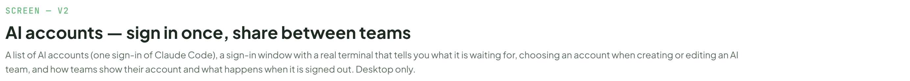

- Text in this part: "SCREEN — V2" · "AI accounts — sign in once, share between teams" · "A list of AI accounts (one sign-in of Claude Code), a sign-in window with a real terminal that tells you what it is waiting for, choosing an account when creating or editing an AI team, and how teams show their account and what happens when it is signed out. Desktop only."

---

## Where each piece lives

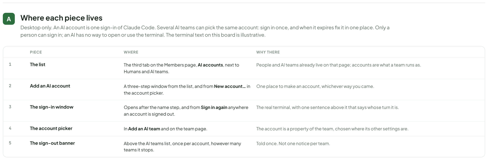

- Text in this part: "A" · "Where each piece lives" · "Desktop only. An AI account is one sign-in of Claude Code. Several AI teams can pick the same account: sign in once, and when it expires fix it in one place. Only a person can sign in; an AI has no way to open or use the terminal. The terminal text on this board is illustrative." · "PIECE" · "WHERE" · "WHY THERE" · "1" · "The list" · "The third tab on the Members page, AI accounts, next to Humans and AI teams." · "People and AI teams already live on that page; accounts are what a team runs as." · "2" · "Add an AI account" · "A three-step window from the list, and from New account… in the account picker." · "One place to make an account, whichever way you came." · "3" · "The sign-in window" · "Opens after the name step, and from Sign in again anywhere an account is signed out." · "The real terminal, with one sentence above it that says whose turn it is." · "4" · "The account picker" · "In Add an AI team and on the team page." · "The account is a property of the team, chosen where its other settings are." · "5" · "The sign-out banner" · "Above the AI teams list, once per account, however many teams it stops." · "Told once. Not one notice per team."

---

## AI accounts, the list

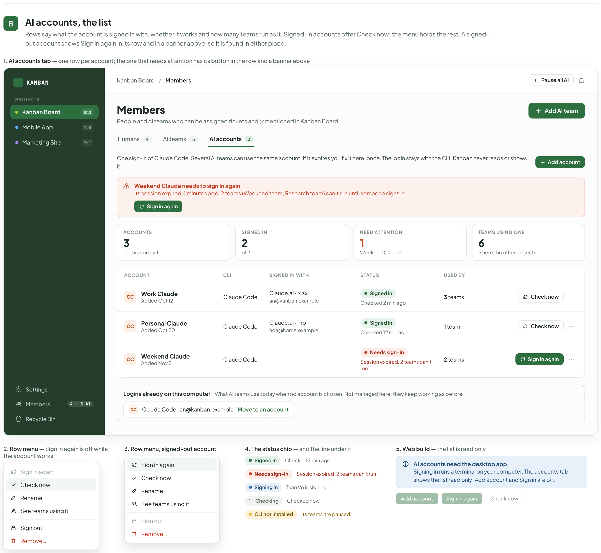

- Text in this part: "B" · "AI accounts, the list" · "Rows say what the account is signed in with, whether it works and how many teams run as it. Signed-in accounts offer Check now; the menu holds the rest. A signed-out account shows Sign in again in its row and in a banner above, so it is found in either place." · "1. AI accounts tab — one row per account; the one that needs attention has its button in the row and a banner above" · "KANBAN" · "PROJECTS" · "Kanban Board" · "KAN" · "Mobile App" · "MOB" · "Marketing Site" · "MKT" · "Settings" · "Members" · "4 · 5 AI" · "Recycle Bin" · "/" · "Pause all AI" · "People and AI teams who can be assigned tickets and @mentioned in Kanban Board." · "Add AI team" · "Humans" · "4" · "AI teams" · "5" · "AI accounts" · "3" · "One sign-in of Claude Code. Several AI teams can use the same account; if it expires you fix it here, once. The login stays with the CLI; Kanban never reads or shows it." · "Add account" · "Weekend Claude needs to sign in again" · "Its session expired 4 minutes ago. 2 teams (Weekend team, Research team) can’t run until someone signs in." · "Sign in again" · "ACCOUNTS" · "on this computer" · "SIGNED IN" · "2" · "of 3" · "NEED ATTENTION" · "1" · "Weekend Claude" · "TEAMS USING ONE" · "6" · "5 here, 1 in other projects" · "ACCOUNT" · "CLI" · "SIGNED IN WITH" · "STATUS" · "USED BY" · "CC" · "Work Claude" · "Added Oct 12" · "Claude Code" · "Claude.ai · Max" · "an@kanban.example" · "Signed in" · "Checked 2 min ago" · "3 teams" · "Check now" · "Personal Claude" · "Added Oct 20" · "Claude.ai · Pro" · "hoa@home.example" · "Checked 12 min ago" · "1 team" · "Added Nov 2" · "—" · "Needs sign-in" · "Session expired. 2 teams can’t run." · "2 teams" · "Logins already on this computer" · "What AI teams use today when no account is chosen. Not managed here; they keep working as before." · "Claude Code · an@kanban.example" · "Move to an account" · "2. Row menu — Sign in again is off while the account works" · "Rename" · "See teams using it" · "Sign out" · "Remove…" · "3. Row menu, signed-out account" · "4. The status chip — and the line under it" · "Signing in" · "Tuan Vo is signing in" · "Checking" · "Checked now" · "CLI not installed" · "Its teams are paused." · "5. Web build — the list is read only" · "AI accounts need the desktop app" · "Signing in runs a terminal on your computer. The accounts tab shows the list read only; Add account and Sign in are off."

---

## Add an AI account

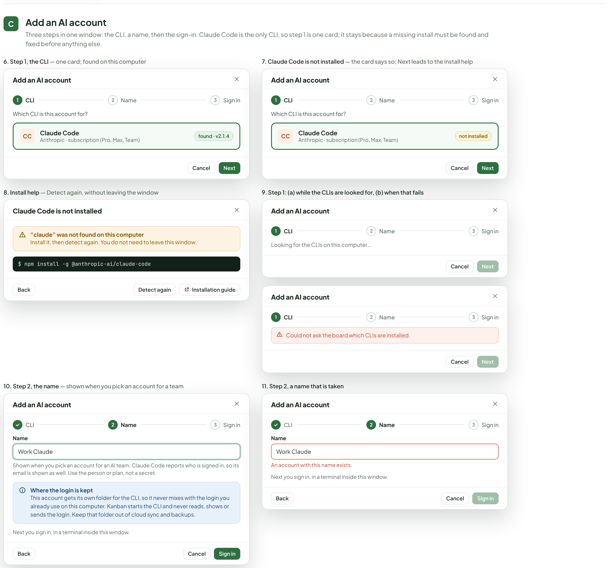

- Text in this part: "C" · "Add an AI account" · "Three steps in one window: the CLI, a name, then the sign-in. Claude Code is the only CLI, so step 1 is one card; it stays because a missing install must be found and fixed before anything else." · "6. Step 1, the CLI — one card; found on this computer" · "1" · "CLI" · "2" · "Name" · "3" · "Sign in" · "Which CLI is this account for?" · "CC" · "Claude Code" · "Anthropic · subscription (Pro, Max, Team)" · "found · v2.1.4" · "Cancel" · "Next" · "7. Claude Code is not installed — the card says so; Next leads to the install help" · "not installed" · "8. Install help — Detect again, without leaving the window" · "Claude Code is not installed" · "“claude” was not found on this computer" · "Install it, then detect again. You do not need to leave this window." · "$ npm install -g @anthropic-ai/claude-code" · "Back" · "Detect again" · "Installation guide" · "9. Step 1: (a) while the CLIs are looked for, (b) when that fails" · "Looking for the CLIs on this computer…" · "Could not ask the board which CLIs are installed." · "10. Step 2, the name — shown when you pick an account for a team" · "✓" · "Work Claude" · "Shown when you pick an account for an AI team. Claude Code reports who is signed in, so its email is shown as well. Use the person or plan, not a secret." · "Where the login is kept" · "This account gets its own folder for the CLI, so it never mixes with the login you already use on this computer. Kanban starts the CLI and never reads, shows or sends the login. Keep that folder out of cloud sync and backups." · "Next you sign in, in a terminal inside this window." · "11. Step 2, a name that is taken" · "An account with this name exists."

---

## The sign-in window, moment by moment

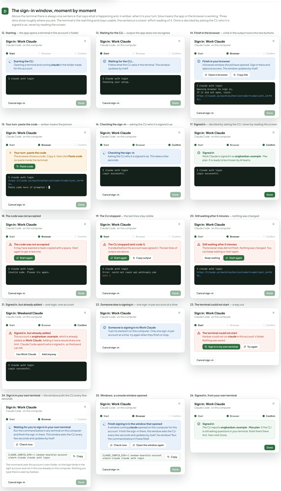

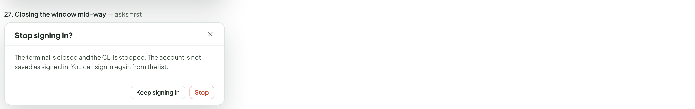

- Text in this part: "D" · "The sign-in window, moment by moment" · "Above the terminal there is always one sentence that says what is happening and, in amber, when it is your turn; blue means the app or the browser is working. Three dots show roughly where you are. The terminal is the real thing and stays usable; the sentence is a best-effort reading of it. Done is decided by asking the CLI who it is signed in as, never by reading the screen." · "12. Starting — the app opens a terminal in the account’s folder" · "Sign in: Work Claude" · "Claude Code · on this computer" · "Start" · "Browser" · "Confirm" · "Starting the CLI" · "Opening a terminal and running claude in the folder made for this account." · "$ claude auth login" · "Cancel sign-in" · "Done" · "13. Waiting for the CLI — output the app does not recognise" · "Waiting for the CLI…" · "Follow what the CLI asks in the terminal. This window updates by itself." · "Checking your setup…" · "14. Finish in the browser — a link in the output turns into two buttons" · "Finish in your browser" · "A browser window should have opened. Sign in there and approve access. This window updates by itself." · "Open in browser" · "Copy link" · "Opening browser to sign in…" · "If it did not open, visit:" · "https://claude.ai/oauth/authorize?code=true&client_id=9d1c…" · "15. Your turn: paste the code — amber means the person" · "Your turn: paste the code" · "The browser shows a code. Copy it, then click Paste code (or paste inside the terminal)." · "Paste code" · "Paste code here if prompted >" · "16. Checking the sign-in — asking the CLI who it is signed in as" · "Checking the sign-in" · "Asking the CLI who it is signed in as. This takes a few seconds." · "Login successful." · "17. Signed in — decided by asking the CLI, never by reading the screen" · "Signed in" · "Work Claude is signed in as an@kanban.example · Max plan. It is ready to be chosen by AI teams." · "18. The code was not accepted" · "The code was not accepted" · "It may have expired or been copied with a space. Start again to get a new one." · "Start again" · "Invalid code. Please try again." · "19. The CLI stopped — the last lines stay visible" · "The CLI stopped (exit code 1)" · "It ended before the account was signed in. The last lines of output are above." · "Copy output" · "Error: could not reach api.anthropic.com" · "exit 1" · "20. Still waiting after 5 minutes — nothing was changed" · "Still waiting after 5 minutes" · "The browser step did not finish. Nothing was changed. You can keep waiting or start again." · "Keep waiting" · "21. Signed in, but already added — one login, one account" · "Sign in: Weekend Claude" · "Signed in, but already added" · "This account is an@kanban.example, which is already added as Work Claude. Adding it twice would share one limit. Claude Code reports who is signed in, so the board can tell." · "Use Work Claude" · "Add anyway" · "22. Someone else is signing in — one sign-in per account at a time" · "Someone is signing in to Work Claude" · "Tuan Vo started it on this computer. Only one sign-in per account at a time: try again when they finish or stop." · "23. The terminal could not start — a way out" · "The terminal could not start" · "Kanban could not run claude in this account’s folder. Nothing was saved." · "Sign in in my own terminal" · "Try again" · "24. Sign in in your own terminal — the window polls the CLI every few seconds" · "Waiting for you to sign in in your own terminal" · "Run the command below in any terminal on this computer and finish the sign-in there. This window asks the CLI every few seconds and updates by itself." · "Check now" · "CLAUDE_CONFIG_DIR=~/.kanban-board/ai-accounts/work-claude claude auth login" · "Copy" · "The command uses this account’s own folder, so the login lands in the right account and not in the one already on this computer. Nothing you type there is seen by Kanban." · "25. Windows: a console window opened" · "Finish signing in in the window that opened" · "A window running claude opened on this computer for this account. Finish the sign-in there; this window asks the CLI every few seconds and updates by itself. No window? Run the command below in PowerShell." · "Open the window again" · "26. Signed in, from your own terminal" · "The CLI reports an@kanban.example · Max plan. If the CLI is still asking questions in your terminal, finish them there first, then click Done." · "27. Closing the window mid-way — asks first" · "Stop signing in?" · "The terminal is closed and the CLI is stopped. The account is not saved as signed in. You can sign in again from the list." · "Keep signing in" · "Stop"

---

## Choosing an account

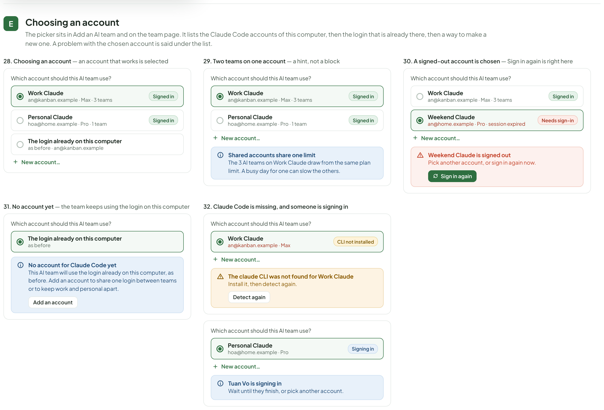

- Text in this part: "E" · "Choosing an account" · "The picker sits in Add an AI team and on the team page. It lists the Claude Code accounts of this computer, then the login that is already there, then a way to make a new one. A problem with the chosen account is said under the list." · "28. Choosing an account — an account that works is selected" · "Which account should this AI team use?" · "Work Claude" · "an@kanban.example · Max · 3 teams" · "Signed in" · "Personal Claude" · "hoa@home.example · Pro · 1 team" · "The login already on this computer" · "as before · an@kanban.example" · "New account…" · "29. Two teams on one account — a hint, not a block" · "Shared accounts share one limit" · "The 3 AI teams on Work Claude draw from the same plan limit. A busy day for one can slow the others." · "30. A signed-out account is chosen — Sign in again is right here" · "Weekend Claude" · "an@home.example · Pro · session expired" · "Needs sign-in" · "Weekend Claude is signed out" · "Pick another account, or sign in again now." · "Sign in again" · "31. No account yet — the team keeps using the login on this computer" · "as before" · "No account for Claude Code yet" · "This AI team will use the login already on this computer, as before. Add an account to share one login between teams or to keep work and personal apart." · "Add an account" · "32. Claude Code is missing, and someone is signing in" · "an@kanban.example · Max" · "CLI not installed" · "The claude CLI was not found for Work Claude" · "Install it, then detect again." · "Detect again" · "hoa@home.example · Pro" · "Signing in" · "Tuan Vo is signing in" · "Wait until they finish, or pick another account."

---

## Accounts on teams

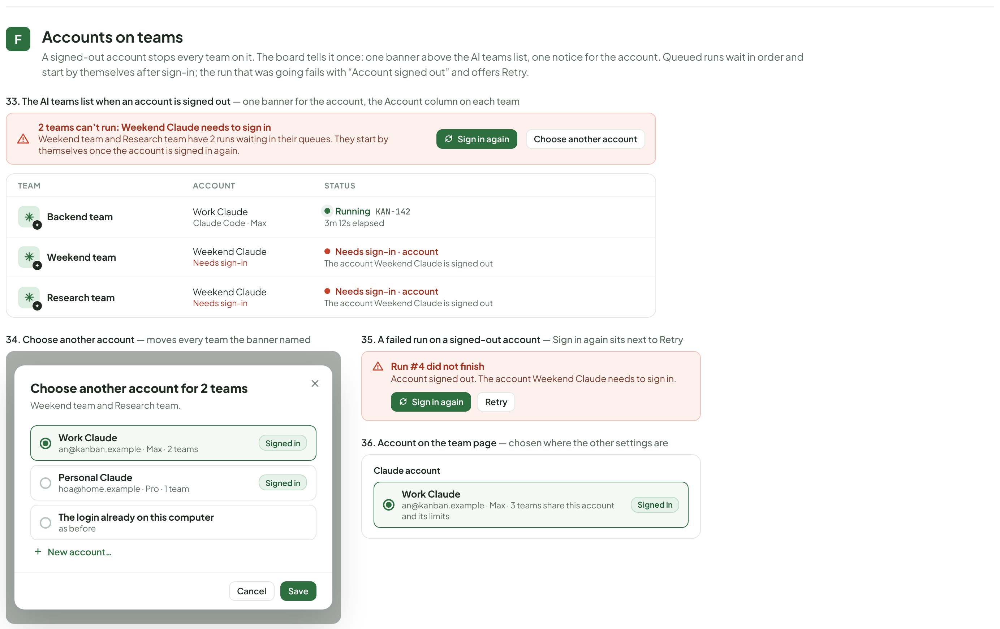

- Text in this part: "F" · "Accounts on teams" · "A signed-out account stops every team on it. The board tells it once: one banner above the AI teams list, one notice for the account. Queued runs wait in order and start by themselves after sign-in; the run that was going fails with “Account signed out” and offers Retry." · "33. The AI teams list when an account is signed out — one banner for the account, the Account column on each team" · "2 teams can’t run: Weekend Claude needs to sign in" · "Weekend team and Research team have 2 runs waiting in their queues. They start by themselves once the account is signed in again." · "Sign in again" · "Choose another account" · "TEAM" · "ACCOUNT" · "STATUS" · "Backend team" · "Work Claude" · "Claude Code · Max" · "Running" · "KAN-142" · "3m 12s elapsed" · "Weekend team" · "Weekend Claude" · "Needs sign-in" · "Needs sign-in · account" · "The account Weekend Claude is signed out" · "Research team" · "34. Choose another account — moves every team the banner named" · "Choose another account for 2 teams" · "Weekend team and Research team." · "an@kanban.example · Max · 2 teams" · "Signed in" · "Personal Claude" · "hoa@home.example · Pro · 1 team" · "The login already on this computer" · "as before" · "New account…" · "Cancel" · "Save" · "35. A failed run on a signed-out account — Sign in again sits next to Retry" · "Run #4 did not finish" · "Account signed out. The account Weekend Claude needs to sign in." · "Retry" · "36. Account on the team page — chosen where the other settings are" · "Claude account" · "an@kanban.example · Max · 3 teams share this account and its limits" · "37. A team that hit its plan limit — the status reads Rate-limited; there is no banner" · "Rate-limited" · "Amber: a limit, not a sign-in problem" · "Still assignable: the ticket waits in the team’s queue" · "No banner and no Sign in again"

---

## Row menu dialogs

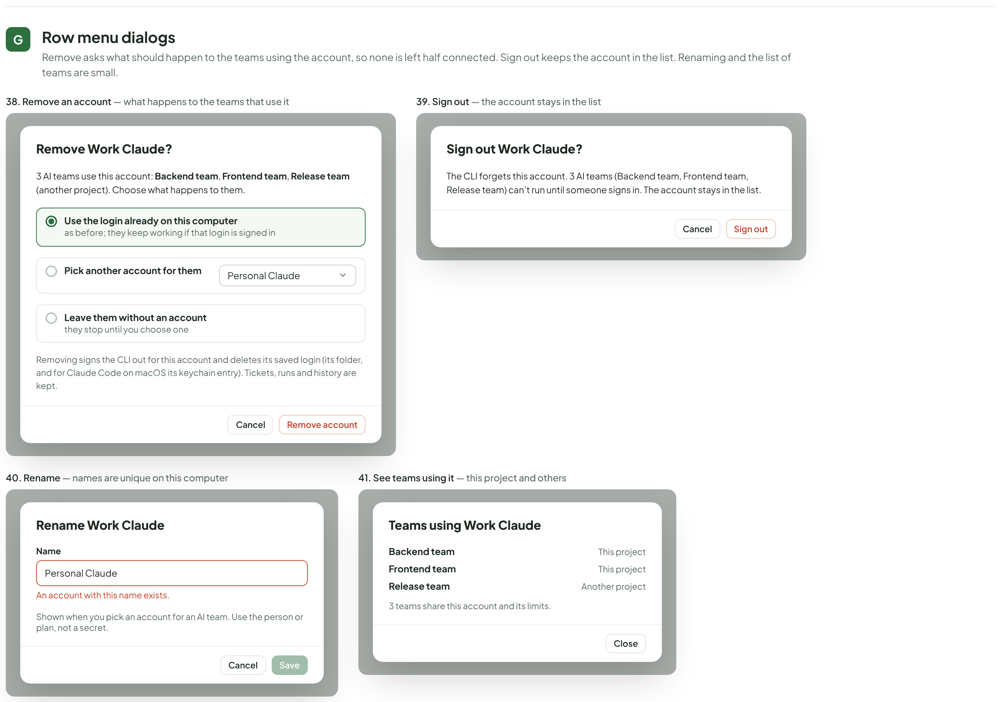

- Text in this part: "G" · "Row menu dialogs" · "Remove asks what should happen to the teams using the account, so none is left half connected. Sign out keeps the account in the list. Renaming and the list of teams are small." · "38. Remove an account — what happens to the teams that use it" · "Remove Work Claude?" · "3 AI teams use this account: Backend team, Frontend team, Release team (another project). Choose what happens to them." · "Use the login already on this computer" · "as before; they keep working if that login is signed in" · "Pick another account for them" · "Personal Claude" · "Leave them without an account" · "they stop until you choose one" · "Removing signs the CLI out for this account and deletes its saved login (its folder, and for Claude Code on macOS its keychain entry). Tickets, runs and history are kept." · "Cancel" · "Remove account" · "39. Sign out — the account stays in the list" · "Sign out Work Claude?" · "The CLI forgets this account. 3 AI teams (Backend team, Frontend team, Release team) can’t run until someone signs in. The account stays in the list." · "Sign out" · "40. Rename — names are unique on this computer" · "Rename Work Claude" · "Name" · "An account with this name exists." · "Shown when you pick an account for an AI team. Use the person or plan, not a secret." · "Save" · "41. See teams using it — this project and others" · "Teams using Work Claude" · "Backend team" · "This project" · "Frontend team" · "Release team" · "Another project" · "3 teams share this account and its limits." · "Close"

---

## Other states

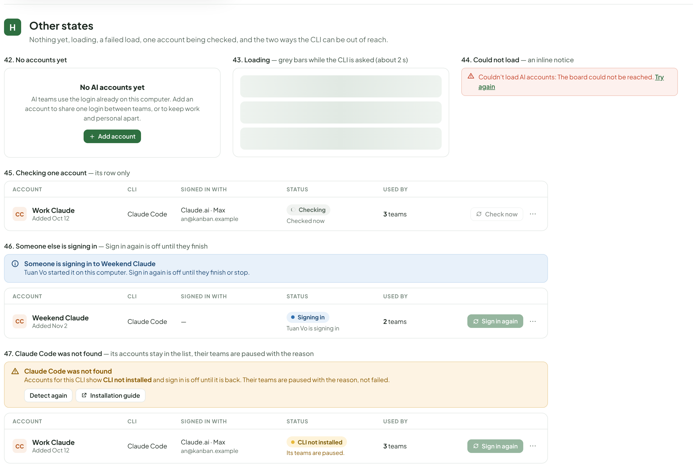

- Text in this part: "H" · "Other states" · "Nothing yet, loading, a failed load, one account being checked, and the two ways the CLI can be out of reach." · "42. No accounts yet" · "No AI accounts yet" · "AI teams use the login already on this computer. Add an account to share one login between teams, or to keep work and personal apart." · "Add account" · "43. Loading — grey bars while the CLI is asked (about 2 s)" · "44. Could not load — an inline notice" · "Couldn't load AI accounts: The board could not be reached. Try again" · "45. Checking one account — its row only" · "ACCOUNT" · "CLI" · "SIGNED IN WITH" · "STATUS" · "USED BY" · "CC" · "Work Claude" · "Added Oct 12" · "Claude Code" · "Claude.ai · Max" · "an@kanban.example" · "Checking" · "Checked now" · "3 teams" · "Check now" · "46. Someone else is signing in — Sign in again is off until they finish" · "Someone is signing in to Weekend Claude" · "Tuan Vo started it on this computer. Sign in again is off until they finish or stop." · "Weekend Claude" · "Added Nov 2" · "—" · "Signing in" · "Tuan Vo is signing in" · "2 teams" · "Sign in again" · "47. Claude Code was not found — its accounts stay in the list, their teams are paused with the reason" · "Claude Code was not found" · "Accounts for this CLI show CLI not installed and sign in is off until it is back. Their teams are paused with the reason, not failed." · "Detect again" · "Installation guide" · "CLI not installed" · "Its teams are paused."

---

## Where the data comes from

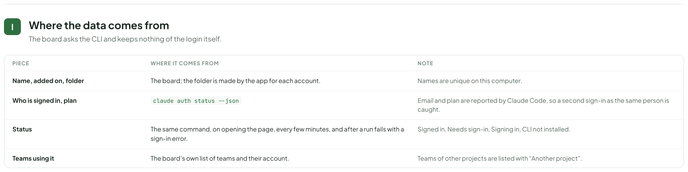

- Text in this part: "I" · "Where the data comes from" · "The board asks the CLI and keeps nothing of the login itself." · "PIECE" · "WHERE IT COMES FROM" · "NOTE" · "Name, added on, folder" · "The board; the folder is made by the app for each account." · "Names are unique on this computer." · "Who is signed in, plan" · "claude auth status --json" · "Email and plan are reported by Claude Code, so a second sign-in as the same person is caught." · "Status" · "The same command, on opening the page, every few minutes, and after a run fails with a sign-in error." · "Signed in, Needs sign-in, Signing in, CLI not installed." · "Teams using it" · "The board’s own list of teams and their account." · "Teams of other projects are listed with “Another project”."

---

### Owner decisions pass (comment on PR #331)

Rate-limited is drawn as the state of a team on an account (label only).

Rows, differences from the code and open points for this group are in [ai-members.md](ai-members.md).
