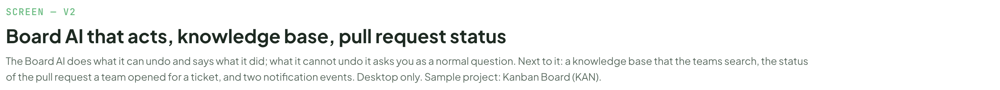
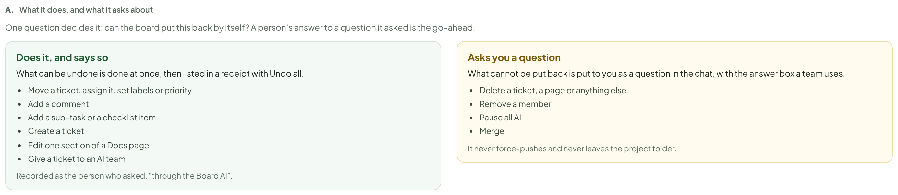
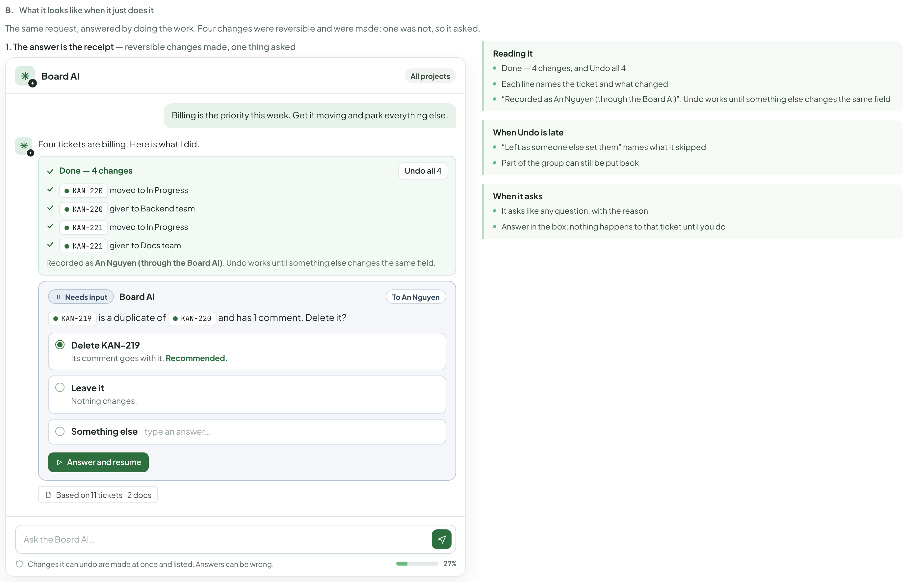
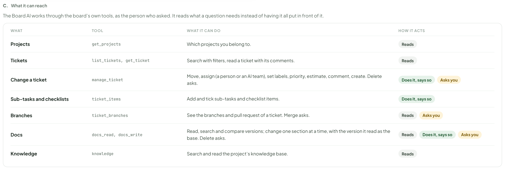
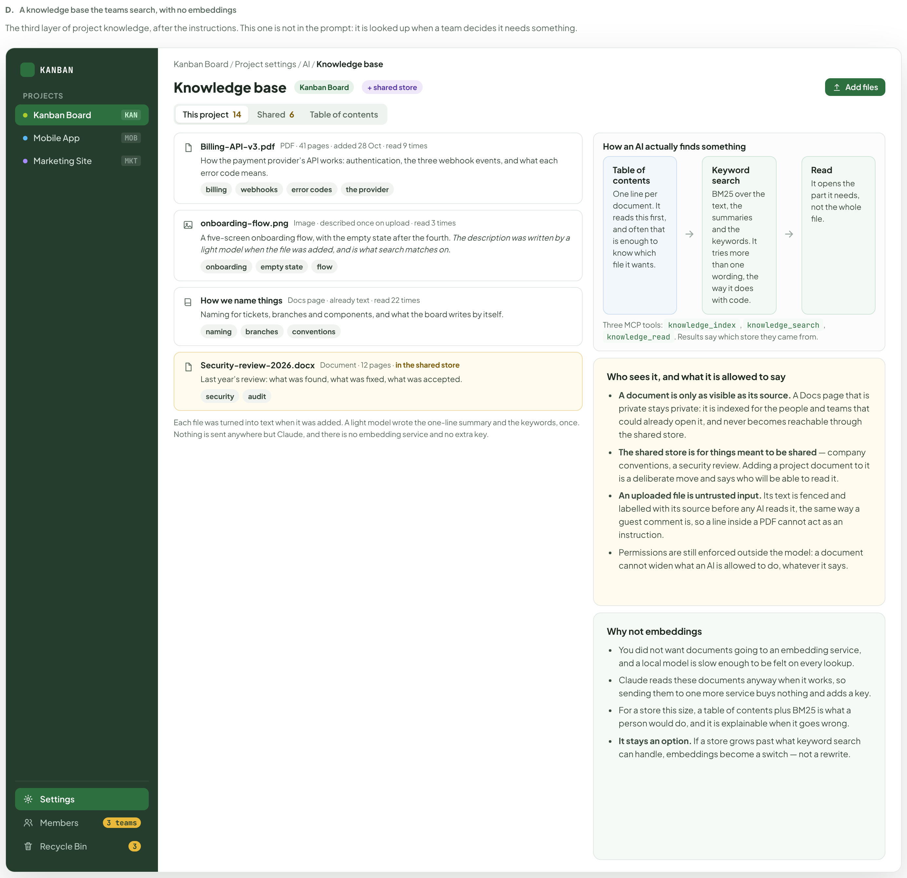
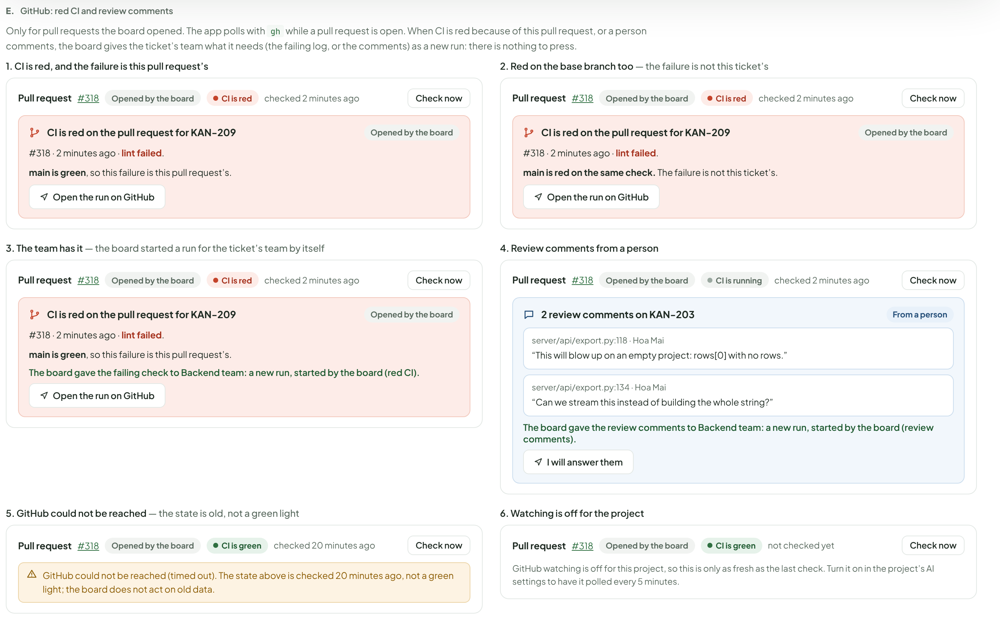
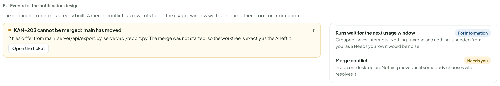
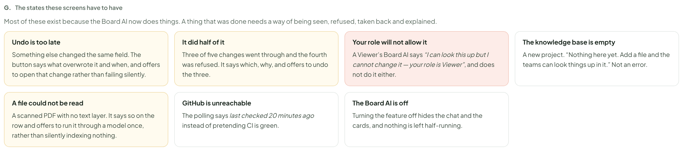

# Board AI & beyond — risk tiers, standing orders, knowledge base, GitHub, marks

> Redrawn for AI v2 · source: [`AiBoardWave3.dc.html`](../source/AiBoardWave3.dc.html) · canvas `1794110641-1323` · sha256 `1ab21f07558e841ba2326e7fe81a3d887d9e4df7166b6b38f93361504112967c`

> Words, states and conditions follow the code of branch `claude/ai-team-architecture-7a1efc`; the layout is designed here and is not the layout of the current screens. Names, ids, costs and times in the mock-ups are sample data. **Check the code before building from this: the file named in each part is the truth, not the picture.**

## SCREEN — V2

- Text in this part: "SCREEN — V2" · "Board AI that acts, knowledge base, pull request status" · "The Board AI does what it can undo and says what it did; what it cannot undo it asks you as a normal question. Next to it: a knowledge base that the teams search, the status of the pull request a team opened for a ticket, and two notification events. Desktop only. Sample project: Kanban Board (KAN)."

---

## What it does, and what it asks about

- Text in this part: "A." · "What it does, and what it asks about" · "One question decides it: can the board put this back by itself? A person’s answer to a question it asked is the go-ahead." · "Does it, and says so" · "What can be undone is done at once, then listed in a receipt with Undo all." · "Move a ticket, assign it, set labels or priority" · "Add a comment" · "Add a sub-task or a checklist item" · "Create a ticket" · "Edit one section of a Docs page" · "Give a ticket to an AI team" · "Recorded as the person who asked, “through the Board AI”." · "Asks you a question" · "What cannot be put back is put to you as a question in the chat, with the answer box a team uses." · "Delete a ticket, a page or anything else" · "Remove a member" · "Pause all AI" · "Merge" · "It never force-pushes and never leaves the project folder."

---

## What it looks like when it just does it

- Text in this part: "B." · "What it looks like when it just does it" · "The same request, answered by doing the work. Four changes were reversible and were made; one was not, so it asked." · "1. The answer is the receipt — reversible changes made, one thing asked" · "Board AI" · "All projects" · "Billing is the priority this week. Get it moving and park everything else." · "Four tickets are billing. Here is what I did." · "Done — 4 changes" · "Undo all 4" · "KAN-220 moved to In Progress" · "KAN-220 given to Backend team" · "KAN-221 moved to In Progress" · "KAN-221 given to Docs team" · "Recorded as An Nguyen (through the Board AI). Undo works until something else changes the same field." · "Needs input" · "To An Nguyen" · "KAN-219 is a duplicate of" · "KAN-220 and has 1 comment. Delete it?" · "Delete KAN-219" · "Its comment goes with it. Recommended." · "Leave it" · "Nothing changes." · "Something else" · "type an answer…" · "Answer and resume" · "Based on 11 tickets · 2 docs" · "Ask the Board AI…" · "Changes it can undo are made at once and listed. Answers can be wrong." · "27%" · "Reading it" · "Done — 4 changes, and Undo all 4" · "Each line names the ticket and what changed" · "“Recorded as An Nguyen (through the Board AI)”. Undo works until something else changes the same field" · "When Undo is late" · "“Left as someone else set them” names what it skipped" · "Part of the group can still be put back" · "When it asks" · "It asks like any question, with the reason" · "Answer in the box; nothing happens to that ticket until you do"

---

## What it can reach

- Text in this part: "C." · "What it can reach" · "The Board AI works through the board’s own tools, as the person who asked. It reads what a question needs instead of having it all put in front of it." · "WHAT" · "TOOL" · "WHAT IT CAN DO" · "HOW IT ACTS" · "Projects" · "get_projects" · "Which projects you belong to." · "Reads" · "Tickets" · "list_tickets, get_ticket" · "Search with filters, read a ticket with its comments." · "Change a ticket" · "manage_ticket" · "Move, assign (a person or an AI team), set labels, priority, estimate, comment, create. Delete asks." · "Does it, says so" · "Asks you" · "Sub-tasks and checklists" · "ticket_items" · "Add and tick sub-tasks and checklist items." · "Branches" · "ticket_branches" · "See the branches and pull request of a ticket. Merge asks." · "Docs" · "docs_read, docs_write" · "Read, search and compare versions; change one section at a time, with the version it read as the base. Delete asks." · "Knowledge" · "knowledge" · "Search and read the project’s knowledge base."

---

## A knowledge base the teams search, with no embeddings

- Text in this part: "D." · "A knowledge base the teams search, with no embeddings" · "The third layer of project knowledge, after the instructions. This one is not in the prompt: it is looked up when a team decides it needs something." · "KANBAN" · "PROJECTS" · "Kanban Board" · "KAN" · "Mobile App" · "MOB" · "Marketing Site" · "MKT" · "Settings" · "Members" · "3 teams" · "Recycle Bin" · "3" · "Kanban Board / Project settings / AI / Knowledge base" · "Knowledge base" · "+ shared store" · "Add files" · "This project" · "14" · "Shared" · "6" · "Table of contents" · "Billing-API-v3.pdf" · "PDF · 41 pages · added 28 Oct · read 9 times" · "How the payment provider’s API works: authentication, the three webhook events, and what each error code means." · "billing" · "webhooks" · "error codes" · "the provider" · "onboarding-flow.png" · "Image · described once on upload · read 3 times" · "A five-screen onboarding flow, with the empty state after the fourth. The description was written by a light model when the file was added, and is what search matches on." · "onboarding" · "empty state" · "flow" · "How we name things" · "Docs page · already text · read 22 times" · "Naming for tickets, branches and components, and what the board writes by itself." · "naming" · "branches" · "conventions" · "Security-review-2026.docx" · "Document · 12 pages · in the shared store" · "Last year’s review: what was found, what was fixed, what was accepted." · "security" · "audit" · "Each file was turned into text when it was added. A light model wrote the one-line summary and the keywords, once. Nothing is sent anywhere but Claude, and there is no embedding service and no extra key." · "How an AI actually finds something" · "One line per document. It reads this first, and often that is enough to know which file it wants." · "Keyword search" · "BM25 over the text, the summaries and the keywords. It tries more than one wording, the way it does with code." · "Read" · "It opens the part it needs, not the whole file." · "Three MCP tools: knowledge_index, knowledge_search, knowledge_read. Results say which store they came from." · "Who sees it, and what it is allowed to say" · "A document is only as visible as its source. A Docs page that is private stays private: it is indexed for the people and teams that could already open it, and never becomes reachable through the shared store." · "The shared store is for things meant to be shared — company conventions, a security review. Adding a project document to it is a deliberate move and says who will be able to read it." · "An uploaded file is untrusted input. Its text is fenced and labelled with its source before any AI reads it, the same way a guest comment is, so a line inside a PDF cannot act as an instruction." · "Permissions are still enforced outside the model: a document cannot widen what an AI is allowed to do, whatever it says." · "Why not embeddings" · "You did not want documents going to an embedding service, and a local model is slow enough to be felt on every lookup." · "Claude reads these documents anyway when it works, so sending them to one more service buys nothing and adds a key." · "For a store this size, a table of contents plus BM25 is what a person would do, and it is explainable when it goes wrong." · "It stays an option. If a store grows past what keyword search can handle, embeddings become a switch — not a rewrite."

---

## GitHub: red CI and review comments

- Text in this part: "E." · "GitHub: red CI and review comments" · "Only for pull requests the board opened. The app polls with gh while a pull request is open. When CI is red because of this pull request, or a person comments, the board gives the ticket’s team what it needs (the failing log, or the comments) as a new run: there is nothing to press." · "1. CI is red, and the failure is this pull request’s" · "Pull request" · "#318" · "Opened by the board" · "CI is red" · "checked 2 minutes ago" · "Check now" · "CI is red on the pull request for KAN-209" · "#318 · 2 minutes ago · lint failed." · "main is green, so this failure is this pull request’s." · "Open the run on GitHub" · "2. Red on the base branch too — the failure is not this ticket’s" · "main is red on the same check. The failure is not this ticket’s." · "3. The team has it — the board started a run for the ticket’s team by itself" · "The board gave the failing check to Backend team: a new run, started by the board (red CI)." · "4. Review comments from a person" · "CI is running" · "2 review comments on KAN-203" · "From a person" · "server/api/export.py:118 · Hoa Mai" · "“This will blow up on an empty project: rows[0] with no rows.”" · "server/api/export.py:134 · Hoa Mai" · "“Can we stream this instead of building the whole string?”" · "The board gave the review comments to Backend team: a new run, started by the board (review comments)." · "I will answer them" · "5. GitHub could not be reached — the state is old, not a green light" · "CI is green" · "checked 20 minutes ago" · "GitHub could not be reached (timed out). The state above is checked 20 minutes ago, not a green light; the board does not act on old data." · "6. Watching is off for the project" · "not checked yet" · "GitHub watching is off for this project, so this is only as fresh as the last check. Turn it on in the project’s AI settings to have it polled every 5 minutes."

---

## Events for the notification design

- Text in this part: "F." · "Events for the notification design" · "The notification centre is already built. A merge conflict is a row in its table; the usage-window wait is declared there too, for information." · "KAN-203 cannot be merged: main has moved" · "1 h" · "2 files differ from main: server/api/export.py, server/api/report.py. The merge was not started, so the worktree is exactly as the AI left it." · "Open the ticket" · "Runs wait for the next usage window" · "For information" · "Grouped, never interrupts. Nothing is wrong and nothing is needed from you; as a Needs you row it would be noise." · "Merge conflict" · "Needs you" · "In app on, desktop on. Nothing moves until somebody chooses who resolves it."

---

## The states these screens have to have

- Text in this part: "G." · "The states these screens have to have" · "Most of these exist because the Board AI now does things. A thing that was done needs a way of being seen, refused, taken back and explained." · "Undo is too late" · "Something else changed the same field. The button says what overwrote it and when, and offers to open that change rather than failing silently." · "It did half of it" · "Three of five changes went through and the fourth was refused. It says which, why, and offers to undo the three." · "Your role will not allow it" · "A Viewer’s Board AI says “I can look this up but I cannot change it — your role is Viewer”, and does not do it either." · "The knowledge base is empty" · "A new project. “Nothing here yet. Add a file and the teams can look things up in it.” Not an error." · "A file could not be read" · "A scanned PDF with no text layer. It says so on the row and offers to run it through a model once, rather than silently indexing nothing." · "GitHub is unreachable" · "The polling says last checked 20 minutes ago instead of pretending CI is green." · "The Board AI is off" · "Turning the feature off hides the chat and the cards, and nothing is left half-running."

---

### Owner decisions pass (comment on PR #331)

Section B and the "Asks you" column use the normal question card instead of Yes/No buttons; section E carries one line for the red-CI run ("The board gave the failing check to Backend team: a new run, started by the board (red CI).") and one for review comments; the v1 lines "nobody is sent back" and "Already given back" are gone. Seven states stay.

Rows, differences from the code and open points for this group are in [ai-story-flow.md](ai-story-flow.md).
