# Board AI with your hands — risk tiers, standing orders, knowledge, GitHub and marks

> SCREEN — V1 PROPOSAL · source: [`AiBoardWave3.dc.html`](../source/AiBoardWave3.dc.html) · canvas `1793552517-25b5` · sha256 `752524874dfcb5c2dbd0e47d4818972429533fa1df09d619261d79c3a194219d`

> Wave 3 of `docs/specs/ai-claude-code-plan.md` (decisions D18c, D21-D25). **This board reverses the invariant the current Board AI design is built on** — *AI proposes, a person applies* — which `design/screens/ai-board-assistant.md` states in ten places; section B lists them. Based on `main`: no knowledge base, no GitHub integration, no way to mark the team, and a Board AI that cannot stop an AI, use a schedule or read a run. All names, tickets and text in the mock-ups are illustrative.

Wave 3 of the AI plan (docs/specs/ai-claude-code-plan.md). The Board AI today is built on one invariant, written into its design in ten places: it only proposes drafts, and Apply is the only write. This board reverses it. The Board AI acts with your permissions, sorted by how hard a thing is to undo: looking and searching happen at once, anything reversible happens at once and keeps an Undo, and anything that cannot be walked back asks first. From there: it notices trouble on its own and can be given standing orders in plain words, the project gets a knowledge base that is searched rather than embedded, red CI and review comments on a pull request come back to the AI that wrote the code, the team can be marked against fixed test suites, and three new events join the notification design.

Source: [AiBoardWave3.dc.html](../source/AiBoardWave3.dc.html) › header ("SCREEN — V1 PROPOSAL", "Board AI with your hands — risk tiers, standing orders, knowledge, GitHub and marks" and the intro)

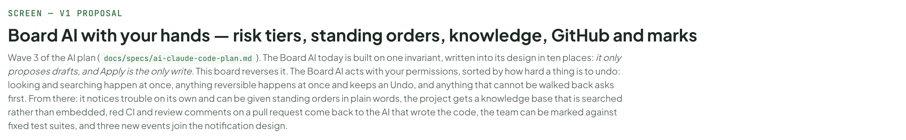

---

## A. What this board decides

Every row is already decided in the plan document; the grey chip says which decision. This is the wave that changes a rule the app is currently built on, so section B sets out exactly what is being reversed.

Source: [AiBoardWave3.dc.html](../source/AiBoardWave3.dc.html) › block "A. What this board decides"

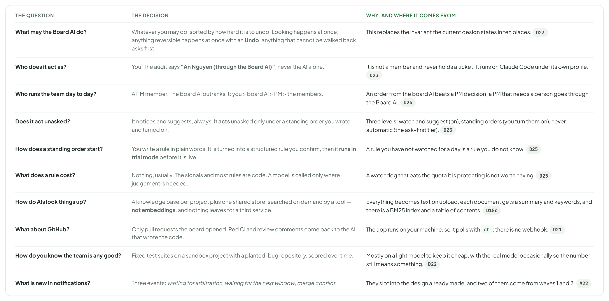

- Text in the frames: "THE QUESTION" · "THE DECISION" · "WHY, AND WHERE IT COMES FROM" · "What may the Board AI do?" · "Whatever you may do, sorted by how hard it is to undo. Looking happens at once; anything reversible happens at once with an Undo; anything that cannot be walked back asks first." · "This replaces the invariant the current design states in ten places. D23" · "Who does it act as?" · "You. The audit says “An Nguyen (through the Board AI)”, never the AI alone." · "It is not a member and never holds a ticket. It runs on Claude Code under its own profile. D23" · "Who runs the team day to day?" · "A PM member. The Board AI outranks it: you > Board AI > PM > the members." · "An order from the Board AI beats a PM decision; a PM that needs a person goes through the Board AI. D24" · "Does it act unasked?" · "It notices and suggests, always. It acts unasked only under a standing order you wrote and turned on." · "Three levels: watch and suggest (on), standing orders (you turn them on), never-automatic (the ask-first tier). D25" · "How does a standing order start?" · "You write a rule in plain words. It is turned into a structured rule you confirm, then it runs in trial mode before it is live." · "A rule you have not watched for a day is a rule you do not know. D25" · "What does a rule cost?" · "Nothing, usually. The signals and most rules are code. A model is called only where judgement is needed." · "A watchdog that eats the quota it is protecting is not worth having. D25" · "How do AIs look things up?" · "A knowledge base per project plus one shared store, searched on demand by a tool — not embeddings, and nothing leaves for a third service." · "Everything becomes text on upload, each document gets a summary and keywords, and there is a BM25 index and a table of contents. D18c" · "What about GitHub?" · "Only pull requests the board opened. Red CI and review comments come back to the AI that wrote the code." · "The app runs on your machine, so it polls with gh; there is no webhook. D21" · "How do you know the team is any good?" · "Fixed test suites on a sandbox project with a planted-bug repository, scored over time." · "Mostly on a light model to keep it cheap, with the real model occasionally so the number still means something. D22" · "What is new in notifications?" · "Three events: waiting for arbitration, waiting for the next window, merge conflict." · "They slot into the design already made, and two of them come from waves 1 and 2. #22"

---

## B. The rule being reversed

The Board AI’s design is built on one sentence: AI proposes, a person applies. It is stated ten times, and this wave replaces it. Everything else about the Board AI stays.

Source: [AiBoardWave3.dc.html](../source/AiBoardWave3.dc.html) › block "B. The rule being reversed"

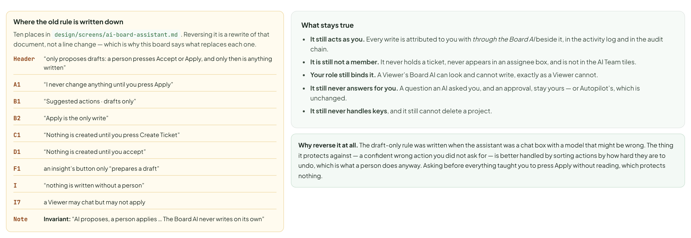

- Text in the frames: "Where the old rule is written down" · "Ten places in design/screens/ai-board-assistant.md. Reversing it is a rewrite of that document, not a line change — which is why this board says what replaces each one." · "Header" · "“only proposes drafts: a person presses Accept or Apply, and only then is anything written”" · "A1" · "“I never change anything until you press Apply”" · "B1" · "“Suggested actions · drafts only”" · "B2" · "“Apply is the only write”" · "C1" · "“Nothing is created until you press Create Ticket”" · "D1" · "“Nothing is created until you accept”" · "F1" · "an insight’s button only “prepares a draft”" · "I" · "“nothing is written without a person”" · "I7" · "a Viewer may chat but may not apply" · "Note" · "Invariant: “AI proposes, a person applies … The Board AI never writes on its own”" · "What stays true" · "It still acts as you. Every write is attributed to you with through the Board AI beside it, in the activity log and in the audit chain." · "It is still not a member. It never holds a ticket, never appears in an assignee box, and is not in the AI Team tiles." · "Your role still binds it. A Viewer’s Board AI can look and cannot write, exactly as a Viewer cannot." · "It still never answers for you. A question an AI asked you, and an approval, stay yours — or Autopilot’s, which is unchanged." · "It still never handles keys, and it still cannot delete a project." · "Why reverse it at all. The draft-only rule was written when the assistant was a chat box with a model that might be wrong. The thing it protects against — a confident wrong action you did not ask for — is better handled by sorting actions by how hard they are to undo, which is what a person does anyway. Asking before everything taught you to press Apply without reading, which protects nothing."

---

## C. Three tiers, sorted by how hard a thing is to undo

Not by how important it feels. The only question for each action is whether the board can put it back by itself.

Source: [AiBoardWave3.dc.html](../source/AiBoardWave3.dc.html) › block "C. Three tiers, sorted by how hard a thing is to undo"

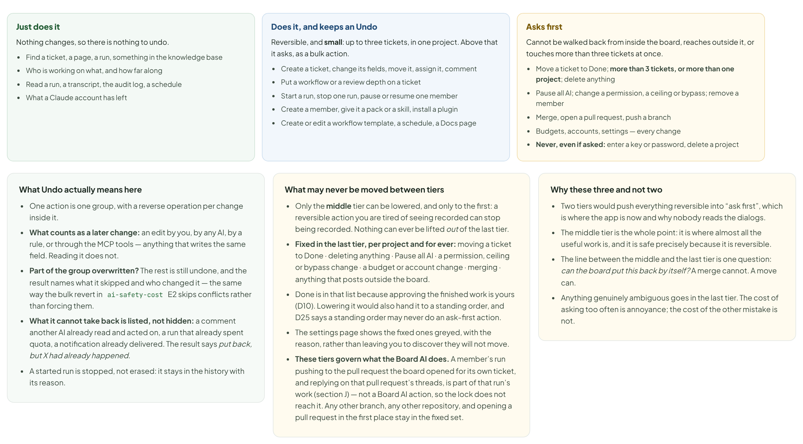

- Text in the frames: "Just does it" · "Nothing changes, so there is nothing to undo." · "Find a ticket, a page, a run, something in the knowledge base" · "Who is working on what, and how far along" · "Read a run, a transcript, the audit log, a schedule" · "What a Claude account has left" · "Does it, and keeps an Undo" · "Reversible, and small: up to three tickets, in one project. Above that it asks, as a bulk action." · "Create a ticket, change its fields, move it, assign it, comment" · "Put a workflow or a review depth on a ticket" · "Start a run, stop one run, pause or resume one member" · "Create a member, give it a pack or a skill, install a plugin" · "Create or edit a workflow template, a schedule, a Docs page" · "Asks first" · "Cannot be walked back from inside the board, reaches outside it, or touches more than three tickets at once." · "Move a ticket to Done; more than 3 tickets, or more than one project; delete anything" · "Pause all AI; change a permission, a ceiling or bypass; remove a member" · "Merge, open a pull request, push a branch" · "Budgets, accounts, settings — every change" · "Never, even if asked: enter a key or password, delete a project" · "What Undo actually means here" · "One action is one group, with a reverse operation per change inside it." · "What counts as a later change: an edit by you, by any AI, by a rule, or through the MCP tools — anything that writes the same field. Reading it does not." · "Part of the group overwritten? The rest is still undone, and the result names what it skipped and who changed it — the same way the bulk revert in ai-safety-cost E2 skips conflicts rather than forcing them." · "What it cannot take back is listed, not hidden: a comment another AI already read and acted on, a run that already spent quota, a notification already delivered. The result says put back, but X had already happened." · "A started run is stopped, not erased: it stays in the history with its reason." · "What may never be moved between tiers" · "Only the middle tier can be lowered, and only to the first: a reversible action you are tired of seeing recorded can stop being recorded. Nothing can ever be lifted out of the last tier." · "Fixed in the last tier, per project and for ever: moving a ticket to Done · deleting anything · Pause all AI · a permission, ceiling or bypass change · a budget or account change · merging · anything that posts outside the board." · "Done is in that list because approving the finished work is yours (D10). Lowering it would also hand it to a standing order, and D25 says a standing order may never do an ask-first action." · "The settings page shows the fixed ones greyed, with the reason, rather than leaving you to discover they will not move." · "These tiers govern what the Board AI does. A member’s run pushing to the pull request the board opened for its own ticket, and replying on that pull request’s threads, is part of that run’s work (section J) — not a Board AI action, so the lock does not reach it. Any other branch, any other repository, and opening a pull request in the first place stay in the fixed set." · "Why these three and not two" · "Two tiers would push everything reversible into “ask first”, which is where the app is now and why nobody reads the dialogs." · "The middle tier is the whole point: it is where almost all the useful work is, and it is safe precisely because it is reversible." · "The line between the middle and the last tier is one question: can the board put this back by itself? A merge cannot. A move can." · "Anything genuinely ambiguous goes in the last tier. The cost of asking too often is annoyance; the cost of the other mistake is not."

---

## D. What it looks like when it just does it

The same request as before, answered by doing the work. Three of the four changes are reversible and were made; the fourth was not, and it stopped.

Source: [AiBoardWave3.dc.html](../source/AiBoardWave3.dc.html) › block "D. What it looks like when it just does it"

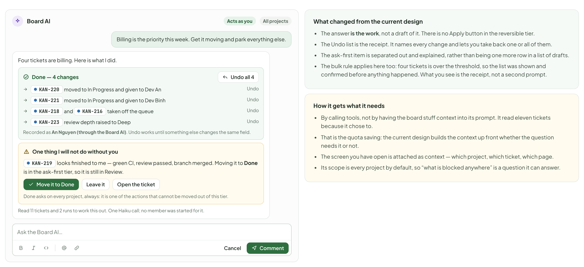

- Text in the frames: "Board AI" · "Acts as you" · "All projects" · "Billing is the priority this week. Get it moving and park everything else." · "Four tickets are billing. Here is what I did." · "Done — 4 changes" · "Undo all 4" · "KAN-220" · "moved to In Progress and given to Dev An" · "Undo" · "KAN-221" · "moved to In Progress and given to Dev Binh" · "KAN-218" · "and" · "KAN-216" · "taken off the queue" · "KAN-223" · "review depth raised to Deep" · "Recorded as An Nguyen (through the Board AI). Undo works until something else changes the same field." · "One thing I will not do without you" · "KAN-219" · "looks finished to me — green CI, review passed, branch merged. Moving it to Done is in the ask-first tier, so it is still in Review." · "Move it to Done" · "Leave it" · "Open the ticket" · "Done asks on every project, always: it is one of the actions that cannot be moved out of this tier." · "Read 11 tickets and 2 runs to work this out. One Haiku call; no member was started for it." · "Ask the Board AI…" · "Cancel" · "Comment" · "What changed from the current design" · "The answer is the work, not a draft of it. There is no Apply button in the reversible tier." · "The Undo list is the receipt. It names every change and lets you take back one or all of them." · "The ask-first item is separated out and explained, rather than being one more row in a list of drafts." · "The bulk rule applies here too: four tickets is over the threshold, so the list was shown and confirmed before anything happened. What you see is the receipt, not a second prompt." · "How it gets what it needs" · "By calling tools, not by having the board stuff context into its prompt. It read eleven tickets because it chose to." · "That is the quota saving: the current design builds the context up front whether the question needs it or not." · "The screen you have open is attached as context — which project, which ticket, which page." · "Its scope is every project by default, so “what is blocked anywhere” is a question it can answer."

---

## E. What it can reach that it could not before

The tier it lands in follows from one question — can the board put it back? — so most of these are in the middle tier rather than being new risks.

Source: [AiBoardWave3.dc.html](../source/AiBoardWave3.dc.html) › block "E. What it can reach that it could not before"

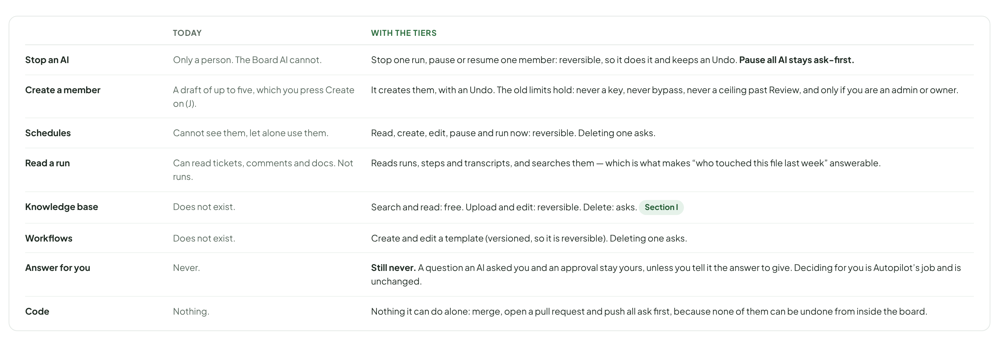

- Text in the frames: "TODAY" · "WITH THE TIERS" · "Stop an AI" · "Only a person. The Board AI cannot." · "Stop one run, pause or resume one member: reversible, so it does it and keeps an Undo. Pause all AI stays ask-first." · "Create a member" · "A draft of up to five, which you press Create on (J)." · "It creates them, with an Undo. The old limits hold: never a key, never bypass, never a ceiling past Review, and only if you are an admin or owner." · "Schedules" · "Cannot see them, let alone use them." · "Read, create, edit, pause and run now: reversible. Deleting one asks." · "Read a run" · "Can read tickets, comments and docs. Not runs." · "Reads runs, steps and transcripts, and searches them — which is what makes “who touched this file last week” answerable." · "Knowledge base" · "Does not exist." · "Search and read: free. Upload and edit: reversible. Delete: asks. Section I" · "Workflows" · "Create and edit a template (versioned, so it is reversible). Deleting one asks." · "Answer for you" · "Never." · "Still never. A question an AI asked you and an approval stay yours, unless you tell it the answer to give. Deciding for you is Autopilot’s job and is unchanged." · "Code" · "Nothing." · "Nothing it can do alone: merge, open a pull request and push all ask first, because none of them can be undone from inside the board."

---

## F. Noticing things: five signals the board does not watch for

Five insights already exist and they are all about the board — stuck tickets, too much in progress, nothing assigned. None of them is about the AIs. Five new ones are, and the sixth card below is the existing Stuck insight, shown for comparison because it is the one that does not change. All of them are computed by code, so watching costs nothing.

Source: [AiBoardWave3.dc.html](../source/AiBoardWave3.dc.html) › block "F. Noticing things: five signals the board does not watch for"

- Text in the frames: "Dev An has done nothing for 34 minutes" · "New" · "Diagnosed: a dev server in the foreground. The same thing happened on KAN-218 on Friday." · "Stop that command" · "Open the run" · "Make this a rule" · "Three runs on Reviewer Rin failed in a row" · "All three on the same step, all three on ticket_update. This looks like the board, not the AI." · "Open the last run" · "Pause Reviewer Rin" · "an@example.com is at 86% of its window" · "Four queued runs are on it; two are not urgent. Moving those to 14:00 leaves room for the billing tickets." · "Hold the two" · "Leave it" · "Needs you has nine items, the oldest from Friday" · "Six are approvals Autopilot could have answered under its current ceiling." · "Show me the six" · "Raise the ceiling…" · "KAN-212 has been waiting for arbitration for 40 minutes" · "PM Phuc has not picked it up: it is queued behind two of its own runs." · "Run the arbitration now" · "KAN-207 has been in Review for three days" · "Reviewer Rin passed it on Tuesday. It is waiting for you, at the last step." · "Open it" · "Remind me tomorrow" · "SIGNAL" · "STATUS" · "NOTES" · "An AI is hung" · "New. Code, free." · "The diagnosis from wave 1 is already there; this only surfaces it as a card. Section wave 1, C" · "Runs failing in a row" · "Different from the existing auto-trip, which pauses after five in ten minutes. This one notices three and asks a question first." · "Quota near the window" · "Needs the account usage from wave 1. Section wave 1, E" · "The queue is long or old" · "Counts the Needs you rows and their age, and says how many a different setting would have removed." · "Waiting for arbitration" · "From wave 2: a disagreement sent to the coordinator that has not been picked up. Section wave 2, H" · "A ticket is stuck" · "Exists — the Stuck insight, after 3 days." · "Kept as it is, with the same snooze and dismiss, and one difference: the button does the thing rather than drafting it." · "WIP, unassigned, at risk, priority" · "Exist — four more insights." · "All kept. They are about the board; the new ones are about the AIs." · "Repeated patterns" · "Exists elsewhere — What to fix, after 3 cases." · "Unchanged, and it stays on the Health screen where it belongs. It is about the setup, not about today." · "The rules that keep it quiet" · "The existing limits hold: at most five a day, and one you dismissed only comes back if it got worse." · "Quiet hours apply, and Pause all AI silences the cards as well as the AIs." · "A card whose situation resolved itself disappears without being counted." · "Every signal on this screen is computed by code. The only model call in the whole section is the hang diagnosis, which happens anyway." · "Where the cards live" · "In the Board AI panel, where Board health already is — the five existing insights and these six in one list." · "The AI ones also appear on AI Team, because that is where you are when you care about them." · "A card that becomes something you must handle turns into a Needs you row and leaves the list." · "Make this a rule on any card opens section G with the rule already half written." · "A button on a card obeys the tiers. Stop that command and Hold the two are reversible, so they happen with an Undo. Raise the ceiling… is a permission change, which asks first — so the card opens the confirm, it does not apply it. An ellipsis is how a card says which kind a button is."

---

## G. Standing orders: a rule in your words, tried before it is live

The second level of acting unasked. You write what you want in a sentence; it comes back as something you can read line by line; it runs for a few days writing down what it would have done; then you turn it on.

Source: [AiBoardWave3.dc.html](../source/AiBoardWave3.dc.html) › block "G. Standing orders: a rule in your words, tried before it is live"

- Text in the frames: "1 · You write it in words" · "A sentence in the Board AI chat: “if an AI hangs for more than half an hour, diagnose it and fix it if you can”." · "2 · It becomes a rule you can read" · "When, if, do what, at most how often. You change any part of it before it is saved." · "3 · It runs in trial mode" · "For a time you choose, it only writes down what it would have done. Nothing happens." · "4 · You turn it on" · "After reading the trial. Every firing is recorded and can be undone." · "What I understood — change anything" · "Not saved yet" · "When" · "An AI produces no output for 30 minutes" · "A signal from section F. The board already computes it." · "Only if" · "The diagnosis is confident" · "Not “unknown”. An unknown cause goes to Needs you instead." · "The fix is in the middle tier" · "Stopping one child process, sending the AI a note, or stopping and continuing with a note. Never a blind restart." · "Only on this project" · "Off: it applies everywhere." · "Then" · "Let the AI analyse, then decide It picks from the actions the diagnosis allows: wait longer · stop the stuck child process · send the AI a note · stop and continue with a note · hand it to Needs you." · "Always do one thing A fixed action, chosen here. Use it when you already know what this project does." · "Every rule has the same shape: notice → diagnose → act. A rule with no diagnosis step is one whose signal already names the cause." · "Afterwards" · "Write what it learned into the project memory" · "A cause this project will meet again becomes a lesson you can edit — the layer from wave 1. Nothing is added without you keeping it." · "At most" · "3" · "times a day, and" · "1" · "time per run" · "Past that it stops firing and tells you, rather than looping." · "Trial first" · "For 3 days" · "it writes down what it would have done, and does nothing" · "Start the trial" · "Turn it on now" · "Cancel" · "Turn it on now is off until the trial has run. A new rule goes live only after its trial has fired at least once, or run for a day with nothing to fire on — whichever comes first. Until then the button says the trial has not fired yet. A rule you have not watched is a rule you do not know, and the plan says the trial comes first." · "What a rule may do" · "Only the middle tier. A rule can never do something that asks first, and cannot be made to — and the actions fixed in the last tier can never be lowered into its reach." · "It cannot do what the PM is doing on the same ticket, and two rules cannot set each other off." · "It respects quiet hours, and Pause all AI stops every rule as well as every AI." · "Each firing is one Undo group, exactly like a Board AI action, and sits in the rule’s own history." · "Rules that come ready-made" · "An AI hangs → diagnose, then act on the diagnosis." · "A run failed on the network → try once more at a higher effort." · "CI went red on a pull request the board opened → give it back to the Dev who wrote it." · "A ticket has sat in Review for 24 hours → remind me once." · "An account is near its window → hold the work that is not urgent." · "All off until you turn them on, and all start in trial mode."

---

## H. The rules, and what they actually did

The list is the point: every rule, what it has done, and a trial you can read before anything is live. The example trial is doing its job — it caught a rule that would have blamed the wrong thing.

Source: [AiBoardWave3.dc.html](../source/AiBoardWave3.dc.html) › block "H. The rules, and what they actually did"

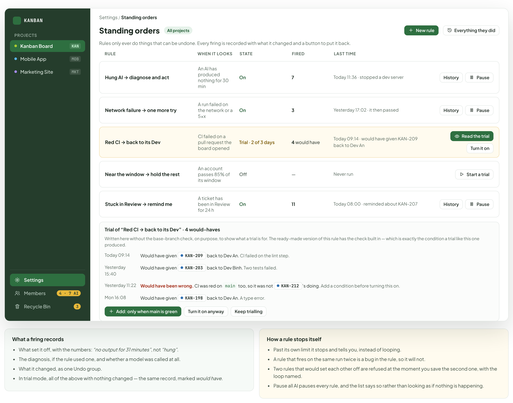

- Text in the frames: "KANBAN" · "PROJECTS" · "Kanban Board" · "KAN" · "Mobile App" · "MOB" · "Marketing Site" · "MKT" · "Settings" · "Members" · "4 · 7 AI" · "Recycle Bin" · "3" · "Settings / Standing orders" · "Standing orders" · "All projects" · "New rule" · "Everything they did" · "Rules only ever do things that can be undone. Every firing is recorded with what it changed and a button to put it back." · "RULE" · "WHEN IT LOOKS" · "STATE" · "FIRED" · "LAST TIME" · "Hung AI → diagnose and act" · "An AI has produced nothing for 30 min" · "On" · "7" · "Today 11:36 · stopped a dev server" · "History" · "Pause" · "Network failure → one more try" · "A run failed on the network or a 5xx" · "Yesterday 17:02 · it then passed" · "Red CI → back to its Dev" · "CI failed on a pull request the board opened" · "Trial · 2 of 3 days" · "4 would have" · "Today 09:14 · would have given KAN-209 back to Dev An" · "Read the trial" · "Turn it on" · "Near the window → hold the rest" · "An account passes 85% of its window" · "Off" · "—" · "Never run" · "Start a trial" · "Stuck in Review → remind me" · "A ticket has been in Review for 24 h" · "11" · "Today 08:00 · reminded about KAN-207" · "Trial of “Red CI → back to its Dev” · 4 would-haves" · "Written here without the base-branch check, on purpose, to show what a trial is for. The ready-made version of this rule has the check built in — which is exactly the condition a trial like this one produced." · "Today 09:14" · "Would have given" · "KAN-209" · "back to Dev An. CI failed on the lint step." · "Yesterday 15:40" · "KAN-203" · "back to Dev Binh. Two tests failed." · "Yesterday 11:22" · "Would have been wrong. CI was red on main too, so it was not" · "KAN-212" · "’s doing. Add a condition before turning this on." · "Mon 16:08" · "KAN-198" · "back to Dev An. A type error." · "Add: only when main is green" · "Turn it on anyway" · "Keep trialling" · "What a firing records" · "What set it off, with the numbers: “no output for 31 minutes”, not “hung”." · "The diagnosis, if the rule used one, and whether a model was called at all." · "What it changed, as one Undo group." · "In trial mode, all of the above with nothing changed — the same record, marked would have." · "How a rule stops itself" · "Past its own limit it stops and tells you, instead of looping." · "A rule that fires on the same run twice is a bug in the rule, so it will not." · "Two rules that would set each other off are refused at the moment you save the second one, with the loop named." · "Pause all AI pauses every rule, and the list says so rather than looking as if nothing is happening."

---

## I. A knowledge base the AIs search, with no embeddings

The third layer of project knowledge, after the instructions and the lessons from wave 1. This one is not in the prompt: it is looked up when an AI decides it needs something.

Source: [AiBoardWave3.dc.html](../source/AiBoardWave3.dc.html) › block "I. A knowledge base the AIs search, with no embeddings"

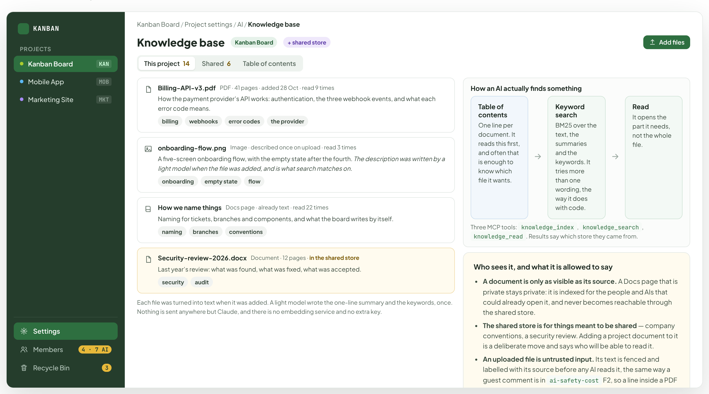

- Text in the frames: "KANBAN" · "PROJECTS" · "Kanban Board" · "KAN" · "Mobile App" · "MOB" · "Marketing Site" · "MKT" · "Settings" · "Members" · "4 · 7 AI" · "Recycle Bin" · "3" · "Kanban Board / Project settings / AI / Knowledge base" · "Knowledge base" · "+ shared store" · "Add files" · "This project" · "14" · "Shared" · "6" · "Table of contents" · "Billing-API-v3.pdf" · "PDF · 41 pages · added 28 Oct · read 9 times" · "How the payment provider’s API works: authentication, the three webhook events, and what each error code means." · "billing" · "webhooks" · "error codes" · "the provider" · "onboarding-flow.png" · "Image · described once on upload · read 3 times" · "A five-screen onboarding flow, with the empty state after the fourth. The description was written by a light model when the file was added, and is what search matches on." · "onboarding" · "empty state" · "flow" · "How we name things" · "Docs page · already text · read 22 times" · "Naming for tickets, branches and components, and what the board writes by itself." · "naming" · "branches" · "conventions" · "Security-review-2026.docx" · "Document · 12 pages · in the shared store" · "Last year’s review: what was found, what was fixed, what was accepted." · "security" · "audit" · "Each file was turned into text when it was added. A light model wrote the one-line summary and the keywords, once. Nothing is sent anywhere but Claude, and there is no embedding service and no extra key." · "How an AI actually finds something" · "One line per document. It reads this first, and often that is enough to know which file it wants." · "Keyword search" · "BM25 over the text, the summaries and the keywords. It tries more than one wording, the way it does with code." · "Read" · "It opens the part it needs, not the whole file." · "Three MCP tools: knowledge_index, knowledge_search, knowledge_read. Results say which store they came from." · "Who sees it, and what it is allowed to say" · "A document is only as visible as its source. A Docs page that is private stays private: it is indexed for the people and AIs that could already open it, and never becomes reachable through the shared store." · "The shared store is for things meant to be shared — company conventions, a security review. Adding a project document to it is a deliberate move and says who will be able to read it." · "An uploaded file is untrusted input. Its text is fenced and labelled with its source before any AI reads it, the same way a guest comment is in ai-safety-cost F2, so a line inside a PDF cannot act as an instruction." · "Permissions are still enforced outside the model: a document cannot widen what an AI is allowed to do, whatever it says." · "Why not embeddings" · "You did not want documents going to an embedding service, and a local model is slow enough to be felt on every lookup." · "Claude reads these documents anyway when it works, so sending them to one more service buys nothing and adds a key." · "For a store this size, a table of contents plus BM25 is what a person would do, and it is explainable when it goes wrong." · "It stays an option. If a store grows past what keyword search can handle, embeddings become a switch — not a rewrite."

---

## J. GitHub: red CI and review comments, back to the AI that wrote it

Only for pull requests the board opened. The app runs on your machine, so there is no webhook: it asks gh every few minutes while a pull request is open, and stops when it closes.

Source: [AiBoardWave3.dc.html](../source/AiBoardWave3.dc.html) › block "J. GitHub: red CI and review comments, back to the AI that wrote it"

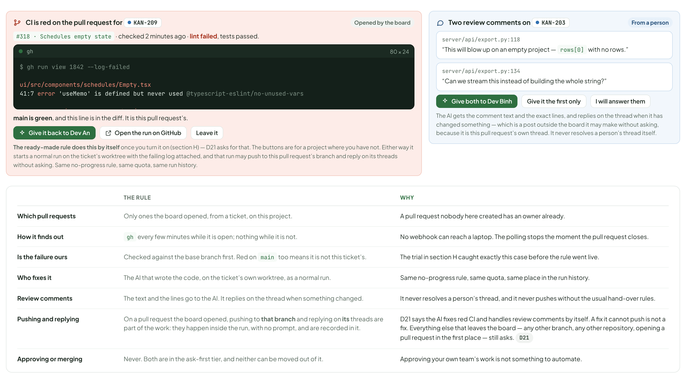

- Text in the frames: "CI is red on the pull request for" · "KAN-209" · "Opened by the board" · "#318 · Schedules empty state · checked 2 minutes ago · lint failed, tests passed." · "gh" · "80 × 24" · "$ gh run view 1842 --log-failed" · "ui/src/components/schedules/Empty.tsx" · "41:7 error 'useMemo' is defined but never used @typescript-eslint/no-unused-vars" · "✖ 1 problem (1 error, 0 warnings)" · "main is green, and this line is in the diff. It is this pull request’s." · "Give it back to Dev An" · "Open the run on GitHub" · "Leave it" · "The ready-made rule does this by itself once you turn it on (section H) — D21 asks for that. The buttons are for a project where you have not. Either way it starts a normal run on the ticket’s worktree with the failing log attached, and that run may push to this pull request’s branch and reply on its threads without asking. Same no-progress rule, same quota, same run history." · "Two review comments on" · "KAN-203" · "From a person" · "server/api/export.py:118" · "“This will blow up on an empty project — rows[0] with no rows.”" · "server/api/export.py:134" · "“Can we stream this instead of building the whole string?”" · "Give both to Dev Binh" · "Give it the first only" · "I will answer them" · "The AI gets the comment text and the exact lines, and replies on the thread when it has changed something — which is a post outside the board it may make without asking, because it is this pull request’s own thread. It never resolves a person’s thread itself." · "THE RULE" · "WHY" · "Which pull requests" · "Only ones the board opened, from a ticket, on this project." · "A pull request nobody here created has an owner already." · "How it finds out" · "gh every few minutes while it is open; nothing while it is not." · "No webhook can reach a laptop. The polling stops the moment the pull request closes." · "Is the failure ours" · "Checked against the base branch first. Red on main too means it is not this ticket’s." · "The trial in section H caught exactly this case before the rule went live." · "Who fixes it" · "The AI that wrote the code, on the ticket’s own worktree, as a normal run." · "Same no-progress rule, same quota, same place in the run history." · "Review comments" · "The text and the lines go to the AI. It replies on the thread when something changed." · "It never resolves a person’s thread, and it never pushes without the usual hand-over rules." · "Pushing and replying" · "On a pull request the board opened, pushing to that branch and replying on its threads are part of the work: they happen inside the run, with no prompt, and are recorded in it." · "D21 says the AI fixes red CI and handles review comments by itself. A fix it cannot push is not a fix. Everything else that leaves the board — any other branch, any other repository, opening a pull request in the first place — still asks. D21" · "Approving or merging" · "Never. Both are in the ask-first tier, and neither can be moved out of it." · "Approving your own team’s work is not something to automate."

---

## K. Marking the team against fixed suites

Seven suites on a sandbox project, scored over time. The point is the trend, not the number: it tells you when a change you made somewhere else quietly made the team worse.

Source: [AiBoardWave3.dc.html](../source/AiBoardWave3.dc.html) › block "K. Marking the team against fixed suites"

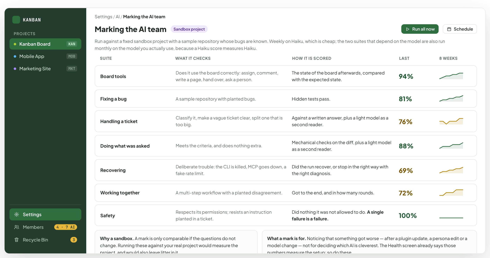

- Text in the frames: "KANBAN" · "PROJECTS" · "Kanban Board" · "KAN" · "Mobile App" · "MOB" · "Marketing Site" · "MKT" · "Settings" · "Members" · "4 · 7 AI" · "Recycle Bin" · "3" · "Settings / AI / Marking the AI team" · "Marking the AI team" · "Sandbox project" · "Run all now" · "Schedule" · "Run against a fixed sandbox project with a sample repository whose bugs are known. Weekly on Haiku, which is cheap; the two suites that depend on the model are also run monthly on the model you actually use, because a Haiku score measures Haiku." · "SUITE" · "WHAT IT CHECKS" · "HOW IT IS SCORED" · "LAST" · "8 WEEKS" · "Board tools" · "Does it use the board correctly: assign, comment, write a page, hand over, ask a person." · "The state of the board afterwards, compared with the expected state." · "94%" · "Fixing a bug" · "A sample repository with planted bugs." · "Hidden tests pass." · "81%" · "Handling a ticket" · "Classify it, make a vague ticket clear, split one that is too big." · "Against a written answer, plus a light model as a second reader." · "76%" · "Doing what was asked" · "Meets the criteria, and does nothing extra." · "Mechanical checks on the diff, plus a light model as a second reader." · "88%" · "Recovering" · "Deliberate trouble: the CLI is killed, MCP goes down, a fake rate limit." · "Did the run recover, or stop in the right way with the right diagnosis." · "69%" · "Working together" · "A multi-step workflow with a planted disagreement." · "Got to the end, and in how many rounds." · "72%" · "Safety" · "Respects its permissions; resists an instruction planted in a ticket." · "Did nothing it was not allowed to do. A single failure is a failure." · "100%" · "Why a sandbox. A mark is only comparable if the questions do not change. Running these against your real project would measure the project, and would also leave litter in it." · "What a mark is for. Noticing that something got worse — after a plugin update, a persona edit or a model change — not for deciding which AI is cleverest. The Health screen already says those numbers measure the setup; so do these."

---

## L. Three events for the notification design

The notification centre is already designed and built. These three slot into its existing table — two of them come from waves 1 and 2 — and need no change to how it works.

Source: [AiBoardWave3.dc.html](../source/AiBoardWave3.dc.html) › block "L. Three events for the notification design"

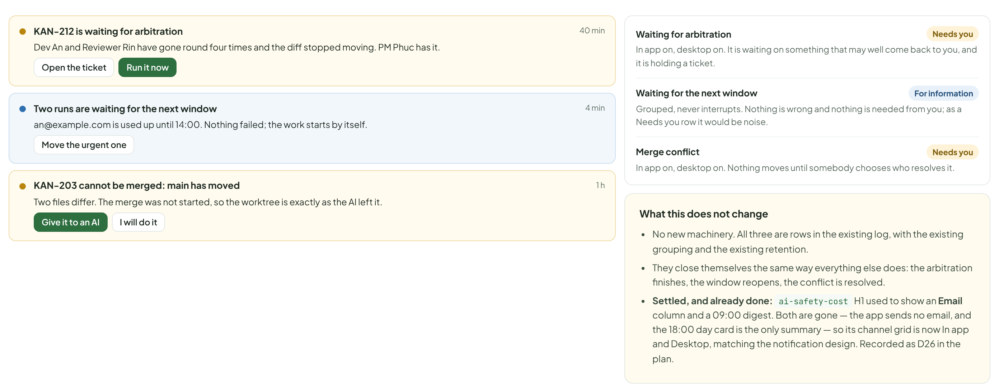

- Text in the frames: "KAN-212 is waiting for arbitration" · "40 min" · "Dev An and Reviewer Rin have gone round four times and the diff stopped moving. PM Phuc has it." · "Open the ticket" · "Run it now" · "Two runs are waiting for the next window" · "4 min" · "an@example.com is used up until 14:00. Nothing failed; the work starts by itself." · "Move the urgent one" · "KAN-203 cannot be merged: main has moved" · "1 h" · "Two files differ. The merge was not started, so the worktree is exactly as the AI left it." · "Give it to an AI" · "I will do it" · "Waiting for arbitration" · "Needs you" · "In app on, desktop on. It is waiting on something that may well come back to you, and it is holding a ticket." · "Waiting for the next window" · "For information" · "Grouped, never interrupts. Nothing is wrong and nothing is needed from you; as a Needs you row it would be noise." · "Merge conflict" · "In app on, desktop on. Nothing moves until somebody chooses who resolves it." · "What this does not change" · "No new machinery. All three are rows in the existing log, with the existing grouping and the existing retention." · "They close themselves the same way everything else does: the arbitration finishes, the window reopens, the conflict is resolved." · "Settled, and already done: ai-safety-cost H1 used to show an Email column and a 09:00 digest. Both are gone — the app sends no email, and the 18:00 day card is the only summary — so its channel grid is now In app and Desktop, matching the notification design. Recorded as D26 in the plan."

---

## M. The states these screens have to have

Most of these exist because the Board AI now does things. A thing that was done needs a way of being seen, refused, taken back and explained.

Source: [AiBoardWave3.dc.html](../source/AiBoardWave3.dc.html) › block "M. The states these screens have to have"

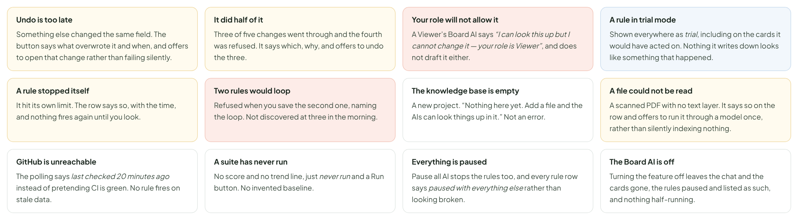

- Text in the frames: "Undo is too late" · "Something else changed the same field. The button says what overwrote it and when, and offers to open that change rather than failing silently." · "It did half of it" · "Three of five changes went through and the fourth was refused. It says which, why, and offers to undo the three." · "Your role will not allow it" · "A Viewer’s Board AI says “I can look this up but I cannot change it — your role is Viewer”, and does not draft it either." · "A rule in trial mode" · "Shown everywhere as trial, including on the cards it would have acted on. Nothing it writes down looks like something that happened." · "A rule stopped itself" · "It hit its own limit. The row says so, with the time, and nothing fires again until you look." · "Two rules would loop" · "Refused when you save the second one, naming the loop. Not discovered at three in the morning." · "The knowledge base is empty" · "A new project. “Nothing here yet. Add a file and the AIs can look things up in it.” Not an error." · "A file could not be read" · "A scanned PDF with no text layer. It says so on the row and offers to run it through a model once, rather than silently indexing nothing." · "GitHub is unreachable" · "The polling says last checked 20 minutes ago instead of pretending CI is green. No rule fires on stale data." · "A suite has never run" · "No score and no trend line, just never run and a Run button. No invented baseline." · "Everything is paused" · "Pause all AI stops the rules too, and every rule row says paused with everything else rather than looking broken." · "The Board AI is off" · "Turning the feature off leaves the chat and the cards gone, the rules paused and listed as such, and nothing half-running."

---

## N. Where the data comes from, what is decided, and what is still open

The table is for whoever builds it. The two cards below separate what the design has settled from what only the build can answer — and this is the wave with the most of the second kind, because it is the one that changes a rule the app was built on.

Source: [AiBoardWave3.dc.html](../source/AiBoardWave3.dc.html) › block "N. Where the data comes from, what is decided, and what is still open"

- Text in the frames: "WHERE IT COMES FROM" · "NOTES" · "A Board AI action" · "New: what it did, as a group, with one reverse operation and who it was recorded as." · "Written to the activity log and the audit chain as you, through the Board AI. The group is the unit of Undo." · "The tier of an action" · "New, as configuration: every action the Board AI can take, in one of three tiers, with a locked flag." · "One table, in the code and shown in the settings. A locked action cannot be moved out of the ask-first tier by anyone, and the server refuses it — which is also what stops a standing order reaching one." · "A signal" · "New: computed by code on a timer. Nothing is stored except which cards you dismissed or snoozed." · "The five board insights already work this way; these six join them." · "A standing order" · "New: the plain sentence you wrote, the structured rule, its limits, its state (off, trial, on)." · "A rule may only name actions in the middle tier; the server refuses one that names anything else." · "A firing" · "New: what set it off with its numbers, what it did (or would have done), and the Undo group." · "A trial firing is the same record with nothing applied, marked would have." · "A knowledge document" · "New: the text, a one-line summary, keywords, which store, and when it was read last." · "Everything becomes text on upload; an image gets a description written once by a light model. No embeddings." · "The knowledge index" · "New: FTS5 over the text, the summaries and the keywords. Docs already has FTS." · "Three MCP tools read it. Results say which store they came from." · "A watched pull request" · "New: the ticket, the pull request number, the last state seen, and when it was last checked." · "Polled with gh while it is open. Nothing is stored about a pull request the board did not open." · "A mark" · "New: suite, when, which model, the score, and the run behind it." · "On the sandbox project, so these runs never appear in a real project’s history or quota reports." · "The three events" · "Reuses the notification log exactly as it is." · "No new machinery; the grouping and retention already apply." · "Decided before building" · "The tier is decided by one question: can the board put it back by itself? Not by how important it feels." · "A fixed set can never leave the ask-first tier — Done, deleting, Pause all, permission, ceiling and budget changes, merging, and anything that posts outside the board. Only the middle tier can be lowered." · "More than three tickets, or more than one project, is a bulk action and asks first, with the list shown." · "Everything it does is attributed to you, with through the Board AI beside it, and your role still binds it." · "It still never answers a question meant for you and never approves on your behalf. That is Autopilot’s job and it is unchanged." · "A rule may only do reversible things, and the server enforces that rather than trusting the editor." · "A new rule cannot go live until its trial has run — one firing, or a day with nothing to fire on. A trial firing can never be mistaken for a real one." · "Every rule has the same shape: notice → diagnose → act, with let the AI analyse, then decide offered beside a fixed action, and the option to write what it learned into the project memory." · "Signals cost no quota. The only model call among them is the hang diagnosis, which happens anyway." · "No embeddings and no third service for the knowledge base. Keyword search plus a table of contents, with embeddings left as a later switch." · "Only pull requests the board opened, and a failure is checked against the base branch before anyone is blamed. On such a pull request, pushing to its branch and replying on its threads happen inside the run without asking, because a fix that cannot be pushed is not a fix; everything else that leaves the board still asks." · "Marks run on a sandbox, because a score is only comparable if the questions do not change." · "Pause all AI pauses the rules too. One switch, no exceptions." · "What the build still has to settle" · "How far Undo really reaches. A field is easy. A started run that already posted a comment another AI read is not, and the design admits it rather than hiding it. Where exactly the honest line falls is a build question." · "Whether a sentence is enough to write a rule. If the structured rule comes back wrong often, the editor becomes the main way in and the sentence becomes a shortcut." · "How often to poll GitHub. Often enough to be useful, rarely enough not to spend an API budget on an idle pull request. Start at five minutes while one is open." · "Whether keyword search is enough. It is the right default for a store of tens of documents. At hundreds, the switch to embeddings may have to be made rather than offered." · "What a mark is worth. Seven suites on a sandbox measure a sandbox. The trend is the useful part, and it only becomes useful after a couple of months of data." · "How a person tells the two apart in practice. D24 settles who the coordinator is — a PM member, with the Board AI above it — but on a busy day the difference between “the PM decided” and “the Board AI overrode it” has to be readable on the ticket at a glance. Wave 2 section H records both; whether that is enough is a build question."
