# Choose your database — SQLite, PostgreSQL or MySQL/MariaDB, and move between them

> SCREEN — V1 PROPOSAL · source: [`AiDatabases.dc.html`](../source/AiDatabases.dc.html) · canvas `1793693225-d839` · sha256 `2744187998cf03ebf72e6faa1213e68ad9ff9fcd111dc4314b9d80ed3617689a`

> Drawn against `main` at 3.35.1, from `server/database.py`, `server/api/data.py`, `server/events.py`, `ui/src/components/settings/StoragePage.tsx` and the models. It extends the Storage & backup page in `design/screens/settings-pages.md`. Names, hosts and numbers in the mock-ups are illustrative; table and column names are the app's own.

> **Implementing this — read the source and the code, not only this doc and the images.** The PNGs are renders and the text lists are extracted from them; either can miss a state, a label, a hint or a detail that only the source shows, and the mock-ups are easy to misread. Open the board itself: on the canvas, board **Choose your database** on the page **Screens · AI** (https://claude.ai/artifact/B3jiFjnoEL9erRN7QYRHj2), or [`../source/AiDatabases.dc.html`](../source/AiDatabases.dc.html) in a browser. Then check every claim in section F against the code at the time you build it (`server/database.py`, `server/api/data.py`, `server/events.py`, `server/services/docs_search.py`, `server/alembic/`, `ui/src/components/settings/StoragePage.tsx`): `main` moves, and this board was drawn against 3.35.1. Where the code and the board disagree, say so in the PR instead of choosing silently.

App settings › Storage & backup gets a Database card. SQLite stays the default; PostgreSQL and MySQL/MariaDB are real alternatives, with a test that explains what it finds. Moving data is one four-step flow that can be run three ways: a button in Settings, a script, and an AI that helps when a copy stops. Redis and MongoDB are left out on purpose, and the board says why. Based on main at 3.35.1; names, hosts and numbers in the mock-ups are illustrative.

Source: [AiDatabases.dc.html](../source/AiDatabases.dc.html) › header ("SCREEN — V1 PROPOSAL", "Choose your database — SQLite, PostgreSQL or MySQL/MariaDB, and move between them" and the intro)

---

## A. What is supported, and how data moves

SQLite stays the default and the only choice that needs no setup. PostgreSQL and MySQL/MariaDB become real alternatives, set in App settings › Storage & backup. Redis and MongoDB are left out on purpose, with the reason on the page. The three migration ways share one flow, so the person learns one thing.

Source: [AiDatabases.dc.html](../source/AiDatabases.dc.html) › block "A. What is supported, and how data moves"

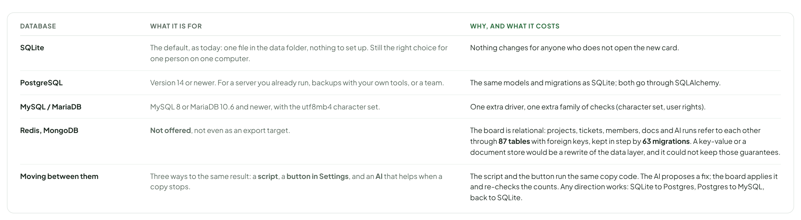

- Text in the frame (frame 1 of 2): "DATABASE" · "WHAT IT IS FOR" · "WHY, AND WHAT IT COSTS" · "SQLite" · "The default, as today: one file in the data folder, nothing to set up. Still the right choice for one person on one computer." · "Nothing changes for anyone who does not open the new card." · "PostgreSQL" · "Version 14 or newer. For a server you already run, backups with your own tools, or a team." · "The same models and migrations as SQLite; both go through SQLAlchemy." · "MySQL / MariaDB" · "MySQL 8 or MariaDB 10.6 and newer, with the utf8mb4 character set." · "One extra driver, one extra family of checks (character set, user rights)." · "Redis, MongoDB" · "Not offered, not even as an export target." · "The board is relational: projects, tickets, members, docs and AI runs refer to each other through 87 tables with foreign keys, kept in step by 63 migrations. A key-value or a document store would be a rewrite of the data layer, and it could not keep those guarantees." · "Moving between them" · "Three ways to the same result: a script, a button in Settings, and an AI that helps when a copy stops." · "The script and the button run the same copy code. The AI proposes a fix; the board applies it and re-checks the counts. Any direction works: SQLite to Postgres, Postgres to MySQL, back to SQLite."

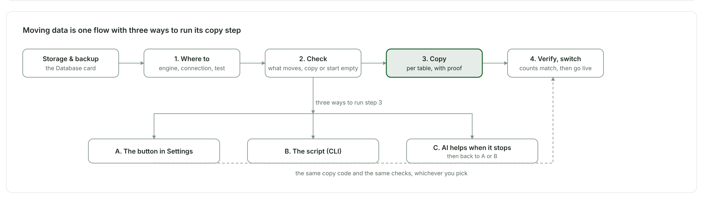

- Text in the frame (frame 2 of 2): "Storage & backup" · "the Database card" · "1. Where to" · "engine, connection, test" · "2. Check" · "what moves, copy or start empty" · "3. Copy" · "per table, with proof" · "4. Verify, switch" · "counts match, then go live" · "three ways to run step 3" · "A. The button in Settings" · "B. The script (CLI)" · "C. AI helps when it stops" · "then back to A or B" · "the same copy code and the same checks, whichever you pick" · "Moving data is one flow with three ways to run its copy step"

---

## B. App settings › Storage & backup

One new card at the top, Database, and small changes to the two cards under it. Today’s page is unchanged for anyone staying on SQLite; the Data folder and Import and export texts say what they mean once the database is somewhere else.

Source: [AiDatabases.dc.html](../source/AiDatabases.dc.html) › block "B. App settings › Storage & backup"

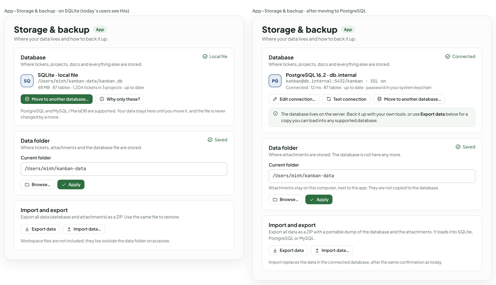

- Text in the frame (frame 1 of 2): "App › Storage & backup · on SQLite (today’s users see this)" · "Storage & backup" · "App" · "Where your data lives and how to back it up." · "Database" · "Where tickets, projects, docs and everything else are stored." · "Local file" · "SQ" · "SQLite · local file" · "/Users/minh/kanban-data/kanban.db" · "48 MB · 87 tables · 1,204 tickets in 3 projects · up to date" · "Move to another database…" · "Why only these?" · "PostgreSQL and MySQL / MariaDB are supported. Your data stays here until you move it, and the file is never changed by a move." · "Data folder" · "Where tickets, attachments and the database file are stored." · "Saved" · "Current folder" · "/Users/minh/kanban-data" · "Browse…" · "Apply" · "Import and export" · "Export all data (database and attachments) as a ZIP. Use the same file to restore." · "Export data" · "Import data…" · "Workspace files are not included; they live outside the data folder on purpose." · "App › Storage & backup · after moving to PostgreSQL" · "Connected" · "PG" · "PostgreSQL 16.2 · db.internal" · "kanban@db.internal:5432/kanban · SSL on" · "Connected · 12 ms · 87 tables · up to date · password in your system keychain" · "Edit connection…" · "Test connection" · "The database lives on the server. Back it up with your own tools, or use Export data below for a copy you can load into any supported database." · "Where attachments are stored. The database is not here any more." · "Attachments stay on this computer, next to the app. They are not copied to the database." · "Export all data as a ZIP with a portable dump of the database and the attachments. It loads into SQLite, PostgreSQL or MySQL." · "Import replaces the data in the connected database, after the same confirmation as today."

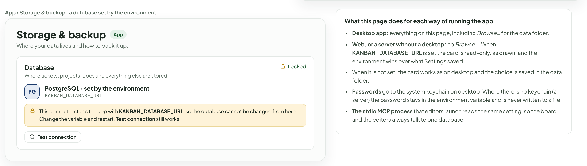

- Text in the frame (frame 2 of 2): "App › Storage & backup · a database set by the environment" · "Storage & backup" · "App" · "Where your data lives and how to back it up." · "Database" · "Where tickets, projects, docs and everything else are stored." · "Locked" · "PG" · "PostgreSQL · set by the environment" · "KANBAN_DATABASE_URL" · "This computer starts the app with KANBAN_DATABASE_URL, so the database cannot be changed from here. Change the variable and restart. Test connection still works." · "Test connection" · "What this page does for each way of running the app" · "Desktop app: everything on this page, including Browse… for the data folder." · "Web, or a server without a desktop: no Browse…. When KANBAN_DATABASE_URL is set the card is read-only, as drawn, and the environment wins over what Settings saved." · "When it is not set, the card works as on desktop and the choice is saved in the data folder." · "Passwords go to the system keychain on desktop. Where there is no keychain (a server) the password stays in the environment variable and is never written to a file." · "The stdio MCP process that editors launch reads the same setting, so the board and the editors always talk to one database."

---

## C. Move to another database · step 1, where to

Choose an engine, give the connection, press Test. The test says what it found in plain lines, and for each problem it says how to fix it, with the statement ready to copy. Amber lines (a character set, an old minor version) let the person go on; red ones (cannot sign in, cannot create tables) do not.

Source: [AiDatabases.dc.html](../source/AiDatabases.dc.html) › block "C. Move to another database · step 1, where to"

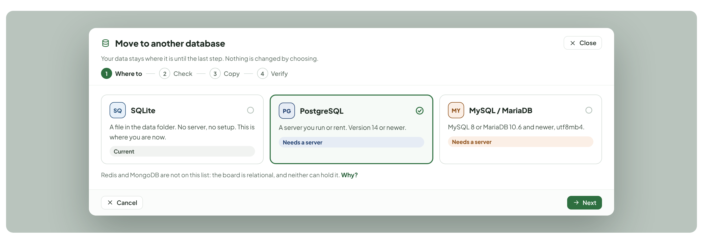

- Text in the frame (frame 1 of 3): "Move to another database" · "Close" · "Your data stays where it is until the last step. Nothing is changed by choosing." · "1" · "Where to" · "2" · "Check" · "3" · "Copy" · "4" · "Verify" · "SQ" · "SQLite" · "A file in the data folder. No server, no setup. This is where you are now." · "Current" · "PG" · "PostgreSQL" · "A server you run or rent. Version 14 or newer." · "Needs a server" · "MY" · "MySQL / MariaDB" · "MySQL 8 or MariaDB 10.6 and newer, utf8mb4." · "Redis and MongoDB are not on this list: the board is relational, and neither can hold it. Why?" · "Cancel" · "Next"

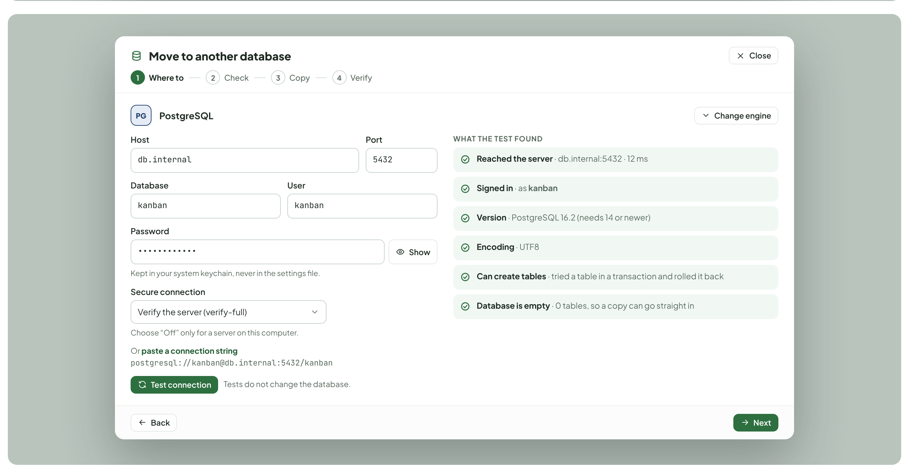

- Text in the frame (frame 2 of 3): "Move to another database" · "Close" · "1" · "Where to" · "2" · "Check" · "3" · "Copy" · "4" · "Verify" · "PG" · "PostgreSQL" · "Change engine" · "Host" · "db.internal" · "Port" · "5432" · "Database" · "kanban" · "User" · "Password" · "••••••••••••" · "Show" · "Kept in your system keychain, never in the settings file." · "Secure connection" · "Verify the server (verify-full)" · "Choose “Off” only for a server on this computer." · "Or paste a connection string postgresql://kanban@db.internal:5432/kanban" · "Test connection" · "Tests do not change the database." · "WHAT THE TEST FOUND" · "Reached the server · db.internal:5432 · 12 ms" · "Signed in · as kanban" · "Version · PostgreSQL 16.2 (needs 14 or newer)" · "Encoding · UTF8" · "Can create tables · tried a table in a transaction and rolled it back" · "Database is empty · 0 tables, so a copy can go straight in" · "Back" · "Next"

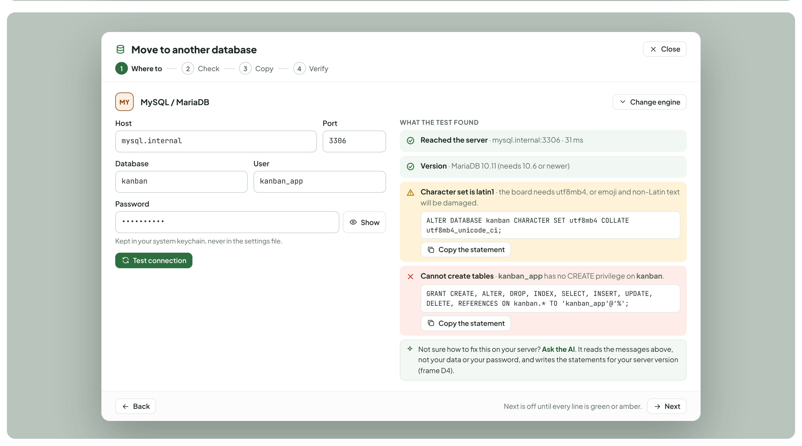

- Text in the frame (frame 3 of 3): "Move to another database" · "Close" · "1" · "Where to" · "2" · "Check" · "3" · "Copy" · "4" · "Verify" · "MY" · "MySQL / MariaDB" · "Change engine" · "Host" · "mysql.internal" · "Port" · "3306" · "Database" · "kanban" · "User" · "kanban_app" · "Password" · "••••••••••" · "Show" · "Kept in your system keychain, never in the settings file." · "Test connection" · "WHAT THE TEST FOUND" · "Reached the server · mysql.internal:3306 · 31 ms" · "Version · MariaDB 10.11 (needs 10.6 or newer)" · "Character set is latin1 · the board needs utf8mb4, or emoji and non-Latin text will be damaged." · "ALTER DATABASE kanban CHARACTER SET utf8mb4 COLLATE utf8mb4_unicode_ci;" · "Copy the statement" · "Cannot create tables · kanban_app has no CREATE privilege on kanban." · "GRANT CREATE, ALTER, DROP, INDEX, SELECT, INSERT, UPDATE, DELETE, REFERENCES ON kanban.* TO 'kanban_app'@'%';" · "Not sure how to fix this on your server? Ask the AI. It reads the messages above, not your data or your password, and writes the statements for your server version (frame D4)." · "Back" · "Next is off until every line is green or amber." · "Next"

---

## D. Step 2 to 4 · copy, in three ways

The wizard in Settings (D0 to D2), the script (D3) and the AI helper (D4) all drive the same copy. A person can start in the wizard, copy the command and run it on a server, or let the AI explain and fix a stop. Whoever runs it, the proof is the same: counts, a sample read back, links between rows and counters. Table names are the app’s own; the counts and sizes are examples.

Source: [AiDatabases.dc.html](../source/AiDatabases.dc.html) › block "D. Step 2 to 4 · copy, in three ways"

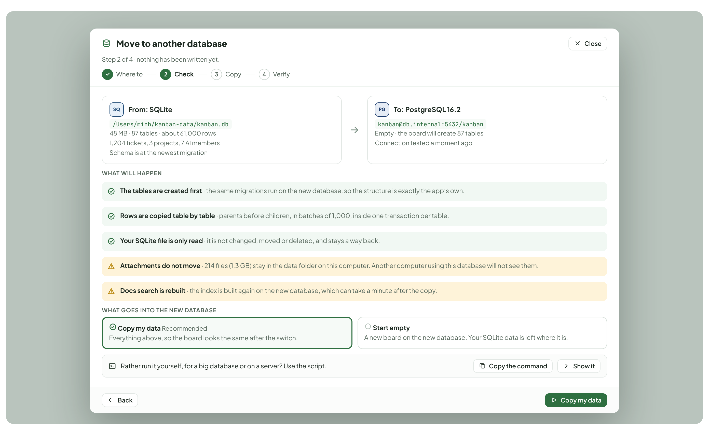

- Text in the frame (frame 1 of 6): "Move to another database" · "Close" · "Step 2 of 4 · nothing has been written yet." · "Where to" · "2" · "Check" · "3" · "Copy" · "4" · "Verify" · "SQ" · "From: SQLite" · "/Users/minh/kanban-data/kanban.db" · "48 MB · 87 tables · about 61,000 rows" · "1,204 tickets, 3 projects, 7 AI members" · "Schema is at the newest migration" · "PG" · "To: PostgreSQL 16.2" · "kanban@db.internal:5432/kanban" · "Empty · the board will create 87 tables" · "Connection tested a moment ago" · "WHAT WILL HAPPEN" · "The tables are created first · the same migrations run on the new database, so the structure is exactly the app’s own." · "Rows are copied table by table · parents before children, in batches of 1,000, inside one transaction per table." · "Your SQLite file is only read · it is not changed, moved or deleted, and stays a way back." · "Attachments do not move · 214 files (1.3 GB) stay in the data folder on this computer. Another computer using this database will not see them." · "Docs search is rebuilt · the index is built again on the new database, which can take a minute after the copy." · "WHAT GOES INTO THE NEW DATABASE" · "Copy my data Recommended" · "Everything above, so the board looks the same after the switch." · "Start empty" · "A new board on the new database. Your SQLite data is left where it is." · "Rather run it yourself, for a big database or on a server? Use the script." · "Copy the command" · "Show it" · "Back" · "Copy my data"

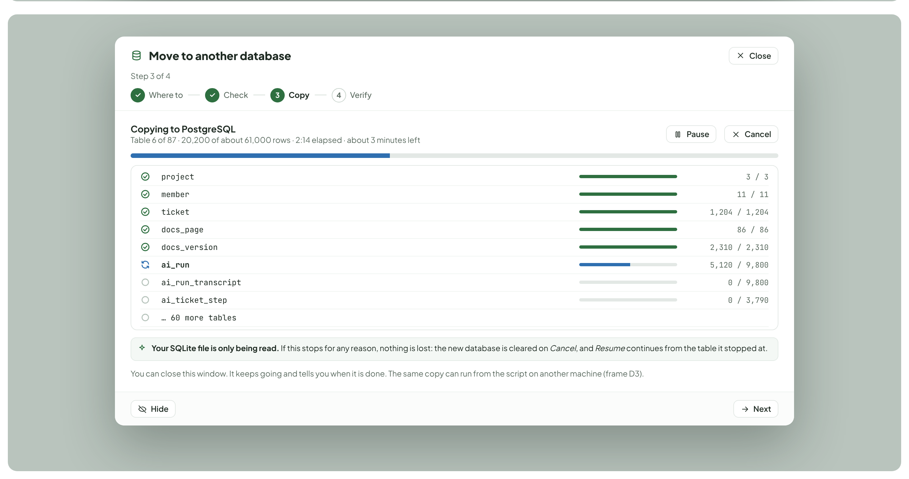

- Text in the frame (frame 2 of 6): "Move to another database" · "Close" · "Step 3 of 4" · "Where to" · "Check" · "3" · "Copy" · "4" · "Verify" · "Copying to PostgreSQL" · "Table 6 of 87 · 20,200 of about 61,000 rows · 2:14 elapsed · about 3 minutes left" · "Pause" · "Cancel" · "project" · "3 / 3" · "member" · "11 / 11" · "ticket" · "1,204 / 1,204" · "docs_page" · "86 / 86" · "docs_version" · "2,310 / 2,310" · "ai_run" · "5,120 / 9,800" · "ai_run_transcript" · "0 / 9,800" · "ai_ticket_step" · "0 / 3,790" · "… 60 more tables" · "Your SQLite file is only being read. If this stops for any reason, nothing is lost: the new database is cleared on Cancel, and Resume continues from the table it stopped at." · "You can close this window. It keeps going and tells you when it is done. The same copy can run from the script on another machine (frame D3)." · "Hide" · "Next"

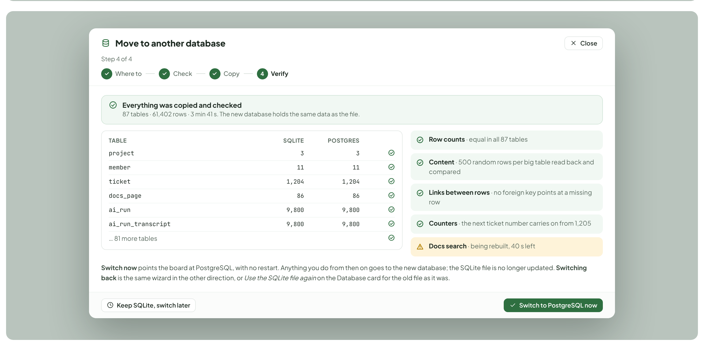

- Text in the frame (frame 3 of 6): "Move to another database" · "Close" · "Step 4 of 4" · "Where to" · "Check" · "Copy" · "4" · "Verify" · "Everything was copied and checked" · "87 tables · 61,402 rows · 3 min 41 s. The new database holds the same data as the file." · "TABLE" · "SQLITE" · "POSTGRES" · "project" · "3" · "member" · "11" · "ticket" · "1,204" · "docs_page" · "86" · "ai_run" · "9,800" · "ai_run_transcript" · "… 81 more tables" · "Row counts · equal in all 87 tables" · "Content · 500 random rows per big table read back and compared" · "Links between rows · no foreign key points at a missing row" · "Counters · the next ticket number carries on from 1,205" · "Docs search · being rebuilt, 40 s left" · "Switch now points the board at PostgreSQL, with no restart. Anything you do from then on goes to the new database; the SQLite file is no longer updated. Switching back is the same wizard in the other direction, or Use the SQLite file again on the Database card for the old file as it was." · "Keep SQLite, switch later" · "Switch to PostgreSQL now"

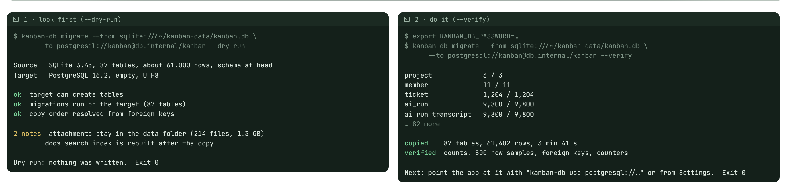

- Text in the frame (frame 4 of 6): "1 · look first (--dry-run)" · "$ kanban-db migrate --from sqlite:///~/kanban-data/kanban.db \" · "--to postgresql://kanban@db.internal/kanban --dry-run" · "Source   SQLite 3.45, 87 tables, about 61,000 rows, schema at head" · "Target   PostgreSQL 16.2, empty, UTF8" · "ok  target can create tables" · "ok  migrations run on the target (87 tables)" · "ok  copy order resolved from foreign keys" · "2 notes  attachments stay in the data folder (214 files, 1.3 GB)" · "docs search index is rebuilt after the copy" · "Dry run: nothing was written.  Exit 0" · "2 · do it (--verify)" · "$ export KANBAN_DB_PASSWORD=…" · "--to postgresql://kanban@db.internal/kanban --verify" · "project             3 / 3" · "member              11 / 11" · "ticket              1,204 / 1,204" · "ai_run              9,800 / 9,800" · "ai_run_transcript   9,800 / 9,800" · "… 82 more" · "copied    87 tables, 61,402 rows, 3 min 41 s" · "verified  counts, 500-row samples, foreign keys, counters" · "Next: point the app at it with "kanban-db use postgresql://…" or from Settings.  Exit 0"

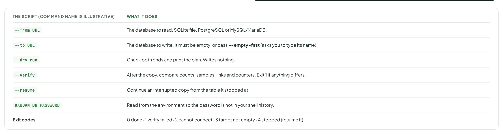

- Text in the frame (frame 5 of 6): "THE SCRIPT (COMMAND NAME IS ILLUSTRATIVE)" · "WHAT IT DOES" · "--from URL" · "The database to read. SQLite file, PostgreSQL or MySQL/MariaDB." · "--to URL" · "The database to write. It must be empty, or pass --empty-first (asks you to type its name)." · "--dry-run" · "Check both ends and print the plan. Writes nothing." · "--verify" · "After the copy, compare counts, samples, links and counters. Exit 1 if anything differs." · "--resume" · "Continue an interrupted copy from the table it stopped at." · "KANBAN_DB_PASSWORD" · "Read from the environment so the password is not in your shell history." · "Exit codes" · "0 done · 1 verify failed · 2 cannot connect · 3 target not empty · 4 stopped (resume it)"

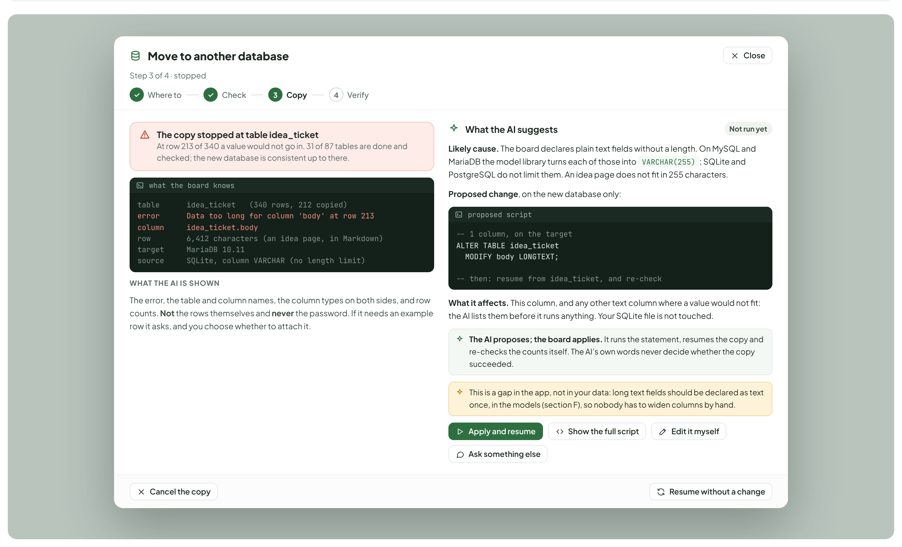

- Text in the frame (frame 6 of 6): "Move to another database" · "Close" · "Step 3 of 4 · stopped" · "Where to" · "Check" · "3" · "Copy" · "4" · "Verify" · "The copy stopped at table idea_ticket" · "At row 213 of 340 a value would not go in. 31 of 87 tables are done and checked; the new database is consistent up to there." · "what the board knows" · "table      idea_ticket   (340 rows, 212 copied)" · "error      Data too long for column 'body' at row 213" · "column     idea_ticket.body" · "row        6,412 characters (an idea page, in Markdown)" · "target     MariaDB 10.11" · "source     SQLite, column VARCHAR (no length limit)" · "WHAT THE AI IS SHOWN" · "The error, the table and column names, the column types on both sides, and row counts. Not the rows themselves and never the password. If it needs an example row it asks, and you choose whether to attach it." · "What the AI suggests" · "Not run yet" · "Likely cause. The board declares plain text fields without a length. On MySQL and MariaDB the model library turns each of those into VARCHAR(255); SQLite and PostgreSQL do not limit them. An idea page does not fit in 255 characters." · "Proposed change, on the new database only:" · "proposed script" · "-- 1 column, on the target" · "ALTER TABLE idea_ticket" · "MODIFY body LONGTEXT;" · "-- then: resume from idea_ticket, and re-check" · "What it affects. This column, and any other text column where a value would not fit: the AI lists them before it runs anything. Your SQLite file is not touched." · "The AI proposes; the board applies. It runs the statement, resumes the copy and re-checks the counts itself. The AI’s own words never decide whether the copy succeeded." · "This is a gap in the app, not in your data: long text fields should be declared as text once, in the models (section F), so nobody has to widen columns by hand." · "Apply and resume" · "Show the full script" · "Edit it myself" · "Ask something else" · "Cancel the copy" · "Resume without a change"

---

## E. When something is not as expected

A database that is not empty, a copy that was interrupted, a database that cannot be reached after the switch, and the problems the test can find. Each one says what happened, what is safe, and what to do; none leaves the person without a way back to the SQLite file.

Source: [AiDatabases.dc.html](../source/AiDatabases.dc.html) › block "E. When something is not as expected"

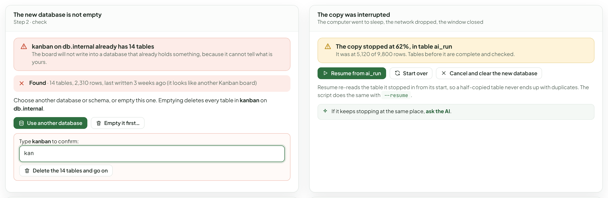

- Text in the frame (frame 1 of 2): "The new database is not empty" · "Step 2 · check" · "kanban on db.internal already has 14 tables" · "The board will not write into a database that already holds something, because it cannot tell what is yours." · "Found · 14 tables, 2,310 rows, last written 3 weeks ago (it looks like another Kanban board)" · "Choose another database or schema, or empty this one. Emptying deletes every table in kanban on db.internal." · "Use another database" · "Empty it first…" · "Type kanban to confirm:" · "kan" · "Delete the 14 tables and go on" · "The copy was interrupted" · "The computer went to sleep, the network dropped, the window closed" · "The copy stopped at 62%, in table ai_run" · "It was at 5,120 of 9,800 rows. Tables before it are complete and checked." · "Resume from ai_run" · "Start over" · "Cancel and clear the new database" · "Resume re-reads the table it stopped in from its start, so a half-copied table never ends up with duplicates. The script does the same with --resume." · "If it keeps stopping at the same place, ask the AI."

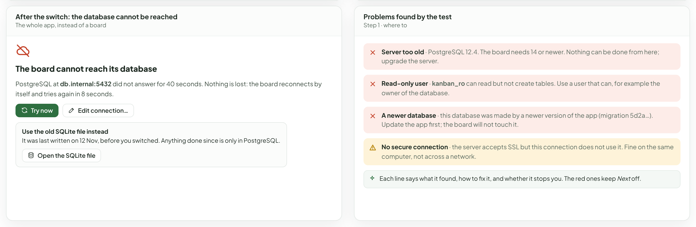

- Text in the frame (frame 2 of 2): "After the switch: the database cannot be reached" · "The whole app, instead of a board" · "The board cannot reach its database" · "PostgreSQL at db.internal:5432 did not answer for 40 seconds. Nothing is lost: the board reconnects by itself and tries again in 8 seconds." · "Try now" · "Edit connection…" · "Use the old SQLite file instead" · "It was last written on 12 Nov, before you switched. Anything done since is only in PostgreSQL." · "Open the SQLite file" · "Problems found by the test" · "Step 1 · where to" · "Server too old · PostgreSQL 12.4. The board needs 14 or newer. Nothing can be done from here; upgrade the server." · "Read-only user · kanban_ro can read but not create tables. Use a user that can, for example the owner of the database." · "A newer database · this database was made by a newer version of the app (migration 5d2a…). Update the app first; the board will not touch it." · "No secure connection · the server accepts SSL but this connection does not use it. Fine on the same computer, not across a network." · "Each line says what it found, how to fix it, and whether it stops you. The red ones keep Next off."

---

## F. What stays, what is new, and what is still open

The questions a person building this would ask, each with a recommendation, then what the server and the packaging would have to do. Checked against main at 3.35.1.

Source: [AiDatabases.dc.html](../source/AiDatabases.dc.html) › block "F. What stays, what is new, and what is still open"

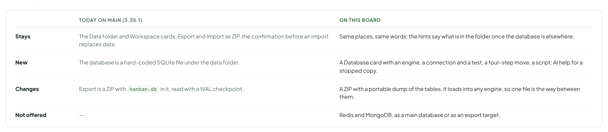

- Text in the frame (frame 1 of 3): "TODAY ON MAIN (3.35.1)" · "ON THIS BOARD" · "Stays" · "The Data folder and Workspace cards, Export and Import as ZIP, the confirmation before an import replaces data." · "Same places, same words; the hints say what is in the folder once the database is elsewhere." · "New" · "The database is a hard-coded SQLite file under the data folder." · "A Database card with an engine, a connection and a test; a four-step move; a script; AI help for a stopped copy." · "Changes" · "Export is a ZIP with kanban.db in it, read with a WAL checkpoint." · "A ZIP with a portable dump of the tables. It loads into any engine, so one file is the way between them." · "Not offered" · "—" · "Redis and MongoDB, as a main database or as an export target."

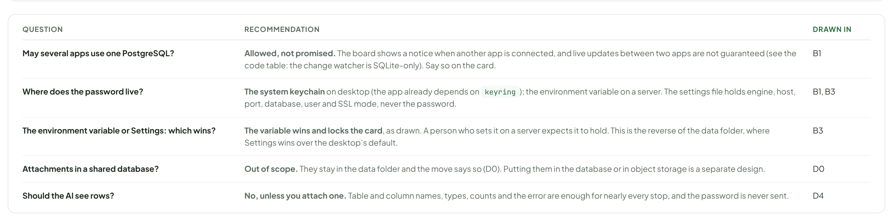

- Text in the frame (frame 2 of 3): "QUESTION" · "RECOMMENDATION" · "DRAWN IN" · "May several apps use one PostgreSQL?" · "Allowed, not promised. The board shows a notice when another app is connected, and live updates between two apps are not guaranteed (see the code table: the change watcher is SQLite-only). Say so on the card." · "B1" · "Where does the password live?" · "The system keychain on desktop (the app already depends on keyring); the environment variable on a server. The settings file holds engine, host, port, database, user and SSL mode, never the password." · "B1, B3" · "The environment variable or Settings: which wins?" · "The variable wins and locks the card, as drawn. A person who sets it on a server expects it to hold. This is the reverse of the data folder, where Settings wins over the desktop’s default." · "B3" · "Attachments in a shared database?" · "Out of scope. They stay in the data folder and the move says so (D0). Putting them in the database or in object storage is a separate design." · "D0" · "Should the AI see rows?" · "No, unless you attach one. Table and column names, types, counts and the error are enough for nearly every stop, and the password is never sent." · "D4"

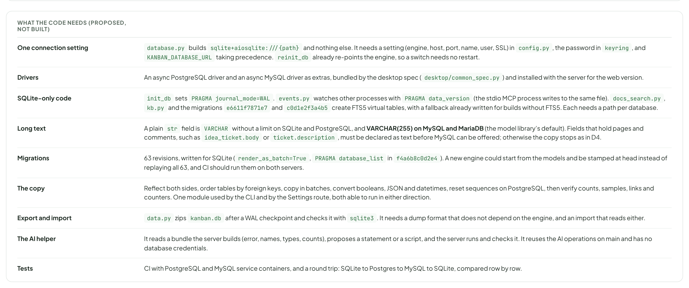

- Text in the frame (frame 3 of 3): "WHAT THE CODE NEEDS (PROPOSED, NOT BUILT)" · "One connection setting" · "database.py builds sqlite+aiosqlite:///{path} and nothing else. It needs a setting (engine, host, port, name, user, SSL) in config.py, the password in keyring, and KANBAN_DATABASE_URL taking precedence. reinit_db already re-points the engine, so a switch needs no restart." · "Drivers" · "An async PostgreSQL driver and an async MySQL driver as extras, bundled by the desktop spec (desktop/common_spec.py) and installed with the server for the web version." · "SQLite-only code" · "init_db sets PRAGMA journal_mode=WAL. events.py watches other processes with PRAGMA data_version (the stdio MCP process writes to the same file). docs_search.py, kb.py and the migrations e6611f7871e7 and c0d1e2f3a4b5 create FTS5 virtual tables, with a fallback already written for builds without FTS5. Each needs a path per database." · "Long text" · "A plain str field is VARCHAR without a limit on SQLite and PostgreSQL, and VARCHAR(255) on MySQL and MariaDB (the model library’s default). Fields that hold pages and comments, such as idea_ticket.body or ticket.description, must be declared as text before MySQL can be offered; otherwise the copy stops as in D4." · "Migrations" · "63 revisions, written for SQLite (render_as_batch=True, PRAGMA database_list in f4a6b8c0d2e4). A new engine could start from the models and be stamped at head instead of replaying all 63, and CI should run them on both servers." · "The copy" · "Reflect both sides, order tables by foreign keys, copy in batches, convert booleans, JSON and datetimes, reset sequences on PostgreSQL, then verify counts, samples, links and counters. One module used by the CLI and by the Settings route, both able to run in either direction." · "Export and import" · "data.py zips kanban.db after a WAL checkpoint and checks it with sqlite3. It needs a dump format that does not depend on the engine, and an import that reads either." · "The AI helper" · "It reads a bundle the server builds (error, names, types, counts), proposes a statement or a script, and the server runs and checks it. It reuses the AI operations on main and has no database credentials." · "Tests" · "CI with PostgreSQL and MySQL service containers, and a round trip: SQLite to Postgres to MySQL to SQLite, compared row by row."
