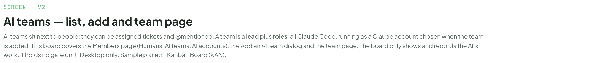
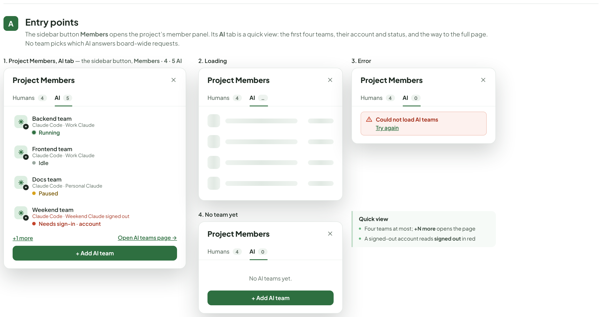
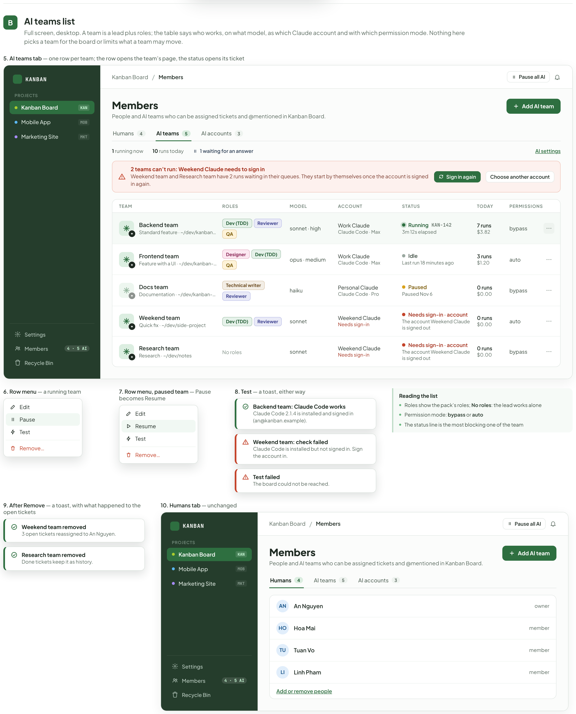
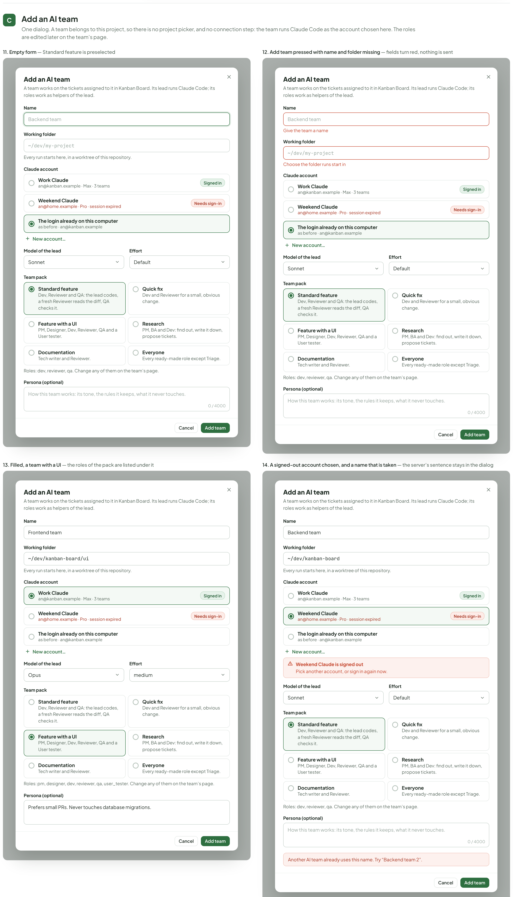
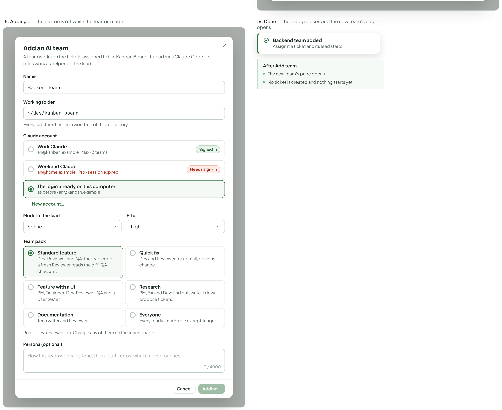
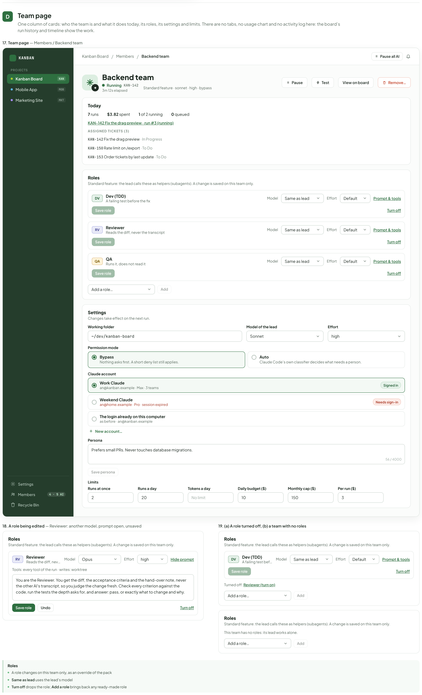
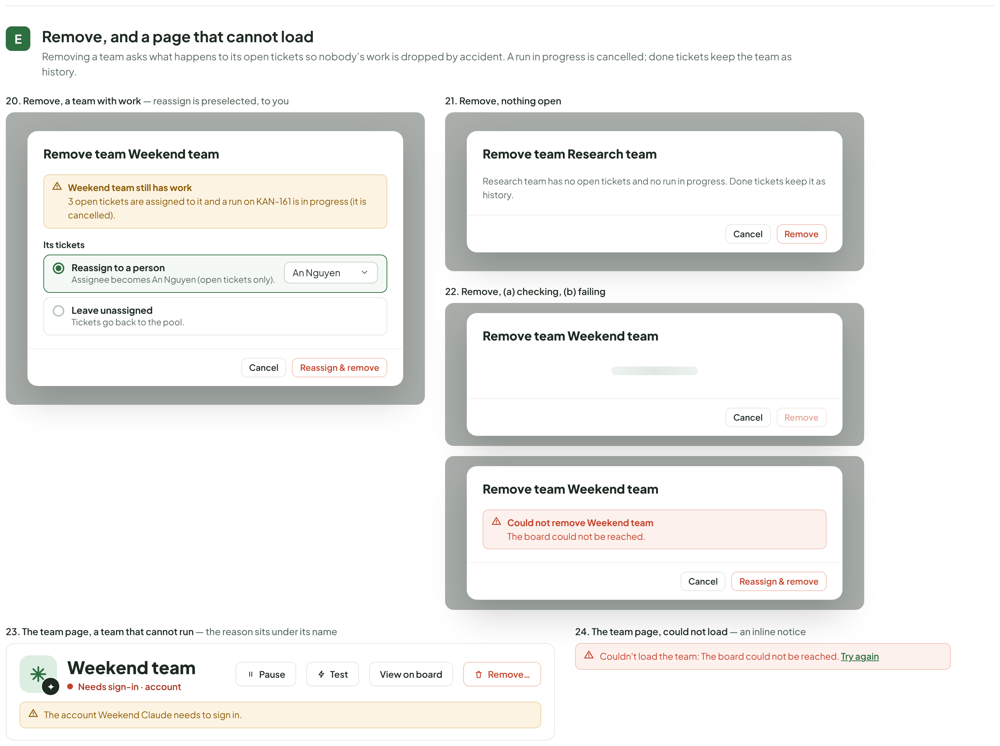
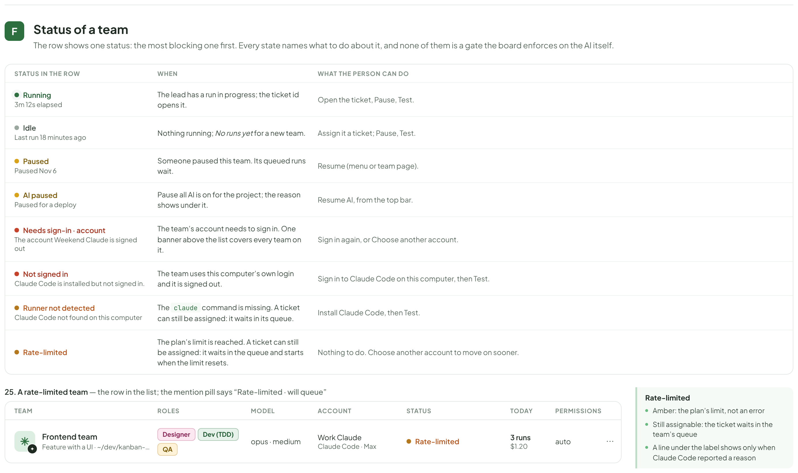
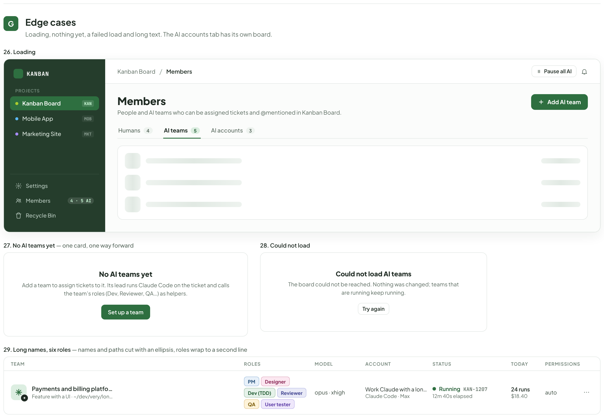

# AI members — list & register

> Redrawn for AI v2 · source: [`AiMembers.dc.html`](../source/AiMembers.dc.html) · canvas `1794110641-1323` · sha256 `e84769c85c3b8cd0b9cb96b10695c16ae2c0b2933e37754bf58b69b0d7cb6be6`

> Words, states and conditions follow the code of branch `claude/ai-team-architecture-7a1efc`; the layout is designed here and is not the layout of the current screens. Names, ids, costs and times in the mock-ups are sample data. **Check the code before building from this: the file named in each part is the truth, not the picture.**

## SCREEN — V2

- Text in this part: "SCREEN — V2" · "AI teams — list, add and team page" · "AI teams sit next to people: they can be assigned tickets and @mentioned. A team is a lead plus roles, all Claude Code, running as a Claude account chosen when the team is added. This board covers the Members page (Humans, AI teams, AI accounts), the Add an AI team dialog and the team page. The board only shows and records the AI’s work: it holds no gate on it. Desktop only. Sample project: Kanban Board (KAN)."

---

## Entry points

- Text in this part: "A" · "Entry points" · "The sidebar button Members opens the project’s member panel. Its AI tab is a quick view: the first four teams, their account and status, and the way to the full page. No team picks which AI answers board-wide requests." · "1. Project Members, AI tab — the sidebar button, Members · 4 · 5 AI" · "Project Members" · "Humans" · "4" · "AI" · "5" · "Backend team" · "Claude Code · Work Claude" · "Running" · "Frontend team" · "Idle" · "Docs team" · "Claude Code · Personal Claude" · "Paused" · "Weekend team" · "Claude Code · Weekend Claude signed out" · "Needs sign-in · account" · "+1 more" · "Open AI teams page →" · "+ Add AI team" · "2. Loading" · "…" · "3. Error" · "0" · "Could not load AI teams" · "Try again" · "4. No team yet" · "No AI teams yet." · "Quick view" · "Four teams at most; +N more opens the page" · "A signed-out account reads signed out in red"

---

## AI teams list

- Text in this part: "B" · "AI teams list" · "Full screen, desktop. A team is a lead plus roles; the table says who works, on what model, as which Claude account and with which permission mode. Nothing here picks a team for the board or limits what a team may move." · "5. AI teams tab — one row per team; the row opens the team’s page, the status opens its ticket" · "KANBAN" · "PROJECTS" · "Kanban Board" · "KAN" · "Mobile App" · "MOB" · "Marketing Site" · "MKT" · "Settings" · "Members" · "4 · 5 AI" · "Recycle Bin" · "/" · "Pause all AI" · "People and AI teams who can be assigned tickets and @mentioned in Kanban Board." · "Add AI team" · "Humans" · "4" · "AI teams" · "5" · "AI accounts" · "3" · "1 running now" · "10 runs today" · "1 waiting for an answer" · "AI settings" · "2 teams can’t run: Weekend Claude needs to sign in" · "Weekend team and Research team have 2 runs waiting in their queues. They start by themselves once the account is signed in again." · "Sign in again" · "Choose another account" · "TEAM" · "ROLES" · "MODEL" · "ACCOUNT" · "STATUS" · "TODAY" · "PERMISSIONS" · "Backend team" · "Standard feature · ~/dev/kanban-board" · "Dev (TDD)" · "Reviewer" · "QA" · "sonnet · high" · "Work Claude" · "Claude Code · Max" · "Running" · "KAN-142" · "3m 12s elapsed" · "7 runs" · "$3.82" · "bypass" · "Frontend team" · "Feature with a UI · ~/dev/kanban-board/ui" · "Designer" · "opus · medium" · "Idle" · "Last run 18 minutes ago" · "3 runs" · "$1.20" · "auto" · "Docs team" · "Documentation · ~/dev/kanban-board/docs" · "Technical writer" · "haiku" · "Personal Claude" · "Claude Code · Pro" · "Paused" · "Paused Nov 6" · "0 runs" · "$0.00" · "Weekend team" · "Quick fix · ~/dev/side-project" · "sonnet" · "Weekend Claude" · "Needs sign-in" · "Needs sign-in · account" · "The account Weekend Claude is signed out" · "Research team" · "Research · ~/dev/notes" · "No roles" · "6. Row menu — a running team" · "Edit" · "Pause" · "Test" · "Remove…" · "7. Row menu, paused team — Pause becomes Resume" · "Resume" · "8. Test — a toast, either way" · "Backend team: Claude Code works" · "Claude Code 2.1.4 is installed and signed in (an@kanban.example)." · "Weekend team: check failed" · "Claude Code is installed but not signed in. Sign the account in." · "Test failed" · "The board could not be reached." · "Reading the list" · "Roles show the pack’s roles; No roles: the lead works alone" · "Permission mode: bypass or auto" · "The status line is the most blocking one of the team" · "9. After Remove — a toast, with what happened to the open tickets" · "Weekend team removed" · "3 open tickets reassigned to An Nguyen." · "Research team removed" · "Done tickets keep it as history." · "10. Humans tab — unchanged" · "AN" · "An Nguyen"

---

## Add an AI team

- Text in this part: "C" · "Add an AI team" · "One dialog. A team belongs to this project, so there is no project picker, and no connection step: the team runs Claude Code as the account chosen here. The roles are edited later on the team’s page." · "11. Empty form — Standard feature is preselected" · "A team works on the tickets assigned to it in Kanban Board. Its lead runs Claude Code; its roles work as helpers of the lead." · "Name" · "Backend team" · "Working folder" · "~/dev/my-project" · "Every run starts here, in a worktree of this repository." · "Claude account" · "Work Claude" · "an@kanban.example · Max · 3 teams" · "Signed in" · "Weekend Claude" · "an@home.example · Pro · session expired" · "Needs sign-in" · "The login already on this computer" · "as before · an@kanban.example" · "New account…" · "Model of the lead" · "Sonnet" · "Effort" · "Default" · "Team pack" · "Standard feature" · "Dev, Reviewer and QA: the lead codes, a fresh Reviewer reads the diff, QA checks it." · "Quick fix" · "Dev and Reviewer for a small, obvious change." · "Feature with a UI" · "PM, Designer, Dev, Reviewer, QA and a User tester." · "Research" · "PM, BA and Dev: find out, write it down, propose tickets." · "Documentation" · "Tech writer and Reviewer." · "Everyone" · "Every ready-made role except Triage." · "Roles: dev, reviewer, qa. Change any of them on the team’s page." · "Persona (optional)" · "How this team works: its tone, the rules it keeps, what it never touches." · "0 / 4000" · "Cancel" · "Add team" · "12. Add team pressed with name and folder missing — fields turn red, nothing is sent" · "Give the team a name" · "Choose the folder runs start in" · "13. Filled, a team with a UI — the roles of the pack are listed under it" · "Frontend team" · "~/dev/kanban-board/ui" · "Opus" · "medium" · "Roles: pm, designer, dev, reviewer, qa, user_tester. Change any of them on the team’s page." · "Prefers small PRs. Never touches database migrations." · "14. A signed-out account chosen, and a name that is taken — the server’s sentence stays in the dialog" · "~/dev/kanban-board" · "Weekend Claude is signed out" · "Pick another account, or sign in again now." · "Another AI team already uses this name. Try “Backend team 2”." · "15. Adding… — the button is off while the team is made" · "high" · "Adding…" · "16. Done — the dialog closes and the new team’s page opens" · "Backend team added" · "Assign it a ticket and its lead starts." · "After Add team" · "The new team’s page opens" · "No ticket is created and nothing starts yet"

---

## Team page

- Text in this part: "D" · "Team page" · "One column of cards: who the team is and what it does today, its roles, its settings and limits. There are no tabs, no usage chart and no activity log here: the board’s run history and timeline show the work." · "17. Team page — Members / Backend team" · "KANBAN" · "PROJECTS" · "Kanban Board" · "KAN" · "Mobile App" · "MOB" · "Marketing Site" · "MKT" · "Settings" · "Members" · "4 · 5 AI" · "Recycle Bin" · "/" · "Backend team" · "Pause all AI" · "Running" · "KAN-142" · "3m 12s elapsed" · "Standard feature · sonnet · high · bypass" · "Pause" · "Test" · "View on board" · "Remove…" · "Today" · "7 runs" · "$3.82 spent" · "1 of 2 running" · "0 queued" · "KAN-142 Fix the drag preview · run #3 (running)" · "ASSIGNED TICKETS (3)" · "KAN-142 Fix the drag preview · In Progress" · "KAN-150 Rate limit on /export · To Do" · "KAN-153 Order tickets by last update · To Do" · "Roles" · "Standard feature: the lead calls these as helpers (subagents). A change is saved on this team only." · "DV" · "Dev (TDD)" · "A failing test before the fix" · "Model" · "Same as lead" · "Effort" · "Default" · "Prompt & tools" · "Save role" · "Turn off" · "RV" · "Reviewer" · "Reads the diff, never the transcript" · "QA" · "Runs it, does not read it" · "Add a role…" · "Add" · "Changes take effect on the next run." · "Working folder" · "~/dev/kanban-board" · "Model of the lead" · "Sonnet" · "high" · "Permission mode" · "Bypass" · "Nothing asks first. A short deny list still applies." · "Auto" · "Claude Code’s own classifier decides what needs a person." · "Claude account" · "Work Claude" · "an@kanban.example · Max · 3 teams" · "Signed in" · "Weekend Claude" · "an@home.example · Pro · session expired" · "Needs sign-in" · "The login already on this computer" · "as before · an@kanban.example" · "New account…" · "Persona" · "Prefers small PRs. Never touches database migrations." · "56 / 4000" · "Save persona" · "Limits" · "Runs at once" · "2" · "Runs a day" · "20" · "Tokens a day" · "No limit" · "Daily budget ($)" · "10" · "Monthly cap ($)" · "150" · "Per run ($)" · "3" · "18. A role being edited — Reviewer: another model, prompt open, unsaved" · "Opus" · "Hide prompt" · "Tools: every tool of the run · writes: worktree" · "You are the Reviewer. You get the diff, the acceptance criteria and the hand-over note, never the other AI's transcript, so you judge the change fresh. Check every criterion against the code, run the tests the depth asks for, and answer: pass, or exactly what to change and why." · "Undo" · "19. (a) A role turned off, (b) a team with no roles" · "Turned off: Reviewer (turn on)" · "This team has no roles: its lead works alone." · "A role changes on this team only, as an override of the pack" · "Same as lead uses the lead’s model" · "Turn off drops the role; Add a role brings back any ready-made role"

---

## Remove, and a page that cannot load

- Text in this part: "E" · "Remove, and a page that cannot load" · "Removing a team asks what happens to its open tickets so nobody’s work is dropped by accident. A run in progress is cancelled; done tickets keep the team as history." · "20. Remove, a team with work — reassign is preselected, to you" · "Remove team Weekend team" · "Weekend team still has work" · "3 open tickets are assigned to it and a run on KAN-161 is in progress (it is cancelled)." · "Its tickets" · "Reassign to a person" · "Assignee becomes An Nguyen (open tickets only)." · "An Nguyen" · "Leave unassigned" · "Tickets go back to the pool." · "Cancel" · "Reassign & remove" · "21. Remove, nothing open" · "Remove team Research team" · "Research team has no open tickets and no run in progress. Done tickets keep it as history." · "Remove" · "22. Remove, (a) checking, (b) failing" · "Could not remove Weekend team" · "The board could not be reached." · "23. The team page, a team that cannot run — the reason sits under its name" · "Weekend team" · "Needs sign-in · account" · "Pause" · "Test" · "View on board" · "Remove…" · "The account Weekend Claude needs to sign in." · "24. The team page, could not load — an inline notice" · "Couldn't load the team: The board could not be reached. Try again"

---

## Status of a team

- Text in this part: "F" · "Status of a team" · "The row shows one status: the most blocking one first. Every state names what to do about it, and none of them is a gate the board enforces on the AI itself." · "STATUS IN THE ROW" · "WHEN" · "WHAT THE PERSON CAN DO" · "Running" · "3m 12s elapsed" · "The lead has a run in progress; the ticket id opens it." · "Open the ticket, Pause, Test." · "Idle" · "Last run 18 minutes ago" · "Nothing running; No runs yet for a new team." · "Assign it a ticket; Pause, Test." · "Paused" · "Paused Nov 6" · "Someone paused this team. Its queued runs wait." · "Resume (menu or team page)." · "AI paused" · "Paused for a deploy" · "Pause all AI is on for the project; the reason shows under it." · "Resume AI, from the top bar." · "Needs sign-in · account" · "The account Weekend Claude is signed out" · "The team’s account needs to sign in. One banner above the list covers every team on it." · "Sign in again, or Choose another account." · "Not signed in" · "Claude Code is installed but not signed in." · "The team uses this computer’s own login and it is signed out." · "Sign in to Claude Code on this computer, then Test." · "Runner not detected" · "Claude Code not found on this computer" · "The claude command is missing. A ticket can still be assigned: it waits in its queue." · "Install Claude Code, then Test." · "Rate-limited" · "The plan’s limit is reached. A ticket can still be assigned: it waits in the queue and starts when the limit resets." · "Nothing to do. Choose another account to move on sooner." · "25. A rate-limited team — the row in the list; the mention pill says “Rate-limited · will queue”" · "TEAM" · "ROLES" · "MODEL" · "ACCOUNT" · "STATUS" · "TODAY" · "PERMISSIONS" · "Frontend team" · "Feature with a UI · ~/dev/kanban-board/ui" · "Designer" · "Dev (TDD)" · "QA" · "opus · medium" · "Work Claude" · "Claude Code · Max" · "3 runs" · "$1.20" · "auto" · "Amber: the plan’s limit, not an error" · "Still assignable: the ticket waits in the team’s queue" · "A line under the label shows only when Claude Code reported a reason"

---

## Edge cases

- Text in this part: "G" · "Edge cases" · "Loading, nothing yet, a failed load and long text. The AI accounts tab has its own board." · "26. Loading" · "KANBAN" · "PROJECTS" · "Kanban Board" · "KAN" · "Mobile App" · "MOB" · "Marketing Site" · "MKT" · "Settings" · "Members" · "4 · 5 AI" · "Recycle Bin" · "/" · "Pause all AI" · "People and AI teams who can be assigned tickets and @mentioned in Kanban Board." · "Add AI team" · "Humans" · "4" · "AI teams" · "5" · "AI accounts" · "3" · "27. No AI teams yet — one card, one way forward" · "No AI teams yet" · "Add a team to assign tickets to it. Its lead runs Claude Code on the ticket and calls the team’s roles (Dev, Reviewer, QA…) as helpers." · "Set up a team" · "28. Could not load" · "Could not load AI teams" · "The board could not be reached. Nothing was changed; teams that are running keep running." · "Try again" · "29. Long names, six roles — names and paths cut with an ellipsis, roles wrap to a second line" · "TEAM" · "ROLES" · "MODEL" · "ACCOUNT" · "STATUS" · "TODAY" · "PERMISSIONS" · "Payments and billing platform team" · "Feature with a UI · ~/dev/very/long/path/to/the/monorepo/services/billing" · "PM" · "Designer" · "Dev (TDD)" · "Reviewer" · "QA" · "User tester" · "opus · xhigh" · "Work Claude with a long name" · "Claude Code · Max" · "Running" · "KAN-1207" · "12m 40s elapsed" · "24 runs" · "$18.40" · "auto"

---

## Todo rows, differences from the code, and what was not checked

Files (all width 1480, built with the tw helpers; generators `gen_members.py`, `gen_accounts.py`, `gen_repo.py`, shared `g2c.py`):
AiMembers.dc.html (finalH 10641), AiAccounts.dc.html (finalH 10020), AiRepoCommands.dc.html (finalH 7575). All three are full rebuilds, not edits of the old files.

## AiMembers.dc.html (A03, B-15, B-16 only where it concerns this canvas)
| row | what I did | notes |
|---|---|---|
| A-049 | drawn | header says team = lead + roles, Claude account |
| A-050 | drawn | frames 1-4: Project Members panel, AI tab (quick view, loading, error, empty). Board AI card, Change popover and Settings A4 removed |
| A-051 | drawn | frame 5 table: Team, Roles, Model, Account, Status, Today, Permissions, menu; frames 6-9 row menu, Test toasts, shared signed-out banner |
| A-052 | redrawn | frames 10-15 "Add an AI team" (empty, validation, filled, taken name, Adding..., done toast). Stepper, Projects picker, Fill with Board AI gone |
| A-053 | drawn | frames 16-18 team page: Today, Roles card (role editor, turned off, no roles), Settings, Limits. Tabs, Usage chart, Permissions and Activity tabs gone |
| A-054 | drawn | section F status table (running, idle, paused, AI paused, Needs sign-in · account, Not signed in, Runner not detected, Rate-limited). E1, E6, E10 gone |
| A-055 | drawn | section G: loading, "No AI teams yet" (one card), could not load, long names. API-key sentence gone |
| A-056 | removed | notes board removed |
| B-15 | drawn | all listed states: empty, error, idle/working/paused/signed out, test ok/failed, modal validation, role override editor, no roles |
| B-16 | not drawn here | assignee picker belongs to the ticket canvases (not this one) |
Also drawn: Remove team dialog (4 states, frames 19-21) and the team page when it cannot run / cannot load (22-23), from AiDialogs.tsx.

## AiAccounts.dc.html (A04)
| row | what I did | notes |
|---|---|---|
| A-057 | drawn | intro and section A (5 pieces), "New types" row gone, Claude Code only |
| A-058 | drawn | frame 1 list (tiles, banner, rows, "Logins already on this computer / Move to an account"), frames 2-5 menu, chips, web build; "teams" wording |
| A-059 | drawn | menu and dialogs G (remove, sign out, rename, see teams using it); Codex/opencode examples gone |
| A-060 | drawn | section C: one CLI card, not-installed, install help, name, taken name, loading, error. opencode and Antigravity frames gone |
| A-061 | kept and redrawn | section D: 15 sign-in moments + "Stop signing in?" |
| A-062 | removed | C2b Antigravity gone |
| A-063 | drawn | only Claude Code lines in D |
| A-064 | drawn | section E picker (6 states); D1, D6 gone |
| A-065 | drawn | section F: banner per account (not a Needs-you card), Choose another account dialog, Sign in again next to Retry, account on team page |
| A-066 | drawn | section H: no accounts, loading, error, checking, someone signing in, CLI not found, web build (frame 5) |
| A-067 | drawn | section I: `claude auth status --json` only |

## AiRepoCommands.dc.html (A11)
| row | what I did | notes |
|---|---|---|
| A-127 | removed wizard header and stepper | PATH explanation kept as hint inside the open environment block (frame 6) |
| A-128 | redrawn | frames 1-5: button + strip + log inside Settings > AI > Repositories; no wizard chrome, no Team or Ports rows |
| A-129 | drawn | frames 6-9 rows and status legend; no "check" or "sent back" wording, no Confirm frame |
| A-130 | drawn | frames 10-15: out of time, nothing to find, did not finish, stopped, loading/error, opened later (card under Repositories) |
| A-131 | removed | section F gone |

## Rows not done
B-16 (not this canvas). Not drawn on purpose (other workers): Resources, Flow, You stepped in, Health, Docs AI.

## Code and todo disagree, or I drew differently from the code (the code must change)
- Accounts code still says "AI member(s)" (AccountsTab intro, tile "Members using one", bannerCopy, AccountPicker "Which account should this AI member use?", dialogs, signInCopy "chosen by AI members"). Drawn as "teams" per the todo. Same in MembersPanel ("Could not load AI members") and AddAccountModal ("Add AI member window").
- Todo A-054 lists "over budget" and the UI type has `over_budget`/`not_ready`, but `status_of` in server/services/ai/teams.py never returns them: not drawn.
- bannerCopy says "queued run held"; drawn as "run waiting in its queue" (no "held" on the canvas).
- AddTeamModal prints pack roles as raw keys ("Roles: dev, reviewer, qa"); drawn as names ("Dev, Reviewer, QA"). The pack list is drawn as a 2-column grid of compact cards instead of six tall radio rows (modal was about 1100 px tall).
- The account picker inside Add an AI team shows the copy "Next stays off until this account works", but AddTeamModal has no Next and does not block "Add team"; I dropped that sentence.
- Team page: the code's role row is one crowded line; drawn with model/effort selects and "Prompt & tools" as in the code, but Today is kept as plain lines. No tabs, as the code.
- RepositoriesSection still has "Use as a check" boxes and the text "The project's checks. The Checks step runs them..." (v1 workflow). Drawn without them (A-129). EnvBlock "Used by everything" text mentions "lint, build and test checks of a workflow" and "AI members' own runs": drawn as "test, lint and build commands, and the teams' own runs".
- Commands UI is new on an existing backend (C-20). `repo_scan.apply()` also creates a team, plugins and project settings; the card needs a lean "save commands + env_path" call (PATCH of project ops already exists). Texts I invented because the backend has none: "Let the AI find the commands", "Save these commands", "Discard", "Set up again", "Run it again", "Stopped", the nothing-found sentence. Real strings used: step labels, "The AI stopped after 10 minutes.", "The app restarted while it ran. Run it again.", "The commands are already being set up.", the two ai_status reasons, the "Works / Command is wrong / Runs · the repo's own tests fail" chips from the earlier design (server statuses works / wrong / fails / timeout / not_run).
- Sign-in window, rename/remove/sign-out dialogs, picker states: strings quoted from signInCopy.ts, AccountPicker, Remove/Rename/SignOut/AccountMembers dialogs.

## Not checked
The app was not run; AccountsTab/SignInWindow behavior was read from code only. Sidebar badge "4 · 3 AI" is invented sample data. The Humans tab and the Settings > AI "Manage AI accounts" link were not drawn (the todo no longer lists them; the old A rows 1 mention the link, I could not confirm it in code). Dark/light mode and narrow widths not drawn.

## Review round
finalH now: AiMembers 11153, AiAccounts 10036, AiRepoCommands 7516 (width 1480). Frames of AiMembers were renumbered (humans tab and remove toast added, the duplicate shared-banner frame dropped).
- A-054 rate-limited / over budget: fixed. Neither is set by `_apply_health`; both removed (status table has 7 states).
- B-18 breadcrumb: fixed, cards read "Settings > AI > Repositories".
- B-15 Humans tab: fixed, drawn (frame 10). Remove toast: fixed (frame 9).
- 1 load errors: fixed for team page, accounts and repository settings (inline notice "Couldn't load ...: <error>. Try again"); the teams list keeps its card (ListError).
- 2, 3, 4 roles: fixed. Taglines, "Dev (TDD)", "Technical writer", "writes: worktree" and the real Reviewer persona start from packs.py.
- 5 pack texts: fixed (roles.py wording). The Roles line under the pack list prints raw keys as the code does.
- 6 model: fixed, raw "sonnet · high".
- 7 sidebar badge: fixed, "4 · 5 AI" everywhere.
- 8 Rate-limited text: removed.
- 9 "opens on its Settings": fixed.
- 10 Stop signing in text: fixed (code sentence).
- 11 fixed: sign-in source wording, frame 10 shows only "The AI stopped after 10 minutes.", Pressed-twice button is off.
- 15 sample data: fixed. Work Claude 3 teams (Backend, Frontend, Release team in another project); Personal Claude 1 (Docs); Weekend Claude 2 (Weekend, Research). The "no team uses it" remove dialog was dropped (no such account in the story).
- Visual: table card now stretches (frame 28); frame 23 caption shortened; stacked sub-frames labelled (a)/(b).
- Kept: none refused.

Designer's proposals (no basis in the code): AiRepoCommands whole card UI (button "Let the AI find the commands", strip, "Save these commands", "Discard", "Set up again", "Run it again", "Run all again", "Ask the AI to fix", per-row AI comments, the free-text hint with "Try again", chips "Not tried yet", "Empty", "Changed since the last run", "Stopped"); AiMembers pack grid, compact status table, Humans frame mock data; AiAccounts section A table, "Check now" disabled web-build row, Stop/Keep buttons in the Stop signing in dialog.

### Owner decisions pass (comment on PR #331)

Rate-limited is drawn in the states table and as a team row (label only; the code adds a reason line only when Claude Code reported one); Runner not detected is amber as in the code.
