# AI members — list & register

> Screen — v1 · source: [`AiMembers.dc.html`](../source/AiMembers.dc.html) · canvas `1792727511-31c8` · sha256 `d3513e3f2747d8445b9576b773cff2cdcddfbf2f61bb33ec8e4e7facd3935402`

Eyebrow "Screen — v1". AI members sit next to people: they can be assigned tickets, @mentioned and asked questions. Two ways to connect: a **local runner** that launches the official CLI you are already signed in to (Claude Code, Antigravity), or an **API key** where the board runs the agent loop (Anthropic, OpenAI, Gemini, custom endpoint). One AI is also chosen as the **Board AI** for board-wide features. Desktop only. Every agent can move tickets only up to Review by default.

---

## A. Entry points

The sidebar “Members” button keeps working as today; its modal gets Humans | AI tabs. The AI tab is a quick view; “Open AI members page” goes to the full screen in section B. The Board AI selector lives at the top of that page and in Settings (frame A4, drawn beside the popovers below). A separate sidebar item was considered and not chosen (see Note).

Source: [AiMembers.dc.html](../source/AiMembers.dc.html) › block "A Entry points" (three frames side by side: 1 sidebar, 2 Members modal Humans tab, 3 Members modal AI tab)


### 1. Sidebar

- Caption: "1. Sidebar" "— the existing Members button gains a count pill".
- "KANBAN"; "Projects"; "Kanban Board" "KAN"; "Mobile App" "MOB"; "Marketing Site" "MKT"; bottom items "Settings"; "Members" with pill "4 · 7 AI"; "Recycle Bin".

### 2. Members modal — Humans tab

- Caption: "2. Members modal — Humans tab" "— unchanged content, new tab strip".
- Title "Project Members"; tabs "Humans" "4", "AI" "7".
- People: "AN" "An Nguyen"; "HM" "Hoa Mai"; "TV" "Tuan Vo"; "LP" "Linh Pham".
- "Add member"; "Add".

### 3. Members modal — AI tab

- Caption: "3. Members modal — AI tab" "— compact list; the full screen is section B".
- Title "Project Members"; tabs "Humans" "4", "AI" "7".
- "Board AI" "Reviewer (Claude API)" "Change".
- Rows: "Claude Code · Backend" "Running KAN-142" "Local runner"; "Antigravity · Frontend" "Idle" "Local runner"; "Reviewer (Claude API)" "Online" "API key"; "Triage (GPT)" "Key invalid" "API key".
- "+3 more"; "Open AI members page"; "Add AI member".

---

## B. AI members list

Full screen, desktop. Header carries the Board AI card and “Add AI member”. Rows show everything needed to decide whether an AI can take work right now. The sample rows cover every provider and the main states; full state catalogue is section E.

Source: [AiMembers.dc.html](../source/AiMembers.dc.html) › block "B AI members list" (full screen on top; below it the row overflow menu, the "Change" Board AI picker and frame A4, Settings "AI" section)

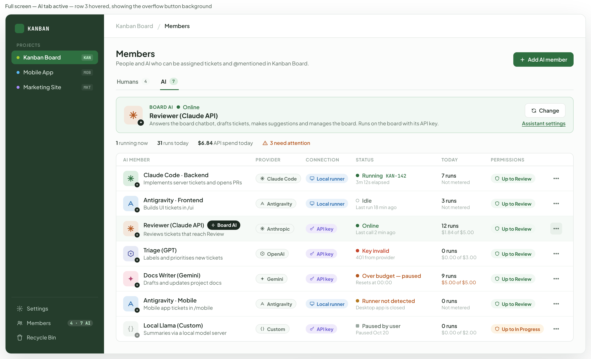

### Full screen

- Caption: "Full screen — AI tab active" "— row 3 hovered, showing the overflow button background".
- Sidebar: "KANBAN"; "Projects"; "Kanban Board" "KAN"; "Mobile App" "MOB"; "Marketing Site" "MKT"; "Settings"; "Members" "4 · 7 AI"; "Recycle Bin".
- Breadcrumb "Kanban Board" "/" "Members"; title "Members"; "People and AI who can be assigned tickets and @mentioned in Kanban Board."; button "Add AI member"; tabs "Humans" "4", "AI" "7".
- Board AI card: "Board AI" "Online"; "Reviewer (Claude API)"; "Answers the board chatbot, drafts tickets, makes suggestions and manages the board. Runs on the board with its API key."; "Change"; "Assistant settings".
- Summary: "1" "running now"; "31" "runs today"; "$6.84" "API spend today"; "3 need attention".
- Table:

| AI member | Provider | Connection | Status | Today | Permissions |
|---|---|---|---|---|---|
| "Claude Code · Backend" "Implements server tickets and opens PRs" | "Claude Code" | "Local runner" | "Running" "KAN-142" "3m 12s elapsed" | "7 runs" "Not metered" | "Up to Review" |
| "Antigravity · Frontend" "Builds UI tickets in /ui" | "Antigravity" | "Local runner" | "Idle" "Last run 18 min ago" | "3 runs" "Not metered" | "Up to Review" |
| "Reviewer (Claude API)" "Board AI" "Reviews tickets that reach Review" | "Anthropic" | "API key" | "Online" "Last call 2 min ago" | "12 runs" "$1.84 of $5.00" | "Up to Review" |
| "Triage (GPT)" "Labels and prioritises new tickets" | "OpenAI" | "API key" | "Key invalid" "401 from provider" | "0 runs" "$0.00 of $3.00" | "Up to Review" |
| "Docs Writer (Gemini)" "Drafts and updates project docs" | "Gemini" | "API key" | "Over budget — paused" "Resets at 00:00" | "9 runs" "$5.00 of $5.00" | "Up to Review" |
| "Antigravity · Mobile" "Mobile app tickets in /mobile" | "Antigravity" | "Local runner" | "Runner not detected" "Desktop app is closed" | "0 runs" "Not metered" | "Up to Review" |
| "Local Llama (Custom)" "Summaries via a local model server" | "Custom" | "API key" | "Paused by user" "Paused Oct 20" | "0 runs" "$0.00 of $2.00" | "Up to In Progress" |

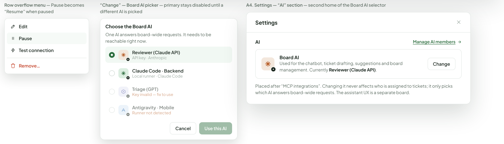

### Row overflow menu

- Caption: "Row overflow menu" "— Pause becomes “Resume” when paused".
- Menu: "Edit"; "Pause"; "Test connection"; "Remove…".

### “Change” — Board AI picker

- Caption: "“Change” — Board AI picker" "— primary stays disabled until a different AI is picked".
- Title "Choose the Board AI"; "One AI answers board-wide requests. It needs to be reachable right now."
- Options: "Reviewer (Claude API)" "API key · Anthropic"; "Claude Code · Backend" "Local runner · Claude Code"; "Triage (GPT)" "Key invalid — fix to use"; "Antigravity · Mobile" "Runner not detected".
- Buttons "Cancel", "Use this AI".

### A4. Settings — “AI” section

- Caption: "A4. Settings — “AI” section" "— second home of the Board AI selector".
- Title "Settings"; section "AI" with link "Manage AI members"; card "Board AI" "Used for the chatbot, ticket drafting, suggestions and board management. Currently" "Reviewer (Claude API)" "." and button "Change".
- "Placed after “MCP integrations”. Changing it never affects who is assigned to tickets; it only picks which AI answers board-wide requests. The assistant UX is a separate board."

---

## C. Add AI member — stepper modal

Four steps drawn as separate frames, plus the result and failure states; 2b, 2d and 5b are variants of a step and show only its body and footer. Local runners never ask for a key; API-key AI members never ask for a folder. Step 2 changes shape per type; the stepper and footer stay put.

Source: [AiMembers.dc.html](../source/AiMembers.dc.html) › block "C Add AI member — stepper modal" (three columns: 1, 2a, 2b / 2c, 2d, 3 / 4, 5, 5b)

### 1. Type

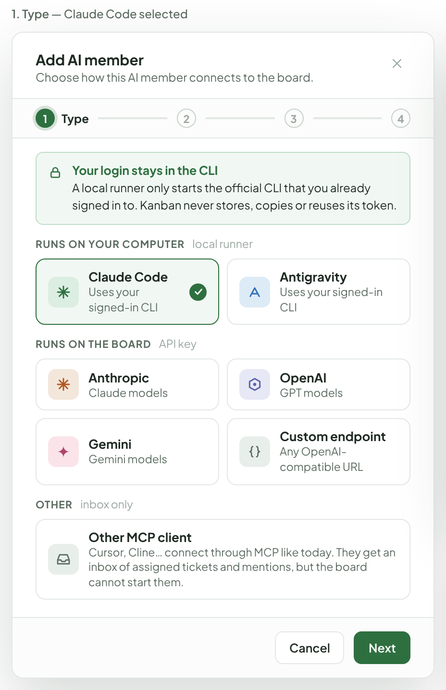

- Caption: "1. Type" "— Claude Code selected".
- Title "Add AI member"; "Choose how this AI member connects to the board."; stepper "1" "Type" "2" "3" "4".
- Notice "Your login stays in the CLI": "A local runner only starts the official CLI that you already signed in to. Kanban never stores, copies or reuses its token."
- Group "Runs on your computer" "local runner": "Claude Code" "Uses your signed-in CLI" (selected); "Antigravity" "Uses your signed-in CLI".
- Group "Runs on the board" "API key": "Anthropic" "Claude models"; "OpenAI" "GPT models"; "Gemini" "Gemini models"; "Custom endpoint" "Any OpenAI-compatible URL".
- Group "Other" "inbox only": "Other MCP client" "Cursor, Cline… connect through MCP like today. They get an inbox of assigned tickets and mentions, but the board cannot start them."
- Buttons "Cancel", "Next".

### 2a. Connect — local runner

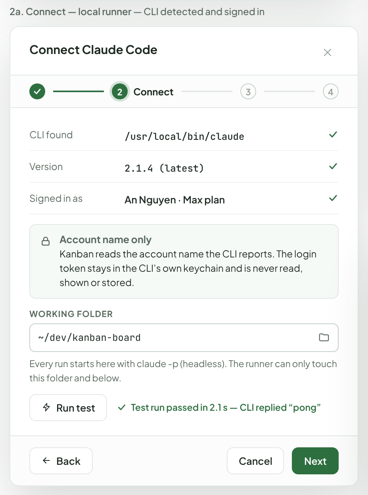

- Caption: "2a. Connect — local runner" "— CLI detected and signed in".
- Title "Connect Claude Code"; stepper "2" "Connect" "3" "4".
- Rows: "CLI found" "/usr/local/bin/claude"; "Version" "2.1.4 (latest)"; "Signed in as" "An Nguyen · Max plan".
- Notice "Account name only": "Kanban reads the account name the CLI reports. The login token stays in the CLI’s own keychain and is never read, shown or stored."
- "Working folder" "~/dev/kanban-board"; "Every run starts here with claude -p (headless). The runner can only touch this folder and below."
- "Run test"; "Test run passed in 2.1 s — CLI replied “pong”".
- Buttons "Back", "Cancel", "Next".

### 2b. Connect — CLI missing

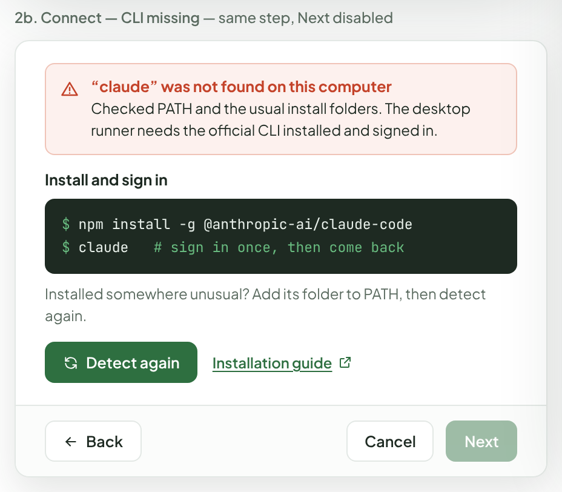

- Caption: "2b. Connect — CLI missing" "— same step, Next disabled".
- Error: "“claude” was not found on this computer"; "Checked PATH and the usual install folders. The desktop runner needs the official CLI installed and signed in."
- "Install and sign in":

```
$ npm install -g @anthropic-ai/claude-code
$ claude   # sign in once, then come back
```

- "Installed somewhere unusual? Add its folder to PATH, then detect again."
- "Detect again"; "Installation guide".
- Buttons "Back", "Cancel", "Next".

### 2c. Connect — API key

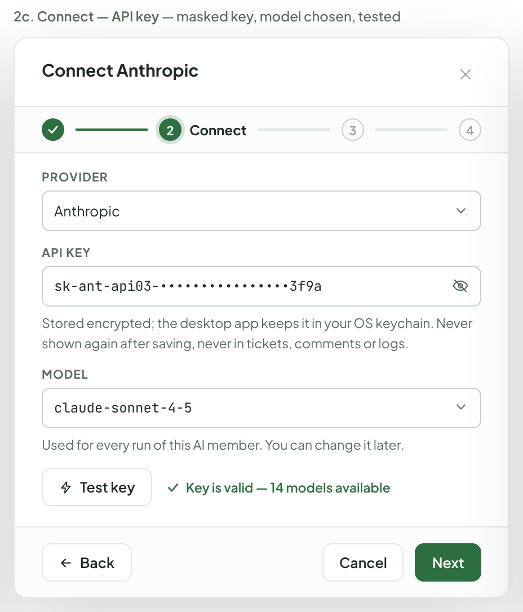

- Caption: "2c. Connect — API key" "— masked key, model chosen, tested".
- Title "Connect Anthropic"; stepper "2" "Connect" "3" "4".
- "Provider" "Anthropic"; "API key" "sk-ant-api03-••••••••••••••••3f9a"; "Stored encrypted; the desktop app keeps it in your OS keychain. Never shown again after saving, never in tickets, comments or logs."
- "Model" "claude-sonnet-4-5"; "Used for every run of this AI member. You can change it later."
- "Test key"; "Key is valid — 14 models available".
- Buttons "Back", "Cancel", "Next".

### 2d. Connect — key rejected

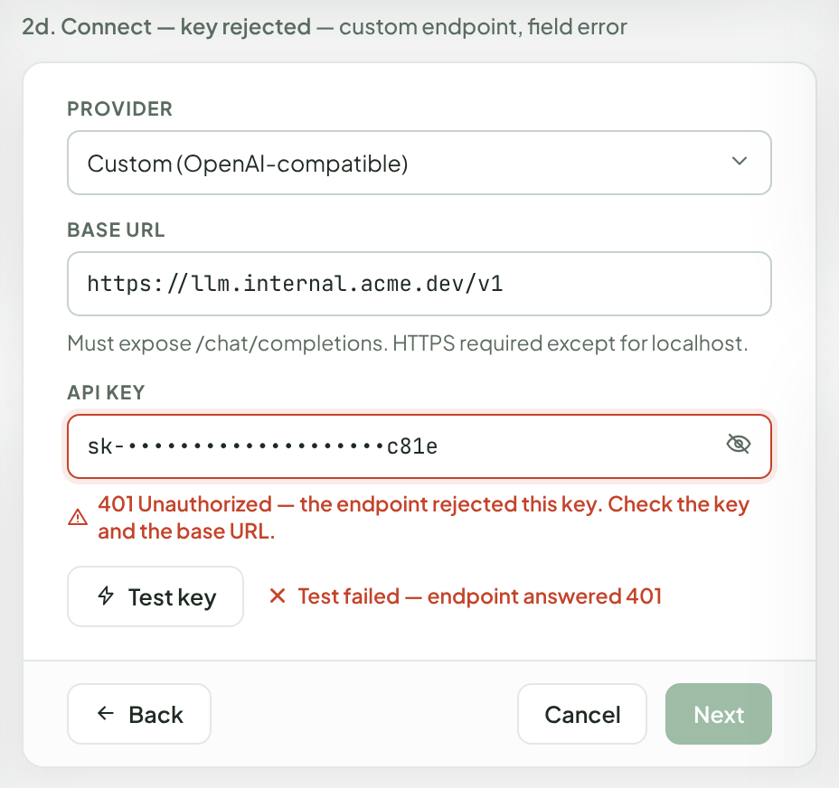

- Caption: "2d. Connect — key rejected" "— custom endpoint, field error".
- "Provider" "Custom (OpenAI-compatible)"; "Base URL" "https://llm.internal.acme.dev/v1"; "Must expose /chat/completions. HTTPS required except for localhost."
- "API key" "sk-••••••••••••••••••••c81e"; error "401 Unauthorized — the endpoint rejected this key. Check the key and the base URL."
- "Test key"; "Test failed — endpoint answered 401".
- Buttons "Back", "Cancel", "Next".

### 3. Identity & limits

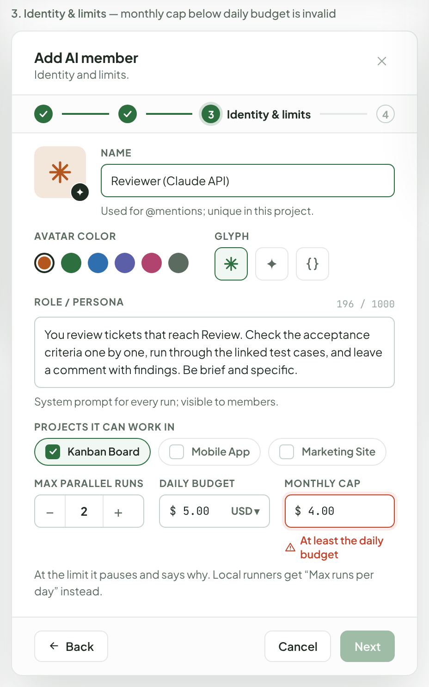

- Caption: "3. Identity & limits" "— monthly cap below daily budget is invalid".
- Title "Add AI member"; "Identity and limits."; stepper "3" "Identity & limits" "4".
- "Name" "Reviewer (Claude API)"; "Used for @mentions; unique in this project."
- "Avatar color"; "Glyph".
- "Role / persona" "196 / 1000"; "You review tickets that reach Review. Check the acceptance criteria one by one, run through the linked test cases, and leave a comment with findings. Be brief and specific."; "System prompt for every run; visible to members."
- "Projects it can work in": "Kanban Board"; "Mobile App"; "Marketing Site".
- "Max parallel runs" "−" "2" "+"; "Daily budget" "$ 5.00" "USD ▾"; "Monthly cap" "$ 4.00" error "At least the daily budget".
- "At the limit it pauses and says why. Local runners get “Max runs per day” instead."
- Buttons "Back", "Cancel", "Next".

### 4. Permissions & review

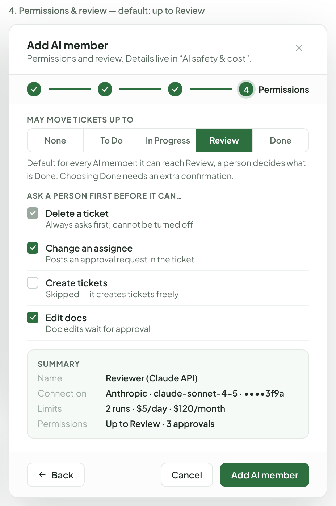

- Caption: "4. Permissions & review" "— default: up to Review".
- Title "Add AI member"; "Permissions and review. Details live in “AI safety & cost”."; stepper "4" "Permissions".
- "Permissions"; "May move tickets up to": "None", "To Do", "In Progress", "Review" (selected), "Done".
- "Default for every AI member: it can reach Review, a person decides what is Done. Choosing Done needs an extra confirmation."
- "Ask a person first before it can…": "Delete a ticket" "Always asks first; cannot be turned off"; "Change an assignee" "Posts an approval request in the ticket"; "Create tickets" "Skipped — it creates tickets freely"; "Edit docs" "Doc edits wait for approval".
- "Summary": "Name" "Reviewer (Claude API)"; "Connection" "Anthropic · claude-sonnet-4-5 · ••••3f9a"; "Limits" "2 runs · $5/day · $120/month"; "Permissions" "Up to Review · 3 approvals".
- Buttons "Back", "Cancel", "Add AI member".

### 5. Done

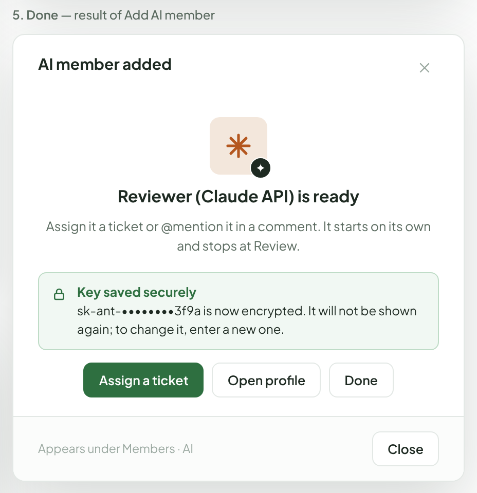

- Caption: "5. Done" "— result of Add AI member".
- "AI member added"; "Reviewer (Claude API) is ready"; "Assign it a ticket or @mention it in a comment. It starts on its own and stops at Review."
- Notice "Key saved securely": "sk-ant-••••••••3f9a is now encrypted. It will not be shown again; to change it, enter a new one."
- Buttons "Assign a ticket", "Open profile", "Done".
- Footer: "Appears under Members · AI"; "Close".

### 5b. Save failed

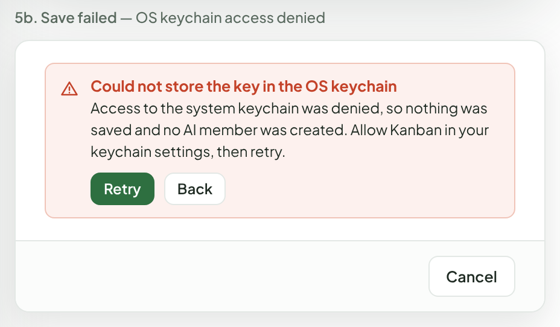

- Caption: "5b. Save failed" "— OS keychain access denied".
- "Could not store the key in the OS keychain"; "Access to the system keychain was denied, so nothing was saved and no AI member was created. Allow Kanban in your keychain settings, then retry."
- Buttons "Retry", "Back"; footer "Cancel".

---

## D. AI member profile

One page per AI member. Overview shows what it is doing now and what it owns; Usage previews cost and tokens (an API-key AI member here, since local runners are not metered). Configuration, Permissions and Activity are other boards and appear only as labelled links.

Source: [AiMembers.dc.html](../source/AiMembers.dc.html) › block "D AI member profile" (D1 full-width Overview tab; D2 full-width Usage tab below)

### D1. Overview tab

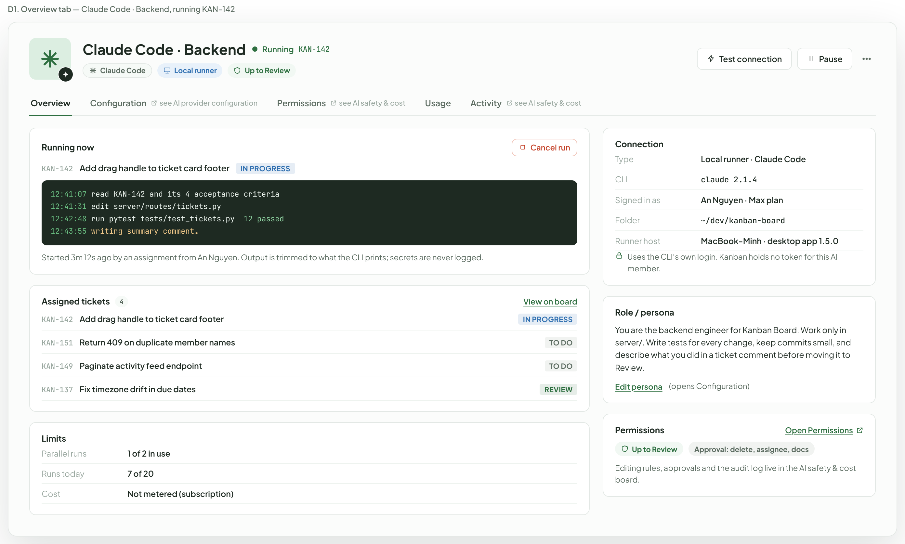

- Caption: "D1. Overview tab" "— Claude Code · Backend, running KAN-142".
- Header: "Claude Code · Backend" "Running" "KAN-142"; chips "Claude Code", "Local runner", "Up to Review"; buttons "Test connection", "Pause".
- Tabs: "Overview"; "Configuration" "see AI provider configuration"; "Permissions" "see AI safety & cost"; "Usage"; "Activity" "see AI safety & cost".
- Running now: "Running now"; "Cancel run"; "KAN-142" "Add drag handle to ticket card footer" "In Progress".
- Log:
  - "12:41:07" "read KAN-142 and its 4 acceptance criteria"
  - "12:41:31" "edit server/routes/tickets.py"
  - "12:42:48" "run pytest tests/test_tickets.py" "12 passed"
  - "12:43:55" "writing summary comment…"
- "Started 3m 12s ago by an assignment from An Nguyen. Output is trimmed to what the CLI prints; secrets are never logged."
- Assigned tickets "4" "View on board": "KAN-142" "Add drag handle to ticket card footer" "In Progress"; "KAN-151" "Return 409 on duplicate member names" "To Do"; "KAN-149" "Paginate activity feed endpoint" "To Do"; "KAN-137" "Fix timezone drift in due dates" "Review".
- Limits: "Parallel runs" "1 of 2 in use"; "Runs today" "7 of 20"; "Cost" "Not metered (subscription)".
- Connection: "Type" "Local runner · Claude Code"; "CLI" "claude 2.1.4"; "Signed in as" "An Nguyen · Max plan"; "Folder" "~/dev/kanban-board"; "Runner host" "MacBook-Minh · desktop app 1.5.0"; "Uses the CLI’s own login. Kanban holds no token for this AI member."
- Role / persona: "You are the backend engineer for Kanban Board. Work only in server/. Write tests for every change, keep commits small, and describe what you did in a ticket comment before moving it to Review."; "Edit persona" "(opens Configuration)".
- Permissions: "Open Permissions"; "Up to Review"; "Approval: delete, assignee, docs"; "Editing rules, approvals and the audit log live in the AI safety & cost board."

### D2. Usage tab (preview)

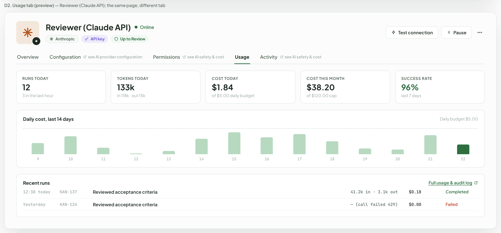

- Caption: "D2. Usage tab (preview)" "— Reviewer (Claude API); the same page, different tab".
- Header: "Reviewer (Claude API)" "Online"; chips "Anthropic", "API key", "Up to Review"; buttons "Test connection", "Pause". Tabs as in D1 with "Usage" active.
- Tiles: "Runs today" "12" "3 in the last hour"; "Tokens today" "133k" "in 118k · out 15k"; "Cost today" "$1.84" "of $5.00 daily budget"; "Cost this month" "$38.20" "of $120.00 cap"; "Success rate" "96%" "last 7 days".
- "Daily cost, last 14 days"; "Daily budget $5.00"; day labels "9" to "22".
- "Recent runs" "Full usage & audit log":
  - "12:30 today" "KAN-137" "Reviewed acceptance criteria" "41.2k in · 3.1k out" "$0.18" "Completed"
  - "Yesterday" "KAN-124" "Reviewed acceptance criteria" "— (call failed 429)" "$0.00" "Failed"

---

## E. Connection states

Every state offers exactly one action. When several apply the row shows the most blocking one in this order: key invalid / not logged in, runner not detected, model retired, over budget, rate-limited, paused by user, then running, idle, online.

Source: [AiMembers.dc.html](../source/AiMembers.dc.html) › block "E Connection states" (two rows of five state cards, E1 to E5 and E6 to E10)

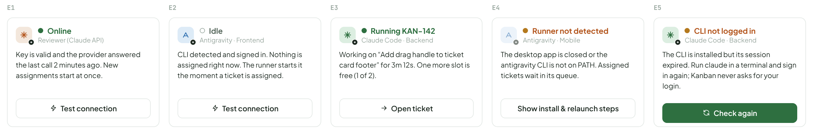

- "E1" "Online" "Reviewer (Claude API)": "Key is valid and the provider answered the last call 2 minutes ago. New assignments start at once." Button "Test connection".
- "E2" "Idle" "Antigravity · Frontend": "CLI detected and signed in. Nothing is assigned right now. The runner starts it the moment a ticket is assigned." Button "Test connection".
- "E3" "Running KAN-142" "Claude Code · Backend": "Working on “Add drag handle to ticket card footer” for 3m 12s. One more slot is free (1 of 2)." Button "Open ticket".
- "E4" "Runner not detected" "Antigravity · Mobile": "The desktop app is closed or the antigravity CLI is not on PATH. Assigned tickets wait in its queue." Button "Show install & relaunch steps".
- "E5" "CLI not logged in" "Claude Code · Backend": "The CLI is installed but its session expired. Run claude in a terminal and sign in again; Kanban never asks for your login." Button "Check again".

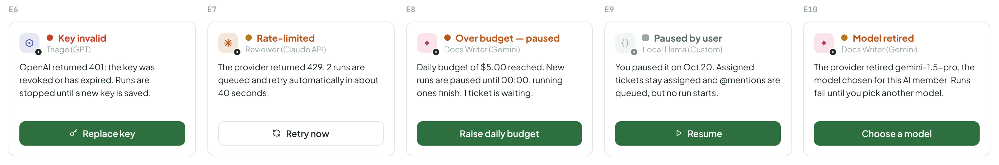

- "E6" "Key invalid" "Triage (GPT)": "OpenAI returned 401: the key was revoked or has expired. Runs are stopped until a new key is saved." Button "Replace key".
- "E7" "Rate-limited" "Reviewer (Claude API)": "The provider returned 429. 2 runs are queued and retry automatically in about 40 seconds." Button "Retry now".
- "E8" "Over budget — paused" "Docs Writer (Gemini)": "Daily budget of $5.00 reached. New runs are paused until 00:00, running ones finish. 1 ticket is waiting." Button "Raise daily budget".
- "E9" "Paused by user" "Local Llama (Custom)": "You paused it on Oct 20. Assigned tickets stay assigned and @mentions are queued, but no run starts." Button "Resume".
- "E10" "Model retired" "Docs Writer (Gemini)": "The provider retired gemini-1.5-pro, the model chosen for this AI member. Runs fail until you pick another model." Button "Choose a model".

---

## F. Edge cases

Duplicate names, removal with work in flight, how AI appears in assignee UI, the empty and loading states, and the web build where the local runner does not exist.

Source: [AiMembers.dc.html](../source/AiMembers.dc.html) › block "F Edge cases" (top row of three columns: F1 and F5, the Remove AI member dialog, F3 and F3b; bottom row: F4 and F6)

### F1. Duplicate name and F5. Loading skeleton

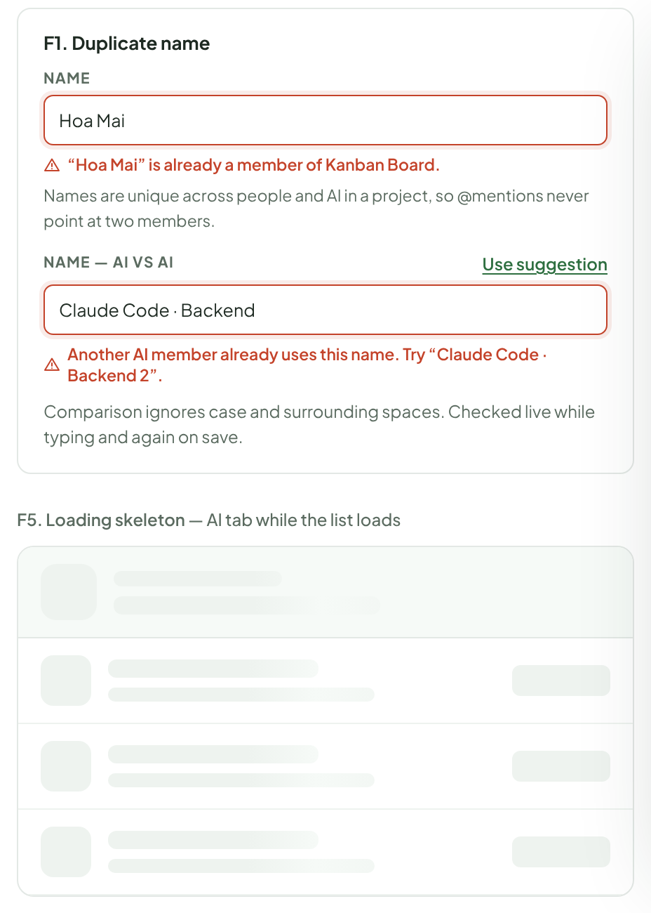

- "F1. Duplicate name".
- "Name" "Hoa Mai"; error "“Hoa Mai” is already a member of Kanban Board."; "Names are unique across people and AI in a project, so @mentions never point at two members."
- "Name — AI vs AI" "Use suggestion"; "Claude Code · Backend"; error "Another AI member already uses this name. Try “Claude Code · Backend 2”."
- "Comparison ignores case and surrounding spaces. Checked live while typing and again on save."
- Caption: "F5. Loading skeleton" "— AI tab while the list loads" (shimmer rows, no text).

### Remove AI member

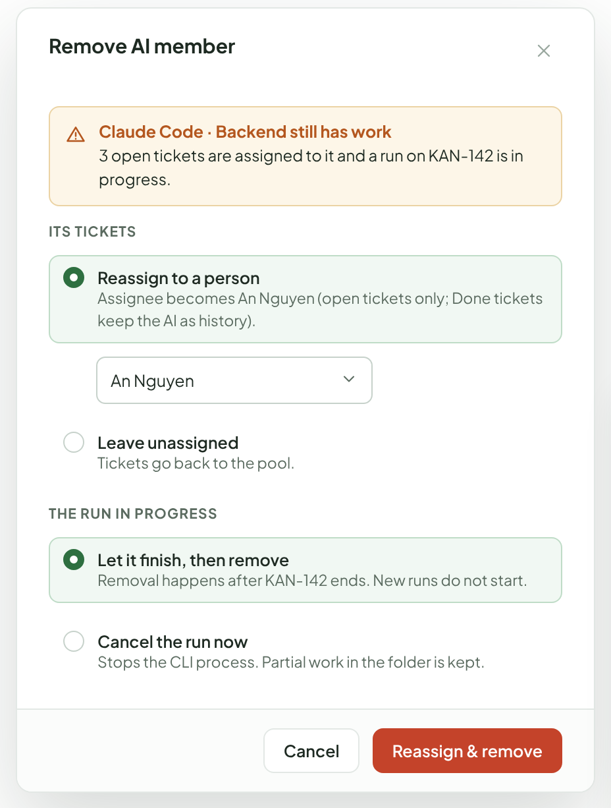

- Title "Remove AI member".
- Warning "Claude Code · Backend still has work": "3 open tickets are assigned to it and a run on KAN-142 is in progress."
- "Its tickets": "Reassign to a person" "Assignee becomes An Nguyen (open tickets only; Done tickets keep the AI as history)." with select "An Nguyen"; "Leave unassigned" "Tickets go back to the pool."
- "The run in progress": "Let it finish, then remove" "Removal happens after KAN-142 ends. New runs do not start."; "Cancel the run now" "Stops the CLI process. Partial work in the folder is kept."
- Buttons "Cancel", "Reassign & remove".

### F3. AI in a ticket card footer and F3b. Assignee dropdown

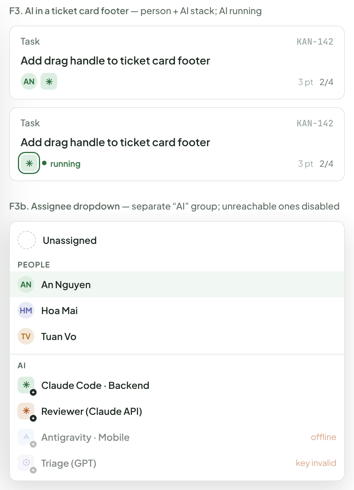

- Caption: "F3. AI in a ticket card footer" "— person + AI stack; AI running".
- Card 1: "Task" "KAN-142" "Add drag handle to ticket card footer" "AN" "3 pt" "2/4".
- Card 2: "Task" "KAN-142" "Add drag handle to ticket card footer" "running" "3 pt" "2/4".
- Caption: "F3b. Assignee dropdown" "— separate “AI” group; unreachable ones disabled".
- "Unassigned"; "People": "AN" "An Nguyen"; "HM" "Hoa Mai"; "TV" "Tuan Vo"; "AI": "Claude Code · Backend"; "Reviewer (Claude API)"; "Antigravity · Mobile" "offline"; "Triage (GPT)" "key invalid".

### F4. Empty state

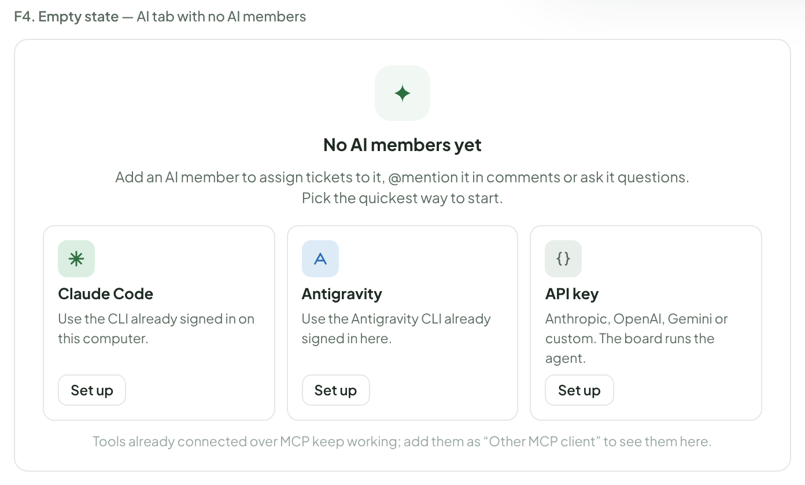

- Caption: "F4. Empty state" "— AI tab with no AI members".
- "No AI members yet"; "Add an AI member to assign tickets to it, @mention it in comments or ask it questions. Pick the quickest way to start."
- Cards: "Claude Code" "Use the CLI already signed in on this computer." "Set up"; "Antigravity" "Use the Antigravity CLI already signed in here." "Set up"; "API key" "Anthropic, OpenAI, Gemini or custom. The board runs the agent." "Set up".
- "Tools already connected over MCP keep working; add them as “Other MCP client” to see them here."

### F6. Web build

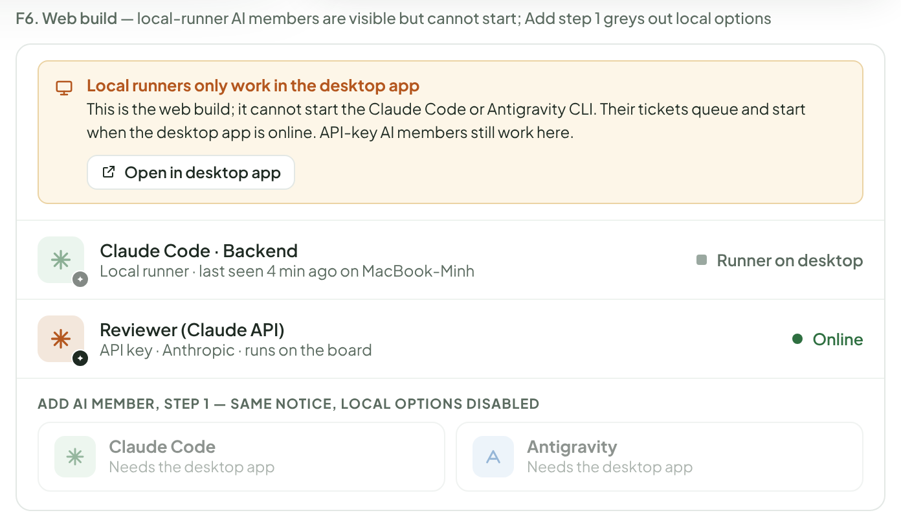

- Caption: "F6. Web build" "— local-runner AI members are visible but cannot start; Add step 1 greys out local options".
- Notice "Local runners only work in the desktop app": "This is the web build; it cannot start the Claude Code or Antigravity CLI. Their tickets queue and start when the desktop app is online. API-key AI members still work here." Button "Open in desktop app".
- Rows: "Claude Code · Backend" "Local runner · last seen 4 min ago on MacBook-Minh" "Runner on desktop"; "Reviewer (Claude API)" "API key · Anthropic · runs on the board" "Online".
- "Add AI member, step 1 — same notice, local options disabled": "Claude Code" "Needs the desktop app"; "Antigravity" "Needs the desktop app".

---

## Note

Source: [AiMembers.dc.html](../source/AiMembers.dc.html) › block "Note" (three cards side by side: "Inconsistencies to flag" with the "Subscription terms caveat", "Everything invented", "Backend needs")

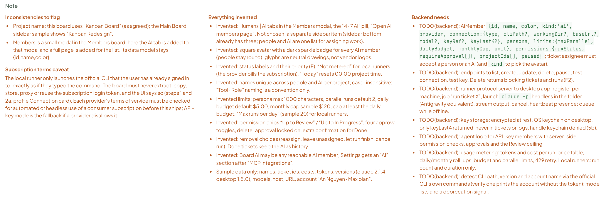

"Inconsistencies to flag":

- "Project name: this board uses “Kanban Board” (as agreed); the Main Board sidebar sample shows “Kanban Redesign”."
- "Members is a small modal in the Members board; here the AI tab is added to that modal and a full page is added for the list. Its data model stays {id,name,color}."

"Subscription terms caveat":

- "The local runner only launches the official CLI that the user has already signed in to, exactly as if they typed the command. The board must never extract, copy, store, proxy or reuse the subscription login token, and the UI says so (steps 1 and 2a, profile Connection card). Each provider’s terms of service must be checked for automated or headless use of a consumer subscription before this ships; API-key mode is the fallback if a provider disallows it."

"Everything invented":

- "Invented: Humans | AI tabs in the Members modal, the “4 · 7 AI” pill, “Open AI members page”. Not chosen: a separate sidebar item (sidebar bottom already has three; people and AI are one list for assigning work)."
- "Invented: square avatar with a dark sparkle badge for every AI member (people stay round); glyphs are neutral drawings, not vendor logos."
- "Invented: status labels and their priority (E), “Not metered” for local runners (the provider bills the subscription), “Today” resets 00:00 project time."
- "Invented: names unique across people and AI per project, case-insensitive; “Tool · Role” naming is a convention only."
- "Invented limits: persona max 1000 characters, parallel runs default 2, daily budget default $5.00, monthly cap sample $120, cap at least the daily budget, “Max runs per day” (sample 20) for local runners."
- "Invented: permission chips “Up to Review” / “Up to In Progress”, four approval toggles, delete-approval locked on, extra confirmation for Done."
- "Invented: removal choices (reassign, leave unassigned, let run finish, cancel run); Done tickets keep the AI as history."
- "Invented: Board AI may be any reachable AI member; Settings gets an “AI” section after “MCP integrations”."
- "Sample data only: names, ticket ids, costs, tokens, versions (claude 2.1.4, desktop 1.5.0), models, host, URL, account “An Nguyen · Max plan”."

"Backend needs":

- TODO(backend): AiMember `{id, name, color, kind:'ai', provider, connection:{type, cliPath?, workingDir?, baseUrl?, model?, keyRef?, keyLast4?}, persona, limits:{maxParallel, dailyBudget, monthlyCap, unit}, permissions:{maxStatus, requireApproval[]}, projectIds[], paused}`; ticket assignee must accept a person or an AI (and `kind` to pick the avatar).
- TODO(backend): endpoints to list, create, update, delete, pause, test connection, test key. Delete returns blocking tickets and runs (F2).
- TODO(backend): runner protocol server to desktop app: register per machine, job “run ticket X”, launch `claude -p` headless in the folder (Antigravity equivalent), stream output, cancel, heartbeat presence; queue while offline.
- TODO(backend): key storage: encrypted at rest, OS keychain on desktop, only keyLast4 returned, never in tickets or logs, handle keychain denied (5b).
- TODO(backend): agent loop for API-key members with server-side permission checks, approvals and the Review ceiling.
- TODO(backend): usage metering: tokens and cost per run, price table, daily/monthly roll-ups, budget and parallel limits, 429 retry. Local runners: run count and duration only.
- TODO(backend): detect CLI path, version and account name via the official CLI’s own commands (verify one prints the account without the token); model lists and a deprecation signal.
