# AI operations — hangs, the needs-you queue, quota, run history, knowledge, worktrees

> Redrawn for AI v2 · source: [`AiOperations.dc.html`](../source/AiOperations.dc.html) · canvas `1794110641-1323` · sha256 `853772f54e98234b0714d8e4b630abded083e33ca21d25c60c4ce18c8a5f1c45`

> Words, states and conditions follow the code of branch `claude/ai-team-architecture-7a1efc`; the layout is designed here and is not the layout of the current screens. Names, ids, costs and times in the mock-ups are sample data. **Check the code before building from this: the file named in each part is the truth, not the picture.**

## SCREEN — V2

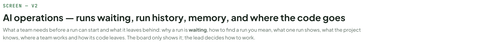

- Text in this part: "SCREEN — V2" · "AI operations — runs waiting, run history, memory, and where the code goes" · "What a team needs before a run can start and what it leaves behind: why a run is waiting, how to find a run you mean, what one run shows, what the project knows, where a team works and how its code leaves. The board only shows it; the lead decides how to work."

---

## What this board decides

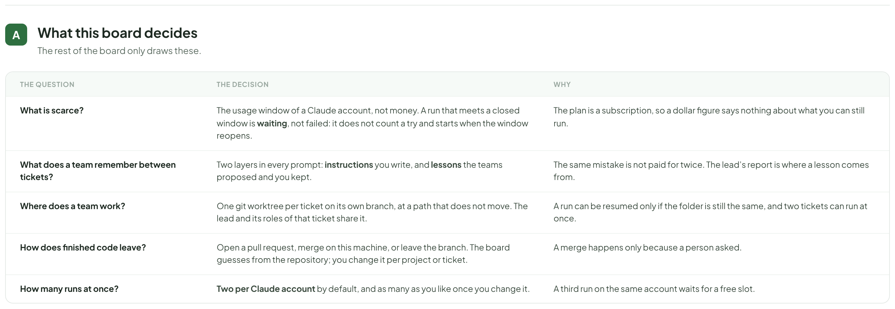

- Text in this part: "A" · "What this board decides" · "The rest of the board only draws these." · "THE QUESTION" · "THE DECISION" · "WHY" · "What is scarce?" · "The usage window of a Claude account, not money. A run that meets a closed window is waiting, not failed: it does not count a try and starts when the window reopens." · "The plan is a subscription, so a dollar figure says nothing about what you can still run." · "What does a team remember between tickets?" · "Two layers in every prompt: instructions you write, and lessons the teams proposed and you kept." · "The same mistake is not paid for twice. The lead’s report is where a lesson comes from." · "Where does a team work?" · "One git worktree per ticket on its own branch, at a path that does not move. The lead and its roles of that ticket share it." · "A run can be resumed only if the folder is still the same, and two tickets can run at once." · "How does finished code leave?" · "Open a pull request, merge on this machine, or leave the branch. The board guesses from the repository; you change it per project or ticket." · "A merge happens only because a person asked." · "How many runs at once?" · "Two per Claude account by default, and as many as you like once you change it." · "A third run on the same account waits for a free slot."

---

## Why a run is waiting

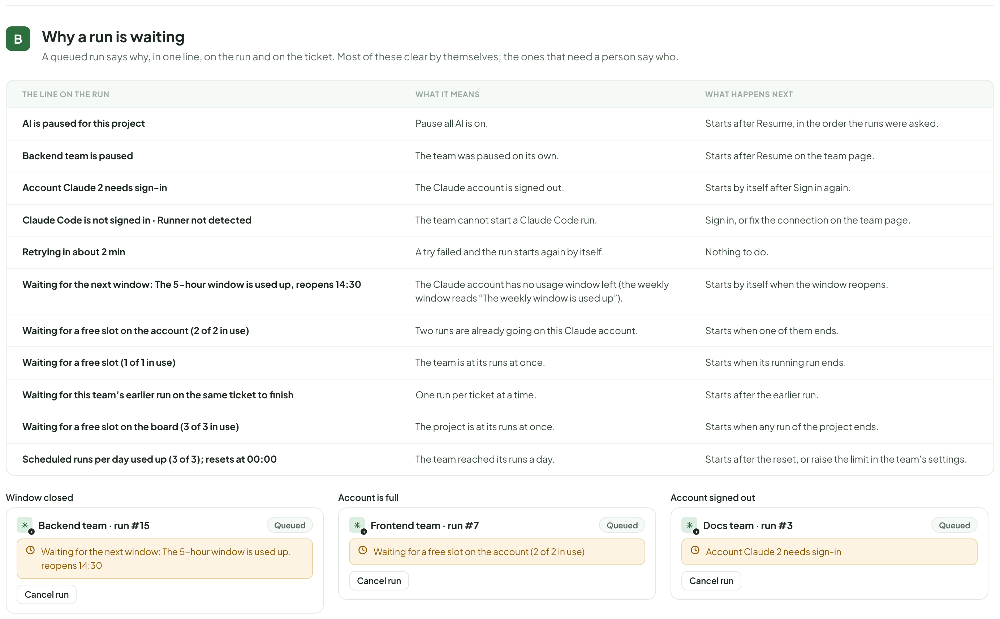

- Text in this part: "B" · "Why a run is waiting" · "A queued run says why, in one line, on the run and on the ticket. Most of these clear by themselves; the ones that need a person say who." · "THE LINE ON THE RUN" · "WHAT IT MEANS" · "WHAT HAPPENS NEXT" · "AI is paused for this project" · "Pause all AI is on." · "Starts after Resume, in the order the runs were asked." · "Backend team is paused" · "The team was paused on its own." · "Starts after Resume on the team page." · "Account Claude 2 needs sign-in" · "The Claude account is signed out." · "Starts by itself after Sign in again." · "Claude Code is not signed in · Runner not detected" · "The team cannot start a Claude Code run." · "Sign in, or fix the connection on the team page." · "Retrying in about 2 min" · "A try failed and the run starts again by itself." · "Nothing to do." · "Waiting for the next window: The 5-hour window is used up, reopens 14:30" · "The Claude account has no usage window left (the weekly window reads “The weekly window is used up”)." · "Starts by itself when the window reopens." · "Waiting for a free slot on the account (2 of 2 in use)" · "Two runs are already going on this Claude account." · "Starts when one of them ends." · "Waiting for a free slot (1 of 1 in use)" · "The team is at its runs at once." · "Starts when its running run ends." · "Waiting for this team’s earlier run on the same ticket to finish" · "One run per ticket at a time." · "Starts after the earlier run." · "Waiting for a free slot on the board (3 of 3 in use)" · "The project is at its runs at once." · "Starts when any run of the project ends." · "Scheduled runs per day used up (3 of 3); resets at 00:00" · "The team reached its runs a day." · "Starts after the reset, or raise the limit in the team’s settings." · "Window closed" · "Backend team · run #15" · "Queued" · "Cancel run" · "Account is full" · "Frontend team · run #7" · "Account signed out" · "Docs team · run #3"

---

## Keep awake

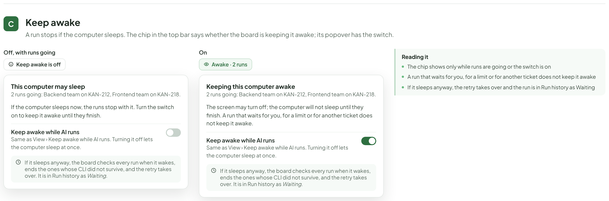

- Text in this part: "C" · "Keep awake" · "A run stops if the computer sleeps. The chip in the top bar says whether the board is keeping it awake; its popover has the switch." · "Off, with runs going" · "Keep awake is off" · "This computer may sleep" · "2 runs going: Backend team on KAN-212, Frontend team on KAN-218." · "If the computer sleeps now, the runs stop with it. Turn the switch on to keep it awake until they finish." · "Keep awake while AI runs" · "Same as View › Keep awake while AI runs. Turning it off lets the computer sleep at once." · "If it sleeps anyway, the board checks every run when it wakes, ends the ones whose CLI did not survive, and the retry takes over. It is in Run history as Waiting." · "On" · "Awake · 2 runs" · "Keeping this computer awake" · "The screen may turn off; the computer will not sleep until they finish. A run that waits for you, for a limit or for another ticket does not keep it awake." · "Reading it" · "The chip shows only while runs are going or the switch is on" · "A run that waits for you, for a limit or for another ticket does not keep it awake" · "If it sleeps anyway, the retry takes over and the run is in Run history as Waiting"

---

## Run history

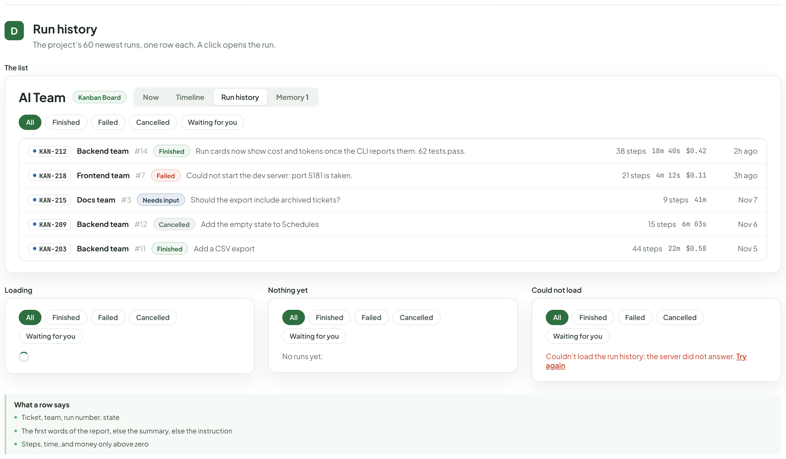

- Text in this part: "D" · "Run history" · "The project’s 60 newest runs, one row each. A click opens the run." · "The list" · "AI Team" · "Kanban Board" · "Now" · "Timeline" · "Memory 1" · "All" · "Finished" · "Failed" · "Cancelled" · "Waiting for you" · "KAN-212" · "Backend team" · "#14" · "Run cards now show cost and tokens once the CLI reports them. 62 tests pass." · "38 steps" · "18m 40s" · "$0.42" · "2h ago" · "KAN-218" · "Frontend team" · "#7" · "Could not start the dev server: port 5181 is taken." · "21 steps" · "4m 12s" · "$0.11" · "3h ago" · "KAN-215" · "Docs team" · "#3" · "Needs input" · "Should the export include archived tickets?" · "9 steps" · "41m" · "Nov 7" · "KAN-209" · "#12" · "Add the empty state to Schedules" · "15 steps" · "6m 03s" · "Nov 6" · "KAN-203" · "#11" · "Add a CSV export" · "44 steps" · "22m" · "$0.58" · "Nov 5" · "Loading" · "Nothing yet" · "No runs yet." · "Could not load" · "Couldn’t load the run history: the server did not answer. Try again" · "What a row says" · "Ticket, team, run number, state" · "The first words of the report, else the summary, else the instruction" · "Steps, time, and money only above zero"

---

## One run

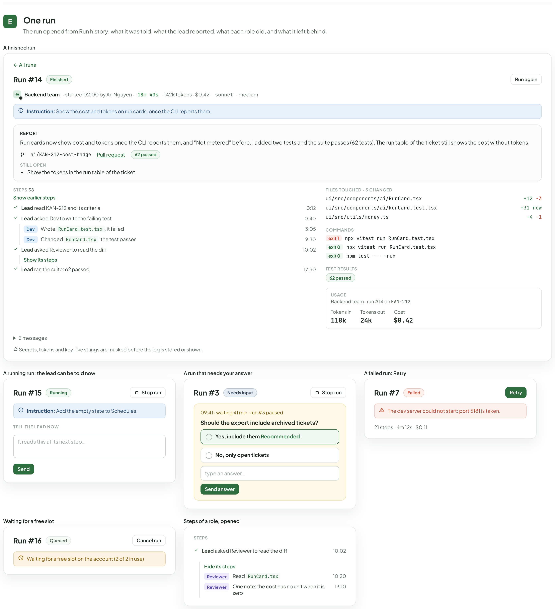

- Text in this part: "E" · "One run" · "The run opened from Run history: what it was told, what the lead reported, what each role did, and what it left behind." · "A finished run" · "← All runs" · "Run #14" · "Finished" · "Run again" · "Backend team" · "· started 02:00 by An Nguyen ·" · "18m 40s" · "· 142k tokens · $0.42 ·" · "sonnet" · "· medium" · "Instruction: Show the cost and tokens on run cards, once the CLI reports them." · "REPORT" · "Run cards now show cost and tokens once the CLI reports them, and “Not metered” before. I added two tests and the suite passes (62 tests). The run table of the ticket still shows the cost without tokens." · "ai/KAN-212-cost-badge" · "Pull request" · "62 passed" · "STILL OPEN" · "Show the tokens in the run table of the ticket" · "STEPS 38" · "Show earlier steps" · "Lead read KAN-212 and its criteria" · "0:12" · "Lead asked Dev to write the failing test" · "0:40" · "Dev" · "Wrote RunCard.test.tsx, it failed" · "3:05" · "Changed RunCard.tsx, the test passes" · "9:30" · "Lead asked Reviewer to read the diff" · "10:02" · "Show its steps" · "Lead ran the suite: 62 passed" · "17:50" · "FILES TOUCHED · 3 CHANGED" · "ui/src/components/ai/RunCard.tsx" · "+12" · "−3" · "ui/src/components/ai/RunCard.test.tsx" · "+31" · "new" · "ui/src/utils/money.ts" · "+4" · "−1" · "COMMANDS" · "exit 1" · "npx vitest run RunCard.test.tsx" · "exit 0" · "npm test -- --run" · "TEST RESULTS" · "USAGE" · "Backend team · run #14 on KAN-212" · "Tokens in" · "118k" · "Tokens out" · "24k" · "Cost" · "$0.42" · "2 messages" · "Secrets, tokens and key-like strings are masked before the log is stored or shown." · "A running run: the lead can be told now" · "Run #15" · "Running" · "Stop run" · "Instruction: Add the empty state to Schedules." · "TELL THE LEAD NOW" · "It reads this at its next step…" · "Send" · "A run that needs your answer" · "Run #3" · "Needs input" · "09:41 · waiting 41 min · run #3 paused" · "Should the export include archived tickets?" · "Yes, include them Recommended." · "No, only open tickets" · "type an answer…" · "Send answer" · "A failed run: Retry" · "Run #7" · "Failed" · "Retry" · "The dev server could not start: port 5181 is taken." · "21 steps · 4m 12s · $0.11" · "Waiting for a free slot" · "Run #16" · "Queued" · "Cancel run" · "Waiting for a free slot on the account (2 of 2 in use)" · "Steps of a role, opened" · "STEPS" · "Hide its steps" · "Reviewer" · "Read RunCard.tsx" · "10:20" · "One note: the cost has no unit when it is zero" · "13:10"

---

## What the project knows

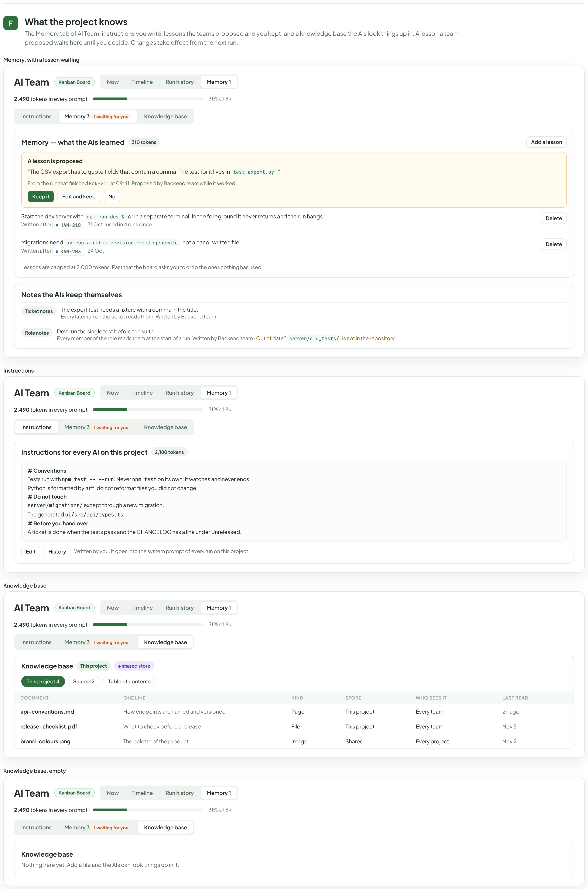

- Text in this part: "F" · "What the project knows" · "The Memory tab of AI Team: instructions you write, lessons the teams proposed and you kept, and a knowledge base the AIs look things up in. A lesson a team proposed waits here until you decide. Changes take effect from the next run." · "Memory, with a lesson waiting" · "AI Team" · "Kanban Board" · "Now" · "Timeline" · "Run history" · "Memory 1" · "2,490 tokens in every prompt" · "31% of 8k" · "Instructions" · "Memory 3 1 waiting for you" · "Knowledge base" · "Memory — what the AIs learned" · "310 tokens" · "Add a lesson" · "A lesson is proposed" · "“The CSV export has to quote fields that contain a comma. The test for it lives in test_export.py.”" · "From the run that finished KAN-211 at 09:41. Proposed by Backend team while it worked." · "Keep it" · "Edit and keep" · "No" · "Start the dev server with npm run dev & or in a separate terminal. In the foreground it never returns and the run hangs." · "Written after" · "KAN-218" · "· 31 Oct · used in 4 runs since" · "Delete" · "Migrations need uv run alembic revision --autogenerate, not a hand-written file." · "KAN-203" · "· 24 Oct" · "Lessons are capped at 2,000 tokens. Past that the board asks you to drop the ones nothing has used." · "Notes the AIs keep themselves" · "Ticket notes" · "The export test needs a fixture with a comma in the title." · "Every later run on the ticket reads them. Written by Backend team" · "Role notes" · "Dev: run the single test before the suite." · "Every member of the role reads them at the start of a run. Written by Backend team · Out of date? server/old_tests/ is not in the repository" · "Instructions for every AI on this project" · "2,180 tokens" · "# Conventions" · "Tests run with npm test -- --run. Never npm test on its own: it watches and never ends." · "Python is formatted by ruff; do not reformat files you did not change." · "# Do not touch" · "server/migrations/ except through a new migration." · "The generated ui/src/api/types.ts." · "# Before you hand over" · "A ticket is done when the tests pass and the CHANGELOG has a line under Unreleased." · "Edit" · "History" · "Written by you. It goes into the system prompt of every run on this project." · "This project" · "+ shared store" · "This project 4" · "Shared 2" · "Table of contents" · "DOCUMENT" · "ONE LINE" · "KIND" · "STORE" · "WHO SEES IT" · "LAST READ" · "api-conventions.md" · "How endpoints are named and versioned" · "Page" · "Every team" · "2h ago" · "release-checklist.pdf" · "What to check before a release" · "File" · "Nov 5" · "brand-colours.png" · "The palette of the product" · "Image" · "Shared" · "Every project" · "Nov 2" · "Knowledge base, empty" · "Nothing here yet. Add a file and the AIs can look things up in it."

---

## Where a team works: one worktree per ticket

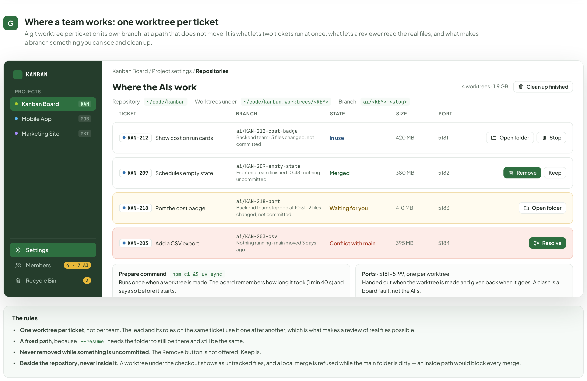

- Text in this part: "G" · "Where a team works: one worktree per ticket" · "A git worktree per ticket on its own branch, at a path that does not move. It is what lets two tickets run at once, what lets a reviewer read the real files, and what makes a branch something you can see and clean up." · "KANBAN" · "PROJECTS" · "Kanban Board" · "KAN" · "Mobile App" · "MOB" · "Marketing Site" · "MKT" · "Settings" · "Members" · "4 · 7 AI" · "Recycle Bin" · "3" · "Kanban Board / Project settings / Repositories" · "Where the AIs work" · "4 worktrees · 1.9 GB" · "Clean up finished" · "Repository" · "~/code/kanban" · "Worktrees under" · "~/code/kanban.worktrees/<KEY>" · "Branch" · "ai/<KEY>-<slug>" · "TICKET" · "BRANCH" · "STATE" · "SIZE" · "PORT" · "KAN-212" · "Show cost on run cards" · "ai/KAN-212-cost-badge" · "Backend team · 3 files changed, not committed" · "In use" · "420 MB" · "5181" · "Open folder" · "Stop" · "KAN-209" · "Schedules empty state" · "ai/KAN-209-empty-state" · "Frontend team finished 10:48 · nothing uncommitted" · "Merged" · "380 MB" · "5182" · "Remove" · "Keep" · "KAN-218" · "Port the cost badge" · "ai/KAN-218-port" · "Backend team stopped at 10:31 · 2 files changed, not committed" · "Waiting for you" · "410 MB" · "5183" · "KAN-203" · "Add a CSV export" · "ai/KAN-203-csv" · "Nothing running · main moved 3 days ago" · "Conflict with main" · "395 MB" · "5184" · "Resolve" · "Prepare command · npm ci && uv sync" · "Runs once when a worktree is made. The board remembers how long it took (1 min 40 s) and says so before it starts." · "Ports · 5181–5199, one per worktree" · "Handed out when the worktree is made and given back when it goes. A clash is a board fault, not the AI’s." · "The rules" · "One worktree per ticket, not per team. The lead and its roles on the same ticket use it one after another, which is what makes a review of real files possible." · "A fixed path, because --resume needs the folder to still be there and still be the same." · "Never removed while something is uncommitted. The Remove button is not offered; Keep is." · "Beside the repository, never inside it. A worktree under the checkout shows as untracked files, and a local merge is refused while the main folder is dirty — an inside path would block every merge."

---

## Handing over the code

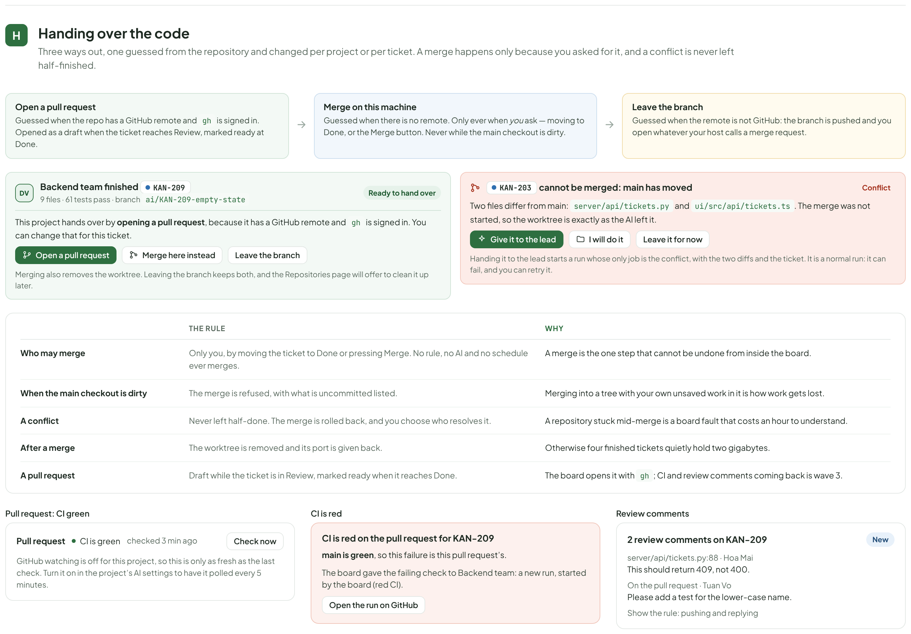

- Text in this part: "H" · "Handing over the code" · "Three ways out, one guessed from the repository and changed per project or per ticket. A merge happens only because you asked for it, and a conflict is never left half-finished." · "Open a pull request" · "Guessed when the repo has a GitHub remote and gh is signed in. Opened as a draft when the ticket reaches Review, marked ready at Done." · "Merge on this machine" · "Guessed when there is no remote. Only ever when you ask — moving to Done, or the Merge button. Never while the main checkout is dirty." · "Leave the branch" · "Guessed when the remote is not GitHub: the branch is pushed and you open whatever your host calls a merge request." · "DV" · "Backend team finished" · "KAN-209" · "9 files · 61 tests pass · branch ai/KAN-209-empty-state" · "Ready to hand over" · "This project hands over by opening a pull request, because it has a GitHub remote and gh is signed in. You can change that for this ticket." · "Merge here instead" · "Merging also removes the worktree. Leaving the branch keeps both, and the Repositories page will offer to clean it up later." · "KAN-203" · "cannot be merged: main has moved" · "Conflict" · "Two files differ from main: server/api/tickets.py and ui/src/api/tickets.ts. The merge was not started, so the worktree is exactly as the AI left it." · "Give it to the lead" · "I will do it" · "Leave it for now" · "Handing it to the lead starts a run whose only job is the conflict, with the two diffs and the ticket. It is a normal run: it can fail, and you can retry it." · "THE RULE" · "WHY" · "Who may merge" · "Only you, by moving the ticket to Done or pressing Merge. No rule, no AI and no schedule ever merges." · "A merge is the one step that cannot be undone from inside the board." · "When the main checkout is dirty" · "The merge is refused, with what is uncommitted listed." · "Merging into a tree with your own unsaved work in it is how work gets lost." · "A conflict" · "Never left half-done. The merge is rolled back, and you choose who resolves it." · "A repository stuck mid-merge is a board fault that costs an hour to understand." · "After a merge" · "The worktree is removed and its port is given back." · "Otherwise four finished tickets quietly hold two gigabytes." · "A pull request" · "Draft while the ticket is in Review, marked ready when it reaches Done." · "The board opens it with gh; CI and review comments coming back is wave 3." · "Pull request: CI green" · "Pull request" · "CI is green" · "checked 3 min ago" · "Check now" · "GitHub watching is off for this project, so this is only as fresh as the last check. Turn it on in the project’s AI settings to have it polled every 5 minutes." · "CI is red" · "CI is red on the pull request for KAN-209" · "main is green, so this failure is this pull request’s." · "The board gave the failing check to Backend team: a new run, started by the board (red CI)." · "Open the run on GitHub" · "Review comments" · "2 review comments on KAN-209" · "New" · "server/api/tickets.py:88 · Hoa Mai" · "This should return 409, not 400." · "On the pull request · Tuan Vo" · "Please add a test for the lower-case name." · "Show the rule: pushing and replying"

---

## The states these screens have to have

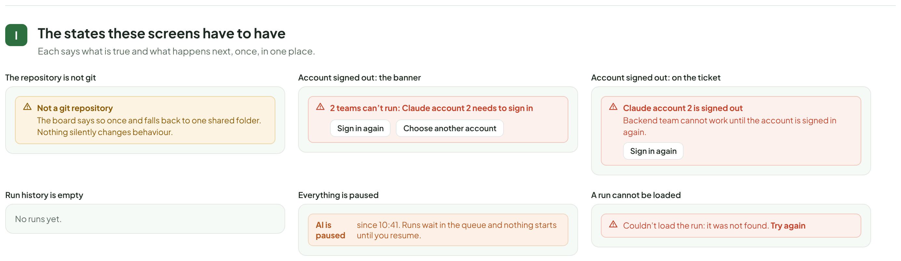

- Text in this part: "I" · "The states these screens have to have" · "Each says what is true and what happens next, once, in one place." · "The repository is not git" · "Not a git repository" · "The board says so once and falls back to one shared folder. Nothing silently changes behaviour." · "Account signed out: the banner" · "2 teams can’t run: Claude account 2 needs to sign in" · "Sign in again" · "Choose another account" · "Account signed out: on the ticket" · "Claude account 2 is signed out" · "Backend team cannot work until the account is signed in again." · "Run history is empty" · "No runs yet." · "Everything is paused" · "AI is paused" · "since 10:41. Runs wait in the queue and nothing starts until you resume." · "A run cannot be loaded" · "Couldn’t load the run: it was not found. Try again"

---

## Rules to keep

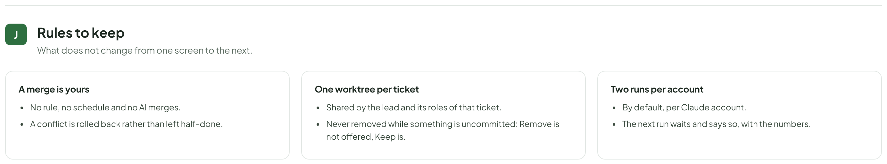

- Text in this part: "J" · "Rules to keep" · "What does not change from one screen to the next." · "A merge is yours" · "No rule, no schedule and no AI merges." · "A conflict is rolled back rather than left half-done." · "One worktree per ticket" · "Shared by the lead and its roles of that ticket." · "Never removed while something is uncommitted: Remove is not offered, Keep is." · "Two runs per account" · "By default, per Claude account." · "The next run waits and says so, with the numbers."

---

## Todo rows, differences from the code, and what was not checked

Files: AiOperations.dc.html (finalH 9195), AiSchedules.dc.html (7968), AiPaused.dc.html (4778), AiTeamProcess.dc.html (4665). Generators in gen/. Root id is `board-root` as in the source files.

## AiOperations (A06, plus A-206 from A02)
| row | what | notes |
|---|---|---|
| A-076 | drawn (A) | five rows kept: usage window = waiting not failed, instructions+lessons, worktree per ticket, hand-over, two per account |
| A-077, A-078, A-079 | removed (B, C, D) | salvage: usage window and signed-out account are in B and H |
| A-080 | redrawn (B) | table of the five "why a run is waiting" lines, exact server texts, plus three queued-run frames |
| A-081 + A-206 | redrawn (C) | chips All/Finished/Failed/Cancelled/Waiting for you, row, loading, "No runs yet.", load error with Try again. Search, Export, Retention, Pinned, member/ticket/skill/date filters and "Skills used" deleted |
| A-082 | redrawn (D) | Report, two-level steps, files, commands, tests, usage, messages, "Tell the lead now"; running, failed, queued states. No "What it was given", Compare, Export, Pin |
| A-083 + A-207 | redrawn (E) | Memory tab: token meter, Instructions, Memory with a proposed lesson (Keep it / Edit and keep / No), Notes with the "Out of date?" flag |
| A-084 | kept (F, G) | text edits: teams, no wave-3 note, "What it replaces" card and "Roles with no ticket" bullet removed, D7 chip removed |
| A-085 | NOT drawn here | Pause all AI, Permission mode, Deny list, Limits, Skills & plugins, Lessons, Knowledge, Repositories belong to AiProjectSettings (other worker); K removed |
| A-086 | drawn (H, I) | not a git repo, account signed out, history empty, everything paused, unknown window; M cut to the three kept rules |

## AiSchedules (A07 + B-29), edited in place
A-087 done (Queue item and the assign popover frame removed). A-088 done (list: Schedule, Team, Next run, Last run; note "Teams run while the desktop app is open"; History tab frame added). A-089 done (Done when and AI review removed; Instruction section added after Task with "Start from" templates; team wording; summary; dry run and its failure). A-090 done (history rows: lead's report, run link, stats Finished / Average time; waiting and "Late: run it?" slots; paused schedule). A-091 done (criteria chips and review lines removed). A-092 done (Reviewer-same-AI frame removed, empty state fixed, rules rewritten; added "AI paused for the project" and "Account signed out" frames). B-29 done.

## AiPaused (A09 + B-19), rebuilt
A-103..A-105 (top bar: Normal / Paused / "N team paused", tooltips; one banner), A-106 (plain Resume confirm, plus resuming and error states), A-107 (Now tab), A-109 (Timeline band, no diamond or audit link), A-110 (cards, left as built), A-111 (ticket strips, "Its next run is held."), A-112 (team Pause/Resume: list, menu, page header, picker; toast). A-108 board removed. B-19 drawn (strips, card footers, signed-out account note). Pause all AI dialog not drawn (AiProjectSettings).

## AiTeamProcess (A13)
A-140 retitled "Skills & plugins and role packs"; A-141 (Installed, Add from a source with four states, Suggested for a role, empty, reload; board's own skills card; per-member plugin card, library rows and Today/Proposed table gone); A-142 (12 role packs, 6 team packs, one pack in full; no ceiling/tools/step); A-143, A-144 boards removed; A-145 reduced to one board "Stepping in" with Tell the lead now / Leave a note for the lead.

## Not done
Anything of Resources, Flow, You stepped in, Health, Docs AI, AiTeamReview (untouched).

## Code and todo disagree / deliberate differences (code must change or confirm)
- Words I did not use though the code has them: "AI MEMBER" label, "Local runner: subscription, not metered", "Not metered: a local runner uses your signed-in CLI" (RunView usage), "Waiting for runner" slot chip (I drew "Waiting for the desktop app"), "NEXT 5 RUNS" kept, "Who gets it" says members (drawn as roles), schedule empty state "have another AI check it", summary "It never moves past Review" (server schedules.py).
- Server summary is "...Its lead decides when the work is done and reports it." (used), the todo says "The lead decides what to do and reports."
- "Held until resume" and "Its next run is held." are code strings (A-110 VALID) and stay on AiPaused/AiOperations although "held" is on the banned list as a ticket hold.
- The todo's "Slipped in / Next turn (run resumed)" is not in the code: RunView toasts are "The lead has it." / "The lead gets it with its next turn." (drawn).
- Instruction section placed after Task (code puts it last); History tab of schedules is a frame I added from the code's table.
- A-084 "Give it to {lead}": code (TicketHandover.tsx) has no such button, only a Worktree/Merge panel; the picture is left as designed, text only changed.
- Run history rows in code show ticket, team, #N, state, text, steps, time, money, ago; drawn that way.
- Pack names: code "Dev (TDD)", "Technical writer", "Security reviewer"; the todo says "Tech writer" (team-pack text in roles.py also says Tech writer).

## Not checked
Server routes for search/export/retention (A-206), whether lessons can still show "Proposed by a light model" (text left out), the app was not run. The sparkle badge on AI avatars comes from the shared helper and renders as a dark dot.

## Review round
Final heights now: AiOperations 9195, AiSchedules 7968, AiPaused 4953, AiTeamProcess 4665 (all width 1480; every touched part re-viewed in screenshots, no overflow).

Fixed
- Avatar dot bug (lib.py fix picked up; badge now shows the sparkle).
- AiOperations: Keep awake chip and popover (on/off) added; "why a run is waiting" table now has every `_blocking_reason` line plus the day-limit line, with the 5-hour / weekly window text; usage-window-not-known state removed; Memory tab drawn with sub-tabs Instructions / Memory (count + "1 waiting for you") / Knowledge base (full and empty), tab count a plain bold number; one run has "← All runs", "started 02:00 by An Nguyen", unspaced durations, ages "Nov 5", no "0 failed", a Needs input run with its question card, "Show earlier steps" / "Show its steps" / "Hide its steps"; Pull request panel (CI green, CI red, review comments) replaces the "wave 3" sentence; signed-out account split into the banner (with Choose another account) and the ticket note; section letters are badges everywhere; KAN-212 is "Show cost on run cards" in all boards (run #14, report, branch, files).
- AiSchedules: "Over budget" frame replaced by the real hold "Scheduled runs per day used up (3 of 3); resets at 00:00", the editor hint no longer says over budget; chip and notes use the code's words (Finished, "Finished. ...", "Stopped at the 45 min limit.", "Stopped at the $2.00 cost limit.", "The lead reported blocked.", "Started 02:41 when it was back.", "Run cancelled by An Nguyen.", "Run failed: ... Retried, failed again."); added Running slot (waiting for your answer), Cancelled slot, the empty states, delete confirm, "Only An Nguyen (who made it) or an admin can change this schedule."; Instruction moved to the end as in the code; invented cost hint, role lines under a team and the Resume button on the paused-AI frame removed; dry run texts as in the code; badge section headings.
- AiPaused: no banner without a reason ("Paused by An Nguyen"); resume error is "Network Error"; teams list chips Running / Paused / Idle with the pack name; team page header with Account / Lead model / Slots / Runs today / Spend today; role cards as in RoleCard; footer "Asks An Nguyen: ..."; Now tab is the real Needs you list plus TeamCards; invented ticket strings removed (stopped-run card, "Run again stays off"); Right now strip "No AI is running · paused since 10:41"; queued bars hatched grey (amber hatch = waiting for you); tab order AI Team before Schedules, badge 1; KAN-216 renamed to "Add an export button to Reports".
- AiTeamProcess: no Tools row (Plugins and MCP only when a pack has them), no "verdict" (PM hands in "A plan"; Triage "Labels: a ticket sorted for the team"), Security reviewer glyph SR, Technical writer, Dev (TDD); Open / Pin / Unpin; Suggested rows show only the Installed chip; folder error "No plugin, marketplace or skill was found there."; the green "Used is counted" callout removed; "never used"; Who gets it lists all 12 roles; stepping in shows "Tell the lead now" (going) and "Leave a note for the lead" (active, not listening) and no box for a finished run.

Kept (why)
- Column "Team" (code says "AI"), "Waiting for the desktop app / App closed? / Missed, waiting for the app" instead of the code's runner wording, stat tile "Finished 9 of 14" (code "PASSED"): intended v2 renames, the code must change.
- "Held until resume", "Its next run is held." (code strings, VALID in the todo).
- The summary line has no "It never moves past Review." (v1 ceiling, server schedules.py still prints it: code change).
- AiOperations G (worktree table) kept as drawn; its mock still clips the Prepare command / Ports cards at the bottom edge, as in the original board.

Designer's proposals (no basis in the code): the Start-from chips placed with the Instruction field is the code's; the Keep awake chip uses an eye glyph drawn from the code's Eye icon; "Give it to the lead" in the hand-over conflict card (the code's TicketHandover has no such button); PM tagline "Plans, splits, and says who takes each piece" (code still says "settles disagreements").

Cannot
- Role cards of the Now tab: the code's StatusLabel/RoleChips styling was approximated, not copied.

### Owner decisions pass (comment on PR #331)

The red-CI card carries "The board gave the failing check to Backend team: a new run, started by the board (red CI)." instead of "Already given back".
