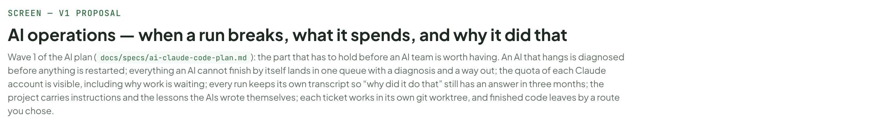
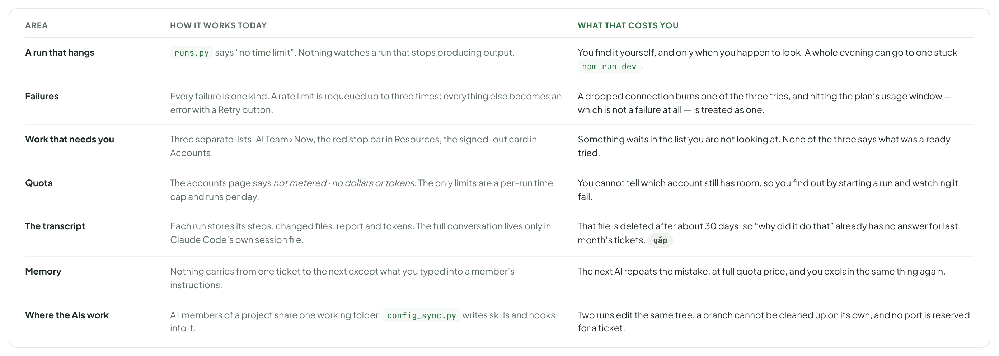
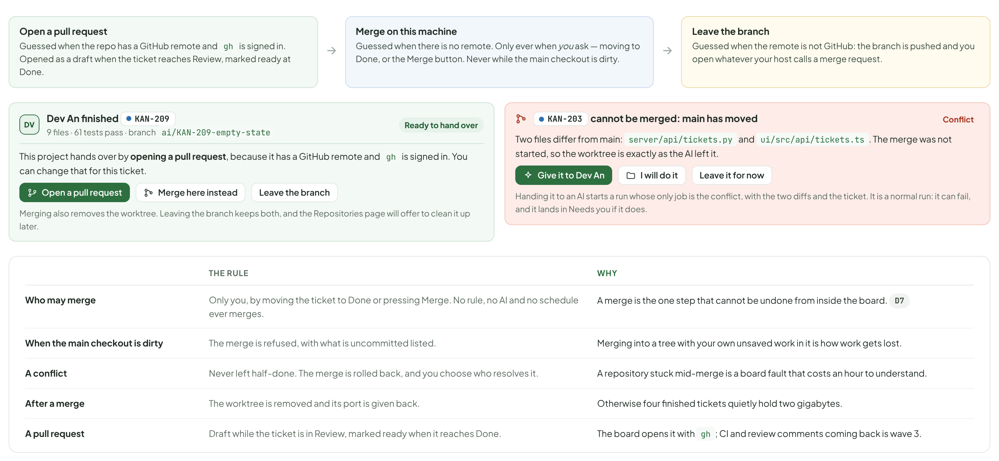
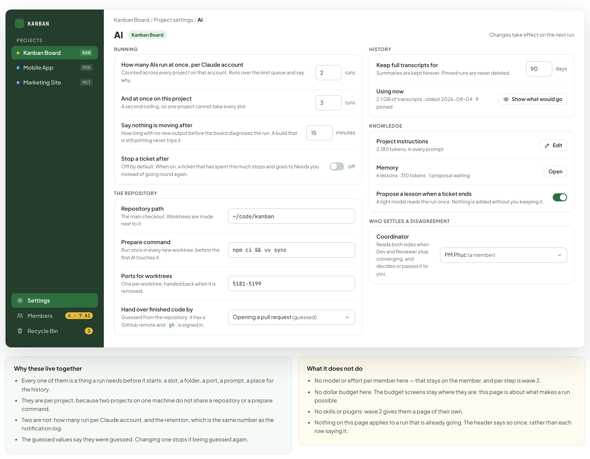
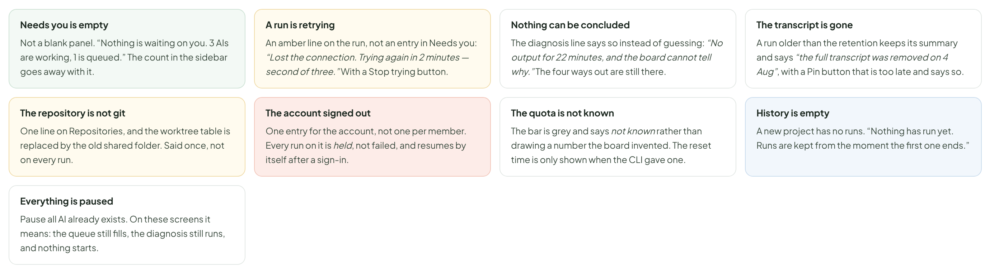

# AI operations — when a run breaks, what it spends, and why it did that

> SCREEN — V1 PROPOSAL · source: [`AiOperations.dc.html`](../source/AiOperations.dc.html) · canvas `1793548337-bcf0` · sha256 `a2d3a5312d8a77e1d48ed9a0df81c4290487b0872f5c6680a650acba6be23a05`

> Wave 1 of `docs/specs/ai-claude-code-plan.md` (decisions D1-D25). Based on `main` and on the code as it is today: a run with no time limit, failures of one kind only, work that needs you in three separate screens, an accounts page that says *not metered*, and transcripts that live only in Claude Code’s own session files. All names, tickets and text in the mock-ups are illustrative. What is decided and what is still open are in section M.

Wave 1 of the AI plan (docs/specs/ai-claude-code-plan.md): the part that has to hold before an AI team is worth having. An AI that hangs is diagnosed before anything is restarted; everything an AI cannot finish by itself lands in one queue with a diagnosis and a way out; the quota of each Claude account is visible, including why work is waiting; every run keeps its own transcript so “why did it do that” still has an answer in three months; the project carries instructions and the lessons the AIs wrote themselves; each ticket works in its own git worktree, and finished code leaves by a route you chose.

Source: [AiOperations.dc.html](../source/AiOperations.dc.html) › header ("SCREEN — V1 PROPOSAL", "AI operations — when a run breaks, what it spends, and why it did that" and the intro)

---

## A. What this board decides

Every row is a decision already taken in the plan document, and the rest of the board only draws these. The grey chip says where it comes from: D1–D25 are the decisions in section 2 of docs/specs/ai-claude-code-plan.md, #1–#32 the numbered needs in its section 5, and the rest name a section of the document.

Source: [AiOperations.dc.html](../source/AiOperations.dc.html) › block "A. What this board decides"

- Text in the frames: "THE QUESTION" · "THE DECISION" · "WHY, AND WHERE IT COMES FROM" · "Where does work an AI cannot finish go?" · "One queue called Needs you — the same list as the Needs you tab of the notification panel. Resolve it in either place and both close." · "Three screens collect it today: AI Team › Now, a stop in Resources, a signed-out account. #20 #31" · "What happens when a run stops moving?" · "Diagnose first, act second. A restart is never the first move, and most causes are found by code, with no quota spent." · "A dev server in the foreground, a command waiting for a key and a long test look identical from outside. D25" · "What is scarce?" · "The usage window of a Claude account, not money. The board shows a window, what is left and when it reopens." · "The plan is a subscription, so a dollar figure on the board is an estimate and says nothing about what you can still run. D17" · "Who keeps the transcript of a run?" · "The board keeps its own copy when a run ends. It never reads the CLI’s session files to answer a question." · "Claude Code deletes its own transcripts on cleanupPeriodDays (30 by default), so history is being lost now. Log 1" · "How long is it kept?" · "The summary of a run forever, the full transcript 90 days, a pinned run forever." · "The same 90 days as the notification log, so one retention setting covers both. Log 2" · "What does an AI remember between tickets?" · "Two layers in the prompt: instructions you write, and lessons the AIs wrote themselves and you can edit. A searchable knowledge base is wave 3." · "Lessons are where the quota saving is: the same mistake is not paid for twice. D18" · "Where does an AI work?" · "One git worktree per ticket on ai/<KEY>-<slug>, at a fixed path. Every role of that ticket uses it, one after another." · "--resume needs the path to stay the same, and one folder for all members makes two runs collide. D4" · "How does finished code leave?" · "Open a PR, merge on this machine, or leave the branch alone. The board guesses from the repo and you change it per project." · "A merge only ever happens because a person asked, and a conflict is never left half-done. D6 D7" · "How many AIs run at once?" · "Two per Claude account by default, and as many as you like once you change it." · "Today the limit applies to API keys only, so the CLI has no limit at all. Survey 1" · "What counts as the board’s own fault?" · "An MCP tool that does not answer or returns 5xx, a revoked token, a permission that makes a required step impossible, a broken worktree, a port clash." · "An AI calling a tool with wrong arguments is the AI’s to fix and is not counted against it. D11" · "Who is told first?" · "A judgement call waits for the PM AI, then you. A board fault comes straight to you." · "You should not be the first reader of something another AI could settle. D12"

---

## B. What is in the way today

From the survey of the code in section 1 of the plan. The third column is what it costs you, not what it costs the AI.

Source: [AiOperations.dc.html](../source/AiOperations.dc.html) › block "B. What is in the way today"

- Text in the frames: "AREA" · "HOW IT WORKS TODAY" · "WHAT THAT COSTS YOU" · "A run that hangs" · "runs.py says “no time limit”. Nothing watches a run that stops producing output." · "You find it yourself, and only when you happen to look. A whole evening can go to one stuck npm run dev." · "Failures" · "Every failure is one kind. A rate limit is requeued up to three times; everything else becomes an error with a Retry button." · "A dropped connection burns one of the three tries, and hitting the plan’s usage window — which is not a failure at all — is treated as one." · "Work that needs you" · "Three separate lists: AI Team › Now, the red stop bar in Resources, the signed-out card in Accounts." · "Something waits in the list you are not looking at. None of the three says what was already tried." · "Quota" · "The accounts page says not metered · no dollars or tokens. The only limits are a per-run time cap and runs per day." · "You cannot tell which account still has room, so you find out by starting a run and watching it fail." · "The transcript" · "Each run stores its steps, changed files, report and tokens. The full conversation lives only in Claude Code’s own session file." · "That file is deleted after about 30 days, so “why did it do that” already has no answer for last month’s tickets. gấp" · "Memory" · "Nothing carries from one ticket to the next except what you typed into a member’s instructions." · "The next AI repeats the mistake, at full quota price, and you explain the same thing again." · "Where the AIs work" · "All members of a project share one working folder; config_sync.py writes skills and hooks into it." · "Two runs edit the same tree, a branch cannot be cleaned up on its own, and no port is reserved for a ticket."

---

## C. An AI in trouble: diagnose, then act

Today a run with no time limit can sit forever and nothing notices. The proposal is not a timeout — a timeout would kill long builds — but a ladder: notice by code, diagnose by code, and only then offer an action that fits the cause. Most of it costs no quota at all.

Source: [AiOperations.dc.html](../source/AiOperations.dc.html) › block "C. An AI in trouble: diagnose, then act"

- Text in the frames: "DV" · "Dev An has produced nothing for 22 minutes" · "On" · "KAN-218" · "· step 14 · started 10:06 · the process is alive, CPU 0%" · "Diagnosed" · "What the board found. The last step ran npm run dev in the foreground. It printed ready in 412 ms 21 minutes ago and nothing since. No CPU, no new output, no MCP call open." · "What that means. A dev server does not end by itself, so the run is waiting for a command that will never return. The work before it is intact." · "Already tried. Nothing. This is the first time this run stopped moving." · "Stop that command, keep the run" · "Tell the AI to run it in the background" · "Wait, tell me again at 30 min" · "Send to Needs you" · "Stopping the command ends that child process only. The run goes on from step 14 and is told what happened." · "What makes this card different" · "It names the cause, not the symptom. “No output for 22 minutes” is the trigger; the card is about the dev server." · "It says what was already tried, so you are not the second person to try the same thing." · "Every action is scoped: stop the command, not the run; nudge the AI, not restart it." · "Waiting is an action too, with a time on it. Choosing it is not the same as ignoring the card." · "1 · Notice" · "By code, on a timer: no new stream event for N minutes while the run is still marked running. Nothing is concluded yet." · "2 · Diagnose" · "By code first: is the process alive, is the CPU busy, what was the last step, is an MCP call open, is RSS climbing. Only if that is inconclusive, Haiku reads the last few steps." · "3 · Act" · "What the diagnosis allows, under the risk tiers: wait, stop one child process, send a message to the running AI, resume with a note, or hand it to you." · "4 · Learn" · "When the cause is one the project will meet again, the AI proposes a lesson for the project memory (section H)." · "WHAT THE BOARD CAN SEE, BY CODE AND AT NO COST" · "WHAT IT MEANS" · "WHAT IT OFFERS" · "The last step is a command, CPU is busy, output arrived in the last minute" · "A long build or test. Not a hang." · "Nothing, except Wait with a reminder. The card does not appear at all unless it crosses the slow threshold." · "The last step ran something that matches a server — npm run dev, uvicorn, vite — and has printed nothing since" · "A foreground server that never ends." · "Stop that child process, keep the run. Then propose the lesson “start the dev server in the background”." · "The process is blocked reading stdin" · "Something is waiting for a key nobody will press: the editor of git commit, an npx “Ok to proceed?”." · "Send the answer, or stop the child and resume with a note saying what was asked." · "An MCP call has been open longer than 15 minutes" · "A board tool is not answering. This is the board’s own fault." · "Cancel the call and resume. If it happens again, straight to Needs you, marked board fault." · "The CLI reported a usage limit and a reset time" · "Not a hang. The plan’s window is used up." · "Hold every run of that account until the reset, and say so. Not counted as a try. Section E" · "RSS keeps climbing" · "A child process is eating memory, not the CLI itself." · "Name the child and offer to stop it, before restarting anything. Today the run is simply restarted, twice." · "None of the above" · "Unknown." · "Haiku reads the last few steps and the process state, classifies it, and proposes one of the actions above. Its answer is shown as a proposal, never applied by itself." · "Where the diagnosis comes from" · "The process and its children, and their CPU and RSS: the board already starts the CLI, so it owns the process." · "The last events of the stream, which the board already stores as steps." · "Whether an MCP call is open, which the board knows because it answers them." · "The CLI’s own words when it reports a usage limit, with the reset time." · "What the board will not do" · "Restart a run before it has a diagnosis. That is what happens today for memory, twice, and it is the thing this section replaces." · "Spend quota on a diagnosis it can make by code." · "Stop a whole run when stopping one child process is enough." · "Apply Haiku’s reading on its own: an AI’s guess about an AI is still a guess."

---

## D. Needs you: one queue, with a diagnosis

Everything an AI could not get past lands here, whatever caused it. The list exists today in three screens and carries only a title and a button; what is new is that every row says what the board already found out and already tried, and offers the same four ways out.

Source: [AiOperations.dc.html](../source/AiOperations.dc.html) › block "D. Needs you: one queue, with a diagnosis"

- Text in the frames: "KANBAN" · "PROJECTS" · "Kanban Board" · "KAN" · "Mobile App" · "MOB" · "Marketing Site" · "MKT" · "Settings" · "Members" · "4 · 7 AI" · "Recycle Bin" · "3" · "Board" · "List" · "Timeline" · "Docs" · "AI Team" · "4" · "Pause all AI" · "New Ticket" · "Now" · "Flow" · "You stepped in" · "Health" · "Live · updated 4 s ago" · "Needs you 4" · "Oldest first. Everything an AI could not get past by itself, in one list." · "All 4" · "Board faults 2" · "Judgement 1" · "Questions 1" · "The board could not reach its own tool" · "Board fault" · "14 min" · "What happened. Dev asked ticket_update on" · "KAN-212" · "three times. The MCP process did not answer within 60 s." · "Diagnosis. The stdio MCP process is alive but has not answered any call since 10:48. Nothing is wrong with the AI’s request." · "ALREADY TRIED" · "Retried at 30 s, 2 min and 10 min, with backoff." · "Resumed the run once after the second failure." · "Board fault · came straight to you, no AI was asked first" · "Try again" · "Continue with a note" · "Hand to another AI" · "Cancel the run" · "Restart the MCP process" · "BA is asking a question" · "41 min" · "BA on" · "KAN-215" · "— “Should the export include archived tickets?”" · "Diagnosis. Not a failure. The run is paused and nothing is lost; the answer goes straight back into it." · "Waiting on you · blocks" · "Answer" · "Answer: yes, include them" · "Open the run" · "Dev and Reviewer are not converging on KAN-212" · "PM could not settle it" · "26 min" · "Dev and Reviewer have passed" · "back and forth 4 times. The diff barely changed between rounds 3 and 4." · "Diagnosis. No progress, by the rule in D11. The PM AI read both sides and could not settle it: the two disagree on whether the cost field belongs in the API response at all." · "PM AI arbitrated at 11:12. Verdict: cannot decide, this is a product question." · "The acceptance criterion was not changed; a change was only proposed." · "Judgement · the PM AI saw it first and passed it up" · "Side with Reviewer" · "Side with Dev" · "Split the ticket" · "Read the arbitration" · "Reviewer cannot run the tests it is asked to run" · "1 h 2 min" · "Reviewer on" · "KAN-209" · ": the workflow step Check requires running the test suite, and this member’s permission does not allow commands." · "Diagnosis. A configuration that makes a required step impossible. This counts as a board fault, not an AI failure, so it is not held against the member." · "Board fault · blocks the whole workflow, not just this step" · "Allow commands for this member" · "Give the step to Dev" · "Drop the step for this ticket" · "What every row carries, in the order you read it:" · "1" · "What happened, in one sentence a person can read without opening the run. Never the raw error." · "2" · "Diagnosis — the board’s reading of the cause, from section C. If nothing could be concluded, the line says so rather than guessing." · "Already tried, with times. Three retries with backoff and one resume are four facts you do not have to rediscover." · "Who saw it first. A judgement call carries the PM AI’s verdict; a board fault says it came straight to you." · "5" · "The four ways out, always in the same order: Try again · Continue with a note · Hand to another AI · Cancel." · "6" · "One action that fits this entry, placed first when the diagnosis is confident enough to name it (“Allow commands”, “Restart the MCP process”)." · "WHAT HAPPENED" · "WHO SEES IT FIRST" · "NOTES" · "A run failed and retrying did not help" · "Straight to you" · "Marked board fault when the cause is the board’s (MCP, token, worktree, port); otherwise it carries the diagnosis from C." · "A board fault" · "There is nothing for another AI to decide. The entry says which part of the board failed." · "An AI is asking a person something" · "Already how it works. It moves into this list instead of its own card, and the inline answer stays." · "An approval request" · "Straight to you, or Autopilot" · "Unchanged: Autopilot may answer within its risk ceiling. existing" · "Dev and Reviewer are not converging" · "The PM AI first" · "Only reaches you when the PM AI cannot settle it, and then it carries the verdict and the reason. D12" · "A member’s Claude account signed out" · "One entry for the account, not one per member on it. Runs are held, not failed." · "The account’s usage window is used up" · "Nobody — it is not an entry" · "Work waits and says why. It only becomes an entry if you marked the ticket urgent and no other account has room. Section E" · "A merge conflict" · "Straight to you, with a choice" · "“Hand it to an AI” or “I will do it”. The worktree is left exactly as it is either way. Section J" · "One list, two doors" · "This is the same list as the Needs you tab of the notification panel. One row, two places to see it; resolving it in either closes both. That was decided for the notification design and holds here." · "AI Team › Now keeps the heading Needs you. What changes is what a row carries: a diagnosis, what was tried, and the four ways out." · "The red stop bar in Resources and the signed-out card in Accounts become rows here. They keep their own buttons." · "What stays out of it" · "Anything an AI is still working through. A run that is retrying with backoff is not an entry; it is an amber line on the run." · "Anything that resolved itself. If the account signed back in, the row closes on its own and is not left for you to tidy." · "Progress reports. “Dev finished KAN-212” is information, and belongs in the Updates tab." · "Approvals that Autopilot is allowed to answer, until it declines them."

---

## E. Quota: the window of a Claude account

On a subscription the thing that runs out is the usage window of an account, and today the board shows nothing about it — the accounts page says not metered and leaves it there. Hitting the window is also not a failure, and should stop being counted as one.

Source: [AiOperations.dc.html](../source/AiOperations.dc.html) › block "E. Quota: the window of a Claude account"

- Text in the frames: "KANBAN" · "PROJECTS" · "Kanban Board" · "KAN" · "Mobile App" · "MOB" · "Marketing Site" · "MKT" · "Settings" · "Members" · "4 · 7 AI" · "Recycle Bin" · "3" · "Kanban Board / Members" · "Add AI member" · "Humans" · "4" · "AI" · "7" · "AI accounts" · "5" · "3 Claude accounts" · "Run at most" · "2 at a time per account" · "A subscription has a usage window, not a bill. What the board shows here is how much of the current window each account has spent, when it reopens, and what is waiting on it." · "CLAUDE ACCOUNT" · "THIS WINDOW" · "MEMBERS" · "RUNNING NOW" · "CC" · "an@example.com" · "Max 20× · signed in" · "92% used" · "Window reopens 14:00 · in 1 h 12 min" · "4 members" · "Dev" · "KAN-212" · "· 14 min" · "2 runs held until 14:00" · "Move urgent work" · "an.work@example.com" · "Pro · signed in" · "41% used" · "Window reopens 17:00" · "2 members" · "Reviewer" · "KAN-209" · "· 3 min" · "Room for 1 more run" · "Open" · "team@example.com" · "Max 5× · signed out" · "not known" · "Last read 09:58, before it signed out" · "1 member" · "Nothing. 2 runs are held." · "Held since 09:58, nothing lost" · "Sign in again" · "Where these numbers come from. The CLI does not publish what is left in a window. The board learns it two ways: it counts what it spent itself, and it reads the reset time the CLI gives when a limit is actually hit. So the bar is the board’s own count and says so; the reset time is exact. Q4 S5" · "Why a run is waiting, in its own words" · "Waiting for the next window" · "The account this member runs on has used its window. The run starts by itself at the reset time. Not a failure, and not counted as a try." · "Waiting for a free slot" · "Two runs are already going on this account, which is the limit you set. The next one starts when one ends." · "Waiting for the ticket’s worktree" · "Another role of the same ticket holds the worktree. Roles of one ticket take turns, by design." · "Waiting for you" · "There is a row in Needs you with this run’s name on it." · "Held: the account signed out" · "Everything on that account waits for a sign-in. The work already done is kept." · "Move urgent work to another account" · "Moving work between accounts is yours to do. The board never does it on its own." · "an@example.com has used 92% of its window and reopens at 14:00. Two runs are held." · "Show cost on run cards" · "Dev An · marked urgent · held 6 min" · "KAN-216" · "Tidy the schedules page" · "Dev An · not urgent · let it wait for 14:00" · "Run it on" · "an.work@example.com · Pro · 41% used · room for 1" · "The member keeps its own model and permissions. Only the account changes, and only for this run." · "The conversation does not carry over: a run moved to another account starts a new one, with a hand-over note of what was done so far." · "Move 1 run" · "Cancel" · "TODAY" · "PROPOSED" · "A usage window is used up" · "Treated as a rate limit: requeued up to 3 times, then the run fails." · "Not a failure. Every run of that account is held until the reset time the CLI reported, and the tries are not counted. Urgent work can be moved by hand." · "How much is left" · "Nothing is shown. The accounts page says not metered." · "A bar per account, with the board’s own count and the exact reset time when one is known. Labelled as an estimate, because it is one." · "How many run at once" · "No limit at all for the CLI; the limit applies to API keys only." · "Two per Claude account by default, changed in one place. Runs over the limit queue and say so." · "Which account a member uses" · "Fixed on the member." · "Unchanged. Moving a run to another account is a deliberate act, for one run, and it starts a fresh conversation." · "Money" · "A dollar estimate per run and per project, with caps." · "Kept, and kept labelled an estimate. It is useful for comparing tickets, and useless for knowing what you can still run."

---

## F. Run history: finding the run you mean

The board already records every run. What it cannot do is find one: there is no search, no retention, and the detail that would answer a question lives in Claude Code’s own session file, which is deleted after about 30 days. The first thing to build is the board keeping its own copy.

Source: [AiOperations.dc.html](../source/AiOperations.dc.html) › block "F. Run history: finding the run you mean"

- Text in the frames: "KANBAN" · "PROJECTS" · "Kanban Board" · "KAN" · "Mobile App" · "MOB" · "Marketing Site" · "MKT" · "Settings" · "Members" · "4 · 7 AI" · "Recycle Bin" · "3" · "Board" · "List" · "Timeline" · "Docs" · "AI Team" · "4" · "Pause all AI" · "New Ticket" · "Run history" · "Export" · "Retention" · "npm test 2 failed" · "1,104 runs · 17 match" · "All" · "1104" · "Failed" · "63" · "Needed you" · "118" · "Pinned" · "9" · "Any member" · "Any ticket" · "Any skill" · "Last 30 days" · "WHEN" · "WHO" · "TICKET" · "HOW IT ENDED" · "STEPS" · "TOOK" · "SKILLS USED" · "11:22" · "DV" · "Dev An" · "KAN-212" · "Show cost on run cards" · "21 steps" · "14 min" · "tdd" · "10:48" · "RV" · "Reviewer Rin" · "KAN-209" · "Schedules empty state" · "Finished" · "9 steps" · "4 min" · "review-depth" · "10:06" · "KAN-218" · "Port the cost badge" · "14 steps" · "22 min" · "db-migrations" · "09:41" · "TS" · "Tester Tam" · "KAN-211" · "Export tickets to CSV" · "17 steps" · "8 min" · "webapp-testing" · "09:12" · "6 steps" · "2 min" · "08:55" · "PM" · "PM Phuc" · "KAN-220" · "Billing page, parent" · "4 steps" · "1 min" · "What the search reads. The summary and report, what the AI said, the name and arguments of every tool call, file paths, error text, and the question it asked you. Full text, so npm test 2 failed finds the run that printed it." · "Transcripts: 2.1 GB of 90 days. Summaries are kept forever and are small. 9 pinned runs are never deleted. Oldest transcript: 2026-08-04." · "WHAT" · "KEPT FOR" · "WHY" · "The summary of a run" · "Forever" · "Who, which ticket, how it ended, how long, how many steps, which files, what it reported. Small, and it is what the board’s own screens read." · "The full transcript" · "90 days" · "The prompt that was sent, every tool call with its arguments and result, everything the AI said. The same 90 days as the notification log, set in one place." · "A pinned run" · "You pin it, or the board pins it: the run behind a reverted change, the run that produced a lesson, the run attached to an arbitration." · "Very large tool output" · "90 days, truncated in place" · "The step keeps the first and last part; the whole output is stored beside it and fetched when you open it." · "Anything that looks like a secret" · "Never stored" · "Masked before writing, the same masking the board already applies to step output today."

---

## G. One run: what it was given, and what it did

This screen has never been designed. Four others link to it — AI Team › Now, the Flow bars, the Timeline inspector, the touches in You stepped in — and all of them say “opens the run view”. It is one timeline, where every step opens, and the first step opens on everything the AI knew before it began.

Source: [AiOperations.dc.html](../source/AiOperations.dc.html) › block "G. One run: what it was given, and what it did"

- Text in the frames: "KANBAN" · "PROJECTS" · "Kanban Board" · "KAN" · "Mobile App" · "MOB" · "Marketing Site" · "MKT" · "Settings" · "Members" · "4 · 7 AI" · "Recycle Bin" · "3" · "Board" · "List" · "Timeline" · "Docs" · "AI Team" · "4" · "Pause all AI" · "New Ticket" · "Run of 11:22" · "Run history › KAN-212" · "Steps" · "What it was given" · "Files" · "Report" · "Started. Handed over by Reviewer Rin: “the estimate should not show on an unmetered run”" · "11:22:04" · "Model" · "Sonnet · effort medium · chosen by the step, not the member D17" · "Account" · "an@example.com · 61% of the window used when the run started" · "System prompt" · "Persona of Dev An, the board’s own rules, and the project instructions — 2,180 tokens · show" · "Project memory" · "6 lessons, 310 tokens · among them “run the dev server in the background” Section H" · "The ticket" · "KAN-212 with its description, 3 acceptance criteria, 11 comments, 1 linked page" · "Tools" · "kanban MCP, and the plugins of this member: tdd, db-migrations" · "Workspace" · "~/code/kanban/.worktrees/KAN-212 on ai/KAN-212-cost-badge, port 5181" · "This panel is the answer to “why did it do that”. Everything the AI knew when it started is here, and every line opens the thing itself." · "Read the ticket and the three acceptance criteria. Planned to change CostChip.tsx and its test." · "11:22:09" · "Ran npm test -- --run src/cost" · "11:22:18 · exit 1" · "WHAT IT SENT" · "Bash" · "80 × 24" · "{" · ""command": "npm test -- --run src/cost"," · ""timeout": 120000" · "}" · "WHAT CAME BACK · EXIT CODE 1 · 38 S" · "output" · "> kanban-ui@3.18.1 test" · "FAIL src/cost/CostChip.test.tsx" · "× shows the estimate when the run is metered" · "expected "$0.41" to equal "—"" · "… 184 lines hidden · show all" · "Tests: 1 failed, 61 passed" · "Long output is cut in the middle and kept whole beside the run. Anything shaped like a key or a token is masked before it is written." · "Edited ui/src/components/ai/CostChip.tsx · +14 −6" · "11:24:51" · "Used the skill tdd — wrote the failing test first, then the fix" · "11:25:02" · "Stopped. ticket_update did not answer three times. The board could not be reached." · "11:36:40" · "Sent to Needs you as a board fault, with the diagnosis and the three retries." · "11:36:41" · "Failed" · "Board fault" · "Dev An on" · "KAN-212" · "11:22 → 11:36 · 14 min · 21 steps" · "3 changed, on the branch" · "Tokens" · "41k in · 6k out · 118k cached" · "Estimate" · "$0.38 (subscription: not billed)" · "Tests" · "1 failed, 61 passed" · "Open in Needs you" · "Resume with a note" · "Compare with the 09:12 run" · "Export as Markdown" · "Unpin" · "Pinned runs are never deleted. This one is pinned because a lesson was written from it." · "What makes a step answerable" · "Every step opens. A command shows what was sent and what came back, with its exit code and how long it took." · "The first step opens on what the AI was given: the model, the account, the system prompt, the memory, the ticket, the tools, the workspace. That is the “why”." · "A skill or a subagent is a step of its own, so “was the skill actually used” has an answer. Today the stream is not read for it at all." · "A failure is a step too, and it carries the same diagnosis the Needs you row carries. One text, two places." · "What it costs to keep" · "Compressed, in the board’s own data folder. A busy project is a couple of gigabytes for ninety days, and the screen says how much." · "Nothing is read from Claude Code’s session files at display time. They are gone after thirty days, and the board must not depend on them." · "Secrets are masked on the way in, not on the way out." · "A run can be exported as Markdown or JSON — one run, or everything that happened on one ticket."

---

## H. What the project knows, and what the AIs learned

Two layers that are always in the prompt: instructions you write, and lessons the AIs wrote themselves. The second is where the quota saving is — the same mistake is not paid for twice — and it is the layer that does not exist at all today.

Source: [AiOperations.dc.html](../source/AiOperations.dc.html) › block "H. What the project knows, and what the AIs learned"

- Text in the frames: "KANBAN" · "PROJECTS" · "Kanban Board" · "KAN" · "Mobile App" · "MOB" · "Marketing Site" · "MKT" · "Settings" · "Members" · "4 · 7 AI" · "Recycle Bin" · "3" · "Kanban Board / Project settings / AI / Project knowledge" · "Project knowledge" · "2,490 tokens in every prompt" · "31% of 8k" · "Instructions" · "Memory" · "6" · "Knowledge base" · "wave 3" · "Instructions for every AI on this project" · "2,180 tokens" · "# Conventions" · "Tests run with npm test -- --run. Never npm test on its own: it watches and never ends." · "Python is formatted by ruff; do not reformat files you did not change." · "# Do not touch" · "server/migrations/ except through a new migration." · "The generated ui/src/api/types.ts." · "# Before you hand over" · "A ticket is done when the tests pass and the CHANGELOG has a line under Unreleased." · "Edit" · "History" · "Written by you. It goes into the system prompt of every run on this project, before the member’s own persona." · "Memory — what the AIs learned" · "310 tokens" · "Add a lesson" · "Start the dev server with & or in a separate terminal. npm run dev in the foreground never returns and the run hangs." · "Written after" · "KAN-218" · "· 31 Oct · used in 4 runs since" · "Delete" · "The cost estimate is hidden on an unmetered run. Do not add it back; three tickets have tried." · "KAN-212" · "· 1 Nov" · "Migrations need uv run alembic revision --autogenerate, not a hand-written file." · "KAN-203" · "· 24 Oct" · "Dev An proposes: “The CSV export has to quote fields that contain a comma. The test for it lives in test_export.py.”" · "From the run that finished" · "KAN-211" · "at 09:41. Proposed by a light model reading the run, not by the Dev itself." · "Keep it" · "Edit and keep" · "No" · "Lessons are capped at 2,000 tokens. Past that the board asks you to drop the ones nothing has used, and tells you which they are." · "LAYER" · "WHO WRITES IT" · "HOW THE AI GETS IT" · "WHAT GOES IN IT" · "You write them" · "In every prompt, always" · "Conventions, commands, what not to touch. Project-wide, so it is not copied into each member’s CLAUDE.md the way it is today." · "Memory (lessons)" · "An AI proposes, you keep or drop it" · "In every prompt, capped" · "Short facts learned the hard way. This is where quota is saved: the second AI does not repeat the first one’s mistake." · "You upload, an AI may add" · "Looked up when needed, not in the prompt" · "Files, images, pages. Not in wave 1 — it needs an index and a search tool. D18c" · "The member’s own persona" · "You write it" · "In every prompt" · "Unchanged, and it stays per member: who this AI is, how it works, what it may not do." · "Where a lesson comes from" · "When a ticket ends, a light model reads the run and proposes at most one lesson. It costs very little and it only runs once per ticket." · "A diagnosis in section C can propose one directly: a dev server that hung is exactly the kind of thing worth remembering." · "You can write one yourself, and you can edit or delete any of them." · "Nothing is added to the prompt without you keeping it. A proposal sits in this screen until you decide." · "How it changes what is written today" · "Today the board writes its block into CLAUDE.md in the working folder, between markers, per member. That stops." · "It moves into the system prompt of the run (--append-system-prompt-file), which is where it belongs: it is the board’s text, not the repo’s." · "The repo’s own CLAUDE.md is left alone and still read by the CLI. Two sources, neither overwriting the other." · "Because the prompt is fixed at the first request of a conversation, changing any of this takes effect on the next run, and the screen says so."

---

## I. Where an AI works: one worktree per ticket

A git worktree per ticket on its own branch, at a path that does not move. It is what lets two tickets run at once, what lets a reviewer read the real files, and what makes a branch something you can see and clean up.

Source: [AiOperations.dc.html](../source/AiOperations.dc.html) › block "I. Where an AI works: one worktree per ticket"

- Text in the frames: "KANBAN" · "PROJECTS" · "Kanban Board" · "KAN" · "Mobile App" · "MOB" · "Marketing Site" · "MKT" · "Settings" · "Members" · "4 · 7 AI" · "Recycle Bin" · "3" · "Kanban Board / Project settings / Repositories" · "Where the AIs work" · "4 worktrees · 1.9 GB" · "Clean up finished" · "Repository" · "~/code/kanban" · "Worktrees under" · "~/code/kanban/.worktrees/<KEY>" · "Branch" · "ai/<KEY>-<slug>" · "TICKET" · "BRANCH" · "STATE" · "SIZE" · "PORT" · "KAN-212" · "Show cost on run cards" · "ai/KAN-212-cost-badge" · "Dev An · 3 files changed, not committed" · "In use" · "420 MB" · "5181" · "Open folder" · "Stop" · "KAN-209" · "Schedules empty state" · "ai/KAN-209-empty-state" · "Reviewer Rin finished 10:48 · nothing uncommitted" · "Merged" · "380 MB" · "5182" · "Remove" · "Keep" · "KAN-218" · "Port the cost badge" · "ai/KAN-218-port" · "Dev An stopped at 11:36 · 2 files changed, not committed" · "Waiting for you" · "410 MB" · "5183" · "KAN-203" · "Add a CSV export" · "ai/KAN-203-csv" · "Nothing running · main moved 3 days ago" · "Conflict with main" · "395 MB" · "5184" · "Resolve" · "Prepare command · npm ci && uv sync" · "Runs once when a worktree is made. The board remembers how long it took (1 min 40 s) and says so before it starts." · "Ports · 5181–5199, one per worktree" · "Handed out when the worktree is made and given back when it goes. A clash is a board fault, not the AI’s." · "Not a git repository?" · "The board says so once and falls back to one shared folder, the way it works today. Nothing silently changes behaviour." · "The rules" · "One worktree per ticket, not per member. Dev, Reviewer and Tester of the same ticket use it one after another, which is what makes a review of real files possible." · "A fixed path, because --resume needs the folder to still be there and still be the same." · "Never removed while something is uncommitted. The Remove button is not offered; Keep is." · "Roles with no ticket — Board AI, Triage — read the main checkout and do not take a worktree." · "What it replaces" · "Today every member of a project shares one working folder, and the board writes skills, hooks and .mcp.json into it." · "Two runs in that folder edit the same files. Nothing says so, and nothing stops it." · "A branch is only a label on the ticket: there is no state, no size, and no way to clean one up." · "Settings › Repositories exists as a row in a table and has never been drawn."

---

## J. Handing over the code

Three ways out, one guessed from the repository and changed per project or per ticket. A merge happens only because you asked for it, and a conflict is never left half-finished.

Source: [AiOperations.dc.html](../source/AiOperations.dc.html) › block "J. Handing over the code"

- Text in the frames: "Open a pull request" · "Guessed when the repo has a GitHub remote and gh is signed in. Opened as a draft when the ticket reaches Review, marked ready at Done." · "Merge on this machine" · "Guessed when there is no remote. Only ever when you ask — moving to Done, or the Merge button. Never while the main checkout is dirty." · "Leave the branch" · "Guessed when the remote is not GitHub: the branch is pushed and you open whatever your host calls a merge request." · "DV" · "Dev An finished" · "KAN-209" · "9 files · 61 tests pass · branch ai/KAN-209-empty-state" · "Ready to hand over" · "This project hands over by opening a pull request, because it has a GitHub remote and gh is signed in. You can change that for this ticket." · "Merge here instead" · "Merging also removes the worktree. Leaving the branch keeps both, and the Repositories page will offer to clean it up later." · "KAN-203" · "cannot be merged: main has moved" · "Conflict" · "Two files differ from main: server/api/tickets.py and ui/src/api/tickets.ts. The merge was not started, so the worktree is exactly as the AI left it." · "Give it to Dev An" · "I will do it" · "Leave it for now" · "Handing it to an AI starts a run whose only job is the conflict, with the two diffs and the ticket. It is a normal run: it can fail, and it lands in Needs you if it does." · "THE RULE" · "WHY" · "Who may merge" · "Only you, by moving the ticket to Done or pressing Merge. No rule, no AI and no schedule ever merges." · "A merge is the one step that cannot be undone from inside the board. D7" · "When the main checkout is dirty" · "The merge is refused, with what is uncommitted listed." · "Merging into a tree with your own unsaved work in it is how work gets lost." · "A conflict" · "Never left half-done. The merge is rolled back, and you choose who resolves it." · "A repository stuck mid-merge is a board fault that costs an hour to understand." · "After a merge" · "The worktree is removed and its port is given back." · "Otherwise four finished tickets quietly hold two gigabytes." · "A pull request" · "Draft while the ticket is in Review, marked ready when it reaches Done." · "The board opens it with gh; CI and review comments coming back is wave 3."

---

## K. Project settings for the AI team

One page for everything a run needs before it can start. Most of it does not exist today, and what does is scattered across three screens.

Source: [AiOperations.dc.html](../source/AiOperations.dc.html) › block "K. Project settings for the AI team"

- Text in the frames: "KANBAN" · "PROJECTS" · "Kanban Board" · "KAN" · "Mobile App" · "MOB" · "Marketing Site" · "MKT" · "Settings" · "Members" · "4 · 7 AI" · "Recycle Bin" · "3" · "Kanban Board / Project settings / AI" · "AI" · "Changes take effect on the next run" · "RUNNING" · "How many AIs run at once, per Claude account" · "Counted across every project on that account. Runs over the limit queue and say why." · "2" · "runs" · "And at once on this project" · "A second ceiling, so one project cannot take every slot." · "Say nothing is moving after" · "How long with no new output before the board diagnoses the run. A build that is still printing never trips it." · "15" · "minutes" · "Stop a ticket after" · "Off by default. When on, a ticket that has spent this much stops and goes to Needs you instead of going round again." · "off" · "THE REPOSITORY" · "Repository path" · "The main checkout. Worktrees are made next to it." · "~/code/kanban" · "Prepare command" · "Run once in every new worktree, before the first AI touches it." · "npm ci && uv sync" · "Ports for worktrees" · "One per worktree, handed back when it is removed." · "5181-5199" · "Hand over finished code by" · "Guessed from the repository: it has a GitHub remote and gh is signed in." · "Opening a pull request (guessed)" · "HISTORY" · "Keep full transcripts for" · "Summaries are kept forever. Pinned runs are never deleted." · "90" · "days" · "Using now" · "2.1 GB of transcripts · oldest 2026-08-04 · 9 pinned" · "Show what would go" · "KNOWLEDGE" · "Project instructions" · "2,180 tokens, in every prompt" · "Edit" · "Memory" · "6 lessons · 310 tokens · 1 proposal waiting" · "Open" · "Propose a lesson when a ticket ends" · "A light model reads the run once. Nothing is added without you keeping it." · "WHO SETTLES A DISAGREEMENT" · "Coordinator" · "Reads both sides when Dev and Reviewer stop converging, and decides or passes it to you." · "PM Phuc (a member)" · "Why these live together" · "Every one of them is a thing a run needs before it starts: a slot, a folder, a port, a prompt, a place for the history." · "They are per project, because two projects on one machine do not share a repository or a prepare command." · "Two are not: how many run per Claude account, and the retention, which is the same number as the notification log." · "The guessed values say they were guessed. Changing one stops it being guessed again." · "What it does not do" · "No model or effort per member here — that stays on the member, and per step is wave 2." · "No dollar budget here. The budget screens stay where they are; this page is about what makes a run possible." · "No skills or plugins: wave 2 gives them a page of their own." · "Nothing on this page applies to a run that is already going. The header says so once, rather than each row saying it."

---

## L. The states each of these screens has to have

Not decoration. Four of these are the states the current screens get wrong, and the fifth is the one that only appears on somebody else’s machine.

Source: [AiOperations.dc.html](../source/AiOperations.dc.html) › block "L. The states each of these screens has to have"

- Text in the frames: "Needs you is empty" · "Not a blank panel. “Nothing is waiting on you. 3 AIs are working, 1 is queued.” The count in the sidebar goes away with it." · "A run is retrying" · "An amber line on the run, not an entry in Needs you: “Lost the connection. Trying again in 2 minutes — second of three.” With a Stop trying button." · "Nothing can be concluded" · "The diagnosis line says so instead of guessing: “No output for 22 minutes, and the board cannot tell why.” The four ways out are still there." · "The transcript is gone" · "A run older than the retention keeps its summary and says “the full transcript was removed on 4 Aug”, with a Pin button that is too late and says so." · "The repository is not git" · "One line on Repositories, and the worktree table is replaced by the old shared folder. Said once, not on every run." · "The account signed out" · "One entry for the account, not one per member. Every run on it is held, not failed, and resumes by itself after a sign-in." · "The quota is not known" · "The bar is grey and says not known rather than drawing a number the board invented. The reset time is only shown when the CLI gave one." · "History is empty" · "A new project has no runs. “Nothing has run yet. Runs are kept from the moment the first one ends.”" · "Everything is paused" · "Pause all AI already exists. On these screens it means: the queue still fills, the diagnosis still runs, and nothing starts."

---

## M. Where the data comes from, what is decided, and what is still open

The first table is for whoever builds it: what already exists, what is new, and what each thing is for. The two cards below separate what the design has settled from what only the build can answer.

Source: [AiOperations.dc.html](../source/AiOperations.dc.html) › block "M. Where the data comes from, what is decided, and what is still open"

- Text in the frames: "WHERE IT COMES FROM" · "NOTES" · "A run and its steps" · "Exists — AiRun: steps, files, report, tokens, cost, state, status changes." · "Unchanged. The run detail reads it, and the summary is what is kept forever." · "The transcript" · "New. Written when a run ends: the prompt, every tool call with its arguments and result, what the AI said, the skills used." · "Compressed on disk, masked for secrets, searchable (FTS), deleted at the retention unless the run is pinned." · "The diagnosis" · "New, on the run: what the board concluded, what it tried, and when." · "One text, shown on the run, in the Needs you row and in the notification. Never written three times." · "The Needs you queue" · "Reuses the notification row. A row with kind = needs_you and a reference to the run." · "So that resolving it in either place closes both, which the notification design already decided." · "Account usage" · "New, per Claude account: what the board itself spent in the window, and the reset time the CLI last reported." · "An estimate and labelled as one. The reset time is exact, because the CLI gave it." · "Project knowledge" · "New: instructions (one text per project) and lessons (a row each, with the ticket it came from and a use count)." · "Both go into --append-system-prompt-file. The block the board writes into CLAUDE.md today goes away." · "A worktree" · "New: ticket, path, branch, port, size, state, and whether anything is uncommitted." · "Read from git on the machine; the board stores only the mapping." · "Hand-over" · "New, per project: the chosen route and whether it was guessed." · "Plus, per ticket, an override." · "Decided before building" · "Diagnose before acting. No screen offers a restart as the first move, and no restart happens without a line saying why." · "One Needs you list, shared with the notification panel. The name is kept, and resolving it anywhere closes it everywhere." · "Hitting a usage window is not a failure. It does not count a try, does not fail a run, and does not reach Needs you unless the ticket is urgent and no other account has room." · "The board keeps its own transcript. Nothing on these screens reads Claude Code’s session files, because they are deleted after about 30 days." · "90 days for the transcript, the same number as the notification log, set in one place. Summaries and pinned runs are kept forever." · "One worktree per ticket, shared by the roles of that ticket, never removed while something is uncommitted." · "A merge is yours. No rule, no schedule and no AI merges, and a conflict is rolled back rather than left half-done." · "Two runs per Claude account by default." · "What the build still has to settle" · "How much of a window is left. The CLI does not publish it. The design draws the board’s own count and says it is an estimate; if the experiment in S5 finds a real source, the bar stops being a guess and the label goes." · "Sending a message to a running AI. The diagnosis in C offers it, but it needs --input-format stream-json and a change to how the board starts the CLI (S6). Until that works, the action is not shown." · "How big a transcript really is. 2.1 GB is a guess from the current step volume. If it turns out much larger, the default retention is the thing to revisit, not the feature." · "Whether a lesson should ever be added without you. The design says no. If six months of keeping almost every proposal says otherwise, it is one switch." · "Who the coordinator is. The settings page picks a member. Whether the Board AI can be that member belongs to wave 3, where the Board AI changes anyway."
