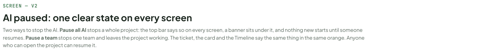
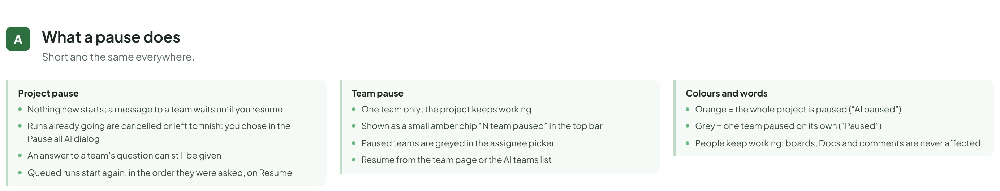
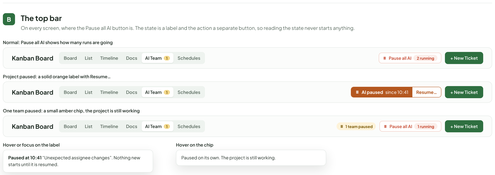
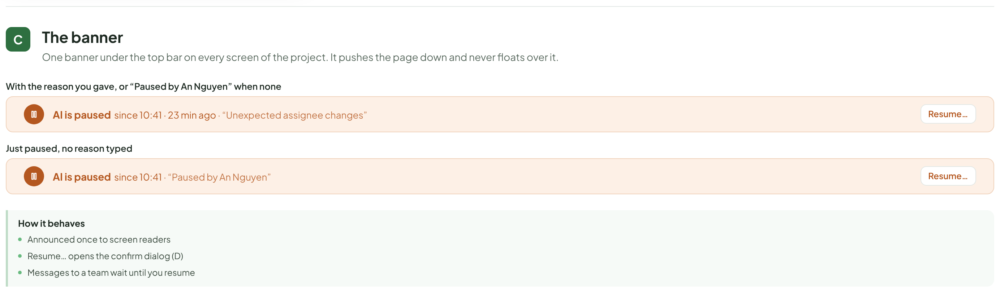
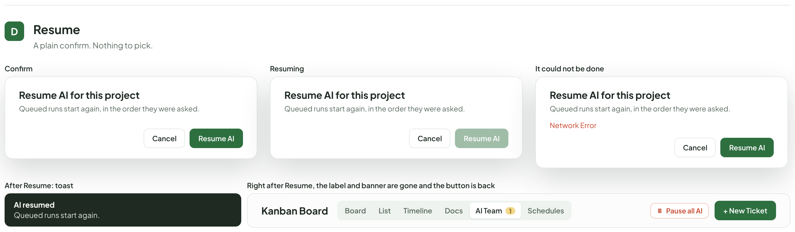
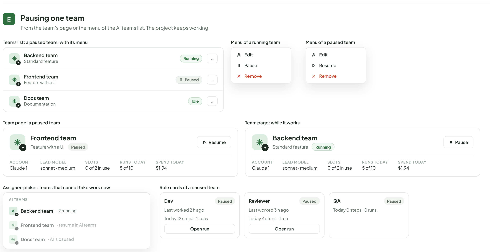
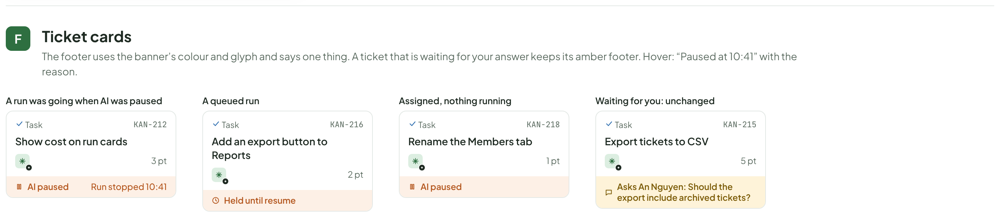
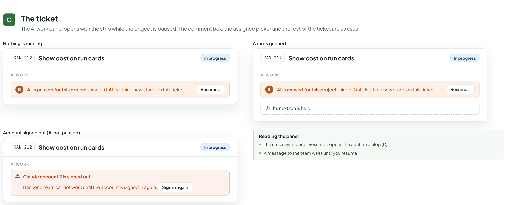
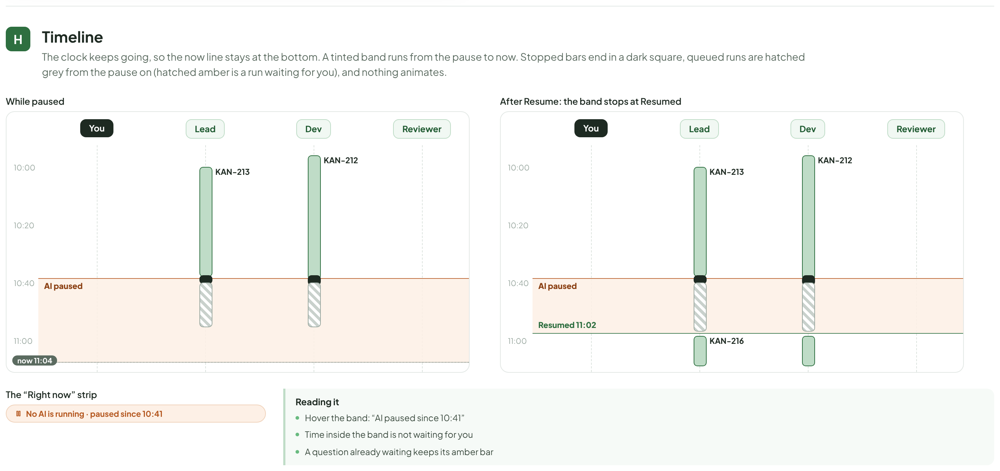
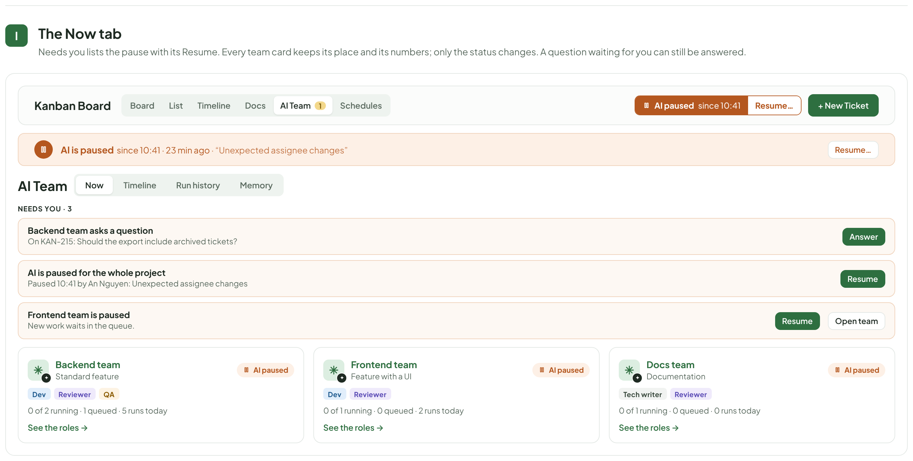

# AI Team — AI paused: one clear state on every screen

> Redrawn for AI v2 · source: [`AiPaused.dc.html`](../source/AiPaused.dc.html) · canvas `1794099567-d725` · sha256 `db7062930325175c3c29dd31e9942608ef8f2618eed217dc377a1d5f3cd0d09c`

> Words, states and conditions follow the code of branch `claude/ai-team-architecture-7a1efc`; the layout is designed here and is not the layout of the current screens. Names, ids, costs and times in the mock-ups are sample data. **Check the code before building from this: the file named in each part is the truth, not the picture.**

## SCREEN — V2

- Text in this part: "SCREEN — V2" · "AI paused: one clear state on every screen" · "Two ways to stop the AI. Pause all AI stops a whole project: the top bar says so on every screen, a banner sits under it, and nothing new starts until someone resumes. Pause a team stops one team and leaves the project working. The ticket, the card and the Timeline say the same thing in the same orange. Anyone who can open the project can resume it."

---

## What a pause does

- Text in this part: "A" · "What a pause does" · "Short and the same everywhere." · "Project pause" · "Nothing new starts; a message to a team waits until you resume" · "Runs already going are cancelled or left to finish: you chose in the Pause all AI dialog" · "An answer to a team’s question can still be given" · "Queued runs start again, in the order they were asked, on Resume" · "Team pause" · "One team only; the project keeps working" · "Shown as a small amber chip “N team paused” in the top bar" · "Paused teams are greyed in the assignee picker" · "Resume from the team page or the AI teams list" · "Colours and words" · "Orange = the whole project is paused (“AI paused”)" · "Grey = one team paused on its own (“Paused”)" · "People keep working: boards, Docs and comments are never affected"

---

## The top bar

- Text in this part: "B" · "The top bar" · "On every screen, where the Pause all AI button is. The state is a label and the action a separate button, so reading the state never starts anything." · "Normal: Pause all AI shows how many runs are going" · "Kanban Board" · "Board" · "List" · "Timeline" · "Docs" · "AI Team 1" · "Schedules" · "Pause all AI" · "2 running" · "+ New Ticket" · "Project paused: a solid orange label with Resume…" · "AI paused" · "since 10:41" · "Resume…" · "One team paused: a small amber chip, the project is still working" · "1 team paused" · "1 running" · "Hover or focus on the label" · "Paused at 10:41 “Unexpected assignee changes”. Nothing new starts until it is resumed." · "Hover on the chip" · "Paused on its own. The project is still working."

---

## The banner

- Text in this part: "C" · "The banner" · "One banner under the top bar on every screen of the project. It pushes the page down and never floats over it." · "With the reason you gave, or “Paused by An Nguyen” when none" · "AI is paused  since 10:41 · 23 min ago · “Unexpected assignee changes”" · "Resume…" · "Just paused, no reason typed" · "AI is paused  since 10:41 · “Paused by An Nguyen”" · "How it behaves" · "Announced once to screen readers" · "Resume… opens the confirm dialog (D)" · "Messages to a team wait until you resume"

---

## Resume

- Text in this part: "D" · "Resume" · "A plain confirm. Nothing to pick." · "Confirm" · "Resume AI for this project" · "Queued runs start again, in the order they were asked." · "Cancel" · "Resume AI" · "Resuming" · "It could not be done" · "Network Error" · "After Resume: toast" · "AI resumed" · "Queued runs start again." · "Right after Resume, the label and banner are gone and the button is back" · "Kanban Board" · "Board" · "List" · "Timeline" · "Docs" · "AI Team 1" · "Schedules" · "Pause all AI" · "+ New Ticket"

---

## Pausing one team

- Text in this part: "E" · "Pausing one team" · "From the team’s page or the menu of the AI teams list. The project keeps working." · "Teams list: a paused team, with its menu" · "Backend team" · "Standard feature" · "Running" · "…" · "Frontend team" · "Feature with a UI" · "Paused" · "Docs team" · "Documentation" · "Idle" · "Menu of a running team" · "Edit" · "Pause" · "Remove" · "Menu of a paused team" · "Resume" · "Team page: a paused team" · "ACCOUNT" · "Claude 1" · "LEAD MODEL" · "sonnet · medium" · "SLOTS" · "0 of 2 in use" · "RUNS TODAY" · "5 of 10" · "SPEND TODAY" · "$1.94" · "Team page: while it works" · "Assignee picker: teams that cannot take work now" · "AI TEAMS" · "· 2 running" · "· resume in AI teams" · "· AI is paused" · "Role cards of a paused team" · "Dev" · "Last worked 2 h ago" · "Today 12 steps · 2 runs" · "Open run" · "Reviewer" · "Last worked 3 h ago" · "Today 4 steps · 1 run" · "QA" · "Today 0 steps · 0 runs"

---

## Ticket cards

- Text in this part: "F" · "Ticket cards" · "The footer uses the banner’s colour and glyph and says one thing. A ticket that is waiting for your answer keeps its amber footer. Hover: “Paused at 10:41” with the reason." · "A run was going when AI was paused" · "Task" · "KAN-212" · "Show cost on run cards" · "3 pt" · "AI paused" · "Run stopped 10:41" · "A queued run" · "KAN-216" · "Add an export button to Reports" · "2 pt" · "Held until resume" · "Assigned, nothing running" · "KAN-218" · "Rename the Members tab" · "1 pt" · "Waiting for you: unchanged" · "KAN-215" · "Export tickets to CSV" · "5 pt" · "Asks An Nguyen: Should the export include archived tickets?"

---

## The ticket

- Text in this part: "G" · "The ticket" · "The AI work panel opens with the strip while the project is paused. The comment box, the assignee picker and the rest of the ticket are as usual." · "Nothing is running" · "KAN-212" · "Show cost on run cards" · "In progress" · "AI WORK" · "AI is paused for this project · since 10:41. Nothing new starts on this ticket." · "Resume…" · "A run is queued" · "Its next run is held." · "Account signed out (AI not paused)" · "Claude account 2 is signed out" · "Backend team cannot work until the account is signed in again. Sign in again" · "Reading the panel" · "The strip says it once; Resume… opens the confirm dialog (D)" · "A message to the team waits until you resume"

---

## Timeline

- Text in this part: "H" · "Timeline" · "The clock keeps going, so the now line stays at the bottom. A tinted band runs from the pause to now. Stopped bars end in a dark square, queued runs are hatched grey from the pause on (hatched amber is a run waiting for you), and nothing animates." · "While paused" · "You" · "Lead" · "Dev" · "Reviewer" · "10:00" · "10:20" · "10:40" · "11:00" · "KAN-213" · "KAN-212" · "AI paused" · "now 11:04" · "After Resume: the band stops at Resumed" · "KAN-216" · "Resumed 11:02" · "The “Right now” strip" · "No AI is running · paused since 10:41" · "Reading it" · "Hover the band: “AI paused since 10:41”" · "Time inside the band is not waiting for you" · "A question already waiting keeps its amber bar"

---

## The Now tab

- Text in this part: "I" · "The Now tab" · "Needs you lists the pause with its Resume. Every team card keeps its place and its numbers; only the status changes. A question waiting for you can still be answered." · "Kanban Board" · "Board" · "List" · "Timeline" · "Docs" · "AI Team 1" · "Schedules" · "AI paused" · "since 10:41" · "Resume…" · "+ New Ticket" · "AI is paused  since 10:41 · 23 min ago · “Unexpected assignee changes”" · "AI Team" · "Now" · "Run history" · "Memory" · "NEEDS YOU · 3" · "Backend team asks a question" · "On KAN-215: Should the export include archived tickets?" · "Answer" · "AI is paused for the whole project" · "Paused 10:41 by An Nguyen: Unexpected assignee changes" · "Resume" · "Frontend team is paused" · "New work waits in the queue." · "Open team" · "Backend team" · "Standard feature" · "Dev" · "Reviewer" · "QA" · "0 of 2 running · 1 queued · 5 runs today" · "See the roles →" · "Frontend team" · "Feature with a UI" · "0 of 1 running · 0 queued · 2 runs today" · "Docs team" · "Documentation" · "Tech writer" · "0 of 1 running · 0 queued · 0 runs today"

---

Rows, differences from the code and open points for this group are in [ai-operations.md](ai-operations.md).
