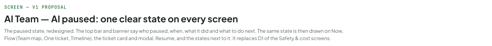
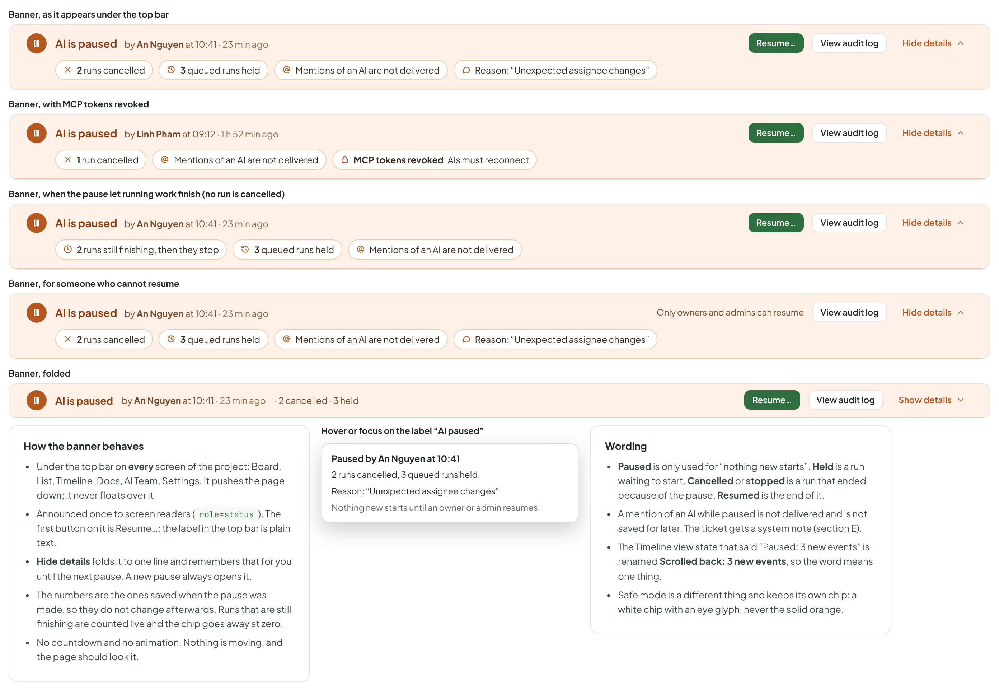
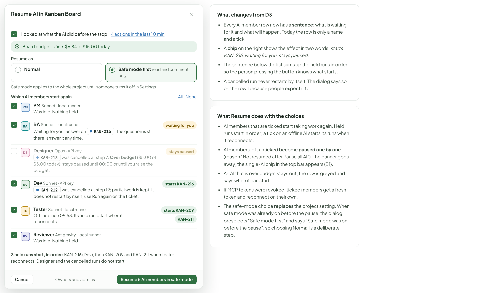
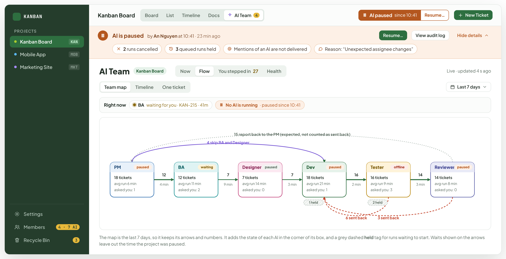
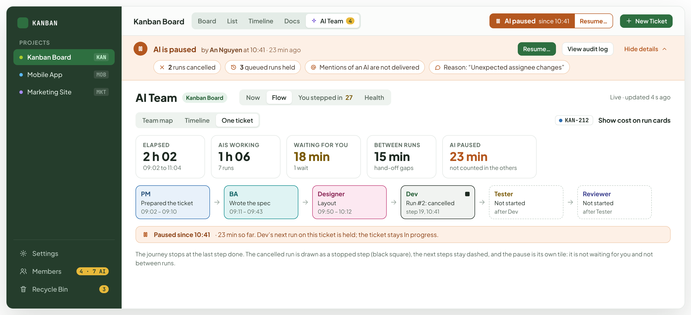
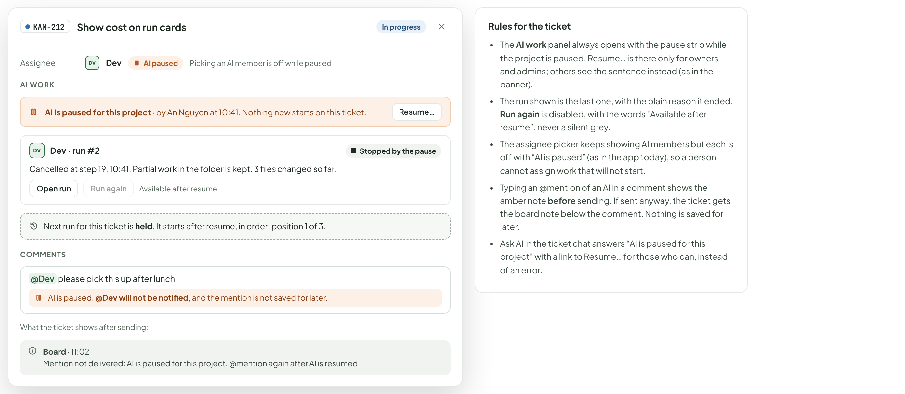
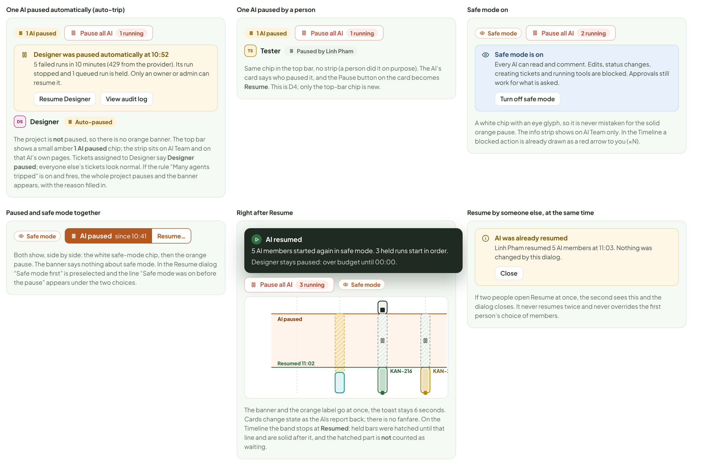
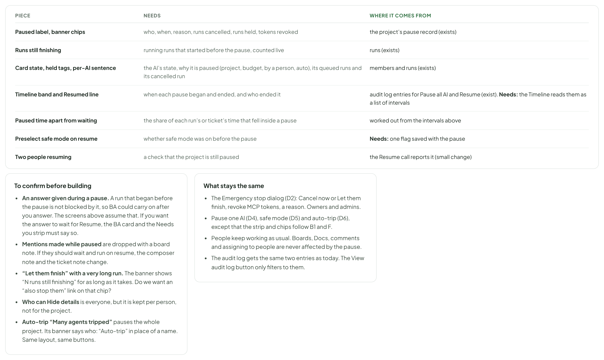

# AI Team — AI paused: one clear state on every screen

> SCREEN — V1 PROPOSAL · source: [`AiPaused.dc.html`](../source/AiPaused.dc.html) · canvas `1793431332-0cc8` · sha256 `1c3ea3f26d0dca51d78f8f3889f7225cac52d1d16db614814a007064df548e89`

The paused state, redesigned. The top bar and banner say who paused, when, what it did and what to do next. The same state is then drawn on Now, Flow (Team map, One ticket, Timeline), the ticket card and modal, Resume, and the states next to it. It replaces D1 of the Safety & cost screens.

Source: [AiPaused.dc.html](../source/AiPaused.dc.html) › header ("SCREEN — V1 PROPOSAL", "AI Team — AI paused: one clear state on every screen" and the intro)

---

## A. What changes, and what does not

This board supersedes D1 of the Safety & cost screens for the banner and the top-bar state. D2 (Emergency stop), D3 (Resume), D4 (pause one AI), D5 (safe mode) and D6 (auto-trip) stay, with one small change to D3 (section C). Facts used here come from the project’s pause record: who, when, reason, runs cancelled, runs held, tokens revoked.

Source: [AiPaused.dc.html](../source/AiPaused.dc.html) › block "A. What changes, and what does not"

- Text in the frames: "PART" · "TODAY (D1)" · "PROPOSED" · "WHY" · "Top bar" · "One orange button, “AI paused · Resume”. It names the state and does the action in the same words, so reading it and clicking it are one gesture." · "Two parts. A solid label, AI paused since 10:41, that is not a button (hover or focus: who, when, reason). Next to it a separate Resume… button." · "Reading a state should never risk starting something. The two jobs get two controls." · "Banner headline" · "“AI is paused for Kanban Board” followed by one long sentence that holds five facts." · "AI is paused, then who and when on the same line: by An Nguyen at 10:41 · 23 min ago." · "Who and when are the first two things anyone asks. They come before the numbers." · "What it did" · "Numbers inside the sentence: “1 run cancelled, 3 queued runs held”." · "One chip per fact: 2 runs cancelled, 3 queued runs held, Mentions of an AI are not delivered, MCP tokens revoked (only when true), 2 runs still finishing (only for “Let them finish”)." · "Chips can be scanned in a second, and a chip that does not apply is not drawn. Zero is never shown." · "Reason" · "The last words of the sentence." · "Its own chip, in quotes, only when a person typed one." · "The reason is the thing a teammate arriving late needs most." · "Actions" · "Resume…, View audit log." · "The same two. Resume… is the primary button. View audit log opens the log already filtered to the Pause all AI entry. People who cannot resume see the sentence “Only owners and admins can resume” in its place." · "No silent missing button: a person who cannot act is told why." · "Space" · "Always full size." · "Can fold into one line (“Hide details”). It opens again by itself on the next pause." · "A tall banner on a small laptop costs a ticket row. The facts are still one click away." · "Resume dialog" · "D3: checklist, Normal or Safe mode, a list of AI members." · "Same dialog. Each AI member row now says what will happen to it: which held runs start, which cancelled run stays cancelled, why an AI stays paused." · "The question “which AIs restart” cannot be answered without knowing what each has waiting." · "AI Team" · "Not drawn. Only the bar and two ticket cards." · "Banner on every tab. Now: cards say AI paused and what was held. Flow: Team map, One ticket and Timeline each show the pause without moving anything." · "The AI Team screens are where people look when something has stopped." · "Ticket card and modal" · "“Paused: AI is paused” (the word twice) and “Held until resume”." · "AI paused, Held until resume and Run stopped 10:41, in the banner’s colour and glyph. The modal repeats the pause and offers Resume to those who can." · "One state, one look, wherever you meet it." · "Nearby states" · "Auto-trip (D6) and safe mode (D5) drawn alone." · "One AI paused, safe mode, paused with safe mode, and the moment after Resume, in the same words and colours." · "The cheap neighbours are where the vocabulary breaks if nobody draws them."

---

## B1. The top bar

On every screen, in the same place as today’s Pause all AI button. The state is a label, the action a button. A project-wide pause is a solid orange label; a single AI that is paused shows only a small amber chip, because the project is still working.

Source: [AiPaused.dc.html](../source/AiPaused.dc.html) › block "B1. The top bar"

- Text in the frames: "Normal" · "Kanban Board" · "Board" · "List" · "Timeline" · "Docs" · "AI Team" · "4" · "Pause all AI" · "2 running" · "New Ticket" · "Paused" · "AI paused" · "since 10:41" · "Resume…" · "Paused, safe mode was on before" · "Safe mode" · "Paused, and you cannot resume (member, viewer)" · "One AI paused, by a person or by auto-trip (the project is not paused)" · "1 AI paused" · "1 running" · "Safe mode on, nothing paused"

---

## B2. The banner

Five versions of the same banner. The first is the default; the others change only the facts that apply.

Source: [AiPaused.dc.html](../source/AiPaused.dc.html) › block "B2. The banner"

- Text in the frames: "Banner, as it appears under the top bar" · "AI is paused" · "by An Nguyen at 10:41 · 23 min ago" · "Resume…" · "View audit log" · "Hide details" · "2 runs cancelled" · "3 queued runs held" · "Mentions of an AI are not delivered" · "Reason: “Unexpected assignee changes”" · "Banner, with MCP tokens revoked" · "by Linh Pham at 09:12 · 1 h 52 min ago" · "1 run cancelled" · "MCP tokens revoked, AIs must reconnect" · "Banner, when the pause let running work finish (no run is cancelled)" · "2 runs still finishing, then they stop" · "Banner, for someone who cannot resume" · "Only owners and admins can resume" · "Banner, folded" · "· 2 cancelled · 3 held" · "Show details" · "How the banner behaves" · "Under the top bar on every screen of the project: Board, List, Timeline, Docs, AI Team, Settings. It pushes the page down; it never floats over it." · "Announced once to screen readers (role=status). The first button on it is Resume…; the label in the top bar is plain text." · "Hide details folds it to one line and remembers that for you until the next pause. A new pause always opens it." · "The numbers are the ones saved when the pause was made, so they do not change afterwards. Runs that are still finishing are counted live and the chip goes away at zero." · "No countdown and no animation. Nothing is moving, and the page should look it." · "Hover or focus on the label “AI paused”" · "Paused by An Nguyen at 10:41" · "2 runs cancelled, 3 queued runs held." · "Nothing new starts until an owner or admin resumes." · "Wording" · "Paused is only used for “nothing new starts”. Held is a run waiting to start. Cancelled or stopped is a run that ended because of the pause. Resumed is the end of it." · "A mention of an AI while paused is not delivered and is not saved for later. The ticket gets a system note (section E)." · "The Timeline view state that said “Paused: 3 new events” is renamed Scrolled back: 3 new events, so the word means one thing." · "Safe mode is a different thing and keeps its own chip: a white chip with an eye glyph, never the solid orange."

---

## C. Resume: pick which AI members start again

The dialog is the same as D3. It grows one thing: each row says what that AI has waiting. Opened from the banner or from the top-bar button.

Source: [AiPaused.dc.html](../source/AiPaused.dc.html) › block "C. Resume: pick which AI members start again"

- Text in the frames: "Resume AI in Kanban Board" · "I looked at what the AI did before the stop" · "4 actions in the last 10 min" · "Board budget is fine: $6.84 of $15.00 today" · "Resume as" · "Normal" · "Safe mode first read and comment only" · "Safe mode applies to the whole project until someone turns it off in Settings." · "Which AI members start again" · "All" · "None" · "PM" · "PM Sonnet · local runner" · "Was idle. Nothing held." · "BA" · "BA Sonnet · local runner" · "Waiting for your answer on" · "KAN-215" · ". The question is still there; answer it any time." · "waiting for you" · "DS" · "Designer Opus · API key" · "KAN-213" · "was cancelled at step 7. Over budget ($5.00 of $5.00 today): stays paused until 00:00 or until you raise the budget." · "stays paused" · "DV" · "Dev Sonnet · API key" · "KAN-212" · "was cancelled at step 19; partial work is kept. It does not restart by itself; use Run again on the ticket." · "starts KAN-216" · "TS" · "Tester Sonnet · local runner" · "Offline since 09:58. Its held runs start when it reconnects." · "starts KAN-209" · "KAN-211" · "RV" · "Reviewer Antigravity · local runner" · "3 held runs start, in order: KAN-216 (Dev), then KAN-209 and KAN-211 when Tester reconnects. Designer and the cancelled runs do not start." · "Cancel" · "Owners and admins" · "Resume 5 AI members in safe mode" · "What changes from D3" · "Every AI member row now has a sentence: what is waiting for it and what will happen. Today the row is only a name and a tick." · "A chip on the right shows the effect in two words: starts KAN-216, waiting for you, stays paused." · "The sentence below the list sums up the held runs in order, so the person pressing the button knows what starts." · "A cancelled run never restarts by itself. The dialog says so on the row, because people expect it to." · "What Resume does with the choices" · "AI members that are ticked start taking work again. Held runs start in order; a tick on an offline AI starts its runs when it reconnects." · "AI members left unticked become paused one by one (reason “Not resumed after Pause all AI”). The banner goes away; the single-AI chip in the top bar appears (B1)." · "An AI that is over budget stays out; the row is greyed and says when it can start." · "If MCP tokens were revoked, ticked members get a fresh token and reconnect on their own." · "The safe-mode choice replaces the project setting. When safe mode was already on before the pause, the dialog preselects “Safe mode first” and says “Safe mode was on before the pause”, so choosing Normal is a deliberate step."

---

## D1. Now

Every card keeps its place and its numbers. What changes: the state chip, and one line saying what the pause did to that AI. An AI that was waiting for you stays Waiting for you, and an offline AI stays Offline: those are reasons the pause does not change. Chips follow the same order as today.

Source: [AiPaused.dc.html](../source/AiPaused.dc.html) › block "D1. Now"

- Text in the frames: "KANBAN" · "PROJECTS" · "Kanban Board" · "KAN" · "Mobile App" · "MOB" · "Marketing Site" · "MKT" · "Settings" · "Members" · "4 · 7 AI" · "Recycle Bin" · "3" · "Board" · "List" · "Timeline" · "Docs" · "AI Team" · "4" · "AI paused" · "since 10:41" · "Resume…" · "New Ticket" · "AI is paused" · "by An Nguyen at 10:41 · 23 min ago" · "View audit log" · "Hide details" · "2 runs cancelled" · "3 queued runs held" · "Mentions of an AI are not delivered" · "Reason: “Unexpected assignee changes”" · "Now" · "Flow" · "You stepped in" · "27" · "Health" · "Last 7 days" · "AI paused 3" · "Paused 1" · "Waiting for you 1" · "Offline 1" · "Orange: paused for the whole project. Grey: paused on its own (budget, rate limit, or by a person)." · "Needs you · 2" · "An answer already waiting can still be given while the project is paused." · "BA asks a question" · "BA on" · "KAN-215" · "“Should the export include archived tickets?”" · "waiting 41 min · blocks KAN-215" · "Answer" · "Tester is offline" · "Tester is not logged in to its local runner since 09:58." · "offline 1 h 06 min · 2 held runs are waiting for it" · "Fix connection" · "PM" · "Sonnet · local runner" · "Paused for the project." · "Last: finished" · "KAN-214" · "prepared the ticket" · "1 h 02 ago · $0.08" · "TODAY" · "5 runs · 5 ok · $0.41" · "Open last run" · "BA" · "Waiting for you" · "On" · "Export tickets to CSV" · "Asked 41 min ago. Its run began before the pause, so it carries on once you answer." · "3 runs · 2 ok · $0.36" · "Open run" · "DS" · "Designer" · "Opus · API key" · "Paused" · "Over budget until 00:00" · "Run on" · "KAN-213" · "cancelled at step 7 (10:41). Partial work is kept." · "Paused on its own, not only by the project: Resume will not start it." · "4 runs · 3 ok · $5.00 / $5.00" · "Raise budget" · "DV" · "Dev" · "Sonnet · API key" · "KAN-212" · "cancelled at step 19 (10:41)" · "Partial work is kept. Run again after resume." · "Held:" · "KAN-216" · "starts on resume" · "6 runs · 5 ok · $1.94" · "TS" · "Tester" · "Offline" · "Not logged in to the local runner" · "KAN-209" · "," · "KAN-211" · "start on resume, once it reconnects" · "Offline since 09:58" · "2 runs · 2 ok · $0.22" · "RV" · "Reviewer" · "Antigravity · local runner" · "Paused for the project. Nothing in Review." · "Last: reviewed" · "KAN-208" · "2 comments" · "1 h 24 ago · 14k tokens" · "3 runs · 3 ok · 41k tokens"

---

## D2. Flow › Team map

The map is history, so nothing on it is erased. It marks where each AI stands now, and the strip above it says that no AI is running.

Source: [AiPaused.dc.html](../source/AiPaused.dc.html) › block "D2. Flow › Team map"

- Text in the frames: "KANBAN" · "PROJECTS" · "Kanban Board" · "KAN" · "Mobile App" · "MOB" · "Marketing Site" · "MKT" · "Settings" · "Members" · "4 · 7 AI" · "Recycle Bin" · "3" · "Board" · "List" · "Timeline" · "Docs" · "AI Team" · "4" · "AI paused" · "since 10:41" · "Resume…" · "New Ticket" · "AI is paused" · "by An Nguyen at 10:41 · 23 min ago" · "View audit log" · "Hide details" · "2 runs cancelled" · "3 queued runs held" · "Mentions of an AI are not delivered" · "Reason: “Unexpected assignee changes”" · "Now" · "Flow" · "You stepped in" · "27" · "Health" · "Live · updated 4 s ago" · "Team map" · "One ticket" · "Last 7 days" · "Right now" · "BA" · "waiting for you · KAN-215 · 41m" · "No AI is running" · "· paused since 10:41" · "15 report back to the PM (expected, not counted as sent back)" · "4 skip BA and Designer" · "PM" · "18 tickets" · "avg run 6 min" · "asked you: 1" · "12 tickets" · "avg run 11 min" · "asked you: 2" · "Designer" · "7 tickets" · "avg run 14 min" · "asked you: 0" · "Dev" · "avg run 21 min" · "Tester" · "16 tickets" · "avg run 9 min" · "asked you: 3" · "Reviewer" · "14 tickets" · "avg run 8 min" · "12" · "4 min" · "7" · "9 min" · "3 min" · "16" · "2 min" · "14" · "6 sent back" · "3 sent back" · "paused" · "waiting" · "1 held" · "offline" · "2 held" · "The map is the last 7 days, so it keeps its arrows and numbers. It adds the state of each AI in the corner of its box, and a grey dashed held tag for runs waiting to start. Waits shown on the arrows leave out the time the project was paused."

---

## D3. Flow › One ticket

The ticket’s journey ends where the work stopped. Paused time gets its own tile so the other totals still mean what they said before.

Source: [AiPaused.dc.html](../source/AiPaused.dc.html) › block "D3. Flow › One ticket"

- Text in the frames: "KANBAN" · "PROJECTS" · "Kanban Board" · "KAN" · "Mobile App" · "MOB" · "Marketing Site" · "MKT" · "Settings" · "Members" · "4 · 7 AI" · "Recycle Bin" · "3" · "Board" · "List" · "Timeline" · "Docs" · "AI Team" · "4" · "AI paused" · "since 10:41" · "Resume…" · "New Ticket" · "AI is paused" · "by An Nguyen at 10:41 · 23 min ago" · "View audit log" · "Hide details" · "2 runs cancelled" · "3 queued runs held" · "Mentions of an AI are not delivered" · "Reason: “Unexpected assignee changes”" · "Now" · "Flow" · "You stepped in" · "27" · "Health" · "Live · updated 4 s ago" · "Team map" · "One ticket" · "KAN-212" · "Show cost on run cards" · "ELAPSED" · "2 h 02" · "09:02 to 11:04" · "AIS WORKING" · "1 h 06" · "7 runs" · "WAITING FOR YOU" · "18 min" · "1 wait" · "BETWEEN RUNS" · "15 min" · "hand-off gaps" · "AI PAUSED" · "23 min" · "not counted in the others" · "PM" · "Prepared the ticket" · "09:02 – 09:10" · "BA" · "Wrote the spec" · "09:11 – 09:43" · "Designer" · "Layout" · "09:50 – 10:12" · "Dev" · "Run #2: cancelled" · "step 19, 10:41" · "Tester" · "Not started" · "after Dev" · "Reviewer" · "after Tester" · "Paused since 10:41" · "· 23 min so far. Dev’s next run on this ticket is held; the ticket stays In progress." · "The journey stops at the last step done. The cancelled run is drawn as a stopped step (black square), the next steps stay dashed, and the pause is its own tile: it is not waiting for you and not between runs."

---

## D4. Flow › Timeline

The clock keeps going, so the now line stays at the bottom and the diagram keeps following. What changes: a tinted band from the pause to now (it grows), stopped bars end in a black square, held runs are grey and hatched from the pause on, and nothing animates. A question the project was already waiting on keeps its amber wait. Following live gives way to a chip that says why nothing is moving.

Source: [AiPaused.dc.html](../source/AiPaused.dc.html) › block "D4. Flow › Timeline"

- Text in the frames: "KANBAN" · "PROJECTS" · "Kanban Board" · "KAN" · "Mobile App" · "MOB" · "Marketing Site" · "MKT" · "Settings" · "Members" · "4 · 7 AI" · "Recycle Bin" · "3" · "Board" · "List" · "Timeline" · "Docs" · "AI Team" · "4" · "AI paused" · "since 10:41" · "Resume…" · "New Ticket" · "AI is paused" · "by An Nguyen at 10:41 · 23 min ago" · "View audit log" · "Hide details" · "2 runs cancelled" · "3 queued runs held" · "Mentions of an AI are not delivered" · "Reason: “Unexpected assignee changes”" · "Now" · "Flow" · "You stepped in" · "27" · "Health" · "Live · updated 4 s ago" · "Team map" · "One ticket" · "Whole team" · "All tickets" · "Show: all" · "Compact" · "Detailed" · "Compact time" · "Real time" · "AI paused since 10:41" · "Today" · "09:30" · "09:45" · "10:00" · "10:15" · "10:30" · "10:45" · "11:00" · "You" · "PM" · "BA" · "DS" · "Designer" · "DV" · "Dev" · "TS" · "Tester" · "RV" · "Reviewer" · "KAN-214" · "@" · "KAN-215" · "?" · "waiting 41 min" · "KAN-213" · "KAN-212" · "offline" · "KAN-209" · "KAN-216" · "Pause all AI" · "now 11:04" · "By An Nguyen at 10:41. 23 min so far." · "Stopped: Designer" · ", Dev" · "." · "Held:" · "(Dev)," · "and" · "KAN-211" · "(Tester)." · "Still waiting for you: BA’s question on" · "Open audit entry" · "Click the band or the diamond on the You line. The time inside the band is counted as paused: it is not waiting for you and not a bottleneck."

---

## E1. Ticket card

The chip uses the banner’s colour and glyph and says one thing. “Paused: AI is paused” repeated itself; the stopped run now says when it stopped. A ticket that needs your answer keeps its amber footer: a pause does not hide it. Hover on any of these footers: “Paused by An Nguyen at 10:41” with a Resume link for those who can.

Source: [AiPaused.dc.html](../source/AiPaused.dc.html) › block "E1. Ticket card"

- Text in the frames: "Today" · "Task" · "KAN-142" · "Add drag handle to ticket card footer" · "TV" · "3 pt" · "Paused: AI is paused" · "In flight when paused: run cancelled" · "KAN-212" · "Show cost on run cards" · "DV" · "Run stopped 10:41" · "Queued: held until resume" · "KAN-216" · "Return 409 on duplicate member names" · "2 pt" · "Held until resume" · "Assigned to an AI, nothing running" · "KAN-218" · "Rename the Members tab" · "PM" · "1 pt" · "AI paused" · "Waiting for you: unchanged" · "KAN-215" · "Export tickets to CSV" · "BA" · "5 pt" · "Needs your answer"

---

## E2. Ticket modal

One opened ticket, assigned to Dev, after the pause. Only the AI work panel and the comment box change; the rest of the modal is as today.

Source: [AiPaused.dc.html](../source/AiPaused.dc.html) › block "E2. Ticket modal"

- Text in the frames: "KAN-212" · "Show cost on run cards" · "In progress" · "Assignee" · "DV" · "Dev" · "AI paused" · "Picking an AI member is off while paused" · "AI WORK" · "AI is paused for this project · by An Nguyen at 10:41. Nothing new starts on this ticket." · "Resume…" · "Dev · run #2" · "Stopped by the pause" · "Cancelled at step 19, 10:41. Partial work in the folder is kept. 3 files changed so far." · "Open run" · "Run again" · "Available after resume" · "Next run for this ticket is held. It starts after resume, in order: position 1 of 3." · "COMMENTS" · "@Dev please pick this up after lunch" · "AI is paused. @Dev will not be notified, and the mention is not saved for later." · "What the ticket shows after sending:" · "Board · 11:02" · "Mention not delivered: AI is paused for this project. @mention again after AI is resumed." · "Rules for the ticket" · "The AI work panel always opens with the pause strip while the project is paused. Resume… is there only for owners and admins; others see the sentence instead (as in the banner)." · "The run shown is the last one, with the plain reason it ended. Run again is disabled, with the words “Available after resume”, never a silent grey." · "The assignee picker keeps showing AI members but each is off with “AI is paused” (as in the app today), so a person cannot assign work that will not start." · "Typing an @mention of an AI in a comment shows the amber note before sending. If sent anyway, the ticket gets the board note below the comment. Nothing is saved for later." · "Ask AI in the ticket chat answers “AI is paused for this project” with a link to Resume… for those who can, instead of an error."

---

## F. Neighbouring states

The states next to the pause, drawn with the same words and colours, so that nobody has to guess which one they are looking at.

Source: [AiPaused.dc.html](../source/AiPaused.dc.html) › block "F. Neighbouring states"

- Text in the frames: "One AI paused automatically (auto-trip)" · "1 AI paused" · "Pause all AI" · "1 running" · "Designer was paused automatically at 10:52" · "5 failed runs in 10 minutes (429 from the provider). Its run stopped and 1 queued run is held. Only an owner or admin can resume it." · "Resume Designer" · "View audit log" · "DS" · "Designer" · "Auto-paused" · "The project is not paused, so there is no orange banner. The top bar shows a small amber 1 AI paused chip; the strip sits on AI Team and on that AI’s own pages. Tickets assigned to Designer say Designer paused; everyone else’s tickets look normal. If the rule “Many agents tripped” is on and fires, the whole project pauses and the banner appears, with the reason filled in." · "One AI paused by a person" · "TS" · "Tester" · "Paused by Linh Pham" · "Same chip in the top bar, no strip (a person did it on purpose). The AI’s card says who paused it, and the Pause button on the card becomes Resume. This is D4; only the top-bar chip is new." · "Safe mode on" · "Safe mode" · "2 running" · "Safe mode is on" · "Every AI can read and comment. Edits, status changes, creating tickets and running tools are blocked. Approvals still work for what is asked." · "Turn off safe mode" · "A white chip with an eye glyph, so it is never mistaken for the solid orange pause. The info strip shows on AI Team only. In the Timeline a blocked action is already drawn as a red arrow to you (×N)." · "Paused and safe mode together" · "AI paused" · "since 10:41" · "Resume…" · "Both show, side by side: the white safe-mode chip, then the orange pause. The banner says nothing about safe mode. In the Resume dialog “Safe mode first” is preselected and the line “Safe mode was on before the pause” appears under the two choices." · "Right after Resume" · "AI resumed" · "5 AI members started again in safe mode. 3 held runs start in order." · "Designer stays paused: over budget until 00:00." · "3 running" · "KAN-216" · "KAN-209" · "Resumed 11:02" · "The banner and the orange label go at once, the toast stays 6 seconds. Cards change state as the AIs report back; there is no fanfare. On the Timeline the band stops at Resumed: held bars were hatched until that line and are solid after it, and the hatched part is not counted as waiting." · "Resume by someone else, at the same time" · "AI was already resumed" · "Linh Pham resumed 5 AI members at 11:03. Nothing was changed by this dialog." · "Close" · "If two people open Resume at once, the second sees this and the dialog closes. It never resumes twice and never overrides the first person’s choice of members."

---

## G. Where the data comes from, what stays, and what to confirm

Almost all of this is already stored. The Timeline band and the safe-mode preselect are the only things that need more than a read.

Source: [AiPaused.dc.html](../source/AiPaused.dc.html) › block "G. Where the data comes from, what stays, and what to confirm"

- Text in the frames: "PIECE" · "NEEDS" · "WHERE IT COMES FROM" · "Paused label, banner chips" · "who, when, reason, runs cancelled, runs held, tokens revoked" · "the project’s pause record (exists)" · "Runs still finishing" · "running runs that started before the pause, counted live" · "runs (exists)" · "Card state, held tags, per-AI sentence" · "the AI’s state, why it is paused (project, budget, by a person, auto), its queued runs and its cancelled run" · "members and runs (exists)" · "Timeline band and Resumed line" · "when each pause began and ended, and who ended it" · "audit log entries for Pause all AI and Resume (exist). Needs: the Timeline reads them as a list of intervals" · "Paused time apart from waiting" · "the share of each run’s or ticket’s time that fell inside a pause" · "worked out from the intervals above" · "Preselect safe mode on resume" · "whether safe mode was on before the pause" · "Needs: one flag saved with the pause" · "Two people resuming" · "a check that the project is still paused" · "the Resume call reports it (small change)" · "To confirm before building" · "An answer given during a pause. A run that began before the pause is not blocked by it, so BA could carry on after you answer. The screens above assume that. If you want the answer to wait for Resume, the BA card and the Needs you strip must say so." · "Mentions made while paused are dropped with a board note. If they should wait and run on resume, the composer note and the ticket note change." · "“Let them finish” with a very long run. The banner shows “N runs still finishing” for as long as it takes. Do we want an “also stop them” link on that chip?" · "Who can Hide details is everyone, but it is kept per person, not for the project." · "Auto-trip “Many agents tripped” pauses the whole project. Its banner says who: “Auto-trip” in place of a name. Same layout, same buttons." · "What stays the same" · "The Emergency stop dialog (D2): Cancel now or Let them finish, revoke MCP tokens, a reason. Owners and admins." · "Pause one AI (D4), safe mode (D5) and auto-trip (D6), except that the strip and chips follow B1 and F." · "People keep working as usual. Boards, Docs, comments and assigning to people are never affected by the pause." · "The audit log gets the same two entries as today. The View audit log button only filters to them."
