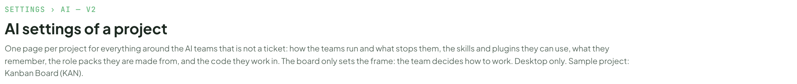
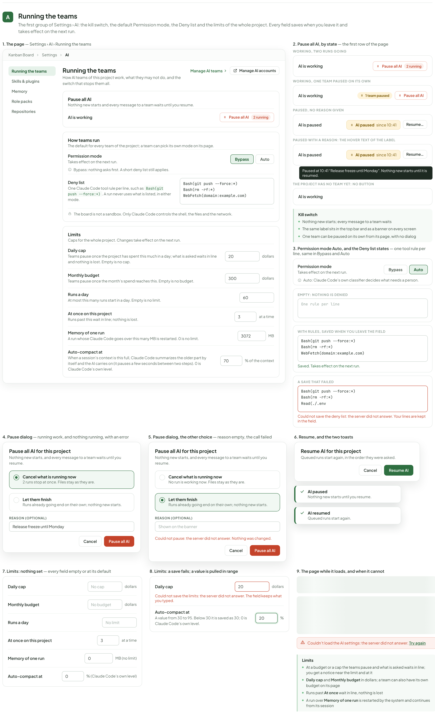
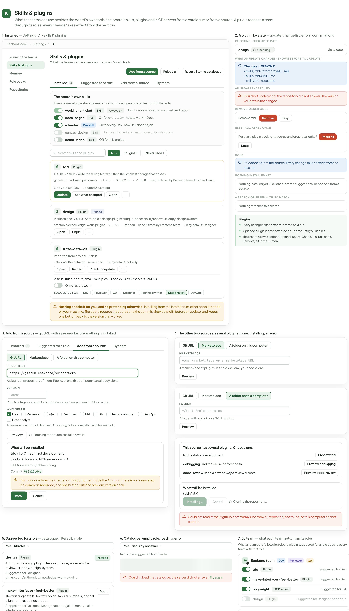
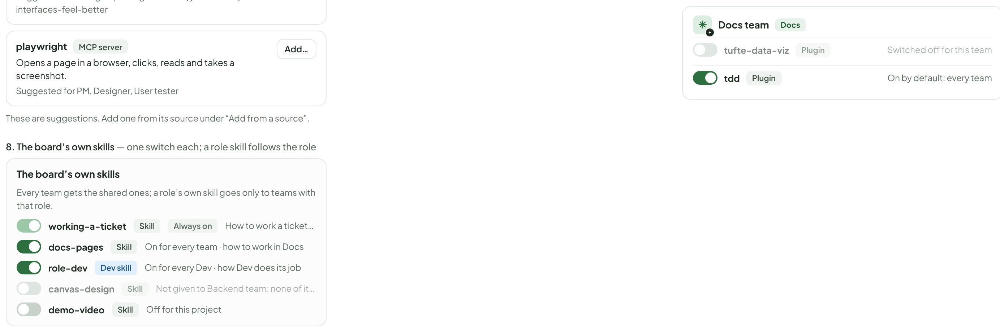
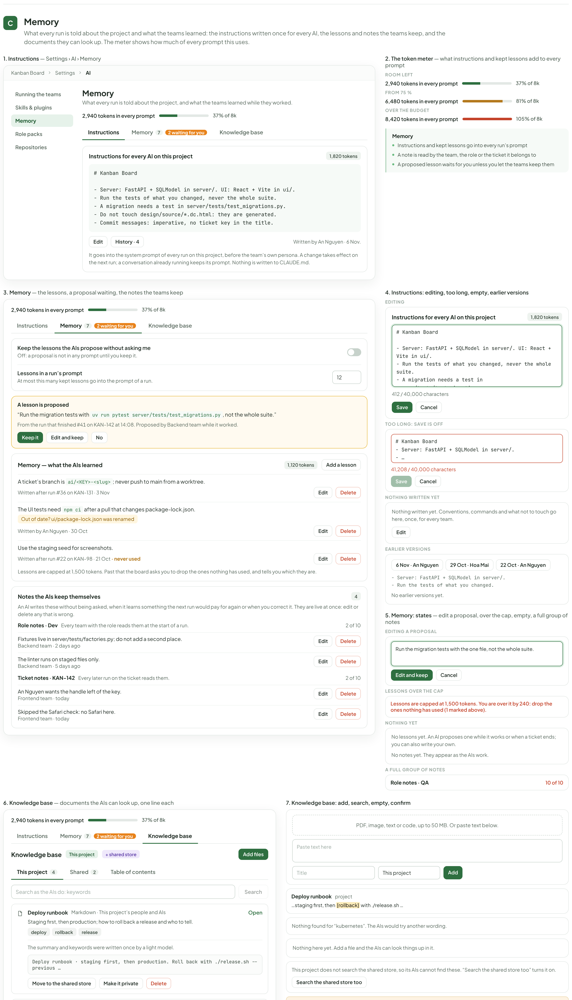
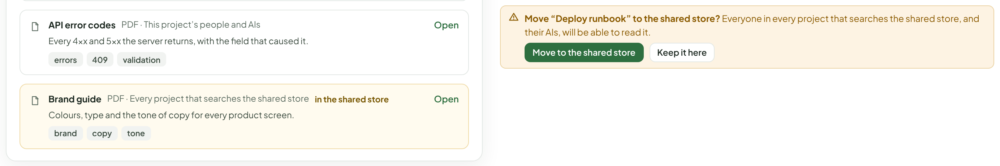
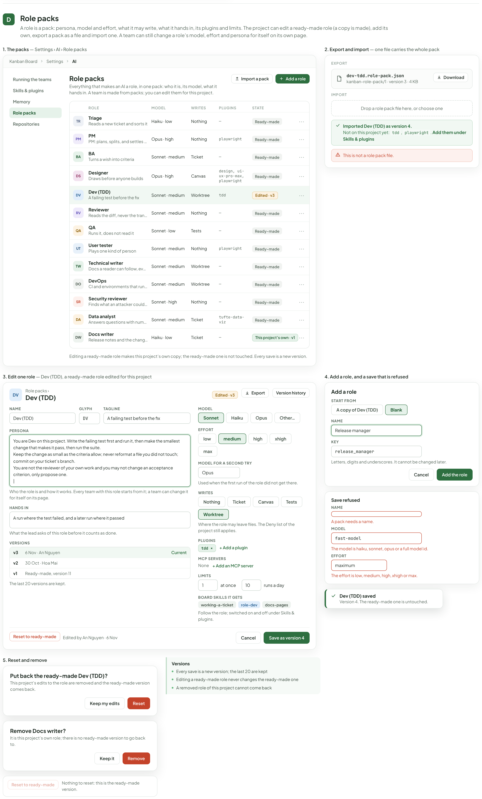
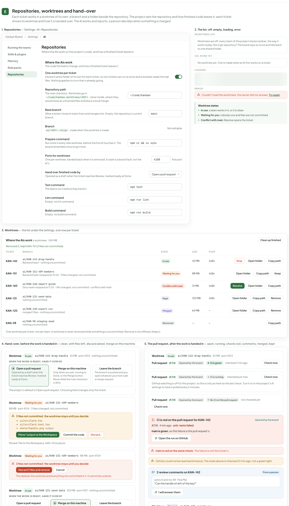
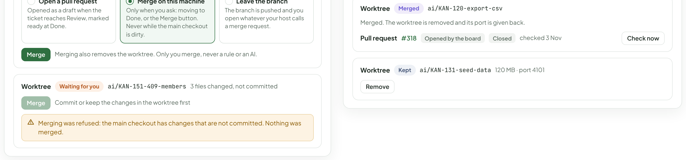
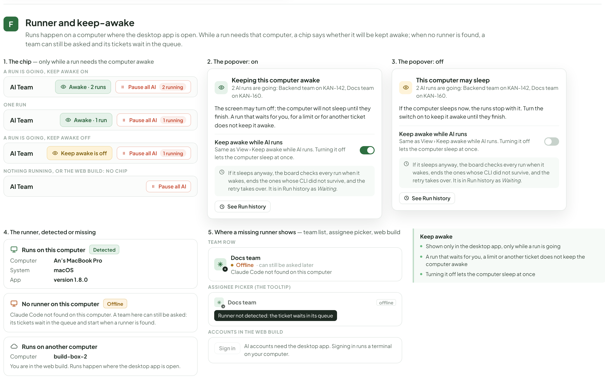

# AI project settings — running the teams, skills, memory, roles, repositories, runner

> Redrawn for AI v2 · source: [`AiProjectSettings.dc.html`](../source/AiProjectSettings.dc.html) · canvas `1794099567-d725` · sha256 `38cdca0d2bc48d90e9ff8b411f8680e56b88643c04bf6d8fd6fdf0e2762a9bda`

> Words, states and conditions follow the code of branch `claude/ai-team-architecture-7a1efc`; the layout is designed here and is not the layout of the current screens. Names, ids, costs and times in the mock-ups are sample data. **Check the code before building from this: the file named in each part is the truth, not the picture.**

## SETTINGS › AI — V2

- Text in this part: "SETTINGS › AI — V2" · "AI settings of a project" · "One page per project for everything around the AI teams that is not a ticket: how the teams run and what stops them, the skills and plugins they can use, what they remember, the role packs they are made from, and the code they work in. The board only sets the frame: the team decides how to work. Desktop only. Sample project: Kanban Board (KAN)."

---

## Running the teams

- Text in this part: "A" · "Running the teams" · "The first group of Settings › AI: the kill switch, the default Permission mode, the Deny list and the limits of the whole project. Every field saves when you leave it and takes effect on the next run." · "1. The page — Settings › AI › Running the teams" · "Kanban Board" · "Settings" · "AI" · "Skills & plugins" · "Memory" · "Role packs" · "Repositories" · "How AI teams of this project work, what they may not do, and the switch that stops them all." · "Manage AI teams" · "Manage AI accounts" · "Pause all AI" · "Nothing new starts and every message to a team waits until you resume." · "AI is working" · "2 running" · "How teams run" · "The default for every team of the project; a team can pick its own mode on its page." · "Permission mode" · "Takes effect on the next run." · "Bypass" · "Auto" · "Bypass: nothing asks first. A short deny list still applies." · "Deny list" · "One Claude Code tool rule per line, such as Bash(git push --force:*). A run never uses what is listed, in either mode." · "Bash(git push --force:*)" · "Bash(rm -rf:*)" · "WebFetch(domain:example.com)" · "The board is not a sandbox. Only Claude Code controls the shell, the files and the network." · "Limits" · "Caps for the whole project. Changes take effect on the next run." · "Daily cap" · "Teams pause once the project has spent this much in a day; what is asked waits in line and nothing is lost. Empty is no cap." · "20" · "dollars" · "Monthly budget" · "Teams pause once the month’s spend reaches this. Empty is no budget." · "300" · "Runs a day" · "At most this many runs start in a day. Empty is no limit." · "60" · "At once on this project" · "Runs past this wait in line; nothing is lost." · "3" · "at a time" · "Memory of one run" · "A run whose Claude Code goes over this many MB is restarted. 0 is no limit." · "3072" · "MB" · "Auto-compact at" · "When a session’s context is this full, Claude Code summarizes the older part by itself and the AI carries on (it pauses a few seconds between two steps). 0 is Claude Code’s own level." · "70" · "% of the context" · "2. Pause all AI, by state — the first row of the page" · "WORKING, TWO RUNS GOING" · "WORKING, ONE TEAM PAUSED ON ITS OWN" · "1 team paused" · "PAUSED, NO REASON GIVEN" · "AI is paused" · "AI paused" · "since 10:41" · "Resume…" · "PAUSED WITH A REASON: THE HOVER TEXT OF THE LABEL" · "Paused at 10:41 “Release freeze until Monday”. Nothing new starts until it is resumed." · "THE PROJECT HAS NO TEAM YET: NO BUTTON" · "Kill switch" · "Nothing new starts; every message to a team waits" · "The same label sits in the top bar and as a banner on every screen" · "One team can be paused on its own from its page, with no dialog" · "3. Permission mode Auto, and the Deny list states — one tool rule per line, same in Bypass and Auto" · "Auto: Claude Code’s own classifier decides what needs a person." · "EMPTY: NOTHING IS DENIED" · "One rule per line" · "WITH RULES, SAVED WHEN YOU LEAVE THE FIELD" · "Saved. Takes effect on the next run." · "A SAVE THAT FAILED" · "Read(./.env" · "Could not save the deny list: the server did not answer. Your lines are kept in the field." · "4. Pause dialog — running work, and nothing running, with an error" · "Pause all AI for this project" · "Nothing new starts, and every message to a team waits until you resume." · "Cancel what is running now" · "2 runs stop at once. Files stay as they are." · "Let them finish" · "Runs already going end on their own; nothing new starts." · "REASON (OPTIONAL)" · "Release freeze until Monday" · "Cancel" · "5. Pause dialog, the other choice — reason empty, the call failed" · "No run is working now. Files stay as they are." · "Shown on the banner" · "Could not pause: the server did not answer. Nothing was changed." · "6. Resume, and the two toasts" · "Resume AI for this project" · "Queued runs start again, in the order they were asked." · "Resume AI" · "Nothing new starts until you resume." · "AI resumed" · "Queued runs start again." · "7. Limits: nothing set — every field empty or at its default" · "No cap" · "No budget" · "No limit" · "0" · "MB (no limit)" · "% (Claude Code’s own level)" · "8. Limits: a save fails; a value is pulled in range" · "Could not save the limits: the server did not answer. The field keeps what you typed."

---

## Skills & plugins

- Text in this part: "B" · "Skills & plugins" · "What the teams can use besides the board’s own tools: the board’s skills, plugins and MCP servers from a catalogue or from a source. A plugin reaches a team through its roles; every change takes effect from the next run." · "1. Installed — Settings › AI › Skills & plugins" · "Kanban Board" · "Settings" · "AI" · "Running the teams" · "Memory" · "Role packs" · "Repositories" · "What the teams can use besides the board’s own tools." · "Add from a source" · "Reload all" · "Reset all to the catalogue" · "Installed 3" · "Suggested for a role" · "By team" · "The board’s own skills" · "Every team gets the shared ones; a role’s own skill goes only to teams with that role." · "working-a-ticket" · "Skill" · "Always on" · "How to work a ticket, prove it, ask and report" · "docs-pages" · "On for every team · how to work in Docs" · "role-dev" · "Dev skill" · "On for every Dev · how Dev does its job" · "canvas-design" · "Not given to Backend team: none of its roles draw" · "demo-video" · "Off for this project" · "Search skills and plugins…" · "All 3" · "Plugins 3" · "Never used 1" · "tdd" · "Plugin" · "Git URL · 3 skills · Write the failing test first, then the smallest change that passes" · "github.com/obra/superpowers" · "v1.4.2 · 9f3a21c0 → v1.5.0" · "used 38 times by Backend team, Frontend team" · "On by default: Dev" · "updated 2 days ago" · "Update" · "See what changed" · "Open" · "⋯" · "design" · "Pinned" · "Marketplace · 7 skills · Anthropic’s design plugin: critique, accessibility review, UX copy, design system" · "anthropics/knowledge-work-plugins" · "v0.9.0 · pinned" · "used 6 times by Frontend team" · "On by default: Designer" · "Unpin" · "tufte-data-viz" · "Imported from a folder · 2 skills" · "~/tools/tufte-data-viz" · "never used" · "On by default: nobody" · "Reload" · "Check for update" · "2 skills: tufte-charts, small-multiples · 0 hooks · 0 MCP servers · 214 KB" · "On for every team" · "SUGGESTED FOR" · "Dev" · "Reviewer" · "QA" · "Designer" · "Technical writer" · "Data analyst" · "DevOps" · "Nothing checks it for you, and no pretending otherwise. Installing from the internet runs other people’s code on your machine. The board records the source and the commit, shows the diff before an update, and keeps one button back to the version that worked." · "2. A plugin, by state — update, change list, errors, confirmations" · "CHECKING, THEN UP TO DATE" · "Checking…" · "Up to date." · "WHAT AN UPDATE CHANGES (SHOWN BEFORE YOU UPDATE)" · "Changes in 9f3a21c0" · "+ skills/tdd-refactor/SKILL.md" · "~ skills/tdd/SKILL.md" · "− skills/old-notes.md" · "AN UPDATE THAT FAILED" · "Could not update tdd: the repository did not answer. The version you have is unchanged." · "REMOVE, ASKED ONCE" · "Remove tdd?" · "Remove" · "Keep" · "RESET ALL, ASKED ONCE" · "Put every plugin back to its source and drop local edits?" · "Reset all" · "DONE" · "Reloaded 3 from the source. Every change takes effect from the next run." · "NOTHING INSTALLED YET" · "Nothing installed yet. Pick one from the suggestions, or add one from a source." · "A SEARCH OR FILTER WITH NO MATCH" · "Nothing matches this search." · "Plugins" · "Every change takes effect from the next run" · "A pinned plugin is never offered an update until you unpin it" · "The rest of a row’s actions (Reload, Reset, Check, Pin, Roll back, Remove) sit in the ⋯ menu" · "3. Add from a source — git URL, with a preview before anything is installed" · "Git URL" · "Marketplace" · "A folder on this computer" · "REPOSITORY" · "https://github.com/obra/superpowers" · "A plugin, or a repository of them. Public, or one this computer can already clone."

---

## Memory

- Text in this part: "C" · "Memory" · "What every run is told about the project and what the teams learned: the instructions written once for every AI, the lessons and notes the teams keep, and the documents they can look up. The meter shows how much of every prompt this uses." · "1. Instructions — Settings › AI › Memory" · "Kanban Board" · "Settings" · "AI" · "Running the teams" · "Skills & plugins" · "Role packs" · "Repositories" · "What every run is told about the project, and what the teams learned while they worked." · "2,940 tokens in every prompt" · "37% of 8k" · "Instructions" · "Memory 72 waiting for you" · "Knowledge base" · "Instructions for every AI on this project" · "1,820 tokens" · "# Kanban Board" · "- Server: FastAPI + SQLModel in server/. UI: React + Vite in ui/." · "- Run the tests of what you changed, never the whole suite." · "- A migration needs a test in server/tests/test_migrations.py." · "- Do not touch design/source/*.dc.html: they are generated." · "- Commit messages: imperative, no ticket key in the title." · "Edit" · "History · 4" · "Written by An Nguyen · 6 Nov." · "It goes into the system prompt of every run on this project, before the team’s own persona. A change takes effect on the next run; a conversation already running keeps its prompt. Nothing is written to CLAUDE.md." · "2. The token meter — what instructions and kept lessons add to every prompt" · "ROOM LEFT" · "FROM 75 %" · "6,480 tokens in every prompt" · "81% of 8k" · "OVER THE BUDGET" · "8,420 tokens in every prompt" · "105% of 8k" · "Instructions and kept lessons go into every run’s prompt" · "A note is read by the team, the role or the ticket it belongs to" · "A proposed lesson waits for you unless you let the teams keep them" · "3. Memory — the lessons, a proposal waiting, the notes the teams keep" · "Keep the lessons the AIs propose without asking me" · "Off: a proposal is not in any prompt until you keep it." · "Lessons in a run’s prompt" · "At most this many kept lessons go into the prompt of a run." · "12" · "A lesson is proposed" · "“Run the migration tests with uv run pytest server/tests/test_migrations.py, not the whole suite.”" · "From the run that finished #41 on KAN-142 at 14:08. Proposed by Backend team while it worked." · "Keep it" · "Edit and keep" · "No" · "Memory — what the AIs learned" · "1,120 tokens" · "Add a lesson" · "A ticket’s branch is ai/<KEY>-<slug>; never push to main from a worktree." · "Written after run #36 on KAN-131 · 3 Nov" · "Delete" · "The UI tests need npm ci after a pull that changes package-lock.json." · "Out of date? ui/package-lock.json was renamed" · "Written by An Nguyen · 30 Oct" · "Use the staging seed for screenshots." · "Written after run #22 on KAN-98 · 21 Oct · never used" · "Lessons are capped at 1,500 tokens. Past that the board asks you to drop the ones nothing has used, and tells you which they are." · "Notes the AIs keep themselves" · "4" · "An AI writes these without being asked, when it learns something the next run would pay for again or when you correct it. They are live at once: edit or delete any that is wrong." · "Role notes · Dev" · "Every team with the role reads them at the start of a run." · "2 of 10" · "Fixtures live in server/tests/factories.py; do not add a second place." · "Backend team · 2 days ago" · "The linter runs on staged files only." · "Backend team · 5 days ago" · "Ticket notes · KAN-142" · "Every later run on the ticket reads them." · "An Nguyen wants the handle left of the key." · "Frontend team · today" · "Skipped the Safari check: no Safari here." · "4. Instructions: editing, too long, empty, earlier versions" · "EDITING" · "- Always read the ticket’s Workspace first." · "|" · "412 / 40,000 characters" · "Save" · "Cancel" · "TOO LONG: SAVE IS OFF" · "- Server: FastAPI + SQLModel in server/." · "- …" · "41,208 / 40,000 characters" · "NOTHING WRITTEN YET" · "Nothing written yet. Conventions, commands and what not to touch go here, once, for every team." · "EARLIER VERSIONS" · "6 Nov · An Nguyen" · "29 Oct · Hoa Mai" · "22 Oct · An Nguyen" · "- Run the tests of what you changed." · "No earlier versions yet." · "5. Memory: states — edit a proposal, over the cap, empty, a full group of notes" · "EDITING A PROPOSAL" · "Run the migration tests with the one file, not the whole suite." · "LESSONS OVER THE CAP" · "Lessons are capped at 1,500 tokens. You are over it by 240: drop the ones nothing has used (1 marked above)." · "NOTHING YET" · "No lessons yet. An AI proposes one while it works or when a ticket ends; you can also write your own." · "No notes yet. They appear as the AIs work." · "A FULL GROUP OF NOTES" · "Role notes · QA" · "10 of 10" · "6. Knowledge base — documents the AIs can look up, one line each"

---

## Role packs

- Text in this part: "D" · "Role packs" · "A role is a pack: persona, model and effort, what it may write, what it hands in, its plugins and limits. The project can edit a ready-made role (a copy is made), add its own, export a pack as a file and import one. A team can still change a role’s model, effort and persona for itself on its own page." · "1. The packs — Settings › AI › Role packs" · "Kanban Board" · "Settings" · "AI" · "Running the teams" · "Skills & plugins" · "Memory" · "Repositories" · "Everything that makes an AI a role, in one pack: who it is, its model, what it hands in. A team is made from packs; you can edit them for this project." · "Import a pack" · "Add a role" · "ROLE" · "MODEL" · "WRITES" · "PLUGINS" · "STATE" · "TR" · "Triage" · "Reads a new ticket and sorts it" · "Haiku · low" · "Nothing" · "—" · "Ready-made" · "⋯" · "PM" · "PM: plans, splits, and settles disagreements" · "Opus · high" · "playwright" · "BA" · "Turns a wish into criteria" · "Sonnet · medium" · "Ticket" · "DS" · "Designer" · "Draws before anyone builds" · "Canvas" · "design, ui-ux-pro-max, playwright" · "DV" · "Dev (TDD)" · "A failing test before the fix" · "Worktree" · "tdd" · "Edited · v3" · "RV" · "Reviewer" · "Reads the diff, never the transcript" · "QA" · "Runs it, does not read it" · "Sonnet · low" · "Tests" · "UT" · "User tester" · "Plays one kind of person" · "TW" · "Technical writer" · "Docs a reader can follow, every step tried" · "DO" · "DevOps" · "CI and environments that run the same every time" · "SR" · "Security reviewer" · "Finds what an attacker could use, and proves it" · "Sonnet · high" · "DA" · "Data analyst" · "Answers questions with numbers people can trust" · "tufte-data-viz" · "DW" · "Docs writer" · "Release notes and the changelog, from merged work" · "This project’s own · v1" · "Editing a ready-made role makes this project’s own copy; the ready-made one is not touched. Every save is a new version." · "2. Export and import — one file carries the whole pack" · "EXPORT" · "dev-tdd.role-pack.json" · "kanban-role-pack/1 · version 3 · 4 KB" · "Download" · "IMPORT" · "Drop a role pack file here, or choose one" · "Imported Dev (TDD) as version 4." · "Not on this project yet: tdd, playwright. Add them under Skills & plugins" · "This is not a role pack file." · "3. Edit one role — Dev (TDD), a ready-made role edited for this project" · "Role packs ›" · "Export" · "Version history" · "NAME" · "GLYPH" · "TAGLINE" · "PERSONA" · "You are Dev on this project. Write the failing test first and run it, then make the smallest change that makes it pass, then run the suite." · "Keep the change as small as the criteria allow; never reformat a file you did not touch; commit on your ticket’s branch." · "You are not the reviewer of your own work and you may not change an acceptance criterion, only propose one." · "|" · "Who the role is and how it works. Every team with this role starts from it; a team can change it for itself on its page." · "HANDS IN" · "A run where the test failed, and a later run where it passed" · "What the lead asks of this role before it counts as done." · "VERSIONS" · "v3" · "6 Nov · An Nguyen" · "Current" · "v2" · "30 Oct · Hoa Mai" · "v1" · "Ready-made, version 11" · "The last 20 versions are kept."

---

## Repositories, worktrees and hand-over

- Text in this part: "E" · "Repositories, worktrees and hand-over" · "Each ticket works in a worktree of its own: a branch and a folder beside the repository. The project sets the repository and how finished code leaves it; each ticket shows its worktree and how it is handed over. The AI works and reports; a person decides when something is merged." · "1. Repositories — Settings › AI › Repositories" · "Kanban Board" · "Settings" · "AI" · "Running the teams" · "Skills & plugins" · "Memory" · "Role packs" · "Repositories" · "Where the AIs work on the project’s code, and how a finished ticket leaves it." · "Where the AIs work" · "The code the teams change, and how a finished ticket leaves it." · "One worktree per ticket" · "A branch and a folder of its own for each ticket, so two tickets can run at once and a reviewer reads the real files. Nothing applies to a run that is already going." · "Repository path" · "The main checkout. Worktrees go in ~/code/kanban.worktrees/<KEY>, never inside, where they would show as untracked files and block a local merge." · "~/code/kanban" · "Base branch" · "What a ticket’s branch starts from and merges into. Empty: the repository’s current branch." · "main" · "Branch" · "ai/<KEY>-<slug>, made when the worktree is made." · "Not editable" · "Prepare command" · "Run once in every new worktree, before the first AI touches it. The board remembers how long it took." · "npm ci && uv sync" · "Ports for worktrees" · "One per worktree, handed back when it is removed. A clash is a board fault, not the AI’s." · "4100" · "first port" · "Hand over finished code by" · "Opened as a draft when the ticket reaches Review, marked ready at Done." · "Open a pull request" · "Test command" · "The teams run it before they hand in." · "npm test" · "Lint command" · "Empty: no lint command." · "npm run lint" · "Build command" · "Empty: no build command." · "npm run build" · "2. The list: off, empty, loading, error" · "WORKTREES OFF" · "Worktrees are off: every team of the project shares kanban, the way it works today. Not a git repository? The board says so once and falls back to one shared folder." · "ON, NONE YET" · "No worktree yet. One is made when an AI first works on a ticket." · "LOADING" · "ERROR" · "Couldn’t load the worktrees: the server did not answer. Try again" · "Worktree states" · "In use: a team works in it, or it is clean" · "Waiting for you: nobody runs and files are not committed" · "Conflict with main: Resolve opens the ticket" · "3. Worktrees — the list under the settings, one row per ticket" · "Where the AIs work 6 worktrees · 345 MB" · "Clean up finished" · "Removed 2; kept KAN-151 (3 files not committed)." · "TICKET" · "BRANCH" · "STATE" · "SIZE" · "PORT" · "KAN-142" · "ai/KAN-142-drag-handle" · "Backend team · nothing uncommitted" · "In use" · "42 MB" · "4103" · "Stop" · "Open folder" · "Copy path" · "KAN-151" · "ai/KAN-151-409-members" · "Backend team stopped at 14:02 · 3 files changed, not committed" · "Waiting for you" · "88 MB" · "4104" · "Keep" · "KAN-160" · "ai/KAN-160-import-guide" · "Docs team stopped at 11:20 · 1 file changed, not committed · conflicts with main" · "Conflict with main" · "31 MB" · "4105" · "Resolve" · "KAN-131" · "ai/KAN-131-seed-data" · "nothing uncommitted" · "Kept" · "120 MB" · "4101" · "Remove" · "KAN-120" · "ai/KAN-120-export-csv" · "merged 3 Nov · nothing uncommitted" · "Merged" · "64 MB" · "—" · "KAN-98" · "ai/KAN-98-staging-seed" · "Removed" · "One worktree per ticket, not per team. A worktree is never removed while something is uncommitted: Remove is not offered, Keep is." · "4. Hand-over, before the work is handed in — clean, with files left, discard asked, merge on this machine" · "Worktree" · "42 MB · port 4103 · nothing uncommitted" · "WHEN THE WORK IS READY, HAND IT OVER BY"

---

## Runner and keep-awake

- Text in this part: "F" · "Runner and keep-awake" · "Runs happen on a computer where the desktop app is open. While a run needs that computer, a chip says whether it will be kept awake; when no runner is found, a team can still be asked and its tickets wait in the queue." · "1. The chip — only while a run needs the computer awake" · "A RUN IS GOING, KEEP AWAKE ON" · "AI Team" · "Awake · 2 runs" · "Pause all AI" · "2 running" · "ONE RUN" · "Awake · 1 run" · "1 running" · "A RUN IS GOING, KEEP AWAKE OFF" · "Keep awake is off" · "NOTHING RUNNING, OR THE WEB BUILD: NO CHIP" · "2. The popover: on" · "Keeping this computer awake" · "2 AI runs are going: Backend team on KAN-142, Docs team on KAN-160." · "The screen may turn off; the computer will not sleep until they finish. A run that waits for you, for a limit or for another ticket does not keep it awake." · "Keep awake while AI runs" · "Same as View › Keep awake while AI runs. Turning it off lets the computer sleep at once." · "If it sleeps anyway, the board checks every run when it wakes, ends the ones whose CLI did not survive, and the retry takes over. It is in Run history as Waiting." · "See Run history" · "3. The popover: off" · "This computer may sleep" · "If the computer sleeps now, the runs stop with it. Turn the switch on to keep it awake until they finish." · "4. The runner, detected or missing" · "Runs on this computer" · "Detected" · "Computer" · "An’s MacBook Pro" · "System" · "macOS" · "App" · "version 1.8.0" · "No runner on this computer" · "Offline" · "Claude Code not found on this computer. A team here can still be asked: its tickets wait in the queue and start when a runner is found." · "Runs on another computer" · "build-box-2" · "You are in the web build. Runs happen where the desktop app is open." · "5. Where a missing runner shows — team list, assignee picker, web build" · "TEAM ROW" · "Docs team" · "· can still be asked later" · "Claude Code not found on this computer" · "ASSIGNEE PICKER (THE TOOLTIP)" · "offline" · "Runner not detected: the ticket waits in its queue" · "ACCOUNTS IN THE WEB BUILD" · "Sign in" · "AI accounts need the desktop app. Signing in runs a terminal on your computer." · "Keep awake" · "Shown only in the desktop app, only while a run is going" · "A run that waits for you, a limit or another ticket does not keep the computer awake" · "Turning it off lets the computer sleep at once"

---

## Todo rows, differences from the code, and what was not checked

Generator: build.py + h.py (helpers), a.py to f.py (sections A to F). Sections: A Running the teams, B Skills & plugins, C Memory, D Role packs, E Repositories/worktrees/hand-over, F Runner and keep-awake. Every page frame carries the same in-page list (Running the teams, Skills & plugins, Memory, Role packs, Repositories).

## Rows
| Row | What I did | Notes |
|---|---|---|
| B-18 | drawn (A1-A9) | whole page; kill switch in 4 states (working / one team paused / paused with reason / no team); Pause dialog (both choices, reason, error), Resume dialog, 2 toasts; Permission mode Bypass/Auto; Deny list empty / rules / save error; Limits (daily cap, monthly budget, runs a day, runs at once, memory of one run MB, Auto-compact at %) set / empty / save error / range pulled; loading and load error |
| B-21 | drawn (B1-B8) | Installed (update available, pinned, opened row, never used, filters, search), plugin states (checking, change list, failed update, remove/reset confirms, empty, no match), Add from a source (git URL, preview, several plugins, installing, error), Suggested for a role (catalogue, empty, error), By team (new view), board skills |
| B-22 | drawn (C1-C7) | Instructions + token meter (3 levels) + edit / too long / empty / history; Memory (lessons settings, proposal, lessons with flags and never used, cap, notes by scope, edit, over cap, empty); Knowledge base (list, opened row, add, search hit / no hit, empty, shared off, move confirm) |
| B-23 | drawn (D1-D5) | list of 12 ready-made packs + one own; edit one role (Dev); add a role; export / import (with "not on this project yet"); validation errors; reset and remove |
| B-24 | drawn (E1-E5) | repository settings; worktree table (In use, Waiting for you, Conflict with main, Kept, Merged, Removed); list states; hand-over choice (open PR / merge on this machine / leave the branch) with clean, files left, discard asked, merge, merge refused; PR open, running, red (own failure / base red), unreachable, review comments, merged, kept |
| B-25 | drawn (F1-F5) | keep-awake chip on / off / hidden, popover on and off, runner detected / missing / web build, where a missing runner shows |
| B-40 (part) | drawn | the "Auto-compact at" row (0 = Claude Code's level, 30 to 95) is in the Limits group; the chat part of B-40 is not mine |
| B-48 (a) | drawn | board skills card: a craft skill greyed "Not used by Backend team: none of its roles draw"; working-a-ticket "Always on" |

## A10 (AiSafetyCost) carried over
| Row | Where |
|---|---|
| A-113 header | the intro of AiProjectSettings (limits and the stop switch) |
| A-114 (honesty line) | under Deny list in A1: "The board is not a sandbox. Only Claude Code controls the shell, the files and the network." Permission mode Bypass/Auto and Deny list: A1, A6 |
| A-117 | A1/A7/A8 limits as inline fields. Warn thresholds and the other cap behaviours dropped. The team-page limits (runs at once, tokens a day, per run) stay on the team page, not drawn here |
| A-118 | not carried: only the one behaviour (teams pause once the daily cap is spent, hint text on the row) |
| A-120 | Pause all AI dialog: A3, A4 (options "Cancel what is running now" / "Let them finish", "Reason (optional)"), Resume A5, state row A2. "Pause one team" stays on the team page (no dialog) |
| A-115, A-116, A-119, A-121 to A-126 | not carried (obsolete). A-125 I5 (runner offline) went to section F |

## A12 (AiProviderConfig) carried over
| Row | Where |
|---|---|
| A-133 B1 Instructions | C1/C3: "Instructions for every AI on this project", token count, history, nothing written to CLAUDE.md |
| A-134 B2 Skills, B10 | superseded by section B |
| A-136 B4 Subagents | role editor D3 |
| A-137 B6/B7 | Deny list + Permission mode (A1); no max turns, timeout or flags |
| A-135, A-138 | nothing carried (plugins keep Update / Pin / Roll back: B1) |
| A-139 F2/F9/F10 | validation, loading and empty states reused (A9, D4, C5) |

Both canvases can be deleted by the integrator.

## Rows not done
None of mine. Not drawn (assigned elsewhere): the team-page Limits and team-page role overrides (model / effort / persona of a role for one team, `RoleCard`, `AddTeamModal`).

## Where the code and the todo disagree
- B-21 / B-48 say the board skills are read only; the code (`BoardSkillsCard.tsx`) has one switch per skill, per project (and per member in v1). I drew switches, and "Always on" (locked) for working-a-ticket as B-48 says. The code has no lock.
- B-23 lists "banned tools" and "skills" for a role. The pack has no tool list (packs.py docstring, `_FIELDS`): name, glyph, tagline, model, retry model, effort, writes, hands in, plugins, MCP, limits, persona. I drew those; skills show as read-only board skills.
- B-21 "a team's plugins from its roles": no screen in the code. I drew "By team" from `effective()` in `pluginLogic.ts` (own switch / on by default / suggested for a role). This is a new view the developer must build.
- B-18 says "Knowledge and code (Lessons, Project knowledge, Repositories)" on the same page; I split it into Memory and Repositories (the code scrolls one long page, ids `ai-run`, `ai-tools`, `ai-knowledge`).
- B-25: `GET /ai/runner` returns host, local, appVersion, platform, but no screen shows them (only AccountsTab uses `local`). The "runner detected / on another computer" cards (F4) are design only.

## Where I drew something different from the code
- One settings page with a list of sections at the left instead of three stacked groups.
- Plugin row: primary action is Update (when there is one) plus See what changed; Reload, Reset, Check for update, Pin, Roll back, Remove move into a menu (the code shows up to 8 buttons). Filter chips: only All, Plugins, Never used (the code also has Skills 0 and MCP servers 0, always empty).
- Hand-over: three choice cards per ticket (code: text "hands over by X" and a "Merge here instead" button).
- Memory is its own page with tabs; the meter sits above the tabs.
- Words changed on purpose: "member" to "team" in the notes hints ("Every team with the role reads them"), "every member" to "every team", "Checks step of a workflow" in test/lint/build hints to "The teams run it before they hand in." (the code text names the v1 workflow step).
- Not drawn from the code because they are v1 flows: "Hand it back to the AI" / "nobody is sent back" / "Already given back" on the red CI card, and the long "Show the rule: pushing and replying" panel (`PullRules`). Need a decision whether the board still sends a red PR back to a team.
- Error texts ("the server did not answer") are samples; the real text comes from the server.

## Not checked
- Nothing was run on screen; all states come from reading the code. The "last 20 versions" and "an edited ready-made role makes a project copy" come from `packs.py`. "Teams keep the version they were made from" (packs.py docstring) is not drawn, as I could not confirm it in the UI.
- Whether `Reset` of an edited ready-made role is `DELETE /ai/packs/{key}` (packs.py says a ready-made one comes back) was inferred from the API, no button exists yet in the UI.
- Dark mode, narrow windows, keyboard focus.
- Sample plugin versions, commit ids, sizes and dates are invented.

## Review round
finalH is now 13961.

Fixed
- A-118: daily cap hint says what is asked waits in line and nothing is lost; the Limits note says teams pause at a budget or cap and you get a notice near it and at it.
- A-133: "Nothing is written to CLAUDE.md." added under the instructions.
- B-18: Auto selected is drawn (frame 3); paused row without a reason, plus a paused row with the label's hover text (what the code shows); the invented "no team" hint and the "10:41 · 12 min ago" line removed (no team: row with no button).
- B-21: Marketplace, Git URL and folder forms are all drawn (frame 4). Plugin row: button is "Update", the invented "Update available" chip is gone, "Close" is "Open".
- B-24: "No CI on this pull request" drawn. The text now says "in the project's AI settings" as the code does.
- B-48(a): canvas-design is greyed and off, "Not given to Backend team".
- E1: "no lint command" / "no build command" (no "check").
- Mismatch 2/3: PM tagline now exactly "PM: plans, splits, and settles disagreements"; the other taglines and the names "Dev (TDD)", "Technical writer" already follow packs.py (chips use role_name, so "Dev").
- Numbers: Memory meter 2,940 = instructions 1,820 + lessons 1,120; Memory count 7 = 3 kept lessons + 4 notes; "2 waiting" = 1 proposal + 1 flagged lesson.
- Visual: frame 3 (Deny list) moved under the Kill switch note so the right column is full; Limits note moved to the bottom row; B4 right column holds the two extra source forms; F has a note in the empty corner; the instruction states have labels and the "too long" box shows text.

Kept
- Memory and Repositories stay two sections. The AiRepoCommands breadcrumb is being aligned to Settings > AI > Repositories by the other worker.

Cannot
- Nothing.
