# AI provider configuration

> Screen — v1 · source: [`AiProviderConfig.dc.html`](../source/AiProviderConfig.dc.html) · canvas `1792727511-31c8` · sha256 `01dd233efcacc5d16c7494f6504ba9673eceeedbcc0025b8a6f8926f6cf8259b`

Eyebrow "Screen — v1". The **Configuration** tab of an AI member (AI members, section D) is built from the member’s adapter: Claude Code, Antigravity, API agent, or Other MCP client. Each item is **Documented** (steps only) or **Synced** (stored on the board, written to the provider’s native files before each run). A board-level **library** shares items across members. Desktop only.

---

## A. Configuration tab — overview and the adapter contract

The Configuration tab of an AI member profile is generated from its **adapter**. Each adapter declares which option groups it supports and in which mode; the UI renders only those groups, so a Claude Code member never sees an “agent loop” form and an API agent never sees “Hooks”. The matrix below is the contract.

Source: [AiProviderConfig.dc.html](../source/AiProviderConfig.dc.html) › block "A Configuration tab — overview and the adapter contract" (A1 profile header on top; A2 capability matrix on the left with A3 and A4 on the right; the Synced / Documented / Not supported legend underneath)

### A1. Profile header + Configuration tab


- Caption: "A1. Profile header + Configuration tab" "— the adapter badge and the tab toolbar are the same for every adapter".
- Header: "Claude Code · Backend" "Claude Code" "Local runner" "Running" "KAN-142" "3m 12s elapsed"; buttons "Test connection", "Pause".
- Tabs: "Overview"; "Configuration" (active); "Permissions"; "Usage"; "Activity".
- Toolbar: "Adapter" "Claude Code" "· declares 8 of 9 option groups"; "Config v7 · synced 4 min ago · 5 files"; buttons "Import JSON", "Export JSON", "Reset to defaults", "Save changes" (disabled).

### A2. Capability matrix

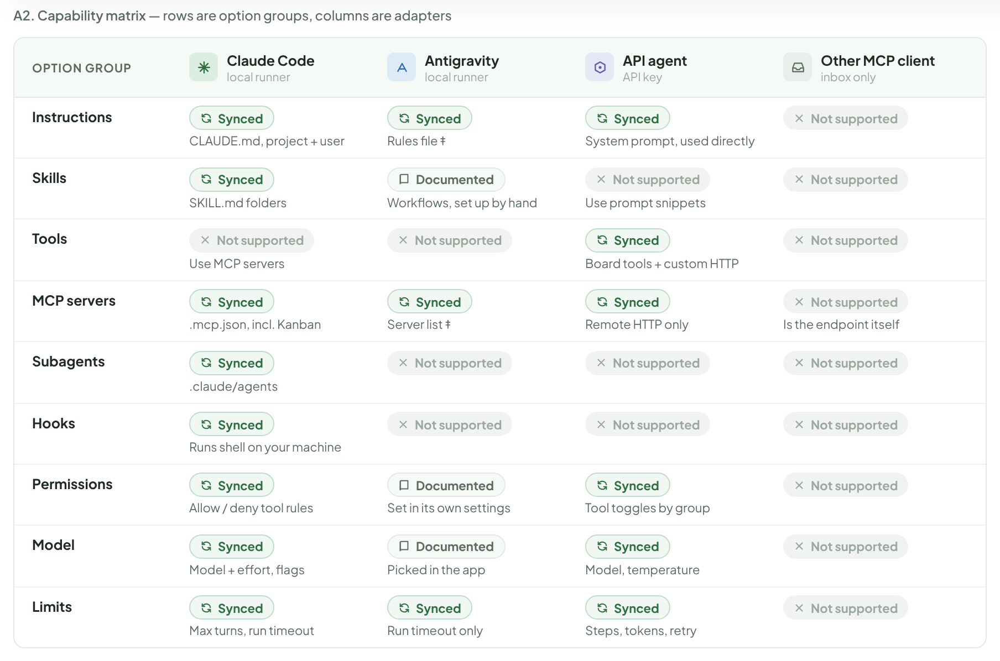

- Caption: "A2. Capability matrix" "— rows are option groups, columns are adapters".
- Column heads: "Option group"; "Claude Code" "local runner"; "Antigravity" "local runner"; "API agent" "API key"; "Other MCP client" "inbox only".

| Option group | Claude Code | Antigravity | API agent | Other MCP client |
|---|---|---|---|---|
| "Instructions" | "Synced" "CLAUDE.md, project + user" | "Synced" "Rules file ‡" | "Synced" "System prompt, used directly" | "Not supported" |
| "Skills" | "Synced" "SKILL.md folders" | "Documented" "Workflows, set up by hand" | "Not supported" "Use prompt snippets" | "Not supported" |
| "Tools" | "Not supported" "Use MCP servers" | "Not supported" | "Synced" "Board tools + custom HTTP" | "Not supported" |
| "MCP servers" | "Synced" ".mcp.json, incl. Kanban" | "Synced" "Server list ‡" | "Synced" "Remote HTTP only" | "Not supported" "Is the endpoint itself" |
| "Subagents" | "Synced" ".claude/agents" | "Not supported" | "Not supported" | "Not supported" |
| "Hooks" | "Synced" "Runs shell on your machine" | "Not supported" | "Not supported" | "Not supported" |
| "Permissions" | "Synced" "Allow / deny tool rules" | "Documented" "Set in its own settings" | "Synced" "Tool toggles by group" | "Not supported" |
| "Model" | "Synced" "Model + effort, flags" | "Documented" "Picked in the app" | "Synced" "Model, temperature" | "Not supported" |
| "Limits" | "Synced" "Max turns, run timeout" | "Synced" "Run timeout only" | "Synced" "Steps, tokens, retry" | "Not supported" |

### A3. Two management modes

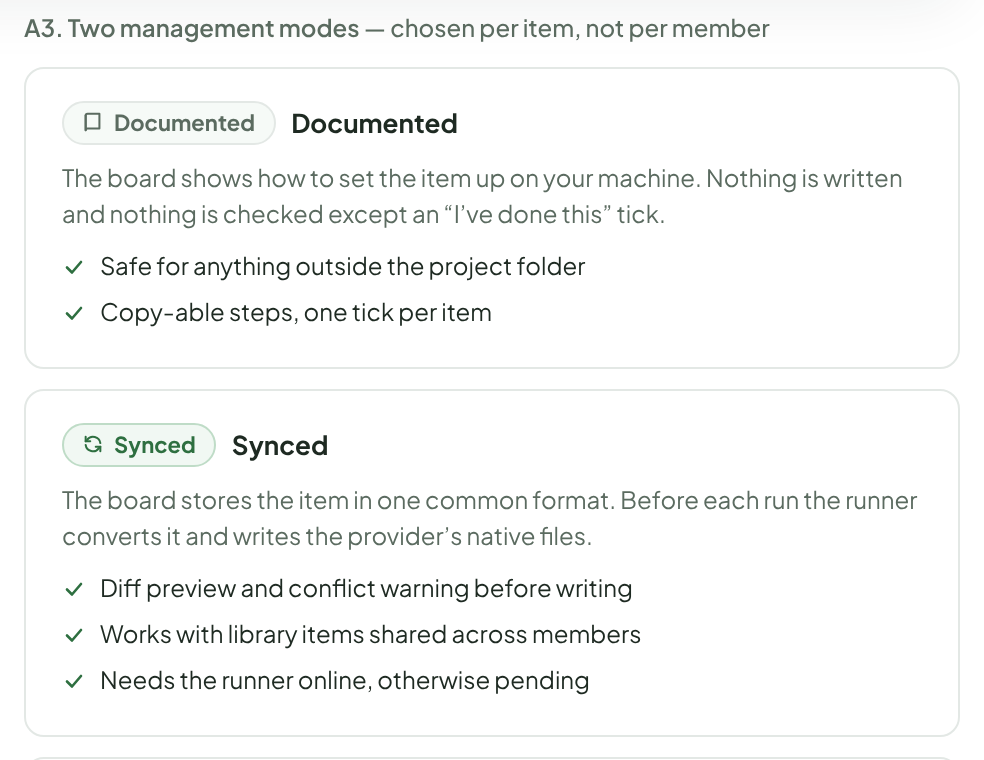

- Caption: "A3. Two management modes" "— chosen per item, not per member".
- "Documented" chip, "Documented": "The board shows how to set the item up on your machine. Nothing is written and nothing is checked except an “I’ve done this” tick." Checks: "Safe for anything outside the project folder"; "Copy-able steps, one tick per item".
- "Synced" chip, "Synced": "The board stores the item in one common format. Before each run the runner converts it and writes the provider’s native files." Checks: "Diff preview and conflict warning before writing"; "Works with library items shared across members"; "Needs the runner online, otherwise pending".

### A4. Other MCP client (inbox only)

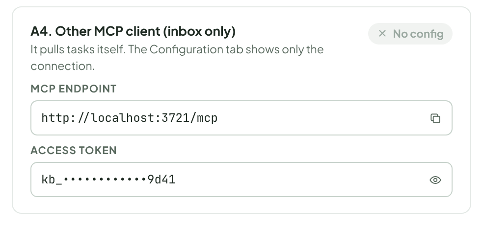

- "A4. Other MCP client (inbox only)" "No config"; "It pulls tasks itself. The Configuration tab shows only the connection."
- "MCP endpoint" "http://localhost:3721/mcp"; "Access token" "kb_••••••••••••9d41".

### Legend


- "Synced" "board stores it, runner writes it"; "Documented" "board only shows steps"; "Not supported" "hidden in this adapter".
- "‡ Placeholder, TODO verify. For the API agent, “Synced” means used directly by the board; no files are written."

---

## B. Claude Code configuration

Full option set. Instructions, skills, MCP servers, subagents, hooks and permissions are Synced (the runner writes .claude/ and .mcp.json before each run) unless they are marked Documented. Native paths and formats change between Claude Code versions: TODO verify against current Claude Code docs before building.

Source: [AiProviderConfig.dc.html](../source/AiProviderConfig.dc.html) › block "B Claude Code configuration" (two columns of cards: left B1, B3, B6; right B2, B4, B5, B7; then B8 and B9 side by side; B10 three modals across the full width)

### B1. Instructions

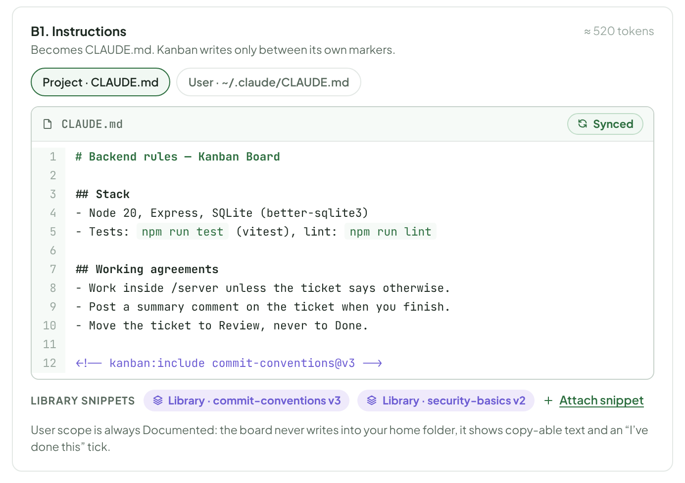

- "B1. Instructions" "≈ 520 tokens"; "Becomes CLAUDE.md. Kanban writes only between its own markers."
- Scope pills: "Project · CLAUDE.md" (selected); "User · ~/.claude/CLAUDE.md".
- File "CLAUDE.md" "Synced":

```
# Backend rules — Kanban Board

## Stack
- Node 20, Express, SQLite (better-sqlite3)
- Tests: npm run test (vitest), lint: npm run lint

## Working agreements
- Work inside /server unless the ticket says otherwise.
- Post a summary comment on the ticket when you finish.
- Move the ticket to Review, never to Done.

<!-- kanban:include commit-conventions@v3 -->
```

- "Library snippets": "Library · commit-conventions v3"; "Library · security-basics v2"; "Attach snippet".
- "User scope is always Documented: the board never writes into your home folder, it shows copy-able text and an “I’ve done this” tick."

### B2. Skills

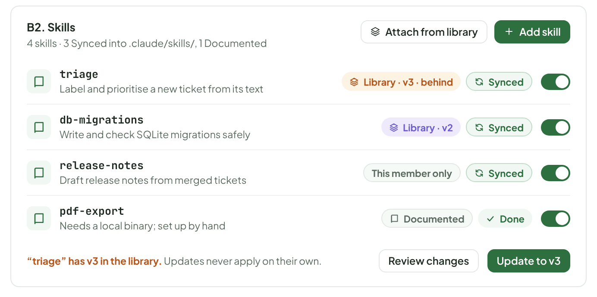

- "B2. Skills" "4 skills · 3 Synced into .claude/skills/, 1 Documented"; buttons "Attach from library", "Add skill".
- "triage" "Label and prioritise a new ticket from its text" "Library · v3 · behind" "Synced".
- "db-migrations" "Write and check SQLite migrations safely" "Library · v2" "Synced".
- "release-notes" "Draft release notes from merged tickets" "This member only" "Synced".
- "pdf-export" "Needs a local binary; set up by hand" "Documented" "Done".
- "“triage” has v3 in the library." "Updates never apply on their own." Buttons "Review changes", "Update to v3".

### B3. MCP servers

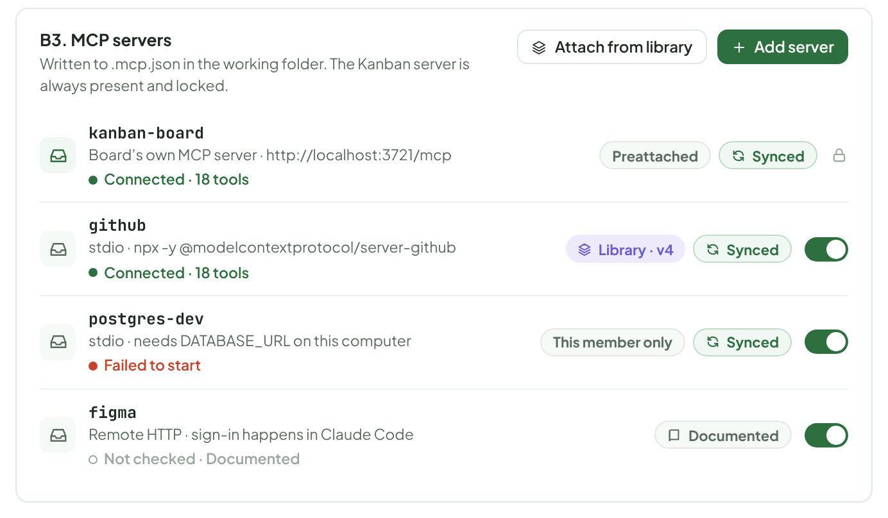

- "B3. MCP servers"; "Written to .mcp.json in the working folder. The Kanban server is always present and locked."; buttons "Attach from library", "Add server".
- "kanban-board" "Board’s own MCP server · http://localhost:3721/mcp" "Connected · 18 tools" "Preattached" "Synced" (lock icon).
- "github" "stdio · npx -y @modelcontextprotocol/server-github" "Connected · 18 tools" "Library · v4" "Synced".
- "postgres-dev" "stdio · needs DATABASE_URL on this computer" "Failed to start" "This member only" "Synced".
- "figma" "Remote HTTP · sign-in happens in Claude Code" "Not checked · Documented" "Documented".

### B4. Subagents

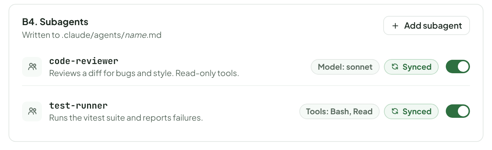

- "B4. Subagents"; "Written to .claude/agents/" "name" ".md"; button "Add subagent".
- "code-reviewer" "Reviews a diff for bugs and style. Read-only tools." "Model: sonnet" "Synced".
- "test-runner" "Runs the vitest suite and reports failures." "Tools: Bash, Read" "Synced".

### B5. Hooks

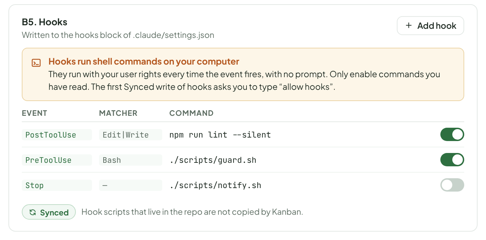

- "B5. Hooks"; "Written to the hooks block of .claude/settings.json"; button "Add hook".
- Warning "Hooks run shell commands on your computer": "They run with your user rights every time the event fires, with no prompt. Only enable commands you have read. The first Synced write of hooks asks you to type “allow hooks”."

| Event | Matcher | Command |
|---|---|---|
| "PostToolUse" | "Edit\|Write" | "npm run lint --silent" |
| "PreToolUse" | "Bash" | "./scripts/guard.sh" |
| "Stop" | "—" | "./scripts/notify.sh" |

- "Synced" "Hook scripts that live in the repo are not copied by Kanban."

### B6. Permissions

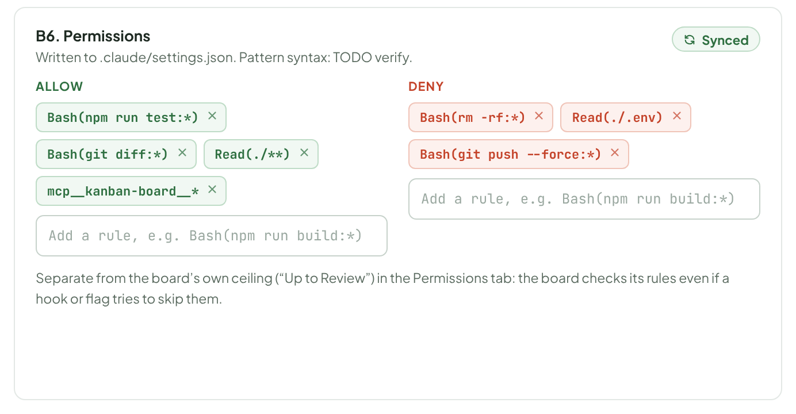

- "B6. Permissions" "Synced"; "Written to .claude/settings.json. Pattern syntax: TODO verify."
- "Allow": "Bash(npm run test:*)"; "Bash(git diff:*)"; "Read(./**)"; "mcp__kanban-board__*"; input "Add a rule, e.g. Bash(npm run build:*)".
- "Deny": "Bash(rm -rf:*)"; "Read(./.env)"; "Bash(git push --force:*)"; input "Add a rule, e.g. Bash(npm run build:*)".
- "Separate from the board’s own ceiling (“Up to Review”) in the Permissions tab: the board checks its rules even if a hook or flag tries to skip them."

### B7. Model & flags

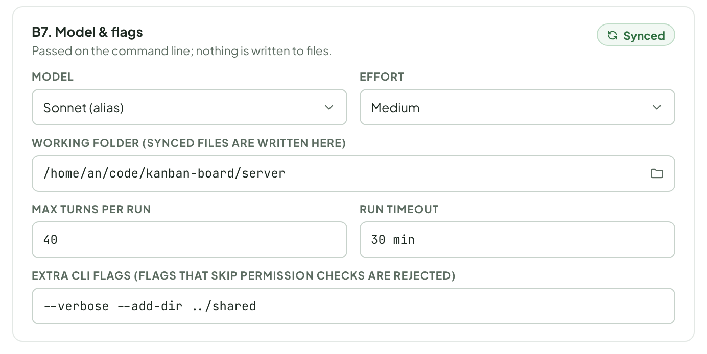

- "B7. Model & flags" "Synced"; "Passed on the command line; nothing is written to files."
- "Model" "Sonnet (alias)"; "Effort" "Medium".
- "Working folder (Synced files are written here)" "/home/an/code/kanban-board/server".
- "Max turns per run" "40"; "Run timeout" "30 min".
- "Extra CLI flags (flags that skip permission checks are rejected)" "--verbose --add-dir ../shared".

### B8. Sync preview

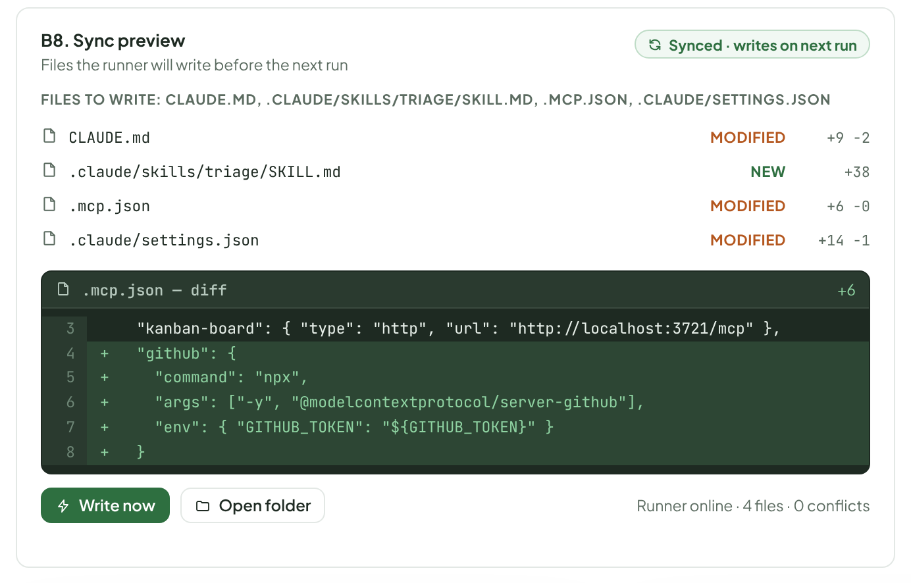

- "B8. Sync preview" "Synced · writes on next run"; "Files the runner will write before the next run".
- "Files to write: CLAUDE.md, .claude/skills/triage/SKILL.md, .mcp.json, .claude/settings.json".
- "CLAUDE.md" "modified" "+9 −2"; ".claude/skills/triage/SKILL.md" "new" "+38"; ".mcp.json" "modified" "+6 −0"; ".claude/settings.json" "modified" "+14 −1".
- Diff ".mcp.json — diff" "+6":

```
3     "kanban-board": { "type": "http", "url": "http://localhost:3721/mcp" },
4 +   "github": {
5 +     "command": "npx",
6 +     "args": ["-y", "@modelcontextprotocol/server-github"],
7 +     "env": { "GITHUB_TOKEN": "${GITHUB_TOKEN}" }
8 +   }
```

- Buttons "Write now", "Open folder"; "Runner online · 4 files · 0 conflicts".

### B9. Conflict — file edited by hand

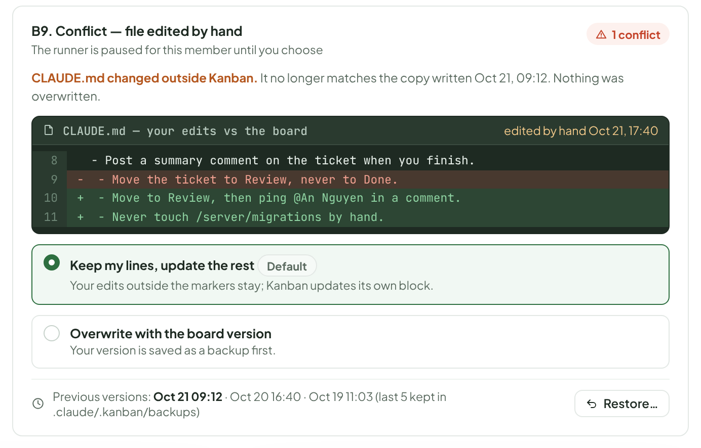

- "B9. Conflict — file edited by hand" "1 conflict"; "The runner is paused for this member until you choose".
- "CLAUDE.md changed outside Kanban." "It no longer matches the copy written Oct 21, 09:12. Nothing was overwritten."
- Diff "CLAUDE.md — your edits vs the board" "edited by hand Oct 21, 17:40":

```
8     - Post a summary comment on the ticket when you finish.
9 -   - Move the ticket to Review, never to Done.
10 +  - Move to Review, then ping @An Nguyen in a comment.
11 +  - Never touch /server/migrations by hand.
```

- Radio (selected) "Keep my lines, update the rest" "Default": "Your edits outside the markers stay; Kanban updates its own block."
- Radio "Overwrite with the board version": "Your version is saved as a backup first."
- "Previous versions:" "Oct 21 09:12" "· Oct 20 16:40 · Oct 19 11:03 (last 5 kept in .claude/.kanban/backups)"; button "Restore…".

### B10. Add skill modal

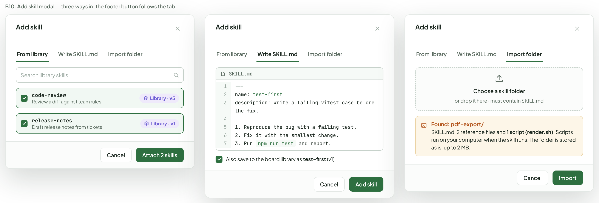

- Caption: "B10. Add skill modal" "— three ways in; the footer button follows the tab".
- Modal 1: title "Add skill"; tabs "From library" (active), "Write SKILL.md", "Import folder"; search "Search library skills"; rows (checked) "code-review" "Review a diff against team rules" "Library · v5"; "release-notes" "Draft release notes from tickets" "Library · v1"; buttons "Cancel", "Attach 2 skills".
- Modal 2: title "Add skill"; same tabs with "Write SKILL.md" active; file "SKILL.md":

```
---
name: test-first
description: Write a failing vitest case before the fix.
---
1. Reproduce the bug with a failing test.
2. Fix it with the smallest change.
3. Run npm run test and report.
```

  "Also save to the board library as" "test-first" "(v1)" (checked); buttons "Cancel", "Add skill".
- Modal 3: title "Add skill"; same tabs with "Import folder" active; drop zone "Choose a skill folder" "or drop it here · must contain SKILL.md"; notice "Found: pdf-export/" "SKILL.md, 2 reference files and" "1 script (render.sh)" ". Scripts run on your computer when the skill runs. The folder is stored as is, up to 2 MB."; buttons "Cancel", "Import".

---

## C. Antigravity configuration

A smaller adapter: fewer option groups, and most items are Documented, meaning the board gives you steps to follow in Antigravity itself. File formats, names and menus for Antigravity are not confirmed; wherever they would appear they are marked “TODO verify”.

Source: [AiProviderConfig.dc.html](../source/AiProviderConfig.dc.html) › block "C Antigravity configuration" (two columns: left C1 and C2, right C3 and C4)

### C1. Reduced option set

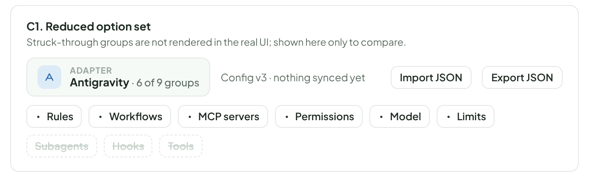

- "C1. Reduced option set"; "Struck-through groups are not rendered in the real UI; shown here only to compare."
- "Adapter" "Antigravity" "· 6 of 9 groups"; "Config v3 · nothing synced yet"; buttons "Import JSON", "Export JSON".
- Rendered groups: "Rules"; "Workflows"; "MCP servers"; "Permissions"; "Model"; "Limits".
- Struck through: "Subagents"; "Hooks"; "Tools".

### C2. Rules — setup instructions

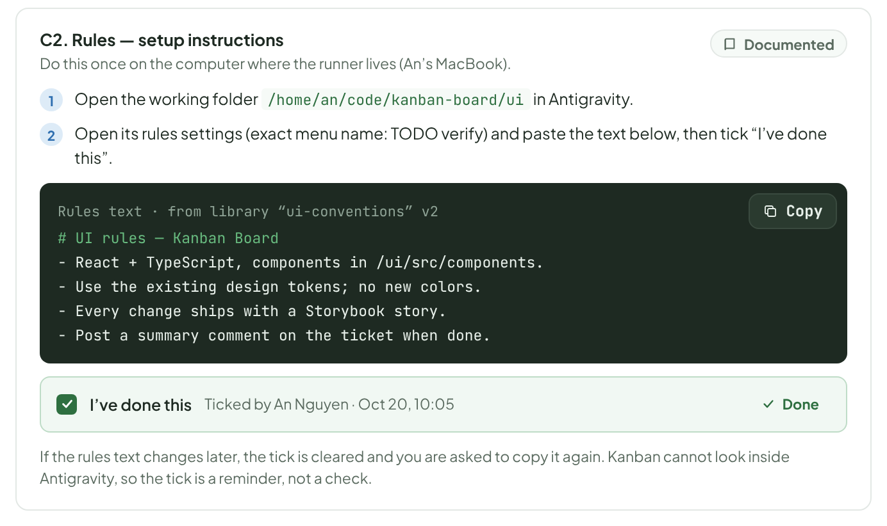

- "C2. Rules — setup instructions" "Documented"; "Do this once on the computer where the runner lives (An’s MacBook)."
- Step "1" "Open the working folder" "/home/an/code/kanban-board/ui" "in Antigravity."
- Step "2" "Open its rules settings (exact menu name: TODO verify) and paste the text below, then tick “I’ve done this”."
- "Rules text · from library “ui-conventions” v2"; button "Copy":

```
# UI rules — Kanban Board
- React + TypeScript, components in /ui/src/components.
- Use the existing design tokens; no new colors.
- Every change ships with a Storybook story.
- Post a summary comment on the ticket when done.
```

- Checked "I’ve done this" "Ticked by An Nguyen · Oct 20, 10:05" "Done".
- "If the rules text changes later, the tick is cleared and you are asked to copy it again. Kanban cannot look inside Antigravity, so the tick is a reminder, not a check."

### C3. Item status

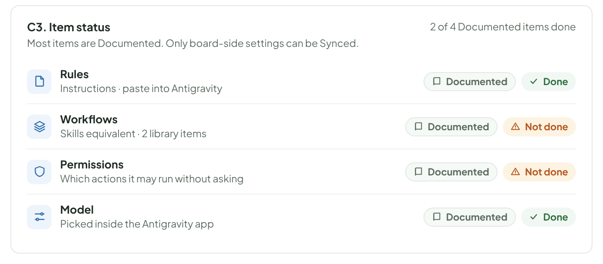

- "C3. Item status" "2 of 4 Documented items done"; "Most items are Documented. Only board-side settings can be Synced."
- "Rules" "Instructions · paste into Antigravity" "Documented" "Done".
- "Workflows" "Skills equivalent · 2 library items" "Documented" "Not done".
- "Permissions" "Which actions it may run without asking" "Documented" "Not done".
- "Model" "Picked inside the Antigravity app" "Documented" "Done".

### C4. MCP servers — the rare Synced item

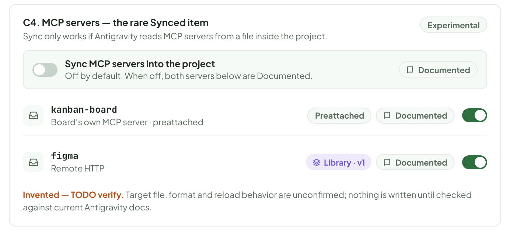

- "C4. MCP servers — the rare Synced item" "Experimental"; "Sync only works if Antigravity reads MCP servers from a file inside the project."
- Toggle (off) "Sync MCP servers into the project" "Documented": "Off by default. When off, both servers below are Documented."
- "kanban-board" "Board’s own MCP server · preattached" "Preattached" "Documented".
- "figma" "Remote HTTP" "Library · v1" "Documented".
- "Invented — TODO verify." "Target file, format and reload behavior are unconfirmed; nothing is written until checked against current Antigravity docs."

---

## D. API agent configuration

For Anthropic, OpenAI, Gemini and custom endpoints. The board itself runs the agent loop, so every option here is read straight from the board: nothing is written to files. The hardest screen to get right is the prompt editor, the tool schema editor and the dry run, shown in full below.

Source: [AiProviderConfig.dc.html](../source/AiProviderConfig.dc.html) › block "D API agent configuration" (two columns: D1 and D2; D3 with D4 and D5; D6 and D7; D8 full width)

### D1. System prompt

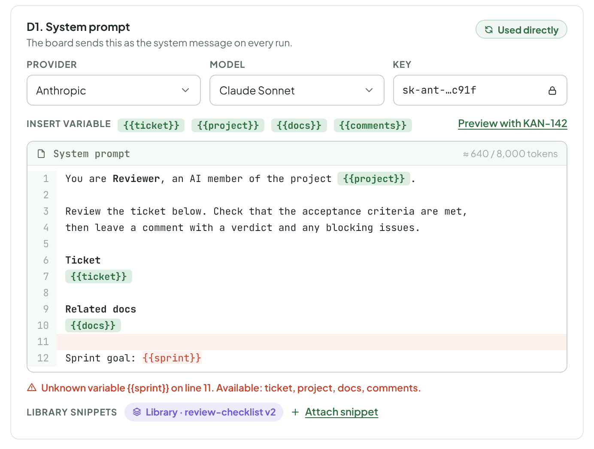

- "D1. System prompt" "Used directly"; "The board sends this as the system message on every run."
- "Provider" "Anthropic"; "Model" "Claude Sonnet"; "Key" "sk-ant-…c91f".
- "Insert variable" "{{ticket}}" "{{project}}" "{{docs}}" "{{comments}}"; link "Preview with KAN-142".
- Editor "System prompt" "≈ 640 / 8,000 tokens":

```
1  You are Reviewer, an AI member of the project {{project}}.
2
3  Review the ticket below. Check that the acceptance criteria are met,
4  then leave a comment with a verdict and any blocking issues.
5
6  Ticket
7  {{ticket}}
8
9  Related docs
10 {{docs}}
11
12 Sprint goal: {{sprint}}
```

- Error "Unknown variable {{sprint}} on line 11. Available: ticket, project, docs, comments."
- "Library snippets" "Library · review-checklist v2" "Attach snippet".

### D2. Tools

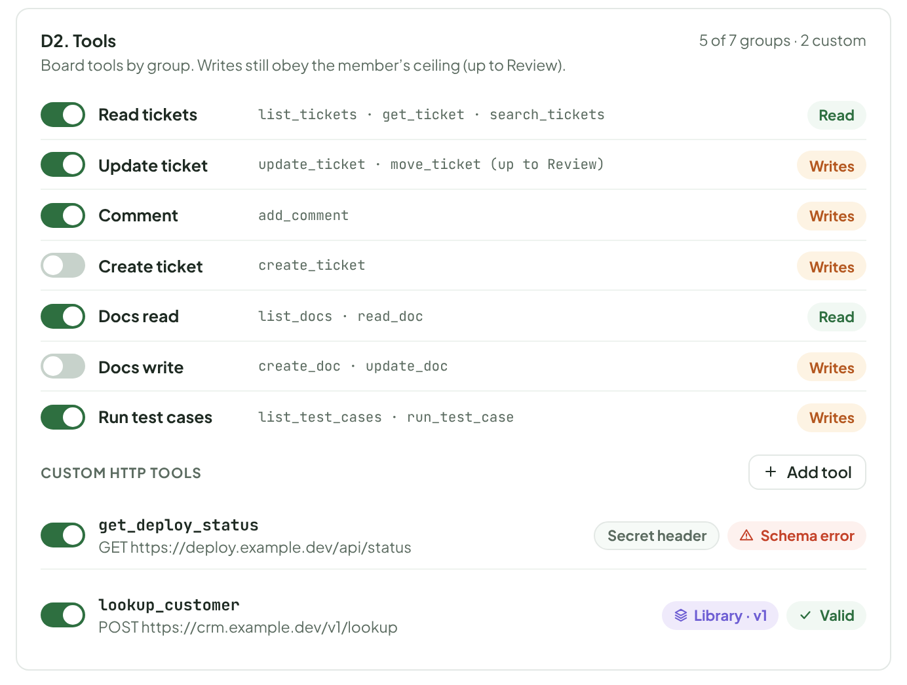

- "D2. Tools" "5 of 7 groups · 2 custom"; "Board tools by group. Writes still obey the member’s ceiling (up to Review)."
- "Read tickets" "list_tickets · get_ticket · search_tickets" "Read".
- "Update ticket" "update_ticket · move_ticket (up to Review)" "Writes".
- "Comment" "add_comment" "Writes".
- "Create ticket" "create_ticket" "Writes" (off).
- "Docs read" "list_docs · read_doc" "Read".
- "Docs write" "create_doc · update_doc" "Writes" (off).
- "Run test cases" "list_test_cases · run_test_case" "Writes".
- "Custom HTTP tools"; button "Add tool".
- "get_deploy_status" "GET https://deploy.example.dev/api/status" "Secret header" "Schema error".
- "lookup_customer" "POST https://crm.example.dev/v1/lookup" "Library · v1" "Valid".

### D3. Custom tool — schema editor

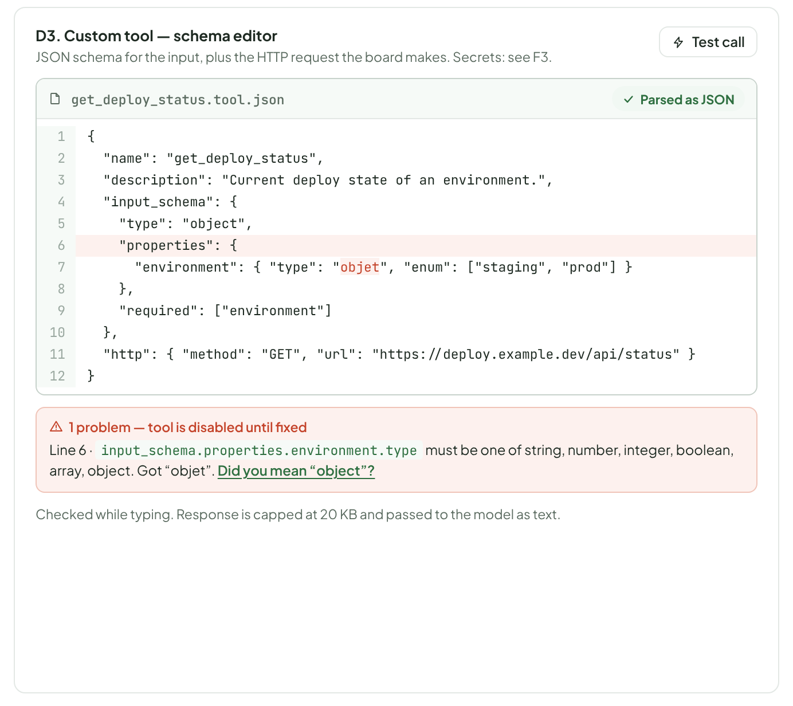

- "D3. Custom tool — schema editor"; "JSON schema for the input, plus the HTTP request the board makes. Secrets: see F3."; button "Test call".
- File "get_deploy_status.tool.json" "Parsed as JSON" (line 7 highlighted, the value "objet" in red):

```
{
  "name": "get_deploy_status",
  "description": "Current deploy state of an environment.",
  "input_schema": {
    "type": "object",
    "properties": {
      "environment": { "type": "objet", "enum": ["staging", "prod"] }
    },
    "required": ["environment"]
  },
  "http": { "method": "GET", "url": "https://deploy.example.dev/api/status" }
}
```

- Problem box "1 problem — tool is disabled until fixed": "Line 6 ·" "input_schema.properties.environment.type" "must be one of string, number, integer, boolean, array, object. Got “objet”." Link "Did you mean “object”?"
- "Checked while typing. Response is capped at 20 KB and passed to the model as text."

### D4. MCP client servers

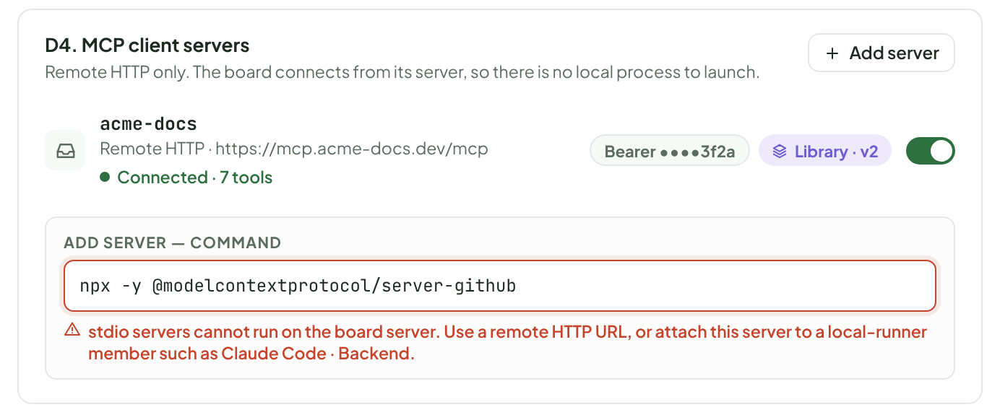

- "D4. MCP client servers"; "Remote HTTP only. The board connects from its server, so there is no local process to launch."; button "Add server".
- "acme-docs" "Remote HTTP · https://mcp.acme-docs.dev/mcp" "Connected · 7 tools" "Bearer ••••3f2a" "Library · v2".
- "Add server — command" "npx -y @modelcontextprotocol/server-github"; error "stdio servers cannot run on the board server. Use a remote HTTP URL, or attach this server to a local-runner member such as Claude Code · Backend."

### D5. Context sources

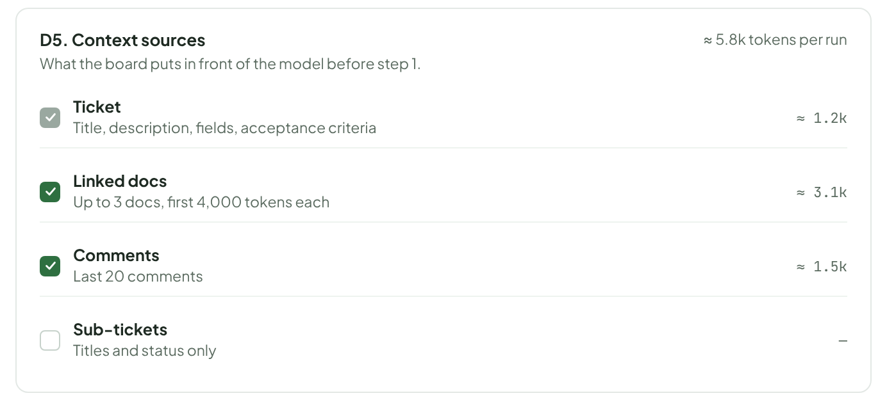

- "D5. Context sources" "≈ 5.8k tokens per run"; "What the board puts in front of the model before step 1."
- "Ticket" "Title, description, fields, acceptance criteria" "≈ 1.2k" (locked on).
- "Linked docs" "Up to 3 docs, first 4,000 tokens each" "≈ 3.1k".
- "Comments" "Last 20 comments" "≈ 1.5k".
- "Sub-tickets" "Titles and status only" "—" (unchecked).

### D6. Agent loop limits

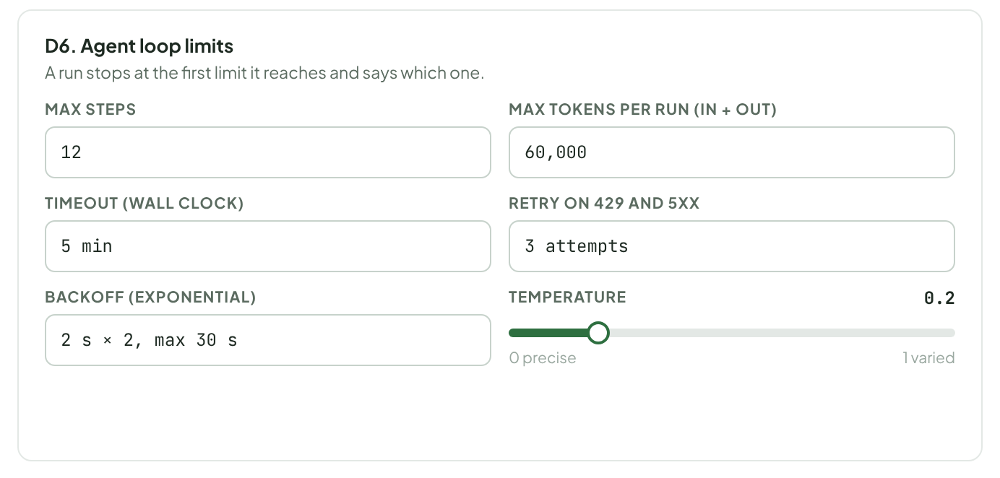

- "D6. Agent loop limits"; "A run stops at the first limit it reaches and says which one."
- "Max steps" "12"; "Max tokens per run (in + out)" "60,000"; "Timeout (wall clock)" "5 min"; "Retry on 429 and 5xx" "3 attempts"; "Backoff (exponential)" "2 s × 2, max 30 s".
- "Temperature" "0.2"; slider ends "0 precise" "1 varied".

### D7. Output rules

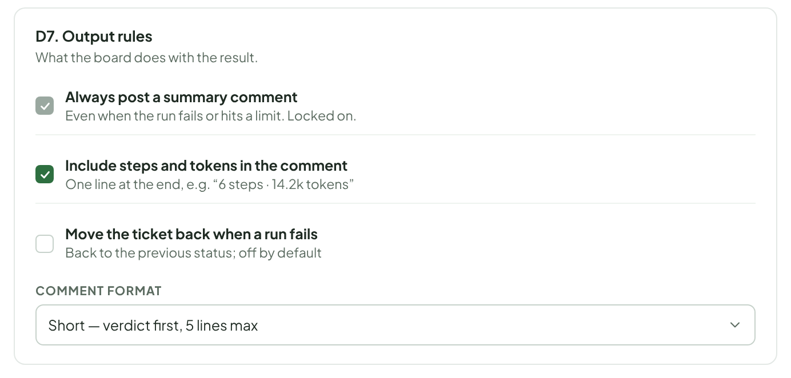

- "D7. Output rules"; "What the board does with the result."
- "Always post a summary comment" "Even when the run fails or hits a limit. Locked on." (checked, locked).
- "Include steps and tokens in the comment" "One line at the end, e.g. “6 steps · 14.2k tokens”" (checked).
- "Move the ticket back when a run fails" "Back to the previous status; off by default" (unchecked).
- "Comment format" "Short — verdict first, 5 lines max".

### D8. Dry run

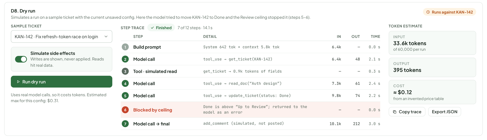

- "D8. Dry run" "Runs against KAN-142"; "Simulates a run on a sample ticket with the current unsaved config. Here the model tried to move KAN-142 to Done and the Review ceiling stopped it (steps 5–6)."
- "Sample ticket" "KAN-142 · Fix refresh-token race on login"; toggle "Simulate side effects" "Writes are shown, never applied. Reads hit real data."; button "Run dry run"; "Uses real model calls, so it costs tokens. Estimated max for this config: $0.31."
- "Step trace" "Finished" "7 of 12 steps · 14.1 s":

| Step | Name | Detail | In | Out | Time |
|---|---|---|---|---|---|
| "1" | "Build prompt" | "System 642 tok + context 5.8k tok" | "6.4k" | "—" | "0.0 s" |
| "2" | "Model call" | "tool_use → get_ticket(KAN-142)" | "6.4k" | "48" | "2.1 s" |
| "3" | "Tool · simulated read" | "get_ticket → 0.9k tokens of fields" | "—" | "—" | "0.3 s" |
| "4" | "Model call" | "tool_use → read_doc(“Auth design”)" | "7.3k" | "61" | "2.4 s" |
| "5" | "Model call" | "tool_use → update_ticket(status: Done)" | "9.8k" | "74" | "2.2 s" |
| "6" | "Blocked by ceiling" | "Done is above “Up to Review”; returned to the model as an error" | "—" | "—" | "0.0 s" |
| "7" | "Model call → final" | "add_comment (simulated, not posted)" | "10.1k" | "212" | "3.0 s" |

- Column heads "Step" "Detail" "In" "Out" "Time".
- "Token estimate": "Input" "33.6k tokens" "of 60,000 per run"; "Output" "395 tokens"; "Cost" "≈ $0.12" "from an invented price table".
- Buttons "Copy trace", "Export JSON".

---

## E. Shared library (board level)

Define a skill, tool, MCP server or instruction snippet once and attach it to many AI members. Each edit creates a new version; members stay on the version they have until someone updates them. Opened from Settings → AI → Library.

Source: [AiProviderConfig.dc.html](../source/AiProviderConfig.dc.html) › block "E Shared library (board level)" (E1 library list on the left, E2 update prompt on the right)

### E1. Library list

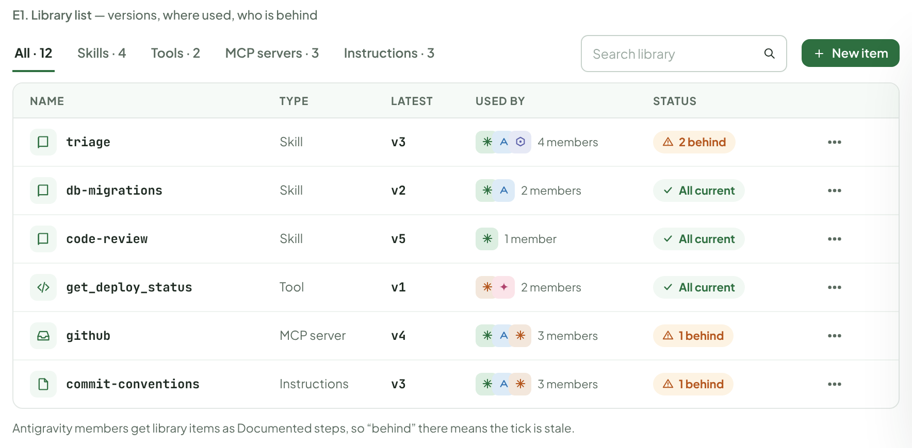

- Caption: "E1. Library list" "— versions, where used, who is behind".
- Tabs "All · 12" "Skills · 4" "Tools · 2" "MCP servers · 3" "Instructions · 3"; search "Search library"; button "New item".

| Name | Type | Latest | Used by | Status |
|---|---|---|---|---|
| "triage" | "Skill" | "v3" | "4 members" | "2 behind" |
| "db-migrations" | "Skill" | "v2" | "2 members" | "All current" |
| "code-review" | "Skill" | "v5" | "1 member" | "All current" |
| "get_deploy_status" | "Tool" | "v1" | "2 members" | "All current" |
| "github" | "MCP server" | "v4" | "3 members" | "1 behind" |
| "commit-conventions" | "Instructions" | "v3" | "3 members" | "1 behind" |

- "Antigravity members get library items as Documented steps, so “behind” there means the tick is stale."

### E2. Update propagation prompt

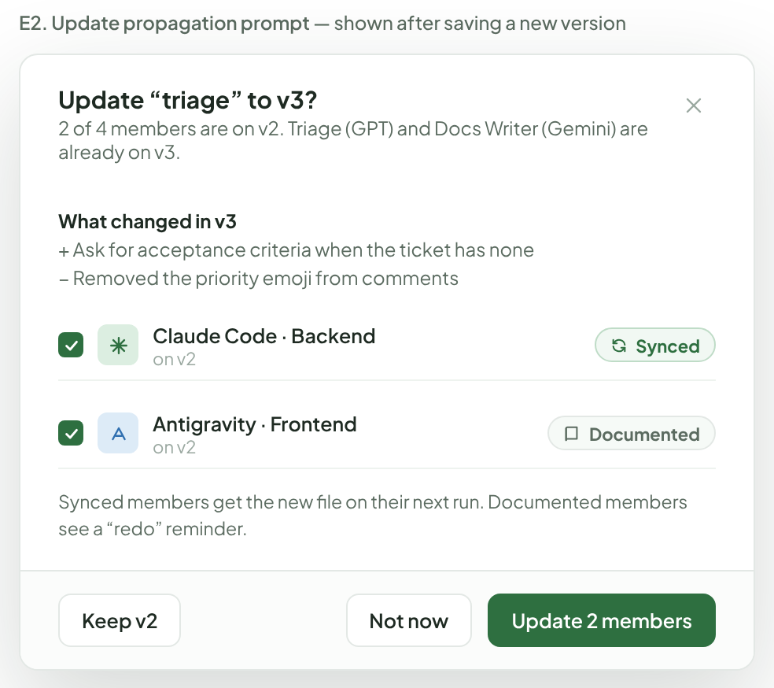

- Caption: "E2. Update propagation prompt" "— shown after saving a new version".
- Title "Update “triage” to v3?"; "2 of 4 members are on v2. Triage (GPT) and Docs Writer (Gemini) are already on v3."
- "What changed in v3": "+ Ask for acceptance criteria when the ticket has none"; "− Removed the priority emoji from comments".
- "Claude Code · Backend" "on v2" "Synced"; "Antigravity · Frontend" "on v2" "Documented".
- "Synced members get the new file on their next run. Documented members see a “redo” reminder."
- Buttons "Keep v2", "Not now", "Update 2 members".

---

## F. States and edge cases

Unsaved changes, validation, secrets, sync problems, offline runner, items on the wrong adapter, import/export, reset, loading and empty states.

Source: [AiProviderConfig.dc.html](../source/AiProviderConfig.dc.html) › block "F States and edge cases" (three columns: F1 to F4; F5 to F7; F8 to F10)

### F1. Unsaved changes bar

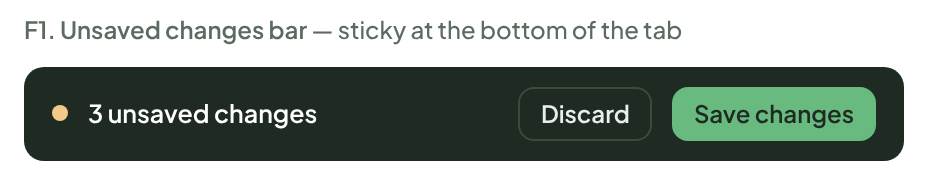

- Caption: "F1. Unsaved changes bar" "— sticky at the bottom of the tab".
- "3 unsaved changes"; buttons "Discard", "Save changes".

### F2. Validation errors

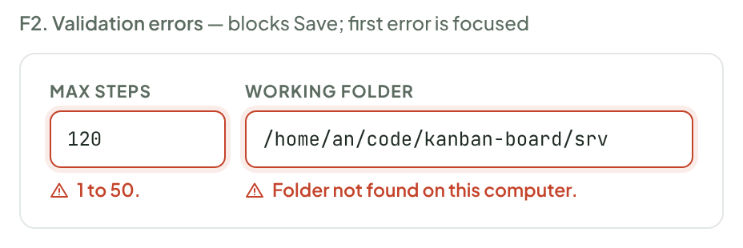

- Caption: "F2. Validation errors" "— blocks Save; first error is focused".
- "Max steps" "120" error "1 to 50."; "Working folder" "/home/an/code/kanban-board/srv" error "Folder not found on this computer."

### F3. Secret inside a tool

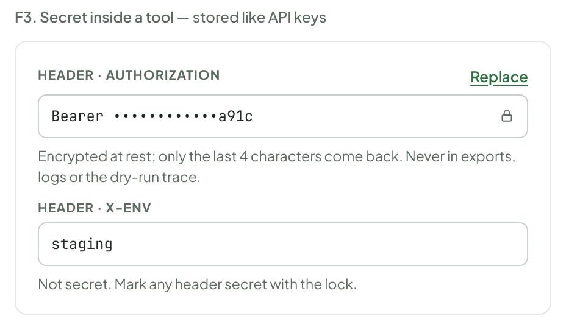

- Caption: "F3. Secret inside a tool" "— stored like API keys".
- "Header · Authorization" "Replace" "Bearer ••••••••••••a91c"; "Encrypted at rest; only the last 4 characters come back. Never in exports, logs or the dry-run trace."
- "Header · X-Env" "staging"; "Not secret. Mark any header secret with the lock."

### F4. Sync failed

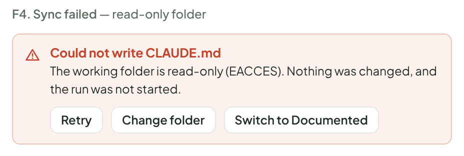

- Caption: "F4. Sync failed" "— read-only folder".
- "Could not write CLAUDE.md"; "The working folder is read-only (EACCES). Nothing was changed, and the run was not started."
- Buttons "Retry", "Change folder", "Switch to Documented".

### F5. Runner offline

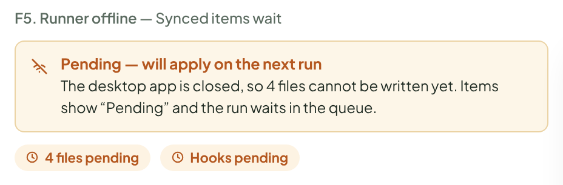

- Caption: "F5. Runner offline" "— Synced items wait".
- "Pending — will apply on the next run"; "The desktop app is closed, so 4 files cannot be written yet. Items show “Pending” and the run waits in the queue."
- Chips "4 files pending", "Hooks pending".

### F6. Item on the wrong adapter

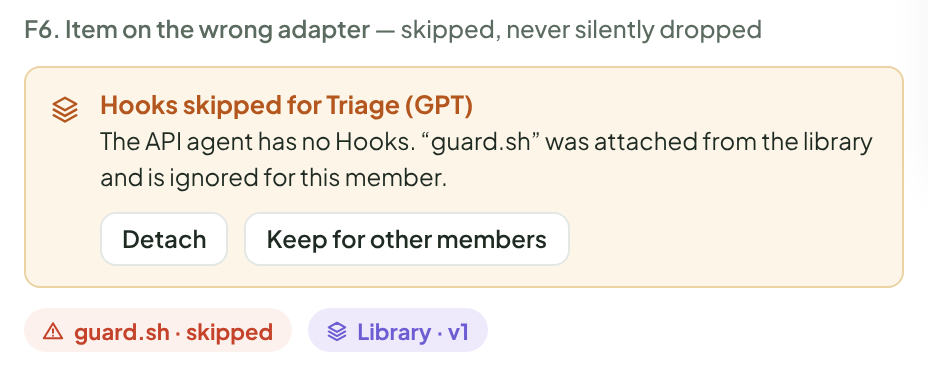

- Caption: "F6. Item on the wrong adapter" "— skipped, never silently dropped".
- "Hooks skipped for Triage (GPT)"; "The API agent has no Hooks. “guard.sh” was attached from the library and is ignored for this member."
- Buttons "Detach", "Keep for other members"; chips "guard.sh · skipped", "Library · v1".

### F7. Import / export JSON

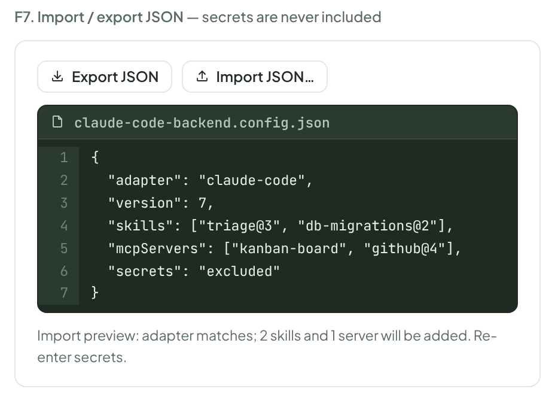

- Caption: "F7. Import / export JSON" "— secrets are never included".
- Buttons "Export JSON", "Import JSON…"; file "claude-code-backend.config.json":

```
{
  "adapter": "claude-code",
  "version": 7,
  "skills": ["triage@3", "db-migrations@2"],
  "mcpServers": ["kanban-board", "github@4"],
  "secrets": "excluded"
}
```

- "Import preview: adapter matches; 2 skills and 1 server will be added. Re-enter secrets."

### F8. Reset to defaults

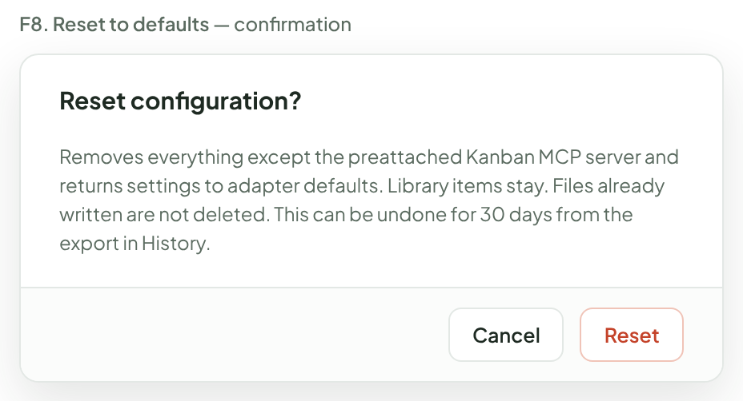

- Caption: "F8. Reset to defaults" "— confirmation".
- Title "Reset configuration?"; "Removes everything except the preattached Kanban MCP server and returns settings to adapter defaults. Library items stay. Files already written are not deleted. This can be undone for 30 days from the export in History."
- Buttons "Cancel", "Reset".

### F9. Loading skeleton

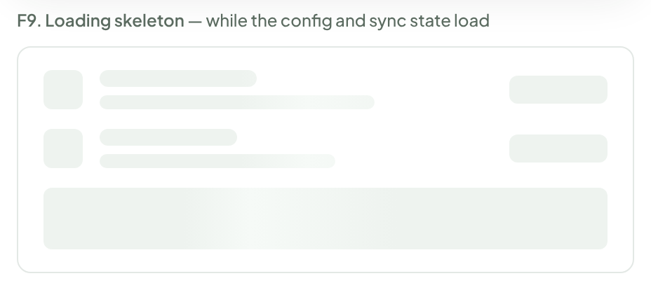

- Caption: "F9. Loading skeleton" "— while the config and sync state load" (shimmer rows, no text).

### F10. Empty states

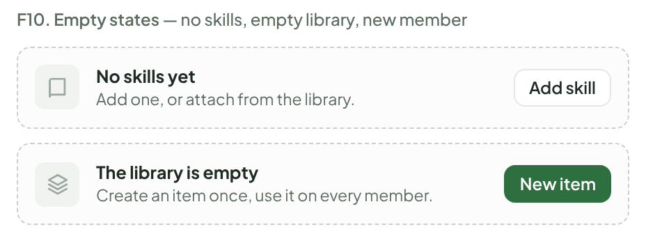

- Caption: "F10. Empty states" "— no skills, empty library, new member".
- "No skills yet" "Add one, or attach from the library." button "Add skill".
- "The library is empty" "Create an item once, use it on every member." button "New item".

---

## Note

Source: [AiProviderConfig.dc.html](../source/AiProviderConfig.dc.html) › block "Note" (three cards side by side: "Inconsistencies to flag" with the "Caveat." paragraph, "Everything invented", "Backend needs")

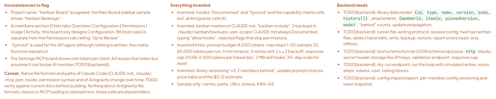

"Inconsistencies to flag":

- "Project name: “Kanban Board” as agreed; the Main Board sidebar sample shows “Kanban Redesign”."
- "AI members section D lists tabs Overview | Configuration | Permissions | Usage | Activity; this board only designs Configuration. B6 (tool rules) is separate from the Permissions tab ceiling “Up to Review”."
- "“Synced” is used for the API agent although nothing is written; the matrix footnote explains it."
- "The Settings MCP board shows one token per client; A4 reuses that token but assumes it can be per AI member (TODO(backend))."
- "Caveat." "Native file formats and paths of Claude Code (CLAUDE.md, .claude/, .mcp.json, hooks, permission syntax) and of Antigravity change over time: TODO verify against current docs before building. Nothing about Antigravity file formats, menus or MCP loading is claimed here; those cells are placeholders."

"Everything invented":

- "Invented: modes “Documented” and “Synced” and the capability matrix cells, incl. all Antigravity cells (‡)."
- "Invented: kanban markers in CLAUDE.md, “kanban:include”, 5 backups in .claude/.kanban/backups, user-scope CLAUDE.md always Documented, typing “allow hooks”, rejected flags that skip permissions."
- "Invented limits: prompt budget 8,000 tokens, max steps 1–50 (sample 12), 60,000 tokens per run, 5 min timeout, 3 retries with 2 s × 2 backoff, response cap 20 KB, 4,000 tokens per linked doc, 2 MB skill folder, 30-day undo for reset."
- "Invented: library versioning “v3, 2 members behind”, update prompt choices, price table and the $0.12 estimate."
- "Sample only: names, paths, URLs, tokens, KAN-142."

"Backend needs":

- TODO(backend): library data model `{id, type, name, version, body, history[]}`, attachments `{memberId, itemId, pinnedVersion, mode}`, “behind” counts, update propagation.
- TODO(backend): runner file-writing protocol: resolve config, hash last written files, detect hand edits, write, backup, restore, report errors (read-only, offline).
- TODO(backend): tool schema format (JSON schema input plus `http` block), secret header storage like API keys, validation endpoint, response cap.
- TODO(backend): dry-run endpoint: run the loop with simulated writes, return steps, tokens, cost, ceiling blocks.
- TODO(backend): config import/export, per-member config versioning and reset snapshot.
