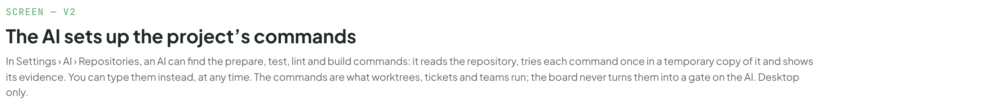
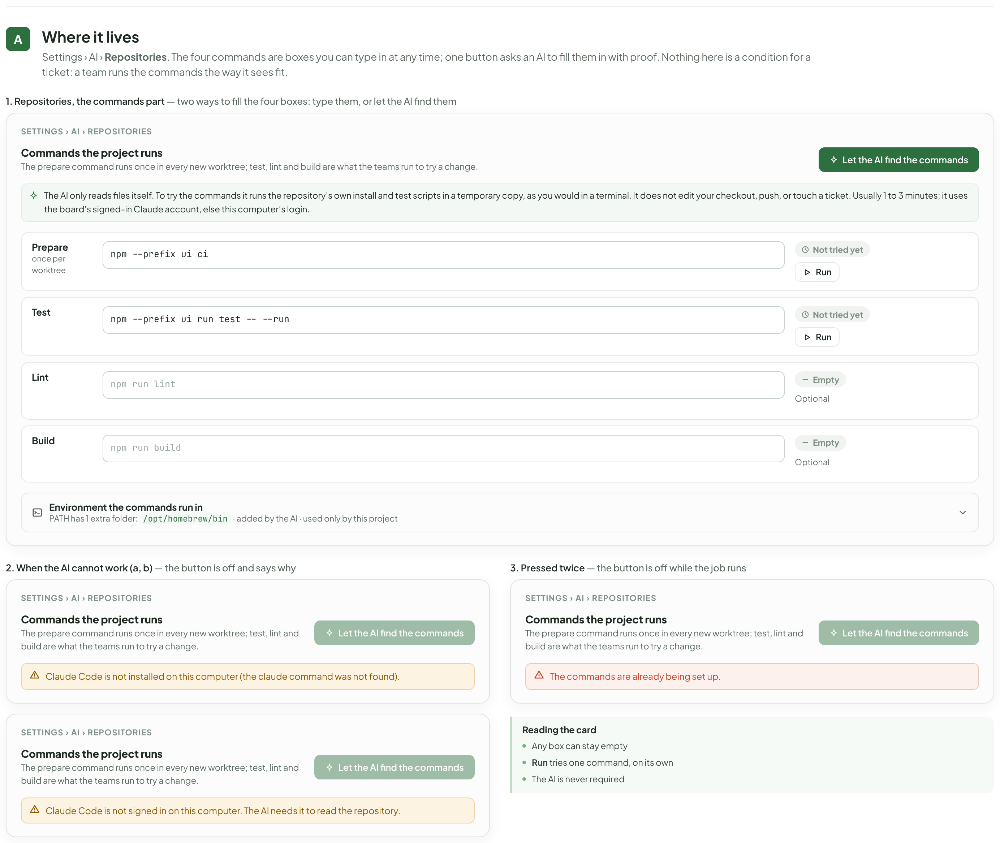
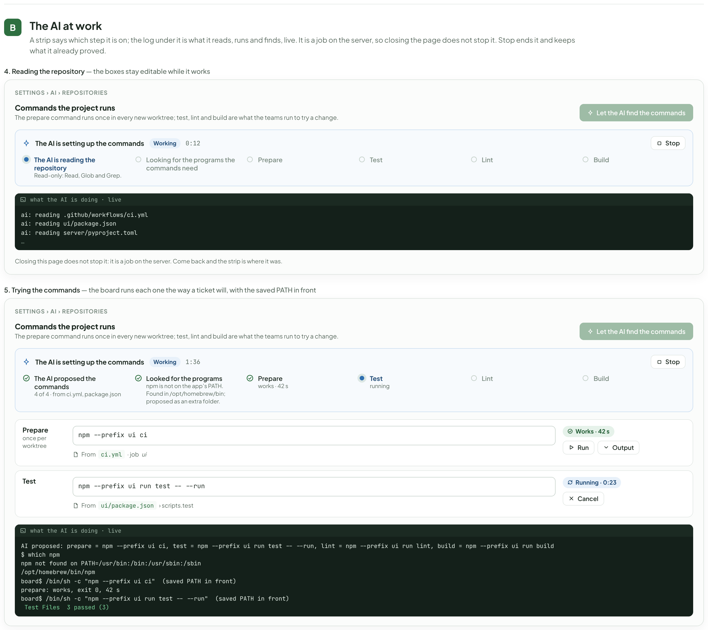
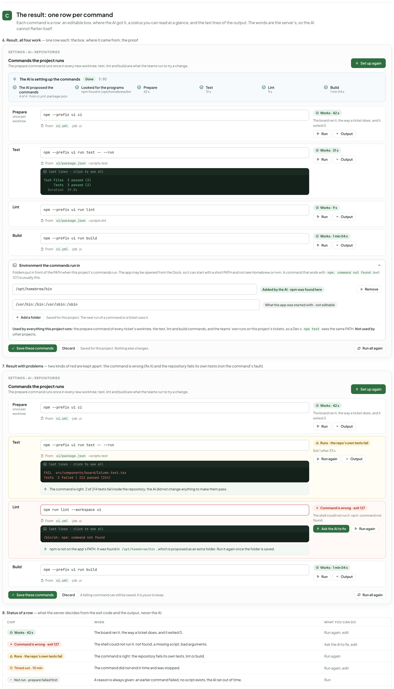
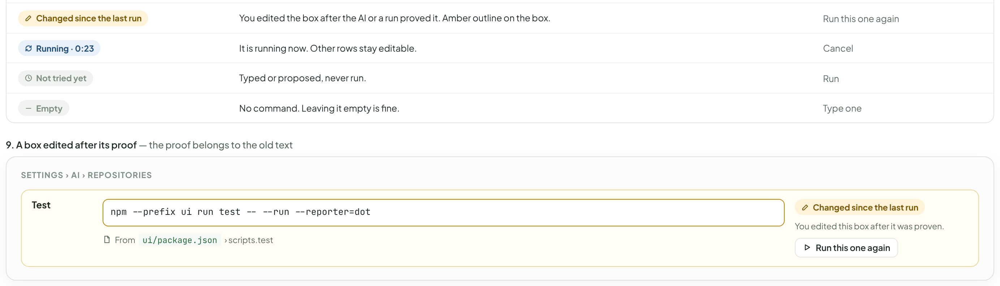
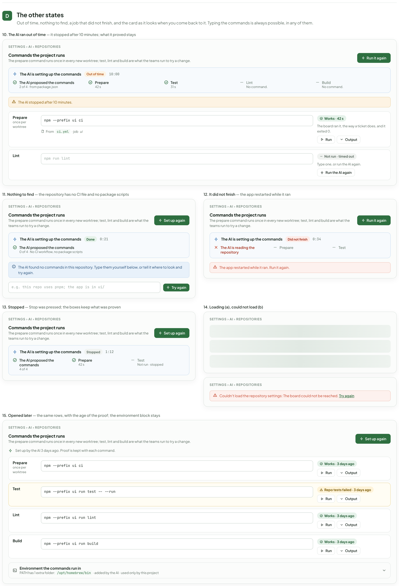

# AI sets up the commands

> Redrawn for AI v2 · source: [`AiRepoCommands.dc.html`](../source/AiRepoCommands.dc.html) · canvas `1794099567-d725` · sha256 `65a635b215480742983976dbd6d644074375ad22327305779ed416840af5eb87`

> Words, states and conditions follow the code of branch `claude/ai-team-architecture-7a1efc`; the layout is designed here and is not the layout of the current screens. Names, ids, costs and times in the mock-ups are sample data. **Check the code before building from this: the file named in each part is the truth, not the picture.**

## SCREEN — V2

- Text in this part: "SCREEN — V2" · "The AI sets up the project’s commands" · "In Settings › AI › Repositories, an AI can find the prepare, test, lint and build commands: it reads the repository, tries each command once in a temporary copy of it and shows its evidence. You can type them instead, at any time. The commands are what worktrees, tickets and teams run; the board never turns them into a gate on the AI. Desktop only."

---

## Where it lives

- Text in this part: "A" · "Where it lives" · "Settings › AI › Repositories. The four commands are boxes you can type in at any time; one button asks an AI to fill them in with proof. Nothing here is a condition for a ticket: a team runs the commands the way it sees fit." · "1. Repositories, the commands part — two ways to fill the four boxes: type them, or let the AI find them" · "SETTINGS › AI › REPOSITORIES" · "Commands the project runs" · "The prepare command runs once in every new worktree; test, lint and build are what the teams run to try a change." · "Let the AI find the commands" · "The AI only reads files itself. To try the commands it runs the repository’s own install and test scripts in a temporary copy, as you would in a terminal. It does not edit your checkout, push, or touch a ticket. Usually 1 to 3 minutes; it uses the board’s signed-in Claude account, else this computer’s login." · "Prepare" · "once per worktree" · "npm --prefix ui ci" · "Not tried yet" · "Run" · "Test" · "npm --prefix ui run test -- --run" · "Lint" · "npm run lint" · "Empty" · "Optional" · "Build" · "npm run build" · "Environment the commands run in" · "PATH has 1 extra folder: /opt/homebrew/bin · added by the AI · used only by this project" · "2. When the AI cannot work (a, b) — the button is off and says why" · "Claude Code is not installed on this computer (the claude command was not found)." · "Claude Code is not signed in on this computer. The AI needs it to read the repository." · "3. Pressed twice — the button is off while the job runs" · "The commands are already being set up." · "Reading the card" · "Any box can stay empty" · "Run tries one command, on its own" · "The AI is never required"

---

## The AI at work

- Text in this part: "B" · "The AI at work" · "A strip says which step it is on; the log under it is what it reads, runs and finds, live. It is a job on the server, so closing the page does not stop it. Stop ends it and keeps what it already proved." · "4. Reading the repository — the boxes stay editable while it works" · "SETTINGS › AI › REPOSITORIES" · "Commands the project runs" · "The prepare command runs once in every new worktree; test, lint and build are what the teams run to try a change." · "Let the AI find the commands" · "The AI is setting up the commands" · "Working" · "0:12" · "Stop" · "The AI is reading the repository" · "Read-only: Read, Glob and Grep." · "Looking for the programs the commands need" · "Prepare" · "Test" · "Lint" · "Build" · "what the AI is doing · live" · "ai: reading .github/workflows/ci.yml" · "ai: reading ui/package.json" · "ai: reading server/pyproject.toml" · "…" · "Closing this page does not stop it: it is a job on the server. Come back and the strip is where it was." · "5. Trying the commands — the board runs each one the way a ticket will, with the saved PATH in front" · "1:36" · "The AI proposed the commands" · "4 of 4 · from ci.yml, package.json" · "Looked for the programs" · "npm is not on the app’s PATH. Found in /opt/homebrew/bin; proposed as an extra folder." · "works · 42 s" · "running" · "once per worktree" · "npm --prefix ui ci" · "From" · "ci.yml" · "· job" · "ui" · "Works · 42 s" · "Run" · "Output" · "npm --prefix ui run test -- --run" · "ui/package.json" · "› scripts.test" · "Running · 0:23" · "Cancel" · "AI proposed: prepare = npm --prefix ui ci, test = npm --prefix ui run test -- --run, lint = npm --prefix ui run lint, build = npm --prefix ui run build" · "$ which npm" · "npm not found on PATH=/usr/bin:/bin:/usr/sbin:/sbin" · "/opt/homebrew/bin/npm" · "board$ /bin/sh -c "npm --prefix ui ci"  (saved PATH in front)" · "prepare: works, exit 0, 42 s" · "board$ /bin/sh -c "npm --prefix ui run test -- --run"  (saved PATH in front)" · "Test Files  3 passed (3)"

---

## The result: one row per command

- Text in this part: "C" · "The result: one row per command" · "Each command is a row: an editable box, where the AI got it, a status you can read at a glance, and the last lines of the output. The words are the server’s, so the AI cannot flatter itself." · "6. Result, all four work — one row each: the box, where it came from, the proof" · "SETTINGS › AI › REPOSITORIES" · "Commands the project runs" · "The prepare command runs once in every new worktree; test, lint and build are what the teams run to try a change." · "Set up again" · "The AI is setting up the commands" · "Done" · "3:02" · "The AI proposed the commands" · "4 of 4 · from ci.yml, package.json" · "Looked for the programs" · "npm found in /opt/homebrew/bin" · "Prepare" · "42 s" · "Test" · "31 s" · "Lint" · "9 s" · "Build" · "1 min 04 s" · "once per worktree" · "npm --prefix ui ci" · "From" · "ci.yml" · "· job" · "ui" · "Works · 42 s" · "The board ran it, the way a ticket does, and it exited 0." · "Run" · "Output" · "npm --prefix ui run test -- --run" · "ui/package.json" · "› scripts.test" · "last lines · click to see all" · "Test Files  3 passed (3)" · "Tests  3 passed (3)" · "Duration  29.8s" · "Works · 31 s" · "npm --prefix ui run lint" · "› scripts.lint" · "Works · 9 s" · "npm --prefix ui run build" · "Works · 1 min 04 s" · "Environment the commands run in" · "Folders put in front of the PATH when this project’s commands run. The app may be opened from the Dock, so it can start with a short PATH and not see Homebrew or nvm. A command that ends with npm: command not found (exit 127) is usually this." · "/opt/homebrew/bin" · "Added by the AI · npm was found here" · "Remove" · "/usr/bin:/bin:/usr/sbin:/sbin" · "What the app was started with · not editable" · "Add a folder" · "Saved for this project. The next run of a command or a ticket uses it." · "Used by everything this project runs: the prepare command of every ticket’s worktree, the test, lint and build commands, and the teams’ own runs on this project’s tickets, so a Dev’s npm test sees the same PATH. Not used by other projects." · "Save these commands" · "Discard" · "Saved for this project. Nothing else changes." · "Run all again" · "7. Result with problems — two kinds of red are kept apart: the command is wrong (fix it) and the repository fails its own tests (not the command’s fault)" · "FAIL  src/components/board/Column.test.tsx" · "Tests  2 failed | 212 passed (214)" · "The command is right. 2 of 214 tests fail inside the repository; the AI did not change anything to make them pass." · "Runs · the repo’s own tests fail" · "Exit 1 after 33 s." · "Run again" · "npm run lint --workspace ui" · "/bin/sh: npm: command not found" · "npm is not on the app’s PATH. It was found in /opt/homebrew/bin, which is proposed as an extra folder. Run it again once the folder is saved." · "Command is wrong · exit 127" · "The shell could not run it: npm: command not found." · "Ask the AI to fix" · "A failing command can still be saved: it is yours to keep." · "8. Status of a row — what the server decides from the exit code and the output, never the AI" · "CHIP" · "WHEN" · "WHAT YOU CAN DO" · "Run again, edit" · "The shell could not run it: not found, a missing script, bad arguments." · "Ask the AI to fix, edit" · "The command is right; the repository fails its own tests, lint or build." · "Timed out · 10 min" · "The command did not end in time and was stopped." · "Not run · prepare failed first" · "A reason is always given: an earlier command failed, no script exists, the AI ran out of time." · "Changed since the last run" · "You edited the box after the AI or a run proved it. Amber outline on the box." · "Run this one again" · "Running · 0:23" · "It is running now. Other rows stay editable." · "Cancel" · "Not tried yet" · "Typed or proposed, never run." · "Empty" · "No command. Leaving it empty is fine." · "Type one" · "9. A box edited after its proof — the proof belongs to the old text" · "npm --prefix ui run test -- --run --reporter=dot" · "You edited this box after it was proven."

---

## The other states

- Text in this part: "D" · "The other states" · "Out of time, nothing to find, a job that did not finish, and the card as it looks when you come back to it. Typing the commands is always possible, in any of them." · "10. The AI ran out of time — it stopped after 10 minutes; what it proved stays" · "SETTINGS › AI › REPOSITORIES" · "Commands the project runs" · "The prepare command runs once in every new worktree; test, lint and build are what the teams run to try a change." · "Run it again" · "The AI is setting up the commands" · "Out of time" · "10:00" · "The AI proposed the commands" · "2 of 4 · from package.json" · "Prepare" · "42 s" · "Test" · "31 s" · "Lint" · "No command." · "Build" · "The AI stopped after 10 minutes." · "once per worktree" · "npm --prefix ui ci" · "From" · "ci.yml" · "· job" · "ui" · "Works · 42 s" · "The board ran it, the way a ticket does, and it exited 0." · "Run" · "Output" · "npm run lint" · "Not run · timed out" · "Type one, or run the AI again." · "Run the AI again" · "11. Nothing to find — the repository has no CI file and no package scripts" · "Set up again" · "Done" · "0:21" · "0 of 4 · No CI workflow, no package scripts" · "The AI found no commands in this repository. Type them yourself below, or tell it where to look and try again." · "e.g. this repo uses pnpm; the app is in ui/" · "Try again" · "12. It did not finish — the app restarted while it ran" · "Did not finish" · "0:34" · "The AI is reading the repository" · "The app restarted while it ran. Run it again." · "13. Stopped — Stop was pressed; the boxes keep what was proven" · "Stopped" · "1:12" · "4 of 4" · "Not run · stopped" · "14. Loading (a), could not load (b)" · "Couldn't load the repository settings: The board could not be reached. Try again" · "15. Opened later — the same rows, with the age of the proof; the environment block stays" · "Set up by the AI 3 days ago. Proof is kept with each command." · "Works · 3 days ago" · "npm --prefix ui run test -- --run" · "Repo tests failed · 3 days ago" · "npm --prefix ui run lint" · "npm --prefix ui run build" · "Environment the commands run in" · "PATH has 1 extra folder: /opt/homebrew/bin · added by the AI · used only by this project"

---

Rows, differences from the code and open points for this group are in [ai-members.md](ai-members.md).
