# The AI sets up the project’s commands — it reads the repository, tries them, and shows the proof

> SCREEN — V1 PROPOSAL · source: [`AiRepoCommands.dc.html`](../source/AiRepoCommands.dc.html) · canvas `1793629226-4378` · sha256 `6d33c971017c7b52331b26913eaacf8bd7085d806a47ecb65ea8ec6a22a1e7e6`

> Drawn against `main` at 3.23.0, from `ui/src/components/ai/packs/TeamWizard.tsx` and the server code it calls (`repo_scan.py`, `worktrees.py`, `workflow.py`). It redraws the middle of the wizard in `design/screens/ai-team-process.md` section D (steps 2 and 3); the team half of step 2 and the Confirm step are kept. Names, numbers and commands in the mock-ups are illustrative.

The middle of the Set up the AI team wizard is redrawn. The old detector guessed the commands and the trial failed with npm: command not found on a machine that has npm, because an app opened from the Dock does not see Homebrew. Now an AI reads the repository and tries each command, and the person sees a result per command: where it came from, whether it works, and the environment it needed. Typing is possible at every point. Based on main at 3.23.0; project names and numbers are illustrative.

Source: [AiRepoCommands.dc.html](../source/AiRepoCommands.dc.html) › header ("SCREEN — V1 PROPOSAL", "The AI sets up the project’s commands — it reads the repository, tries them, and shows the proof" and the intro)

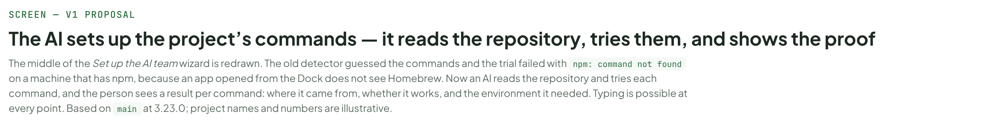

---

## A. Why this part of the wizard is redrawn

Only the middle of the wizard changes: What it suggests loses its commands, and Try the commands becomes Commands, where an AI reads the repository, tries each command once in a temporary copy, and shows its evidence. The team, the workflow, hand-over, worktrees, plugins, ports, I will do it myself and Confirm stay as they are on main. Typing the commands by hand stays possible at any moment.

Source: [AiRepoCommands.dc.html](../source/AiRepoCommands.dc.html) › block "A. Why this part of the wizard is redrawn"

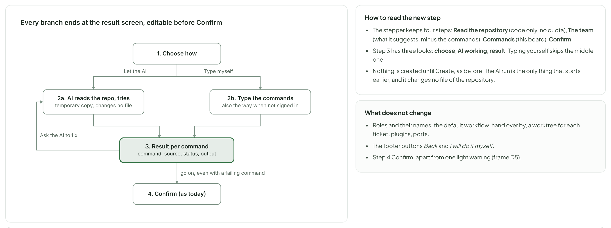

- Text in the frame (frame 1 of 2): "Every branch ends at the result screen, editable before Confirm" · "1. Choose how" · "2a. AI reads the repo, tries" · "temporary copy, changes no file" · "2b. Type the commands" · "also the way when not signed in" · "3. Result per command" · "command, source, status, output" · "4. Confirm (as today)" · "Let the AI" · "Type myself" · "Ask the AI to fix" · "go on, even with a failing command" · "How to read the new step" · "The stepper keeps four steps: Read the repository (code only, no quota), The team (what it suggests, minus the commands), Commands (this board), Confirm." · "Step 3 has three looks: choose, AI working, result. Typing yourself skips the middle one." · "Nothing is created until Create, as before. The AI run is the only thing that starts earlier, and it changes no file of the repository." · "What does not change" · "Roles and their names, the default workflow, hand over by, a worktree for each ticket, plugins, ports." · "The footer buttons Back and I will do it myself." · "Step 4 Confirm, apart from one light warning (frame D5)."

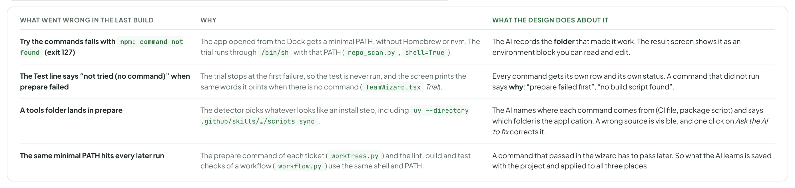

- Text in the frame (frame 2 of 2): "WHAT WENT WRONG IN THE LAST BUILD" · "WHY" · "WHAT THE DESIGN DOES ABOUT IT" · "Try the commands fails with npm: command not found (exit 127)" · "The app opened from the Dock gets a minimal PATH, without Homebrew or nvm. The trial runs through /bin/sh with that PATH (repo_scan.py, shell=True)." · "The AI records the folder that made it work. The result screen shows it as an environment block you can read and edit." · "The Test line says “not tried (no command)” when prepare failed" · "The trial stops at the first failure, so the test is never run, and the screen prints the same words it prints when there is no command (TeamWizard.tsx Trial)." · "Every command gets its own row and its own status. A command that did not run says why: “prepare failed first”, “no build script found”." · "A tools folder lands in prepare" · "The detector picks whatever looks like an install step, including uv --directory .github/skills/…/scripts sync." · "The AI names where each command comes from (CI file, package script) and says which folder is the application. A wrong source is visible, and one click on Ask the AI to fix corrects it." · "The same minimal PATH hits every later run" · "The prepare command of each ticket (worktrees.py) and the lint, build and test checks of a workflow (workflow.py) use the same shell and PATH." · "A command that passed in the wizard has to pass later. So what the AI learns is saved with the project and applied to all three places."

---

## B. Step 3 · Choose how the commands get set

The AI is the default because it is the way that has proof; typing is one click away and is the default when there is no login to use. The permission note (read-only, temporary copy) sits here, before anyone presses Start, and again as a footer while it runs.

Source: [AiRepoCommands.dc.html](../source/AiRepoCommands.dc.html) › block "B. Step 3 · Choose how the commands get set"

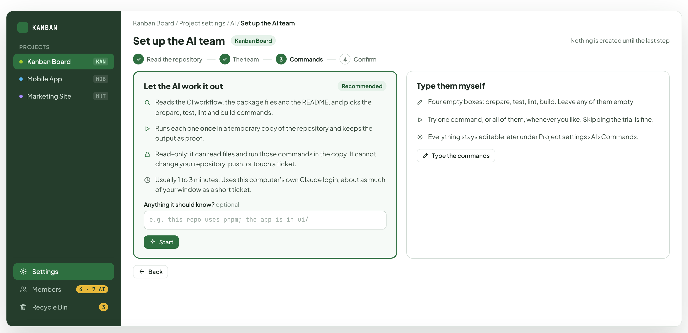

- Text in the frame (frame 1 of 2): "KANBAN" · "PROJECTS" · "Kanban Board" · "KAN" · "Mobile App" · "MOB" · "Marketing Site" · "MKT" · "Settings" · "Members" · "4 · 7 AI" · "Recycle Bin" · "3" · "Kanban Board / Project settings / AI / Set up the AI team" · "Set up the AI team" · "Nothing is created until the last step" · "Read the repository" · "The team" · "Commands" · "4" · "Confirm" · "Let the AI work it out" · "Recommended" · "Reads the CI workflow, the package files and the README, and picks the prepare, test, lint and build commands." · "Runs each one once in a temporary copy of the repository and keeps the output as proof." · "Read-only: it can read files and run those commands in the copy. It cannot change your repository, push, or touch a ticket." · "Usually 1 to 3 minutes. Uses this computer’s own Claude login, about as much of your window as a short ticket." · "Anything it should know? optional" · "e.g. this repo uses pnpm; the app is in ui/" · "Start" · "Type them myself" · "Four empty boxes: prepare, test, lint, build. Leave any of them empty." · "Try one command, or all of them, whenever you like. Skipping the trial is fine." · "Everything stays editable later under Project settings › AI › Commands." · "Type the commands" · "Back"

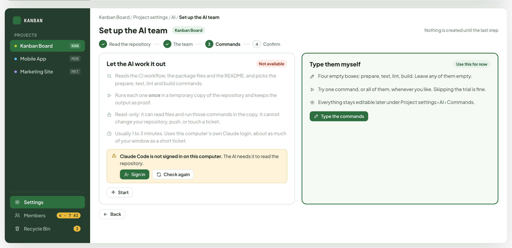

- Text in the frame (frame 2 of 2): "KANBAN" · "PROJECTS" · "Kanban Board" · "KAN" · "Mobile App" · "MOB" · "Marketing Site" · "MKT" · "Settings" · "Members" · "4 · 7 AI" · "Recycle Bin" · "3" · "Kanban Board / Project settings / AI / Set up the AI team" · "Set up the AI team" · "Nothing is created until the last step" · "Read the repository" · "The team" · "Commands" · "4" · "Confirm" · "Let the AI work it out" · "Not available" · "Reads the CI workflow, the package files and the README, and picks the prepare, test, lint and build commands." · "Runs each one once in a temporary copy of the repository and keeps the output as proof." · "Read-only: it can read files and run those commands in the copy. It cannot change your repository, push, or touch a ticket." · "Usually 1 to 3 minutes. Uses this computer’s own Claude login, about as much of your window as a short ticket." · "Claude Code is not signed in on this computer. The AI needs it to read the repository." · "Sign in" · "Check again" · "Start" · "Type them myself" · "Use this for now" · "Four empty boxes: prepare, test, lint, build. Leave any of them empty." · "Try one command, or all of them, whenever you like. Skipping the trial is fine." · "Everything stays editable later under Project settings › AI › Commands." · "Type the commands" · "Back"

---

## C. Step 3 · The AI at work

The person sees what the AI is doing as it does it: what it read, what it is running, how long it has been. The full log is one click away. It is a job on the server, not a request held open by the window, so closing the window does not stop it: the wizard keeps its place, a bar shows on the settings page, and a notice says when it is done.

Source: [AiRepoCommands.dc.html](../source/AiRepoCommands.dc.html) › block "C. Step 3 · The AI at work"

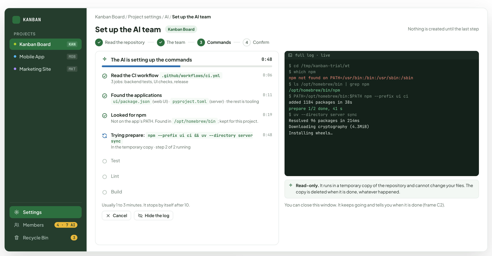

- Text in the frame (frame 1 of 2): "KANBAN" · "PROJECTS" · "Kanban Board" · "KAN" · "Mobile App" · "MOB" · "Marketing Site" · "MKT" · "Settings" · "Members" · "4 · 7 AI" · "Recycle Bin" · "3" · "Kanban Board / Project settings / AI / Set up the AI team" · "Set up the AI team" · "Nothing is created until the last step" · "Read the repository" · "The team" · "Commands" · "4" · "Confirm" · "The AI is setting up the commands" · "0:48" · "Read the CI workflow .github/workflows/ci.yml" · "3 jobs: backend tests, UI checks, release" · "0:06" · "Found the applications" · "ui/package.json (web UI) · pyproject.toml (server) · the rest is tooling" · "0:11" · "Looked for npm" · "Not on the app’s PATH. Found in /opt/homebrew/bin; kept for this project." · "0:19" · "Trying prepare: npm --prefix ui ci && uv --directory server sync" · "In the temporary copy · step 2 of 2 running" · "Test" · "Lint" · "Build" · "Usually 1 to 3 minutes. It stops by itself after 10." · "Cancel" · "Hide the log" · "full log · live" · "$ cd /tmp/kanban-trial/wt" · "$ which npm" · "npm not found on PATH=/usr/bin:/bin:/usr/sbin:/sbin" · "$ ls /opt/homebrew/bin | grep npm" · "/opt/homebrew/bin/npm" · "$ PATH=/opt/homebrew/bin:$PATH npm --prefix ui ci" · "added 1184 packages in 38s" · "prepare 1/2 done, 41 s" · "$ uv --directory server sync" · "Resolved 96 packages in 214ms" · "Downloading cryptography (4.3MiB)" · "Installing wheels…" · "Read-only. It runs in a temporary copy of the repository and cannot change your files. The copy is deleted when it is done, whatever happened." · "You can close this window. It keeps going and tells you when it is done (frame C2)."

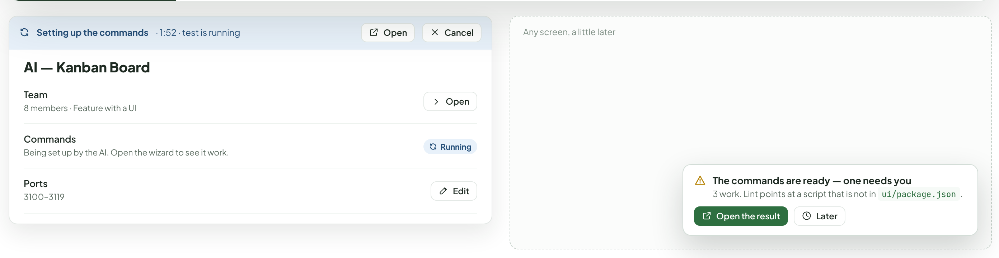

- Text in the frame (frame 2 of 2): "Setting up the commands" · "· 1:52 · test is running" · "Open" · "Cancel" · "AI — Kanban Board" · "Team" · "8 members · Feature with a UI" · "Commands" · "Being set up by the AI. Open the wizard to see it work." · "Running" · "Ports" · "3100–3119" · "Edit" · "Any screen, a little later" · "The commands are ready — one needs you" · "3 work. Lint points at a script that is not in ui/package.json." · "Open the result" · "Later"

---

## D. Step 3 · The result: one row per command

This is the screen that has to be right. Each command is a row: an editable box, where the AI got it, a status you can read at a glance, and the last lines of the output. Two kinds of red are kept apart on purpose: the command is wrong (fix it) and the repository’s own tests fail (the command is fine).

Source: [AiRepoCommands.dc.html](../source/AiRepoCommands.dc.html) › block "D. Step 3 · The result: one row per command"

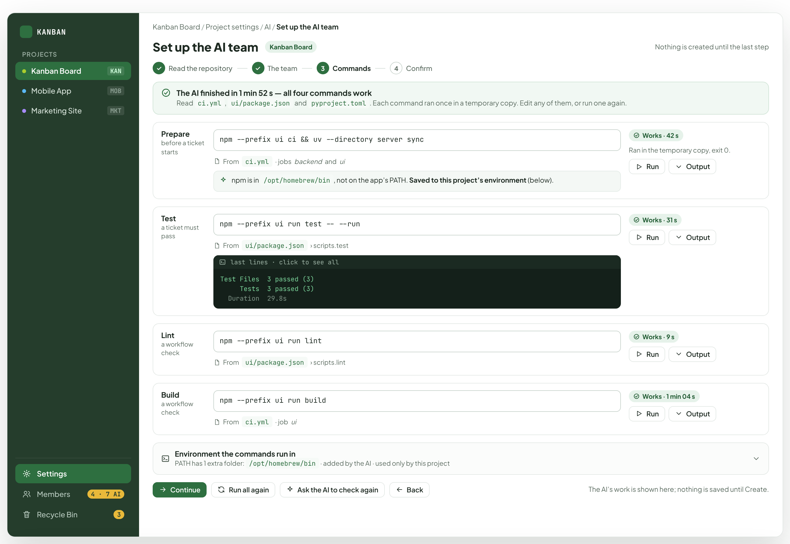

- Text in the frame (frame 1 of 5): "KANBAN" · "PROJECTS" · "Kanban Board" · "KAN" · "Mobile App" · "MOB" · "Marketing Site" · "MKT" · "Settings" · "Members" · "4 · 7 AI" · "Recycle Bin" · "3" · "Kanban Board / Project settings / AI / Set up the AI team" · "Set up the AI team" · "Nothing is created until the last step" · "Read the repository" · "The team" · "Commands" · "4" · "Confirm" · "The AI finished in 1 min 52 s — all four commands work" · "Read ci.yml, ui/package.json and pyproject.toml. Each command ran once in a temporary copy. Edit any of them, or run one again." · "Prepare" · "before a ticket starts" · "npm --prefix ui ci && uv --directory server sync" · "From" · "ci.yml" · "· jobs" · "backend" · "and" · "ui" · "npm is in /opt/homebrew/bin, not on the app’s PATH. Saved to this project’s environment (below)." · "Works · 42 s" · "Ran in the temporary copy, exit 0." · "Run" · "Output" · "Test" · "a ticket must pass" · "npm --prefix ui run test -- --run" · "ui/package.json" · "› scripts.test" · "last lines · click to see all" · "Test Files  3 passed (3)" · "Tests  3 passed (3)" · "Duration  29.8s" · "Works · 31 s" · "Lint" · "a workflow check" · "npm --prefix ui run lint" · "› scripts.lint" · "Works · 9 s" · "Build" · "npm --prefix ui run build" · "· job" · "Works · 1 min 04 s" · "Environment the commands run in" · "PATH has 1 extra folder: /opt/homebrew/bin · added by the AI · used only by this project" · "Continue" · "Run all again" · "Ask the AI to check again" · "Back" · "The AI’s work is shown here; nothing is saved until Create."

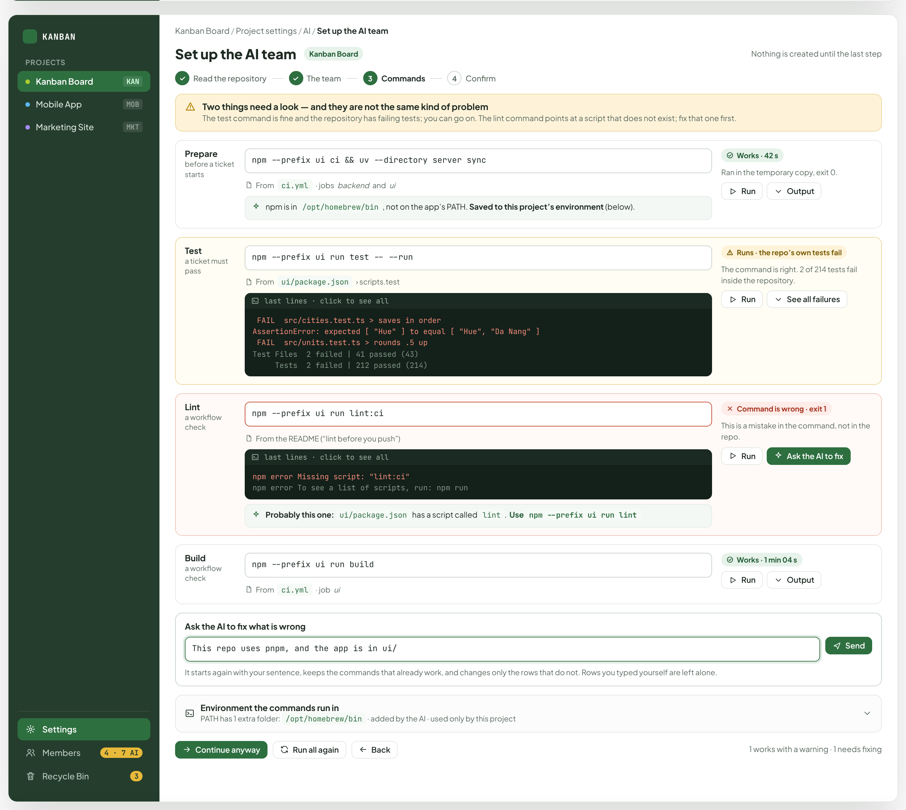

- Text in the frame (frame 2 of 5): "KANBAN" · "PROJECTS" · "Kanban Board" · "KAN" · "Mobile App" · "MOB" · "Marketing Site" · "MKT" · "Settings" · "Members" · "4 · 7 AI" · "Recycle Bin" · "3" · "Kanban Board / Project settings / AI / Set up the AI team" · "Set up the AI team" · "Nothing is created until the last step" · "Read the repository" · "The team" · "Commands" · "4" · "Confirm" · "Two things need a look — and they are not the same kind of problem" · "The test command is fine and the repository has failing tests; you can go on. The lint command points at a script that does not exist; fix that one first." · "Prepare" · "before a ticket starts" · "npm --prefix ui ci && uv --directory server sync" · "From" · "ci.yml" · "· jobs" · "backend" · "and" · "ui" · "npm is in /opt/homebrew/bin, not on the app’s PATH. Saved to this project’s environment (below)." · "Works · 42 s" · "Ran in the temporary copy, exit 0." · "Run" · "Output" · "Test" · "a ticket must pass" · "npm --prefix ui run test -- --run" · "ui/package.json" · "› scripts.test" · "last lines · click to see all" · "FAIL  src/cities.test.ts > saves in order" · "AssertionError: expected [ "Hue" ] to equal [ "Hue", "Da Nang" ]" · "FAIL  src/units.test.ts > rounds .5 up" · "Test Files  2 failed | 41 passed (43)" · "Tests  2 failed | 212 passed (214)" · "Runs · the repo’s own tests fail" · "The command is right. 2 of 214 tests fail inside the repository." · "See all failures" · "Lint" · "a workflow check" · "npm --prefix ui run lint:ci" · "From the README (“lint before you push”)" · "npm error Missing script: "lint:ci"" · "npm error To see a list of scripts, run: npm run" · "Probably this one: ui/package.json has a script called lint.  Use npm --prefix ui run lint" · "Command is wrong · exit 1" · "This is a mistake in the command, not in the repo." · "Ask the AI to fix" · "Build" · "npm --prefix ui run build" · "· job" · "Works · 1 min 04 s" · "Ask the AI to fix what is wrong" · "This repo uses pnpm, and the app is in ui/" · "Send" · "It starts again with your sentence, keeps the commands that already work, and changes only the rows that do not. Rows you typed yourself are left alone." · "Environment the commands run in" · "PATH has 1 extra folder: /opt/homebrew/bin · added by the AI · used only by this project" · "Continue anyway" · "Run all again" · "Back" · "1 works with a warning · 1 needs fixing"

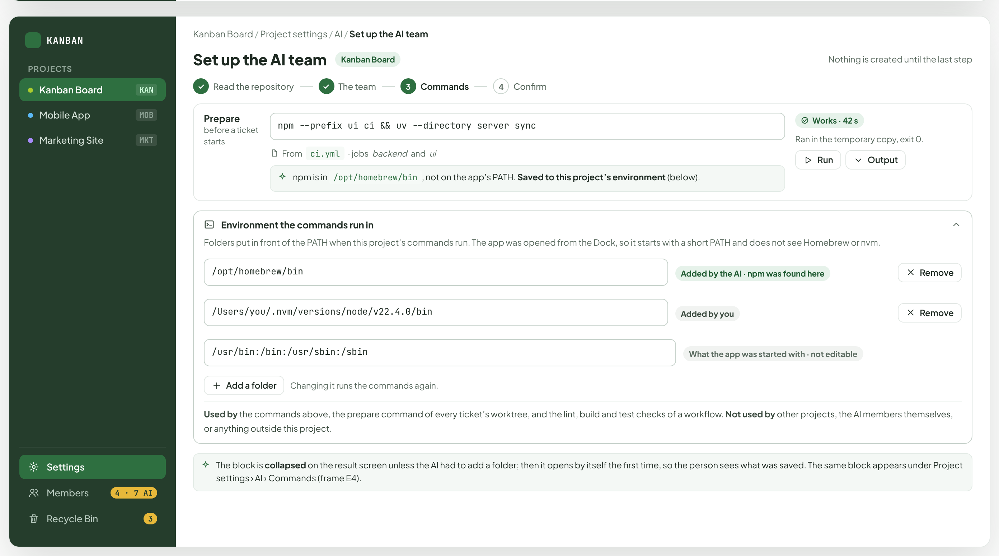

- Text in the frame (frame 3 of 5): "KANBAN" · "PROJECTS" · "Kanban Board" · "KAN" · "Mobile App" · "MOB" · "Marketing Site" · "MKT" · "Settings" · "Members" · "4 · 7 AI" · "Recycle Bin" · "3" · "Kanban Board / Project settings / AI / Set up the AI team" · "Set up the AI team" · "Nothing is created until the last step" · "Read the repository" · "The team" · "Commands" · "4" · "Confirm" · "Prepare" · "before a ticket starts" · "npm --prefix ui ci && uv --directory server sync" · "From" · "ci.yml" · "· jobs" · "backend" · "and" · "ui" · "npm is in /opt/homebrew/bin, not on the app’s PATH. Saved to this project’s environment (below)." · "Works · 42 s" · "Ran in the temporary copy, exit 0." · "Run" · "Output" · "Environment the commands run in" · "Folders put in front of the PATH when this project’s commands run. The app was opened from the Dock, so it starts with a short PATH and does not see Homebrew or nvm." · "/opt/homebrew/bin" · "Added by the AI · npm was found here" · "Remove" · "/Users/you/.nvm/versions/node/v22.4.0/bin" · "Added by you" · "/usr/bin:/bin:/usr/sbin:/sbin" · "What the app was started with · not editable" · "Add a folder" · "Changing it runs the commands again." · "Used by the commands above, the prepare command of every ticket’s worktree, and the lint, build and test checks of a workflow. Not used by other projects, the AI members themselves, or anything outside this project." · "The block is collapsed on the result screen unless the AI had to add a folder; then it opens by itself the first time, so the person sees what was saved. The same block appears under Project settings › AI › Commands (frame E4)."

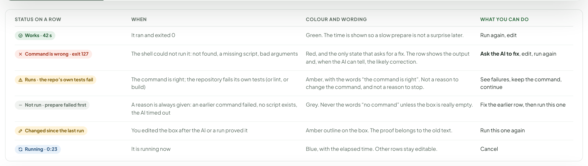

- Text in the frame (frame 4 of 5): "STATUS ON A ROW" · "WHEN" · "COLOUR AND WORDING" · "WHAT YOU CAN DO" · "Works · 42 s" · "It ran and exited 0" · "Green. The time is shown so a slow prepare is not a surprise later." · "Run again, edit" · "Command is wrong · exit 127" · "The shell could not run it: not found, a missing script, bad arguments" · "Red, and the only state that asks for a fix. The row shows the output and, when the AI can tell, the likely correction." · "Ask the AI to fix, edit, run again" · "Runs · the repo’s own tests fail" · "The command is right; the repository fails its own tests (or lint, or build)" · "Amber, with the words “the command is right”. Not a reason to change the command, and not a reason to stop." · "See failures, keep the command, continue" · "Not run · prepare failed first" · "A reason is always given: an earlier command failed, no script exists, the AI timed out" · "Grey. Never the words “no command” unless the box is really empty." · "Fix the earlier row, then run this one" · "Changed since the last run" · "You edited the box after the AI or a run proved it" · "Amber outline on the box. The proof belongs to the old text." · "Run this one again" · "Running · 0:23" · "It is running now" · "Blue, with the elapsed time. Other rows stay editable." · "Cancel"

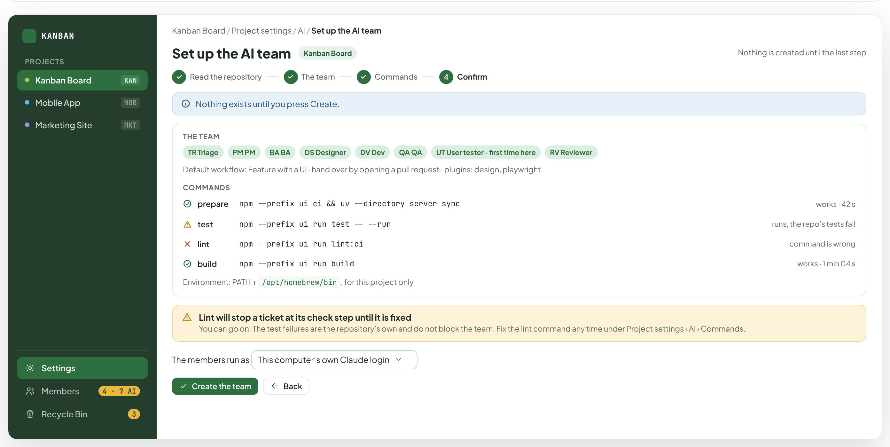

- Text in the frame (frame 5 of 5): "KANBAN" · "PROJECTS" · "Kanban Board" · "KAN" · "Mobile App" · "MOB" · "Marketing Site" · "MKT" · "Settings" · "Members" · "4 · 7 AI" · "Recycle Bin" · "3" · "Kanban Board / Project settings / AI / Set up the AI team" · "Set up the AI team" · "Nothing is created until the last step" · "Read the repository" · "The team" · "Commands" · "4" · "Confirm" · "Nothing exists until you press Create." · "THE TEAM" · "TR Triage" · "PM PM" · "BA BA" · "DS Designer" · "DV Dev" · "QA QA" · "UT User tester · first time here" · "RV Reviewer" · "Default workflow: Feature with a UI · hand over by opening a pull request · plugins: design, playwright" · "COMMANDS" · "prepare" · "npm --prefix ui ci && uv --directory server sync" · "works · 42 s" · "test" · "npm --prefix ui run test -- --run" · "runs, the repo’s tests fail" · "lint" · "npm --prefix ui run lint:ci" · "command is wrong" · "build" · "npm --prefix ui run build" · "works · 1 min 04 s" · "Environment: PATH + /opt/homebrew/bin, for this project only" · "Lint will stop a ticket at its check step until it is fixed" · "You can go on. The test failures are the repository’s own and do not block the team. Fix the lint command any time under Project settings › AI › Commands." · "The members run as This computer’s own Claude login" · "Create the team" · "Back"

---

## E. The other states

The sixth state, the AI at work, is C; not being signed in is B. These four are the rest. The last one is not part of the wizard: it is the same rows under project settings, so the environment block does not vanish after setup.

Source: [AiRepoCommands.dc.html](../source/AiRepoCommands.dc.html) › block "E. The other states"

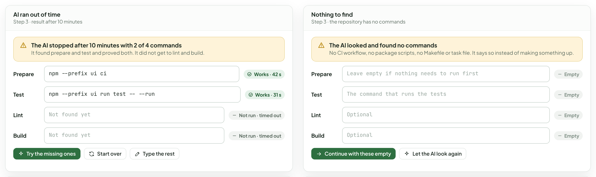

- Text in the frame (frame 1 of 2): "AI ran out of time" · "Step 3 · result after 10 minutes" · "The AI stopped after 10 minutes with 2 of 4 commands" · "It found prepare and test and proved both. It did not get to lint and build." · "Prepare" · "npm --prefix ui ci" · "Works · 42 s" · "Test" · "npm --prefix ui run test -- --run" · "Works · 31 s" · "Lint" · "Not found yet" · "Not run · timed out" · "Build" · "Try the missing ones" · "Start over" · "Type the rest" · "Nothing to find" · "Step 3 · the repository has no commands" · "The AI looked and found no commands" · "No CI workflow, no package scripts, no Makefile or task file. It says so instead of making something up." · "Leave empty if nothing needs to run first" · "Empty" · "The command that runs the tests" · "Optional" · "Continue with these empty" · "Let the AI look again"

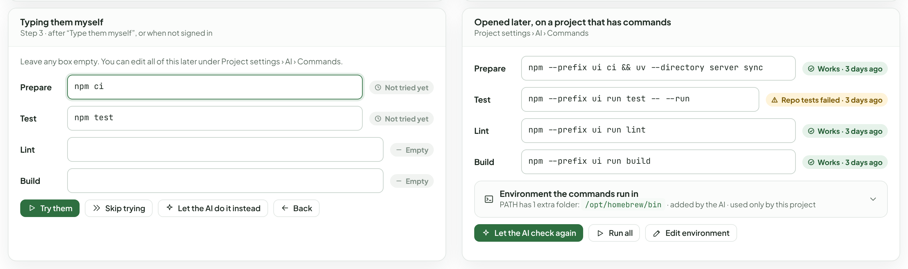

- Text in the frame (frame 2 of 2): "Typing them myself" · "Step 3 · after “Type them myself”, or when not signed in" · "Leave any box empty. You can edit all of this later under Project settings › AI › Commands." · "Prepare" · "npm ci" · "Not tried yet" · "Test" · "npm test" · "Lint" · "Empty" · "Build" · "Try them" · "Skip trying" · "Let the AI do it instead" · "Back" · "Opened later, on a project that has commands" · "Project settings › AI › Commands" · "npm --prefix ui ci && uv --directory server sync" · "Works · 3 days ago" · "npm --prefix ui run test -- --run" · "Repo tests failed · 3 days ago" · "npm --prefix ui run lint" · "npm --prefix ui run build" · "Environment the commands run in" · "PATH has 1 extra folder: /opt/homebrew/bin · added by the AI · used only by this project" · "Let the AI check again" · "Run all" · "Edit environment"

---

## F. What stays, what goes, and what is still open

The questions at the end of the brief, each with a recommendation and the frame where it is drawn; then what the server would have to do for any of this to be true.

Source: [AiRepoCommands.dc.html](../source/AiRepoCommands.dc.html) › block "F. What stays, what goes, and what is still open"

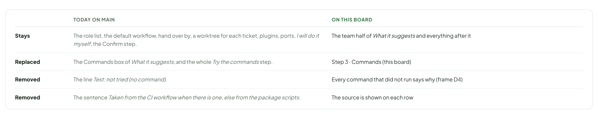

- Text in the frame (frame 1 of 3): "TODAY ON MAIN" · "ON THIS BOARD" · "Stays" · "The role list, the default workflow, hand over by, a worktree for each ticket, plugins, ports, I will do it myself, the Confirm step." · "The team half of What it suggests and everything after it" · "Replaced" · "The Commands box of What it suggests, and the whole Try the commands step." · "Step 3 · Commands (this board)" · "Removed" · "The line Test: not tried (no command)." · "Every command that did not run says why (frame D4)" · "The sentence Taken from the CI workflow when there is one, else from the package scripts." · "The source is shown on each row"

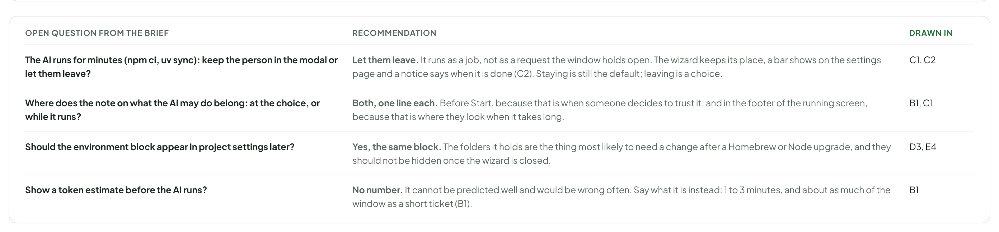

- Text in the frame (frame 2 of 3): "OPEN QUESTION FROM THE BRIEF" · "RECOMMENDATION" · "DRAWN IN" · "The AI runs for minutes (npm ci, uv sync): keep the person in the modal or let them leave?" · "Let them leave. It runs as a job, not as a request the window holds open. The wizard keeps its place, a bar shows on the settings page and a notice says when it is done (C2). Staying is still the default; leaving is a choice." · "C1, C2" · "Where does the note on what the AI may do belong: at the choice, or while it runs?" · "Both, one line each. Before Start, because that is when someone decides to trust it; and in the footer of the running screen, because that is where they look when it takes long." · "B1, C1" · "Should the environment block appear in project settings later?" · "Yes, the same block. The folders it holds are the thing most likely to need a change after a Homebrew or Node upgrade, and they should not be hidden once the wizard is closed." · "D3, E4" · "Show a token estimate before the AI runs?" · "No number. It cannot be predicted well and would be wrong often. Say what it is instead: 1 to 3 minutes, and about as much of the window as a short ticket (B1)." · "B1"

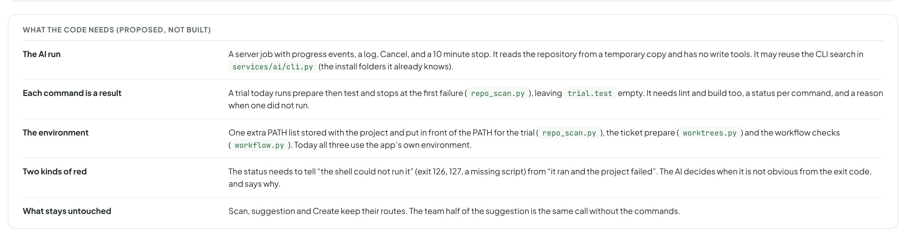

- Text in the frame (frame 3 of 3): "WHAT THE CODE NEEDS (PROPOSED, NOT BUILT)" · "The AI run" · "A server job with progress events, a log, Cancel, and a 10 minute stop. It reads the repository from a temporary copy and has no write tools. It may reuse the CLI search in services/ai/cli.py (the install folders it already knows)." · "Each command is a result" · "A trial today runs prepare then test and stops at the first failure (repo_scan.py), leaving trial.test empty. It needs lint and build too, a status per command, and a reason when one did not run." · "The environment" · "One extra PATH list stored with the project and put in front of the PATH for the trial (repo_scan.py), the ticket prepare (worktrees.py) and the workflow checks (workflow.py). Today all three use the app’s own environment." · "Two kinds of red" · "The status needs to tell “the shell could not run it” (exit 126, 127, a missing script) from “it ran and the project failed”. The AI decides when it is not obvious from the exit code, and says why." · "What stays untouched" · "Scan, suggestion and Create keep their routes. The team half of the suggestion is the same call without the commands."
