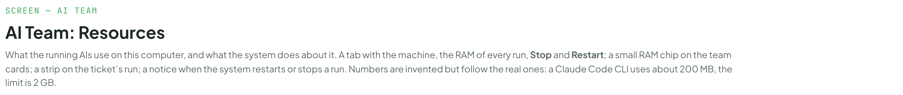
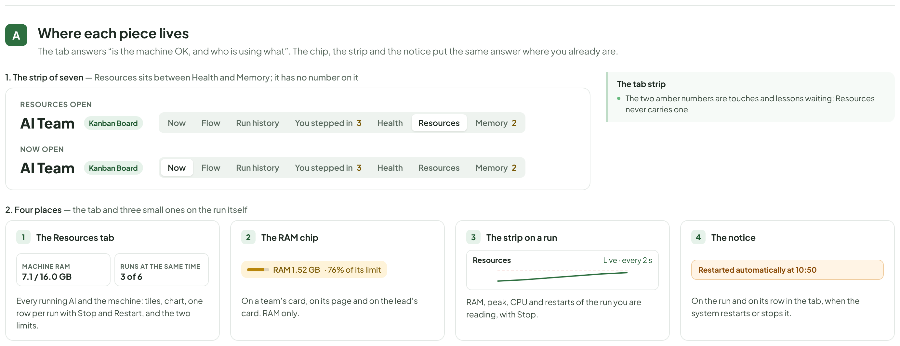
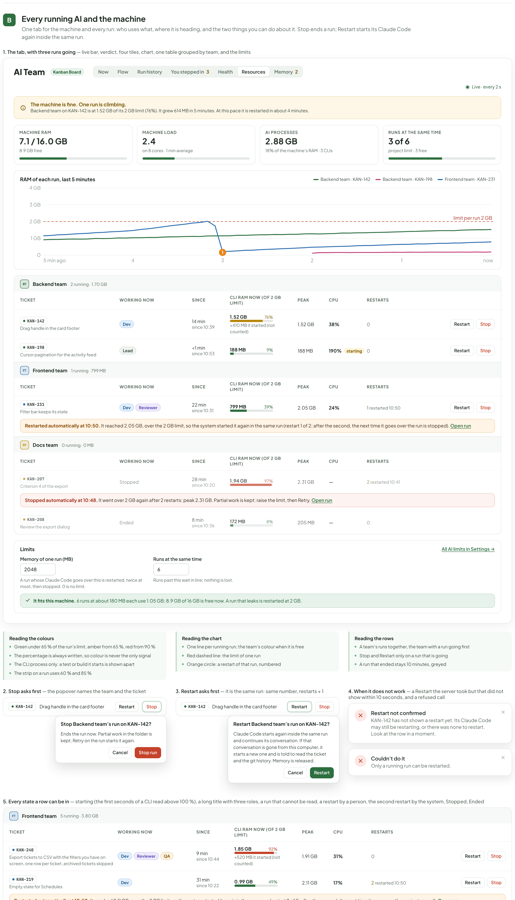
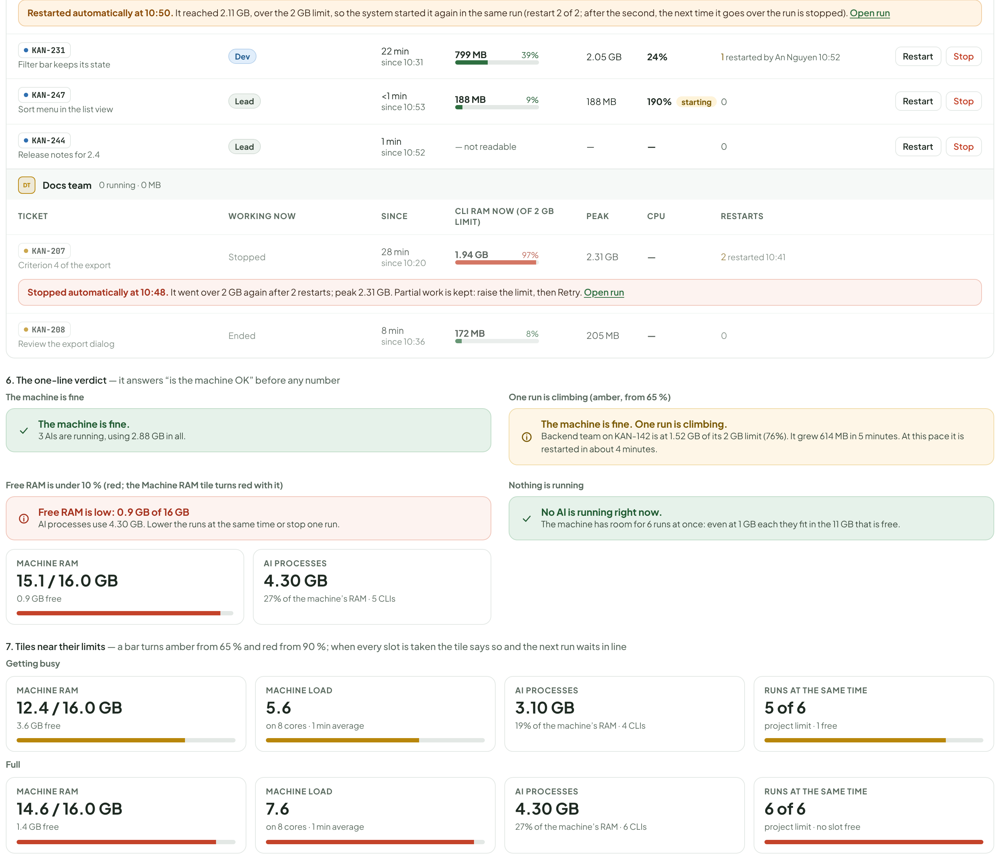
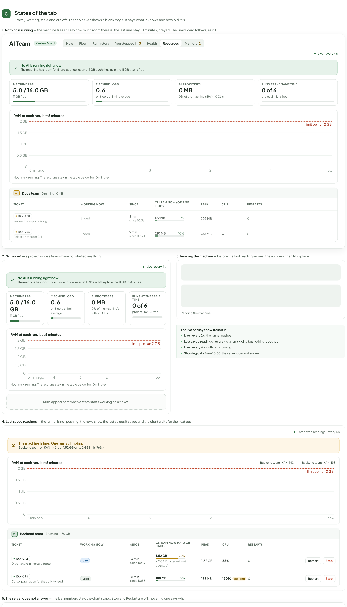
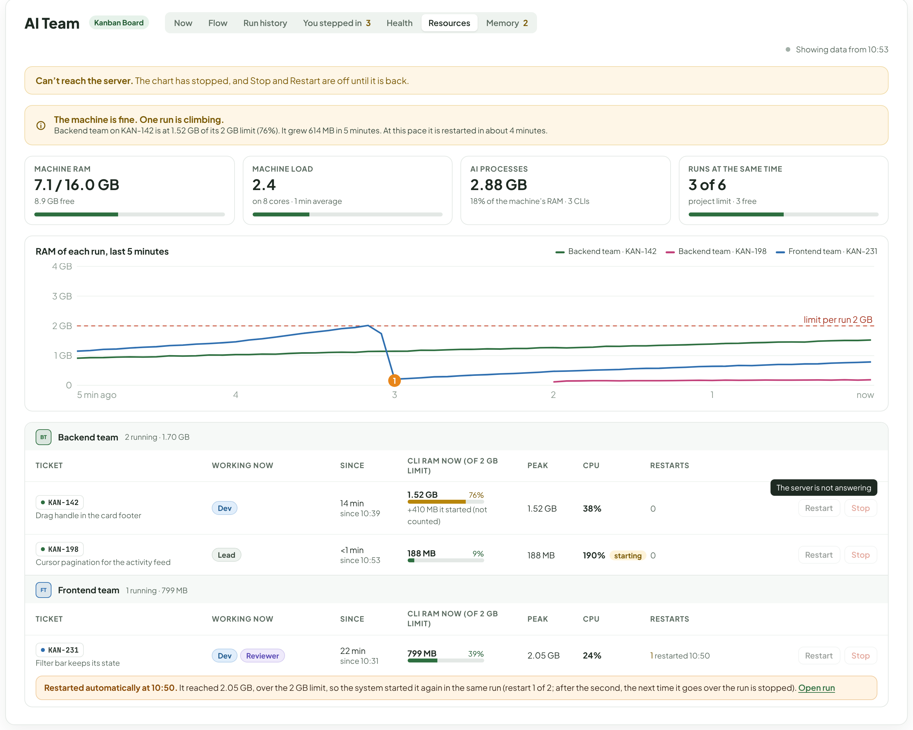
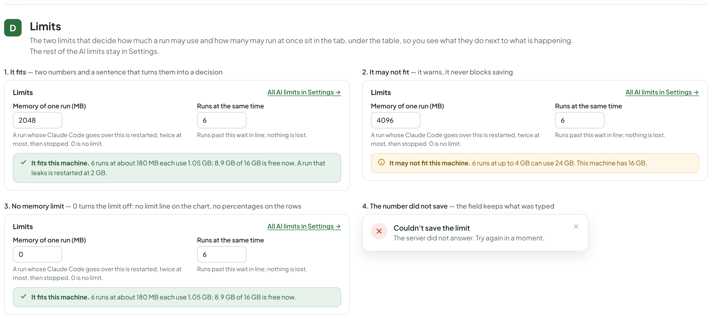
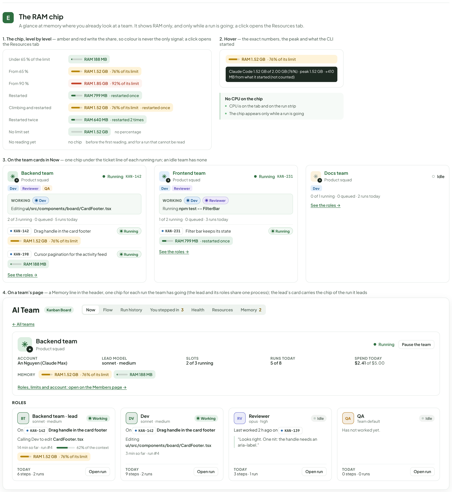
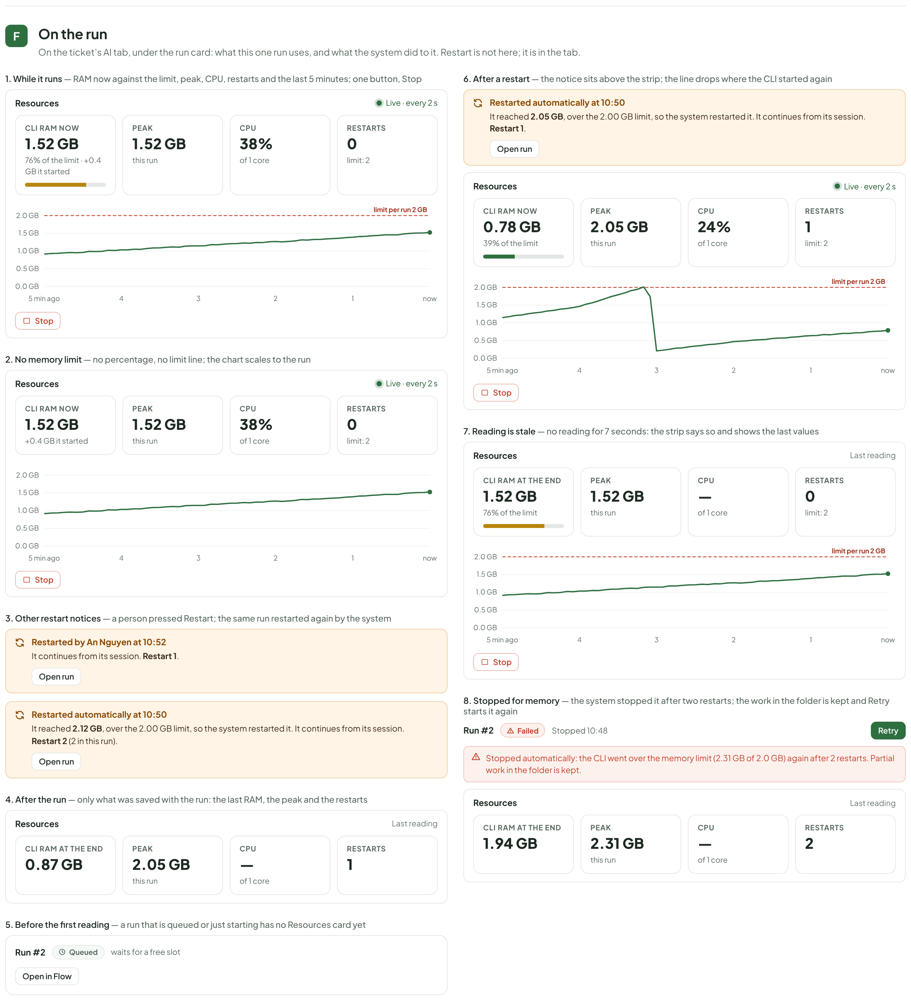
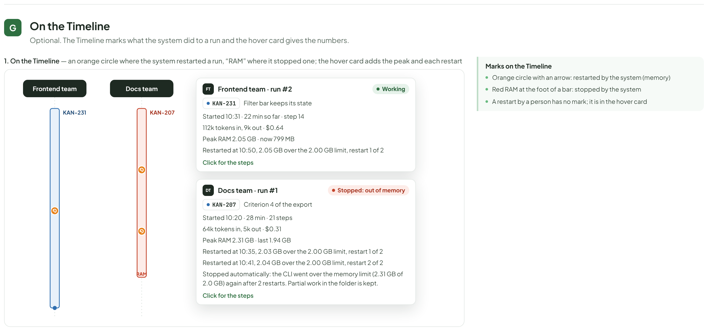

# AI Team — Resources: what the running AIs use

> Redrawn for AI v2 · source: [`AiResources.dc.html`](../source/AiResources.dc.html) · canvas `1794110641-1323` · sha256 `c2d737a4d118989cc57654713cd15711b907cba6139a297b8763099f10d47305`

> Words, states and conditions follow the code of branch `claude/ai-team-architecture-7a1efc`; the layout is designed here and is not the layout of the current screens. Names, ids, costs and times in the mock-ups are sample data. **Check the code before building from this: the file named in each part is the truth, not the picture.**

## SCREEN — AI TEAM

- Text in this part: "SCREEN — AI TEAM" · "AI Team: Resources" · "What the running AIs use on this computer, and what the system does about it. A tab with the machine, the RAM of every run, Stop and Restart; a small RAM chip on the team cards; a strip on the ticket’s run; a notice when the system restarts or stops a run. Numbers are invented but follow the real ones: a Claude Code CLI uses about 200 MB, the limit is 2 GB."

---

## Where each piece lives

- Text in this part: "A" · "Where each piece lives" · "The tab answers “is the machine OK, and who is using what”. The chip, the strip and the notice put the same answer where you already are." · "1. The strip of seven — Resources sits between Health and Memory; it has no number on it" · "RESOURCES OPEN" · "AI Team" · "Kanban Board" · "Now" · "Flow" · "Run history" · "You stepped in" · "3" · "Health" · "Resources" · "Memory" · "2" · "NOW OPEN" · "The tab strip" · "The two amber numbers are touches and lessons waiting; Resources never carries one" · "2. Four places — the tab and three small ones on the run itself" · "1" · "The Resources tab" · "MACHINE RAM" · "7.1 / 16.0 GB" · "RUNS AT THE SAME TIME" · "3 of 6" · "Every running AI and the machine: tiles, chart, one row per run with Stop and Restart, and the two limits." · "The RAM chip" · "RAM 1.52 GB" · "· 76% of its limit" · "On a team’s card, on its page and on the lead’s card. RAM only." · "The strip on a run" · "Live · every 2 s" · "RAM, peak, CPU and restarts of the run you are reading, with Stop." · "4" · "The notice" · "Restarted automatically at 10:50" · "On the run and on its row in the tab, when the system restarts or stops it."

---

## Every running AI and the machine

- Text in this part: "B" · "Every running AI and the machine" · "One tab for the machine and every run: who uses what, where it is heading, and the two things you can do about it. Stop ends a run; Restart starts its Claude Code again inside the same run." · "1. The tab, with three runs going — live bar, verdict, four tiles, chart, one table grouped by team, and the limits" · "AI Team" · "Kanban Board" · "Now" · "Flow" · "Run history" · "You stepped in" · "3" · "Health" · "Resources" · "Memory" · "2" · "Live · every 2 s" · "The machine is fine. One run is climbing." · "Backend team on KAN-142 is at 1.52 GB of its 2 GB limit (76%). It grew 614 MB in 5 minutes. At this pace it is restarted in about 4 minutes." · "MACHINE RAM" · "7.1 / 16.0 GB" · "8.9 GB free" · "MACHINE LOAD" · "2.4" · "on 8 cores · 1 min average" · "AI PROCESSES" · "2.88 GB" · "18% of the machine’s RAM · 3 CLIs" · "RUNS AT THE SAME TIME" · "3 of 6" · "project limit · 3 free" · "RAM of each run, last 5 minutes" · "Backend team · KAN-142" · "Backend team · KAN-198" · "Frontend team · KAN-231" · "0" · "1 GB" · "2 GB" · "3 GB" · "4 GB" · "limit per run 2 GB" · "1" · "4" · "5 min ago" · "now" · "BT" · "Backend team" · "2 running · 1.70 GB" · "TICKET" · "WORKING NOW" · "SINCE" · "CLI RAM NOW (OF 2 GB LIMIT)" · "PEAK" · "CPU" · "RESTARTS" · "KAN-142" · "Drag handle in the card footer" · "Dev" · "14 min" · "since 10:39" · "1.52 GB" · "76%" · "+410 MB it started (not counted)" · "38%" · "Restart" · "Stop" · "KAN-198" · "Cursor pagination for the activity feed" · "Lead" · "<1 min" · "since 10:53" · "188 MB" · "9%" · "190%starting" · "FT" · "Frontend team" · "1 running · 799 MB" · "KAN-231" · "Filter bar keeps its state" · "Reviewer" · "22 min" · "since 10:31" · "799 MB" · "39%" · "2.05 GB" · "24%" · "1 restarted 10:50" · "Restarted automatically at 10:50. It reached 2.05 GB, over the 2 GB limit, so the system started it again in the same run (restart 1 of 2; after the second, the next time it goes over the run is stopped). Open run" · "DT" · "Docs team" · "0 running · 0 MB" · "KAN-207" · "Criterion 4 of the export" · "Stopped" · "28 min" · "since 10:20" · "1.94 GB" · "97%" · "2.31 GB" · "—" · "2 restarted 10:41" · "Stopped automatically at 10:48. It went over 2 GB again after 2 restarts; peak 2.31 GB. Partial work is kept: raise the limit, then Retry. Open run" · "KAN-208" · "Review the export dialog" · "Ended" · "8 min" · "since 10:36" · "172 MB" · "8%" · "205 MB" · "Limits"

---

## States of the tab

- Text in this part: "C" · "States of the tab" · "Empty, waiting, stale and cut off. The tab never shows a blank page: it says what it knows and how old it is." · "1. Nothing is running — the machine tiles still say how much room there is; the last runs stay 10 minutes, greyed. The Limits card follows, as in B1" · "AI Team" · "Kanban Board" · "Now" · "Flow" · "Run history" · "You stepped in" · "3" · "Health" · "Resources" · "Memory" · "2" · "Live · every 4 s" · "No AI is running right now." · "The machine has room for 6 runs at once: even at 1 GB each they fit in the 11 GB that is free." · "MACHINE RAM" · "5.0 / 16.0 GB" · "11 GB free" · "MACHINE LOAD" · "0.6" · "on 8 cores · 1 min average" · "AI PROCESSES" · "0 MB" · "0% of the machine’s RAM · 0 CLIs" · "RUNS AT THE SAME TIME" · "0 of 6" · "project limit · 6 free" · "RAM of each run, last 5 minutes" · "0" · "0.5 GB" · "1 GB" · "1.5 GB" · "2 GB" · "limit per run 2 GB" · "1" · "4" · "5 min ago" · "now" · "Nothing is running. The last runs stay in the table below for 10 minutes." · "DT" · "Docs team" · "0 running · 0 MB" · "TICKET" · "WORKING NOW" · "SINCE" · "CLI RAM NOW (OF 2 GB LIMIT)" · "PEAK" · "CPU" · "RESTARTS" · "KAN-208" · "Review the export dialog" · "Ended" · "8 min" · "since 10:36" · "172 MB" · "8%" · "205 MB" · "—" · "KAN-201" · "Release notes for 2.4" · "9 min" · "since 10:30" · "210 MB" · "10%" · "244 MB" · "2. No run yet — a project whose teams have not started anything" · "Runs appear here when a team starts working on a ticket." · "3. Reading the machine — before the first reading arrives; the numbers then fill in place" · "Reading the machine…" · "The live bar says how fresh it is" · "Live · every 2 s: the runner pushes" · "Last saved readings · every 4 s: a run is going but nothing is pushed" · "Live · every 4 s: nothing is running" · "Showing data from 10:53: the server does not answer" · "4. Last saved readings — the runner is not pushing: the rows show the last values it saved and the chart waits for the next push" · "Last saved readings · every 4 s" · "The machine is fine. One run is climbing." · "Backend team on KAN-142 is at 1.52 GB of its 2 GB limit (76%)." · "Backend team · KAN-142" · "Backend team · KAN-198" · "BT" · "Backend team" · "2 running · 1.70 GB" · "KAN-142" · "Drag handle in the card footer" · "Dev" · "14 min" · "since 10:39" · "1.52 GB" · "76%" · "+410 MB it started (not counted)" · "38%" · "Restart" · "Stop" · "KAN-198" · "Cursor pagination for the activity feed" · "Lead" · "<1 min" · "since 10:53" · "188 MB" · "9%" · "190%starting" · "5. The server does not answer — the last numbers stay, the chart stops, Stop and Restart are off; hovering one says why" · "Showing data from 10:53" · "Can’t reach the server. The chart has stopped, and Stop and Restart are off until it is back." · "Backend team on KAN-142 is at 1.52 GB of its 2 GB limit (76%). It grew 614 MB in 5 minutes. At this pace it is restarted in about 4 minutes." · "7.1 / 16.0 GB"

---

## Limits

- Text in this part: "D" · "Limits" · "The two limits that decide how much a run may use and how many may run at once sit in the tab, under the table, so you see what they do next to what is happening. The rest of the AI limits stay in Settings." · "1. It fits — two numbers and a sentence that turns them into a decision" · "All AI limits in Settings →" · "Memory of one run (MB)" · "2048" · "A run whose Claude Code goes over this is restarted, twice at most, then stopped. 0 is no limit." · "Runs at the same time" · "6" · "Runs past this wait in line; nothing is lost." · "It fits this machine. 6 runs at about 180 MB each use 1.05 GB; 8.9 GB of 16 GB is free now. A run that leaks is restarted at 2 GB." · "2. It may not fit — it warns, it never blocks saving" · "4096" · "It may not fit this machine. 6 runs at up to 4 GB can use 24 GB. This machine has 16 GB." · "3. No memory limit — 0 turns the limit off: no limit line on the chart, no percentages on the rows" · "0" · "It fits this machine. 6 runs at about 180 MB each use 1.05 GB; 8.9 GB of 16 GB is free now." · "4. The number did not save — the field keeps what was typed" · "Couldn't save the limit" · "The server did not answer. Try again in a moment."

---

## The RAM chip

- Text in this part: "E" · "The RAM chip" · "A glance at memory where you already look at a team. It shows RAM only, and only while a run is going; a click opens the Resources tab." · "1. The chip, level by level — amber and red write the share, so colour is never the only signal; a click opens the Resources tab" · "Under 65 % of the limit" · "RAM 188 MB" · "From 65 %" · "RAM 1.52 GB" · "· 76% of its limit" · "From 90 %" · "RAM 1.85 GB" · "· 92% of its limit" · "Restarted" · "RAM 799 MB" · "· restarted once" · "Climbing and restarted" · "Restarted twice" · "RAM 640 MB" · "· restarted 2 times" · "No limit set" · "no percentage" · "No reading yet" · "no chip" · "before the first reading, and for a run that cannot be read" · "2. Hover — the exact numbers, the peak and what the CLI started" · "Claude Code 1.52 GB of 2.00 GB (76%) · peak 1.52 GB · +410 MB from what it started (not counted)" · "No CPU on the chip" · "CPU is on the tab and on the run strip" · "The chip appears only while a run is going" · "3. On the team cards in Now — one chip under the ticket line of each running run; an idle team has none" · "Backend team" · "Product squad" · "Running" · "KAN-142" · "Dev" · "Reviewer" · "QA" · "WORKING" · "Editing ui/src/components/board/CardFooter.tsx" · "2 of 3 running · 0 queued · 5 runs today" · "Drag handle in the card footer" · "KAN-198" · "Cursor pagination for the activity feed" · "See the roles →" · "Frontend team" · "KAN-231" · "Running npm test -- FilterBar" · "1 of 2 running · 0 queued · 3 runs today" · "Filter bar keeps its state" · "Docs team" · "Idle" · "0 of 1 running · 0 queued · 2 runs today" · "4. On a team’s page — a Memory line in the header, one chip for each run the team has going (the lead and its roles share one process); the lead’s card carries the chip of the run it leads" · "AI Team" · "Kanban Board" · "Now" · "Flow" · "Run history" · "You stepped in" · "3" · "Health" · "Resources" · "Memory" · "2" · "← All teams" · "Pause the team" · "ACCOUNT" · "An Nguyen (Claude Max)" · "LEAD MODEL" · "sonnet · medium" · "SLOTS" · "2 of 3 running" · "RUNS TODAY" · "5 of 8" · "SPEND TODAY" · "$2.41 of $5.00" · "MEMORY" · "Roles, limits and account: open on the Members page →" · "ROLES" · "BT" · "Backend team · lead" · "Working" · "On" · "KAN-142 Drag handle in the card footer" · "Calling Dev to edit CardFooter.tsx" · "14 min so far · run #4" · "62% of the context" · "TODAY" · "6 steps · 2 runs" · "Open run" · "DV" · "3 min so far · run #4" · "9 steps · 2 runs" · "RV" · "opus · high" · "Last worked 2 h ago on" · "KAN-139" · "“Looks right. One nit: the handle needs an aria-label.”" · "3 steps · 1 run" · "Team default" · "Has not worked yet." · "0 steps · 0 runs"

---

## On the run

- Text in this part: "F" · "On the run" · "On the ticket’s AI tab, under the run card: what this one run uses, and what the system did to it. Restart is not here; it is in the tab." · "1. While it runs — RAM now against the limit, peak, CPU, restarts and the last 5 minutes; one button, Stop" · "Resources" · "Live · every 2 s" · "CLI RAM NOW" · "1.52 GB" · "76% of the limit · +0.4 GB it started" · "PEAK" · "this run" · "CPU" · "38%" · "of 1 core" · "RESTARTS" · "0" · "limit: 2" · "0.0 GB" · "0.5 GB" · "1.0 GB" · "1.5 GB" · "2.0 GB" · "5 min ago" · "4" · "3" · "2" · "1" · "now" · "limit per run 2 GB" · "Stop" · "2. No memory limit — no percentage, no limit line; the chart scales to the run" · "+0.4 GB it started" · "3. Other restart notices — a person pressed Restart; the same run restarted again by the system" · "Restarted by An Nguyen at 10:52" · "It continues from its session. Restart 1." · "Open run" · "Restarted automatically at 10:50" · "It reached 2.12 GB, over the 2.00 GB limit, so the system restarted it. It continues from its session. Restart 2 (2 in this run)." · "4. After the run — only what was saved with the run: the last RAM, the peak and the restarts" · "Last reading" · "CLI RAM AT THE END" · "0.87 GB" · "2.05 GB" · "—" · "5. Before the first reading — a run that is queued or just starting has no Resources card yet" · "Run #2" · "Queued" · "waits for a free slot" · "Open in Flow" · "6. After a restart — the notice sits above the strip; the line drops where the CLI started again" · "It reached 2.05 GB, over the 2.00 GB limit, so the system restarted it. It continues from its session. Restart 1." · "0.78 GB" · "39% of the limit" · "24%" · "7. Reading is stale — no reading for 7 seconds: the strip says so and shows the last values" · "76% of the limit" · "8. Stopped for memory — the system stopped it after two restarts; the work in the folder is kept and Retry starts it again" · "Failed" · "Stopped 10:48" · "Retry" · "Stopped automatically: the CLI went over the memory limit (2.31 GB of 2.0 GB) again after 2 restarts. Partial work in the folder is kept." · "1.94 GB" · "2.31 GB"

---

## On the Timeline

- Text in this part: "G" · "On the Timeline" · "Optional. The Timeline marks what the system did to a run and the hover card gives the numbers." · "1. On the Timeline — an orange circle where the system restarted a run, “RAM” where it stopped one; the hover card adds the peak and each restart" · "Frontend team" · "Docs team" · "KAN-231" · "RAM" · "KAN-207" · "FT" · "Frontend team · run #2" · "Working" · "Filter bar keeps its state" · "Started 10:31 · 22 min so far · step 14" · "112k tokens in, 9k out · $0.64" · "Peak RAM 2.05 GB · now 799 MB" · "Restarted at 10:50, 2.05 GB over the 2.00 GB limit, restart 1 of 2" · "Click for the steps" · "DT" · "Docs team · run #1" · "Stopped: out of memory" · "Criterion 4 of the export" · "Started 10:20 · 28 min · 21 steps" · "64k tokens in, 5k out · $0.31" · "Peak RAM 2.31 GB · last 1.94 GB" · "Restarted at 10:35, 2.03 GB over the 2.00 GB limit, restart 1 of 2" · "Restarted at 10:41, 2.04 GB over the 2.00 GB limit, restart 2 of 2" · "Stopped automatically: the CLI went over the memory limit (2.31 GB of 2.0 GB) again after 2 restarts. Partial work in the folder is kept." · "Marks on the Timeline" · "Orange circle with an arrow: restarted by the system (memory)" · "Red RAM at the foot of a bar: stopped by the system" · "A restart by a person has no mark; it is in the hover card"

---

## Todo rows, differences from the code, and what was not checked

Width 1480, finalH 11935. Boards: A strip of seven and four places; B tab, popovers, toasts, row states, verdicts; C states; D Limits; E RAM chip (Now cards, team page, lead card); F run strip and notices; G Timeline hover. 10 of 10 rows drawn (A-068 to A-075, B-56, B-12). A-072 drawn because the Timeline code has it.
Deleted: per-member access, Autopilot, Raise limit, Needs-you card, Seen by, tab badge, audit entry, old section G.
Code vs todo: server emits run_restarted / run_stopped_memory notifications and audit rows (runs.py) although the todo says not built (none drawn; Notifications canvas owns them). ai/RunResources.tsx still has Restart + "Raise limit to N GB" but is only used by the old RunPanel (MemoryStopNote not mounted anywhere); drew activity/Resources.tsx (Stop only). Idle live bar says "Live · every 4 s" but polls every 15 s. Run strip colours at 60/85 %; tab and chip use 65/90 %. "Restart not confirmed" toast is clamped to 3 lines in code (4 needed).
Drawn differently: chip on its own line on the Now card; stale strip label "CLI RAM at the last reading".
Not checked: app not run; whether polled data has chart history.

### Review

The canvas was read once by an independent reviewer subagent that got the result and the todo rows, not the builder's conclusions; the findings were fixed except where noted above. The reviewer was not run again after the fixes. The app was not run.

### Owner decisions pass (comment on PR #331)

"Open in Timeline" is "Open in Flow".
