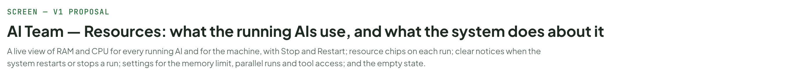
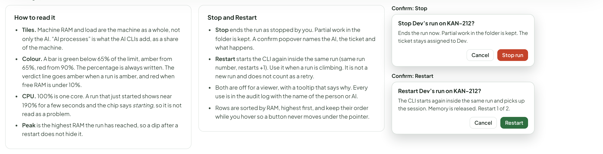
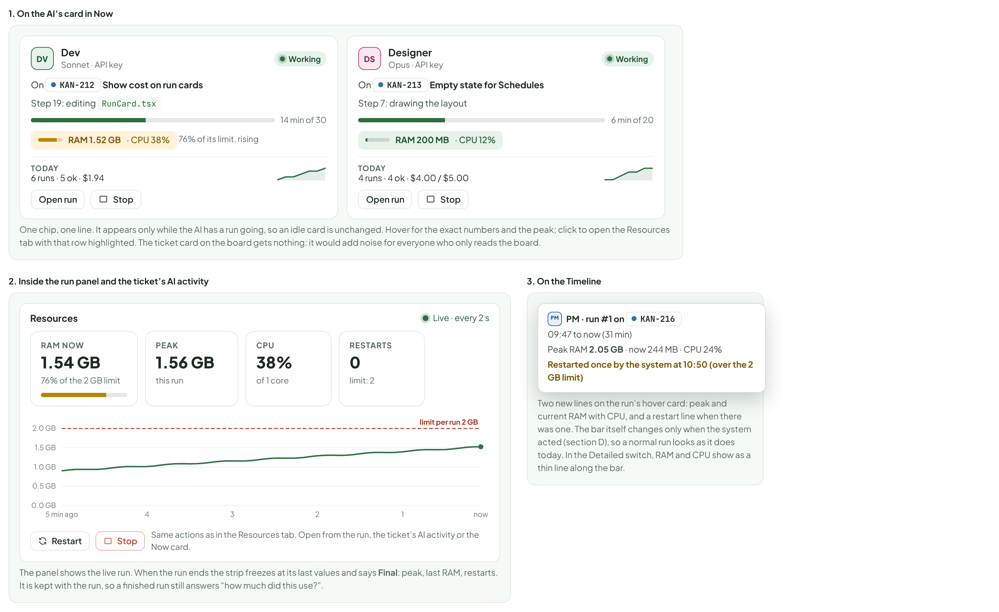
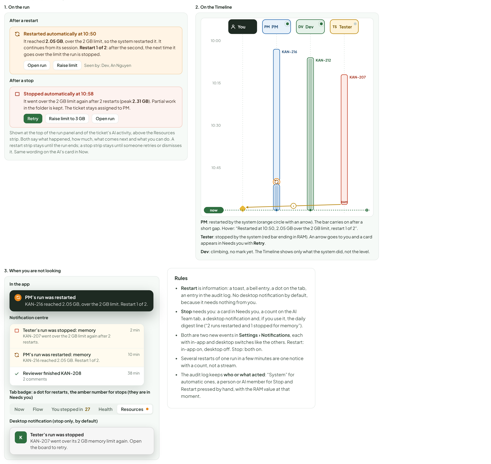
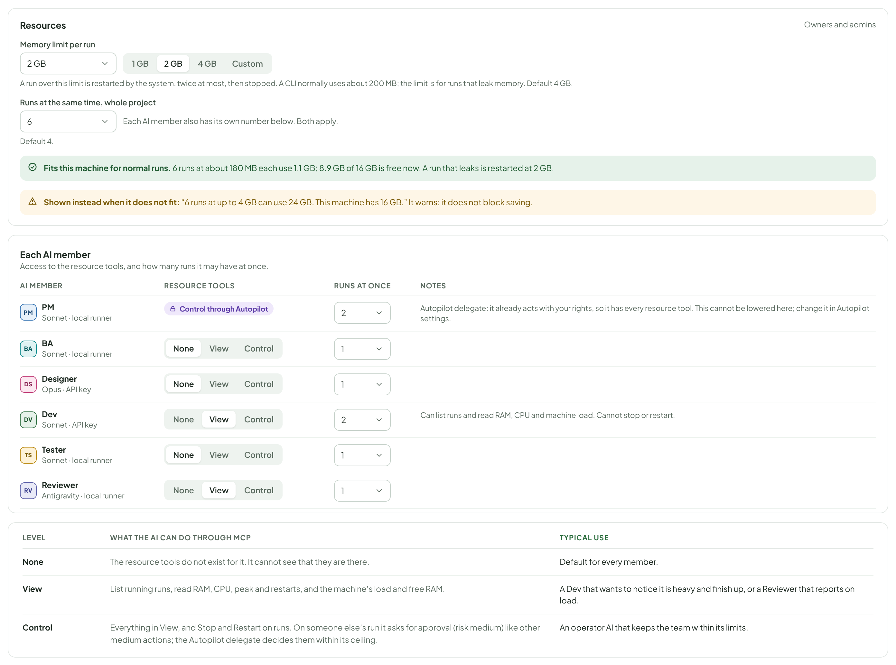
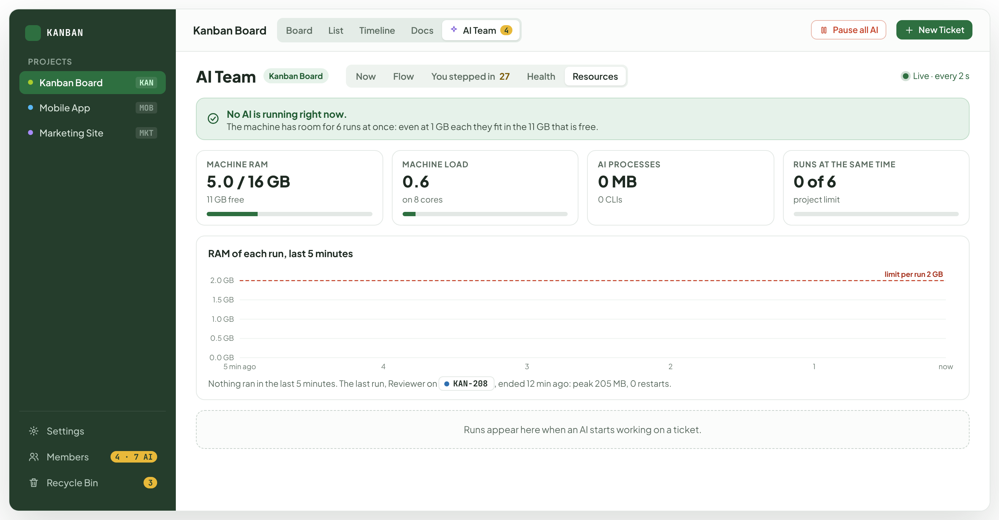
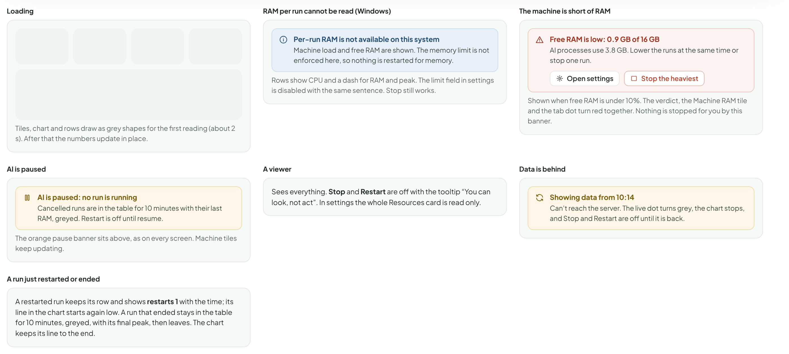
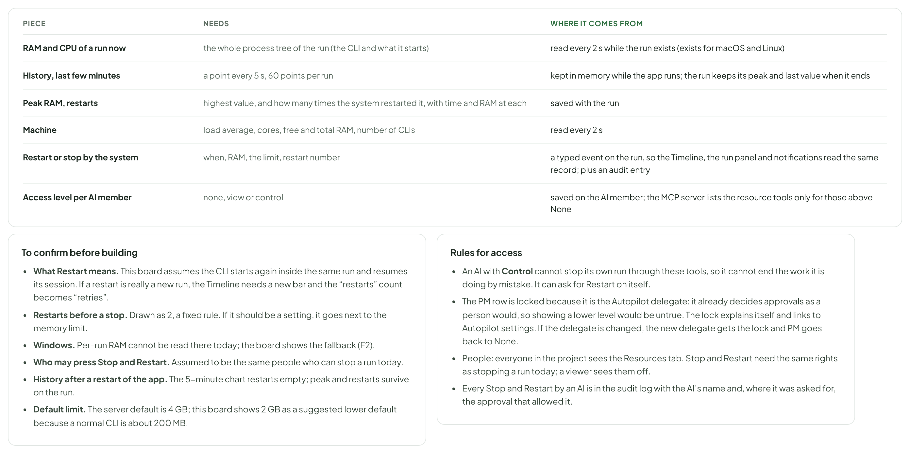

# AI Team — Resources: what the running AIs use, and what the system does about it

> SCREEN — V1 PROPOSAL · source: [`AiResources.dc.html`](../source/AiResources.dc.html) · canvas `1793439837-b9c3` · sha256 `ea758a67f82b2fae45de68222345e58d723aed2f5e8e84a6e9395d749fdd5228`

> Based on `main`: AI Team (Now, Flow, You stepped in, Health) is a separate proposal; this board adds a **Resources** tab to it and shows the other tabs only to place it.

A live view of RAM and CPU for every running AI and for the machine, with Stop and Restart; resource chips on each run; clear notices when the system restarts or stops a run; settings for the memory limit, parallel runs and tool access; and the empty state.

Source: [AiResources.dc.html](../source/AiResources.dc.html) › header ("SCREEN — V1 PROPOSAL", "AI Team — Resources: what the running AIs use, and what the system does about it" and the intro)

---

## A. Where each piece lives, and why

This board adds resource watching to AI Team. It is based on main: AI Team itself (Now, Flow, You stepped in, Health) is a separate proposal, so the frames below show it only as far as needed to place the new tab. Numbers in the mock-ups are invented but follow the real ones: a CLI uses about 180 MB, five together 0.5 to 0.9 GB, CPU peaks near 2 cores at start and settles at 10 to 45%.

Source: [AiResources.dc.html](../source/AiResources.dc.html) › block "A. Where each piece lives, and why"

- Text in the frames: "REQUEST" · "PROPOSAL" · "WHY" · "1. Watch everything" · "A fifth tab in AI Team, Resources, after Health. Machine tiles on top, a live chart of the last 5 minutes, then one row per running run with Stop and Restart." · "Now says what each AI is doing; Health says whether the feature works. Neither is a place for “is the machine OK”. Same range-free, live layout as Now." · "2. On each run" · "A small RAM and CPU chip on the AI’s card in Now and on the run’s own panel; a Resources strip with a 5-minute chart, peak and restarts inside the run panel and the ticket’s AI activity; two lines on the Timeline hover card." · "The ticket card on the board stays quiet: resources are a concern of whoever watches the team, not of everyone reading the board. The chip turns amber and red with the number written beside it, never colour alone." · "3. Restarted or stopped by the system" · "A strip on the run (what, when, how much, what to do), a restart badge or a RAM-stop bar on the Timeline, a toast and a bell entry in the app, a desktop notification and the AI Team tab badge when you are away, and an audit entry." · "A restart is information, a stop needs you. So a restart is a quiet amber notice; a stop is a card in Needs you with a Retry button." · "4. Settings" · "A Resources card in the AI settings: memory limit per run, runs at the same time, and a live estimate against this machine. Per AI member: access to the resource tools (None, View, Control) and its own slots." · "The estimate (“4 runs at up to 2 GB can use 8 GB; 8.9 GB is free”) turns two abstract numbers into one decision." · "5. Nothing running" · "The machine tiles stay, the chart is flat, the table says “No AI is running” and shows the last run’s peak." · "The tab is still useful before anything runs: it tells you how many runs this machine can take."

---

## B. Resources: every running AI, and the machine

The tab answers three questions in order: is the machine OK (tiles and the one-line verdict), who is using what (chart), and what do I do about it (table with Stop and Restart on each row). It updates every 2 seconds and needs no date range.

Source: [AiResources.dc.html](../source/AiResources.dc.html) › block "B. Resources: every running AI, and the machine"

- Text in the frames: "KANBAN" · "PROJECTS" · "Kanban Board" · "KAN" · "Mobile App" · "MOB" · "Marketing Site" · "MKT" · "Settings" · "Members" · "4 · 7 AI" · "Recycle Bin" · "3" · "Board" · "List" · "Timeline" · "Docs" · "AI Team" · "4" · "Pause all AI" · "5 running" · "New Ticket" · "Now" · "Flow" · "You stepped in" · "27" · "Health" · "Resources" · "Live · every 2 s" · "The machine is fine. One run is climbing." · "Dev on" · "KAN-212" · "is at 1.54 GB of its 2 GB limit and grew 0.6 GB in 5 minutes. At this pace it is restarted in about 4 minutes." · "Restart Dev now" · "MACHINE RAM" · "7.1 / 16 GB" · "8.9 GB free" · "MACHINE LOAD" · "2.4" · "on 8 cores · 1 min average" · "AI PROCESSES" · "2.3 GB" · "14% of the machine’s RAM · 5 CLIs" · "RUNS AT THE SAME TIME" · "5 of 6" · "project limit · 1 slot free" · "RAM of each run, last 5 minutes" · "Dev" · "Designer" · "Tester" · "Reviewer" · "PM" · "0.0 GB" · "0.5 GB" · "1.0 GB" · "1.5 GB" · "2.0 GB" · "5 min ago" · "2" · "1" · "now" · "limit per run 2 GB" · "The orange badge is PM’s run restarted by the system 3 minutes ago after it passed the limit; its line starts again low." · "AI" · "RUN" · "RUNNING" · "RAM NOW (OF 2 GB LIMIT)" · "PEAK" · "CPU" · "RESTARTS" · "DV" · "Show cost on run cards" · "14 min" · "1.52 GB" · "76%" · "1.54 GB" · "38%" · "0" · "Restart" · "Stop" · "DS" · "KAN-213" · "Empty state for Schedules" · "6 min" · "200 MB" · "10%" · "210 MB" · "12%" · "TS" · "KAN-207" · "Criterion 4 of the export" · "2 min" · "188 MB" · "9%" · "190%" · "starting" · "RV" · "KAN-208" · "Review the export dialog" · "22 min" · "172 MB" · "8%" · "205 MB" · "11%" · "KAN-216" · "Plan the CSV export" · "31 min" · "244 MB" · "2.05 GB" · "24%" · "1 restarted 3 min ago"

---

## B2. Reading it, and the two actions

Source: [AiResources.dc.html](../source/AiResources.dc.html) › block "B2. Reading it, and the two actions"

- Text in the frames: "How to read it" · "Tiles. Machine RAM and load are the machine as a whole, not only the AI. “AI processes” is what the AI CLIs add, as a share of the machine." · "Colour. A bar is green below 65% of the limit, amber from 65%, red from 90%. The percentage is always written. The verdict line goes amber when a run is amber, and red when free RAM is under 10%." · "CPU. 100% is one core. A run that just started shows near 190% for a few seconds and the chip says starting, so it is not read as a problem." · "Peak is the highest RAM the run has reached, so a dip after a restart does not hide it." · "Stop and Restart" · "Stop ends the run as stopped by you. Partial work in the folder is kept. A confirm popover names the AI, the ticket and what happens." · "Restart starts the CLI again inside the same run (same run number, restarts +1). Use it when a run is climbing. It is not a new run and does not count as a retry." · "Both are off for a viewer, with a tooltip that says why. Every use is in the audit log with the name of the person or AI." · "Rows are sorted by RAM, highest first, and keep their order while you hover so a button never moves under the pointer." · "Confirm: Stop" · "Stop Dev’s run on KAN-212?" · "Ends the run now. Partial work in the folder is kept. The ticket stays assigned to Dev." · "Cancel" · "Stop run" · "Confirm: Restart" · "Restart Dev’s run on KAN-212?" · "The CLI starts again inside the same run and picks up the session. Memory is released. Restart 1 of 2." · "Restart"

---

## C. On each run

Three places, in decreasing order of attention: the AI’s card, the run’s own panel, the Timeline hover. Each shows RAM first and CPU second, because RAM is the one that stops a run.

Source: [AiResources.dc.html](../source/AiResources.dc.html) › block "C. On each run"

- Text in the frames: "1. On the AI’s card in Now" · "DV" · "Dev" · "Sonnet · API key" · "Working" · "On" · "KAN-212" · "Show cost on run cards" · "Step 19: editing RunCard.tsx" · "14 min of 30" · "RAM 1.52 GB" · "· CPU 38%" · "76% of its limit, rising" · "TODAY" · "6 runs · 5 ok · $1.94" · "Open run" · "Stop" · "DS" · "Designer" · "Opus · API key" · "KAN-213" · "Empty state for Schedules" · "Step 7: drawing the layout" · "6 min of 20" · "RAM 200 MB" · "· CPU 12%" · "4 runs · 4 ok · $4.00 / $5.00" · "One chip, one line. It appears only while the AI has a run going, so an idle card is unchanged. Hover for the exact numbers and the peak; click to open the Resources tab with that row highlighted. The ticket card on the board gets nothing: it would add noise for everyone who only reads the board." · "2. Inside the run panel and the ticket’s AI activity" · "Resources" · "Live · every 2 s" · "RAM NOW" · "1.54 GB" · "76% of the 2 GB limit" · "PEAK" · "1.56 GB" · "this run" · "CPU" · "38%" · "of 1 core" · "RESTARTS" · "0" · "limit: 2" · "0.0 GB" · "0.5 GB" · "1.0 GB" · "1.5 GB" · "2.0 GB" · "5 min ago" · "4" · "3" · "2" · "1" · "now" · "limit per run 2 GB" · "Restart" · "Same actions as in the Resources tab. Open from the run, the ticket’s AI activity or the Now card." · "The panel shows the live run. When the run ends the strip freezes at its last values and says Final: peak, last RAM, restarts. It is kept with the run, so a finished run still answers “how much did this use?”." · "3. On the Timeline" · "PM" · "PM · run #1 on" · "KAN-216" · "09:47 to now (31 min)" · "Peak RAM 2.05 GB · now 244 MB · CPU 24%" · "Restarted once by the system at 10:50 (over the 2 GB limit)" · "Two new lines on the run’s hover card: peak and current RAM with CPU, and a restart line when there was one. The bar itself changes only when the system acted (section D), so a normal run looks as it does today. In the Detailed switch, RAM and CPU show as a thin line along the bar."

---

## D. When the system restarts or stops a run

Automatic action is the thing most likely to go unnoticed, because it happens when nobody watches. It is shown on the run, on the Timeline, and by the channels people already use.

Source: [AiResources.dc.html](../source/AiResources.dc.html) › block "D. When the system restarts or stops a run"

- Text in the frames: "1. On the run" · "After a restart" · "Restarted automatically at 10:50" · "It reached 2.05 GB, over the 2 GB limit, so the system restarted it. It continues from its session. Restart 1 of 2: after the second, the next time it goes over the limit the run is stopped." · "Open run" · "Raise limit" · "Seen by: Dev, An Nguyen" · "After a stop" · "Stopped automatically at 10:58" · "It went over the 2 GB limit again after 2 restarts (peak 2.31 GB). Partial work in the folder is kept. The ticket stays assigned to PM." · "Retry" · "Raise limit to 3 GB" · "Shown at the top of the run panel and of the ticket’s AI activity, above the Resources strip. Both say what happened, how much, what comes next and what you can do. A restart strip stays until the run ends; a stop strip stays until someone retries or dismisses it. Same wording on the AI’s card in Now." · "2. On the Timeline" · "10:00" · "10:15" · "10:30" · "10:45" · "11:00" · "You" · "PM" · "DV" · "Dev" · "TS" · "Tester" · "KAN-216" · "KAN-212" · "RAM" · "KAN-207" · "›" · "now" · "PM: restarted by the system (orange circle with an arrow). The bar carries on after a short gap. Hover: “Restarted at 10:50, 2.05 GB over the 2 GB limit, restart 1 of 2”." · "Tester: stopped by the system (red bar ending in RAM). An arrow goes to you and a card appears in Needs you with Retry." · "Dev: climbing, no mark yet. The Timeline shows only what the system did, not the level." · "3. When you are not looking" · "In the app" · "PM’s run was restarted" · "KAN-216 reached 2.05 GB, over the 2 GB limit. Restart 1 of 2." · "Notification centre" · "Tester’s run was stopped: memory" · "KAN-207 went over the 2 GB limit again after 2 restarts." · "2 min" · "PM’s run was restarted: memory" · "KAN-216 reached 2.05 GB. Restart 1 of 2." · "10 min" · "Reviewer finished KAN-208" · "2 comments" · "38 min" · "Tab badge: a dot for restarts, the amber number for stops (they are in Needs you)" · "Now" · "Flow" · "You stepped in" · "27" · "Health" · "Resources" · "Desktop notification (stop only, by default)" · "K" · "Tester’s run was stopped" · "KAN-207 went over its 2 GB memory limit again. Open the board to retry." · "Rules" · "Restart is information: a toast, a bell entry, a dot on the tab, an entry in the audit log. No desktop notification by default, because it needs nothing from you." · "Stop needs you: a card in Needs you, a count on the AI Team tab, a desktop notification and, if you use it, the daily digest line (“2 runs restarted and 1 stopped for memory”)." · "Both are two new events in Settings › Notifications, each with in-app and desktop switches like the others. Restart: in-app on, desktop off. Stop: both on." · "Several restarts of one run in a few minutes are one notice with a count, not a stream." · "The audit log keeps who or what acted: “System” for automatic ones, a person or AI member for Stop and Restart pressed by hand, with the RAM value at that moment."

---

## E. Settings: limits, parallel runs, and who may use the tools

Two limits for the project and one choice per AI member, in the AI settings next to the safety and cost cards. The estimate under the two numbers is the part that makes them easy to set.

Source: [AiResources.dc.html](../source/AiResources.dc.html) › block "E. Settings: limits, parallel runs, and who may use the tools"

- Text in the frames: "Resources" · "Owners and admins" · "Memory limit per run" · "2 GB" · "1 GB" · "4 GB" · "Custom" · "A run over this limit is restarted by the system, twice at most, then stopped. A CLI normally uses about 200 MB; the limit is for runs that leak memory. Default 4 GB." · "Runs at the same time, whole project" · "6" · "Each AI member also has its own number below. Both apply." · "Default 4." · "Fits this machine for normal runs. 6 runs at about 180 MB each use 1.1 GB; 8.9 GB of 16 GB is free now. A run that leaks is restarted at 2 GB." · "Shown instead when it does not fit: “6 runs at up to 4 GB can use 24 GB. This machine has 16 GB.” It warns; it does not block saving." · "Each AI member" · "Access to the resource tools, and how many runs it may have at once." · "AI MEMBER" · "RESOURCE TOOLS" · "RUNS AT ONCE" · "NOTES" · "PM" · "Sonnet · local runner" · "Control through Autopilot" · "2" · "Autopilot delegate: it already acts with your rights, so it has every resource tool. This cannot be lowered here; change it in Autopilot settings." · "BA" · "None" · "View" · "Control" · "1" · "DS" · "Designer" · "Opus · API key" · "DV" · "Dev" · "Sonnet · API key" · "Can list runs and read RAM, CPU and machine load. Cannot stop or restart." · "TS" · "Tester" · "RV" · "Reviewer" · "Antigravity · local runner" · "LEVEL" · "WHAT THE AI CAN DO THROUGH MCP" · "TYPICAL USE" · "The resource tools do not exist for it. It cannot see that they are there." · "Default for every member." · "List running runs, read RAM, CPU, peak and restarts, and the machine’s load and free RAM." · "A Dev that wants to notice it is heavy and finish up, or a Reviewer that reports on load." · "Everything in View, and Stop and Restart on runs. On someone else’s run it asks for approval (risk medium) like other medium actions; the Autopilot delegate decides them within its ceiling." · "An operator AI that keeps the team within its limits."

---

## F1. Nothing is running

The tab stays useful before any run: the machine tiles say how much room there is. The chart is an empty frame with its axes, so it does not jump when the first run starts.

Source: [AiResources.dc.html](../source/AiResources.dc.html) › block "F1. Nothing is running"

- Text in the frames: "KANBAN" · "PROJECTS" · "Kanban Board" · "KAN" · "Mobile App" · "MOB" · "Marketing Site" · "MKT" · "Settings" · "Members" · "4 · 7 AI" · "Recycle Bin" · "3" · "Board" · "List" · "Timeline" · "Docs" · "AI Team" · "4" · "Pause all AI" · "New Ticket" · "Now" · "Flow" · "You stepped in" · "27" · "Health" · "Resources" · "Live · every 2 s" · "No AI is running right now." · "The machine has room for 6 runs at once: even at 1 GB each they fit in the 11 GB that is free." · "MACHINE RAM" · "5.0 / 16 GB" · "11 GB free" · "MACHINE LOAD" · "0.6" · "on 8 cores" · "AI PROCESSES" · "0 MB" · "0 CLIs" · "RUNS AT THE SAME TIME" · "0 of 6" · "project limit" · "RAM of each run, last 5 minutes" · "0.0 GB" · "0.5 GB" · "1.0 GB" · "1.5 GB" · "2.0 GB" · "5 min ago" · "2" · "1" · "now" · "limit per run 2 GB" · "Nothing ran in the last 5 minutes. The last run, Reviewer on" · "KAN-208" · ", ended 12 min ago: peak 205 MB, 0 restarts." · "Runs appear here when an AI starts working on a ticket."

---

## F2. Other states

Source: [AiResources.dc.html](../source/AiResources.dc.html) › block "F2. Other states"

- Text in the frames: "Loading" · "Tiles, chart and rows draw as grey shapes for the first reading (about 2 s). After that the numbers update in place." · "RAM per run cannot be read (Windows)" · "Per-run RAM is not available on this system" · "Machine load and free RAM are shown. The memory limit is not enforced here, so nothing is restarted for memory." · "Rows show CPU and a dash for RAM and peak. The limit field in settings is disabled with the same sentence. Stop still works." · "The machine is short of RAM" · "Free RAM is low: 0.9 GB of 16 GB" · "AI processes use 3.8 GB. Lower the runs at the same time or stop one run." · "Open settings" · "Stop the heaviest" · "Shown when free RAM is under 10%. The verdict, the Machine RAM tile and the tab dot turn red together. Nothing is stopped for you by this banner." · "AI is paused" · "AI is paused: no run is running" · "Cancelled runs are in the table for 10 minutes with their last RAM, greyed. Restart is off until resume." · "The orange pause banner sits above, as on every screen. Machine tiles keep updating." · "A viewer" · "Sees everything. Stop and Restart are off with the tooltip “You can look, not act”. In settings the whole Resources card is read only." · "Data is behind" · "Showing data from 10:14" · "Can’t reach the server. The live dot turns grey, the chart stops, and Stop and Restart are off until it is back." · "A run just restarted or ended" · "A restarted run keeps its row and shows restarts 1 with the time; its line in the chart starts again low. A run that ended stays in the table for 10 minutes, greyed, with its final peak, then leaves. The chart keeps its line to the end."

---

## G. Where the data comes from, and what to confirm

Most of it is already measured by the server. What is new is keeping a short history, saving restarts as events, and an access level per AI member.

Source: [AiResources.dc.html](../source/AiResources.dc.html) › block "G. Where the data comes from, and what to confirm"

- Text in the frames: "PIECE" · "NEEDS" · "WHERE IT COMES FROM" · "RAM and CPU of a run now" · "the whole process tree of the run (the CLI and what it starts)" · "read every 2 s while the run exists (exists for macOS and Linux)" · "History, last few minutes" · "a point every 5 s, 60 points per run" · "kept in memory while the app runs; the run keeps its peak and last value when it ends" · "Peak RAM, restarts" · "highest value, and how many times the system restarted it, with time and RAM at each" · "saved with the run" · "Machine" · "load average, cores, free and total RAM, number of CLIs" · "read every 2 s" · "Restart or stop by the system" · "when, RAM, the limit, restart number" · "a typed event on the run, so the Timeline, the run panel and notifications read the same record; plus an audit entry" · "Access level per AI member" · "none, view or control" · "saved on the AI member; the MCP server lists the resource tools only for those above None" · "To confirm before building" · "What Restart means. This board assumes the CLI starts again inside the same run and resumes its session. If a restart is really a new run, the Timeline needs a new bar and the “restarts” count becomes “retries”." · "Restarts before a stop. Drawn as 2, a fixed rule. If it should be a setting, it goes next to the memory limit." · "Windows. Per-run RAM cannot be read there today; the board shows the fallback (F2)." · "Who may press Stop and Restart. Assumed to be the same people who can stop a run today." · "History after a restart of the app. The 5-minute chart restarts empty; peak and restarts survive on the run." · "Default limit. The server default is 4 GB; this board shows 2 GB as a suggested lower default because a normal CLI is about 200 MB." · "Rules for access" · "An AI with Control cannot stop its own run through these tools, so it cannot end the work it is doing by mistake. It can ask for Restart on itself." · "The PM row is locked because it is the Autopilot delegate: it already decides approvals as a person would, so showing a lower level would be untrue. The lock explains itself and links to Autopilot settings. If the delegate is changed, the new delegate gets the lock and PM goes back to None." · "People: everyone in the project sees the Resources tab. Stop and Restart need the same rights as stopping a run today; a viewer sees them off." · "Every Stop and Restart by an AI is in the audit log with the AI’s name and, where it was asked for, the approval that allowed it."
