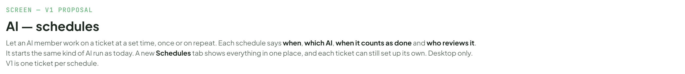
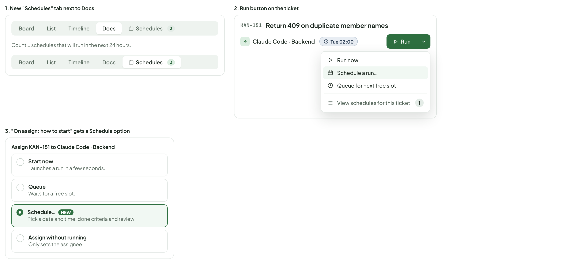
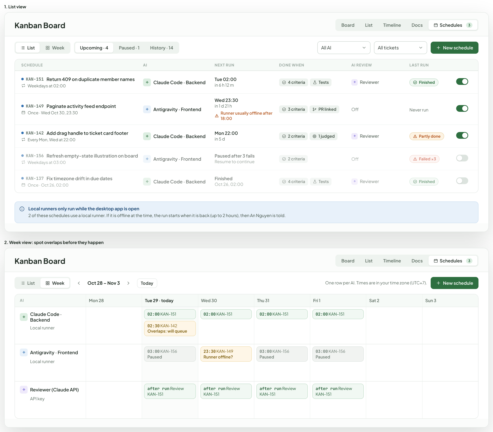
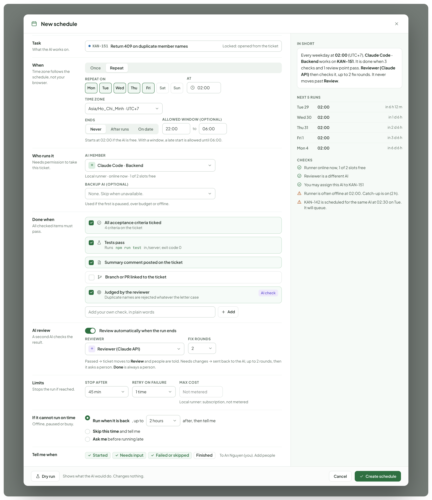
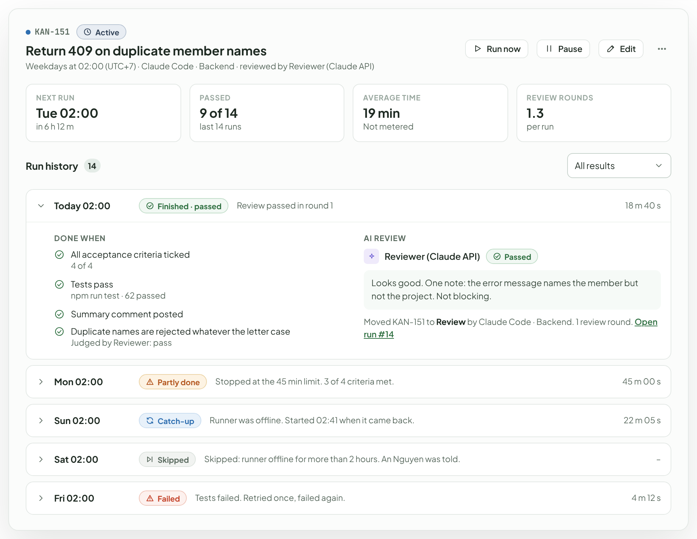
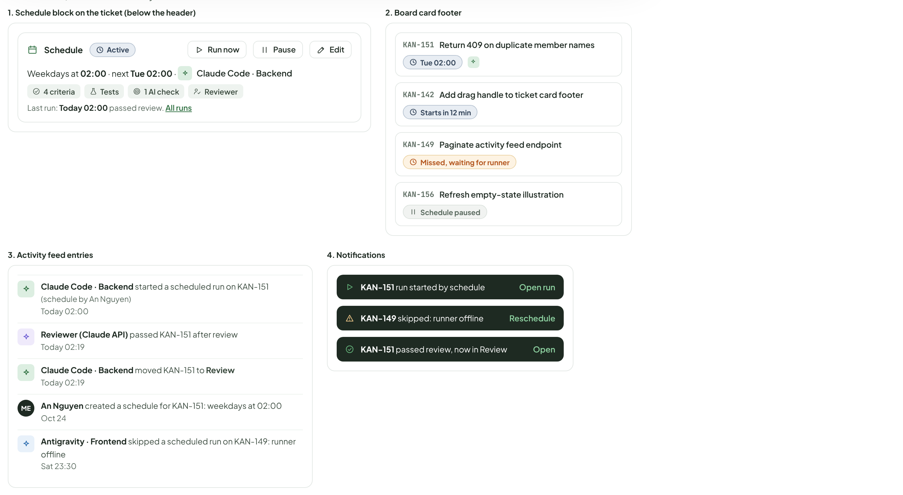
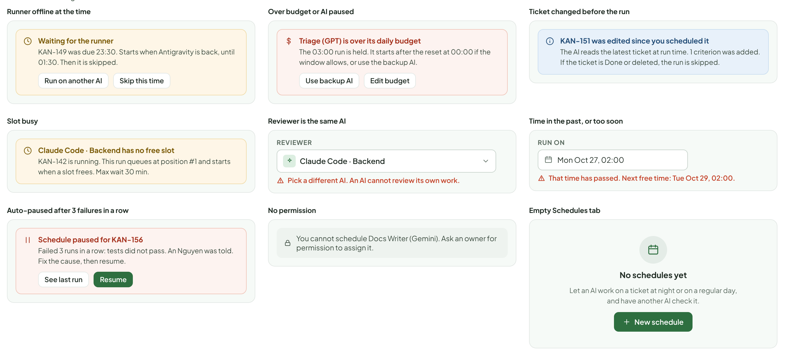
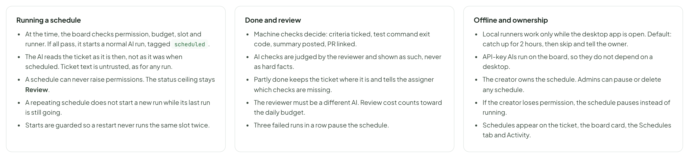

# AI — schedules

> SCREEN — V1 PROPOSAL · source: [`AiSchedules.dc.html`](../source/AiSchedules.dc.html) · canvas `1793195406-cc1c` · sha256 `30ff6c869fc892606e26321afe8c5c2efd684a5a1403ae400f3d535f1a4cefb2`

Let an AI member work on a ticket at a set time, once or on repeat. Each schedule says when, which AI, when it counts as done and who reviews it. It starts the same kind of AI run as today. A new Schedules tab shows everything in one place, and each ticket can still set up its own. Desktop only. V1 is one ticket per schedule.

Source: [AiSchedules.dc.html](../source/AiSchedules.dc.html) › header ("SCREEN — V1 PROPOSAL", "AI — schedules" and the intro)

---

## A. Where you start

The Schedules tab joins Board, List, Timeline and Docs. From a ticket, the Run button and the assign popover both offer Schedule.

Source: [AiSchedules.dc.html](../source/AiSchedules.dc.html) › block "A. Where you start"

- Text in the frames: "1. New "Schedules" tab next to Docs" · "Board" · "List" · "Timeline" · "Docs" · "Schedules" · "3" · "Count = schedules that will run in the next 24 hours." · "2. Run button on the ticket" · "KAN-151" · "Return 409 on duplicate member names" · "Claude Code · Backend" · "Tue 02:00" · "Run" · "Run now" · "Schedule a run…" · "Queue for next free slot" · "View schedules for this ticket" · "1" · "3. "On assign: how to start" gets a Schedule option" · "Assign KAN-151 to Claude Code · Backend" · "Start now" · "Launches a run in a few seconds." · "Queue" · "Waits for a free slot." · "Schedule… NEW" · "Pick a date and time, done criteria and review." · "Assign without running" · "Only sets the assignee."

---

## B. Schedules tab

The list answers “what runs next and how did the last run go”. The week view shows each AI as a row, so overlaps and offline risks are visible before they happen.

Source: [AiSchedules.dc.html](../source/AiSchedules.dc.html) › block "B. Schedules tab"

- Text in the frames: "1. List view" · "Kanban Board" · "Board" · "List" · "Timeline" · "Docs" · "Schedules" · "3" · "Week" · "Upcoming · 4" · "Paused · 1" · "History · 14" · "All AI" · "All tickets" · "New schedule" · "SCHEDULE" · "AI" · "NEXT RUN" · "DONE WHEN" · "AI REVIEW" · "LAST RUN" · "KAN-151" · "Return 409 on duplicate member names" · "Weekdays at 02:00" · "Claude Code · Backend" · "Tue 02:00" · "in 6 h 12 m" · "4 criteria" · "Tests" · "Reviewer" · "Finished" · "KAN-149" · "Paginate activity feed endpoint" · "Once · Wed Oct 30, 23:30" · "Antigravity · Frontend" · "Wed 23:30" · "in 1 d 21 h" · "Runner usually offline after 18:00" · "3 criteria" · "PR linked" · "Off" · "Never run" · "KAN-142" · "Add drag handle to ticket card footer" · "Every Mon, Wed at 22:00" · "Mon 22:00" · "in 5 d" · "2 criteria" · "1 judged" · "Partly done" · "KAN-156" · "Refresh empty-state illustration on board" · "Weekdays at 03:00" · "Paused after 3 fails" · "Resume to continue" · "Failed ×3" · "KAN-137" · "Fix timezone drift in due dates" · "Once · Oct 26, 02:00" · "Oct 26, 02:00" · "Local runners only run while the desktop app is open" · "2 of these schedules use a local runner. If it is offline at the time, the run starts when it is back (up to 2 hours), then An Nguyen is told." · "2. Week view: spot overlaps before they happen" · "Oct 28 – Nov 3" · "Today" · "One row per AI. Times are in your time zone (UTC+7)." · "Mon 28" · "Tue 29 · today" · "Wed 30" · "Thu 31" · "Fri 1" · "Sat 2" · "Sun 3" · "Local runner" · "02:00 KAN-151" · "02:30 KAN-142" · "Overlaps: will queue" · "03:00 KAN-156" · "Paused" · "23:30 KAN-149" · "Runner offline?" · "Reviewer (Claude API)" · "API key" · "after run Review KAN-151"

---

## C. Create or edit a schedule

Opens as a layer, from the tab or from a ticket. The right side always shows the plain-language summary, the next runs and any problems.

Source: [AiSchedules.dc.html](../source/AiSchedules.dc.html) › block "C. Create or edit a schedule"

- Text in the frames: "New schedule" · "Task" · "What the AI works on." · "KAN-151" · "Return 409 on duplicate member names" · "Locked: opened from the ticket" · "When" · "Time zone follows the schedule, not your browser." · "Once" · "Repeat" · "REPEAT ON" · "Mon" · "Tue" · "Wed" · "Thu" · "Fri" · "Sat" · "Sun" · "AT" · "02:00" · "TIME ZONE" · "Asia/Ho_Chi_Minh · UTC+7" · "ENDS" · "Never" · "After runs" · "On date" · "ALLOWED WINDOW (OPTIONAL)" · "22:00" · "to" · "06:00" · "Starts at 02:00 if the AI is free. With a window, a late start is allowed until 06:00." · "Who runs it" · "Needs permission to take this ticket." · "AI MEMBER" · "Claude Code · Backend" · "Local runner · online now · 1 of 2 slots free" · "BACKUP AI (OPTIONAL)" · "None. Skip when unavailable." · "Used if the first is paused, over budget or offline." · "Done when" · "All checked items must pass." · "All acceptance criteria ticked" · "4 criteria on the ticket" · "Tests pass" · "Runs npm run test in /server; exit code 0" · "Summary comment posted on the ticket" · "Branch or PR linked to the ticket" · "Judged by the reviewer" · "Duplicate names are rejected whatever the letter case" · "AI check" · "Add your own check, in plain words" · "Add" · "AI review" · "A second AI checks the result." · "Review automatically when the run ends" · "REVIEWER" · "Reviewer (Claude API)" · "FIX ROUNDS" · "2" · "Passed → ticket moves to Review and people are told. Needs changes → sent back to the AI, up to 2 rounds, then it asks a person. Done is always a person." · "Limits" · "Stops the run if reached." · "STOP AFTER" · "45 min" · "RETRY ON FAILURE" · "1 time" · "MAX COST" · "Not metered" · "Local runner: subscription, not metered" · "If it cannot run on time" · "Offline, paused or busy." · "Run when it is back" · ", up to" · "2 hours" · "after, then tell me" · "Skip this time and tell me" · "Ask me before running late" · "Tell me when" · "Started" · "Needs input" · "Failed or skipped" · "Finished" · "To An Nguyen (you). Add people" · "IN SHORT" · "Every weekday at 02:00 (UTC+7), Claude Code · Backend works on KAN-151. It is done when 3 checks and 1 review point pass. Reviewer (Claude API) then checks it, up to 2 fix rounds. It never moves past Review." · "NEXT 5 RUNS" · "Tue 29" · "in 6 h 12 m" · "Wed 30" · "in 1 d 6 h" · "Thu 31" · "in 2 d 6 h" · "Fri 1" · "in 3 d 6 h" · "Mon 4" · "in 6 d 6 h" · "CHECKS" · "Runner online now, 1 of 2 slots free" · "Reviewer is a different AI" · "You may assign this AI to KAN-151" · "Runner is often offline at 02:00. Catch-up is on (2 h)." · "KAN-142 is scheduled for the same AI at 02:30 on Tue. It will queue." · "Dry run" · "Shows what the AI would do. Changes nothing." · "Cancel" · "Create schedule"

---

## D. One schedule and its history

Every run shows how each “done when” check turned out and what the reviewer said.

Source: [AiSchedules.dc.html](../source/AiSchedules.dc.html) › block "D. One schedule and its history"

- Text in the frames: "KAN-151" · "Active" · "Return 409 on duplicate member names" · "Weekdays at 02:00 (UTC+7) · Claude Code · Backend · reviewed by Reviewer (Claude API)" · "Run now" · "Pause" · "Edit" · "NEXT RUN" · "Tue 02:00" · "in 6 h 12 m" · "PASSED" · "9 of 14" · "last 14 runs" · "AVERAGE TIME" · "19 min" · "Not metered" · "REVIEW ROUNDS" · "1.3" · "per run" · "Run history" · "14" · "All results" · "Today 02:00" · "Finished · passed" · "Review passed in round 1" · "18 m 40 s" · "DONE WHEN" · "All acceptance criteria ticked" · "4 of 4" · "Tests pass" · "npm run test · 62 passed" · "Summary comment posted" · "Duplicate names are rejected whatever the letter case" · "Judged by Reviewer: pass" · "AI REVIEW" · "Reviewer (Claude API)" · "Passed" · "Looks good. One note: the error message names the member but not the project. Not blocking." · "Moved KAN-151 to Review by Claude Code · Backend. 1 review round. Open run #14" · "Mon 02:00" · "Partly done" · "Stopped at the 45 min limit. 3 of 4 criteria met." · "45 m 00 s" · "Sun 02:00" · "Catch-up" · "Runner was offline. Started 02:41 when it came back." · "22 m 05 s" · "Sat 02:00" · "Skipped" · "Skipped: runner offline for more than 2 hours. An Nguyen was told." · "–" · "Fri 02:00" · "Failed" · "Tests failed. Retried once, failed again." · "4 m 12 s"

---

## E. On the ticket, the card and in Activity

Source: [AiSchedules.dc.html](../source/AiSchedules.dc.html) › block "E. On the ticket, the card and in Activity"

- Text in the frames: "1. Schedule block on the ticket (below the header)" · "Schedule" · "Active" · "Run now" · "Pause" · "Edit" · "Weekdays at 02:00 · next Tue 02:00 ·" · "Claude Code · Backend" · "4 criteria" · "Tests" · "1 AI check" · "Reviewer" · "Last run: Today 02:00 passed review. All runs" · "2. Board card footer" · "KAN-151" · "Return 409 on duplicate member names" · "Tue 02:00" · "KAN-142" · "Add drag handle to ticket card footer" · "Starts in 12 min" · "KAN-149" · "Paginate activity feed endpoint" · "Missed, waiting for runner" · "KAN-156" · "Refresh empty-state illustration" · "Schedule paused" · "3. Activity feed entries" · "Claude Code · Backend started a scheduled run on KAN-151 (schedule by An Nguyen)" · "Today 02:00" · "Reviewer (Claude API) passed KAN-151 after review" · "Today 02:19" · "Claude Code · Backend moved KAN-151 to Review" · "ME" · "An Nguyen created a schedule for KAN-151: weekdays at 02:00" · "Oct 24" · "Antigravity · Frontend skipped a scheduled run on KAN-149: runner offline" · "Sat 23:30" · "4. Notifications" · "KAN-151 run started by schedule" · "Open run" · "KAN-149 skipped: runner offline" · "Reschedule" · "KAN-151 passed review, now in Review" · "Open"

---

## F. Problems and edge cases

Source: [AiSchedules.dc.html](../source/AiSchedules.dc.html) › block "F. Problems and edge cases"

- Text in the frames: "Runner offline at the time" · "Waiting for the runner" · "KAN-149 was due 23:30. Starts when Antigravity is back, until 01:30. Then it is skipped." · "Run on another AI" · "Skip this time" · "Over budget or AI paused" · "Triage (GPT) is over its daily budget" · "The 03:00 run is held. It starts after the reset at 00:00 if the window allows, or use the backup AI." · "Use backup AI" · "Edit budget" · "Ticket changed before the run" · "KAN-151 was edited since you scheduled it" · "The AI reads the latest ticket at run time. 1 criterion was added. If the ticket is Done or deleted, the run is skipped." · "Slot busy" · "Claude Code · Backend has no free slot" · "KAN-142 is running. This run queues at position #1 and starts when a slot frees. Max wait 30 min." · "Reviewer is the same AI" · "REVIEWER" · "Claude Code · Backend" · "Pick a different AI. An AI cannot review its own work." · "Time in the past, or too soon" · "RUN ON" · "Mon Oct 27, 02:00" · "That time has passed. Next free time: Tue Oct 29, 02:00." · "Auto-paused after 3 failures in a row" · "Schedule paused for KAN-156" · "Failed 3 runs in a row: tests did not pass. An Nguyen was told. Fix the cause, then resume." · "See last run" · "Resume" · "No permission" · "You cannot schedule Docs Writer (Gemini). Ask an owner for permission to assign it." · "Empty Schedules tab" · "No schedules yet" · "Let an AI work on a ticket at night or on a regular day, and have another AI check it." · "New schedule"

---

## G. Rules

Proposed. Defaults are chosen to fail safe: when unsure, skip and tell a person.

Source: [AiSchedules.dc.html](../source/AiSchedules.dc.html) › block "G. Rules"

- Text in the frames: "Running a schedule" · "At the time, the board checks permission, budget, slot and runner. If all pass, it starts a normal AI run, tagged scheduled." · "The AI reads the ticket as it is then, not as it was when scheduled. Ticket text is untrusted, as for any run." · "A schedule can never raise permissions. The status ceiling stays Review." · "A repeating schedule does not start a new run while its last run is still going." · "Starts are guarded so a restart never runs the same slot twice." · "Done and review" · "Machine checks decide: criteria ticked, test command exit code, summary posted, PR linked." · "AI checks are judged by the reviewer and shown as such, never as hard facts." · "Partly done keeps the ticket where it is and tells the assigner which checks are missing." · "The reviewer must be a different AI. Review cost counts toward the daily budget." · "Three failed runs in a row pause the schedule." · "Offline and ownership" · "Local runners work only while the desktop app is open. Default: catch up for 2 hours, then skip and tell the owner." · "API-key AIs run on the board, so they do not depend on a desktop." · "The creator owns the schedule. Admins can pause or delete any schedule." · "If the creator loses permission, the schedule pauses instead of running." · "Schedules appear on the ticket, the board card, the Schedules tab and Activity."
