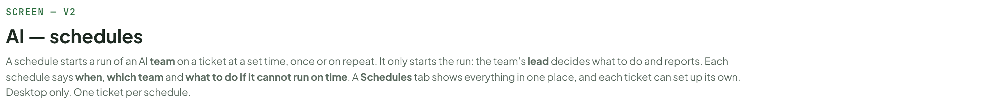
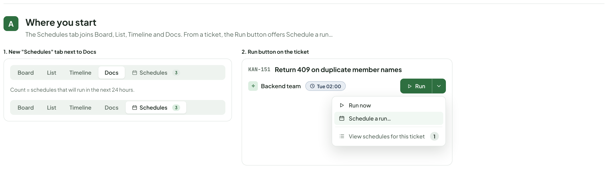
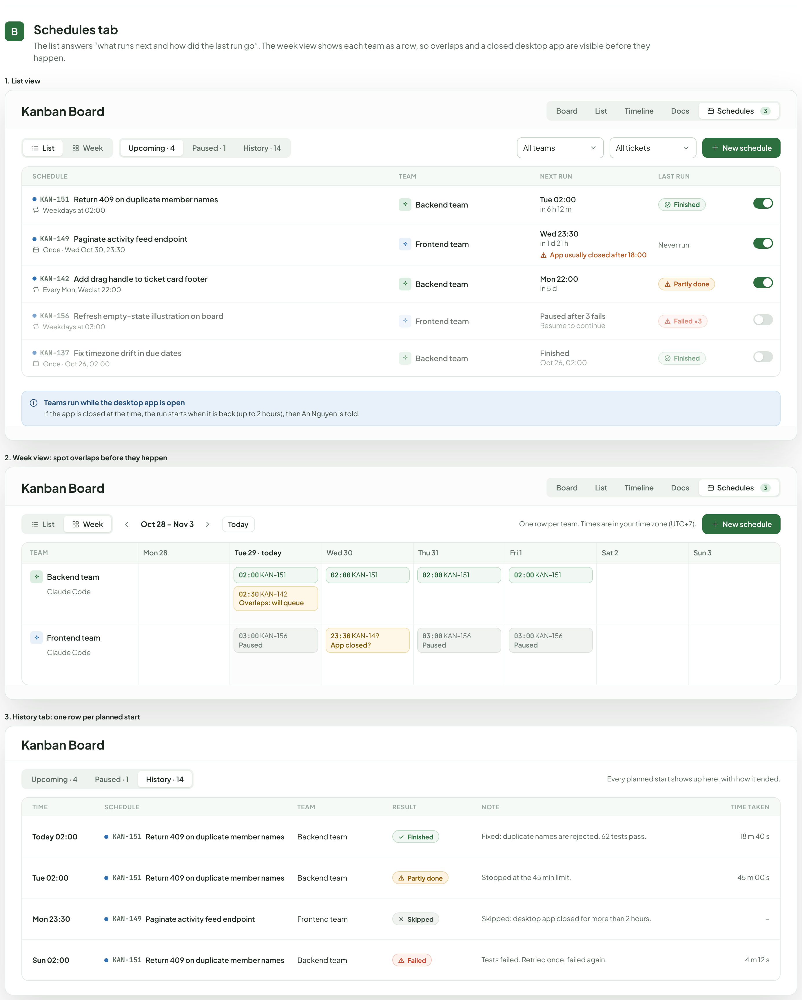
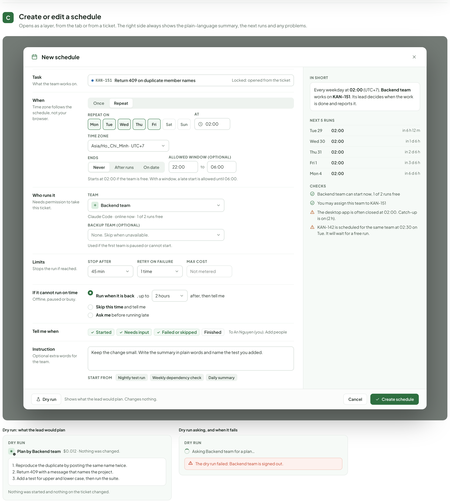
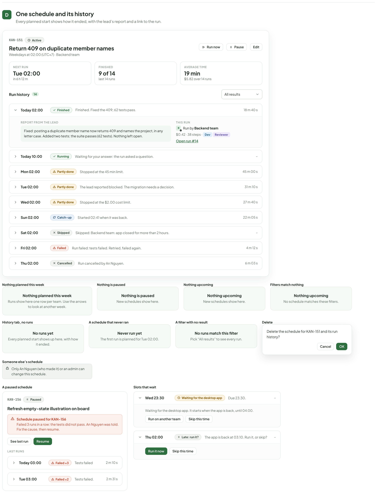
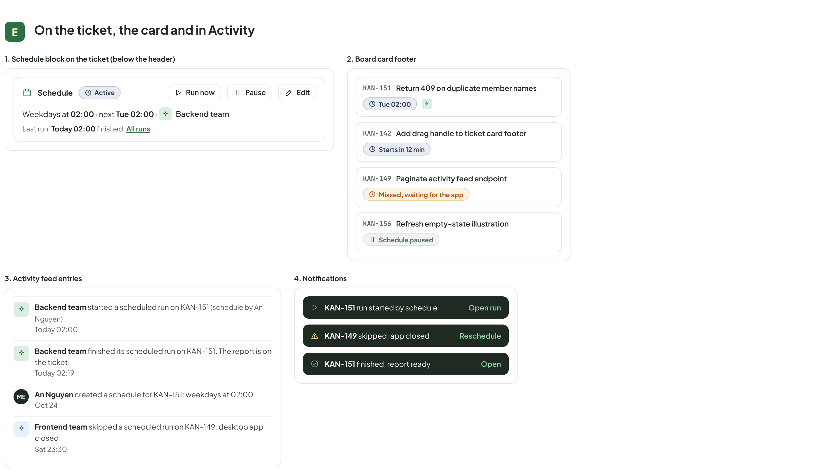
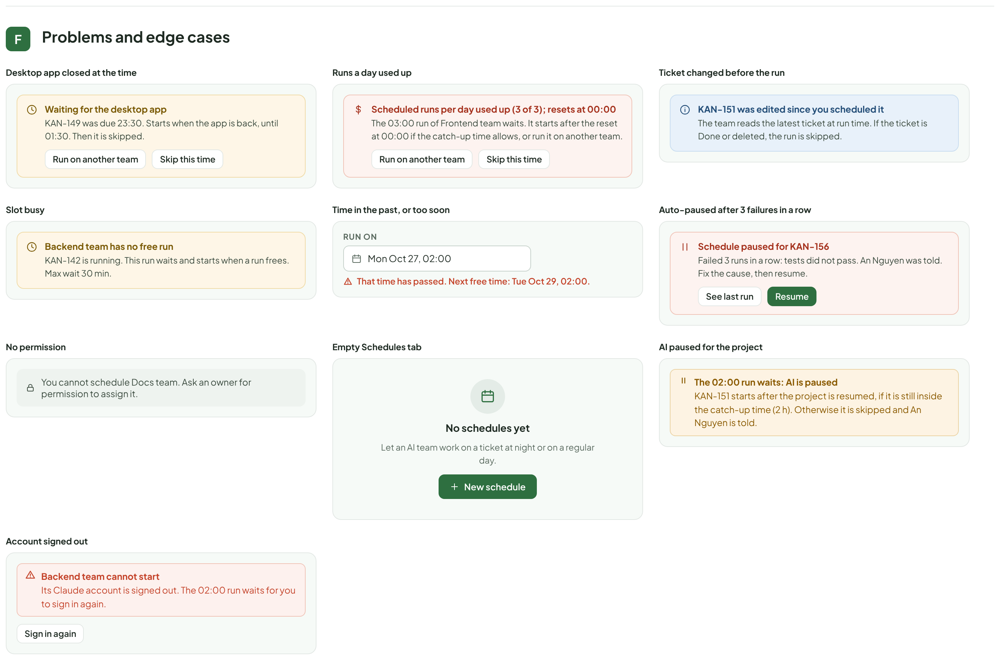
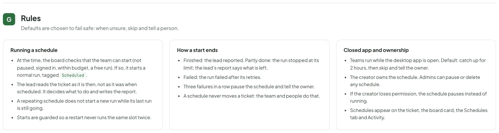

# AI — schedules

> Redrawn for AI v2 · source: [`AiSchedules.dc.html`](../source/AiSchedules.dc.html) · canvas `1794099567-d725` · sha256 `04c76f058e9f2f205ad0964e77ba24eb8250f6712de81bd5257756f6e5390c9d`

> Words, states and conditions follow the code of branch `claude/ai-team-architecture-7a1efc`; the layout is designed here and is not the layout of the current screens. Names, ids, costs and times in the mock-ups are sample data. **Check the code before building from this: the file named in each part is the truth, not the picture.**

## SCREEN — V2

- Text in this part: "SCREEN — V2" · "AI — schedules" · "A schedule starts a run of an AI team on a ticket at a set time, once or on repeat. It only starts the run: the team’s lead decides what to do and reports. Each schedule says when, which team and what to do if it cannot run on time. A Schedules tab shows everything in one place, and each ticket can set up its own. Desktop only. One ticket per schedule."

---

## Where you start

- Text in this part: "A" · "Where you start" · "The Schedules tab joins Board, List, Timeline and Docs. From a ticket, the Run button offers Schedule a run…" · "1. New "Schedules" tab next to Docs" · "Board" · "List" · "Timeline" · "Docs" · "Schedules" · "3" · "Count = schedules that will run in the next 24 hours." · "2. Run button on the ticket" · "KAN-151" · "Return 409 on duplicate member names" · "Backend team" · "Tue 02:00" · "Run" · "Run now" · "Schedule a run…" · "View schedules for this ticket" · "1"

---

## Schedules tab

- Text in this part: "B" · "Schedules tab" · "The list answers “what runs next and how did the last run go”. The week view shows each team as a row, so overlaps and a closed desktop app are visible before they happen." · "1. List view" · "Kanban Board" · "Board" · "List" · "Timeline" · "Docs" · "Schedules" · "3" · "Week" · "Upcoming · 4" · "Paused · 1" · "History · 14" · "All teams" · "All tickets" · "New schedule" · "SCHEDULE" · "TEAM" · "NEXT RUN" · "LAST RUN" · "KAN-151" · "Return 409 on duplicate member names" · "Weekdays at 02:00" · "Backend team" · "Tue 02:00" · "in 6 h 12 m" · "Finished" · "KAN-149" · "Paginate activity feed endpoint" · "Once · Wed Oct 30, 23:30" · "Frontend team" · "Wed 23:30" · "in 1 d 21 h" · "App usually closed after 18:00" · "Never run" · "KAN-142" · "Add drag handle to ticket card footer" · "Every Mon, Wed at 22:00" · "Mon 22:00" · "in 5 d" · "Partly done" · "KAN-156" · "Refresh empty-state illustration on board" · "Weekdays at 03:00" · "Paused after 3 fails" · "Resume to continue" · "Failed ×3" · "KAN-137" · "Fix timezone drift in due dates" · "Once · Oct 26, 02:00" · "Oct 26, 02:00" · "Teams run while the desktop app is open" · "If the app is closed at the time, the run starts when it is back (up to 2 hours), then An Nguyen is told." · "2. Week view: spot overlaps before they happen" · "Oct 28 – Nov 3" · "Today" · "One row per team. Times are in your time zone (UTC+7)." · "Mon 28" · "Tue 29 · today" · "Wed 30" · "Thu 31" · "Fri 1" · "Sat 2" · "Sun 3" · "Claude Code" · "02:00 KAN-151" · "02:30 KAN-142" · "Overlaps: will queue" · "03:00 KAN-156" · "Paused" · "23:30 KAN-149" · "App closed?" · "3. History tab: one row per planned start" · "Every planned start shows up here, with how it ended." · "TIME" · "RESULT" · "NOTE" · "TIME TAKEN" · "Today 02:00" · "Fixed: duplicate names are rejected. 62 tests pass." · "18 m 40 s" · "Stopped at the 45 min limit." · "45 m 00 s" · "Mon 23:30" · "Skipped" · "Skipped: desktop app closed for more than 2 hours." · "–" · "Sun 02:00" · "Failed" · "Tests failed. Retried once, failed again." · "4 m 12 s"

---

## Create or edit a schedule

- Text in this part: "C" · "Create or edit a schedule" · "Opens as a layer, from the tab or from a ticket. The right side always shows the plain-language summary, the next runs and any problems." · "New schedule" · "Task" · "What the team works on." · "KAN-151" · "Return 409 on duplicate member names" · "Locked: opened from the ticket" · "When" · "Time zone follows the schedule, not your browser." · "Once" · "Repeat" · "REPEAT ON" · "Mon" · "Tue" · "Wed" · "Thu" · "Fri" · "Sat" · "Sun" · "AT" · "02:00" · "TIME ZONE" · "Asia/Ho_Chi_Minh · UTC+7" · "ENDS" · "Never" · "After runs" · "On date" · "ALLOWED WINDOW (OPTIONAL)" · "22:00" · "to" · "06:00" · "Starts at 02:00 if the team is free. With a window, a late start is allowed until 06:00." · "Who runs it" · "Needs permission to take this ticket." · "TEAM" · "Backend team" · "Claude Code · online now · 1 of 2 runs free" · "BACKUP TEAM (OPTIONAL)" · "None. Skip when unavailable." · "Used if the first team is paused or cannot start." · "Limits" · "Stops the run if reached." · "STOP AFTER" · "45 min" · "RETRY ON FAILURE" · "1 time" · "MAX COST" · "Not metered" · "If it cannot run on time" · "Offline, paused or busy." · "Run when it is back" · ", up to" · "2 hours" · "after, then tell me" · "Skip this time and tell me" · "Ask me before running late" · "Tell me when" · "Started" · "Needs input" · "Failed or skipped" · "Finished" · "To An Nguyen (you). Add people" · "Instruction" · "Optional extra words for the team." · "Keep the change small. Write the summary in plain words and name the test you added." · "START FROM" · "Nightly test run" · "Weekly dependency check" · "Daily summary" · "IN SHORT" · "Every weekday at 02:00 (UTC+7), Backend team works on KAN-151. Its lead decides when the work is done and reports it." · "NEXT 5 RUNS" · "Tue 29" · "in 6 h 12 m" · "Wed 30" · "in 1 d 6 h" · "Thu 31" · "in 2 d 6 h" · "Fri 1" · "in 3 d 6 h" · "Mon 4" · "in 6 d 6 h" · "CHECKS" · "Backend team can start now, 1 of 2 runs free" · "You may assign this team to KAN-151" · "The desktop app is often closed at 02:00. Catch-up is on (2 h)." · "KAN-142 is scheduled for the same team at 02:30 on Tue. It will wait for a free run." · "Dry run" · "Shows what the lead would plan. Changes nothing." · "Cancel" · "Create schedule" · "Dry run: what the lead would plan" · "DRY RUN" · "Plan by Backend team" · "$0.012 · Nothing was changed." · "1. Reproduce the duplicate by posting the same name twice." · "2. Return 409 with a message that names the project." · "3. Add a test for upper and lower case, then run the suite." · "Nothing was started and nothing on the ticket changed." · "Dry run asking, and when it fails" · "Asking Backend team for a plan…" · "The dry run failed: Backend team is signed out."

---

## One schedule and its history

- Text in this part: "D" · "One schedule and its history" · "Every planned start shows how it ended, with the lead’s report and a link to the run." · "KAN-151" · "Active" · "Return 409 on duplicate member names" · "Weekdays at 02:00 (UTC+7) · Backend team" · "Run now" · "Pause" · "Edit" · "NEXT RUN" · "Tue 02:00" · "in 6 h 12 m" · "FINISHED" · "9 of 14" · "last 14 runs" · "AVERAGE TIME" · "19 min" · "$5.82 over 14 runs" · "Run history" · "14" · "All results" · "Today 02:00" · "Finished" · "Finished. Fixed the 409; 62 tests pass." · "18 m 40 s" · "REPORT FROM THE LEAD" · "Fixed: posting a duplicate member name now returns 409 and names the project, in any letter case. Added two tests; the suite passes (62 tests). Nothing left open." · "THIS RUN" · "Run by Backend team" · "$0.42 · 38 steps · Dev Reviewer" · "Open run #14" · "Today 10:00" · "Running" · "Waiting for your answer: the run asked a question." · "–" · "Mon 02:00" · "Partly done" · "Stopped at the 45 min limit." · "45 m 00 s" · "The lead reported blocked. The migration needs a decision." · "31 m 10 s" · "Wed 02:00" · "Stopped at the $2.00 cost limit." · "27 m 40 s" · "Sun 02:00" · "Catch-up" · "Started 02:41 when it was back." · "22 m 05 s" · "Sat 02:00" · "Skipped" · "Skipped: Backend team: app closed for more than 2 hours." · "Fri 02:00" · "Failed" · "Run failed: tests failed. Retried, failed again." · "4 m 12 s" · "Thu 02:00" · "Cancelled" · "Run cancelled by An Nguyen." · "6 m 03 s" · "Nothing planned this week" · "Runs show here one row per team. Use the arrows to look at another week." · "Nothing is paused" · "New schedules show here." · "Nothing upcoming" · "Filters match nothing" · "No schedule matches these filters." · "History tab, no runs" · "No runs yet" · "Every planned start shows up here, with how it ended." · "A schedule that never ran" · "Never run yet" · "The first run is planned for Tue 02:00." · "A filter with no result" · "No runs match this filter" · "Pick “All results” to see every run." · "Delete" · "Delete the schedule for KAN-151 and its run history?" · "Cancel" · "OK" · "Someone else’s schedule" · "Only An Nguyen (who made it) or an admin can change this schedule." · "A paused schedule" · "KAN-156" · "Paused" · "Refresh empty-state illustration on board" · "Schedule paused for KAN-156" · "Failed 3 runs in a row: the tests did not pass. An Nguyen was told. Fix the cause, then resume." · "See last run" · "Resume" · "LAST RUNS" · "Today 03:00" · "Failed ×3" · "Tests failed" · "2 m 10 s" · "Tue 03:00" · "Failed ×2" · "Tests failed." · "2 m 31 s" · "Slots that wait" · "Wed 23:30" · "Waiting for the desktop app" · "Due 23:30." · "Waiting for the desktop app. It starts when the app is back, until 04:00." · "Run on another team" · "Skip this time" · "Late: run it?" · "The app is back at 03:10. Run it, or skip?" · "Run it now"

---

## On the ticket, the card and in Activity

- Text in this part: "E" · "On the ticket, the card and in Activity" · "1. Schedule block on the ticket (below the header)" · "Schedule" · "Active" · "Run now" · "Pause" · "Edit" · "Weekdays at 02:00 · next Tue 02:00 ·" · "Backend team" · "Last run: Today 02:00 finished. All runs" · "2. Board card footer" · "KAN-151" · "Return 409 on duplicate member names" · "Tue 02:00" · "KAN-142" · "Add drag handle to ticket card footer" · "Starts in 12 min" · "KAN-149" · "Paginate activity feed endpoint" · "Missed, waiting for the app" · "KAN-156" · "Refresh empty-state illustration" · "Schedule paused" · "3. Activity feed entries" · "Backend team started a scheduled run on KAN-151 (schedule by An Nguyen)" · "Today 02:00" · "Backend team finished its scheduled run on KAN-151. The report is on the ticket." · "Today 02:19" · "ME" · "An Nguyen created a schedule for KAN-151: weekdays at 02:00" · "Oct 24" · "Frontend team skipped a scheduled run on KAN-149: desktop app closed" · "Sat 23:30" · "4. Notifications" · "KAN-151 run started by schedule" · "Open run" · "KAN-149 skipped: app closed" · "Reschedule" · "KAN-151 finished, report ready" · "Open"

---

## Problems and edge cases

- Text in this part: "F" · "Problems and edge cases" · "Desktop app closed at the time" · "Waiting for the desktop app" · "KAN-149 was due 23:30. Starts when the app is back, until 01:30. Then it is skipped." · "Run on another team" · "Skip this time" · "Runs a day used up" · "Scheduled runs per day used up (3 of 3); resets at 00:00" · "The 03:00 run of Frontend team waits. It starts after the reset at 00:00 if the catch-up time allows, or run it on another team." · "Ticket changed before the run" · "KAN-151 was edited since you scheduled it" · "The team reads the latest ticket at run time. If the ticket is Done or deleted, the run is skipped." · "Slot busy" · "Backend team has no free run" · "KAN-142 is running. This run waits and starts when a run frees. Max wait 30 min." · "Time in the past, or too soon" · "RUN ON" · "Mon Oct 27, 02:00" · "That time has passed. Next free time: Tue Oct 29, 02:00." · "Auto-paused after 3 failures in a row" · "Schedule paused for KAN-156" · "Failed 3 runs in a row: tests did not pass. An Nguyen was told. Fix the cause, then resume." · "See last run" · "Resume" · "No permission" · "You cannot schedule Docs team. Ask an owner for permission to assign it." · "Empty Schedules tab" · "No schedules yet" · "Let an AI team work on a ticket at night or on a regular day." · "New schedule" · "AI paused for the project" · "The 02:00 run waits: AI is paused" · "KAN-151 starts after the project is resumed, if it is still inside the catch-up time (2 h). Otherwise it is skipped and An Nguyen is told." · "Account signed out" · "Backend team cannot start" · "Its Claude account is signed out. The 02:00 run waits for you to sign in again." · "Sign in again"

---

## Rules

- Text in this part: "G" · "Rules" · "Defaults are chosen to fail safe: when unsure, skip and tell a person." · "Running a schedule" · "At the time, the board checks that the team can start (not paused, signed in, within budget, a free run). If so, it starts a normal run, tagged Scheduled." · "The lead reads the ticket as it is then, not as it was when scheduled. It decides what to do and writes the report." · "A repeating schedule does not start a new run while its last run is still going." · "Starts are guarded so a restart never runs the same slot twice." · "How a start ends" · "Finished: the lead reported. Partly done: the run stopped at its limit; the lead’s report says what is left." · "Failed: the run failed after its retries." · "Three failures in a row pause the schedule and tell the owner." · "A schedule never moves a ticket: the team and people do that." · "Closed app and ownership" · "Teams run while the desktop app is open. Default: catch up for 2 hours, then skip and tell the owner." · "The creator owns the schedule. Admins can pause or delete any schedule." · "If the creator loses permission, the schedule pauses instead of running." · "Schedules appear on the ticket, the board card, the Schedules tab and Activity."

---

Rows, differences from the code and open points for this group are in [ai-operations.md](ai-operations.md).
