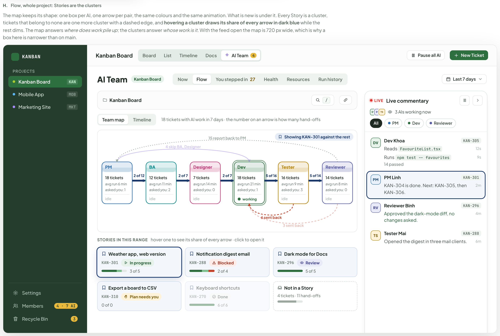
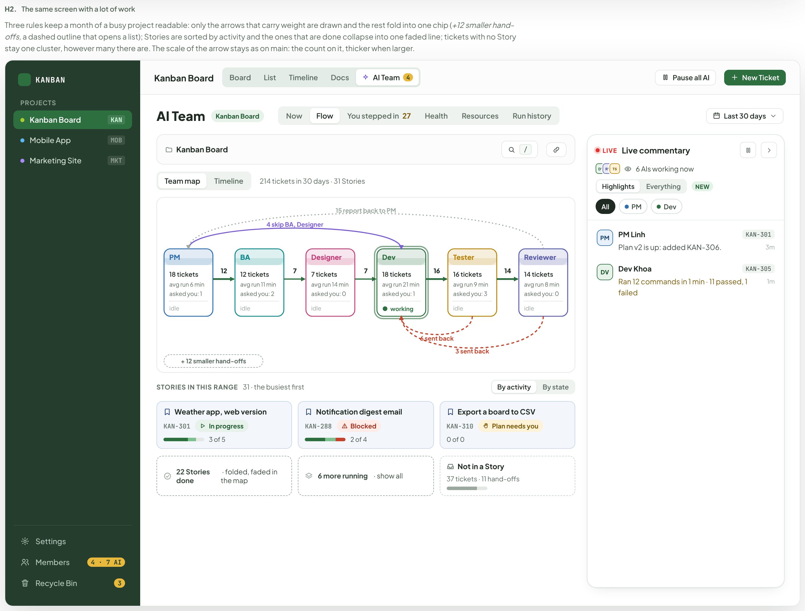
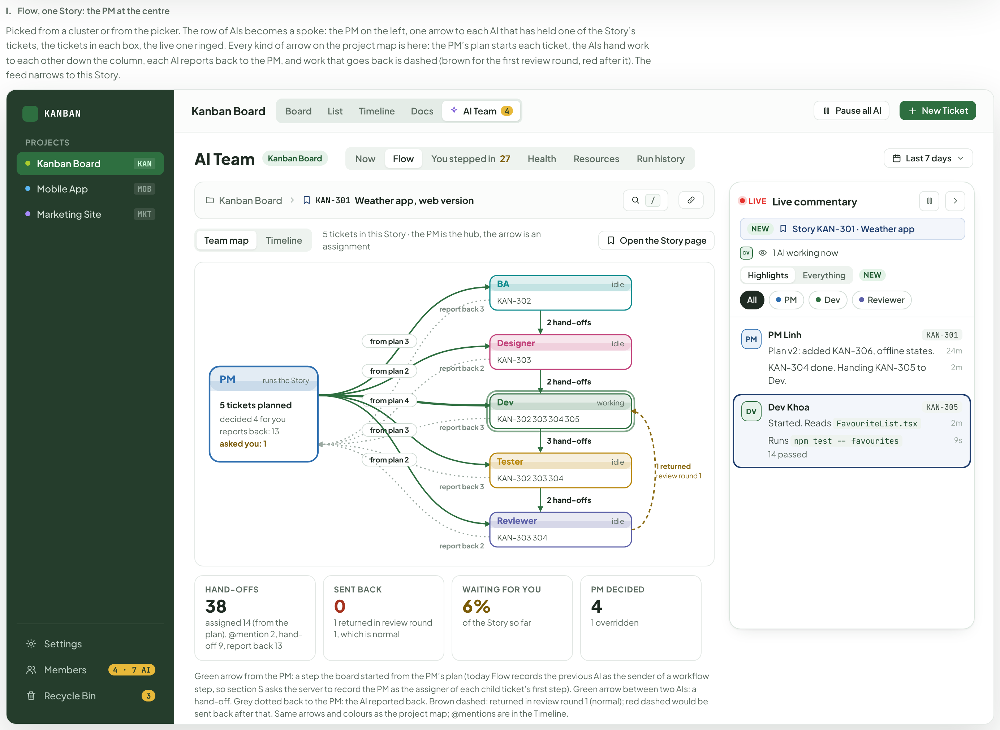
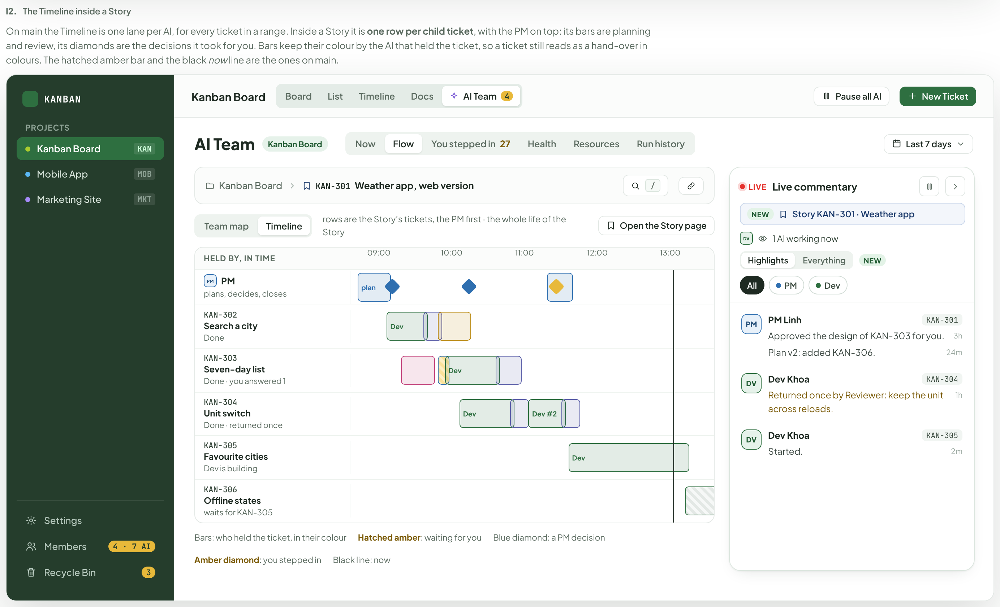
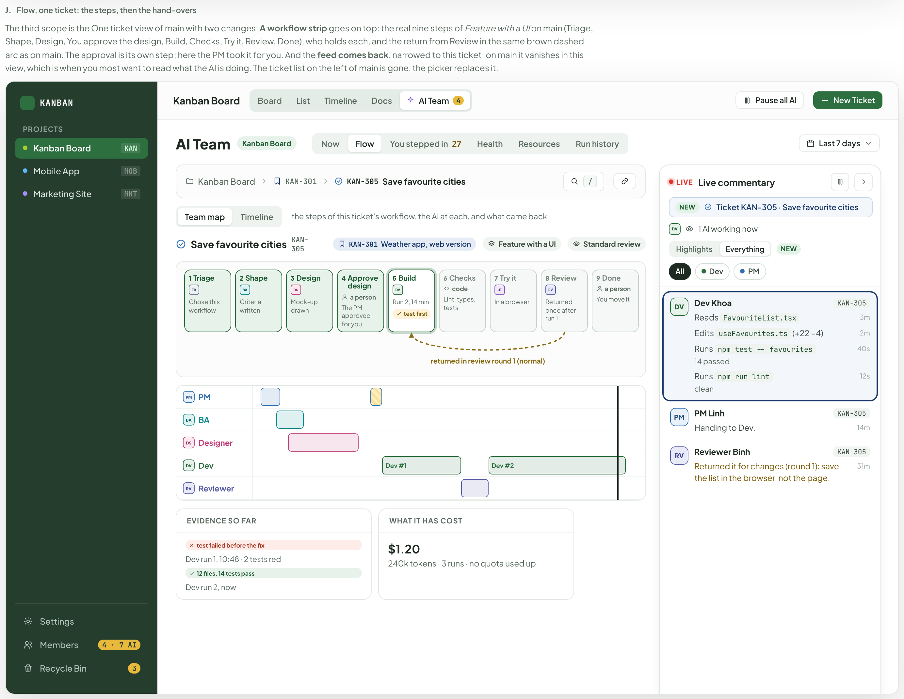

# Story, Flow by scope and Live commentary — a job the PM owns, one bar for Flow, the screens that ran without a design

> Redrawn for AI v2 · source: [`AiStoryFlow.dc.html`](../source/AiStoryFlow.dc.html) · canvas `1794099567-d725` · sha256 `0b783081f27d163895baeb8a1617b3e14db1e19b91716f50cea68415368d7ac4`

> Words, states and conditions follow the code of branch `claude/ai-team-architecture-7a1efc`; the layout is designed here and is not the layout of the current screens. Names, ids, costs and times in the mock-ups are sample data. **Check the code before building from this: the file named in each part is the truth, not the picture.**

## SCREEN — V2

- Text in this part: "SCREEN — V2" · "Story page, Group by Story and Keep awake" · "A Story is a ticket with sub-tickets. The board can group by Story, and a Story opens as a page that says how far its sub-tickets are and what the teams have used. Teams work on the sub-tickets like on any ticket. Below, the Flow boards stay as they are while the Flow tab is built."

---

## Group by Story

- Text in this part: "A" · "Group by Story" · "The switch at the right of the filter bar draws one lane per Story with its sub-tickets in the six columns. Dropping a card in another lane’s cell moves it there." · "1. Group by: Story is on — one lane per Story, its sub-tickets in the board’s six columns" · "KANBAN" · "PROJECTS" · "Kanban Board" · "KAN" · "Mobile App" · "MOB" · "Marketing Site" · "MKT" · "Settings" · "Members" · "3 teams" · "Recycle Bin" · "3" · "Board" · "List" · "Timeline" · "Docs" · "AI Team" · "Filters" · "Group by:" · "Story" · "New Ticket" · "Backlog" · "1" · "To Do" · "In Progress" · "Review" · "Testing" · "2" · "Done" · "6" · "Weather app, web version" · "KAN-301" · "in progress" · "3 of 5 done" · "Feature" · "KAN-306" · "Offline message and error states" · "3 pt" · "KAN-305" · "Save favourite cities" · "Backend team · 4 min" · "5 pt" · "KAN-304" · "Unit switch: Celsius and Fahrenheit" · "AN" · "2 pt" · "KAN-303" · "Seven-day forecast list" · "KAN-302" · "Search a city and show today’s forecast" · "Notification digest email" · "KAN-288" · "to do" · "2 of 4 done" · "Folded: 1 in To Do · 1 in Testing · 2 in Done" · "Not in a Story" · "5 tickets" · "Task" · "KAN-318" · "Show “last updated” time on the card" · "1 pt" · "Chore" · "KAN-312" · "Rename the Members tab" · "HM" · "Bug" · "KAN-299" · "Fix scroll jump on drop" · "KAN-297" · "Fix timezone drift" · "KAN-251" · "Show cost on every AI run card" · "2. The switch, off and on — next to Filters" · "None" · "One lane per Story, its tickets in the columns" · "Show the board without Story lanes" · "The switch" · "Off until someone turns it on" · "Remembered per person" · "Only on the Board view" · "Reading a lane" · "The header says how far the Story is" · "Progress counts every sub-ticket, even the ones a filter hides" · "Tickets in no Story go to the last lane" · "Folding" · "A folded lane keeps one line of counts: “Folded: 1 in To Do · 1 in Testing · 2 in Done”" · "3. A Story with no sub-tickets yet — folded, and open" · "0" · "Export a board to CSV" · "KAN-310" · "backlog" · "0 of 0 done" · "Folded: no tickets yet" · "Dark mode for Docs" · "KAN-296" · "4. No Story in the project — only “Not in a Story” is left" · "5. Filters hide some sub-tickets — Assignee: Backend team; KAN-304 is hidden, the progress still counts it" · "Assignee: Backend team" · "6. Dragging a card over a lane — the cell under the card lights up; any lane, any column"

---

## The Story page

- Text in this part: "B" · "The Story page" · "Opens for a Story ticket, in the app beside the sidebar. It answers four questions in order: what was asked, how far along it is, who holds each sub-ticket, what the teams have used." · "1. The Story page — a page in the app, beside the sidebar" · "KANBAN" · "PROJECTS" · "Kanban Board" · "KAN" · "Mobile App" · "MOB" · "Marketing Site" · "MKT" · "Settings" · "Members" · "3 teams" · "Recycle Bin" · "3" · "Board" · "KAN-301" · "Story" · "In progress" · "Weather app, web version" · "Open in Timeline" · "⋯" · "TICKETS" · "3 of 5" · "1 building" · "ELAPSED" · "2 h 40 m" · "since the first team run" · "WAITING FOR YOU" · "0" · "teams that asked a question" · "TOKENS" · "1.3M" · "by the teams on its sub-tickets" · "GOAL" · "3 of 5 met" · "A web page where I type a city and see the weather there: today, the next seven days, in my choice of units. The cities I look at most stay on the page." · "DONE WHEN" · "Type a city and see today’s temperature and conditions" · "See the next seven days" · "Choose Celsius or Fahrenheit and the page remembers it" · "Cities I use often stay on the page" · "When there is no network the page says so instead of showing nothing" · "PLAN" · "5 sub-tickets · in the order of their waves" · "#" · "TICKET" · "WHAT" · "HELD BY" · "STATE" · "TIME" · "1" · "KAN-302" · "Search a city and show today’s forecast" · "Backend team" · "Done" · "2" · "KAN-303" · "Seven-day forecast list" · "KAN-304" · "Unit switch: Celsius and Fahrenheit" · "AN" · "An Nguyen" · "4" · "KAN-305" · "Save favourite cities" · "5" · "KAN-306" · "Offline message and error states" · "Waits for KAN-305" · "TOKENS AND MONEY" · "tokens in 9 team runs" · "about $6.40 so far" · "2. The ⋯ menu — Open as ticket is the ordinary ticket window, for this Story only" · "Open as ticket" · "3. Open in Timeline — lands on AI Team › Timeline, scoped to this Story" · "List" · "Timeline" · "Docs" · "AI Team" · "Now" · "One ticket: KAN-301" · "You" · "Lead" · "Dev" · "Reviewer" · "QA" · "4. A new Story — no goal, no criteria, no sub-tickets, nothing spent" · "0 of 0" · "none building" · "—" · "0 of 0 met" · "No goal written yet." · "None yet." · "0 sub-tickets · in the order of their waves" · "No sub-tickets yet." · "tokens in 0 team runs" · "no cost yet" · "5. A team is waiting for you — cost not metered: dashes instead of numbers" · "1 building, 1 waiting" · "Search a city" · "Seven-day forecast" · "Unit switch" · "Waiting for you" · "Offline message" · "tokens in 5 team runs" · "6. Time column — a bar from the first run to its end; light while running; hatched when nothing has run; a done ticket with no run uses its own dates" · "Reading the page"

---

## Keep awake

- Text in this part: "C" · "Keep awake" · "In the desktop app, while an AI run is starting or running, the project header shows whether the computer will stay awake. The chip opens what is keeping it awake and the same switch as View › Keep awake while AI runs." · "1. The chip while a run is going — in the project header, beside Board health, Ask AI and the bell; on every tab. Green when the switch is on, amber when it is off" · "Kanban Board" · "Board" · "List" · "Timeline" · "Docs" · "AI Team" · "Awake · 2 runs" · "Board health" · "Ask AI" · "Keep awake is off" · "2. Nothing running — the chip is not there, and not in the web build" · "3. Switch on" · "Keeping this computer awake" · "2 AI runs are going: Backend team on KAN-305, Docs team on KAN-310." · "The screen may turn off; the computer will not sleep until they finish. A run that waits for you, for a limit or for another ticket does not keep it awake." · "Keep awake while AI runs" · "Same as View › Keep awake while AI runs. Turning it off lets the computer sleep at once." · "If it sleeps anyway, the board checks every run when it wakes, ends the ones whose CLI did not survive, and the retry takes over. It is in Run history as Waiting." · "See Run history" · "4. Switch off" · "This computer may sleep" · "If the computer sleeps now, the runs stop with it. Turn the switch on to keep it awake until they finish." · "When it shows" · "Only while a run is queued, starting or running" · "Only in the desktop app" · "A run that waits for you does not keep it awake"

---

## Flow, whole project: Stories are the clusters

- Text in this part: "H." · "Flow, whole project: Stories are the clusters" · "The map keeps its shape: one box per AI, one arrow per pair, the same colours and the same animation. What is new is under it. Every Story is a cluster, tickets that belong to none are one more cluster with a dashed edge, and hovering a cluster draws its share of every arrow in dark blue while the rest dims. The map answers where does work pile up; the clusters answer whose work is it. With the feed open the map is 720 px wide, which is why a box here is narrower than on main." · "KANBAN" · "PROJECTS" · "Kanban Board" · "KAN" · "Mobile App" · "MOB" · "Marketing Site" · "MKT" · "Settings" · "Members" · "4 · 7 AI" · "Recycle Bin" · "3" · "Board" · "List" · "Timeline" · "Docs" · "AI Team" · "4" · "Pause all AI" · "New Ticket" · "Now" · "Flow" · "You stepped in" · "27" · "Health" · "Resources" · "Run history" · "Last 7 days" · "/" · "Team map" · "18 tickets with AI work in 7 days · the number on an arrow is how many hand-offs" · "PM" · "18 tickets" · "avg run 6 min" · "asked you: 1" · "idle" · "BA" · "12 tickets" · "avg run 11 min" · "asked you: 2" · "Designer" · "7 tickets" · "avg run 14 min" · "asked you: 0" · "Dev" · "avg run 21 min" · "working" · "Tester" · "16 tickets" · "avg run 9 min" · "asked you: 3" · "Reviewer" · "14 tickets" · "avg run 8 min" · "2 of 12" · "2 of 7" · "5 of 16" · "5 of 14" · "4 skip BA, Designer" · "15 report back to PM" · "6 sent back" · "3 sent back" · "Showing KAN-301 against the rest" · "STORIES IN THIS RANGE" · "hover one to see its share of every arrow · click to open it" · "Weather app, web version" · "KAN-301" · "In progress" · "3 of 5" · "Notification digest email" · "KAN-288" · "Blocked" · "2 of 4" · "Dark mode for Docs" · "KAN-296" · "Review" · "5 of 5" · "Export a board to CSV" · "KAN-310" · "Plan needs you" · "0 of 0" · "Keyboard shortcuts" · "KAN-270" · "Done" · "6 of 6" · "Not in a Story" · "4 tickets · 11 hand-offs" · "LIVE" · "Live commentary" · "DV" · "RV" · "TS" · "3 AIs working now" · "All" · "Dev Khoa" · "KAN-305" · "Reads FavouriteList.tsx" · "12s" · "Runs npm test -- favourites" · "14 passed" · "9s" · "PM Linh" · "KAN-304 is done. Next: KAN-305, then KAN-306." · "2m" · "Reviewer Binh" · "Approved the dark-mode diff, no changes asked."

---

## The same screen with a lot of work

- Text in this part: "H2." · "The same screen with a lot of work" · "Three rules keep a month of a busy project readable: only the arrows that carry weight are drawn and the rest fold into one chip (+12 smaller hand-offs, a dashed outline that opens a list); Stories are sorted by activity and the ones that are done collapse into one faded line; tickets with no Story stay one cluster, however many there are. The scale of the arrow stays as on main: the count on it, thicker when larger." · "KANBAN" · "PROJECTS" · "Kanban Board" · "KAN" · "Mobile App" · "MOB" · "Marketing Site" · "MKT" · "Settings" · "Members" · "4 · 7 AI" · "Recycle Bin" · "3" · "Board" · "List" · "Timeline" · "Docs" · "AI Team" · "4" · "Pause all AI" · "New Ticket" · "Now" · "Flow" · "You stepped in" · "27" · "Health" · "Resources" · "Run history" · "Last 30 days" · "/" · "Team map" · "214 tickets in 30 days · 31 Stories" · "PM" · "18 tickets" · "avg run 6 min" · "asked you: 1" · "idle" · "BA" · "12 tickets" · "avg run 11 min" · "asked you: 2" · "Designer" · "7 tickets" · "avg run 14 min" · "asked you: 0" · "Dev" · "avg run 21 min" · "working" · "Tester" · "16 tickets" · "avg run 9 min" · "asked you: 3" · "Reviewer" · "14 tickets" · "avg run 8 min" · "12" · "7" · "16" · "14" · "4 skip BA, Designer" · "15 report back to PM" · "6 sent back" · "3 sent back" · "+ 12 smaller hand-offs" · "STORIES IN THIS RANGE" · "31 · the busiest first" · "By activity" · "By state" · "Weather app, web version" · "KAN-301" · "In progress" · "3 of 5" · "Notification digest email" · "KAN-288" · "Blocked" · "2 of 4" · "Export a board to CSV" · "KAN-310" · "Plan needs you" · "0 of 0" · "22 Stories done" · "· folded, faded in the map" · "6 more running" · "· show all" · "Not in a Story" · "37 tickets · 11 hand-offs" · "LIVE" · "Live commentary" · "DV" · "RV" · "TS" · "6 AIs working now" · "Highlights" · "Everything" · "NEW" · "All" · "PM Linh" · "Plan v2 is up: added KAN-306." · "3m" · "Dev Khoa" · "KAN-305" · "Ran 12 commands in 1 min · 11 passed, 1 failed" · "1m"

---

## Flow, one Story: the PM at the centre

- Text in this part: "I." · "Flow, one Story: the PM at the centre" · "Picked from a cluster or from the picker. The row of AIs becomes a spoke: the PM on the left, one arrow to each AI that has held one of the Story’s tickets, the tickets in each box, the live one ringed. Every kind of arrow on the project map is here: the PM’s plan starts each ticket, the AIs hand work to each other down the column, each AI reports back to the PM, and work that goes back is dashed (brown for the first review round, red after it). The feed narrows to this Story." · "KANBAN" · "PROJECTS" · "Kanban Board" · "KAN" · "Mobile App" · "MOB" · "Marketing Site" · "MKT" · "Settings" · "Members" · "4 · 7 AI" · "Recycle Bin" · "3" · "Board" · "List" · "Timeline" · "Docs" · "AI Team" · "4" · "Pause all AI" · "New Ticket" · "Now" · "Flow" · "You stepped in" · "27" · "Health" · "Resources" · "Run history" · "Last 7 days" · "KAN-301" · "Weather app, web version" · "/" · "Team map" · "5 tickets in this Story · the PM is the hub, the arrow is an assignment" · "Open the Story page" · "from plan 3" · "report back 3" · "from plan 2" · "report back 2" · "from plan 4" · "2 hand-offs" · "3 hand-offs" · "BA" · "idle" · "KAN-302" · "Designer" · "KAN-303" · "Dev" · "working" · "KAN-302 303 304 305" · "Tester" · "KAN-302 303 304" · "Reviewer" · "KAN-303 304" · "1 returned" · "review round 1" · "PM" · "runs the Story" · "5 tickets planned" · "decided 4 for you" · "reports back: 13" · "asked you: 1" · "HAND-OFFS" · "38" · "assigned 14 (from the plan), @mention 2, hand-off 9, report back 13" · "SENT BACK" · "0" · "1 returned in review round 1, which is normal" · "WAITING FOR YOU" · "6%" · "of the Story so far" · "PM DECIDED" · "1 overridden" · "Green arrow from the PM: a step the board started from the PM’s plan (today Flow records the previous AI as the sender of a workflow step, so section S asks the server to record the PM as the assigner of each child ticket’s first step). Green arrow between two AIs: a hand-off. Grey dotted back to the PM: the AI reported back. Brown dashed: returned in review round 1 (normal); red dashed would be sent back after that. Same arrows and colours as the project map; @mentions are in the Timeline." · "LIVE" · "Live commentary" · "NEW" · "Story KAN-301 · Weather app" · "DV" · "1 AI working now" · "Highlights" · "Everything" · "All" · "PM Linh" · "Plan v2: added KAN-306, offline states." · "24m" · "KAN-304 done. Handing KAN-305 to Dev." · "2m" · "Dev Khoa" · "KAN-305" · "Started. Reads FavouriteList.tsx" · "Runs npm test -- favourites" · "14 passed" · "9s"

---

## The Timeline inside a Story

- Text in this part: "I2." · "The Timeline inside a Story" · "On main the Timeline is one lane per AI, for every ticket in a range. Inside a Story it is one row per child ticket, with the PM on top: its bars are planning and review, its diamonds are the decisions it took for you. Bars keep their colour by the AI that held the ticket, so a ticket still reads as a hand-over in colours. The hatched amber bar and the black now line are the ones on main." · "KANBAN" · "PROJECTS" · "Kanban Board" · "KAN" · "Mobile App" · "MOB" · "Marketing Site" · "MKT" · "Settings" · "Members" · "4 · 7 AI" · "Recycle Bin" · "3" · "Board" · "List" · "Timeline" · "Docs" · "AI Team" · "4" · "Pause all AI" · "New Ticket" · "Now" · "Flow" · "You stepped in" · "27" · "Health" · "Resources" · "Run history" · "Last 7 days" · "KAN-301" · "Weather app, web version" · "/" · "Team map" · "rows are the Story’s tickets, the PM first · the whole life of the Story" · "Open the Story page" · "HELD BY, IN TIME" · "09:00" · "10:00" · "11:00" · "12:00" · "13:00" · "PM" · "plans, decides, closes" · "plan" · "KAN-302" · "Search a city" · "Done" · "Dev" · "KAN-303" · "Seven-day list" · "Done · you answered 1" · "KAN-304" · "Unit switch" · "Done · returned once" · "Dev #2" · "KAN-305" · "Favourite cities" · "Dev is building" · "KAN-306" · "Offline states" · "waits for KAN-305" · "Bars: who held the ticket, in their colour" · "Hatched amber: waiting for you" · "Blue diamond: a PM decision" · "Amber diamond: you stepped in" · "Black line: now" · "LIVE" · "Live commentary" · "NEW" · "Story KAN-301 · Weather app" · "DV" · "1 AI working now" · "Highlights" · "Everything" · "All" · "PM Linh" · "Approved the design of KAN-303 for you." · "3h" · "Plan v2: added KAN-306." · "24m" · "Dev Khoa" · "Returned once by Reviewer: keep the unit across reloads." · "1h" · "Started." · "2m"

---

## Flow, one ticket: the steps, then the hand-overs

- Text in this part: "J." · "Flow, one ticket: the steps, then the hand-overs" · "The third scope is the One ticket view of main with two changes. A workflow strip goes on top: the real nine steps of Feature with a UI on main (Triage, Shape, Design, You approve the design, Build, Checks, Try it, Review, Done), who holds each, and the return from Review in the same brown dashed arc as on main. The approval is its own step; here the PM took it for you. And the feed comes back, narrowed to this ticket; on main it vanishes in this view, which is when you most want to read what the AI is doing. The ticket list on the left of main is gone, the picker replaces it." · "KANBAN" · "PROJECTS" · "Kanban Board" · "KAN" · "Mobile App" · "MOB" · "Marketing Site" · "MKT" · "Settings" · "Members" · "4 · 7 AI" · "Recycle Bin" · "3" · "Board" · "List" · "Timeline" · "Docs" · "AI Team" · "4" · "Pause all AI" · "New Ticket" · "Now" · "Flow" · "You stepped in" · "27" · "Health" · "Resources" · "Run history" · "Last 7 days" · "KAN-301" · "KAN-305" · "Save favourite cities" · "/" · "Team map" · "the steps of this ticket’s workflow, the AI at each, and what came back" · "Weather app, web version" · "Feature with a UI" · "Standard review" · "1" · "Triage" · "TR" · "Chose this workflow" · "2" · "Shape" · "BA" · "Criteria written" · "Design" · "DS" · "Mock-up drawn" · "Approve design" · "a person" · "The PM approved for you" · "5" · "Build" · "DV" · "Run 2, 14 min" · "test first" · "6" · "Checks" · "code" · "Lint, types, tests" · "7" · "Try it" · "UT" · "In a browser" · "8" · "Review" · "RV" · "Returned once after run 1" · "9" · "Done" · "You move it" · "returned in review round 1 (normal)" · "PM" · "Designer" · "Dev" · "Dev #1" · "Dev #2" · "Reviewer" · "EVIDENCE SO FAR" · "test failed before the fix" · "Dev run 1, 10:48 · 2 tests red" · "12 files, 14 tests pass" · "Dev run 2, now" · "WHAT IT HAS COST" · "$1.20" · "240k tokens · 3 runs · no quota used up" · "LIVE" · "Live commentary" · "NEW" · "Ticket KAN-305 · Save favourite cities" · "1 AI working now" · "Highlights" · "Everything" · "All" · "Dev Khoa" · "Reads FavouriteList.tsx" · "3m" · "Edits useFavourites.ts (+22 −4)" · "2m" · "Runs npm test -- favourites" · "14 passed" · "40s" · "Runs npm run lint" · "clean" · "12s" · "PM Linh"

---

## Todo rows, differences from the code, and what was not checked

All files are 1480 wide. finalH: AiStoryFlow 10447, AiBoardAssistant 10654, AiBoardWave3 4136, AiEverywhere 4347.
Not touched: AiTeamReview, AiResources. Generators: gen_story.py, gen_assist.py, gen_wave3.py, gen_every.py (kit.py, dock.py, cio.py are shared helpers).

## AiStoryFlow.dc.html (A-147..A-153, B-42, B-43)
Old file edited with bs4 (25 boards, 34 506 px) down to 9 children: new header, A, B, C and the five Flow boards.
| Row | What I did | Notes |
|---|---|---|
| A-147 | Removed A, A2, B, C, C2, F, G, L, M1, M2, N, O, P, Q, R(1)(3), S; redrew D and E (now A and B) | G (scope bar) is removed with the rest: it belongs to Flow but the todo lists it as deleted |
| A-147 Flow part | LEFT as is: H, H2, I, I2, J (Flow map, one Story, one ticket, Timeline inside a Story) | KBM-20 is building them. They still carry v1 words (PM, hand-offs, Designer, approval); not mine to change. Their letters stay H..J |
| A-148, A-149, A-150, A-151, A-153 | Removed (K, K2, L..P, Q, R(1)(3), S) | Live list goes in AiTeam (not in this canvas) |
| A-152 | Drawn as board C: chip on (green) and off (amber), nothing running, popover on and off | Samples now Backend team / Docs team. Not moved to its own canvas (the assignment keeps it here) |
| B-42 | Board A: lanes on (full board), switch off and on, folded lane, Story with no sub-tickets (folded and open), no Story at all, filters hiding sub-tickets (progress still counts all), drag over a lane cell | |
| B-43 | Board B: the page, the ⋯ menu with Open as ticket, Open in Timeline landing, new Story (no goal, no criteria, no sub-tickets), a team waiting for you with cost not metered ("—"), the Time column (done, live, hatched), window under 1100 px | |

Differences from the code (drawn on purpose): the lane's status is a small chip ("In progress"), the code prints it as grey lowercase text ("in progress"); the card avatars are teams; Members badge in the sidebar reads "3 teams" (the code still has the v1 count); the Open in Timeline icon is the code's. Todo B-42 says the draw of the "Draft Story with no children" was not checked: I drew the code's "Folded: no tickets yet" and an open lane with empty cells; the empty cells are my reading of the code, not a screenshot.

## AiBoardAssistant.dc.html (A-154..A-166, B-26, B-39..B-41, B-44)
Boards now: A Entry points, B Chat dock, C Ticket chat with its team (new), D Board health, E Docs AI, F Settings → AI, G States, Note. Removed: C Ticket drafting, D Sub-task split, E Test cases.
| Row | What I did | Notes |
|---|---|---|
| A-154 | Header and Note rewritten (Board AI = session of the project's first team, acts, context bar) | |
| A-155 | A1 edited in place: sub line "Backend team (Claude Code) · online", new welcome, new footer, context bar; A7 redrawn as "Board AI without a team" | New texts are mine (the code still says "propose drafts", see below) |
| A-156 | A2 table: removed New Ticket and Test Cases rows; Ticket row now "Ask about this ticket ⌘J"; A4 menu has one item | |
| A-157 | Removed boards C, D, E and I4, I5, I6 | |
| A-158 | B1 conversation without suggested actions or cost; B2 receipt "Done — 2 changes · Undo all 2"; B3 Undo all ("Undone — 2 put back"); B4 asks first | Receipt drawn as DoneReceipt.tsx (Undo all only, no per-line Undo) |
| A-159 | Removed (old B2 draft card) | |
| A-160 | History without $ (B5); thinking, scope with Doc and Idea scopes (B10); empty board (G5); long ticket; injection; private doc; feature off | I8: new target is "Ask for a first ticket" (my wording, there is no target in the code) |
| A-161 | Error (B8), account limit (B9), budget reached "only when metered" (B11), not signed in (G1), slow (G3) | Texts mine: "Claude Code did not answer", "Claude usage limit reached" |
| A-162 | G4 Viewer | Text as the todo quotes Wave3 M |
| A-163 | D: act buttons, draft block and cost chip removed | |
| A-164 | D2 row "Offer a draft comment" removed; E (Docs AI) kept, cost chip removed | |
| A-165 | F: features Ask AI (chat), Drafting in editors, Board health, Docs AI, Sketch AI; Board AI = first team; no caps, no audit link | Names from `settings.py` FEATURES |
| A-166 | No canvas part (md only). The integrator must delete section J in ai-board-assistant.md | |
| B-39 | C1..C6 idle, working, waiting ("Waiting for Backend team…"), answered with role label, stopped without answering, no team ("Private to you") | |
| B-40 | C15..C19: six commands, filter, dimmed, notices, bar at 8 / 41 / 72 % (A also 18..33; B12 has 20 / 65 / 90), Auto-compact row | The code has six commands (compact, new, history, report, stop, cost); the todo says four |
| B-41 | C7..C14: + menu, greyed while working, confirmation, "Summarising…", notice, History empty / rows / digest stand-in | |
| B-44 | C20..C23: question answered in chat, request that changes something, Runs tab, bell open and closed | |
| B-26 | E4, E5 in Docs AI (draft waiting with Continue; written directly with "AI edited this page · version 14" and Undo) | The banner is C-21 (not built) |

## AiBoardWave3.dc.html (A-167..A-175)
Boards now: A Does it / asks first, B Receipt, C What it can reach, D Knowledge base, E GitHub, F Two events, G States. Removed: A, B, F, G, H, K, N.
| Row | What I did | Notes |
|---|---|---|
| A-167 | Header rewritten | |
| A-168, A-172 | Removed | |
| A-169 | One card with two behaviours | |
| A-170 | Receipt with four changes and an ask-first (delete) | No per-line Undo (code has none) |
| A-171 | Table from the board-ask skill tools: projects, tickets, manage_ticket, ticket_items, ticket_branches, docs, knowledge | Schedules, runs, stop and workflows are not in the skill's tool list; dropped |
| A-173 | Kept; "AIs" to "teams", wave and ai-safety-cost references removed, sidebar badge | The sentence "A light model wrote the one-line summary" is still in `KnowledgeBasePanel.tsx` (for files), so I kept it |
| A-174 | Six frames from PullStatus.tsx: red, red on base too, already given back, comments, unreachable, watching off. Only "Open the run on GitHub" and "I will answer them" | The code's rule table (`pullParts.tsx`) still says "section H", "hand-over rules", "ask-first tier": not drawn, needs a code edit |
| A-175 | Two events kept (window wait, merge conflict); arbitration removed; states 12 to 8 | Merge conflict row has only "Open the ticket": the todo's "Give it to an AI / I will do it" buttons are not in the code. I count 8 other states, the todo says nine |

## AiEverywhere.dc.html (A-176..A-180)
| Row | What I did | Notes |
|---|---|---|
| A-176 | Header and A rewritten (Ask only / mention-stops-at-Review rows gone) | |
| A-177 | B: ticket with a team (chat = the lead, role label, Post as comment, Copy), no team ("Private to you"), Runs tab | No toggle, no criteria draft, no run chip, no estimate |
| A-178 | C: teams in the picker (Docs team paused), "Send to Backend team" split button, queued / working / did not start, answer with team and role | "Needs your OK" removed; Helpful removed |
| A-179 | D kept; costs removed; frames 6..8 added (draft waits with Continue, accepted with Undo, written directly) | |
| A-180 | E "No team yet", "Budget reached" (metered); F three rules (drafts, what it reads, keyboard) | |

## Rows not done, or left
Flow boards (KBM-20) kept untouched. Not drawn: Resources, You stepped in, Health, Docs AI (KBM-21/22/24 as the brief says). `design/screens/ai-where-you-work.md` and `ai-board-assistant.md` not edited (integrator).

## Code against todo
- `AssistDock.tsx` still prints "I read ... and propose changes as drafts. I never change anything until you press Apply.", the footer "AI proposes · you apply", "Reviewer (…)" subtitle and "Draft first ticket with AI"; `ScopedChat.tsx` still says "I propose changes as drafts" for a ticket with no team and has `Who` with "No AI member". I drew the todo's v2 text; the code must change.
- Ask-first has no confirm control in the code (`AsksFirst` says "Apply is the confirm"). I drew two answer buttons ("Yes, delete…", "Leave it"): the developer must decide.
- Context bar tooltip and Auto-compact row follow the code.

## Not checked
Nothing was run in the app. Strings for the account-limit, error, empty-board and "Send to" frames are mine where the code has nothing. Word search done on text: no v1 words remain except in the kept Flow boards and the real code line "API keys and secrets, never" (what is sent).

## Review round
finalH now: AiStoryFlow 11353, AiBoardAssistant 10890, AiBoardWave3 4598, AiEverywhere 4358. Avatar dot bug fixed by re-running the generators with the fixed lib (kept boards come from the old file and are untouched).
**Fixed**
- Keep awake: chip now in the project header beside Board health, Ask AI, bell, on any tab. Lane status is grey lowercase text. Open in Timeline lands on AI Team › Timeline with "One ticket: KAN-301". Narrow Story page: only Tokens and money goes under, full table kept. Story sample made one story (5 children: 302/303/304 done, 305 working, 306 waits; same holders everywhere; numbering from 1; "5 sub-tickets"); filter frame hides KAN-304 and says so.
- Board AI: A7/G1 now use the code's block "Claude Code was not found on this computer. Install it, or add an AI team in Members." Removed frames for streaming, rate limit, budget, over-budget, viewer, truncated context (never produced by the server); Everywhere Budget and Viewer states removed; Wave3 "Everything is paused" removed (nothing reads paused_all). Scope shows the three real rows. Thinking has Stop. Frames renumbered. Reading chips "This ticket / Its comments / Linked pages". Style guide label "Style guide for ticket drafts". Board health: "Check now", "Docs that may be out of date", "Not metered" label, 6 insights and 08:00 consistent. "Run #14" plain; thread rows "Cancel" / "Stop", no "Did not start"; Runs tab as TicketChat.tsx (Run #, state chip, Open, "Answer only"/"Work", cost or "Not metered"); empty Runs tab text; question card above the chat; "+ New chat" frame; closing comment without "Report." and dollars, with "Run #4 · 48,000 tokens · sonnet"; bell texts "{team} finished {ticket}" and "{team} asks a question"; @ picker lines as aiAvailability.ts; "2 review comments"; Wave3 B1 "Based on 11 tickets · 2 docs", no "Acts as you"; knowledge-base frame no longer cut, "wave 1" gone; invented UI removed (Open the Runs tab, Reply, explanation under comment box, Draft waiting frames, window-wait example row and its button).
**Kept (why)**
- Todo's frames for the Board AI without a team: replaced by the code's text, so the todo's "needs a team" wording is not drawn (todo and code disagree).
- Scope with Doc and Idea rows (todo A-160): removed, the code has three.
- "Yes, delete…/Leave it" buttons under an ask-first: designer's proposal (code has none). "AI edited this page · Undo" banner: todo C-21, not built. Wave3 merge-conflict card has only "Open the ticket": the todo's give-back buttons do not exist.
- Wave3 states: 7 remain (12 minus 4 rule/suite states minus "Everything is paused"); the todo's nine cannot be reached.
- Stopped-without-answer text and closing-comment sample are drawn from chat.py/runs.py wording.
**Cannot**
- B-26 Idea and Sketch assistants not drawn (no frame source read in this round). "AI summary" chip on the closing comment not drawn (code basis unclear).
