# Story, Flow by scope and Live commentary — one big job handed to the PM, and a way to look at it

> SCREEN — V1 PROPOSAL · source: [`AiStoryFlow.dc.html`](../source/AiStoryFlow.dc.html) · canvas `1793584728-77f0` · sha256 `f69a18e4bc92c447ee6690bfa7563dc8428a704e9dfd267616fa11dad1d43ad3`

> Drawn against `main` at 3.20.0, from the code and not from the earlier designs. It extends `design/screens/ai-team.md` (the Flow tab, the parent-ticket view and the live column), `ai-team-timeline.md`, `ai-team-process.md` and `ai-operations.md`. Section A2 lists what main already has and what this board changes. The screens in sections L to R already run in code and had no design. All names, tickets and text in the mock-ups are illustrative.

The AI team now runs a whole project: a new ticket reaches the Manager, Triage picks a workflow, the PM splits a big job by feature, runs the parts and approves designs for you. In the weather-app test one request became five tickets of five to seven steps each, passed between four to six AIs. This board proposes Story, a job the PM owns from the first plan to Done; a scope bar that points the Flow tab at the whole project, one Story or one ticket; and a Live commentary that follows that scope. It then draws the screens that already run in 3.20.0 without a design. Based on main; names and tickets in the mock-ups are illustrative.

Source: [AiStoryFlow.dc.html](../source/AiStoryFlow.dc.html) › header ("SCREEN — V1 PROPOSAL", "Story, Flow by scope and Live commentary — one big job handed to the PM, and a way to look at it" and the intro)

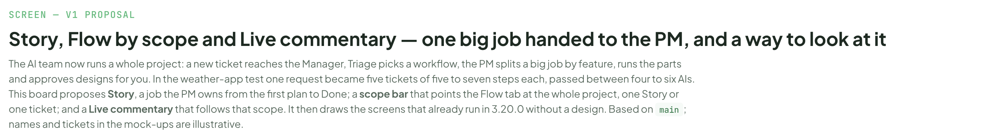

---

## A. What this board decides

Proposed. Every row says what is decided and why; the right-hand column is the argument. Based on main at 3.20.0, not on the earlier designs.

Source: [AiStoryFlow.dc.html](../source/AiStoryFlow.dc.html) › block "A. What this board decides"

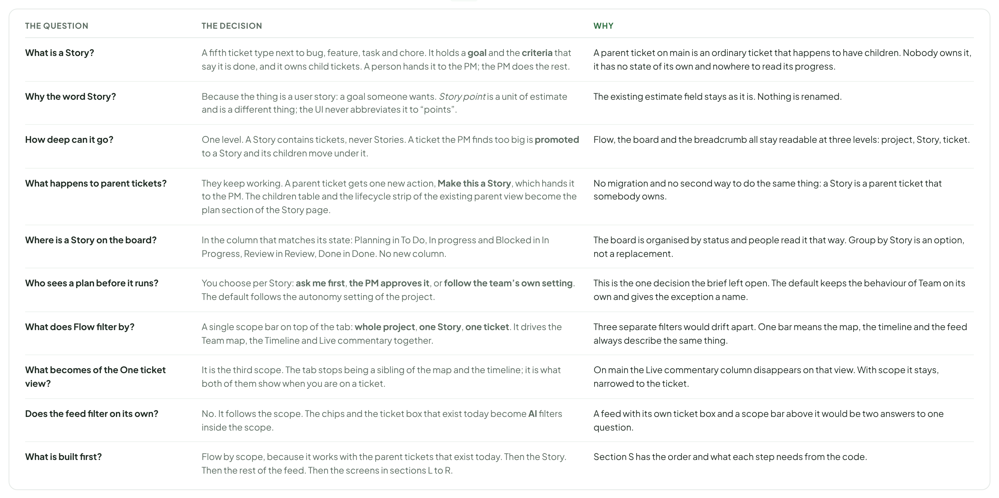

- Text in the frames: "THE QUESTION" · "THE DECISION" · "WHY" · "What is a Story?" · "A fifth ticket type next to bug, feature, task and chore. It holds a goal and the criteria that say it is done, and it owns child tickets. A person hands it to the PM; the PM does the rest." · "A parent ticket on main is an ordinary ticket that happens to have children. Nobody owns it, it has no state of its own and nowhere to read its progress." · "Why the word Story?" · "Because the thing is a user story: a goal someone wants. Story point is a unit of estimate and is a different thing; the UI never abbreviates it to “points”." · "The existing estimate field stays as it is. Nothing is renamed." · "How deep can it go?" · "One level. A Story contains tickets, never Stories. A ticket the PM finds too big is promoted to a Story and its children move under it." · "Flow, the board and the breadcrumb all stay readable at three levels: project, Story, ticket." · "What happens to parent tickets?" · "They keep working. A parent ticket gets one new action, Make this a Story, which hands it to the PM. The children table and the lifecycle strip of the existing parent view become the plan section of the Story page." · "No migration and no second way to do the same thing: a Story is a parent ticket that somebody owns." · "Where is a Story on the board?" · "In the column that matches its state: Planning in To Do, In progress and Blocked in In Progress, Review in Review, Done in Done. No new column." · "The board is organised by status and people read it that way. Group by Story is an option, not a replacement." · "Who sees a plan before it runs?" · "You choose per Story: ask me first, the PM approves it, or follow the team’s own setting. The default follows the autonomy setting of the project." · "This is the one decision the brief left open. The default keeps the behaviour of Team on its own and gives the exception a name." · "What does Flow filter by?" · "A single scope bar on top of the tab: whole project, one Story, one ticket. It drives the Team map, the Timeline and Live commentary together." · "Three separate filters would drift apart. One bar means the map, the timeline and the feed always describe the same thing." · "What becomes of the One ticket view?" · "It is the third scope. The tab stops being a sibling of the map and the timeline; it is what both of them show when you are on a ticket." · "On main the Live commentary column disappears on that view. With scope it stays, narrowed to the ticket." · "Does the feed filter on its own?" · "No. It follows the scope. The chips and the ticket box that exist today become AI filters inside the scope." · "A feed with its own ticket box and a scope bar above it would be two answers to one question." · "What is built first?" · "Flow by scope, because it works with the parent tickets that exist today. Then the Story. Then the rest of the feed. Then the screens in sections L to R." · "Section S has the order and what each step needs from the code."

---

## A2. What is on main today, and what this board does to it

Checked against the code, not remembered. Three things the brief took as missing are already there; the rest of the brief stands as written.

Source: [AiStoryFlow.dc.html](../source/AiStoryFlow.dc.html) › block "A2. What is on main today, and what this board does to it"

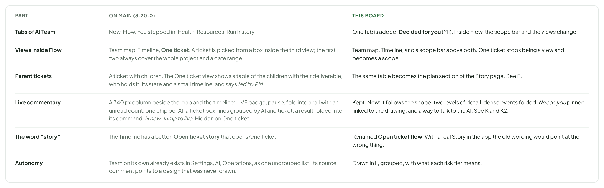

- Text in the frames: "PART" · "ON MAIN (3.20.0)" · "THIS BOARD" · "Tabs of AI Team" · "Now, Flow, You stepped in, Health, Resources, Run history." · "One tab is added, Decided for you (M1). Inside Flow, the scope bar and the views change." · "Views inside Flow" · "Team map, Timeline, One ticket. A ticket is picked from a box inside the third view; the first two always cover the whole project and a date range." · "Team map, Timeline, and a scope bar above both. One ticket stops being a view and becomes a scope." · "Parent tickets" · "A ticket with children. The One ticket view shows a table of the children with their deliverable, who holds it, its state and a small timeline, and says led by PM." · "The same table becomes the plan section of the Story page. See E." · "Live commentary" · "A 340 px column beside the map and the timeline: LIVE badge, pause, fold into a rail with an unread count, one chip per AI, a ticket box, lines grouped by AI and ticket, a result folded into its command, N new, Jump to live. Hidden on One ticket." · "Kept. New: it follows the scope, two levels of detail, dense events folded, Needs you pinned, linked to the drawing, and a way to talk to the AI. See K and K2." · "The word “story”" · "The Timeline has a button Open ticket story that opens One ticket." · "Renamed Open ticket flow. With a real Story in the app the old wording would point at the wrong thing." · "Autonomy" · "Team on its own already exists in Settings, AI, Operations, as one ungrouped list. Its source comment points to a design that was never drawn." · "Drawn in L, grouped, with what each risk tier means."

---

## B. A Story from the goal to Done

Four steps and one overlay. The states are the Story’s own; they are not the status of its children, and a Story is never moved by dragging.

Source: [AiStoryFlow.dc.html](../source/AiStoryFlow.dc.html) › block "B. A Story from the goal to Done"

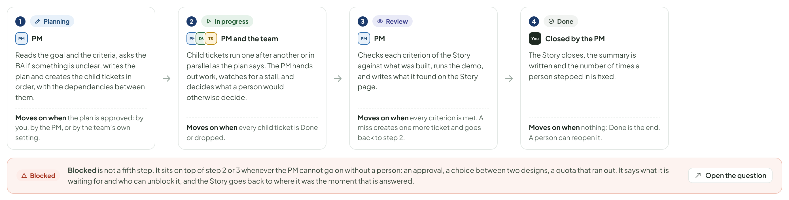

- Text in the frames: "1" · "Planning" · "PM" · "Reads the goal and the criteria, asks the BA if something is unclear, writes the plan and creates the child tickets in order, with the dependencies between them." · "Moves on when the plan is approved: by you, by the PM, or by the team’s own setting." · "2" · "In progress" · "DV" · "TS" · "PM and the team" · "Child tickets run one after another or in parallel as the plan says. The PM hands out work, watches for a stall, and decides what a person would otherwise decide." · "Moves on when every child ticket is Done or dropped." · "3" · "Review" · "Checks each criterion of the Story against what was built, runs the demo, and writes what it found on the Story page." · "Moves on when every criterion is met. A miss creates one more ticket and goes back to step 2." · "4" · "Done" · "You" · "Closed by the PM" · "The Story closes, the summary is written and the number of times a person stepped in is fixed." · "Moves on when nothing: Done is the end. A person can reopen it." · "Blocked" · "Blocked is not a fifth step. It sits on top of step 2 or 3 whenever the PM cannot go on without a person: an approval, a choice between two designs, a quota that ran out. It says what it is waiting for and who can unblock it, and the Story goes back to where it was the moment that is answered." · "Open the question"

---

## C. The Story on the board

A Story card is a ticket card that reads differently at a glance: a tinted ground, a dark-blue left edge, the bookmark and the word Story where a ticket says Feature, and a progress bar where a ticket has points. It never relies on colour alone, so it still reads in the black-and-white theme. Its children carry one small chip that says which Story they belong to.

Source: [AiStoryFlow.dc.html](../source/AiStoryFlow.dc.html) › block "C. The Story on the board"

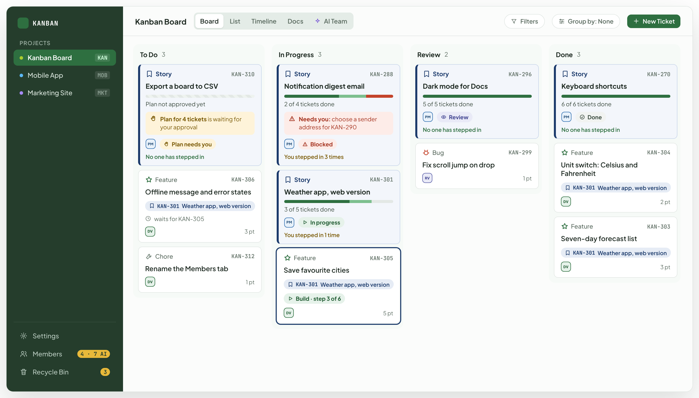

- Text in the frames: "KANBAN" · "PROJECTS" · "Kanban Board" · "KAN" · "Mobile App" · "MOB" · "Marketing Site" · "MKT" · "Settings" · "Members" · "4 · 7 AI" · "Recycle Bin" · "3" · "Board" · "List" · "Timeline" · "Docs" · "AI Team" · "Filters" · "Group by: None" · "New Ticket" · "To Do" · "Story" · "KAN-310" · "Export a board to CSV" · "Plan not approved yet" · "Plan for 4 tickets is waiting for your approval" · "PM" · "Plan needs you" · "No one has stepped in" · "Feature" · "KAN-306" · "Offline message and error states" · "KAN-301" · "Weather app, web version" · "waits for KAN-305" · "DV" · "3 pt" · "Chore" · "KAN-312" · "Rename the Members tab" · "1 pt" · "In Progress" · "KAN-288" · "Notification digest email" · "2 of 4 tickets done" · "Needs you: choose a sender address for KAN-290" · "Blocked" · "You stepped in 3 times" · "3 of 5 tickets done" · "In progress" · "You stepped in 1 time" · "KAN-305" · "Save favourite cities" · "Build · step 3 of 6" · "5 pt" · "Review" · "2" · "KAN-296" · "Dark mode for Docs" · "5 of 5 tickets done" · "Bug" · "KAN-299" · "Fix scroll jump on drop" · "RV" · "Done" · "KAN-270" · "Keyboard shortcuts" · "6 of 6 tickets done" · "KAN-304" · "Unit switch: Celsius and Fahrenheit" · "2 pt" · "KAN-303" · "Seven-day forecast list"

---

## C2. The five states of a Story card

Planning has two faces: the PM is still writing (a plain Planning chip) and the plan is written and waits for you (the amber strip with its count). The strip appears only when you are the one holding it.

Source: [AiStoryFlow.dc.html](../source/AiStoryFlow.dc.html) › block "C2. The five states of a Story card"

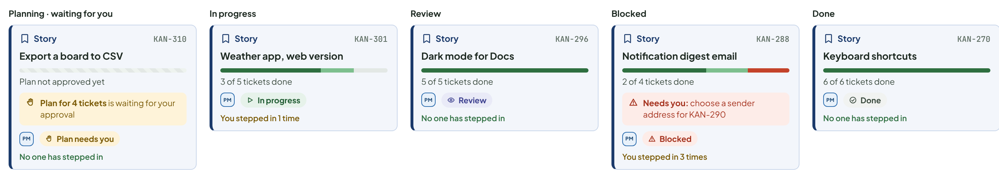

- Text in the frames: "Planning · waiting for you" · "Story" · "KAN-310" · "Export a board to CSV" · "Plan not approved yet" · "Plan for 4 tickets is waiting for your approval" · "PM" · "Plan needs you" · "No one has stepped in" · "In progress" · "KAN-301" · "Weather app, web version" · "3 of 5 tickets done" · "You stepped in 1 time" · "Review" · "KAN-296" · "Dark mode for Docs" · "5 of 5 tickets done" · "Blocked" · "KAN-288" · "Notification digest email" · "2 of 4 tickets done" · "Needs you: choose a sender address for KAN-290" · "You stepped in 3 times" · "Done" · "KAN-270" · "Keyboard shortcuts" · "6 of 6 tickets done"

---

## D. The board grouped by Story

Group by Story is a switch in the board header, next to Filters; it is off until someone turns it on and is remembered per person. In a lane the Story is the header, not a card, and its children sit in the board’s own columns, so a person still reads left to right. Lanes collapse. Tickets without a Story go to the last lane. Done tickets of a Story that is itself Done fold into its header.

Source: [AiStoryFlow.dc.html](../source/AiStoryFlow.dc.html) › block "D. The board grouped by Story"

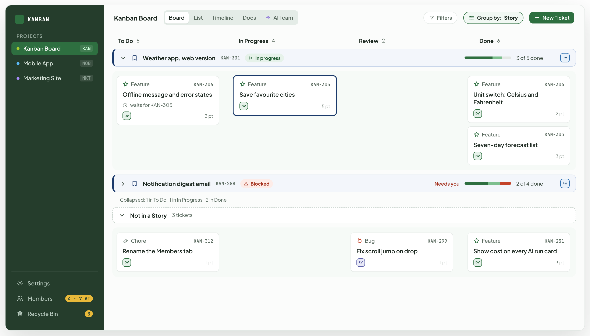

- Text in the frames: "KANBAN" · "PROJECTS" · "Kanban Board" · "KAN" · "Mobile App" · "MOB" · "Marketing Site" · "MKT" · "Settings" · "Members" · "4 · 7 AI" · "Recycle Bin" · "3" · "Board" · "List" · "Timeline" · "Docs" · "AI Team" · "Filters" · "Group by:" · "Story" · "New Ticket" · "To Do" · "5" · "In Progress" · "4" · "Review" · "2" · "Done" · "6" · "Weather app, web version" · "KAN-301" · "In progress" · "3 of 5 done" · "PM" · "Feature" · "KAN-306" · "Offline message and error states" · "waits for KAN-305" · "DV" · "3 pt" · "KAN-305" · "Save favourite cities" · "5 pt" · "KAN-304" · "Unit switch: Celsius and Fahrenheit" · "2 pt" · "KAN-303" · "Seven-day forecast list" · "Notification digest email" · "KAN-288" · "Blocked" · "Needs you" · "2 of 4 done" · "Collapsed: 1 in To Do · 1 in In Progress · 2 in Done" · "Not in a Story" · "3 tickets" · "Chore" · "KAN-312" · "Rename the Members tab" · "1 pt" · "Bug" · "KAN-299" · "Fix scroll jump on drop" · "RV" · "KAN-251" · "Show cost on every AI run card"

---

## E. The Story page

Opens from the card, from a row in Flow or from the breadcrumb. It answers four questions in order: what was asked, how far along is it, what did the PM decide in my place, what has it cost. The plan is the children table of the parent ticket on main, kept as it is and given an order and a Planned-by line; Override reverses a decision when it still can be, and says so when it no longer can.

Source: [AiStoryFlow.dc.html](../source/AiStoryFlow.dc.html) › block "E. The Story page"

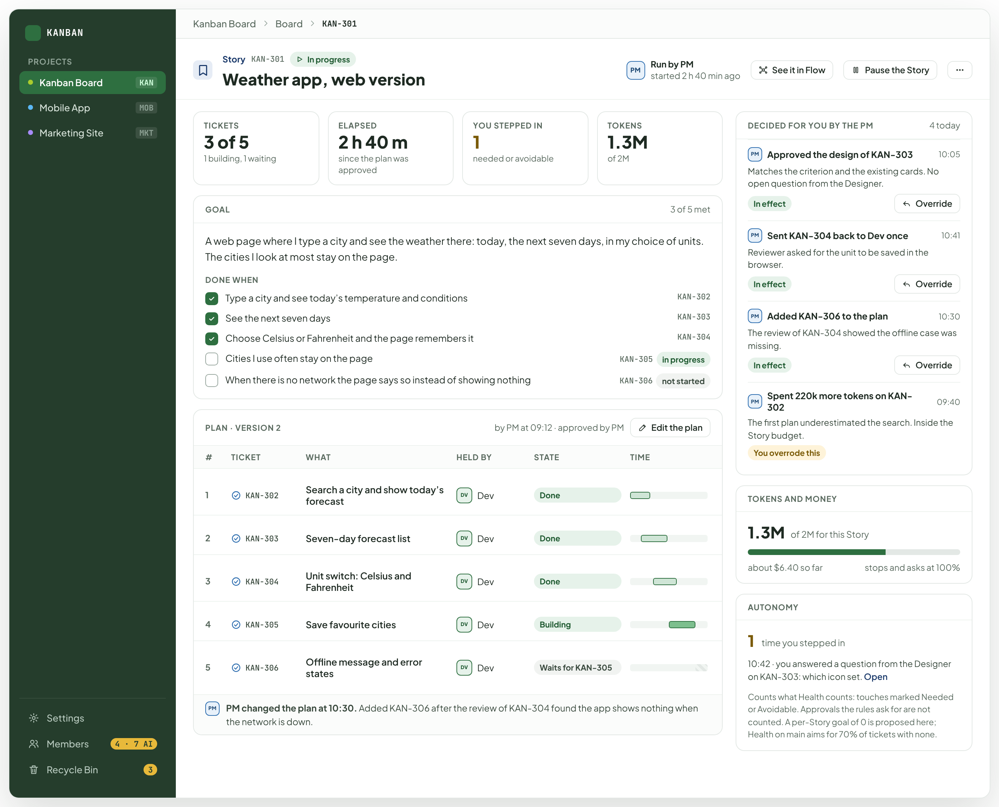

- Text in the frames: "KANBAN" · "PROJECTS" · "Kanban Board" · "KAN" · "Mobile App" · "MOB" · "Marketing Site" · "MKT" · "Settings" · "Members" · "4 · 7 AI" · "Recycle Bin" · "3" · "Board" · "KAN-301" · "Story" · "In progress" · "Weather app, web version" · "PM" · "Run by PM" · "started 2 h 40 min ago" · "See it in Flow" · "Pause the Story" · "TICKETS" · "3 of 5" · "1 building, 1 waiting" · "ELAPSED" · "2 h 40 m" · "since the plan was approved" · "YOU STEPPED IN" · "1" · "needed or avoidable" · "TOKENS" · "1.3M" · "of 2M" · "GOAL" · "3 of 5 met" · "A web page where I type a city and see the weather there: today, the next seven days, in my choice of units. The cities I look at most stay on the page." · "DONE WHEN" · "Type a city and see today’s temperature and conditions" · "KAN-302" · "See the next seven days" · "KAN-303" · "Choose Celsius or Fahrenheit and the page remembers it" · "KAN-304" · "Cities I use often stay on the page" · "KAN-305" · "in progress" · "When there is no network the page says so instead of showing nothing" · "KAN-306" · "not started" · "PLAN · VERSION 2" · "by PM at 09:12 · approved by PM" · "Edit the plan" · "#" · "TICKET" · "WHAT" · "HELD BY" · "STATE" · "TIME" · "Search a city and show today’s forecast" · "DV" · "Dev" · "Done" · "2" · "Seven-day forecast list" · "Unit switch: Celsius and Fahrenheit" · "4" · "Save favourite cities" · "Building" · "5" · "Offline message and error states" · "Waits for KAN-305" · "PM changed the plan at 10:30. Added KAN-306 after the review of KAN-304 found the app shows nothing when the network is down." · "DECIDED FOR YOU BY THE PM" · "4 today" · "Approved the design of KAN-303" · "10:05" · "Matches the criterion and the existing cards. No open question from the Designer." · "In effect" · "Override" · "Sent KAN-304 back to Dev once" · "10:41" · "Reviewer asked for the unit to be saved in the browser." · "Added KAN-306 to the plan" · "10:30" · "The review of KAN-304 showed the offline case was missing." · "Spent 220k more tokens on KAN-302" · "09:40" · "The first plan underestimated the search. Inside the Story budget." · "You overrode this" · "TOKENS AND MONEY" · "of 2M for this Story" · "about $6.40 so far" · "stops and asks at 100%" · "AUTONOMY" · "time you stepped in" · "10:42 · you answered a question from the Designer on KAN-303: which icon set. Open" · "Counts what Health counts: touches marked Needed or Avoidable. Approvals the rules ask for are not counted. A per-Story goal of 0 is proposed here; Health on main aims for 70% of tickets with none."

---

## F. Giving a Story to the PM, and the plan that comes back

The dialog asks for the four things the PM needs and nothing it can work out itself. If you pick Show me the plan first, the Story stops after planning in the amber state of C2, and the plan opens from the card, from the notification and from the Needs you queue as the card on the right. Main has no setting for approving a plan, so Follow Team on its own reuses Highest risk the PM decides. Change the plan edits tickets in place; Tell the PM what to change starts a short chat and the PM writes version 2.

Source: [AiStoryFlow.dc.html](../source/AiStoryFlow.dc.html) › block "F. Giving a Story to the PM, and the plan that comes back"

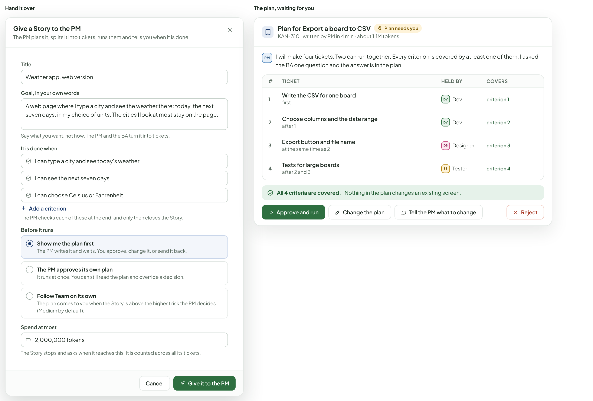

- Text in the frames: "Hand it over" · "Give a Story to the PM" · "The PM plans it, splits it into tickets, runs them and tells you when it is done." · "Title" · "Weather app, web version" · "Goal, in your own words" · "A web page where I type a city and see the weather there: today, the next seven days, in my choice of units. The cities I look at most stay on the page." · "Say what you want, not how. The PM and the BA turn it into tickets." · "It is done when" · "I can type a city and see today’s weather" · "I can see the next seven days" · "I can choose Celsius or Fahrenheit" · "Add a criterion" · "The PM checks each of these at the end, and only then closes the Story." · "Before it runs" · "Show me the plan first" · "The PM writes it and waits. You approve, change it, or send it back." · "The PM approves its own plan" · "It runs at once. You can still read the plan and override a decision." · "Follow Team on its own" · "The plan comes to you when the Story is above the highest risk the PM decides (Medium by default)." · "Spend at most" · "2,000,000 tokens" · "The Story stops and asks when it reaches this. It is counted across all its tickets." · "Cancel" · "Give it to the PM" · "The plan, waiting for you" · "Plan for Export a board to CSV" · "Plan needs you" · "KAN-310 · written by PM in 4 min · about 1.1M tokens" · "PM" · "I will make four tickets. Two can run together. Every criterion is covered by at least one of them. I asked the BA one question and the answer is in the plan." · "#" · "TICKET" · "HELD BY" · "COVERS" · "1" · "Write the CSV for one board" · "first" · "DV" · "Dev" · "criterion 1" · "2" · "Choose columns and the date range" · "after 1" · "criterion 2" · "3" · "Export button and file name" · "at the same time as 2" · "DS" · "Designer" · "criterion 3" · "4" · "Tests for large boards" · "after 2 and 3" · "TS" · "Tester" · "criterion 4" · "All 4 criteria are covered." · "Nothing in the plan changes an existing screen." · "Approve and run" · "Change the plan" · "Tell the PM what to change" · "Reject"

---

## G. The scope bar

One bar above both views. It replaces the ticket box inside One ticket and the scope button inside the Timeline, so there is exactly one place that says what am I looking at. Shown at all three levels, then with the picker open.

Source: [AiStoryFlow.dc.html](../source/AiStoryFlow.dc.html) › block "G. The scope bar"

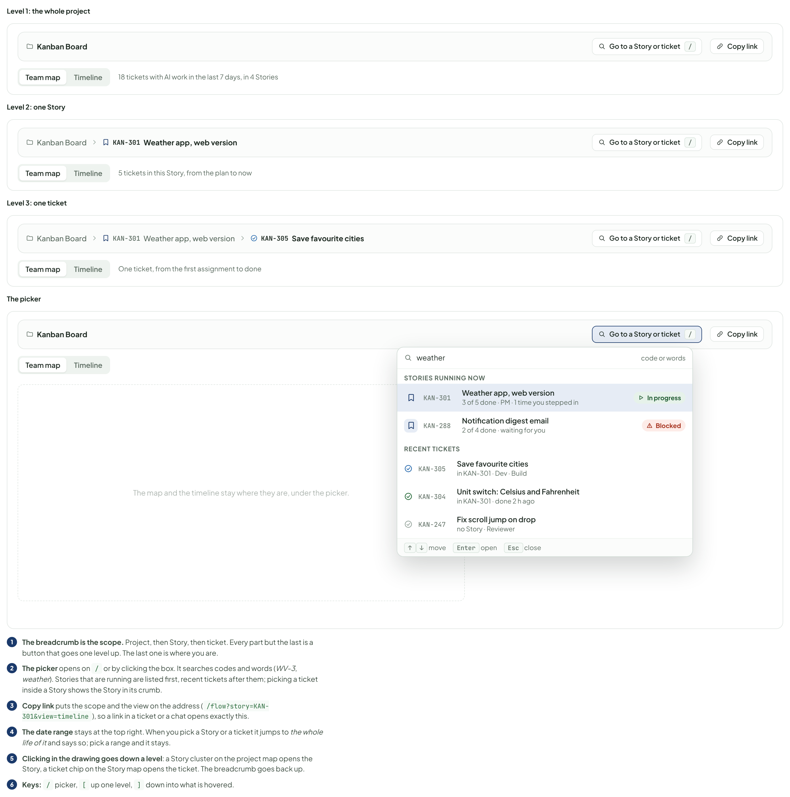

- Text in the frames: "Level 1: the whole project" · "Kanban Board" · "Go to a Story or ticket" · "/" · "Copy link" · "Team map" · "Timeline" · "18 tickets with AI work in the last 7 days, in 4 Stories" · "Level 2: one Story" · "KAN-301" · "Weather app, web version" · "5 tickets in this Story, from the plan to now" · "Level 3: one ticket" · "KAN-305" · "Save favourite cities" · "One ticket, from the first assignment to done" · "The picker" · "weather" · "code or words" · "STORIES RUNNING NOW" · "3 of 5 done · PM · 1 time you stepped in" · "In progress" · "KAN-288" · "Notification digest email" · "2 of 4 done · waiting for you" · "Blocked" · "RECENT TICKETS" · "in KAN-301 · Dev · Build" · "KAN-304" · "Unit switch: Celsius and Fahrenheit" · "in KAN-301 · done 2 h ago" · "KAN-247" · "Fix scroll jump on drop" · "no Story · Reviewer" · "↑↓ move" · "Enter open" · "Esc close" · "The map and the timeline stay where they are, under the picker." · "1" · "The breadcrumb is the scope. Project, then Story, then ticket. Every part but the last is a button that goes one level up. The last one is where you are." · "2" · "The picker opens on / or by clicking the box. It searches codes and words (WV-3, weather). Stories that are running are listed first, recent tickets after them; picking a ticket inside a Story shows the Story in its crumb." · "3" · "Copy link puts the scope and the view on the address (/flow?story=KAN-301&view=timeline), so a link in a ticket or a chat opens exactly this." · "4" · "The date range stays at the top right. When you pick a Story or a ticket it jumps to the whole life of it and says so; pick a range and it stays." · "5" · "Clicking in the drawing goes down a level: a Story cluster on the project map opens the Story, a ticket chip on the Story map opens the ticket. The breadcrumb goes back up." · "6" · "Keys: / picker, [ up one level, ] down into what is hovered."

---

## H. Flow, whole project: Stories are the clusters

The map keeps its shape: one box per AI, one arrow per pair, the same colours and the same animation. What is new is under it. Every Story is a cluster, tickets that belong to none are one more cluster with a dashed edge, and hovering a cluster draws its share of every arrow in dark blue while the rest dims. The map answers where does work pile up; the clusters answer whose work is it. With the feed open the map is 720 px wide, which is why a box here is narrower than on main.

Source: [AiStoryFlow.dc.html](../source/AiStoryFlow.dc.html) › block "H. Flow, whole project: Stories are the clusters"

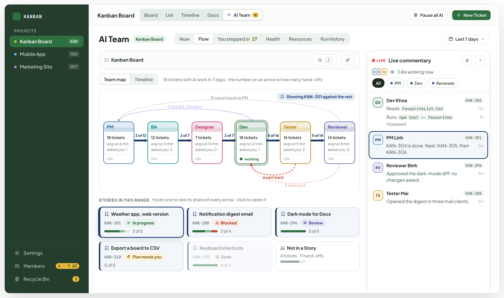

- Text in the frames: "KANBAN" · "PROJECTS" · "Kanban Board" · "KAN" · "Mobile App" · "MOB" · "Marketing Site" · "MKT" · "Settings" · "Members" · "4 · 7 AI" · "Recycle Bin" · "3" · "Board" · "List" · "Timeline" · "Docs" · "AI Team" · "4" · "Pause all AI" · "New Ticket" · "Now" · "Flow" · "You stepped in" · "27" · "Health" · "Resources" · "Run history" · "Last 7 days" · "/" · "Team map" · "18 tickets with AI work in 7 days · the number on an arrow is how many hand-offs" · "PM" · "18 tickets" · "avg run 6 min" · "asked you: 1" · "idle" · "BA" · "12 tickets" · "avg run 11 min" · "asked you: 2" · "Designer" · "7 tickets" · "avg run 14 min" · "asked you: 0" · "Dev" · "avg run 21 min" · "working" · "Tester" · "16 tickets" · "avg run 9 min" · "asked you: 3" · "Reviewer" · "14 tickets" · "avg run 8 min" · "2 of 12" · "2 of 7" · "5 of 16" · "5 of 14" · "4 skip BA, Designer" · "15 report back to PM" · "6 sent back" · "3 sent back" · "Showing KAN-301 against the rest" · "STORIES IN THIS RANGE" · "hover one to see its share of every arrow · click to open it" · "Weather app, web version" · "KAN-301" · "In progress" · "3 of 5" · "Notification digest email" · "KAN-288" · "Blocked" · "2 of 4" · "Dark mode for Docs" · "KAN-296" · "Review" · "5 of 5" · "Export a board to CSV" · "KAN-310" · "Plan needs you" · "0 of 0" · "Keyboard shortcuts" · "KAN-270" · "Done" · "6 of 6" · "Not in a Story" · "4 tickets · 11 hand-offs" · "LIVE" · "Live commentary" · "DV" · "RV" · "TS" · "3 AIs working now" · "All" · "Dev Khoa" · "KAN-305" · "Reads FavouriteList.tsx" · "12s" · "Runs npm test -- favourites" · "14 passed" · "9s" · "PM Linh" · "KAN-304 is done. Next: KAN-305, then KAN-306." · "2m" · "Reviewer Binh" · "Approved the dark-mode diff, no changes asked." · "4m" · "Tester Mai" · "Opened the digest in three mail clients." · "6m"

---

## H2. The same screen with a lot of work

Three rules keep a month of a busy project readable: only the arrows that carry weight are drawn and the rest fold into one chip (+12 smaller hand-offs, a dashed outline that opens a list); Stories are sorted by activity and the ones that are done collapse into one faded line; tickets with no Story stay one cluster, however many there are. The scale of the arrow stays as on main: the count on it, thicker when larger.

Source: [AiStoryFlow.dc.html](../source/AiStoryFlow.dc.html) › block "H2. The same screen with a lot of work"

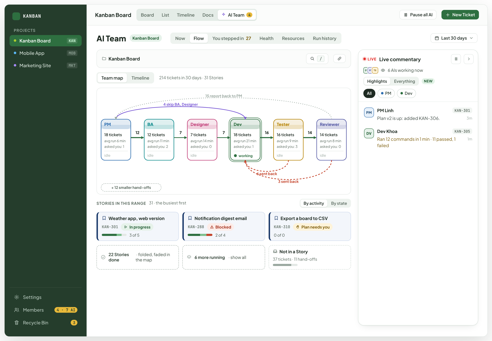

- Text in the frames: "KANBAN" · "PROJECTS" · "Kanban Board" · "KAN" · "Mobile App" · "MOB" · "Marketing Site" · "MKT" · "Settings" · "Members" · "4 · 7 AI" · "Recycle Bin" · "3" · "Board" · "List" · "Timeline" · "Docs" · "AI Team" · "4" · "Pause all AI" · "New Ticket" · "Now" · "Flow" · "You stepped in" · "27" · "Health" · "Resources" · "Run history" · "Last 30 days" · "/" · "Team map" · "214 tickets in 30 days · 31 Stories" · "PM" · "18 tickets" · "avg run 6 min" · "asked you: 1" · "idle" · "BA" · "12 tickets" · "avg run 11 min" · "asked you: 2" · "Designer" · "7 tickets" · "avg run 14 min" · "asked you: 0" · "Dev" · "avg run 21 min" · "working" · "Tester" · "16 tickets" · "avg run 9 min" · "asked you: 3" · "Reviewer" · "14 tickets" · "avg run 8 min" · "12" · "7" · "16" · "14" · "4 skip BA, Designer" · "15 report back to PM" · "6 sent back" · "3 sent back" · "+ 12 smaller hand-offs" · "STORIES IN THIS RANGE" · "31 · the busiest first" · "By activity" · "By state" · "Weather app, web version" · "KAN-301" · "In progress" · "3 of 5" · "Notification digest email" · "KAN-288" · "Blocked" · "2 of 4" · "Export a board to CSV" · "KAN-310" · "Plan needs you" · "0 of 0" · "22 Stories done" · "· folded, faded in the map" · "6 more running" · "· show all" · "Not in a Story" · "37 tickets · 11 hand-offs" · "LIVE" · "Live commentary" · "DV" · "RV" · "TS" · "6 AIs working now" · "Highlights" · "Everything" · "NEW" · "All" · "PM Linh" · "Plan v2 is up: added KAN-306." · "3m" · "Dev Khoa" · "KAN-305" · "Ran 12 commands in 1 min · 11 passed, 1 failed" · "1m"

---

## I. Flow, one Story: the PM at the centre

Picked from a cluster or from the picker. The row of AIs becomes a spoke: the PM on the left, one arrow to each AI that has held one of the Story’s tickets, the tickets in each box, the live one ringed. Every kind of arrow on the project map is here: the PM assigns, the AIs hand work to each other down the column, each AI reports back to the PM, and work that goes back is dashed (brown for the first review round, red after it). The feed narrows to this Story.

Source: [AiStoryFlow.dc.html](../source/AiStoryFlow.dc.html) › block "I. Flow, one Story: the PM at the centre"

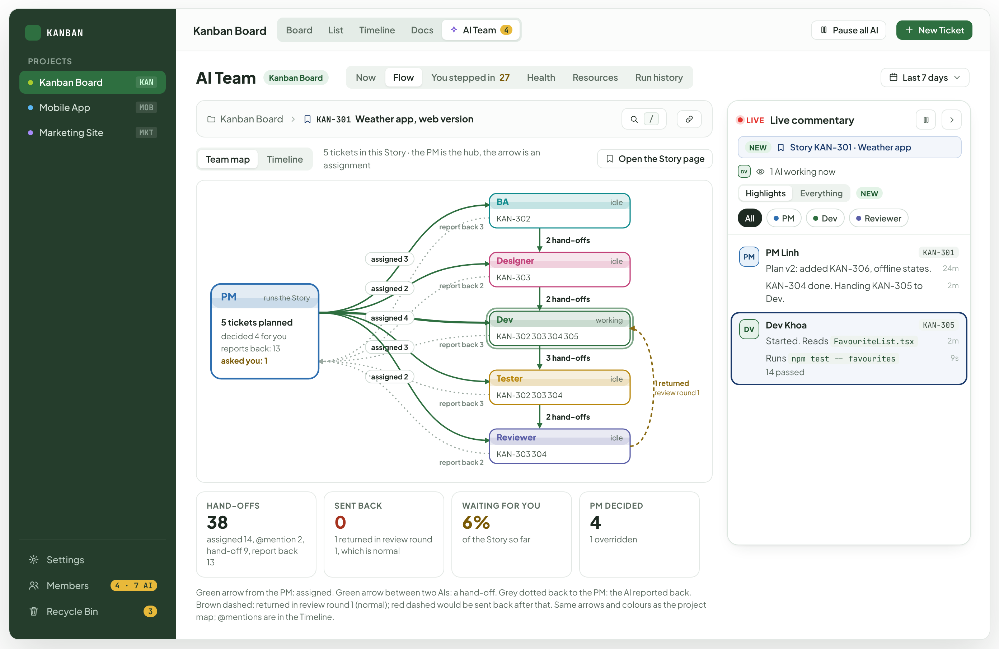

- Text in the frames: "KANBAN" · "PROJECTS" · "Kanban Board" · "KAN" · "Mobile App" · "MOB" · "Marketing Site" · "MKT" · "Settings" · "Members" · "4 · 7 AI" · "Recycle Bin" · "3" · "Board" · "List" · "Timeline" · "Docs" · "AI Team" · "4" · "Pause all AI" · "New Ticket" · "Now" · "Flow" · "You stepped in" · "27" · "Health" · "Resources" · "Run history" · "Last 7 days" · "KAN-301" · "Weather app, web version" · "/" · "Team map" · "5 tickets in this Story · the PM is the hub, the arrow is an assignment" · "Open the Story page" · "assigned 3" · "report back 3" · "assigned 2" · "report back 2" · "assigned 4" · "2 hand-offs" · "3 hand-offs" · "BA" · "idle" · "KAN-302" · "Designer" · "KAN-303" · "Dev" · "working" · "KAN-302 303 304 305" · "Tester" · "KAN-302 303 304" · "Reviewer" · "KAN-303 304" · "1 returned" · "review round 1" · "PM" · "runs the Story" · "5 tickets planned" · "decided 4 for you" · "reports back: 13" · "asked you: 1" · "HAND-OFFS" · "38" · "assigned 14, @mention 2, hand-off 9, report back 13" · "SENT BACK" · "0" · "1 returned in review round 1, which is normal" · "WAITING FOR YOU" · "6%" · "of the Story so far" · "PM DECIDED" · "1 overridden" · "Green arrow from the PM: assigned. Green arrow between two AIs: a hand-off. Grey dotted back to the PM: the AI reported back. Brown dashed: returned in review round 1 (normal); red dashed would be sent back after that. Same arrows and colours as the project map; @mentions are in the Timeline." · "LIVE" · "Live commentary" · "NEW" · "Story KAN-301 · Weather app" · "DV" · "1 AI working now" · "Highlights" · "Everything" · "All" · "PM Linh" · "Plan v2: added KAN-306, offline states." · "24m" · "KAN-304 done. Handing KAN-305 to Dev." · "2m" · "Dev Khoa" · "KAN-305" · "Started. Reads FavouriteList.tsx" · "Runs npm test -- favourites" · "14 passed" · "9s"

---

## I2. The Timeline inside a Story

On main the Timeline is one lane per AI, for every ticket in a range. Inside a Story it is one row per child ticket, with the PM on top: its bars are planning and review, its diamonds are the decisions it took for you. Bars keep their colour by the AI that held the ticket, so a ticket still reads as a hand-over in colours. The hatched amber bar and the black now line are the ones on main.

Source: [AiStoryFlow.dc.html](../source/AiStoryFlow.dc.html) › block "I2. The Timeline inside a Story"

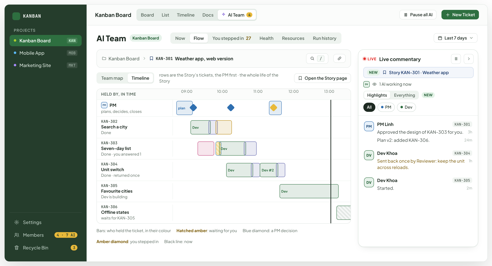

- Text in the frames: "KANBAN" · "PROJECTS" · "Kanban Board" · "KAN" · "Mobile App" · "MOB" · "Marketing Site" · "MKT" · "Settings" · "Members" · "4 · 7 AI" · "Recycle Bin" · "3" · "Board" · "List" · "Timeline" · "Docs" · "AI Team" · "4" · "Pause all AI" · "New Ticket" · "Now" · "Flow" · "You stepped in" · "27" · "Health" · "Resources" · "Run history" · "Last 7 days" · "KAN-301" · "Weather app, web version" · "/" · "Team map" · "rows are the Story’s tickets, the PM first · the whole life of the Story" · "Open the Story page" · "HELD BY, IN TIME" · "09:00" · "10:00" · "11:00" · "12:00" · "13:00" · "PM" · "plans, decides, closes" · "plan" · "KAN-302" · "Search a city" · "Done" · "Dev" · "KAN-303" · "Seven-day list" · "Done · you answered 1" · "KAN-304" · "Unit switch" · "Done · returned once" · "Dev #2" · "KAN-305" · "Favourite cities" · "Dev is building" · "KAN-306" · "Offline states" · "waits for KAN-305" · "Bars: who held the ticket, in their colour" · "Hatched amber: waiting for you" · "Blue diamond: a PM decision" · "Amber diamond: you stepped in" · "Black line: now" · "LIVE" · "Live commentary" · "NEW" · "Story KAN-301 · Weather app" · "DV" · "1 AI working now" · "Highlights" · "Everything" · "All" · "PM Linh" · "Approved the design of KAN-303 for you." · "3h" · "Plan v2: added KAN-306." · "24m" · "Dev Khoa" · "Sent back once by Reviewer: keep the unit across reloads." · "1h" · "Started." · "2m"

---

## J. Flow, one ticket: the steps, then the hand-overs

The third scope is the One ticket view of main with two changes. A workflow strip goes on top: the steps Triage chose, the AI at each, what each step must hand in, and the return from Review in the same brown dashed arc as on main. And the feed comes back, narrowed to this ticket; on main it vanishes in this view, which is when you most want to read what the AI is doing. The ticket list on the left of main is gone, the picker replaces it.

Source: [AiStoryFlow.dc.html](../source/AiStoryFlow.dc.html) › block "J. Flow, one ticket: the steps, then the hand-overs"

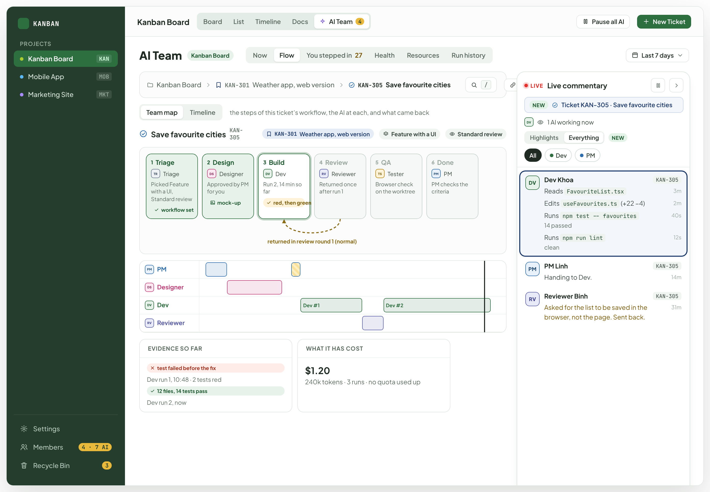

- Text in the frames: "KANBAN" · "PROJECTS" · "Kanban Board" · "KAN" · "Mobile App" · "MOB" · "Marketing Site" · "MKT" · "Settings" · "Members" · "4 · 7 AI" · "Recycle Bin" · "3" · "Board" · "List" · "Timeline" · "Docs" · "AI Team" · "4" · "Pause all AI" · "New Ticket" · "Now" · "Flow" · "You stepped in" · "27" · "Health" · "Resources" · "Run history" · "Last 7 days" · "KAN-301" · "Weather app, web version" · "KAN-305" · "Save favourite cities" · "/" · "Team map" · "the steps of this ticket’s workflow, the AI at each, and what came back" · "Feature with a UI" · "Standard review" · "1" · "Triage" · "TR" · "Picked Feature with a UI, Standard review" · "workflow set" · "2" · "Design" · "DS" · "Designer" · "Approved by PM for you" · "mock-up" · "Build" · "DV" · "Dev" · "Run 2, 14 min so far" · "red, then green" · "Review" · "RV" · "Reviewer" · "Returned once after run 1" · "5" · "QA" · "TS" · "Tester" · "Browser check on the worktree" · "6" · "Done" · "PM" · "PM checks the criteria" · "returned in review round 1 (normal)" · "Dev #1" · "Dev #2" · "EVIDENCE SO FAR" · "test failed before the fix" · "Dev run 1, 10:48 · 2 tests red" · "12 files, 14 tests pass" · "Dev run 2, now" · "WHAT IT HAS COST" · "$1.20" · "240k tokens · 3 runs · no quota used up" · "LIVE" · "Live commentary" · "NEW" · "Ticket KAN-305 · Save favourite cities" · "1 AI working now" · "Highlights" · "Everything" · "All" · "Dev Khoa" · "Reads FavouriteList.tsx" · "3m" · "Edits useFavourites.ts (+22 −4)" · "2m" · "Runs npm test -- favourites" · "14 passed" · "40s" · "Runs npm run lint" · "clean" · "12s" · "PM Linh" · "Handing to Dev." · "14m" · "Reviewer Binh" · "Asked for the list to be saved in the browser, not the page. Sent back." · "31m"

---

## K. Live commentary that follows the scope

The column of main, kept whole, and changed in five ways: it follows the scope bar, it has two levels of detail, it folds dense events, it pins what needs you, and it is joined to the drawing and to the AI that is working. Nothing the feed does today is taken away: Everything is today’s feed.

Source: [AiStoryFlow.dc.html](../source/AiStoryFlow.dc.html) › block "K. Live commentary that follows the scope"

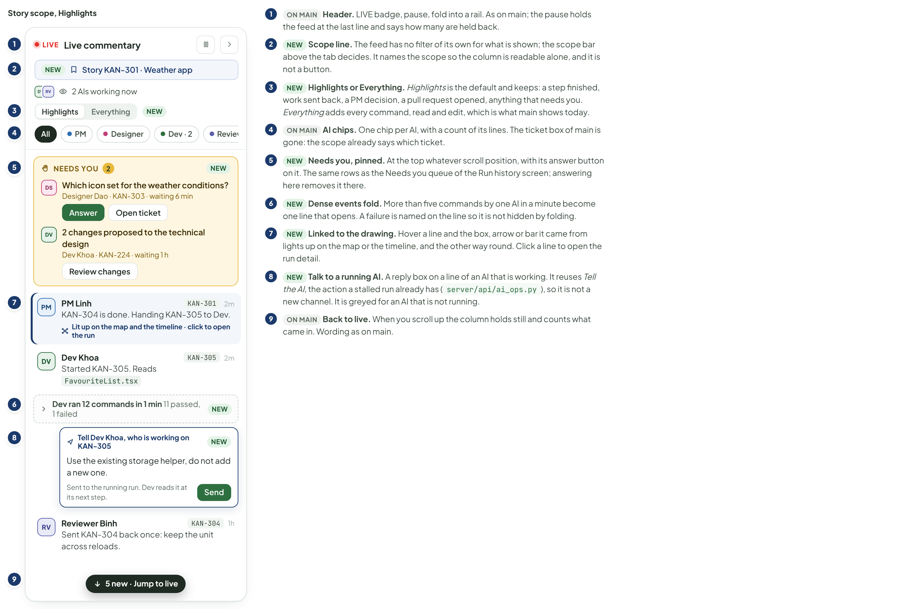

- Text in the frames: "Story scope, Highlights" · "LIVE" · "Live commentary" · "NEW" · "Story KAN-301 · Weather app" · "DV" · "RV" · "2 AIs working now" · "Highlights" · "Everything" · "All" · "PM" · "Designer" · "Dev · 2" · "Reviewer" · "NEEDS YOU" · "2" · "DS" · "Which icon set for the weather conditions?" · "Designer Dao · KAN-303 · waiting 6 min" · "Answer" · "Open ticket" · "2 changes proposed to the technical design" · "Dev Khoa · KAN-224 · waiting 1 h" · "Review changes" · "PM Linh" · "KAN-301" · "2m" · "KAN-304 is done. Handing KAN-305 to Dev." · "Lit up on the map and the timeline · click to open the run" · "Dev Khoa" · "KAN-305" · "Started KAN-305. Reads FavouriteList.tsx" · "Dev ran 12 commands in 1 min 11 passed, 1 failed" · "Tell Dev Khoa, who is working on KAN-305" · "Use the existing storage helper, do not add a new one." · "Sent to the running run. Dev reads it at its next step." · "Send" · "Reviewer Binh" · "KAN-304" · "1h" · "Sent KAN-304 back once: keep the unit across reloads." · "5 new · Jump to live" · "1" · "3" · "4" · "5" · "7" · "6" · "8" · "9" · "ON MAIN Header. LIVE badge, pause, fold into a rail. As on main; the pause holds the feed at the last line and says how many are held back." · "NEW Scope line. The feed has no filter of its own for what is shown; the scope bar above the tab decides. It names the scope so the column is readable alone, and it is not a button." · "NEW Highlights or Everything. Highlights is the default and keeps: a step finished, work sent back, a PM decision, a pull request opened, anything that needs you. Everything adds every command, read and edit, which is what main shows today." · "ON MAIN AI chips. One chip per AI, with a count of its lines. The ticket box of main is gone: the scope already says which ticket." · "NEW Needs you, pinned. At the top whatever scroll position, with its answer button on it. The same rows as the Needs you queue of the Run history screen; answering here removes it there." · "NEW Dense events fold. More than five commands by one AI in a minute become one line that opens. A failure is named on the line so it is not hidden by folding." · "NEW Linked to the drawing. Hover a line and the box, arrow or bar it came from lights up on the map or the timeline, and the other way round. Click a line to open the run detail." · "NEW Talk to a running AI. A reply box on a line of an AI that is working. It reuses Tell the AI, the action a stalled run already has (server/api/ai_ops.py), so it is not a new channel. It is greyed for an AI that is not running." · "ON MAIN Back to live. When you scroll up the column holds still and counts what came in. Wording as on main."

---

## K2. The states of the column

Source: [AiStoryFlow.dc.html](../source/AiStoryFlow.dc.html) › block "K2. The states of the column"

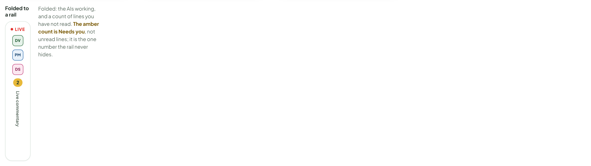

- Text in the frames: "Folded to a rail" · "LIVE" · "DV" · "PM" · "DS" · "2" · "Live commentary" · "Folded: the AIs working, and a count of lines you have not read. The amber count is Needs you, not unread lines; it is the one number the rail never hides."

---

## L. Team on its own: how far the team goes without you

Source: [AiStoryFlow.dc.html](../source/AiStoryFlow.dc.html) › block "L. Team on its own: how far the team goes without you"

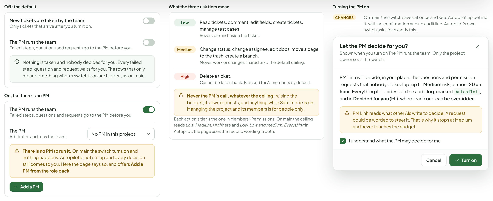

- Text in the frames: "Off: the default" · "New tickets are taken by the team" · "Only tickets that arrive after you turn it on." · "The PM runs the team" · "Failed steps, questions and requests go to the PM before you." · "Nothing is taken and nobody decides for you. Every failed step, question and request waits for you. The rows that only mean something when a switch is on are hidden, as on main." · "On, but there is no PM" · "The PM" · "Arbitrates and runs the team." · "No PM in this project" · "There is no PM to run it. On main the switch turns on and nothing happens: Autopilot is not set up and every decision still comes to you. Here the page says so, and offers Add a PM from the role pack." · "Add a PM" · "What the three risk tiers mean" · "Low" · "Read tickets, comment, edit fields, create tickets, manage test cases." · "Reversible and inside the ticket." · "Medium" · "Change status, change assignee, edit docs, move a page to the trash, create a branch." · "Moves work or changes shared text. The default ceiling." · "High" · "Delete a ticket." · "Cannot be taken back. Blocked for AI members by default." · "Never the PM’s call, whatever the ceiling: raising the budget, its own requests, and anything while Safe mode is on. Managing the project and its members is for people only." · "Each action’s tier is the one in Members › Permissions. On main the ceiling reads Low, Medium, High here and Low, Low and medium, Everything in Autopilot; the page uses the second wording in both." · "Turning the PM on" · "CHANGES" · "On main the switch saves at once and sets Autopilot up behind it, with no confirmation and no audit line. Autopilot’s own switch asks for exactly this." · "Let the PM decide for you?" · "Shown when you turn on The PM runs the team. Only the project owner sees the switch." · "PM Linh will decide, in your place, the questions and permission requests that nobody picked up, up to Medium risk, at most 20 an hour. Everything it decides is in the audit log, marked Autopilot, and in Decided for you (M1), where each one can be overridden." · "PM Linh reads what other AIs write to decide. A request could be worded to steer it. That is why it stops at Medium and never touches the budget." · "I understand what the PM may decide for me" · "Cancel" · "Turn on"

---

## M1. Decided for you: what the team did in your place

Source: [AiStoryFlow.dc.html](../source/AiStoryFlow.dc.html) › block "M1. Decided for you: what the team did in your place"

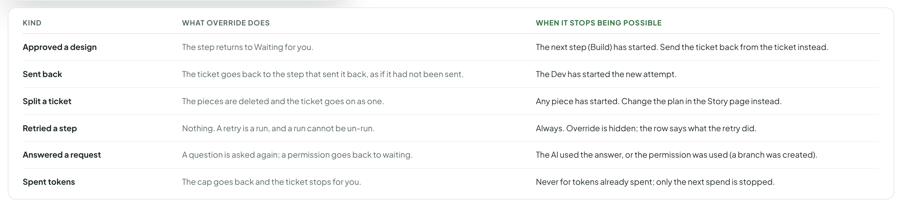

- Text in the frames: "KIND" · "WHAT OVERRIDE DOES" · "WHEN IT STOPS BEING POSSIBLE" · "Approved a design" · "The step returns to Waiting for you." · "The next step (Build) has started. Send the ticket back from the ticket instead." · "Sent back" · "The ticket goes back to the step that sent it back, as if it had not been sent." · "The Dev has started the new attempt." · "Split a ticket" · "The pieces are deleted and the ticket goes on as one." · "Any piece has started. Change the plan in the Story page instead." · "Retried a step" · "Nothing. A retry is a run, and a run cannot be un-run." · "Always. Override is hidden; the row says what the retry did." · "Answered a request" · "A question is asked again; a permission goes back to waiting." · "The AI used the answer, or the permission was used (a branch was created)." · "Spent tokens" · "The cap goes back and the ticket stops for you." · "Never for tokens already spent; only the next spend is stopped."

---

## M2. While you were away: what happened while you were gone

Source: [AiStoryFlow.dc.html](../source/AiStoryFlow.dc.html) › block "M2. While you were away: what happened while you were gone"

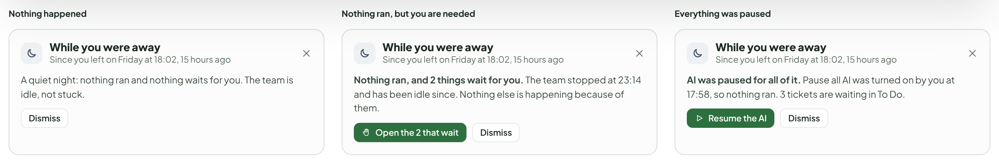

- Text in the frames: "Nothing happened" · "While you were away" · "Since you left on Friday at 18:02, 15 hours ago" · "A quiet night: nothing ran and nothing waits for you. The team is idle, not stuck." · "Dismiss" · "Nothing ran, but you are needed" · "Nothing ran, and 2 things wait for you. The team stopped at 23:14 and has been idle since. Nothing else is happening because of them." · "Open the 2 that wait" · "Everything was paused" · "AI was paused for all of it. Pause all AI was turned on by you at 17:58, so nothing ran. 3 tickets are waiting in To Do." · "Resume the AI"

---

## N. Evidence on a ticket: what the team shows before you approve

Source: [AiStoryFlow.dc.html](../source/AiStoryFlow.dc.html) › block "N. Evidence on a ticket: what the team shows before you approve"

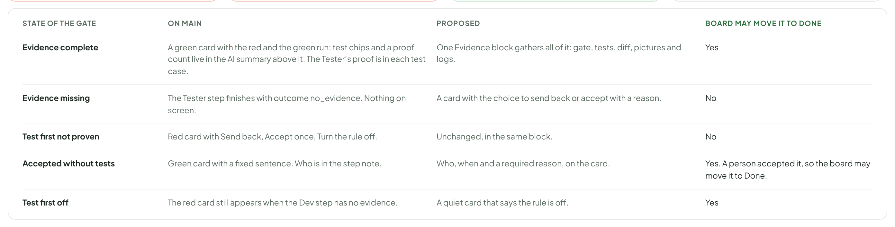

- Text in the frames: "STATE OF THE GATE" · "ON MAIN" · "PROPOSED" · "BOARD MAY MOVE IT TO DONE" · "Evidence complete" · "A green card with the red and the green run; test chips and a proof count live in the AI summary above it. The Tester’s proof is in each test case." · "One Evidence block gathers all of it: gate, tests, diff, pictures and logs." · "Yes" · "Evidence missing" · "The Tester step finishes with outcome no_evidence. Nothing on screen." · "A card with the choice to send back or accept with a reason." · "No" · "Test first not proven" · "Red card with Send back, Accept once, Turn the rule off." · "Unchanged, in the same block." · "Accepted without tests" · "Green card with a fixed sentence. Who is in the step note." · "Who, when and a required reason, on the card." · "Yes. A person accepted it, so the board may move it to Done." · "Test first off" · "The red card still appears when the Dev step has no evidence." · "A quiet card that says the rule is off."

---

## O. Limits and pause: a ticket that stopped, and a ticket that waits

On main a ticket workflow stops at the per-ticket token cap (ticket_token_cap, off by default) and shows a red card with one button, Let it go on, plus a Needs you row; the account usage window, the daily budget, 429 and Pause already have their own words (ai-operations E, ai-paused). A ticket that waits for another is the Pending marker with Waiting on KAN-xxx and Resume ticket. New: the same Resume on the card, the banner, Now and the bell; a card that says what it waits for with one click to it; and the rule for the Story above (it keeps going while any child can run, and is Blocked only when none can).

Source: [AiStoryFlow.dc.html](../source/AiStoryFlow.dc.html) › block "O. Limits and pause: a ticket that stopped, and a ticket that waits"

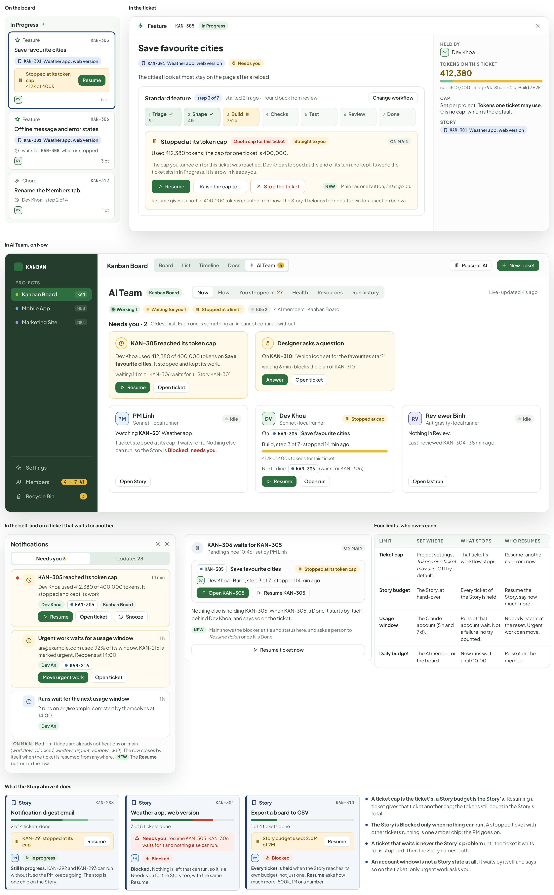

- Text in the frames: "On the board" · "In Progress" · "3" · "Feature" · "KAN-305" · "Save favourite cities" · "KAN-301" · "Weather app, web version" · "Stopped at its token cap" · "412k of 400k" · "Resume" · "DV" · "5 pt" · "KAN-306" · "Offline message and error states" · "waits for KAN-305, which is stopped" · "3 pt" · "Chore" · "KAN-312" · "Rename the Members tab" · "Dev Khoa · step 2 of 4" · "1 pt" · "In the ticket" · "Needs you" · "The cities I look at most stay on the page after a reload." · "Standard feature" · "step 3 of 7" · "started 2 h ago · 1 round back from review" · "Change workflow" · "1" · "Triage" · "9k" · "2" · "Shape" · "41k" · "Build" · "362k" · "4" · "Checks" · "5" · "Test" · "6" · "Review" · "7" · "Done" · "Quota cap for this ticket" · "Straight to you" · "ON MAIN" · "Used 412,380 tokens; the cap for one ticket is 400,000." · "The cap you turned on for this ticket was reached. Dev Khoa stopped at the end of its turn and kept its work; the ticket sits in In Progress. It is a row in Needs you." · "Raise the cap to…" · "Stop the ticket" · "NEW" · "Main has one button, Let it go on." · "Resume gives it another 400,000 tokens counted from now. The Story it belongs to keeps its own total (section below)." · "HELD BY" · "Dev Khoa" · "TOKENS ON THIS TICKET" · "412,380" · "cap 400,000 · Triage 9k, Shape 41k, Build 362k" · "CAP" · "Set per project: Tokens one ticket may use. 0 is no cap, which is the default." · "STORY" · "In AI Team, on Now" · "KANBAN" · "PROJECTS" · "Kanban Board" · "KAN" · "Mobile App" · "MOB" · "Marketing Site" · "MKT" · "Settings" · "Members" · "4 · 7 AI" · "Recycle Bin" · "Board" · "List" · "Timeline" · "Docs" · "AI Team" · "Pause all AI" · "New Ticket" · "Now" · "Flow" · "You stepped in" · "27" · "Health" · "Resources" · "Run history" · "Live · updated 4 s ago" · "Working 1" · "Waiting for you 1" · "Stopped at a limit 1" · "Idle 2" · "4 AI members · Kanban Board" · "Needs you · 2" · "Oldest first. Each one is something an AI cannot continue without." · "KAN-305 reached its token cap" · "Dev Khoa used 412,380 of 400,000 tokens on Save favourite cities. It stopped and kept its work." · "waiting 14 min · KAN-306 waits for it · Story KAN-301" · "Open ticket" · "Designer asks a question" · "On KAN-310: “Which icon set for the favourites star?”" · "waiting 6 min · blocks the plan of KAN-310" · "Answer" · "PM" · "PM Linh" · "Sonnet · local runner" · "Idle" · "Watching KAN-301 Weather app." · "1 ticket stopped at its cap, 1 waits for it. Nothing else can run, so the Story is Blocked: needs you." · "Open Story" · "Stopped at cap" · "On" · "Build, step 3 of 7 · stopped 14 min ago" · "412k of 400k tokens for this ticket" · "Next in line:" · "(waits for KAN-305)" · "Open run" · "RV" · "Reviewer Binh" · "Antigravity · local runner" · "Nothing in Review." · "Last: reviewed KAN-304 · 38 min ago" · "Open last run" · "In the bell, and on a ticket that waits for another" · "Notifications" · "Needs you 3" · "Updates 23" · "14 min" · "Dev Khoa used 412,380 of 400,000 tokens. It stopped and kept its work." · "Snooze" · "Urgent work waits for a usage window" · "1 h" · "an@example.com used 92% of its window. KAN-216 is marked urgent. Reopens at 14:00." · "Dev An" · "KAN-216" · "Move urgent work" · "Runs wait for the next usage window"

---

## P. AIs talking to each other, and where you read it

On main the AIs talk in three ways and none has a reading surface of its own. An @mention in a ticket comment is one hop of a chain, answered as an Ask (max depth 3, no repeats, 60 s cooldown; a refused one becomes a Board comment). A hand-off assigns the ticket and queues a run with an instruction; it shows only as a row in Now and an arrow in Flow. And an AI writing on Docs or a canvas comments as its member, with an AI badge. New: the ticket Comments fold what AIs say only to each other into one line you can open, a Join box, and the same fold on a Docs thread.

Source: [AiStoryFlow.dc.html](../source/AiStoryFlow.dc.html) › block "P. AIs talking to each other, and where you read it"

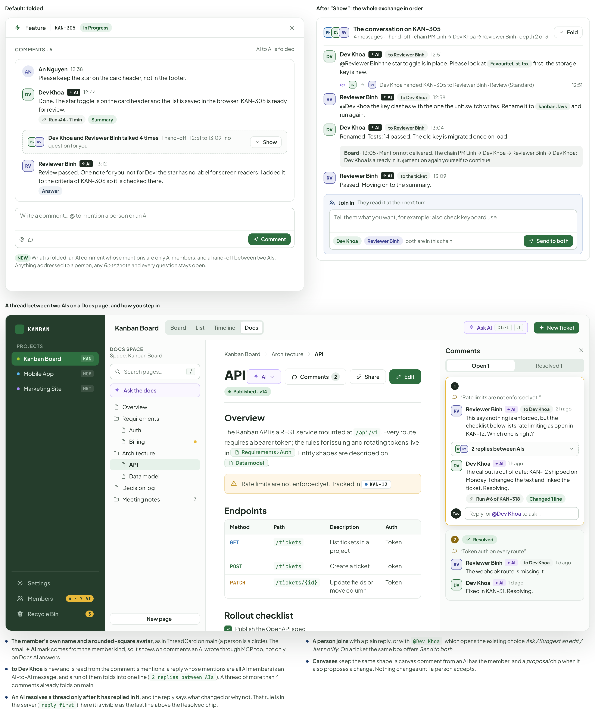

- Text in the frames: "Default: folded" · "Feature" · "KAN-305" · "In Progress" · "COMMENTS · 5" · "AI to AI is folded" · "AN" · "An Nguyen" · "12:38" · "Please keep the star on the card header, not in the footer." · "DV" · "Dev Khoa" · "AI" · "12:44" · "Done. The star toggle is on the card header and the list is saved in the browser. KAN-305 is ready for review." · "Run #4 · 11 min" · "Summary" · "RV" · "Dev Khoa and Reviewer Binh talked 4 times · 1 hand-off · 12:51 to 13:09 · no question for you" · "Show" · "Reviewer Binh" · "13:12" · "Review passed. One note for you, not for Dev: the star has no label for screen readers; I added it to the criteria of KAN-306 so it is checked there." · "Answer" · "Write a comment… @ to mention a person or an AI" · "Comment" · "NEW What is folded: an AI comment whose mentions are only AI members, and a hand-off between two AIs. Anything addressed to a person, any Board note and every question stays open." · "After “Show”: the whole exchange in order" · "PM" · "The conversation on KAN-305" · "4 messages · 1 hand-off · chain PM Linh → Dev Khoa → Reviewer Binh · depth 2 of 3" · "Fold" · "to Reviewer Binh" · "12:51" · "@Reviewer Binh the star toggle is in place. Please look at FavouriteList.tsx first; the storage key is new." · "Dev Khoa handed KAN-305 to Reviewer Binh · Review (Standard)" · "to Dev Khoa" · "12:58" · "@Dev Khoa the key clashes with the one the unit switch writes. Rename it to kanban.favs and run again." · "13:04" · "Renamed. Tests: 14 passed. The old key is migrated once on load." · "Board · 13:05 · Mention not delivered. The chain PM Linh → Dev Khoa → Reviewer Binh → Dev Khoa: Dev Khoa is already in it. @mention again yourself to continue." · "to the ticket" · "13:09" · "Passed. Moving on to the summary." · "Join in" · "They read it at their next turn" · "Tell them what you want, for example: also check keyboard use." · "both are in this chain" · "Send to both" · "A thread between two AIs on a Docs page, and how you step in" · "KANBAN" · "PROJECTS" · "Kanban Board" · "KAN" · "Mobile App" · "MOB" · "Marketing Site" · "MKT" · "Settings" · "Members" · "4 · 7 AI" · "Recycle Bin" · "3" · "Board" · "List" · "Timeline" · "Docs" · "Ask AI" · "Ctrl" · "J" · "New Ticket" · "DOCS SPACE" · "Space: Kanban Board" · "Search pages…" · "/" · "Ask the docs" · "Overview" · "Requirements" · "Auth" · "Billing" · "Architecture" · "API" · "Data model" · "Decision log" · "Meeting notes" · "New page" · "Published · v14" · "Comments" · "2" · "Share" · "Edit" · "The Kanban API is a REST service mounted at /api/v1. Every route requires a bearer token; the rules for issuing and rotating tokens live in" · "Requirements › Auth. Entity shapes are described on" · "Data model." · "Rate limits are not enforced yet. Tracked in" · "KAN-12" · "." · "Endpoints" · "Method	Path	Description	Auth" · "GET	/tickets	List tickets in a project	Token" · "POST	/tickets	Create a ticket	Token" · "PATCH	/tickets/{id}	Update fields or move column	Token" · "Rollout checklist" · "Publish the OpenAPI spec" · "Token auth on every route" · "KAN-9" · "Rate limiting on public endpoints" · "Webhook retries" · "KAN-31" · "Open 1" · "Resolved 1" · "1" · "“Rate limits are not enforced yet.”" · "✦ AI" · "2 h ago" · "This says nothing is enforced, but the checklist below lists rate limiting as open in KAN-12. Which one is right?" · "2 replies between AIs" · "1 h ago" · "The callout is out of date: KAN-12 shipped on Monday. I changed the text and linked the ticket. Resolving." · "Run #6 of KAN-318" · "Changed 1 line" · "You" · "Reply, or @Dev Khoa to ask…" · "Resolved" · "“Token auth on every route”" · "1 d ago" · "The webhook route is missing it." · "Fixed in KAN-31. Resolving." · "The member’s own name and a rounded-square avatar, as in ThreadCard on main (a person is a circle). The small ✦ AI mark comes from the member kind, so it shows on comments an AI wrote through MCP too, not only on Docs AI answers." · "to Dev Khoa is new and is read from the comment’s mentions: a reply whose mentions are all AI members is an AI-to-AI message, and a run of them folds into one line (2 replies between AIs). A thread of more than 4 comments already folds on main." · "An AI resolves a thread only after it has replied in it, and the reply says what changed or why not. That rule is in the server (reply_first); here it is visible as the last line above the Resolved chip." · "A person joins with a plain reply, or with @Dev Khoa, which opens the existing choice Ask / Suggest an edit / Just notify. On a ticket the same box offers Send to both." · "Canvases keep the same shape: a canvas comment from an AI has the member, and a proposal chip when it also proposes a change. Nothing changes until a person accepts."

---

## Q. Packs and plugins: updates, your own plugins, and Bypass per role

ai-team-process B and C already draw the library, the install flow and the eight packs; this section draws only what main added or lacked. On main: a member made from a pack remembers its version, the server says when a newer one is out and can update it (/ai/members/{id}/pack/update, audited), but no screen shows it; the person’s own Claude Code plugins load in every run through one project setting (own_claude, on) with no screen; and Bypass permissions is a per-member choice (owner only, typed phrase) that ready-made packs turn on by default without saying so. New: the update with a diff and a way back (1), the per-role plugin grid (2), the mode on the pack with the same warning (3).

Source: [AiStoryFlow.dc.html](../source/AiStoryFlow.dc.html) › block "Q. Packs and plugins: updates, your own plugins, and Bypass per role"

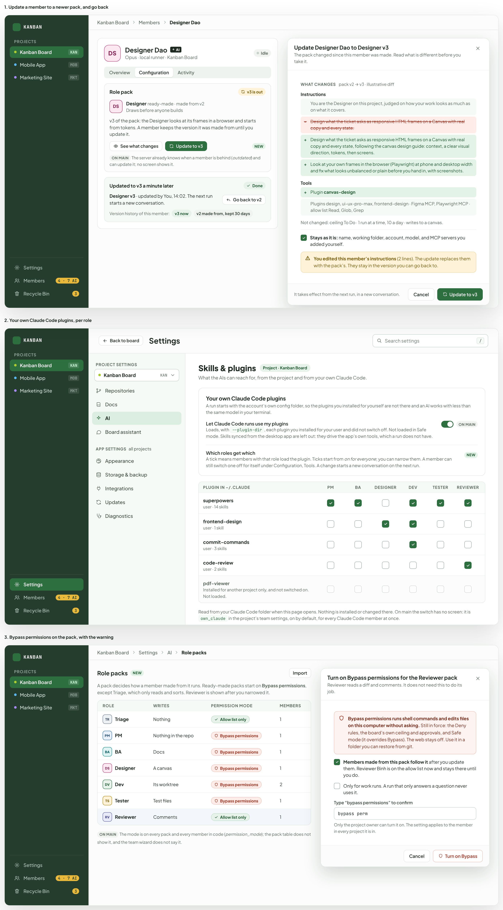

- Text in the frames: "1. Update a member to a newer pack, and go back" · "KANBAN" · "PROJECTS" · "Kanban Board" · "KAN" · "Mobile App" · "MOB" · "Marketing Site" · "MKT" · "Settings" · "Members" · "4 · 7 AI" · "Recycle Bin" · "3" · "Designer Dao" · "DS" · "AI" · "Opus · local runner · Kanban Board" · "Idle" · "Overview" · "Configuration" · "Activity" · "Role pack" · "v3 is out" · "Designer ready-made · made from v2" · "Draws before anyone builds" · "v3 of the pack: the Designer looks at its frames in a browser and starts from tokens. A member keeps the version it was made from until you update it." · "See what changes" · "Update to v3" · "NEW" · "ON MAIN The server already knows when a member is behind (outdated) and can update it; no screen shows it." · "Updated to v3 a minute later" · "Done" · "Designer v3 · updated by You, 14:02. The next run starts a new conversation." · "Go back to v2" · "Version history of this member:" · "v3 now" · "v2 made from, kept 30 days" · "Update Designer Dao to Designer v3" · "The pack changed since this member was made. Read what is different before you take it." · "WHAT CHANGES" · "pack v2 → v3 · illustrative diff" · "Instructions" · "You are the Designer on this project, judged on how your work looks as much as on what it covers." · "−" · "Design what the ticket asks as responsive HTML frames on a Canvas with real copy and every state." · "+" · "Design what the ticket asks as responsive HTML frames on a Canvas with real copy and every state, following the canvas design guide: context, a clear visual direction, tokens, then screens." · "Look at your own frames in the browser (Playwright) at phone and desktop width and fix what looks unbalanced or plain before you hand in, with screenshots." · "Tools" · "Plugin canvas-design" · "Plugins design, ui-ux-pro-max, frontend-design · Figma MCP, Playwright MCP · allow list Read, Glob, Grep" · "Not changed: ceiling To Do · 1 run at a time, 10 a day · writes to a canvas." · "Stays as it is: name, working folder, account, model, and MCP servers you added yourself." · "You edited this member’s instructions (2 lines). The update replaces them with the pack’s. They stay in the version you can go back to." · "It takes effect from the next run, in a new conversation." · "Cancel" · "2. Your own Claude Code plugins, per role" · "Back to board" · "Search settings" · "/" · "PROJECT SETTINGS" · "Repositories" · "Docs" · "Board assistant" · "APP SETTINGS" · "all projects" · "Appearance" · "Storage & backup" · "Integrations" · "Updates" · "Diagnostics" · "Skills & plugins" · "Project · Kanban Board" · "What the AIs can reach for, from the project and from your own Claude Code." · "Your own Claude Code plugins" · "A run starts with the account’s own config folder, so the plugins you installed for yourself are not there and an AI works with less than the same model in your terminal." · "Let Claude Code runs use my plugins" · "Loads, with --plugin-dir, each plugin you installed for your user and did not switch off. Not loaded in Safe mode. Skills synced from the desktop app are left out: they drive the app’s own tools, which a run does not have." · "ON MAIN" · "Which roles get which" · "A tick means members with that role load the plugin. Ticks start from on for everyone; you can narrow them. A member can still switch one off for itself under Configuration, Tools. A change starts a new conversation on the next run." · "PLUGIN IN ~/.CLAUDE" · "PM" · "BA" · "DESIGNER" · "DEV" · "TESTER" · "REVIEWER" · "superpowers" · "user · 14 skills" · "frontend-design" · "user · 1 skill" · "commit-commands" · "user · 3 skills" · "code-review" · "user · 2 skills" · "pdf-viewer" · "Installed for another project only, and not switched on. Not loaded." · "Read from your Claude Code folder when this page opens. Nothing is installed or changed there. On main the switch has no screen: it is own_claude in the project’s team settings, on by default, for every Claude Code member at once." · "3. Bypass permissions on the pack, with the warning" · "Role packs" · "Import" · "A pack decides how a member made from it runs. Ready-made packs start on Bypass permissions, except Triage, which only reads and sorts. Reviewer is shown after you narrowed it." · "ROLE" · "WRITES" · "PERMISSION MODE" · "MEMBERS" · "TR" · "Triage" · "Nothing" · "Allow list only" · "1" · "Nothing in the repo" · "Bypass permissions" · "Designer" · "A canvas" · "DV" · "Dev" · "Its worktree" · "2" · "TS" · "Tester" · "Test files" · "RV" · "Reviewer" · "Comments" · "ON MAIN The mode is on every pack and every member in code (permission_mode); the pack table does not show it, and the team wizard does not say it." · "Turn on Bypass permissions for the Reviewer pack" · "Reviewer reads a diff and comments. It does not need this to do its job." · "Bypass permissions runs shell commands and edits files on this computer without asking. Still in force: the Deny rules, the board’s own ceiling and approvals, and Safe mode (it overrides Bypass). The web stays off. Use it in a folder you can restore from git." · "Members made from this pack follow it after you update them. Reviewer Binh is on the allow list now and stays there until you do." · "Only for work runs. A run that only answers a question never uses it." · "Type “bypass permissions” to confirm" · "bypass perm" · "Only the project owner can turn it on. The setting applies to the member in every project it is in." · "Turn on Bypass"

---

## R. The workflow picker, the machine staying awake, and autonomy by Story

On main: six ready-made workflows (Quick fix, Standard feature, Feature with a UI, Docs, Chore, Research); Triage puts a new ticket on one and a person changes it with a drop-down of names; the desktop app holds the computer awake while an AI run is starting or running (View menu, Keep awake while AI runs, on by default, checked every 30 s) with no indicator; and Health has an Autonomy tile (tickets with no needed or avoidable touch, goal 70%) while You stepped in lists every touch with a mark. New: a picker that shows each workflow’s steps and missing roles (1), a small chip and popover for the awake state (2), and Autonomy per Story with a reason for each touch (3).

Source: [AiStoryFlow.dc.html](../source/AiStoryFlow.dc.html) › block "R. The workflow picker, the machine staying awake, and autonomy by Story"

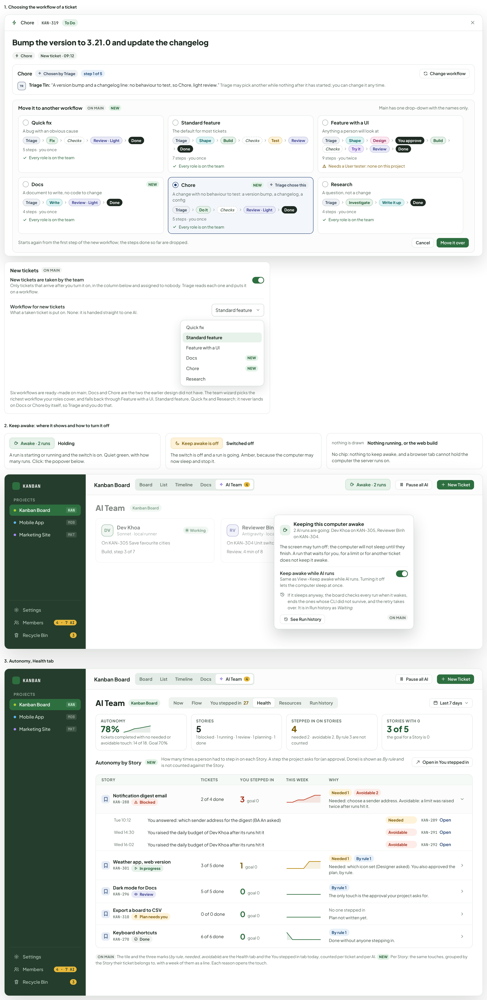

- Text in the frames: "1. Choosing the workflow of a ticket" · "Chore" · "KAN-319" · "To Do" · "Bump the version to 3.21.0 and update the changelog" · "New ticket · 09:12" · "Chosen by Triage" · "step 1 of 5" · "Change workflow" · "TR" · "Triage Tin: “A version bump and a changelog line: no behaviour to test, so Chore, light review.” Triage may pick another while nothing after it has started; you can change it any time." · "Move it to another workflow" · "ON MAIN" · "NEW" · "Main has one drop-down with the names only." · "Quick fix" · "A bug with an obvious cause" · "Triage" · "Fix" · "Checks" · "Review · Light" · "Done" · "5 steps · you once" · "Every role is on the team" · "Standard feature" · "The default for most tickets" · "Shape" · "Build" · "Test" · "Review" · "7 steps · you once" · "Feature with a UI" · "Anything a person will look at" · "Design" · "You approve" · "Try it" · "9 steps · you twice" · "Needs a User tester: none on this project" · "Docs" · "A document to write, no code to change" · "Write" · "4 steps · you once" · "Triage chose this" · "A change with no behaviour to test: a version bump, a changelog, a config" · "Do it" · "Research" · "A question, not a change" · "Investigate" · "Write it up" · "Starts again from the first step of the new workflow; the steps done so far are dropped." · "Cancel" · "Move it over" · "New tickets" · "New tickets are taken by the team" · "Only tickets that arrive after you turn it on, in the column below and assigned to nobody. Triage reads each one and puts it on a workflow." · "Workflow for new tickets" · "What a taken ticket is put on. None: it is handed straight to one AI." · "Six workflows are ready-made on main; Docs and Chore are the two the earlier design did not have. The team wizard picks the richest workflow your roles cover, and falls back through Feature with a UI, Standard feature, Quick fix and Research; it never lands on Docs or Chore by itself, so Triage and you do that." · "2. Keep awake: where it shows and how to turn it off" · "Awake · 2 runs" · "Holding" · "A run is starting or running and the switch is on. Quiet green, with how many runs. Click: the popover below." · "Keep awake is off" · "Switched off" · "The switch is off and a run is going. Amber, because the computer may now sleep and stop it." · "nothing is drawn" · "Nothing running, or the web build" · "No chip: nothing to keep awake, and a browser tab cannot hold the computer the server runs on." · "KANBAN" · "PROJECTS" · "Kanban Board" · "KAN" · "Mobile App" · "MOB" · "Marketing Site" · "MKT" · "Settings" · "Members" · "4 · 7 AI" · "Recycle Bin" · "3" · "Board" · "List" · "Timeline" · "AI Team" · "4" · "Pause all AI" · "New Ticket" · "DV" · "Dev Khoa" · "Sonnet · local runner" · "Working" · "On KAN-305 Save favourite cities" · "Build, step 3 of 7" · "RV" · "Reviewer Binh" · "Antigravity · local runner" · "On KAN-304 Unit switch" · "Review, 4 min of 8" · "Keeping this computer awake" · "2 AI runs are going: Dev Khoa on KAN-305, Reviewer Binh on KAN-304." · "The screen may turn off; the computer will not sleep until they finish. A run that waits for you, for a limit or for another ticket does not keep it awake." · "Keep awake while AI runs" · "Same as View › Keep awake while AI runs. Turning it off lets the computer sleep at once." · "If it sleeps anyway, the board checks every run when it wakes, ends the ones whose CLI did not survive, and the retry takes over. It is in Run history as Waiting." · "See Run history" · "3. Autonomy, Health tab" · "Now" · "Flow" · "You stepped in" · "27" · "Health" · "Resources" · "Run history" · "Last 7 days" · "AUTONOMY" · "78%" · "tickets completed with no needed or avoidable touch: 14 of 18. Goal 70%" · "STORIES" · "5" · "1 blocked · 1 running · 1 review · 1 planning · 1 done" · "STEPPED IN ON STORIES" · "needed 2 · avoidable 2. By rule 3 are not counted" · "STORIES WITH 0" · "3 of 5" · "the goal for a Story is 0" · "Autonomy by Story" · "How many times a person had to step in on each Story. A step the project asks for (an approval, Done) is shown as By rule and is not counted against the Story." · "Open in You stepped in" · "STORY" · "TICKETS" · "YOU STEPPED IN" · "THIS WEEK" · "WHY" · "Notification digest email" · "KAN-288" · "Blocked" · "2 of 4 done" · "goal 0" · "Needed 1"

---

## S. The order, the open questions, and what the code has to give

Proposed. Flow by scope first because it is useful with what exists; the Story second because it needs the largest change to the model; the feed third because it depends on both. The right-hand column of the table is a reading of the UI code and of the server files named in it, not a plan for the server.

Source: [AiStoryFlow.dc.html](../source/AiStoryFlow.dc.html) › block "S. The order, the open questions, and what the code has to give"

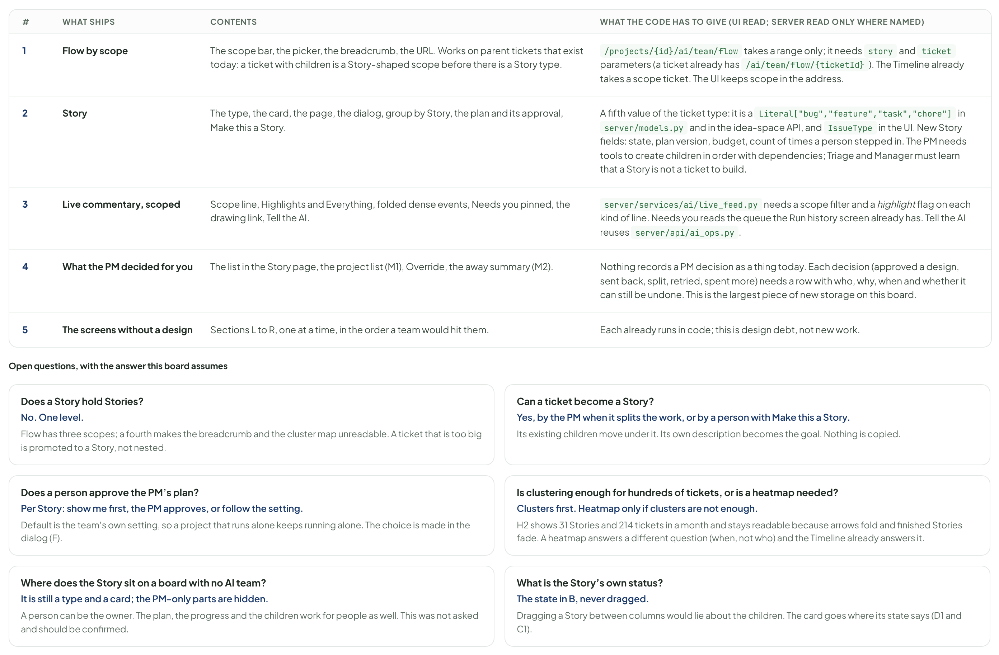

- Text in the frames: "#" · "WHAT SHIPS" · "CONTENTS" · "WHAT THE CODE HAS TO GIVE (UI READ; SERVER READ ONLY WHERE NAMED)" · "1" · "Flow by scope" · "The scope bar, the picker, the breadcrumb, the URL. Works on parent tickets that exist today: a ticket with children is a Story-shaped scope before there is a Story type." · "/projects/{id}/ai/team/flow takes a range only; it needs story and ticket parameters (a ticket already has /ai/team/flow/{ticketId}). The Timeline already takes a scope ticket. The UI keeps scope in the address." · "2" · "Story" · "The type, the card, the page, the dialog, group by Story, the plan and its approval, Make this a Story." · "A fifth value of the ticket type: it is a Literal["bug","feature","task","chore"] in server/models.py and in the idea-space API, and IssueType in the UI. New Story fields: state, plan version, budget, count of times a person stepped in. The PM needs tools to create children in order with dependencies; Triage and Manager must learn that a Story is not a ticket to build." · "3" · "Live commentary, scoped" · "Scope line, Highlights and Everything, folded dense events, Needs you pinned, the drawing link, Tell the AI." · "server/services/ai/live_feed.py needs a scope filter and a highlight flag on each kind of line. Needs you reads the queue the Run history screen already has. Tell the AI reuses server/api/ai_ops.py." · "4" · "What the PM decided for you" · "The list in the Story page, the project list (M1), Override, the away summary (M2)." · "Nothing records a PM decision as a thing today. Each decision (approved a design, sent back, split, retried, spent more) needs a row with who, why, when and whether it can still be undone. This is the largest piece of new storage on this board." · "5" · "The screens without a design" · "Sections L to R, one at a time, in the order a team would hit them." · "Each already runs in code; this is design debt, not new work." · "Open questions, with the answer this board assumes" · "Does a Story hold Stories?" · "No. One level." · "Flow has three scopes; a fourth makes the breadcrumb and the cluster map unreadable. A ticket that is too big is promoted to a Story, not nested." · "Can a ticket become a Story?" · "Yes, by the PM when it splits the work, or by a person with Make this a Story." · "Its existing children move under it. Its own description becomes the goal. Nothing is copied." · "Does a person approve the PM’s plan?" · "Per Story: show me first, the PM approves, or follow the setting." · "Default is the team’s own setting, so a project that runs alone keeps running alone. The choice is made in the dialog (F)." · "Is clustering enough for hundreds of tickets, or is a heatmap needed?" · "Clusters first. Heatmap only if clusters are not enough." · "H2 shows 31 Stories and 214 tickets in a month and stays readable because arrows fold and finished Stories fade. A heatmap answers a different question (when, not who) and the Timeline already answers it." · "Where does the Story sit on a board with no AI team?" · "It is still a type and a card; the PM-only parts are hidden." · "A person can be the owner. The plan, the progress and the children work for people as well. This was not asked and should be confirmed." · "What is the Story’s own status?" · "The state in B, never dragged." · "Dragging a Story between columns would lie about the children. The card goes where its state says (D1 and C1)."
