# Story, Flow by scope and Live commentary — a job the PM owns, one bar for Flow, the screens that ran without a design

> Redrawn for AI v2 · source: [`AiStoryFlow.dc.html`](../source/AiStoryFlow.dc.html) · canvas `1794110641-1323` · sha256 `9e107aea7884c3cced80a75efc89d84feab7f4626d6b9dc5613b4267b45b00f2`

> Words, states and conditions follow the code of branch `claude/ai-team-architecture-7a1efc`; the layout is designed here and is not the layout of the current screens. Names, ids, costs and times in the mock-ups are sample data. **Check the code before building from this: the file named in each part is the truth, not the picture.**

## SCREEN — V2

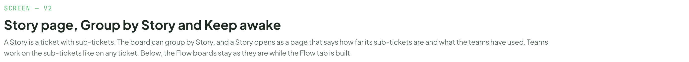

- Text in this part: "SCREEN — V2" · "Story page, Group by Story, Keep awake and Flow" · "A Story is a ticket with sub-tickets. The board can group by Story, and a Story opens as a page that says how far its sub-tickets are and what the teams have used. Teams work on the sub-tickets like on any ticket. Flow, the second tab of AI Team, draws the whole project, one team, one Story or one ticket as a Map or a Timeline: its scope bar, its Map and its empty states come after the Story page."

---

## Group by Story

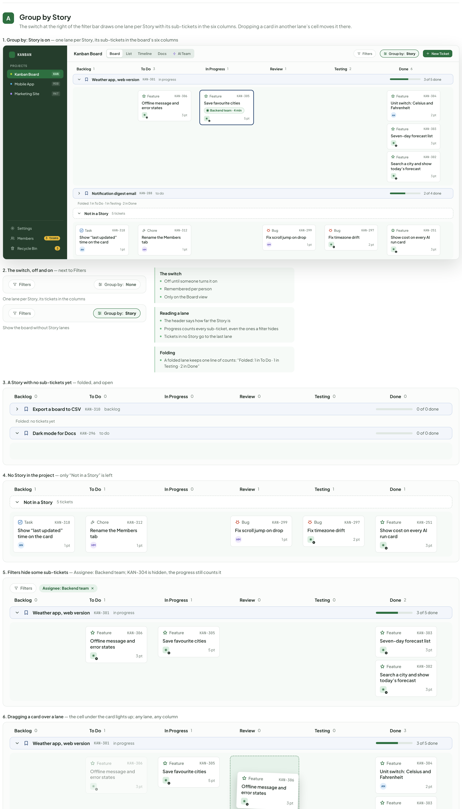

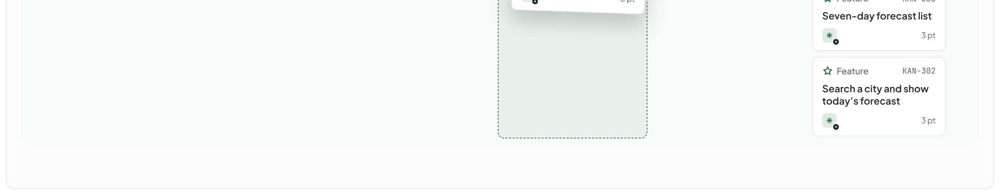

- Text in this part: "A" · "Group by Story" · "The switch at the right of the filter bar draws one lane per Story with its sub-tickets in the six columns. Dropping a card in another lane’s cell moves it there." · "1. Group by: Story is on — one lane per Story, its sub-tickets in the board’s six columns" · "KANBAN" · "PROJECTS" · "Kanban Board" · "KAN" · "Mobile App" · "MOB" · "Marketing Site" · "MKT" · "Settings" · "Members" · "3 teams" · "Recycle Bin" · "3" · "Board" · "List" · "Timeline" · "Docs" · "AI Team" · "Filters" · "Group by:" · "Story" · "New Ticket" · "Backlog" · "1" · "To Do" · "In Progress" · "Review" · "Testing" · "2" · "Done" · "6" · "Weather app, web version" · "KAN-301" · "in progress" · "3 of 5 done" · "Feature" · "KAN-306" · "Offline message and error states" · "3 pt" · "KAN-305" · "Save favourite cities" · "Backend team · 4 min" · "5 pt" · "KAN-304" · "Unit switch: Celsius and Fahrenheit" · "AN" · "2 pt" · "KAN-303" · "Seven-day forecast list" · "KAN-302" · "Search a city and show today’s forecast" · "Notification digest email" · "KAN-288" · "to do" · "2 of 4 done" · "Folded: 1 in To Do · 1 in Testing · 2 in Done" · "Not in a Story" · "5 tickets" · "Task" · "KAN-318" · "Show “last updated” time on the card" · "1 pt" · "Chore" · "KAN-312" · "Rename the Members tab" · "HM" · "Bug" · "KAN-299" · "Fix scroll jump on drop" · "KAN-297" · "Fix timezone drift" · "KAN-251" · "Show cost on every AI run card" · "2. The switch, off and on — next to Filters" · "None" · "One lane per Story, its tickets in the columns" · "Show the board without Story lanes" · "The switch" · "Off until someone turns it on" · "Remembered per person" · "Only on the Board view" · "Reading a lane" · "The header says how far the Story is" · "Progress counts every sub-ticket, even the ones a filter hides" · "Tickets in no Story go to the last lane" · "Folding" · "A folded lane keeps one line of counts: “Folded: 1 in To Do · 1 in Testing · 2 in Done”" · "3. A Story with no sub-tickets yet — folded, and open" · "0" · "Export a board to CSV" · "KAN-310" · "backlog" · "0 of 0 done" · "Folded: no tickets yet" · "Dark mode for Docs" · "KAN-296" · "4. No Story in the project — only “Not in a Story” is left" · "5. Filters hide some sub-tickets — Assignee: Backend team; KAN-304 is hidden, the progress still counts it" · "Assignee: Backend team" · "6. Dragging a card over a lane — the cell under the card lights up; any lane, any column"

---

## The Story page

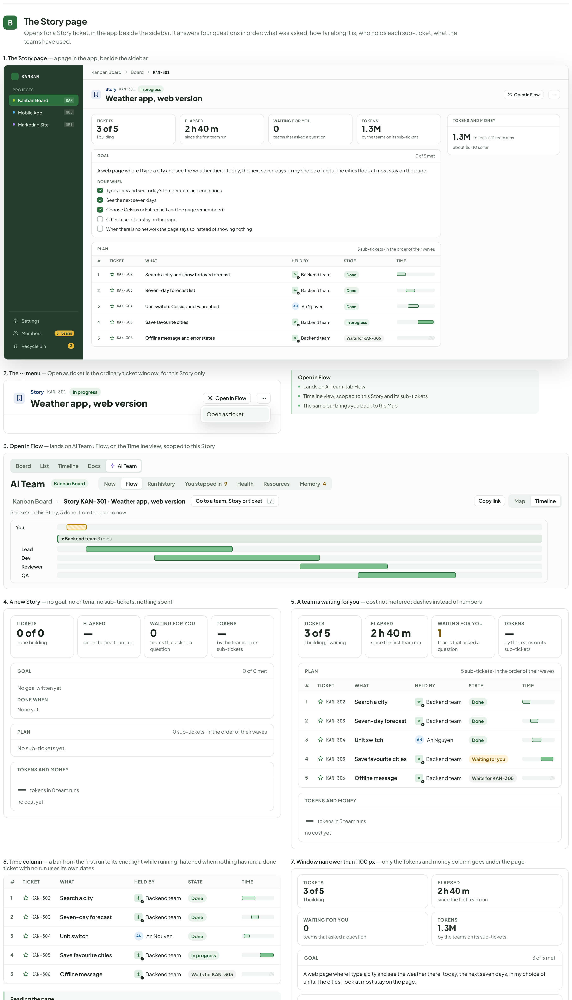

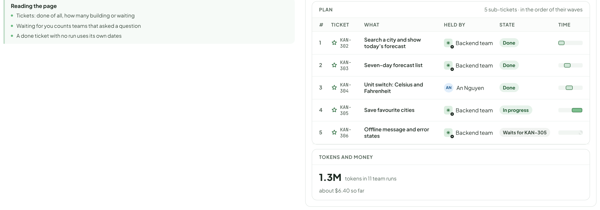

- Text in this part: "B" · "The Story page" · "Opens for a Story ticket, in the app beside the sidebar. It answers four questions in order: what was asked, how far along it is, who holds each sub-ticket, what the teams have used." · "1. The Story page — a page in the app, beside the sidebar" · "KANBAN" · "PROJECTS" · "Kanban Board" · "KAN" · "Mobile App" · "MOB" · "Marketing Site" · "MKT" · "Settings" · "Members" · "3 teams" · "Recycle Bin" · "3" · "Board" · "KAN-301" · "Story" · "In progress" · "Weather app, web version" · "Open in Flow" · "⋯" · "TICKETS" · "3 of 5" · "1 building" · "ELAPSED" · "2 h 40 m" · "since the first team run" · "WAITING FOR YOU" · "0" · "teams that asked a question" · "TOKENS" · "1.3M" · "by the teams on its sub-tickets" · "GOAL" · "3 of 5 met" · "A web page where I type a city and see the weather there: today, the next seven days, in my choice of units. The cities I look at most stay on the page." · "DONE WHEN" · "Type a city and see today’s temperature and conditions" · "See the next seven days" · "Choose Celsius or Fahrenheit and the page remembers it" · "Cities I use often stay on the page" · "When there is no network the page says so instead of showing nothing" · "PLAN" · "5 sub-tickets · in the order of their waves" · "#" · "TICKET" · "WHAT" · "HELD BY" · "STATE" · "TIME" · "1" · "KAN-302" · "Search a city and show today’s forecast" · "Backend team" · "Done" · "2" · "KAN-303" · "Seven-day forecast list" · "KAN-304" · "Unit switch: Celsius and Fahrenheit" · "AN" · "An Nguyen" · "4" · "KAN-305" · "Save favourite cities" · "5" · "KAN-306" · "Offline message and error states" · "Waits for KAN-305" · "TOKENS AND MONEY" · "tokens in 11 team runs" · "about $6.40 so far" · "2. The ⋯ menu — Open as ticket is the ordinary ticket window, for this Story only" · "Open as ticket" · "Lands on AI Team, tab Flow" · "Timeline view, scoped to this Story and its sub-tickets" · "The same bar brings you back to the Map" · "3. Open in Flow — lands on AI Team › Flow, on the Timeline view, scoped to this Story" · "List" · "Timeline" · "Docs" · "AI Team" · "Now" · "Flow" · "Run history" · "You stepped in" · "9" · "Health" · "Resources" · "Memory" · "›" · "Story KAN-301 · Weather app, web version" · "Go to a team, Story or ticket" · "/" · "Copy link" · "Map" · "5 tickets in this Story, 3 done, from the plan to now" · "You" · "▾ Backend team 3 roles" · "Lead" · "Dev" · "Reviewer" · "QA" · "4. A new Story — no goal, no criteria, no sub-tickets, nothing spent" · "0 of 0" · "none building" · "—"

---

## Keep awake

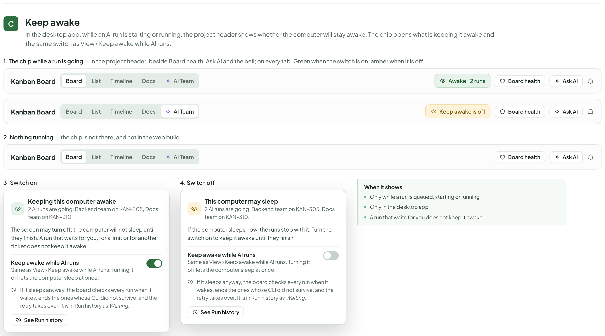

- Text in this part: "C" · "Keep awake" · "In the desktop app, while an AI run is starting or running, the project header shows whether the computer will stay awake. The chip opens what is keeping it awake and the same switch as View › Keep awake while AI runs." · "1. The chip while a run is going — in the project header, beside Board health, Ask AI and the bell; on every tab. Green when the switch is on, amber when it is off" · "Kanban Board" · "Board" · "List" · "Timeline" · "Docs" · "AI Team" · "Awake · 2 runs" · "Board health" · "Ask AI" · "Keep awake is off" · "2. Nothing running — the chip is not there, and not in the web build" · "3. Switch on" · "Keeping this computer awake" · "2 AI runs are going: Backend team on KAN-305, Docs team on KAN-310." · "The screen may turn off; the computer will not sleep until they finish. A run that waits for you, for a limit or for another ticket does not keep it awake." · "Keep awake while AI runs" · "Same as View › Keep awake while AI runs. Turning it off lets the computer sleep at once." · "If it sleeps anyway, the board checks every run when it wakes, ends the ones whose CLI did not survive, and the retry takes over. It is in Run history as Waiting." · "See Run history" · "4. Switch off" · "This computer may sleep" · "If the computer sleeps now, the runs stop with it. Turn the switch on to keep it awake until they finish." · "When it shows" · "Only while a run is queued, starting or running" · "Only in the desktop app" · "A run that waits for you does not keep it awake"

---

## Flow: the scope bar

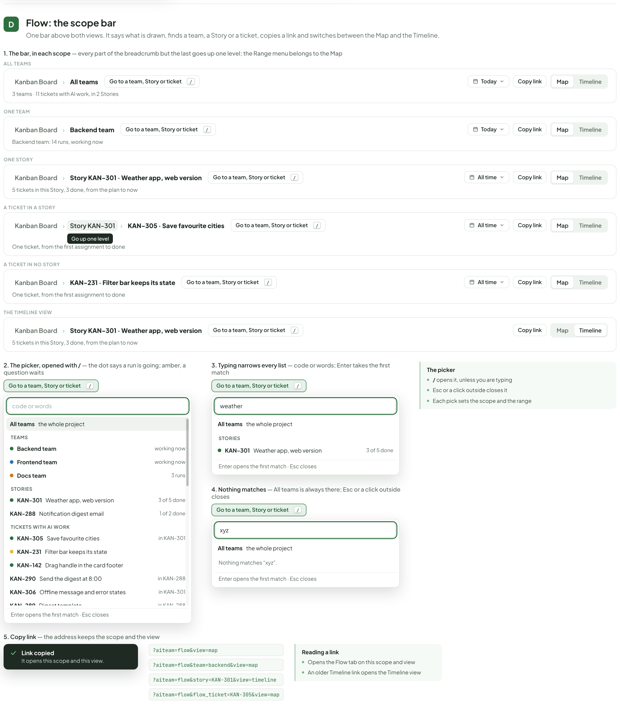

- Text in this part: "D" · "Flow: the scope bar" · "One bar above both views. It says what is drawn, finds a team, a Story or a ticket, copies a link and switches between the Map and the Timeline." · "1. The bar, in each scope — every part of the breadcrumb but the last goes up one level; the Range menu belongs to the Map" · "ALL TEAMS" · "Kanban Board" · "›" · "All teams" · "Go to a team, Story or ticket" · "/" · "Today" · "Copy link" · "Map" · "Timeline" · "3 teams · 11 tickets with AI work, in 2 Stories" · "ONE TEAM" · "Backend team" · "Backend team: 14 runs, working now" · "ONE STORY" · "Story KAN-301 · Weather app, web version" · "All time" · "5 tickets in this Story, 3 done, from the plan to now" · "A TICKET IN A STORY" · "Story KAN-301" · "Go up one level" · "KAN-305 · Save favourite cities" · "One ticket, from the first assignment to done" · "A TICKET IN NO STORY" · "KAN-231 · Filter bar keeps its state" · "THE TIMELINE VIEW" · "2. The picker, opened with / — the dot says a run is going; amber, a question waits" · "code or words" · "the whole project" · "TEAMS" · "working now" · "Frontend team" · "Docs team" · "3 runs" · "STORIES" · "KAN-301" · "Weather app, web version" · "3 of 5 done" · "KAN-288" · "Notification digest email" · "1 of 2 done" · "TICKETS WITH AI WORK" · "KAN-305" · "Save favourite cities" · "in KAN-301" · "KAN-231" · "Filter bar keeps its state" · "KAN-142" · "Drag handle in the card footer" · "KAN-290" · "Send the digest at 8:00" · "in KAN-288" · "KAN-306" · "Offline message and error states" · "KAN-289" · "Digest template" · "KAN-233" · "Filter chips wrap on a narrow board" · "KAN-304" · "Unit switch: Celsius and Fahrenheit" · "KAN-303" · "Seven-day forecast list" · "KAN-302" · "Search a city and show today's forecast" · "KAN-201" · "Release notes for 2.4" · "Enter opens the first match · Esc closes" · "3. Typing narrows every list — code or words; Enter takes the first match" · "weather" · "4. Nothing matches — All teams is always there; Esc or a click outside closes" · "xyz" · "Nothing matches “xyz”." · "The picker" · "/ opens it, unless you are typing" · "Esc or a click outside closes it" · "Each pick sets the scope and the range" · "5. Copy link — the address keeps the scope and the view" · "Link copied" · "It opens this scope and this view." · "?aiteam=flow&view=map" · "?aiteam=flow&team=backend&view=map" · "?aiteam=flow&story=KAN-301&view=timeline" · "?aiteam=flow&flow_ticket=KAN-305&view=map" · "Reading a link" · "Opens the Flow tab on this scope and view" · "An older Timeline link opens the Timeline view"

---

## Flow: the whole project

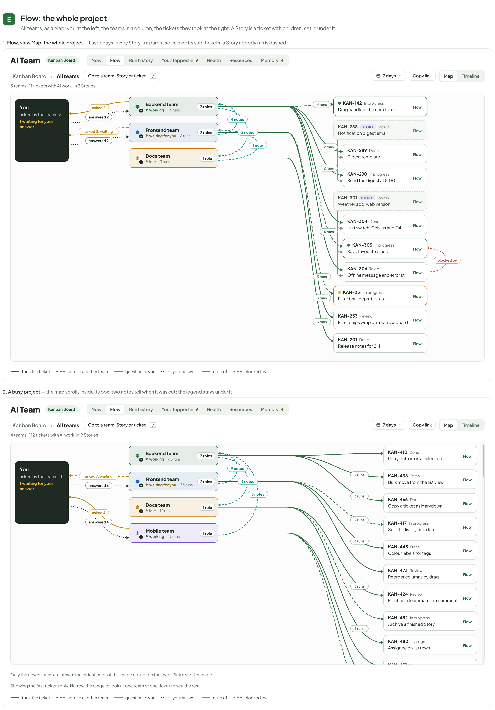

- Text in this part: "E" · "Flow: the whole project" · "All teams, as a Map: you at the left, the teams in a column, the tickets they took at the right. A Story is a ticket with children, set in under it." · "1. Flow, view Map, the whole project — Last 7 days; every Story is a parent set in over its sub-tickets; a Story nobody ran is dashed" · "AI Team" · "Kanban Board" · "Now" · "Flow" · "Run history" · "You stepped in" · "9" · "Health" · "Resources" · "Memory" · "4" · "›" · "All teams" · "Go to a team, Story or ticket" · "/" · "7 days" · "Copy link" · "Map" · "Timeline" · "3 teams · 11 tickets with AI work, in 2 Stories" · "4 runs" · "2 runs" · "3 runs" · "blocked by" · "4 notes" · "2 notes" · "1 note" · "asked 3, waiting" · "answered 2" · "asked 2" · "You" · "asked by the teams: 5" · "1 waiting for your answer" · "Backend team" · "working" · "·" · "14 runs" · "3 roles" · "Frontend team" · "waiting for you" · "6 runs" · "2 roles" · "Docs team" · "idle" · "1 role" · "KAN-142" · "In progress" · "Drag handle in the card footer" · "KAN-288" · "STORY" · "no run" · "Notification digest email" · "KAN-289" · "Done" · "Digest template" · "KAN-290" · "Send the digest at 8:00" · "KAN-301" · "Weather app, web version" · "KAN-304" · "Unit switch: Celsius and Fahrenheit" · "KAN-305" · "Save favourite cities" · "KAN-306" · "To do" · "Offline message and error states" · "KAN-231" · "Filter bar keeps its state" · "KAN-233" · "Review" · "Filter chips wrap on a narrow board" · "KAN-201" · "Release notes for 2.4" · "took the ticket" · "note to another team" · "question to you" · "your answer" · "child of" · "2. A busy project — the map scrolls inside its box; two notes tell when it was cut; the legend stays under it" · "4 teams · 112 tickets with AI work, in 9 Stories" · "9 notes" · "6 notes" · "3 notes" · "asked 7, waiting" · "answered 6" · "asked 4" · "answered 4" · "asked by the teams: 11" · "48 runs" · "33 runs" · "12 runs" · "Mobile team" · "19 runs" · "KAN-410" · "Retry button on a failed run" · "KAN-438" · "Bulk move from the list view" · "KAN-466" · "Copy a ticket as Markdown" · "KAN-417" · "Sort the list by due date" · "KAN-445" · "Colour labels for tags" · "KAN-473" · "Reorder columns by drag" · "KAN-424"

---

## Flow: one Story

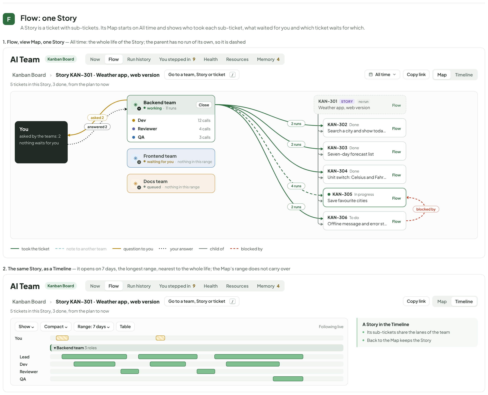

- Text in this part: "F" · "Flow: one Story" · "A Story is a ticket with sub-tickets. Its Map starts on All time and shows who took each sub-ticket, what waited for you and which ticket waits for which." · "1. Flow, view Map, one Story — All time: the whole life of the Story; the parent has no run of its own, so it is dashed" · "AI Team" · "Kanban Board" · "Now" · "Flow" · "Run history" · "You stepped in" · "9" · "Health" · "Resources" · "Memory" · "4" · "›" · "Story KAN-301 · Weather app, web version" · "Go to a team, Story or ticket" · "/" · "All time" · "Copy link" · "Map" · "Timeline" · "5 tickets in this Story, 3 done, from the plan to now" · "2 runs" · "4 runs" · "blocked by" · "asked 2" · "answered 2" · "You" · "asked by the teams: 2" · "nothing waits for you" · "Backend team" · "working" · "·" · "11 runs" · "Close" · "Dev" · "12 calls" · "Reviewer" · "4 calls" · "QA" · "3 calls" · "Frontend team" · "waiting for you" · "nothing in this range" · "Docs team" · "queued" · "KAN-301" · "STORY" · "no run" · "Weather app, web version" · "KAN-302" · "Done" · "Search a city and show today's forecast" · "KAN-303" · "Seven-day forecast list" · "KAN-304" · "Unit switch: Celsius and Fahrenheit" · "KAN-305" · "In progress" · "Save favourite cities" · "KAN-306" · "To do" · "Offline message and error states" · "took the ticket" · "note to another team" · "question to you" · "your answer" · "child of" · "2. The same Story, as a Timeline — it opens on 7 days, the longest range, nearest to the whole life; the Map’s range does not carry over" · "Show ⌄" · "Compact ⌄" · "Range: 7 days ⌄" · "Table" · "Following live" · "▾ Backend team 3 roles" · "Lead" · "A Story in the Timeline" · "Its sub-tickets share the lanes of the team" · "Back to the Map keeps the Story"

---

## Flow: one ticket

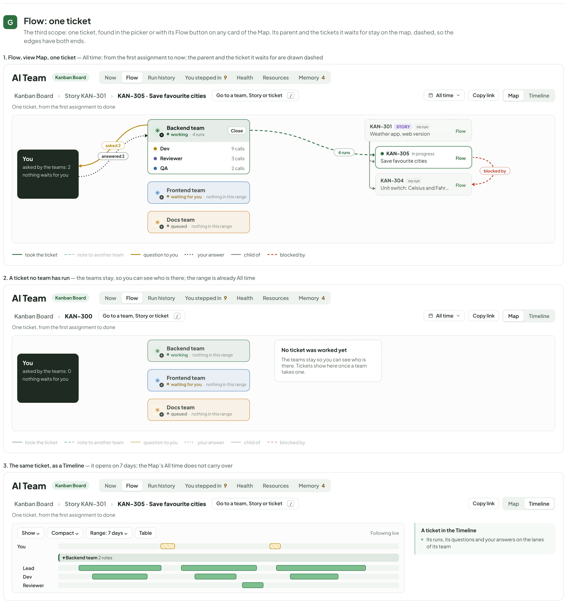

- Text in this part: "G" · "Flow: one ticket" · "The third scope: one ticket, found in the picker or with its Flow button on any card of the Map. Its parent and the tickets it waits for stay on the map, dashed, so the edges have both ends." · "1. Flow, view Map, one ticket — All time: from the first assignment to now; the parent and the ticket it waits for are drawn dashed" · "AI Team" · "Kanban Board" · "Now" · "Flow" · "Run history" · "You stepped in" · "9" · "Health" · "Resources" · "Memory" · "4" · "›" · "Story KAN-301" · "KAN-305 · Save favourite cities" · "Go to a team, Story or ticket" · "/" · "All time" · "Copy link" · "Map" · "Timeline" · "One ticket, from the first assignment to done" · "4 runs" · "blocked by" · "asked 2" · "answered 2" · "You" · "asked by the teams: 2" · "nothing waits for you" · "Backend team" · "working" · "·" · "Close" · "Dev" · "9 calls" · "Reviewer" · "3 calls" · "QA" · "2 calls" · "Frontend team" · "waiting for you" · "nothing in this range" · "Docs team" · "queued" · "KAN-301" · "STORY" · "no run" · "Weather app, web version" · "KAN-305" · "In progress" · "Save favourite cities" · "KAN-304" · "Unit switch: Celsius and Fahrenheit" · "took the ticket" · "note to another team" · "question to you" · "your answer" · "child of" · "2. A ticket no team has run — the teams stay, so you can see who is there; the range is already All time" · "KAN-300" · "asked by the teams: 0" · "No ticket was worked yet" · "The teams stay so you can see who is there. Tickets show here once a team takes one." · "3. The same ticket, as a Timeline — it opens on 7 days; the Map’s All time does not carry over" · "Show ⌄" · "Compact ⌄" · "Range: 7 days ⌄" · "Table" · "Following live" · "▾ Backend team 2 roles" · "Lead" · "A ticket in the Timeline" · "Its runs, its questions and your answers on the lanes of its team"

---

## Flow: ranges and empty ranges

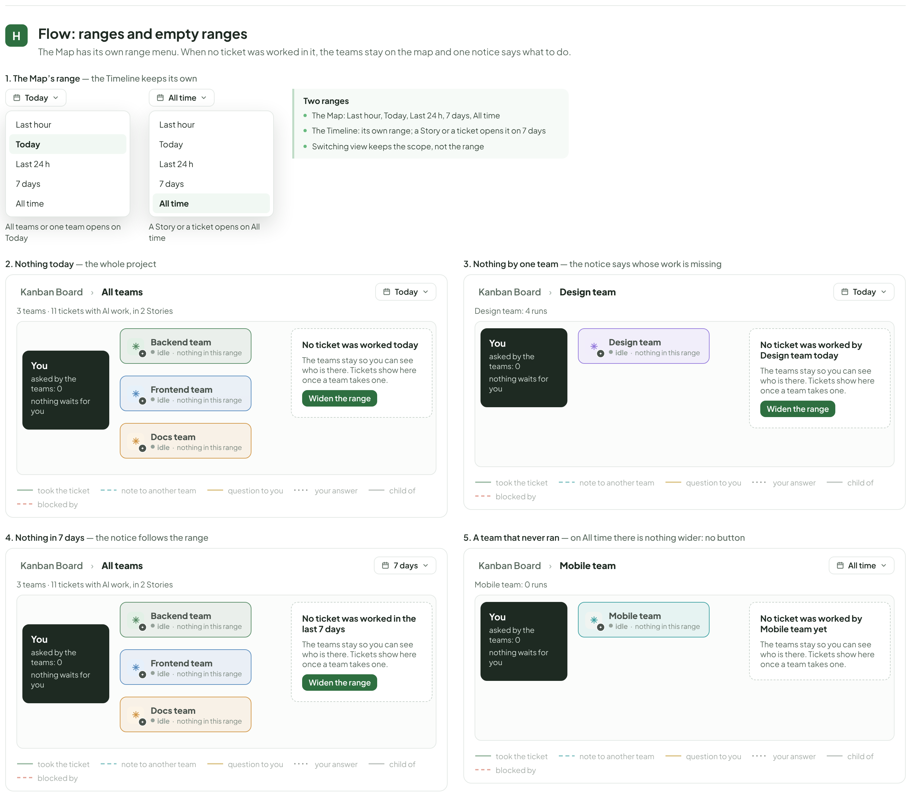

- Text in this part: "H" · "Flow: ranges and empty ranges" · "The Map has its own range menu. When no ticket was worked in it, the teams stay on the map and one notice says what to do." · "1. The Map’s range — the Timeline keeps its own" · "Today" · "Last hour" · "Last 24 h" · "7 days" · "All time" · "All teams or one team opens on Today" · "A Story or a ticket opens on All time" · "Two ranges" · "The Map: Last hour, Today, Last 24 h, 7 days, All time" · "The Timeline: its own range; a Story or a ticket opens it on 7 days" · "Switching view keeps the scope, not the range" · "2. Nothing today — the whole project" · "Kanban Board" · "›" · "All teams" · "3 teams · 11 tickets with AI work, in 2 Stories" · "You" · "asked by the teams: 0" · "nothing waits for you" · "Backend team" · "idle" · "·" · "nothing in this range" · "Frontend team" · "Docs team" · "No ticket was worked today" · "The teams stay so you can see who is there. Tickets show here once a team takes one." · "Widen the range" · "took the ticket" · "note to another team" · "question to you" · "your answer" · "child of" · "blocked by" · "3. Nothing by one team — the notice says whose work is missing" · "Design team" · "Design team: 4 runs" · "No ticket was worked by Design team today" · "4. Nothing in 7 days — the notice follows the range" · "No ticket was worked in the last 7 days" · "5. A team that never ran — on All time there is nothing wider: no button" · "Mobile team" · "Mobile team: 0 runs" · "No ticket was worked by Mobile team yet"

---

### Owner decisions pass (comment on PR #331)

"Open in Timeline" is "Open in Flow" in the buttons and captions.

---

## Todo rows, differences from the code, and what was not checked

### First round (story, board assistant, Wave 3, everywhere)

All files are 1480 wide. finalH: AiStoryFlow 10447, AiBoardAssistant 10654, AiBoardWave3 4136, AiEverywhere 4347.
Not touched: AiTeamReview, AiResources. Generators: gen_story.py, gen_assist.py, gen_wave3.py, gen_every.py (kit.py, dock.py, cio.py are shared helpers).

## AiStoryFlow.dc.html (A-147..A-153, B-42, B-43)
Old file edited with bs4 (25 boards, 34 506 px) down to 9 children: new header, A, B, C and the five Flow boards.
| Row | What I did | Notes |
|---|---|---|
| A-147 | Removed A, A2, B, C, C2, F, G, L, M1, M2, N, O, P, Q, R(1)(3), S; redrew D and E (now A and B) | G (scope bar) is removed with the rest: it belongs to Flow but the todo lists it as deleted |
| A-147 Flow part | LEFT as is: H, H2, I, I2, J (Flow map, one Story, one ticket, Timeline inside a Story) | KBM-20 is building them. They still carry v1 words (PM, hand-offs, Designer, approval); not mine to change. Their letters stay H..J |
| A-148, A-149, A-150, A-151, A-153 | Removed (K, K2, L..P, Q, R(1)(3), S) | Live list goes in AiTeam (not in this canvas) |
| A-152 | Drawn as board C: chip on (green) and off (amber), nothing running, popover on and off | Samples now Backend team / Docs team. Not moved to its own canvas (the assignment keeps it here) |
| B-42 | Board A: lanes on (full board), switch off and on, folded lane, Story with no sub-tickets (folded and open), no Story at all, filters hiding sub-tickets (progress still counts all), drag over a lane cell | |
| B-43 | Board B: the page, the ⋯ menu with Open as ticket, Open in Timeline landing, new Story (no goal, no criteria, no sub-tickets), a team waiting for you with cost not metered ("—"), the Time column (done, live, hatched), window under 1100 px | |

Differences from the code (drawn on purpose): the lane's status is a small chip ("In progress"), the code prints it as grey lowercase text ("in progress"); the card avatars are teams; Members badge in the sidebar reads "3 teams" (the code still has the v1 count); the Open in Timeline icon is the code's. Todo B-42 says the draw of the "Draft Story with no children" was not checked: I drew the code's "Folded: no tickets yet" and an open lane with empty cells; the empty cells are my reading of the code, not a screenshot.

## AiBoardAssistant.dc.html (A-154..A-166, B-26, B-39..B-41, B-44)
Boards now: A Entry points, B Chat dock, C Ticket chat with its team (new), D Board health, E Docs AI, F Settings → AI, G States, Note. Removed: C Ticket drafting, D Sub-task split, E Test cases.
| Row | What I did | Notes |
|---|---|---|
| A-154 | Header and Note rewritten (Board AI = session of the project's first team, acts, context bar) | |
| A-155 | A1 edited in place: sub line "Backend team (Claude Code) · online", new welcome, new footer, context bar; A7 redrawn as "Board AI without a team" | New texts are mine (the code still says "propose drafts", see below) |
| A-156 | A2 table: removed New Ticket and Test Cases rows; Ticket row now "Ask about this ticket ⌘J"; A4 menu has one item | |
| A-157 | Removed boards C, D, E and I4, I5, I6 | |
| A-158 | B1 conversation without suggested actions or cost; B2 receipt "Done — 2 changes · Undo all 2"; B3 Undo all ("Undone — 2 put back"); B4 asks first | Receipt drawn as DoneReceipt.tsx (Undo all only, no per-line Undo) |
| A-159 | Removed (old B2 draft card) | |
| A-160 | History without $ (B5); thinking, scope with Doc and Idea scopes (B10); empty board (G5); long ticket; injection; private doc; feature off | I8: new target is "Ask for a first ticket" (my wording, there is no target in the code) |
| A-161 | Error (B8), account limit (B9), budget reached "only when metered" (B11), not signed in (G1), slow (G3) | Texts mine: "Claude Code did not answer", "Claude usage limit reached" |
| A-162 | G4 Viewer | Text as the todo quotes Wave3 M |
| A-163 | D: act buttons, draft block and cost chip removed | |
| A-164 | D2 row "Offer a draft comment" removed; E (Docs AI) kept, cost chip removed | |
| A-165 | F: features Ask AI (chat), Drafting in editors, Board health, Docs AI, Sketch AI; Board AI = first team; no caps, no audit link | Names from `settings.py` FEATURES |
| A-166 | No canvas part (md only). The integrator must delete section J in ai-board-assistant.md | |
| B-39 | C1..C6 idle, working, waiting ("Waiting for Backend team…"), answered with role label, stopped without answering, no team ("Private to you") | |
| B-40 | C15..C19: six commands, filter, dimmed, notices, bar at 8 / 41 / 72 % (A also 18..33; B12 has 20 / 65 / 90), Auto-compact row | The code has six commands (compact, new, history, report, stop, cost); the todo says four |
| B-41 | C7..C14: + menu, greyed while working, confirmation, "Summarising…", notice, History empty / rows / digest stand-in | |
| B-44 | C20..C23: question answered in chat, request that changes something, Runs tab, bell open and closed | |
| B-26 | E4, E5 in Docs AI (draft waiting with Continue; written directly with "AI edited this page · version 14" and Undo) | The banner is C-21 (not built) |

## AiBoardWave3.dc.html (A-167..A-175)
Boards now: A Does it / asks first, B Receipt, C What it can reach, D Knowledge base, E GitHub, F Two events, G States. Removed: A, B, F, G, H, K, N.
| Row | What I did | Notes |
|---|---|---|
| A-167 | Header rewritten | |
| A-168, A-172 | Removed | |
| A-169 | One card with two behaviours | |
| A-170 | Receipt with four changes and an ask-first (delete) | No per-line Undo (code has none) |
| A-171 | Table from the board-ask skill tools: projects, tickets, manage_ticket, ticket_items, ticket_branches, docs, knowledge | Schedules, runs, stop and workflows are not in the skill's tool list; dropped |
| A-173 | Kept; "AIs" to "teams", wave and ai-safety-cost references removed, sidebar badge | The sentence "A light model wrote the one-line summary" is still in `KnowledgeBasePanel.tsx` (for files), so I kept it |
| A-174 | Six frames from PullStatus.tsx: red, red on base too, already given back, comments, unreachable, watching off. Only "Open the run on GitHub" and "I will answer them" | The code's rule table (`pullParts.tsx`) still says "section H", "hand-over rules", "ask-first tier": not drawn, needs a code edit |
| A-175 | Two events kept (window wait, merge conflict); arbitration removed; states 12 to 8 | Merge conflict row has only "Open the ticket": the todo's "Give it to an AI / I will do it" buttons are not in the code. I count 8 other states, the todo says nine |

## AiEverywhere.dc.html (A-176..A-180)
| Row | What I did | Notes |
|---|---|---|
| A-176 | Header and A rewritten (Ask only / mention-stops-at-Review rows gone) | |
| A-177 | B: ticket with a team (chat = the lead, role label, Post as comment, Copy), no team ("Private to you"), Runs tab | No toggle, no criteria draft, no run chip, no estimate |
| A-178 | C: teams in the picker (Docs team paused), "Send to Backend team" split button, queued / working / did not start, answer with team and role | "Needs your OK" removed; Helpful removed |
| A-179 | D kept; costs removed; frames 6..8 added (draft waits with Continue, accepted with Undo, written directly) | |
| A-180 | E "No team yet", "Budget reached" (metered); F three rules (drafts, what it reads, keyboard) | |

## Rows not done, or left
Flow boards (KBM-20) kept untouched. Not drawn: Resources, You stepped in, Health, Docs AI (KBM-21/22/24 as the brief says). `design/screens/ai-where-you-work.md` and `ai-board-assistant.md` not edited (integrator).

## Code against todo
- `AssistDock.tsx` still prints "I read ... and propose changes as drafts. I never change anything until you press Apply.", the footer "AI proposes · you apply", "Reviewer (…)" subtitle and "Draft first ticket with AI"; `ScopedChat.tsx` still says "I propose changes as drafts" for a ticket with no team and has `Who` with "No AI member". I drew the todo's v2 text; the code must change.
- Ask-first has no confirm control in the code (`AsksFirst` says "Apply is the confirm"). I drew two answer buttons ("Yes, delete…", "Leave it"): the developer must decide.
- Context bar tooltip and Auto-compact row follow the code.

## Not checked
Nothing was run in the app. Strings for the account-limit, error, empty-board and "Send to" frames are mine where the code has nothing. Word search done on text: no v1 words remain except in the kept Flow boards and the real code line "API keys and secrets, never" (what is sent).

## Review round
finalH now: AiStoryFlow 11353, AiBoardAssistant 10890, AiBoardWave3 4598, AiEverywhere 4358. Avatar dot bug fixed by re-running the generators with the fixed lib (kept boards come from the old file and are untouched).
**Fixed**
- Keep awake: chip now in the project header beside Board health, Ask AI, bell, on any tab. Lane status is grey lowercase text. Open in Timeline lands on AI Team › Timeline with "One ticket: KAN-301". Narrow Story page: only Tokens and money goes under, full table kept. Story sample made one story (5 children: 302/303/304 done, 305 working, 306 waits; same holders everywhere; numbering from 1; "5 sub-tickets"); filter frame hides KAN-304 and says so.
- Board AI: A7/G1 now use the code's block "Claude Code was not found on this computer. Install it, or add an AI team in Members." Removed frames for streaming, rate limit, budget, over-budget, viewer, truncated context (never produced by the server); Everywhere Budget and Viewer states removed; Wave3 "Everything is paused" removed (nothing reads paused_all). Scope shows the three real rows. Thinking has Stop. Frames renumbered. Reading chips "This ticket / Its comments / Linked pages". Style guide label "Style guide for ticket drafts". Board health: "Check now", "Docs that may be out of date", "Not metered" label, 6 insights and 08:00 consistent. "Run #14" plain; thread rows "Cancel" / "Stop", no "Did not start"; Runs tab as TicketChat.tsx (Run #, state chip, Open, "Answer only"/"Work", cost or "Not metered"); empty Runs tab text; question card above the chat; "+ New chat" frame; closing comment without "Report." and dollars, with "Run #4 · 48,000 tokens · sonnet"; bell texts "{team} finished {ticket}" and "{team} asks a question"; @ picker lines as aiAvailability.ts; "2 review comments"; Wave3 B1 "Based on 11 tickets · 2 docs", no "Acts as you"; knowledge-base frame no longer cut, "wave 1" gone; invented UI removed (Open the Runs tab, Reply, explanation under comment box, Draft waiting frames, window-wait example row and its button).
**Kept (why)**
- Todo's frames for the Board AI without a team: replaced by the code's text, so the todo's "needs a team" wording is not drawn (todo and code disagree).
- Scope with Doc and Idea rows (todo A-160): removed, the code has three.
- "Yes, delete…/Leave it" buttons under an ask-first: designer's proposal (code has none). "AI edited this page · Undo" banner: todo C-21, not built. Wave3 merge-conflict card has only "Open the ticket": the todo's give-back buttons do not exist.
- Wave3 states: 7 remain (12 minus 4 rule/suite states minus "Everything is paused"); the todo's nine cannot be reached.
- Stopped-without-answer text and closing-comment sample are drawn from chat.py/runs.py wording.
**Cannot**
- B-26 Idea and Sketch assistants not drawn (no frame source read in this round). "AI summary" chip on the closing comment not drawn (code basis unclear).

The Flow v2 round (Map, scope bar, ranges, empty states) is reported in [ai-team.md](ai-team.md).
