# An AI team with a process — packs, skills, workflows and who holds the ball

> SCREEN — V1 PROPOSAL · source: [`AiTeamProcess.dc.html`](../source/AiTeamProcess.dc.html) · canvas `1793549179-0849` · sha256 `06eb4b6a0ac6cd0ed1e655911f3d89063369ea61ba7062c3486f2a01282b15f5`

> Wave 2 of `docs/specs/ai-claude-code-plan.md` (decisions D1-D25). Based on `main` and on the code as it is today: four thin presets in `memberPresets.json`, a skill library that cannot install from outside, no notion of a workflow, one assignee box that a hand-off overwrites, and TDD as a sentence in a persona. Sections B and J depend on experiments S1-S4 and S6 in section 4 of the plan; section N says what happens if they fail. All names, tickets and text in the mock-ups are illustrative.

Wave 2 of the AI plan (docs/specs/ai-claude-code-plan.md). Today the AIs pass work to each other by hand, a ticket has one assignee box and no notion of a process, and nothing records who did which part. This board gives the team its shape: skills and plugins you can install and switch per AI, role packs you can export, a repository scan that proposes a team for a new project, workflows a ticket follows with a role on every step, review at a depth that suits the ticket, an AI that settles disagreements before you are asked, evidence that a test really went red before it went green, a way to interrupt a run with a sentence, and numbers per workflow template rather than per AI.

Source: [AiTeamProcess.dc.html](../source/AiTeamProcess.dc.html) › header ("SCREEN — V1 PROPOSAL", "An AI team with a process — packs, skills, workflows and who holds the ball" and the intro)

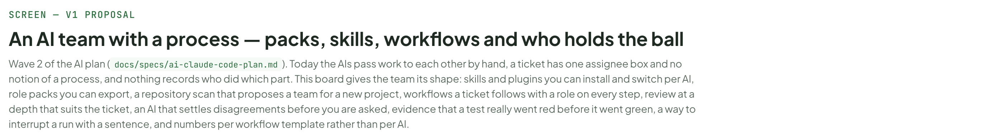

---

## A. What this board decides

Every row is already decided in the plan document; the grey chip says which decision. D1–D25 are the decisions in section 2 of docs/specs/ai-claude-code-plan.md.

Source: [AiTeamProcess.dc.html](../source/AiTeamProcess.dc.html) › block "A. What this board decides"

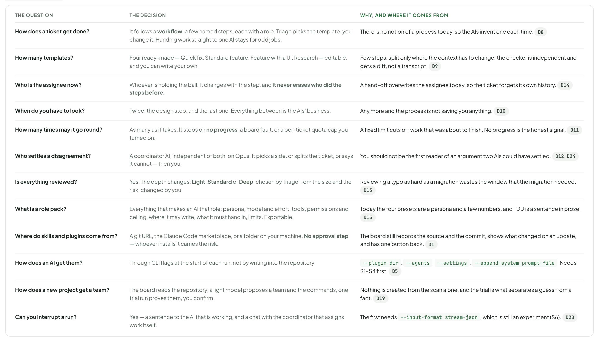

- Text in the frames: "THE QUESTION" · "THE DECISION" · "WHY, AND WHERE IT COMES FROM" · "How does a ticket get done?" · "It follows a workflow: a few named steps, each with a role. Triage picks the template, you change it. Handing work straight to one AI stays for odd jobs." · "There is no notion of a process today, so the AIs invent one each time. D8" · "How many templates?" · "Four ready-made — Quick fix, Standard feature, Feature with a UI, Research — editable, and you can write your own." · "Few steps, split only where the context has to change; the checker is independent and gets a diff, not a transcript. D9" · "Who is the assignee now?" · "Whoever is holding the ball. It changes with the step, and it never erases who did the steps before." · "A hand-off overwrites the assignee today, so the ticket forgets its own history. D14" · "When do you have to look?" · "Twice: the design step, and the last one. Everything between is the AIs’ business." · "Any more and the process is not saving you anything. D10" · "How many times may it go round?" · "As many as it takes. It stops on no progress, a board fault, or a per-ticket quota cap you turned on." · "A fixed limit cuts off work that was about to finish. No progress is the honest signal. D11" · "Who settles a disagreement?" · "A coordinator AI, independent of both, on Opus. It picks a side, or splits the ticket, or says it cannot — then you." · "You should not be the first reader of an argument two AIs could have settled. D12 D24" · "Is everything reviewed?" · "Yes. The depth changes: Light, Standard or Deep, chosen by Triage from the size and the risk, changed by you." · "Reviewing a typo as hard as a migration wastes the window that the migration needed. D13" · "What is a role pack?" · "Everything that makes an AI that role: persona, model and effort, tools, permissions and ceiling, where it may write, what it must hand in, limits. Exportable." · "Today the four presets are a persona and a few numbers, and TDD is a sentence in prose. D15" · "Where do skills and plugins come from?" · "A git URL, the Claude Code marketplace, or a folder on your machine. No approval step — whoever installs it carries the risk." · "The board still records the source and the commit, shows what changed on an update, and has one button back. D1" · "How does an AI get them?" · "Through CLI flags at the start of each run, not by writing into the repository." · "--plugin-dir, --agents, --settings, --append-system-prompt-file. Needs S1–S4 first. D5" · "How does a new project get a team?" · "The board reads the repository, a light model proposes a team and the commands, one trial run proves them, you confirm." · "Nothing is created from the scan alone, and the trial is what separates a guess from a fact. D19" · "Can you interrupt a run?" · "Yes — a sentence to the AI that is working, and a chat with the coordinator that assigns work itself." · "The first needs --input-format stream-json, which is still an experiment (S6). D20"

---

## B. Skills and plugins

The board already has a library of skills written inside it. What it cannot do is bring one in from outside, tell you whether an AI ever reached for it, or treat a plugin as a thing at all.

Source: [AiTeamProcess.dc.html](../source/AiTeamProcess.dc.html) › block "B. Skills and plugins"

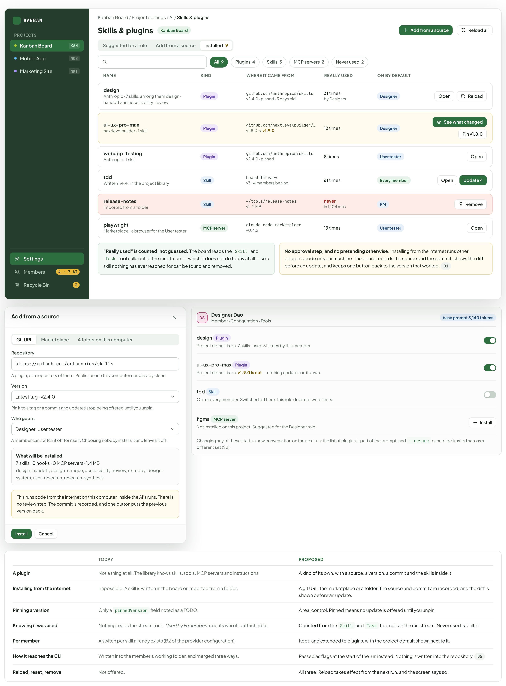

- Text in the frames: "KANBAN" · "PROJECTS" · "Kanban Board" · "KAN" · "Mobile App" · "MOB" · "Marketing Site" · "MKT" · "Settings" · "Members" · "4 · 7 AI" · "Recycle Bin" · "3" · "Kanban Board / Project settings / AI / Skills & plugins" · "Skills & plugins" · "Add from a source" · "Reload all" · "Suggested for a role" · "Installed" · "9" · "All" · "Plugins" · "4" · "Skills" · "MCP servers" · "2" · "Never used" · "NAME" · "KIND" · "WHERE IT CAME FROM" · "REALLY USED" · "ON BY DEFAULT" · "design" · "Anthropic · 7 skills, among them design-handoff and accessibility-review" · "Plugin" · "github.com/anthropics/skills" · "v2.4.0 · pinned · 3 days old" · "31 times" · "by Designer" · "Designer" · "Open" · "Reload" · "ui-ux-pro-max" · "nextlevelbuilder · 1 skill" · "github.com/nextlevelbuilder/…" · "v1.8.0 → v1.9.0" · "12 times" · "See what changed" · "Pin v1.8.0" · "webapp-testing" · "Anthropic · 1 skill" · "v2.4.0 · pinned" · "8 times" · "User tester" · "tdd" · "Written here · in the project library" · "Skill" · "board library" · "v3 · 4 members behind" · "61 times" · "Every member" · "Update 4" · "release-notes" · "Imported from a folder" · "~/tools/release-notes" · "v1 · 2 MB" · "never" · "in 1,104 runs" · "PM" · "Remove" · "playwright" · "Marketplace · a browser for the User tester" · "MCP server" · "claude code marketplace" · "v0.4.2" · "19 times" · "“Really used” is counted, not guessed. The board reads the Skill and Task tool calls out of the run stream — which it does not do today at all — so a skill nothing has ever reached for can be found and removed." · "No approval step, and no pretending otherwise. Installing from the internet runs other people’s code on your machine. The board records the source and the commit, shows the diff before an update, and keeps one button back to the version that worked. D1" · "Git URL" · "Marketplace" · "A folder on this computer" · "Repository" · "https://github.com/anthropics/skills" · "A plugin, or a repository of them. Public, or one this computer can already clone." · "Version" · "Latest tag · v2.4.0" · "Pin it to a tag or a commit and updates stop being offered until you unpin." · "Who gets it" · "Designer, User tester" · "A member can switch it off for itself. Choosing nobody installs it and leaves it off." · "What will be installed" · "7 skills · 0 hooks · 0 MCP servers · 1.4 MB" · "design-handoff, design-critique, accessibility-review, ux-copy, design-system, user-research, research-synthesis" · "This runs code from the internet on this computer, inside the AI’s runs. There is no review step. The commit is recorded, and one button puts the previous version back." · "Install" · "Cancel" · "DS" · "Designer Dao" · "Member › Configuration › Tools" · "base prompt 3,140 tokens" · "design Plugin" · "Project default is on. 7 skills · used 31 times by this member." · "ui-ux-pro-max Plugin" · "Project default is on. v1.9.0 is out — nothing updates on its own." · "tdd Skill" · "On for every member. Switched off here: this role does not write tests." · "figma MCP server" · "Not installed on this project. Suggested for the Designer role." · "Changing any of these starts a new conversation on the next run: the list of plugins is part of the prompt, and --resume cannot be trusted across a different set (S2)." · "TODAY" · "PROPOSED" · "A plugin" · "Not a thing at all. The library knows skills, tools, MCP servers and instructions." · "A kind of its own, with a source, a version, a commit and the skills inside it." · "Installing from the internet" · "Impossible. A skill is written in the board or imported from a folder." · "A git URL, the marketplace or a folder. The source and commit are recorded, and the diff is shown before an update." · "Pinning a version" · "Only a pinnedVersion field noted as a TODO." · "A real control. Pinned means no update is offered until you unpin." · "Knowing it was used" · "Nothing reads the stream for it. Used by N members counts who it is attached to." · "Counted from the Skill and Task tool calls in the run stream. Never used is a filter." · "Per member" · "A switch per skill already exists (B2 of the provider configuration)." · "Kept, and extended to plugins, with the project default shown next to it." · "How it reaches the CLI" · "Written into the member’s working folder, and merged three ways." · "Passed as flags at the start of the run instead. Nothing is written into the repository. D5" · "Reload, reset, remove" · "Not offered." · "All three. Reload takes effect from the next run, and the screen says so."

---

## C. Role packs: eight AIs you do not have to invent

A pack is everything that makes an AI a role, in one object you can export, import and version. Four exist today as a persona and three numbers; four roles do not exist at all.

Source: [AiTeamProcess.dc.html](../source/AiTeamProcess.dc.html) › block "C. Role packs: eight AIs you do not have to invent"

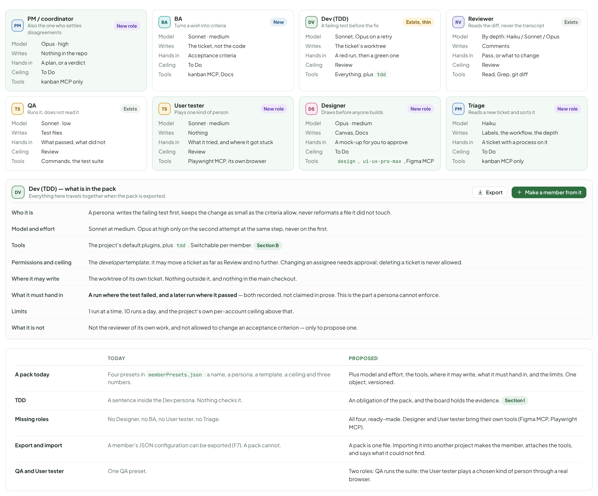

- Text in the frames: "PM" · "PM / coordinator" · "Also the one who settles disagreements" · "New role" · "Model" · "Opus · high" · "Writes" · "Nothing in the repo" · "Hands in" · "A plan, or a verdict" · "Ceiling" · "To Do" · "Tools" · "kanban MCP only" · "BA" · "Turns a wish into criteria" · "New" · "Sonnet · medium" · "The ticket, not the code" · "Acceptance criteria" · "kanban MCP, Docs" · "DV" · "Dev (TDD)" · "A failing test before the fix" · "Exists, thin" · "Sonnet, Opus on a retry" · "The ticket’s worktree" · "A red run, then a green one" · "Review" · "Everything, plus tdd" · "RV" · "Reviewer" · "Reads the diff, never the transcript" · "Exists" · "By depth: Haiku / Sonnet / Opus" · "Comments" · "Pass, or what to change" · "Read, Grep, git diff" · "TS" · "QA" · "Runs it, does not read it" · "Sonnet · low" · "Test files" · "What passed, what did not" · "Commands, the test suite" · "User tester" · "Plays one kind of person" · "Nothing" · "What it tried, and where it got stuck" · "Playwright MCP, its own browser" · "DS" · "Designer" · "Draws before anyone builds" · "Opus · medium" · "Canvas, Docs" · "A mock-up for you to approve" · "design, ui-ux-pro-max, Figma MCP" · "Triage" · "Reads a new ticket and sorts it" · "Haiku" · "Labels, the workflow, the depth" · "A ticket with a process on it" · "Dev (TDD) — what is in the pack" · "Everything here travels together when the pack is exported." · "Export" · "Make a member from it" · "Who it is" · "A persona: writes the failing test first, keeps the change as small as the criteria allow, never reformats a file it did not touch." · "Model and effort" · "Sonnet at medium. Opus at high only on the second attempt at the same step, never on the first." · "The project’s default plugins, plus tdd. Switchable per member. Section B" · "Permissions and ceiling" · "The developer template; it may move a ticket as far as Review and no further. Changing an assignee needs approval; deleting a ticket is never allowed." · "Where it may write" · "The worktree of its own ticket. Nothing outside it, and nothing in the main checkout." · "What it must hand in" · "A run where the test failed, and a later run where it passed — both recorded, not claimed in prose. This is the part a persona cannot enforce." · "Limits" · "1 run at a time, 10 runs a day, and the project’s own per-account ceiling above that." · "What it is not" · "Not the reviewer of its own work, and not allowed to change an acceptance criterion — only to propose one." · "TODAY" · "PROPOSED" · "A pack today" · "Four presets in memberPresets.json: a name, a persona, a template, a ceiling and three numbers." · "Plus model and effort, the tools, where it may write, what it must hand in, and the limits. One object, versioned." · "TDD" · "A sentence inside the Dev persona. Nothing checks it." · "An obligation of the pack, and the board holds the evidence. Section I" · "Missing roles" · "No Designer, no BA, no User tester, no Triage." · "All four, ready-made. Designer and User tester bring their own tools (Figma MCP, Playwright MCP)." · "Export and import" · "A member’s JSON configuration can be exported (F7). A pack cannot." · "A pack is one file. Importing it into another project makes the member, attaches the tools, and says what it could not find." · "QA and User tester" · "One QA preset." · "Two roles: QA runs the suite; the User tester plays a chosen kind of person through a real browser."

---

## D. Giving a new project a team

Adding an AI today is one five-step dialog, one member at a time, and nothing knows anything about the repository. A project with no team should be able to get a working one in about three minutes, with every value visible and changeable.

Source: [AiTeamProcess.dc.html](../source/AiTeamProcess.dc.html) › block "D. Giving a new project a team"

- Text in the frames: "KANBAN" · "PROJECTS" · "Kanban Board" · "KAN" · "Mobile App" · "MOB" · "Marketing Site" · "MKT" · "Settings" · "Members" · "4 · 7 AI" · "Recycle Bin" · "3" · "Marketing Site / Project settings / AI / Set up the AI team" · "Set up the AI team" · "Nothing is created until the last step" · "Read the repository" · "What it suggests" · "Try the commands" · "4" · "Confirm" · "WHAT THE BOARD READ, IN 1.4 SECONDS" · "package.json  Next.js 15, TypeScript, Vitest" · "Test command  npm run test -- --run" · "From the CI workflow  npm ci && npm run lint && npm run test -- --run" · "Dev server  npm run dev on port 3000" · "CLAUDE.md  none" · "Tests  src/**/*.test.ts · 214 files" · "Remote  GitHub · gh is signed in" · "Shape  One package · 38 MB · a web UI" · "All of it read from files. No quota spent. The suggestion below cost one Haiku call on this summary and the README." · "WHAT IT SUGGESTS — CHANGE ANYTHING" · "The team" · "It has a UI, so a Designer and a User tester are in. No database, so no migration skills." · "PM" · "DS" · "DV" · "RV" · "TS" · "Default workflow" · "Most of this repo’s tickets touch the interface." · "Feature with a UI" · "Prepare command" · "Taken from the CI workflow, not from the README." · "npm ci" · "Test command" · "Verified below." · "npm run test -- --run" · "Ports" · "The dev server wants 3000; worktrees get a range above it." · "3100-3119" · "Hand over by" · "GitHub remote, gh signed in." · "Opening a pull request" · "Plugins" · "Suggested for the roles chosen above." · "design" · "ui-ux-pro-max" · "webapp-testing" · "playwright" · "Tried in a scratch worktree, 2 min 10 s. npm ci finished; npm run test -- --run ran 214 tests, 214 passed; the dev server answered on 3100. The commands above are facts now, not guesses." · "Create the team" · "Try again" · "I will do it myself" · "1 · Read" · "Manifests, lock files, the CI workflow, CLAUDE.md, .claude/, the README, the test folders, the git remote, the size. Code only, no quota." · "2 · Suggest" · "One call to a light model, on that summary plus the README: the team, the commands, the ports, the default workflow, the plugins, the hand-off route." · "3 · Try" · "The prepare command and the test command are run once in a scratch worktree. A command that fails is shown failing, not quietly dropped." · "4 · Confirm" · "You change whatever you like and press Create. Only then does anything exist." · "Why the trial run matters" · "A command read out of a README is a guess. A command that just ran is a fact, and the difference costs two minutes once." · "It also warms the prepare step, so the first real ticket is not the one that discovers npm ci takes four minutes." · "A failing command is shown with its output. The wizard does not go on pretending." · "The scratch worktree is removed afterwards, whatever happened." · "When it runs again" · "When the CI workflow changes a command, or a package manager appears that was not there before." · "It never changes anything by itself: it offers the same screen with what moved highlighted." · "On a project that already has a team, only the parts you have not touched are re-suggested." · "The scan is also what the Suggested for a role tab of Skills & plugins reads."

---

## E. Workflows: four ready-made, and an editor

A workflow is a few named steps, each with a role, what it is given and what it must hand in. There is no such concept in the board today, which is why the AIs invent a process per ticket.

Source: [AiTeamProcess.dc.html](../source/AiTeamProcess.dc.html) › block "E. Workflows: four ready-made, and an editor"

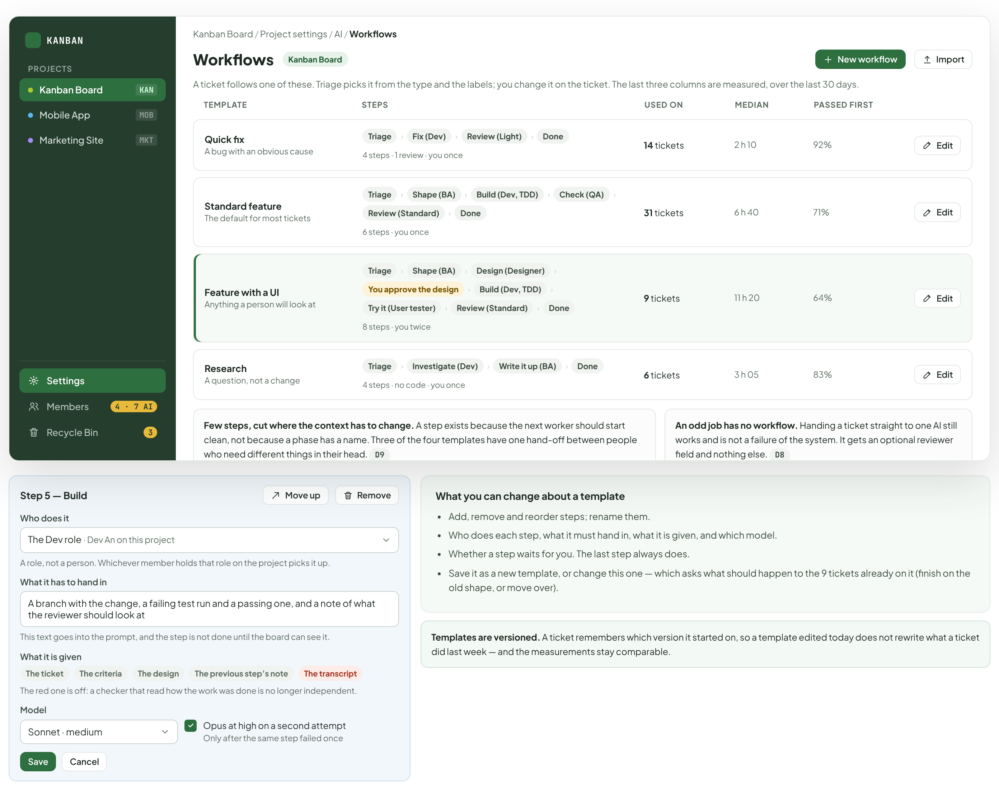

- Text in the frames: "KANBAN" · "PROJECTS" · "Kanban Board" · "KAN" · "Mobile App" · "MOB" · "Marketing Site" · "MKT" · "Settings" · "Members" · "4 · 7 AI" · "Recycle Bin" · "3" · "Kanban Board / Project settings / AI / Workflows" · "Workflows" · "New workflow" · "Import" · "A ticket follows one of these. Triage picks it from the type and the labels; you change it on the ticket. The last three columns are measured, over the last 30 days." · "TEMPLATE" · "STEPS" · "USED ON" · "MEDIAN" · "PASSED FIRST" · "Quick fix" · "A bug with an obvious cause" · "Triage" · "›" · "Fix (Dev)" · "Review (Light)" · "Done" · "4 steps · 1 review · you once" · "14 tickets" · "2 h 10" · "92%" · "Edit" · "Standard feature" · "The default for most tickets" · "Shape (BA)" · "Build (Dev, TDD)" · "Check (QA)" · "Review (Standard)" · "6 steps · you once" · "31 tickets" · "6 h 40" · "71%" · "Feature with a UI" · "Anything a person will look at" · "Design (Designer)" · "You approve the design" · "Try it (User tester)" · "8 steps · you twice" · "9 tickets" · "11 h 20" · "64%" · "Research" · "A question, not a change" · "Investigate (Dev)" · "Write it up (BA)" · "4 steps · no code · you once" · "6 tickets" · "3 h 05" · "83%" · "Few steps, cut where the context has to change. A step exists because the next worker should start clean, not because a phase has a name. Three of the four templates have one hand-off between people who need different things in their head. D9" · "An odd job has no workflow. Handing a ticket straight to one AI still works and is not a failure of the system. It gets an optional reviewer field and nothing else. D8" · "Step 5 — Build" · "Move up" · "Remove" · "Who does it" · "The Dev role · Dev An on this project" · "A role, not a person. Whichever member holds that role on the project picks it up." · "What it has to hand in" · "A branch with the change, a failing test run and a passing one, and a note of what the reviewer should look at" · "This text goes into the prompt, and the step is not done until the board can see it." · "What it is given" · "The ticket" · "The criteria" · "The design" · "The previous step’s note" · "The transcript" · "The red one is off: a checker that read how the work was done is no longer independent." · "Model" · "Sonnet · medium" · "Opus at high on a second attempt" · "Only after the same step failed once" · "Save" · "Cancel" · "What you can change about a template" · "Add, remove and reorder steps; rename them." · "Who does each step, what it must hand in, what it is given, and which model." · "Whether a step waits for you. The last step always does." · "Save it as a new template, or change this one — which asks what should happen to the 9 tickets already on it (finish on the old shape, or move over)." · "Templates are versioned. A ticket remembers which version it started on, so a template edited today does not rewrite what a ticket did last week — and the measurements stay comparable."

---

## F. A workflow on a ticket: who is holding it, and who held it before

The strip is the whole feature: eight steps, a role on each, a mark for done, working and waiting, and two places where it stops for you. The assignee stays one box, but it stops being the only memory of who worked on the ticket.

Source: [AiTeamProcess.dc.html](../source/AiTeamProcess.dc.html) › block "F. A workflow on a ticket: who is holding it, and who held it before"

- Text in the frames: "KANBAN" · "PROJECTS" · "Kanban Board" · "KAN" · "Mobile App" · "MOB" · "Marketing Site" · "MKT" · "Settings" · "Members" · "4 · 7 AI" · "Recycle Bin" · "3" · "Board" · "List" · "Timeline" · "Docs" · "AI Team" · "4" · "Pause all AI" · "New Ticket" · "KAN-213" · "Empty state for Schedules" · "In Progress" · "Feature with a UI" · "step 5 of 8" · "started 2 days ago · 1 round back from review" · "Change workflow" · "1" · "Triage" · "PM" · "Triage · 1 min" · "DONE" · "2" · "Shape" · "BA" · "BA Bao · 3 criteria" · "Design" · "DS" · "Designer Dao · 2 screens" · "You approve the design" · "You · yesterday 16:04" · "5" · "Build" · "DV" · "Dev An · 14 min" · "WORKING" · "6" · "Try it" · "TS" · "User tester Uyen" · "WAITING" · "7" · "Review · Standard" · "RV" · "Reviewer Rin" · "8" · "Done" · "You" · "WAITING FOR YOU" · "SEND SOMETHING TO DEV AN WHILE IT WORKS" · "Also check the dark theme — the empty state has to read there too." · "Cancel" · "Comment" · "It reaches the run that is going now, and the AI answers it in its next turn. If it cannot be slipped in, it is given to the AI at the start of the next one, and the box says which happened." · "Assignee · who is holding it" · "Dev An" · "Set by the step. Changing it by hand moves the workflow with it, and says so." · "WHO DID WHAT" · "Mon 09:02" · "BA Bao" · "Mon 09:40" · "Designer Dao" · "Mon 14:11" · "You approved" · "Tue 16:04" · "now" · "This list is what the single assignee box destroys today: a hand-off overwrites it and the ticket forgets who shaped it." · "Review" · "Standard" · "chosen by Triage" · "TODAY" · "PROPOSED" · "The assignee box" · "One field. A hand-off writes over it, and who did the earlier work is gone from the ticket." · "Still one field — whoever holds the ball — but set by the step, with the list of who did what kept beside it." · "Where the ticket is" · "A board column. Nothing says which part of the work is underway." · "The column stays. The step strip says what is happening inside it, and the two are not the same thing." · "A hand-off" · "An event in the activity log and a new assignee." · "Moving to the next step. The log entry is the same; what changes is that the ticket now has somewhere to move to." · "An odd job" · "The only mode there is." · "Still there, with an optional Reviewer field so a one-off change can still be read by someone." · "Who may change it" · "Anyone may change the assignee." · "You may change the step or the workflow; doing so says which steps are dropped. An AI may only move to the next step."

---

## G. Review at a depth that fits, and the one design you approve

Every ticket is reviewed by an AI. What changes is how hard. The other thing that changes is where you are asked to look: twice in a workflow with a UI, once in the others.

Source: [AiTeamProcess.dc.html](../source/AiTeamProcess.dc.html) › block "G. Review at a depth that fits, and the one design you approve"

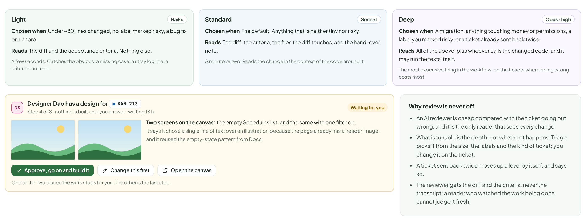

- Text in the frames: "Light" · "Haiku" · "Chosen when  Under ~80 lines changed, no label marked risky, a bug fix or a chore." · "Reads  The diff and the acceptance criteria. Nothing else." · "A few seconds. Catches the obvious: a missing case, a stray log line, a criterion not met." · "Standard" · "Sonnet" · "Chosen when  The default. Anything that is neither tiny nor risky." · "Reads  The diff, the criteria, the files the diff touches, and the hand-over note." · "A minute or two. Reads the change in the context of the code around it." · "Deep" · "Opus · high" · "Chosen when  A migration, anything touching money or permissions, a label you marked risky, or a ticket already sent back twice." · "Reads  All of the above, plus whoever calls the changed code, and it may run the tests itself." · "The most expensive thing in the workflow, on the tickets where being wrong costs most." · "DS" · "Designer Dao has a design for" · "KAN-213" · "Step 4 of 8 · nothing is built until you answer · waiting 18 h" · "Waiting for you" · "Two screens on the canvas: the empty Schedules list, and the same with one filter on." · "It says it chose a single line of text over an illustration because the page already has a header image, and it reused the empty-state pattern from Docs." · "Approve, go on and build it" · "Change this first" · "Open the canvas" · "One of the two places the work stops for you. The other is the last step." · "Why review is never off" · "An AI reviewer is cheap compared with the ticket going out wrong, and it is the only reader that sees every change." · "What is tunable is the depth, not whether it happens. Triage picks it from the size, the labels and the kind of ticket; you change it on the ticket." · "A ticket sent back twice moves up a level by itself, and says so." · "The reviewer gets the diff and the criteria, never the transcript: a reader who watched the work being done cannot judge it fresh."

---

## H. When two AIs cannot agree

Two AIs passing a ticket back and forth is already detected — it is called ping-pong and it is reported to you in What to fix after three cases. The change is that something tries to settle it first.

Source: [AiTeamProcess.dc.html](../source/AiTeamProcess.dc.html) › block "H. When two AIs cannot agree"

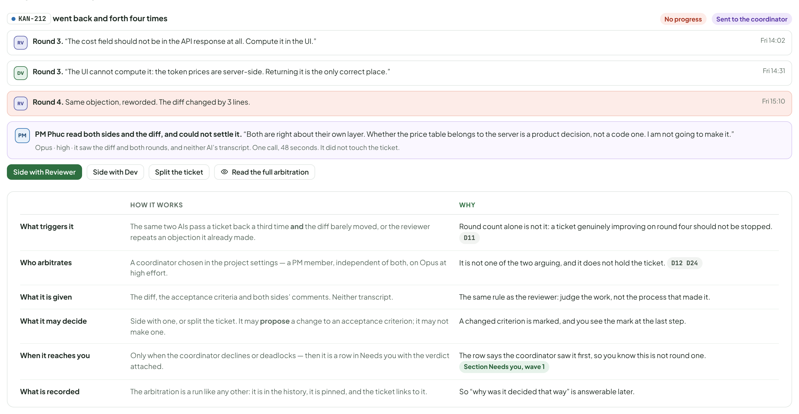

- Text in the frames: "KAN-212" · "went back and forth four times" · "No progress" · "Sent to the coordinator" · "RV" · "Round 3. “The cost field should not be in the API response at all. Compute it in the UI.”" · "Fri 14:02" · "DV" · "Round 3. “The UI cannot compute it: the token prices are server-side. Returning it is the only correct place.”" · "Fri 14:31" · "Round 4. Same objection, reworded. The diff changed by 3 lines." · "Fri 15:10" · "PM" · "PM Phuc read both sides and the diff, and could not settle it. “Both are right about their own layer. Whether the price table belongs to the server is a product decision, not a code one. I am not going to make it.”" · "Opus · high · it saw the diff and both rounds, and neither AI’s transcript. One call, 48 seconds. It did not touch the ticket." · "Side with Reviewer" · "Side with Dev" · "Split the ticket" · "Read the full arbitration" · "HOW IT WORKS" · "WHY" · "What triggers it" · "The same two AIs pass a ticket back a third time and the diff barely moved, or the reviewer repeats an objection it already made." · "Round count alone is not it: a ticket genuinely improving on round four should not be stopped. D11" · "Who arbitrates" · "A coordinator chosen in the project settings — a PM member, independent of both, on Opus at high effort." · "It is not one of the two arguing, and it does not hold the ticket. D12 D24" · "What it is given" · "The diff, the acceptance criteria and both sides’ comments. Neither transcript." · "The same rule as the reviewer: judge the work, not the process that made it." · "What it may decide" · "Side with one, or split the ticket. It may propose a change to an acceptance criterion; it may not make one." · "A changed criterion is marked, and you see the mark at the last step." · "When it reaches you" · "Only when the coordinator declines or deadlocks — then it is a row in Needs you with the verdict attached." · "The row says the coordinator saw it first, so you know this is not round one. Section Needs you, wave 1" · "What is recorded" · "The arbitration is a run like any other: it is in the history, it is pinned, and the ticket links to it." · "So “why was it decided that way” is answerable later."

---

## I. Proof that the test went red first

TDD is a sentence in the Dev persona today and nothing checks it. The run history from wave 1 already stores every command and its exit code, which is all that is needed to turn the sentence into something the board can see.

Source: [AiTeamProcess.dc.html](../source/AiTeamProcess.dc.html) › block "I. Proof that the test went red first"

- Text in the frames: "Test-first evidence for" · "KAN-212" · "Proven" · "Red · 11:22:18" · "npm test -- --run src/cost" · "1 failed, 61 passed" · "The test file existed; the fix did not." · "Green · 11:31:05" · "62 passed" · "Same command, same file, after the change." · "The board matched them by the command, the test file and the run, not by what the AI said it did. Both runs open from here." · "Open the red run" · "Open the green run" · "No test-first evidence for" · "KAN-216" · "Not proven" · "Dev An’s report says “wrote the test first”, but every recorded run of src/schedules passed. There is no run where it failed." · "The step is not marked done. The pack says a red run and a green one, and prose is not either of them." · "Send it back to Dev An" · "Accept without it, just this once" · "Turn the rule off for this project" · "How a pair is matched" · "Same test command, same test path, same ticket, the red one before the green one, and no change to the test file between them." · "A test changed between the two runs breaks the pair, and says so: moving the goalposts is the thing this is meant to catch." · "It works without any new recording. Wave 1 already keeps the command, the exit code and the output of every step." · "Only steps whose pack asks for it are checked. A Designer step has no tests and is never marked unproven." · "What it is not" · "Not a coverage number. Whether the test is any good is the reviewer’s job." · "Not a gate you cannot pass: accepting without it is one button, and it is recorded on the ticket." · "Not retroactive. Tickets finished before this exists are not marked unproven." · "Not on by default for every pack — only Dev (TDD) asks for it."

---

## J. Stepping in without stopping anything

Two ways in: a sentence to the AI that is working right now, and a conversation with the coordinator, which then assigns the work itself rather than handing you a list.

Source: [AiTeamProcess.dc.html](../source/AiTeamProcess.dc.html) › block "J. Stepping in without stopping anything"

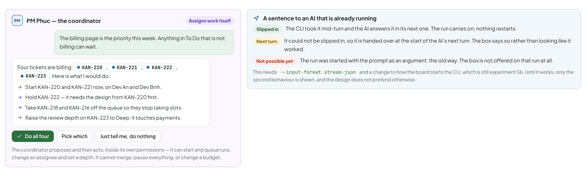

- Text in the frames: "PM" · "PM Phuc — the coordinator" · "Assigns work itself" · "The billing page is the priority this week. Anything in To Do that is not billing can wait." · "Four tickets are billing:" · "KAN-220" · "," · "KAN-221" · "KAN-222" · "KAN-223" · ". Here is what I would do:" · "Start KAN-220 and KAN-221 now, on Dev An and Dev Binh." · "Hold KAN-222 — it needs the design from KAN-220 first." · "Take KAN-218 and KAN-216 off the queue so they stop taking slots." · "Raise the review depth on KAN-223 to Deep: it touches payments." · "Do all four" · "Pick which" · "Just tell me, do nothing" · "The coordinator proposes and then acts, inside its own permissions — it can start and queue runs, change an assignee and set a depth. It cannot merge, pause everything, or change a budget." · "A sentence to an AI that is already running" · "Slipped in" · "The CLI took it mid-turn and the AI answers it in its next one. The run carries on; nothing restarts." · "Next turn" · "It could not be slipped in, so it is handed over at the start of the AI’s next turn. The box says so rather than looking like it worked." · "Not possible yet" · "The run was started with the prompt as an argument, the old way. The box is not offered on that run at all." · "This needs --input-format stream-json and a change to how the board starts the CLI, which is still experiment S6. Until it works, only the second behaviour is shown, and the design does not pretend otherwise."

---

## K. Finding your way around once there are workflows

A board where every ticket has eight steps and five roles needs a different filter bar from one where a ticket has an assignee.

Source: [AiTeamProcess.dc.html](../source/AiTeamProcess.dc.html) › block "K. Finding your way around once there are workflows"

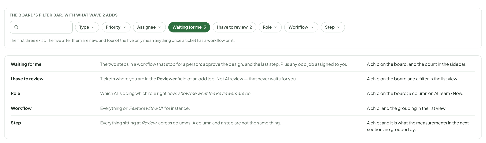

- Text in the frames: "THE BOARD’S FILTER BAR, WITH WHAT WAVE 2 ADDS" · "Type" · "Priority" · "Assignee" · "Waiting for me" · "3" · "I have to review" · "2" · "Role" · "Workflow" · "Step" · "The first three exist. The five after them are new, and four of the five only mean anything once a ticket has a workflow on it." · "The two steps in a workflow that stop for a person: approve the design, and the last step. Plus any odd job assigned to you." · "A chip on the board, and the count in the sidebar." · "Tickets where you are in the Reviewer field of an odd job. Not AI review — that never waits for you." · "A chip on the board and a filter in the list view." · "Which AI is doing which role right now: show me what the Reviewers are on." · "A chip on the board; a column on AI Team › Now." · "Everything on Feature with a UI, for instance." · "A chip, and the grouping in the list view." · "Everything sitting at Review, across columns. A column and a step are not the same thing." · "A chip; and it is what the measurements in the next section are grouped by."

---

## L. Measuring the process, not the AI

The Health tiles that exist measure the setup: how often runs finish, how often you had to step in, what it cost. They say so themselves. What they cannot answer is whether Feature with a UI is worth its extra four steps, because nothing is grouped by template.

Source: [AiTeamProcess.dc.html](../source/AiTeamProcess.dc.html) › block "L. Measuring the process, not the AI"

- Text in the frames: "STANDARD FEATURE" · "31 tickets" · "median 6 h 40 · 71% passed review first time" · "FEATURE WITH A UI" · "9 tickets" · "median 11 h 20 · 64% first time · 2.4× the quota of a Standard" · "QUICK FIX" · "14 tickets" · "median 2 h 10 · 92% first time" · "RESEARCH" · "6 tickets" · "median 3 h 05 · no code" · "PER TEMPLATE, OVER 30 DAYS" · "WHAT IT ANSWERS" · "WHERE THE NUMBER COMES FROM" · "Quota per ticket" · "Whether the longer template is paying for itself." · "The runs of the ticket, summed. An estimate in dollars, and an exact token count." · "Rounds of rework" · "Whether a step is being written badly: four rounds on the same step every time is a prompt problem, not an AI problem." · "Times the workflow went back a step." · "Passed review first time" · "The single most useful number on this screen." · "Reviews that passed on the first attempt, over all reviews." · "Time to the first human step" · "How long you wait before you can do your part." · "Ticket created to the first step that waits for you." · "Where it stalls" · "Which step holds tickets longest. Usually it is the one waiting for you." · "Time in each step, median." · "How it joins the Health screen" · "It is a second grouping on the same screen, next to Each AI: Each workflow." · "The thresholds and the good / watch / fix verdict work the same way, and are set in the same place." · "No verdict under ten tickets on a template, the same rule the existing tiles use under ten runs." · "A template edited mid-period splits the numbers by version, so an improvement is visible rather than averaged away." · "What it still does not measure" · "Whether the work was any good. Nothing here replaces you reading the result." · "Whether an AI is clever. The existing screen already says these numbers measure the setup, and that stays true." · "Anything outside the board: a ticket someone did by hand is not in these numbers and says so." · "Quota in a way you can compare across weeks, until the window reading from wave 1 is better than an estimate."

---

## M. The states these screens have to have

The ones that decide whether a process feels like help or like paperwork.

Source: [AiTeamProcess.dc.html](../source/AiTeamProcess.dc.html) › block "M. The states these screens have to have"

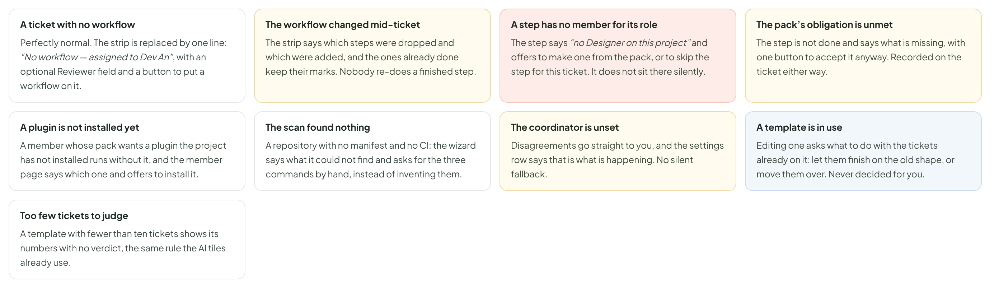

- Text in the frames: "A ticket with no workflow" · "Perfectly normal. The strip is replaced by one line: “No workflow — assigned to Dev An”, with an optional Reviewer field and a button to put a workflow on it." · "The workflow changed mid-ticket" · "The strip says which steps were dropped and which were added, and the ones already done keep their marks. Nobody re-does a finished step." · "A step has no member for its role" · "The step says “no Designer on this project” and offers to make one from the pack, or to skip the step for this ticket. It does not sit there silently." · "The pack’s obligation is unmet" · "The step is not done and says what is missing, with one button to accept it anyway. Recorded on the ticket either way." · "A plugin is not installed yet" · "A member whose pack wants a plugin the project has not installed runs without it, and the member page says which one and offers to install it." · "The scan found nothing" · "A repository with no manifest and no CI: the wizard says what it could not find and asks for the three commands by hand, instead of inventing them." · "The coordinator is unset" · "Disagreements go straight to you, and the settings row says that is what is happening. No silent fallback." · "A template is in use" · "Editing one asks what to do with the tickets already on it: let them finish on the old shape, or move them over. Never decided for you." · "Too few tickets to judge" · "A template with fewer than ten tickets shows its numbers with no verdict, the same rule the AI tiles already use."

---

## N. Where the data comes from, what is decided, and what is still open

The table is for whoever builds it. The two cards below separate what the design has settled from what only the experiments in section 4 of the plan can answer.

Source: [AiTeamProcess.dc.html](../source/AiTeamProcess.dc.html) › block "N. Where the data comes from, what is decided, and what is still open"

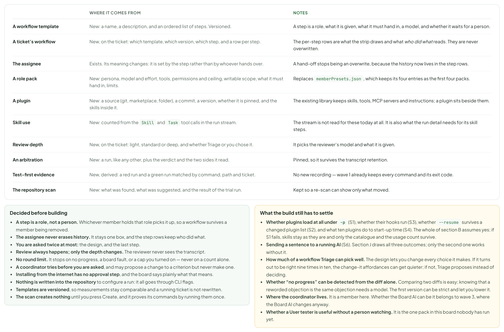

- Text in the frames: "WHERE IT COMES FROM" · "NOTES" · "A workflow template" · "New: a name, a description, and an ordered list of steps. Versioned." · "A step is a role, what it is given, what it must hand in, a model, and whether it waits for a person." · "A ticket’s workflow" · "New, on the ticket: which template, which version, which step, and a row per step." · "The per-step rows are what the strip draws and what who did what reads. They are never overwritten." · "The assignee" · "Exists. Its meaning changes: it is set by the step rather than by whoever hands over." · "A hand-off stops being an overwrite, because the history now lives in the step rows." · "A role pack" · "New: persona, model and effort, tools, permissions and ceiling, writable scope, what it must hand in, limits." · "Replaces memberPresets.json, which keeps its four entries as the first four packs." · "A plugin" · "New: a source (git, marketplace, folder), a commit, a version, whether it is pinned, and the skills inside it." · "The existing library keeps skills, tools, MCP servers and instructions; a plugin sits beside them." · "Skill use" · "New: counted from the Skill and Task tool calls in the run stream." · "The stream is not read for these today at all. It is also what the run detail needs for its skill steps." · "Review depth" · "New, on the ticket: light, standard or deep, and whether Triage or you chose it." · "It picks the reviewer’s model and what it is given." · "An arbitration" · "New: a run, like any other, plus the verdict and the two sides it read." · "Pinned, so it survives the transcript retention." · "Test-first evidence" · "New, derived: a red run and a green run matched by command, path and ticket." · "No new recording — wave 1 already keeps every command and its exit code." · "The repository scan" · "New: what was found, what was suggested, and the result of the trial run." · "Kept so a re-scan can show only what moved." · "Decided before building" · "A step is a role, not a person. Whichever member holds that role picks it up, so a workflow survives a member being removed." · "The assignee never erases history. It stays one box, and the step rows keep who did what." · "You are asked twice at most: the design, and the last step." · "Review always happens; only the depth changes. The reviewer never sees the transcript." · "No round limit. It stops on no progress, a board fault, or a cap you turned on — never on a count alone." · "A coordinator tries before you are asked, and may propose a change to a criterion but never make one." · "Installing from the internet has no approval step, and the board says plainly what that means." · "Nothing is written into the repository to configure a run: it all goes through CLI flags." · "Templates are versioned, so measurements stay comparable and a running ticket is not rewritten." · "The scan creates nothing until you press Create, and it proves its commands by running them once." · "What the build still has to settle" · "Whether plugins load at all under -p (S1), whether their hooks run (S3), whether --resume survives a changed plugin list (S2), and what ten plugins do to start-up time (S4). The whole of section B assumes yes; if S1 fails, skills stay as they are and only the catalogue and the usage count survive." · "Sending a sentence to a running AI (S6). Section J draws all three outcomes; only the second one works without it." · "How much of a workflow Triage can pick well. The design lets you change every choice it makes. If it turns out to be right nine times in ten, the change-it affordances can get quieter; if not, Triage proposes instead of deciding." · "Whether “no progress” can be detected from the diff alone. Comparing two diffs is easy; knowing that a reworded objection is the same objection needs a model. The first version can be strict and let you lower it." · "Where the coordinator lives. It is a member here. Whether the Board AI can be it belongs to wave 3, where the Board AI changes anyway." · "Whether a User tester is useful without a person watching. It is the one pack in this board nobody has run yet."
