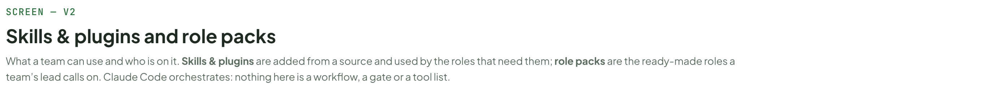
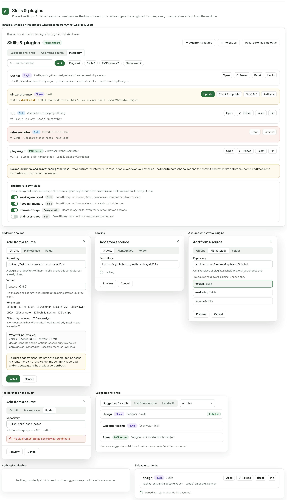
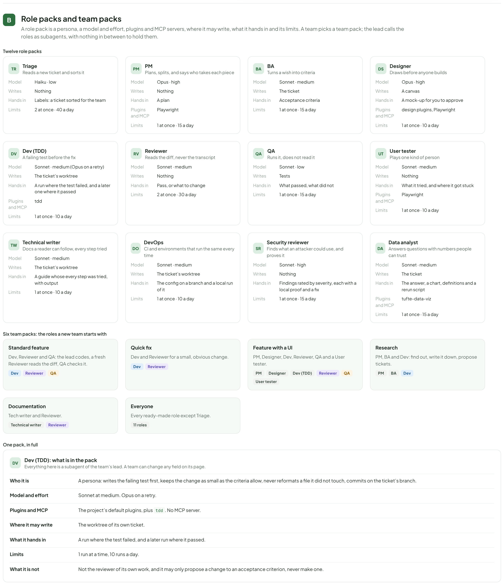
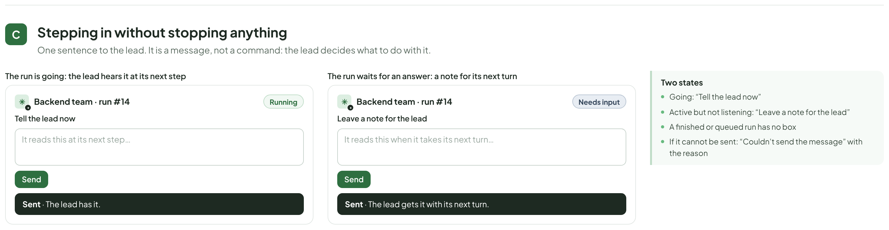

# AI team & process — skills and plugins, role packs, workflows, review, arbitration, TDD proof

> Redrawn for AI v2 · source: [`AiTeamProcess.dc.html`](../source/AiTeamProcess.dc.html) · canvas `1794099567-d725` · sha256 `7739685785347bdccf1238d8a0cea23c089e860e38e8b22df5069f0d0aa8c9a7`

> Words, states and conditions follow the code of branch `claude/ai-team-architecture-7a1efc`; the layout is designed here and is not the layout of the current screens. Names, ids, costs and times in the mock-ups are sample data. **Check the code before building from this: the file named in each part is the truth, not the picture.**

## SCREEN — V2

- Text in this part: "SCREEN — V2" · "Skills & plugins and role packs" · "What a team can use and who is on it. Skills & plugins are added from a source and used by the roles that need them; role packs are the ready-made roles a team’s lead calls on. Claude Code orchestrates: nothing here is a workflow, a gate or a tool list."

---

## Skills & plugins

- Text in this part: "A" · "Skills & plugins" · "Project settings › AI. What teams can use besides the board’s own tools. A team gets the plugins of its roles; every change takes effect from the next run." · "Installed: what is on this project, where it came from, what was really used" · "Kanban Board / Project settings / Settings › AI › Skills & plugins" · "Kanban Board" · "Add from a source" · "Reload all" · "Reset all to the catalogue" · "Suggested for a role" · "Installed 9" · "Search installed" · "All 9" · "Plugins 4" · "Skills 3" · "MCP servers 2" · "Never used 2" · "design" · "Plugin" · "7 skills, among them design-handoff and accessibility-review" · "Open" · "Reload" · "Reset" · "Unpin" · "v2.4.0 · pinned · updated 3 days ago" · "github.com/anthropics/skills" · "used 31 times by Designer" · "ui-ux-pro-max" · "1 skill" · "Update" · "Check for update" · "Pin v1.8.0" · "Roll back" · "v1.8.0 → v1.9.0 is out" · "github.com/nextlevelbuilder/ui-ux-pro-max-skill" · "used 12 times by Designer" · "tdd" · "Skill" · "Written here, in the project library" · "Pin" · "v3" · "board library" · "used 61 times by Dev" · "release-notes" · "Imported from a folder" · "Remove" · "v1 · 2 MB" · "~/tools/release-notes" · "never used" · "playwright" · "MCP server" · "A browser for the User tester" · "v0.4.2" · "claude code marketplace" · "used 19 times by User tester" · "No approval step, and no pretending otherwise. Installing from the internet runs other people’s code on your machine. The board records the source and the commit, shows the diff before an update, and keeps one button back to the version that worked." · "The board’s own skills" · "Every team gets the shared ones; a role’s own skill goes only to teams that have the role. Switch one off for the project here." · "working-a-ticket" · "Board library · on for every team · how to take, work and hand over a ticket" · "keeping-memory" · "Board library · on for every team · what to keep for later runs" · "canvas-design" · "Designer skill" · "Board library · on for every team · mock-ups on a canvas" · "end-user-eyes" · "Board library · on for nobody · test as a first-time user" · "Git URL" · "Marketplace" · "Folder" · "Repository" · "https://github.com/anthropics/skills" · "A plugin, or a repository of them. Public, or one this computer can already clone." · "Version" · "Latest · v2.4.0" · "Pin it to a tag or a commit and updates stop being offered until you unpin." · "Who gets it" · "☐ Triage" · "☐ PM" · "☐ BA" · "☑ Designer" · "☐ Dev (TDD)" · "☐ Reviewer" · "☐ QA" · "☑ User tester" · "☐ Technical writer" · "☐ DevOps" · "☐ Security reviewer" · "☐ Data analyst" · "Every team with that role gets it. Choosing nobody installs it and leaves it off." · "What will be installed" · "7 skills · 0 hooks · 0 MCP servers · 1.4 MB" · "design-handoff, design-critique, accessibility-review, ux-copy, design-system, user-research, research-synthesis" · "This runs code from the internet on this computer, inside the AI’s runs. There is no review step. The commit is recorded, and one button puts the previous version back." · "Install" · "Cancel" · "Looking" · "Looking…" · "Preview" · "A source with several plugins" · "anthropics/claude-plugins-official" · "A marketplace of plugins. If it holds several, you choose one." · "This source has several plugins. Choose one." · "design 7 skills" · "marketing 11 skills" · "finance 8 skills" · "A folder that is not a plugin" · "A folder with a plugin or a SKILL.md in it." · "No plugin, marketplace or skill was found there." · "All roles"

---

## Role packs and team packs

- Text in this part: "B" · "Role packs and team packs" · "A role pack is a persona, a model and effort, plugins and MCP servers, where it may write, what it hands in and its limits. A team picks a team pack; the lead calls the roles as subagents, with nothing in between to hold them." · "Twelve role packs" · "TR" · "Triage" · "Reads a new ticket and sorts it" · "Model" · "Haiku · low" · "Writes" · "Nothing" · "Hands in" · "Labels: a ticket sorted for the team" · "Limits" · "2 at once · 40 a day" · "PM" · "Plans, splits, and says who takes each piece" · "Opus · high" · "A plan" · "Plugins and MCP" · "Playwright" · "1 at once · 15 a day" · "BA" · "Turns a wish into criteria" · "Sonnet · medium" · "The ticket" · "Acceptance criteria" · "DS" · "Designer" · "Draws before anyone builds" · "A canvas" · "A mock-up for you to approve" · "design plugins, Playwright" · "1 at once · 10 a day" · "DV" · "Dev (TDD)" · "A failing test before the fix" · "Sonnet · medium (Opus on a retry)" · "The ticket’s worktree" · "A run where the test failed, and a later one where it passed" · "tdd" · "RV" · "Reviewer" · "Reads the diff, never the transcript" · "Pass, or what to change" · "2 at once · 30 a day" · "QA" · "Runs it, does not read it" · "Sonnet · low" · "Tests" · "What passed, what did not" · "UT" · "User tester" · "Plays one kind of person" · "What it tried, and where it got stuck" · "TW" · "Technical writer" · "Docs a reader can follow, every step tried" · "A guide whose every step was tried, with output" · "DO" · "DevOps" · "CI and environments that run the same every time" · "The config on a branch and a local run of it" · "SR" · "Security reviewer" · "Finds what an attacker could use, and proves it" · "Sonnet · high" · "Findings rated by severity, each with a local proof and a fix" · "DA" · "Data analyst" · "Answers questions with numbers people can trust" · "The answer, a chart, definitions and a rerun script" · "tufte-data-viz" · "Six team packs: the roles a new team starts with" · "Standard feature" · "Dev, Reviewer and QA: the lead codes, a fresh Reviewer reads the diff, QA checks it." · "Dev" · "Quick fix" · "Dev and Reviewer for a small, obvious change." · "Feature with a UI" · "PM, Designer, Dev, Reviewer, QA and a User tester." · "Research" · "PM, BA and Dev: find out, write it down, propose tickets." · "Documentation" · "Tech writer and Reviewer." · "Everyone" · "Every ready-made role except Triage." · "11 roles" · "One pack, in full" · "Dev (TDD): what is in the pack" · "Everything here is a subagent of the team’s lead. A team can change any field on its page." · "Who it is" · "A persona: writes the failing test first, keeps the change as small as the criteria allow, never reformats a file it did not touch, commits on the ticket’s branch." · "Model and effort" · "Sonnet at medium. Opus on a retry." · "The project’s default plugins, plus tdd. No MCP server." · "Where it may write" · "The worktree of its own ticket." · "What it hands in" · "A run where the test failed, and a later run where it passed." · "1 run at a time, 10 runs a day." · "What it is not" · "Not the reviewer of its own work, and it may only propose a change to an acceptance criterion, never make one."

---

## Stepping in without stopping anything

- Text in this part: "C" · "Stepping in without stopping anything" · "One sentence to the lead. It is a message, not a command: the lead decides what to do with it." · "The run is going: the lead hears it at its next step" · "Backend team · run #14" · "Running" · "Tell the lead now" · "It reads this at its next step…" · "Send" · "Sent · The lead has it." · "The run waits for an answer: a note for its next turn" · "Needs input" · "Leave a note for the lead" · "It reads this when it takes its next turn…" · "Sent · The lead gets it with its next turn." · "Two states" · "Going: “Tell the lead now”" · "Active but not listening: “Leave a note for the lead”" · "A finished or queued run has no box" · "If it cannot be sent: “Couldn’t send the message” with the reason"

---

Rows, differences from the code and open points for this group are in [ai-operations.md](ai-operations.md).
