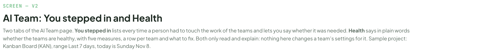
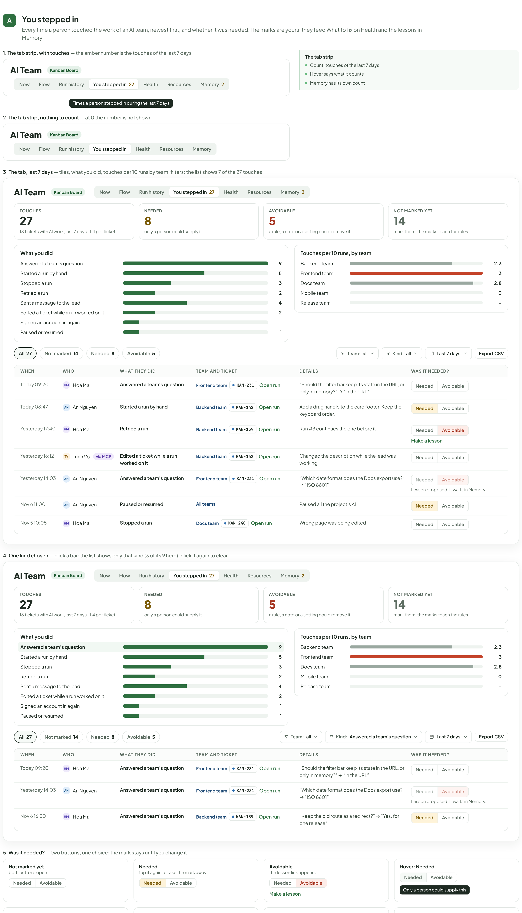
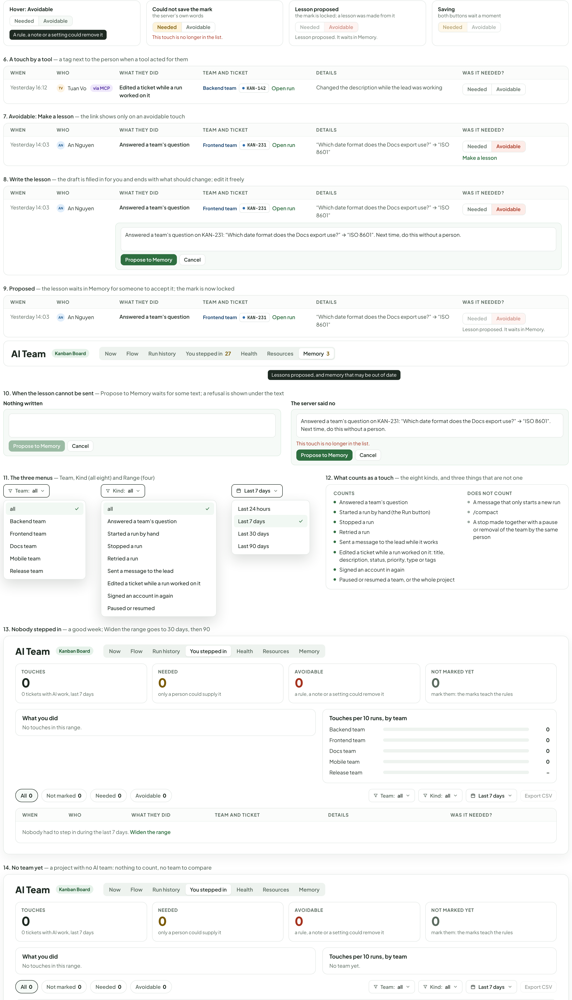
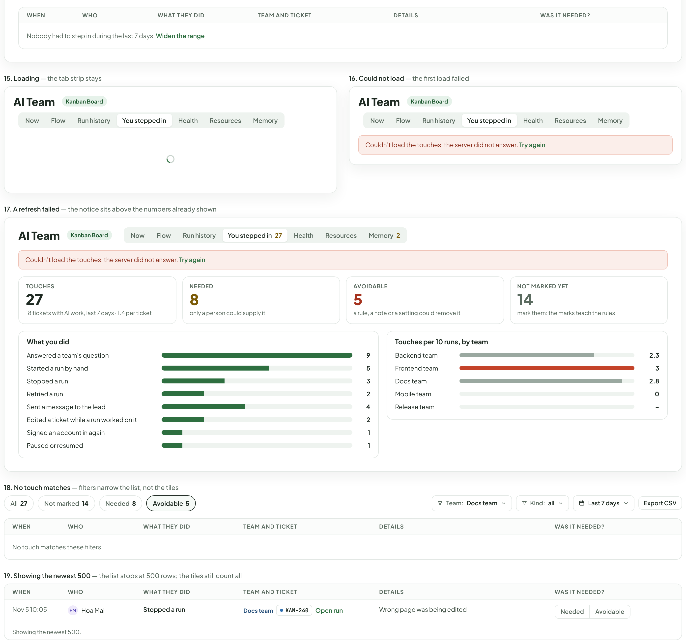
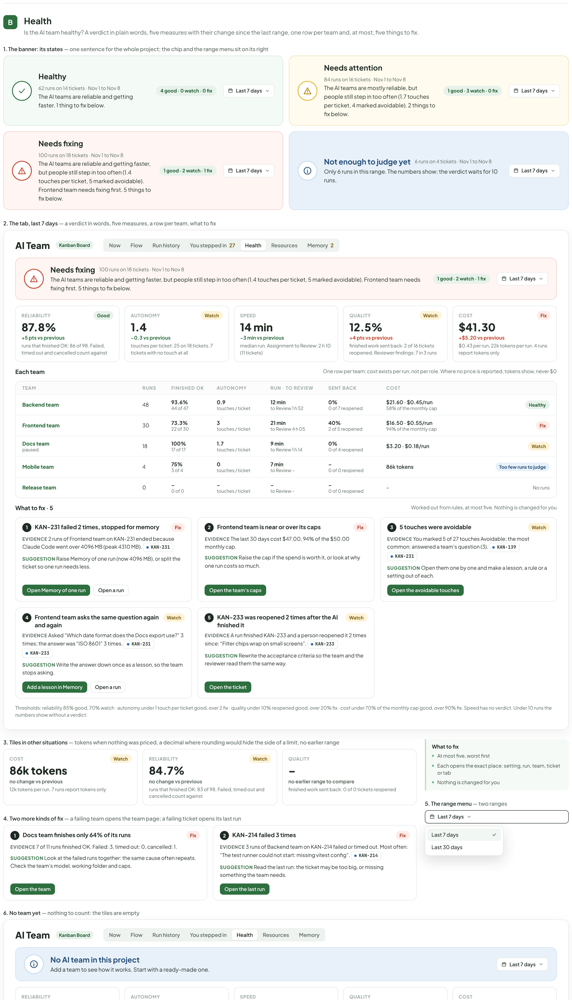
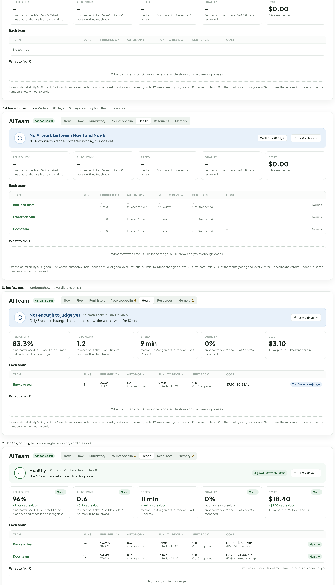
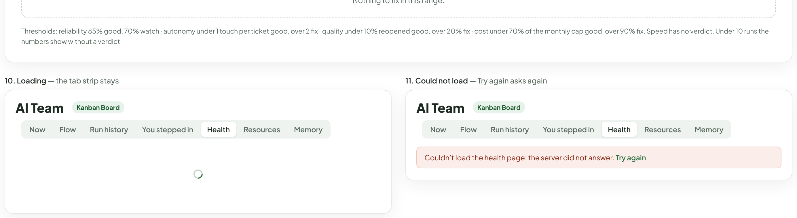
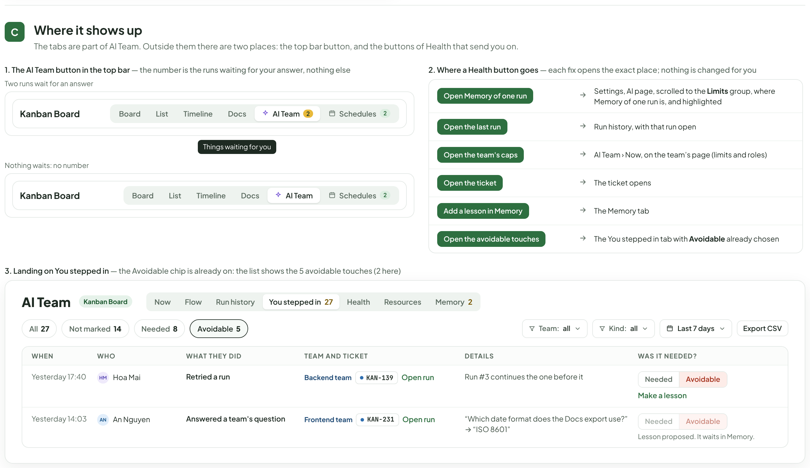
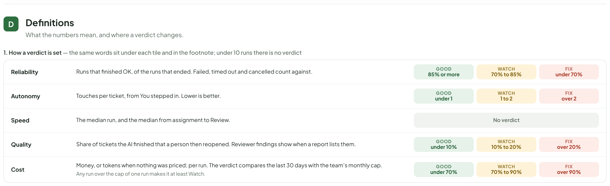

# AI Team — where people stepped in, and AI health

> Redrawn for AI v2 · source: [`AiTeamReview.dc.html`](../source/AiTeamReview.dc.html) · canvas `1794110641-1323` · sha256 `9cac6f11a15d15c35157b7e87f61e7cb3492324890eea30a19a0481d5210379e`

> Words, states and conditions follow the code of branch `claude/ai-team-architecture-7a1efc`; the layout is designed here and is not the layout of the current screens. Names, ids, costs and times in the mock-ups are sample data. **Check the code before building from this: the file named in each part is the truth, not the picture.**

## SCREEN — V2

- Text in this part: "SCREEN — V2" · "AI Team: You stepped in and Health" · "Two tabs of the AI Team page. You stepped in lists every time a person had to touch the work of the teams and lets you say whether it was needed. Health says in plain words whether the teams are healthy, with five measures, a row per team and what to fix. Both only read and explain: nothing here changes a team’s settings for it. Sample project: Kanban Board (KAN), range Last 7 days, today is Sunday Nov 8."

---

## You stepped in

- Text in this part: "A" · "You stepped in" · "Every time a person touched the work of an AI team, newest first, and whether it was needed. The marks are yours: they feed What to fix on Health and the lessons in Memory." · "1. The tab strip, with touches — the amber number is the touches of the last 7 days" · "AI Team" · "Kanban Board" · "Now" · "Flow" · "Run history" · "27" · "Health" · "Resources" · "Memory" · "2" · "Times a person stepped in during the last 7 days" · "2. The tab strip, nothing to count — at 0 the number is not shown" · "The tab strip" · "Count: touches of the last 7 days" · "Hover says what it counts" · "Memory has its own count" · "3. The tab, last 7 days — tiles, what you did, touches per 10 runs by team, filters; the list shows 7 of the 27 touches" · "TOUCHES" · "18 tickets with AI work, last 7 days · 1.4 per ticket" · "NEEDED" · "8" · "only a person could supply it" · "AVOIDABLE" · "5" · "a rule, a note or a setting could remove it" · "NOT MARKED YET" · "14" · "mark them: the marks teach the rules" · "What you did" · "Answered a team's question" · "9" · "Started a run by hand" · "Stopped a run" · "3" · "Retried a run" · "Sent a message to the lead" · "4" · "Edited a ticket while a run worked on it" · "Signed an account in again" · "1" · "Paused or resumed" · "Touches per 10 runs, by team" · "Backend team" · "2.3" · "Frontend team" · "Docs team" · "2.8" · "Mobile team" · "0" · "Release team" · "–" · "All" · "Not marked" · "Needed" · "Avoidable" · "Team:" · "all" · "Kind:" · "Last 7 days" · "Export CSV" · "WHEN" · "WHO" · "WHAT THEY DID" · "TEAM AND TICKET" · "DETAILS" · "WAS IT NEEDED?" · "Today 09:20" · "HM" · "Hoa Mai" · "KAN-231" · "Open run" · "“Should the filter bar keep its state in the URL, or only in memory?” → “In the URL”" · "Today 08:47" · "AN" · "An Nguyen" · "KAN-142" · "Add a drag handle to the card footer. Keep the keyboard order." · "Yesterday 17:40" · "KAN-139" · "Run #3 continues the one before it" · "Make a lesson" · "Yesterday 16:12" · "TV" · "Tuan Vo" · "via MCP" · "Changed the description while the lead was working" · "Yesterday 14:03" · "“Which date format does the Docs export use?” → “ISO 8601”" · "Lesson proposed. It waits in Memory." · "Nov 6 11:00" · "All teams" · "Paused all the project's AI" · "Nov 5 10:05" · "KAN-240" · "Wrong page was being edited" · "4. One kind chosen — click a bar: the list shows only that kind (3 of its 9 here); click it again to clear" · "Nov 6 16:30" · "“Keep the old route as a redirect?” → “Yes, for one release”" · "5. Was it needed? — two buttons, one choice; the mark stays until you change it" · "Not marked yet" · "both buttons open" · "tap it again to take the mark away" · "the lesson link appears" · "Hover: Needed" · "Only a person could supply this" · "Hover: Avoidable"

---

## Health

- Text in this part: "B" · "Health" · "Is the AI team healthy? A verdict in plain words, five measures with their change since the last range, one row per team and, at most, five things to fix." · "1. The banner: its states — one sentence for the whole project; the chip and the range menu sit on its right" · "Healthy" · "62 runs on 14 tickets · Nov 1 to Nov 8" · "The AI teams are reliable and getting faster. 1 thing to fix below." · "4 good · 0 watch · 0 fix" · "Last 7 days" · "Needs attention" · "84 runs on 16 tickets · Nov 1 to Nov 8" · "The AI teams are mostly reliable, but people still step in too often (1.7 touches per ticket, 4 marked avoidable). 2 things to fix below." · "1 good · 3 watch · 0 fix" · "Needs fixing" · "100 runs on 18 tickets · Nov 1 to Nov 8" · "The AI teams are reliable and getting faster, but people still step in too often (1.4 touches per ticket, 5 marked avoidable). Frontend team needs fixing first. 5 things to fix below." · "1 good · 2 watch · 1 fix" · "Not enough to judge yet" · "6 runs on 4 tickets · Nov 1 to Nov 8" · "Only 6 runs in this range. The numbers show; the verdict waits for 10 runs." · "2. The tab, last 7 days — a verdict in words, five measures, a row per team, what to fix" · "AI Team" · "Kanban Board" · "Now" · "Flow" · "Run history" · "You stepped in" · "27" · "Resources" · "Memory" · "2" · "RELIABILITY" · "Good" · "87.8%" · "+5 pts vs previous" · "runs that finished OK: 86 of 98. Failed, timed out and cancelled count against" · "AUTONOMY" · "Watch" · "1.4" · "−0.3 vs previous" · "touches per ticket: 25 on 18 tickets. 7 tickets with no touch at all" · "SPEED" · "14 min" · "−3 min vs previous" · "median run. Assignment to Review: 2 h 10 (11 tickets)" · "QUALITY" · "12.5%" · "+4 pts vs previous" · "finished work sent back: 2 of 16 tickets reopened. Reviewer findings: 7 in 3 runs" · "COST" · "Fix" · "$41.30" · "+$5.20 vs previous" · "$0.43 per run, 22k tokens per run. 4 runs report tokens only" · "Each team" · "One row per team: cost exists per run, not per role. Where no price is reported, tokens show, never $0" · "TEAM" · "RUNS" · "FINISHED OK" · "RUN · TO REVIEW" · "SENT BACK" · "Backend team" · "48" · "93.6%" · "44 of 47" · "0.9" · "touches / ticket" · "12 min" · "to Review 1 h 52" · "0%" · "0 of 7 reopened" · "$21.60 · $0.45/run" · "58% of the monthly cap" · "Frontend team" · "30" · "73.3%" · "22 of 30" · "3" · "21 min" · "to Review 4 h 05" · "40%" · "2 of 5 reopened" · "$16.50 · $0.55/run" · "94% of the monthly cap" · "Docs team" · "paused" · "18" · "100%" · "17 of 17" · "1.7" · "9 min" · "to Review 1 h 14" · "0 of 4 reopened" · "$3.20 · $0.18/run" · "Mobile team" · "4" · "75%" · "3 of 4" · "0" · "7 min" · "to Review –" · "–" · "0 of 0 reopened" · "86k tokens" · "Too few runs to judge" · "Release team" · "0 of 0" · "No runs" · "What to fix · 5" · "Worked out from rules, at most five. Nothing is changed for you"

---

## Where it shows up

- Text in this part: "C" · "Where it shows up" · "The tabs are part of AI Team. Outside them there are two places: the top bar button, and the buttons of Health that send you on." · "1. The AI Team button in the top bar — the number is the runs waiting for your answer, nothing else" · "Two runs wait for an answer" · "Kanban Board" · "Board" · "List" · "Timeline" · "Docs" · "AI Team" · "2" · "Schedules" · "Things waiting for you" · "Nothing waits: no number" · "2. Where a Health button goes — each fix opens the exact place; nothing is changed for you" · "Open Memory of one run" · "Settings, AI page, scrolled to the Limits group, where Memory of one run is, and highlighted" · "Open the last run" · "Run history, with that run open" · "Open the team's caps" · "AI Team › Now, on the team’s page (limits and roles)" · "Open the ticket" · "The ticket opens" · "Add a lesson in Memory" · "The Memory tab" · "Open the avoidable touches" · "The You stepped in tab with Avoidable already chosen" · "3. Landing on You stepped in — the Avoidable chip is already on: the list shows the 5 avoidable touches (2 here)" · "Now" · "Flow" · "Run history" · "You stepped in" · "27" · "Health" · "Resources" · "Memory" · "All" · "Not marked" · "14" · "Needed" · "8" · "Avoidable" · "5" · "Team:" · "all" · "Kind:" · "Last 7 days" · "Export CSV" · "WHEN" · "WHO" · "WHAT THEY DID" · "TEAM AND TICKET" · "DETAILS" · "WAS IT NEEDED?" · "Yesterday 17:40" · "HM" · "Hoa Mai" · "Retried a run" · "Backend team" · "KAN-139" · "Open run" · "Run #3 continues the one before it" · "Make a lesson" · "Yesterday 14:03" · "AN" · "An Nguyen" · "Answered a team's question" · "Frontend team" · "KAN-231" · "“Which date format does the Docs export use?” → “ISO 8601”" · "Lesson proposed. It waits in Memory."

---

## Definitions

- Text in this part: "D" · "Definitions" · "What the numbers mean, and where a verdict changes." · "1. How a verdict is set — the same words sit under each tile and in the footnote; under 10 runs there is no verdict" · "Reliability" · "Runs that finished OK, of the runs that ended. Failed, timed out and cancelled count against." · "GOOD" · "85% or more" · "WATCH" · "70% to 85%" · "FIX" · "under 70%" · "Autonomy" · "Touches per ticket, from You stepped in. Lower is better." · "under 1" · "1 to 2" · "over 2" · "Speed" · "The median run, and the median from assignment to Review." · "No verdict" · "Quality" · "Share of tickets the AI finished that a person then reopened. Reviewer findings show when a report lists them." · "under 10%" · "10% to 20%" · "over 20%" · "Cost" · "Money, or tokens when nothing was priced; per run. The verdict compares the last 30 days with the team’s monthly cap." · "Any run over the cap of one run makes it at least Watch." · "70% to 90%" · "over 90%"

---

## Todo rows, differences from the code, and what was not checked

Width 1480, finalH 10615. A You stepped in 17 frames, B Health 9, C Where it shows up 3 (AI Team badge, where each Health button lands, landing on You stepped in with Avoidable chosen), D Definitions 1.
Rows drawn: A-146, A-209, A-210, B-54, B-55, A-211 C/D/E. Left out (not checked in the code): ticket line, card chip, profile link, digest, kill switch, viewer role, connection states.
Code vs todo: empty state in code "Nobody had to step in last 7 days." (drawn "during the last 7 days"); code "Too few runs to judge", todo "Too few runs" (code used); "via MCP" only on edit / sign-in / pause touches (drawn on an edit row); tile hint "the marks teach the rules" is stale in code (drawn as code); code typo "1 tickets with no touch at all" (drawn once as is).
Drawn differently from code: lesson draft as a panel spanning the row (code: textarea in 250 px column); added a full stop in the draft; row highlight for the chosen kind; avatars for people; ticket chip and Open run on one line.
Drawn from code text only: everything (app not run). Sample numbers invented but consistent.
Not checked: that a row opens its run, keyboard use, narrow table layout, server error wording.

### Review

The canvas was read once by an independent reviewer subagent that got the result and the todo rows, not the builder's conclusions; the findings were fixed except where noted above. The reviewer was not run again after the fixes. The app was not run.
