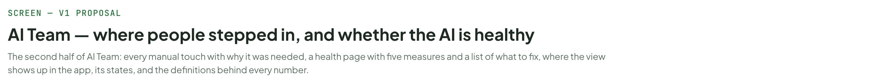
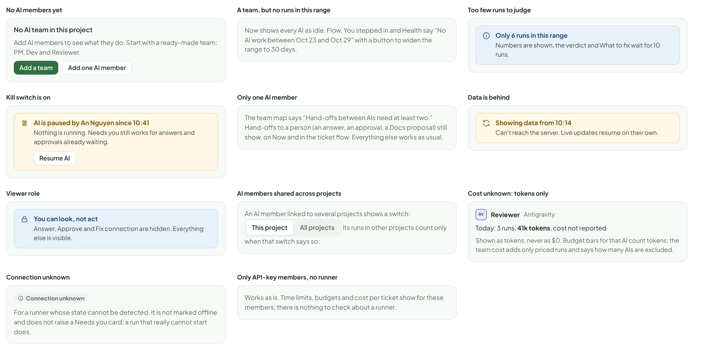
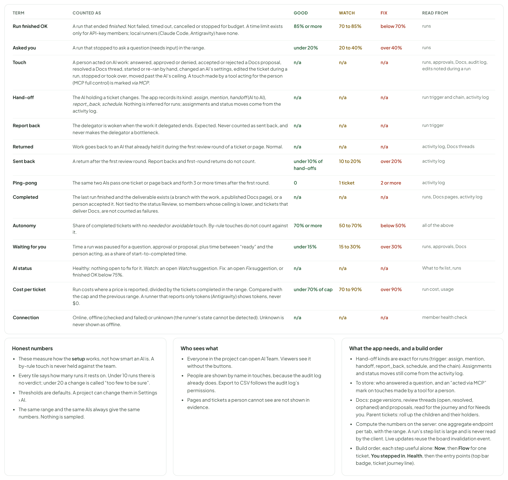

# AI Team — where people stepped in, and whether the AI is healthy

> SCREEN — V1 PROPOSAL · source: [`AiTeamReview.dc.html`](../source/AiTeamReview.dc.html) · canvas `1793385597-3e85` · sha256 `219e98bfad98403ca608652c7ffad5a15086987df5c3a4b4f41a195c63abbb54`

The second half of AI Team: every manual touch with why it was needed, a health page with five measures and a list of what to fix, where the view shows up in the app, its states, and the definitions behind every number.

Source: [AiTeamReview.dc.html](../source/AiTeamReview.dc.html) › header ("SCREEN — V1 PROPOSAL", "AI Team — where people stepped in, and whether the AI is healthy" and the intro)

---

## A. You stepped in: every manual touch, and which ones were needed

Every time a person had to act, in order, with the AI and ticket it was about. Each touch carries one of three marks. By rule: the project is set up to ask for it (approvals, Done). Needed: only a person had the information or judgement. Avoidable: a setting, a note in the instructions or an automatic retry would have removed it. These marks are the answer to “how autonomous is the team”, and each one says why. Click a row to open the run, the approval, the Docs page or the audit entry behind it. When a tool acts for a person through MCP (Settings › Integrations, full control), the touch shows a via MCP mark beside the person. It counts as that person’s touch and can be filtered, so a person’s own touch and a tool’s touch on their behalf can be told apart.

Source: [AiTeamReview.dc.html](../source/AiTeamReview.dc.html) › block "A. You stepped in: every manual touch, and which ones were needed"

![A. You stepped in: every manual touch, and which ones were needed: Every time a person had to act, in order, with the AI and ticket it was about. Each touch carries one of three marks. By rule: the project is set up to ask for it (approvals, Done). Needed: only a person had the information or judgement. Avoidable: a setting, a note in the instructions or an automatic retry would have removed it. These marks are the answer to “how autonomous is the team”, and each one says why. Click a row to open the run, the approval, the Docs page or the audit entry behind it. When a tool acts for a person through MCP (Settings › Integrations, full control), the touch shows a via MCP mark beside the person. It counts as that person’s touch and can be filtered, so a person’s own touch and a tool’s touch on their behalf can be told apart.](../images/ai-team-review/02-a-you-stepped-in-every-manual-touch-and-which-on.png)

- Text in the frames: "KANBAN" · "PROJECTS" · "Kanban Board" · "KAN" · "Mobile App" · "MOB" · "Marketing Site" · "MKT" · "Settings" · "Members" · "4 · 7 AI" · "Recycle Bin" · "3" · "Board" · "List" · "Timeline" · "Docs" · "AI Team" · "4" · "Pause all AI" · "New Ticket" · "Now" · "Flow" · "You stepped in" · "27" · "Health" · "Last 7 days" · "TOUCHES" · "18 tickets, last 7 days · 1.5 per ticket" · "BY RULE" · "14" · "approvals and Done, as configured" · "NEEDED" · "8" · "only a person could supply it" · "AVOIDABLE" · "5" · "could be removed by a setting" · "What you did" · "■ by rule ■ needed ■ avoidable" · "Approved or denied" · "9" · "Accepted or rejected a Docs proposal" · "2" · "Moved to Done, past what the AI may do" · "Answered a question" · "6" · "Resolved a Docs review thread" · "Edited the ticket while an AI worked" · "1" · "Started or re-ran a run by hand" · "Stopped or took over a run" · "Changed an AI’s settings" · "Touches per 10 runs, by AI" · "PM" · "1.4" · "BA" · "3.6" · "DS" · "Designer" · "1.3" · "DV" · "Dev" · "3.9" · "TS" · "Tester" · "1.7" · "RV" · "Reviewer" · "1.1" · "Dev has the most touches (12 of 27): approvals, and re-runs after timeouts." · "All" · "Avoidable" · "Needed" · "By rule" · "Via MCP" · "AI: all" · "Person: all" · "Export CSV" · "WHEN" · "WHO" · "WHAT THEY DID" · "AI AND TICKET" · "DETAILS AND WHY" · "KIND" · "Today 09:20" · "HM" · "Hoa Mai" · "KAN-211" · "“Which environment?” → “staging”" · "The 3rd time Tester asked this, with the same answer each time." · "Today 10:02" · "Accepted a proposal" · "KAN-213" · "Accepted 2 of 3 changes to the page UX design" · "Rule: Edit docs needs approval, with a diff." · "Today 09:05" · "AN" · "An Nguyen" · "Approved" · "KAN-209" · "Change assignee to Tester when done" · "Rule: change assignee needs approval. 9 of 9 approved this week." · "Yesterday 17:40" · "via MCP" · "Re-ran by hand" · "KAN-207" · "Started a new run after a rate limit, from a tool acting for Hoa Mai" · "The limit lasted 3 minutes. An automatic retry would have done it." · "Yesterday 16:12" · "Changed settings" · "Run time limit 30 → 60 min" · "2 of 12 Dev runs had timed out at 30 min." · "Yesterday 14:40" · "LP" · "Linh Pham" · "Resolved 2 threads" · "KAN-222" · "Review threads on Technical design, fixed in v2" · "Only a person can close a thread." · "Yesterday 14:03" · "Edited the ticket" · "Changed the description while Designer was drawing" · "Designer saw the change and adjusted (noted in the run)." · "Oct 28 13:10" · "Moved to Done" · "KAN-210" · "Reviewer approved; AIs may only go up to Review" · "Rule: the ceiling for AI members is Review." · "Oct 28 11:00" · "Raised the limit to 60 min and ran again" · "The first run timed out at 30 min with 3 of 5 criteria done." · "Oct 28 10:05" · "Change assignee to Designer" · "Rule: change assignee needs approval." · "Oct 28 09:31" · "“Show cost for Ask-only runs too.”" · "Not written anywhere the AI could read. Only a person knew." · "Oct 27 15:22" · "Stopped a run"

---

## B. Health: is the AI feature working?

One page that says whether the AI team is healthy, in plain words first, then in numbers. Five measures: reliability (does it run), autonomy (how much does it do alone), speed, quality (how often work is sent back) and cost. Below, a row per AI, and a short list of what to fix, each with the evidence behind it and a button that opens the exact setting. Nothing is changed for you.

Source: [AiTeamReview.dc.html](../source/AiTeamReview.dc.html) › block "B. Health: is the AI feature working?"

- Text in the frames: "KANBAN" · "PROJECTS" · "Kanban Board" · "KAN" · "Mobile App" · "MOB" · "Marketing Site" · "MKT" · "Settings" · "Members" · "4 · 7 AI" · "Recycle Bin" · "3" · "Board" · "List" · "Timeline" · "Docs" · "AI Team" · "4" · "Pause all AI" · "New Ticket" · "Now" · "Flow" · "You stepped in" · "27" · "Health" · "Last 7 days" · "Needs attention" · "118 runs on 18 tickets · Oct 23 to Oct 29" · "The team is reliable and getting faster, but people still step in too often. 5 of the 27 touches were avoidable, Tester keeps asking the same question, and Reviewer is blocked from commenting on Docs pages." · "2 measures good · 3 watch · 0 fix" · "How this is decided" · "RELIABILITY" · "Good" · "89%" · "+3 pts vs last week" · "runs that finished OK: 105 of 118" · "AUTONOMY" · "Watch" · "61%" · "+8 pts vs last week" · "tickets completed with no needed or avoidable touch: 11 of 18. Goal 70%" · "SPEED" · "3 h 40" · "−35 min vs last week" · "median, start to completed. 27% of it waiting for you" · "QUALITY" · "13%" · "+2 pts vs last week" · "hand-offs sent back: 9 of 68. Report backs and first review rounds are not counted" · "COST" · "$41.30" · "−$3.20 vs last week" · "$2.29 per ticket on priced runs. Reviewer reports tokens only. 24% of the $175 cap" · "Each AI" · "Compared with the previous 7 days. Where a runner reports no dollars, tokens are shown, never $0" · "AI" · "RUNS" · "FINISHED OK" · "ASKED YOU" · "TOUCHES /10 RUNS" · "AVG RUN" · "COST /TICKET" · "SENT BACK TO IT" · "PM" · "22" · "100%" · "1 (5%)" · "1.4" · "6 min" · "$0.09" · "0" · "BA" · "14" · "86%" · "2 (14%)" · "3.6" · "11 min" · "$0.31" · "Healthy" · "DS" · "Designer" · "8" · "88%" · "1.3" · "14 min" · "$0.52" · "DV" · "Dev" · "31" · "84%" · "1 (3%)" · "3.9" · "21 min" · "$0.98" · "9" · "TS" · "Tester" · "24" · "92%" · "3 (13%)" · "1.7" · "9 min" · "$0.21" · "RV" · "Reviewer" · "19" · "1.1" · "8 min" · "118k tokens" · "Fix" · "What to fix · 8" · "Worked out from rules, shown only with 3 or more cases" · "1" · "Reviewer is refused “Edit docs” again and again" · "EVIDENCE 10 refusals in 3 runs, all while trying to post a comment on a Docs page. 3 runs ended blocked." · "KAN-222 #4" · "KAN-223 #2" · "+1" · "SUGGESTION The Reviewer template should be able to comment on Docs without editing. Allow commenting for Reviewer, or move it to the Reviewer template." · "Open Reviewer permissions" · "Dismiss" · "2" · "Tester asks the same question again and again" · "EVIDENCE Asked “Which environment?” 3 times and got “staging” each time. Each one waited a median 38 min." · "SUGGESTION Put the answer in Tester’s instructions. You confirm before anything is saved." · "TEXT TO ADD TO TESTER’S INSTRUCTIONS" · "“Test against the staging environment unless the ticket names another one.”" · "Review the change" · "KAN-207 was sent back 3 times" · "EVIDENCE After the first review round it went back to Dev three more times. Criterion 4, “works on slow networks”, was read differently by each." · "SUGGESTION Rewrite the criterion with a number, and have BA check it. Then run once more." · "Open the ticket flow" · "PM’s assignee approvals are always approved, fast" · "EVIDENCE 9 of 9 approved, median 1 min 40 s. None denied. About 9 touches a week." · "SUGGESTION You could change “change assignee” for PM from Needs approval to Allowed. This lowers a safety check, so it is your call; the suggestion is never applied for you." · "Open PM permissions" · "Keep as is" · "5" · "The same tool error, run after run"

---

## C. Where it shows up in the app

One new place, linked from the places people already look. Nothing that exists today moves or is replaced: Inbox, Usage, the Audit log and the run view stay as the detail, and AI Team is the overview that ties them together.

Source: [AiTeamReview.dc.html](../source/AiTeamReview.dc.html) › block "C. Where it shows up in the app"

- Text in the frames: "1. The project top bar" · "Board" · "List" · "Timeline" · "Docs" · "AI Team" · "4" · "4 need you: 1 question, 1 approval, 1 offline, 1 budget" · "The number is what waits for you, not what is running. Grey when nothing waits." · "2. On the ticket page: its AI journey in one line" · "KAN-210" · "Show cost on run cards" · "PM" · "BA" · "DS" · "DV" · "TS" · "RV" · "9 runs · 4 h 08 · $2.06 · you stepped in 4 times" · "Open the flow" · "3. On a ticket card" · "KAN-212" · "Cost estimate on the card" · "Working" · "click: its journey" · "The AI chip already in the card footer opens the ticket’s flow instead of only the run." · "4. From the AI member, a notification and the digest" · "Member profile › Overview: See Dev in AI Team opens Health filtered to Dev." · "Notification “BA is asking a question”: opens Now with that card highlighted." · "Docs page: the banner “Designer proposed 2 changes” and the card in Needs you open the same review." · "Daily digest line: Yesterday: 23 runs, 4 touches, $6.84. 1 thing to fix." · "5. What stays where it is" · "Inbox (approvals, questions)" · "Still where you act. Needs you links to them." · "Usage and budgets" · "Still where limits are set. Cost tiles link to it." · "Audit log" · "Still the full record. Each touch links to its entry." · "Run view" · "Still the detail of one run. Every bar opens it."

---

## D. States

Source: [AiTeamReview.dc.html](../source/AiTeamReview.dc.html) › block "D. States"

- Text in the frames: "No AI members yet" · "No AI team in this project" · "Add AI members to see what they do. Start with a ready-made team: PM, Dev and Reviewer." · "Add a team" · "Add one AI member" · "A team, but no runs in this range" · "Now shows every AI as idle. Flow, You stepped in and Health say “No AI work between Oct 23 and Oct 29” with a button to widen the range to 30 days." · "Too few runs to judge" · "Only 6 runs in this range" · "Numbers are shown, the verdict and What to fix wait for 10 runs." · "Kill switch is on" · "AI is paused by An Nguyen since 10:41" · "Nothing is running. Needs you still works for answers and approvals already waiting." · "Resume AI" · "Only one AI member" · "The team map says “Hand-offs between AIs need at least two.” Hand-offs to a person (an answer, an approval, a Docs proposal) still show, on Now and in the ticket flow. Everything else works as usual." · "Data is behind" · "Showing data from 10:14" · "Can’t reach the server. Live updates resume on their own." · "Viewer role" · "You can look, not act" · "Answer, Approve and Fix connection are hidden. Everything else is visible." · "AI members shared across projects" · "An AI member linked to several projects shows a switch:" · "This project" · "All projects" · "Its runs in other projects count only when that switch says so." · "Cost unknown: tokens only" · "RV" · "Reviewer" · "Antigravity" · "Today: 3 runs, 41k tokens, cost not reported" · "Shown as tokens, never as $0. Budget bars for that AI count tokens; the team cost adds only priced runs and says how many AIs are excluded." · "Connection unknown" · "For a runner whose state cannot be detected. It is not marked offline and does not raise a Needs you card; a run that really cannot start does." · "Only API-key members, no runner" · "Works as is. Time limits, budgets and cost per ticket show for these members; there is nothing to check about a runner."

---

## E. Definitions, and what the app needs

Every number is defined once, here, so that two people reading the same screen agree on what it means. The three colours are defaults.

Source: [AiTeamReview.dc.html](../source/AiTeamReview.dc.html) › block "E. Definitions, and what the app needs"

- Text in the frames: "TERM" · "COUNTED AS" · "GOOD" · "WATCH" · "FIX" · "READ FROM" · "Run finished OK" · "A run that ended finished. Not failed, timed out, cancelled or stopped for budget. A time limit exists only for API-key members; local runners (Claude Code, Antigravity) have none." · "85% or more" · "70 to 85%" · "below 70%" · "runs" · "Asked you" · "A run that stopped to ask a question (needs input) in the range." · "under 20%" · "20 to 40%" · "over 40%" · "Touch" · "A person acted on AI work: answered, approved or denied, accepted or rejected a Docs proposal, resolved a Docs thread, started or re-ran by hand, changed an AI’s settings, edited the ticket during a run, stopped or took over, moved past the AI’s ceiling. A touch made by a tool acting for the person (MCP full control) is marked via MCP." · "n/a" · "runs, approvals, Docs, audit log, edits noted during a run" · "Hand-off" · "The AI holding a ticket changes. The app records its kind: assign, mention, handoff (AI to AI), report_back, schedule. Nothing is inferred for runs; assignments and status moves come from the activity log." · "run trigger and chain, activity log" · "Report back" · "The delegator is woken when the work it delegated ends. Expected. Never counted as sent back, and never makes the delegator a bottleneck." · "run trigger" · "Returned" · "Work goes back to an AI that already held it during the first review round of a ticket or page. Normal." · "activity log, Docs threads" · "Sent back" · "A return after the first review round. Report backs and first-round returns do not count." · "under 10% of hand-offs" · "10 to 20%" · "over 20%" · "activity log" · "Ping-pong" · "The same two AIs pass one ticket or page back and forth 3 or more times after the first round." · "0" · "1 ticket" · "2 or more" · "Completed" · "The last run finished and the deliverable exists (a branch with the work, a published Docs page), or a person accepted it. Not tied to the status Review, so members whose ceiling is lower, and tickets that deliver Docs, are not counted as failures." · "runs, Docs pages, activity log" · "Autonomy" · "Share of completed tickets with no needed or avoidable touch. By-rule touches do not count against it." · "70% or more" · "50 to 70%" · "below 50%" · "all of the above" · "Waiting for you" · "Time a run was paused for a question, approval or proposal, plus time between “ready” and the person acting, as a share of start-to-completed time." · "under 15%" · "15 to 30%" · "over 30%" · "runs, approvals, Docs" · "AI status" · "Healthy: nothing open to fix for it. Watch: an open Watch suggestion. Fix: an open Fix suggestion, or finished OK below 75%." · "What to fix list, runs" · "Cost per ticket" · "Run costs where a price is reported, divided by the tickets completed in the range. Compared with the cap and the previous range. A runner that reports only tokens (Antigravity) shows tokens, never $0." · "under 70% of cap" · "70 to 90%" · "over 90%" · "run cost, usage" · "Connection" · "Online, offline (checked and failed) or unknown (the runner’s state cannot be detected). Unknown is never shown as offline." · "member health check" · "Honest numbers" · "These measure how the setup works, not how smart an AI is. A by-rule touch is never held against the team." · "Every tile says how many runs it rests on. Under 10 runs there is no verdict; under 20 a change is called “too few to be sure”." · "Thresholds are defaults. A project can change them in Settings › AI." · "The same range and the same AIs always give the same numbers. Nothing is sampled." · "Who sees what" · "Everyone in the project can open AI Team. Viewers see it without the buttons." · "People are shown by name in touches, because the audit log already does. Export to CSV follows the audit log’s permissions." · "Pages and tickets a person cannot see are not shown in evidence." · "What the app needs, and a build order" · "Hand-off kinds are exact for runs (trigger: assign, mention, handoff, report_back, schedule, and the chain). Assignments and status moves still come from the activity log." · "To store: who answered a question, and an “acted via MCP” mark on touches made by a tool for a person." · "Docs: page versions, review threads (open, resolved, orphaned) and proposals, read for the journey and for Needs you. Parent tickets: roll up the children and their holders." · "Compute the numbers on the server: one aggregate endpoint per tab, with the range. A run’s step list is large and is never read by the client. Live updates reuse the board invalidation event." · "Build order, each step useful alone: Now, then Flow for one ticket, You stepped in, Health, then the entry points (top bar badge, ticket journey line)."
