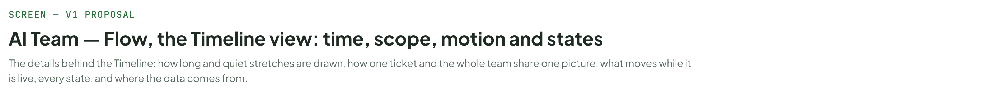
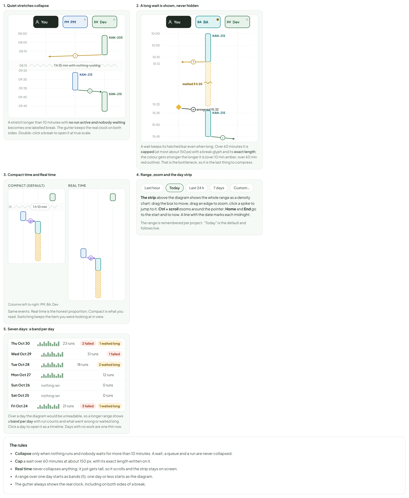
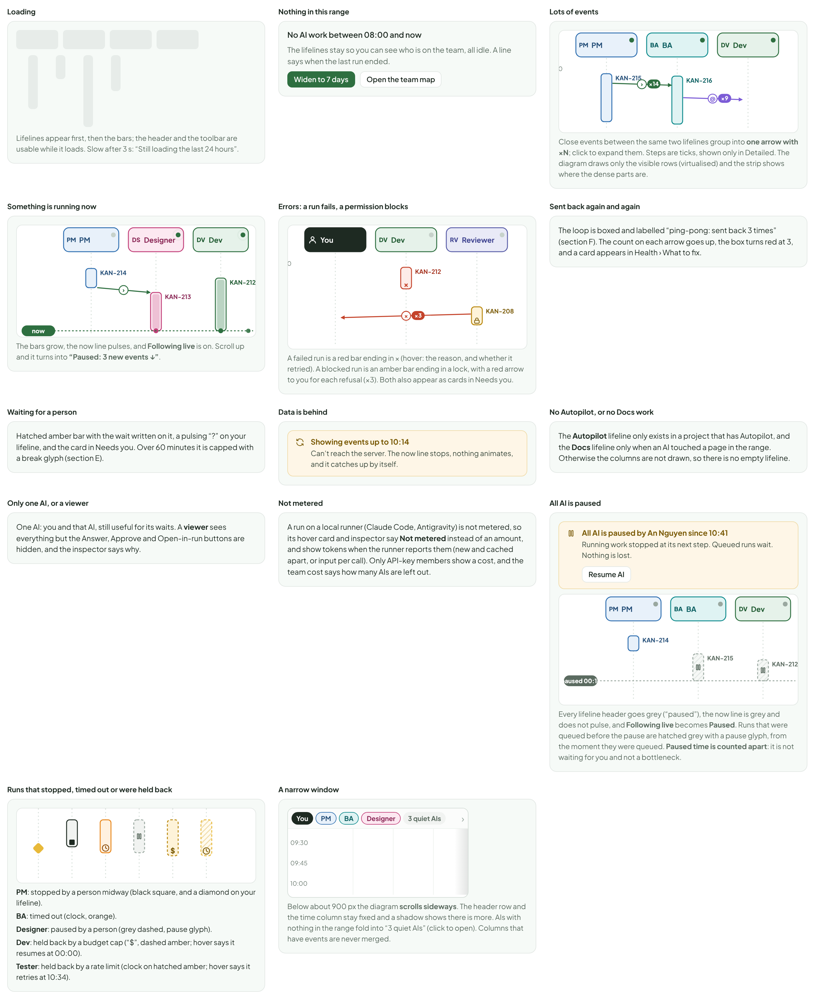
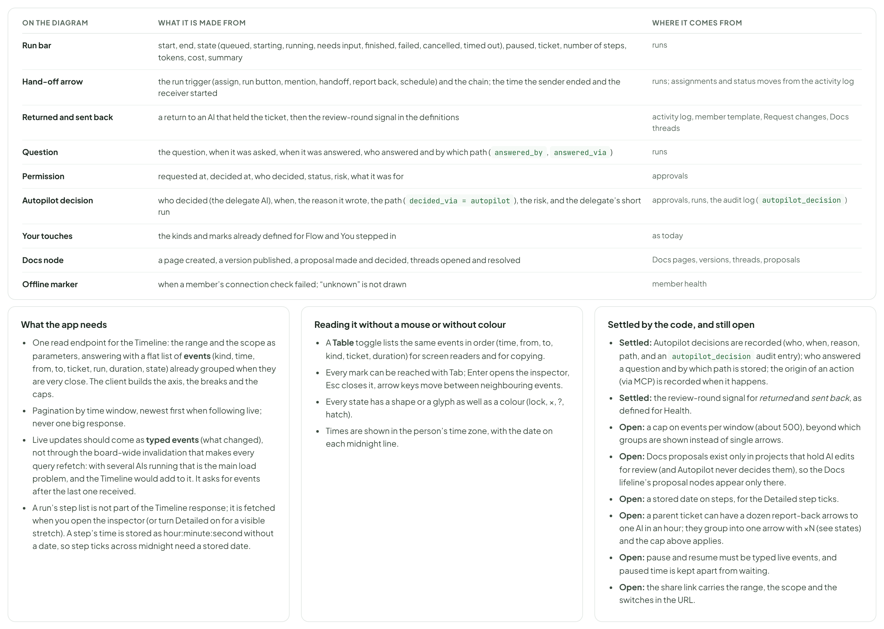

# AI Team — Flow, the Timeline view: time, scope, motion and states

> SCREEN — V1 PROPOSAL · source: [`AiTimelineCases.dc.html`](../source/AiTimelineCases.dc.html) · canvas `1793430454-494a` · sha256 `3dc097701ffc5bc7bdecf6f66a0e987f9193c590284174d9a42b341fff1e2ac3`

The details behind the Timeline: how long and quiet stretches are drawn, how one ticket and the whole team share one picture, what moves while it is live, every state, and where the data comes from.

Source: [AiTimelineCases.dc.html](../source/AiTimelineCases.dc.html) › header ("SCREEN — V1 PROPOSAL", "AI Team — Flow, the Timeline view: time, scope, motion and states" and the intro)

---

## E. Long spans and quiet stretches

Time is the whole diagram, so how it is stretched matters. The rule is simple: compress what carries no information (quiet time), and keep what does (waiting). Five pieces make that work.

Source: [AiTimelineCases.dc.html](../source/AiTimelineCases.dc.html) › block "E. Long spans and quiet stretches"

- Text in the frames: "1. Quiet stretches collapse" · "08:00" · "08:05" · "08:10" · "1 h 10 min with nothing running" · "08:15" · "09:25" · "09:30" · "09:35" · "09:40" · "09:45" · "You" · "PM" · "DV" · "Dev" · "KAN-205" · "›" · "KAN-215" · "A stretch longer than 10 minutes with no run active and nobody waiting becomes one labelled break. The gutter keeps the real clock on both sides. Double-click a break to open it at true scale." · "2. A long wait is shown, never hidden" · "10:00" · "10:05" · "10:10" · "10:12" · "15:32" · "15:35" · "15:40" · "15:45" · "BA" · "?" · "waited 5 h 20" · "✓" · "answered 15:32" · "A wait keeps its hatched bar even when long. Over 60 minutes it is capped (at most about 150 px) with a break glyph and its exact length; the colour gets stronger the longer it is (over 10 min amber, over 60 min red outline). That is the bottleneck, so it is the last thing to compress." · "3. Compact time and Real time" · "COMPACT (DEFAULT)" · "1 h 10 min" · "@" · "REAL TIME" · "Columns left to right: PM, BA, Dev" · "Same events. Real time is the honest proportion; Compact is what you read. Switching keeps the item you were looking at in view." · "4. Range, zoom and the day strip" · "Last hour" · "Today" · "Last 24 h" · "7 days" · "Custom…" · "The strip above the diagram shows the whole range as a density chart: drag the box to move, drag an edge to zoom, click a spike to jump to it. Ctrl + scroll zooms around the pointer; Home and End go to the start and to now. A line with the date marks each midnight." · "The range is remembered per project. “Today” is the default and follows live." · "5. Seven days: a band per day" · "Thu Oct 30" · "23 runs" · "2 failed" · "1 waited long" · "Wed Oct 29" · "31 runs" · "1 failed" · "Tue Oct 28" · "18 runs" · "2 waited long" · "Mon Oct 27" · "12 runs" · "Sun Oct 26" · "nothing ran" · "0 runs" · "Sat Oct 25" · "Fri Oct 24" · "21 runs" · "3 failed" · "Over a day the diagram would be unreadable, so a longer range shows a band per day with run counts and what went wrong or waited long. Click a day to open it as a timeline. Days with no work are one thin row." · "The rules" · "Collapse only when nothing runs and nobody waits for more than 10 minutes. A wait, a queue and a run are never collapsed." · "Cap a wait over 60 minutes at about 150 px, with its exact length written on it." · "Real time never collapses anything; it just gets tall, so it scrolls and the strip stays on screen." · "A range over one day starts as bands (5); one day or less starts as the diagram." · "The gutter always shows the real clock, including on both sides of a break."

---

## F. Whole team, one ticket, and a ticket that kept coming back

The Timeline has a scope. Choosing one ticket (or a parent and its children) keeps only the lifelines that took part, so a ticket’s story is the same picture, just filtered. One ticket stays as its own view for the summary it carries (elapsed split, deliverable, completion, touches); the two link to each other. Below, a ticket that was sent back three times: the loop is boxed, the arrows count up, and the summary says what it cost and what ended it.

Source: [AiTimelineCases.dc.html](../source/AiTimelineCases.dc.html) › block "F. Whole team, one ticket, and a ticket that kept coming back"

![F. Whole team, one ticket, and a ticket that kept coming back: The Timeline has a scope. Choosing one ticket (or a parent and its children) keeps only the lifelines that took part, so a ticket’s story is the same picture, just filtered. One ticket stays as its own view for the summary it carries (elapsed split, deliverable, completion, touches); the two link to each other. Below, a ticket that was sent back three times: the loop is boxed, the arrows count up, and the summary says what it cost and what ended it.](../images/ai-team-timeline-cases/04-f-whole-team-one-ticket-and-a-ticket-that-kept-c.png)

- Text in the frames: "SCOPE" · "Whole team" · "One ticket: KAN-207" · "A parent ticket and its children" · "Only the lifelines that took part are shown." · "Links both ways" · "One ticket header: See as sequence opens this view scoped to the ticket." · "A ticket chip on any bar: Open ticket story." · "A parent scope colours a thin tab on each bar by child ticket." · "KAN-207" · "Retry webhook delivery" · "scoped timeline · Dev, Tester, Reviewer and you" · "09:00" · "09:15" · "09:30" · "09:45" · "10:00" · "10:15" · "10:30" · "10:45" · "11:00" · "11:15" · "You" · "DV" · "Dev" · "TS" · "Tester" · "RV" · "Reviewer" · "run 1" · "›" · "↵" · "returned, round 1 (normal)" · "run 2" · "×1" · "sent back" · "run 3" · "×2" · "run 4" · "×3" · "ping-pong ×3" · "rewrote criterion 4" · "run 5" · "review" · "SENT BACK" · "3" · "same pair, same criterion" · "TIME IN THE LOOP" · "1 h 05" · "from the first sent back to your fix" · "COST OF THE LOOP" · "$1.12" · "4 runs" · "WHAT ENDED IT" · "rewrote criterion 4, with a number" · "See as One ticket"

---

## G. What moves, and when

Only what is live moves. The Timeline is open for long stretches, so motion is small, slow and tied to meaning: “this is running”, “this just arrived”, “this is waiting for you”. Everything finished is still. The demo on the left is a real animation; the four frames show one hand-off in order. A hand-off under way marches as dashes, exactly like the Team map, so the two views move the same way.

Source: [AiTimelineCases.dc.html](../source/AiTimelineCases.dc.html) › block "G. What moves, and when"

- Text in the frames: "A hand-off, live" · "Designer" · "Dev" · "looping demo (a still picture if motion is reduced)" · "The same hand-off in four frames" · "1. Running" · "DS" · "DV" · "KAN-212" · "The bar grows and its head pulses (1.6 s loop)." · "2. It ends" · "The arrow draws toward the next AI (400 ms)." · "3. On its way" · "The dashes march (0.9 s loop) while the hand-off is under way, as in the Team map. The next AI shows as queued." · "4. Arrived" · "›" · "The badge pops (150 ms) and a ring fades; the new bar starts to grow." · "WHAT" · "WHEN" · "MOTION" · "TIMING" · "IF MOTION IS REDUCED" · "The now line" · "while following live" · "End dot pulses; the line stays put and the diagram scrolls under it. When the team is paused the line is grey and does not pulse." · "1.6 s loop" · "A still dot." · "A running bar" · "a run is active" · "Soft inner pulse; a head that grows with time. Same ring and colours as a working node in the Team map." · "A still head." · "A new run" · "a run starts" · "The bar grows from its start line." · "continuous" · "Appears at once." · "A new arrow" · "a hand-off, a report back" · "Draws from sender to receiver, then the badge pops." · "400 + 150 ms, once" · "Appears at once, outlined for 1 s." · "A hand-off under way" · "sent, and the next AI has not started" · "The arrow is dashed and the dashes march toward the receiver (same as the Team map edge). It turns solid when the next AI starts." · "0.9 s loop" · "Dashed, still." · "Waiting for you" · "a question or approval is open" · "The amber hatch breathes slowly; a ring ripples from the “?”." · "2.4 s / 2.2 s loops" · "Still hatch and ring." · "A failure" · "a run fails or is blocked" · "The bar flashes red once, the × or the lock appears, then everything is still." · "300 ms, once" · "A repeat" · "a sent back again" · "The ×N badge counts up with a small tick." · "150 ms" · "Number changes." · "Following" · "new events while you read" · "If you are at the bottom the view scrolls smoothly (300 ms). If you scrolled up it does not move and shows a “3 new events” pill instead." · "300 ms" · "Same, without smoothing." · "Budget for motion" · "Animate only what is on screen and only the last 5 minutes of it; older rows are still." · "Stop everything while the tab is hidden, and resume without replaying." · "At most about 20 things animate at once; beyond that the rest are still." · "While the whole team is paused nothing animates." · "The reduced-motion setting turns every loop and every travel into its still picture."

---

## H. Live: the same on every screen

The build of Flow already has live treatments. Here they are next to the Timeline, with what I would change so that working, waiting and queued look and move the same in the Team map, One ticket, the ticket modal and the Timeline.

Source: [AiTimelineCases.dc.html](../source/AiTimelineCases.dc.html) › block "H. Live: the same on every screen"

- Text in the frames: "WHAT" · "ALREADY BUILT (TEAM MAP, ONE TICKET, TICKET MODAL)" · "THE TIMELINE" · "WHAT I WOULD CHANGE" · "Working" · "green dot, pulse 1.6 s; ring and state line in the node" · "Header dot and the running bar’s head, same green, same 1.6 s pulse." · "Pulse of the bar head 1.4 s → 1.6 s (done)." · "Waiting for you" · "amber dot, pulse" · "Header dot in the same amber (#8A6A12), hatched amber bar that breathes, ring on the “?”." · "Header dot: bright amber → the built amber (done)." · "Queued" · "grey dot, still" · "Header dot in the same grey; hatched grey bar." · "Header dot colour only (done)." · "A hand-off under way" · "dashed edge that marches (0.9 s)" · "Dashed arrow that marches, solid once the next AI starts." · "Was a travelling dot: replaced by marching dashes (done)." · "“Right now” strip" · "a chip per AI that works, waits for you or is queued; click opens that ticket" · "The same strip above the toolbar; a click scrolls the diagram to that run and opens its inspector, with “Open the ticket story” beside it." · "Added to the Timeline (section B of the first board)." · "Live tickets first" · "One ticket list: live tickets on top with a pulsing dot" · "The scope picker lists live tickets first with the same dot." · "Added." · "“Now” banner" · "banner on top of a ticket’s journey while it runs" · "The now pill on the now line; a scoped Timeline of a live ticket carries the same banner on top." · "Wording kept: “Now”." · "Ticket modal" · "Ticket | AI activity switch; a dot when a decision waits for you" · "The AI activity tab shows the Timeline scoped to this ticket (below), with the same dot; “Open in Timeline” leads to the full view." · "Added: the tab reuses the Timeline." · "Reduced motion" · "every loop stops (reduced-motion CSS)" · "The same rule: loops and travel become their still pictures." · "None." · "The ticket modal, AI activity tab" · "KAN-212" · "Show cost on run cards" · "Ticket" · "AI activity" · "a dot: a decision waits for you" · "Open in Timeline" · "Now · Dev is working on run 2 · Tester is queued" · "10:00" · "10:15" · "10:30" · "DV" · "Dev" · "TS" · "Tester" · "RV" · "Reviewer" · "run 1" · "›" · "run 2" · "now 10:40" · "What I would change, in short" · "Colours and timing: the Timeline’s state dots take the built colours and the 1.6 s pulse." · "Hand-off under way: marching dashes, not a travelling dot, so both views move the same way." · "Add the “Right now” strip and live-first ticket lists to the Timeline." · "Reuse the Timeline for the ticket modal’s AI activity tab instead of a second small diagram, so a ticket reads the same in the modal, in One ticket and in the Timeline." · "Words stay as built: working, waiting for you, queued, Now."

---

## I. States

Source: [AiTimelineCases.dc.html](../source/AiTimelineCases.dc.html) › block "I. States"

- Text in the frames: "Loading" · "Lifelines appear first, then the bars; the header and the toolbar are usable while it loads. Slow after 3 s: “Still loading the last 24 hours”." · "Nothing in this range" · "No AI work between 08:00 and now" · "The lifelines stay so you can see who is on the team, all idle. A line says when the last run ended." · "Widen to 7 days" · "Open the team map" · "Lots of events" · "00:00" · "PM" · "BA" · "DV" · "Dev" · "KAN-215" · "KAN-216" · "›" · "×14" · "@" · "×9" · "Close events between the same two lifelines group into one arrow with ×N; click to expand them. Steps are ticks, shown only in Detailed. The diagram draws only the visible rows (virtualised) and the strip shows where the dense parts are." · "Something is running now" · "DS" · "Designer" · "KAN-214" · "KAN-213" · "KAN-212" · "now" · "The bars grow, the now line pulses, and Following live is on. Scroll up and it turns into “Paused: 3 new events ↓”." · "Errors: a run fails, a permission blocks" · "You" · "RV" · "Reviewer" · "×" · "KAN-208" · "×3" · "A failed run is a red bar ending in × (hover: the reason, and whether it retried). A blocked run is an amber bar ending in a lock, with a red arrow to you for each refusal (×3). Both also appear as cards in Needs you." · "Sent back again and again" · "The loop is boxed and labelled “ping-pong: sent back 3 times” (section F). The count on each arrow goes up, the box turns red at 3, and a card appears in Health › What to fix." · "Waiting for a person" · "Hatched amber bar with the wait written on it, a pulsing “?” on your lifeline, and the card in Needs you. Over 60 minutes it is capped with a break glyph (section E)." · "Data is behind" · "Showing events up to 10:14" · "Can’t reach the server. The now line stops, nothing animates, and it catches up by itself." · "No Autopilot, or no Docs work" · "The Autopilot lifeline only exists in a project that has Autopilot, and the Docs lifeline only when an AI touched a page in the range. Otherwise the columns are not drawn, so there is no empty lifeline." · "Only one AI, or a viewer" · "One AI: you and that AI, still useful for its waits. A viewer sees everything but the Answer, Approve and Open-in-run buttons are hidden, and the inspector says why." · "Not metered" · "A run on a local runner (Claude Code, Antigravity) is not metered, so its hover card and inspector say Not metered instead of an amount, and show tokens when the runner reports them (new and cached apart, or input per call). Only API-key members show a cost, and the team cost says how many AIs are left out." · "All AI is paused" · "All AI is paused by An Nguyen since 10:41" · "Running work stopped at its next step. Queued runs wait. Nothing is lost." · "Resume AI" · "paused 00:16" · "Every lifeline header goes grey (“paused”), the now line is grey and does not pulse, and Following live becomes Paused. Runs that were queued before the pause are hatched grey with a pause glyph, from the moment they were queued. Paused time is counted apart: it is not waiting for you and not a bottleneck." · "Runs that stopped, timed out or were held back" · "$" · "PM: stopped by a person midway (black square, and a diamond on your lifeline)." · "BA: timed out (clock, orange)." · "Designer: paused by a person (grey dashed, pause glyph)." · "Dev: held back by a budget cap (“$”, dashed amber; hover says it resumes at 00:00)." · "Tester: held back by a rate limit (clock on hatched amber; hover says it retries at 10:34)." · "A narrow window" · "3 quiet AIs" · "09:30" · "09:45" · "10:00" · "Below about 900 px the diagram scrolls sideways. The header row and the time column stay fixed and a shadow shows there is more. AIs with nothing in the range fold into “3 quiet AIs” (click to open). Columns that have events are never merged."

---

## J. Where the data comes from, and what it needs

Everything on the diagram is built from records that already exist, so the Timeline adds a view, not a new kind of tracking. A few things are still open and are listed at the end.

Source: [AiTimelineCases.dc.html](../source/AiTimelineCases.dc.html) › block "J. Where the data comes from, and what it needs"

- Text in the frames: "ON THE DIAGRAM" · "WHAT IT IS MADE FROM" · "WHERE IT COMES FROM" · "Run bar" · "start, end, state (queued, starting, running, needs input, finished, failed, cancelled, timed out), paused, ticket, number of steps, tokens, cost, summary" · "runs" · "Hand-off arrow" · "the run trigger (assign, run button, mention, handoff, report back, schedule) and the chain; the time the sender ended and the receiver started" · "runs; assignments and status moves from the activity log" · "Returned and sent back" · "a return to an AI that held the ticket, then the review-round signal in the definitions" · "activity log, member template, Request changes, Docs threads" · "Question" · "the question, when it was asked, when it was answered, who answered and by which path (answered_by, answered_via)" · "Permission" · "requested at, decided at, who decided, status, risk, what it was for" · "approvals" · "Autopilot decision" · "who decided (the delegate AI), when, the reason it wrote, the path (decided_via = autopilot), the risk, and the delegate’s short run" · "approvals, runs, the audit log (autopilot_decision)" · "Your touches" · "the kinds and marks already defined for Flow and You stepped in" · "as today" · "Docs node" · "a page created, a version published, a proposal made and decided, threads opened and resolved" · "Docs pages, versions, threads, proposals" · "Offline marker" · "when a member’s connection check failed; “unknown” is not drawn" · "member health" · "What the app needs" · "One read endpoint for the Timeline: the range and the scope as parameters, answering with a flat list of events (kind, time, from, to, ticket, run, duration, state) already grouped when they are very close. The client builds the axis, the breaks and the caps." · "Pagination by time window, newest first when following live; never one big response." · "Live updates should come as typed events (what changed), not through the board-wide invalidation that makes every query refetch: with several AIs running that is the main load problem, and the Timeline would add to it. It asks for events after the last one received." · "A run’s step list is not part of the Timeline response; it is fetched when you open the inspector (or turn Detailed on for a visible stretch). A step’s time is stored as hour:minute:second without a date, so step ticks across midnight need a stored date." · "Reading it without a mouse or without colour" · "A Table toggle lists the same events in order (time, from, to, kind, ticket, duration) for screen readers and for copying." · "Every mark can be reached with Tab; Enter opens the inspector, Esc closes it, arrow keys move between neighbouring events." · "Every state has a shape or a glyph as well as a colour (lock, ×, ?, hatch)." · "Times are shown in the person’s time zone, with the date on each midnight line." · "Settled by the code, and still open" · "Settled: Autopilot decisions are recorded (who, when, reason, path, and an autopilot_decision audit entry); who answered a question and by which path is stored; the origin of an action (via MCP) is recorded when it happens." · "Settled: the review-round signal for returned and sent back, as defined for Health." · "Open: a cap on events per window (about 500), beyond which groups are shown instead of single arrows." · "Open: Docs proposals exist only in projects that hold AI edits for review (and Autopilot never decides them), so the Docs lifeline’s proposal nodes appear only there." · "Open: a stored date on steps, for the Detailed step ticks." · "Open: a parent ticket can have a dozen report-back arrows to one AI in an hour; they group into one arrow with ×N (see states) and the cap above applies." · "Open: pause and resume must be typed live events, and paused time is kept apart from waiting." · "Open: the share link carries the range, the scope and the switches in the URL."
