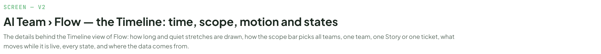
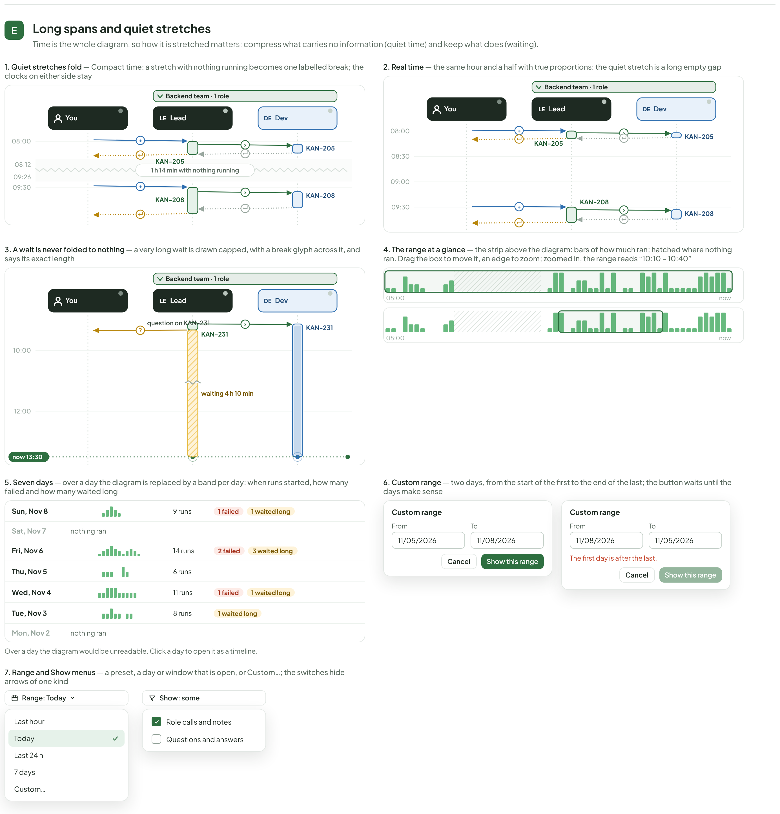
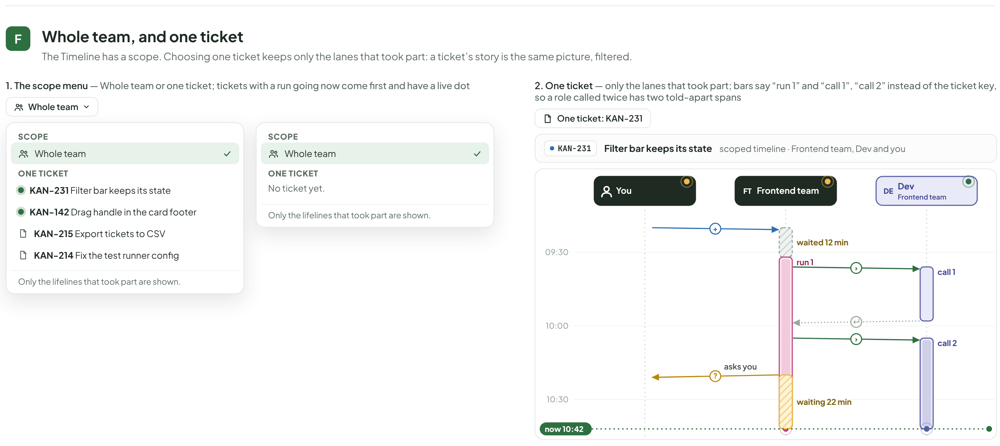
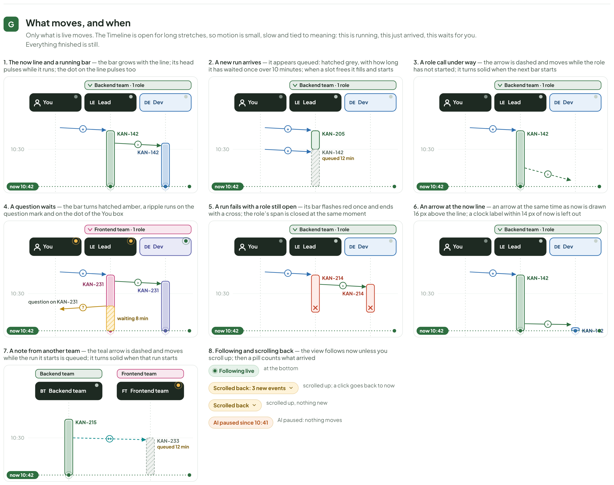
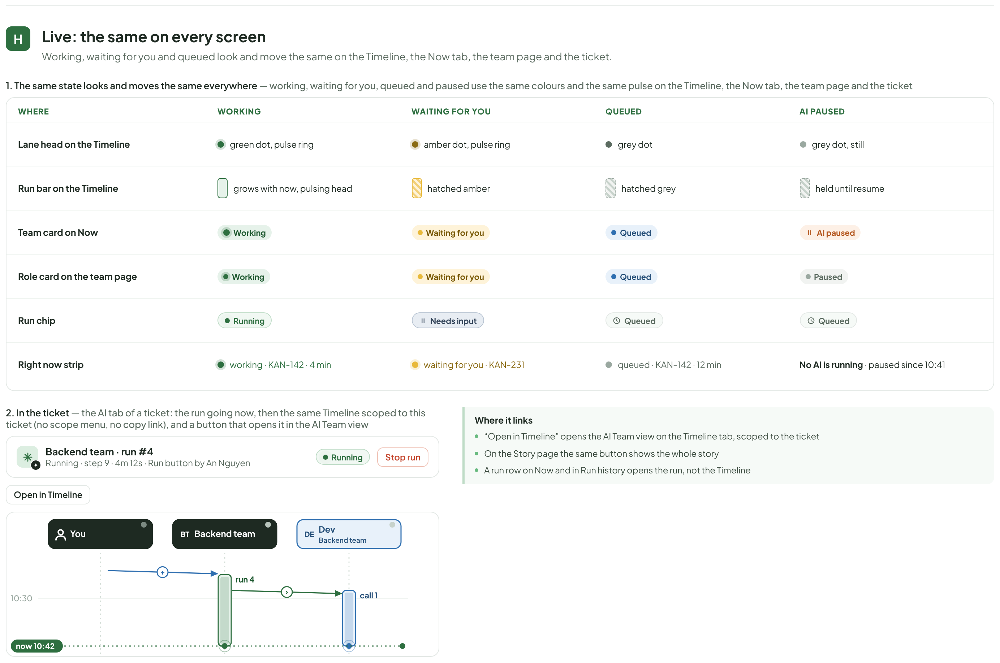
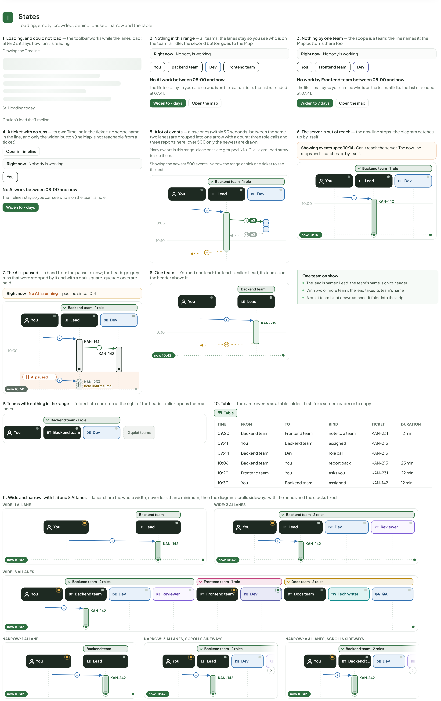
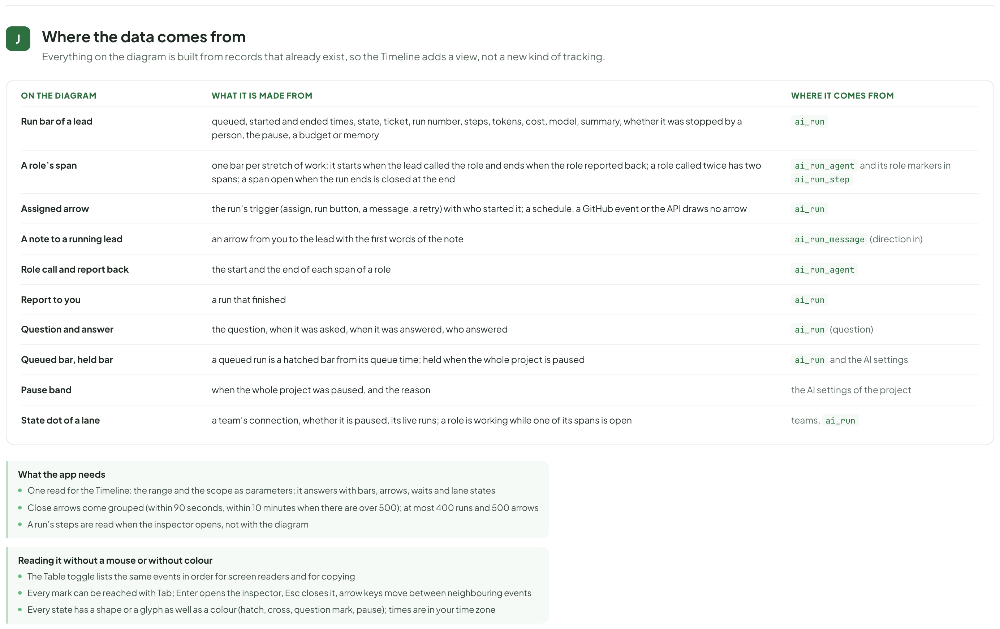

# AI Team — Timeline: time, scope, motion, states

> Redrawn for AI v2 · source: [`AiTimelineCases.dc.html`](../source/AiTimelineCases.dc.html) · canvas `1794099567-d725` · sha256 `76b9b89977aa0733ec3b048ad867b2e33a55b72afcf176c254e44b9b6853e593`

> Words, states and conditions follow the code of branch `claude/ai-team-architecture-7a1efc`; the layout is designed here and is not the layout of the current screens. Names, ids, costs and times in the mock-ups are sample data. **Check the code before building from this: the file named in each part is the truth, not the picture.**

## SCREEN — V2

- Text in this part: "SCREEN — V2" · "AI Team — the Timeline: time, scope, motion and states" · "The details behind the Timeline: how long and quiet stretches are drawn, how one ticket and the whole team share one picture, what moves while it is live, every state, and where the data comes from."

---

## Long spans and quiet stretches

- Text in this part: "E" · "Long spans and quiet stretches" · "Time is the whole diagram, so how it is stretched matters: compress what carries no information (quiet time) and keep what does (waiting)." · "1. Quiet stretches fold — Compact time: a stretch with nothing running becomes one labelled break; the clocks on either side stay" · "You" · "BT" · "Backend team" · "DE" · "Dev" · "08:00" · "09:30" · "1 h 14 min with nothing running" · "08:12" · "09:26" · "KAN-205" · "KAN-208" · "+" · "›" · "↵" · "2. Real time — the same hour and a half with true proportions: the quiet stretch is a long empty gap" · "08:30" · "09:00" · "3. A wait is never folded to nothing — a very long wait is drawn capped, with a break glyph across it, and says its exact length" · "10:00" · "12:00" · "KAN-231" · "waiting 4 h 10 min" · "?" · "asks you" · "now 13:30" · "4. The range at a glance — the strip above the diagram: bars of how much ran; hatched where nothing ran. Drag the box to move it, an edge to zoom; zoomed in, the range reads “10:10 – 10:40”" · "now" · "5. Seven days — over a day the diagram is replaced by a band per day: when runs started, how many failed and how many waited long" · "Sun, Nov 8" · "9 runs" · "1 failed" · "1 waited long" · "Sat, Nov 7" · "nothing ran" · "Fri, Nov 6" · "14 runs" · "2 failed" · "3 waited long" · "Thu, Nov 5" · "6 runs" · "Wed, Nov 4" · "11 runs" · "Over a day the diagram would be unreadable. Click a day to open it as a timeline." · "6. Custom range — two days, from the start of the first to the end of the last; the button waits until the days make sense" · "Custom range" · "From" · "11/05/2026" · "To" · "11/08/2026" · "Cancel" · "Show this range" · "The first day is after the last." · "7. Range and Show menus — a preset, a day or window that is open, or Custom…; the switches hide arrows of one kind" · "Range: Today" · "Last hour" · "Today" · "Last 24 h" · "7 days" · "Custom…" · "Show: some" · "Role calls" · "Questions and answers"

---

## Whole team, and one ticket

- Text in this part: "F" · "Whole team, and one ticket" · "The Timeline has a scope. Choosing one ticket keeps only the lanes that took part: a ticket’s story is the same picture, filtered." · "1. The scope menu — Whole team or one ticket; tickets with a run going now come first and have a live dot" · "Whole team" · "SCOPE" · "ONE TICKET" · "KAN-231 Filter bar keeps its state" · "KAN-142 Drag handle in the card footer" · "KAN-215 Export tickets to CSV" · "KAN-214 Fix the test runner config" · "Only the lifelines that took part are shown." · "No ticket yet." · "2. One ticket — only the lanes that took part; bars say “run 1” and “call 1”, “call 2” instead of the ticket key, so a role called twice has two told-apart spans" · "One ticket: KAN-231" · "KAN-231" · "Filter bar keeps its state" · "scoped timeline · Frontend team, Dev and you" · "You" · "FT" · "Frontend team" · "DE" · "Dev" · "09:30" · "10:00" · "10:30" · "waited 12 min" · "run 1" · "call 1" · "call 2" · "waiting 22 min" · "+" · "›" · "↵" · "?" · "asks you" · "now 10:42"

---

## What moves, and when

- Text in this part: "G" · "What moves, and when" · "Only what is live moves. The Timeline is open for long stretches, so motion is small, slow and tied to meaning: this is running, this just arrived, this waits for you. Everything finished is still." · "1. The now line and a running bar — the bar grows with the line; its head pulses while it runs; the dot on the line pulses too" · "You" · "BT" · "Backend team" · "DE" · "Dev" · "10:30" · "KAN-142" · "call 1" · "+" · "›" · "now 10:42" · "2. A new run arrives — it appears queued: hatched grey, with how long it has waited once over 10 minutes; when a slot frees it fills and starts" · "KAN-205" · "queued 12 min" · "3. A role call under way — the arrow is dashed and moves while the role has not started; it turns solid when the next bar starts" · "4. A question waits — the bar turns hatched amber, a ripple runs on the question mark and on the dot of the You box" · "FT" · "Frontend team" · "waiting 8 min" · "?" · "asks you" · "5. A run fails with a role still open — its bar flashes red once and ends with a cross; the role’s span is closed at the same moment" · "KAN-214" · "6. An arrow at the now line — an arrow at the same time as now is drawn 16 px above the line; a clock label within 14 px of now is left out" · "call 2" · "7. Following and scrolling back — the view follows now unless you scroll up; then a pill counts what arrived" · "Following live" · "at the bottom" · "Scrolled back: 3 new events" · "scrolled up; a click goes back to now" · "Scrolled back" · "scrolled up, nothing new" · "AI paused since 10:41" · "AI paused: nothing moves"

---

## Live: the same on every screen

- Text in this part: "H" · "Live: the same on every screen" · "Working, waiting for you and queued look and move the same on the Timeline, the Now tab, the team page and the ticket." · "1. The same state looks and moves the same everywhere — working, waiting for you, queued and paused use the same colours and the same pulse on the Timeline, the Now tab, the team page and the ticket" · "WHERE" · "WORKING" · "WAITING FOR YOU" · "QUEUED" · "AI PAUSED" · "Lane head on the Timeline" · "green dot, pulse ring" · "amber dot, pulse ring" · "grey dot" · "grey dot, still" · "Run bar on the Timeline" · "grows with now, pulsing head" · "hatched amber" · "hatched grey" · "held until resume" · "Team card on Now" · "Working" · "Waiting for you" · "Queued" · "AI paused" · "Role card on the team page" · "Paused" · "Run chip" · "Running" · "Needs input" · "Right now strip" · "working · KAN-142 · 4 min" · "waiting for you · KAN-231" · "queued · KAN-142 · 12 min" · "No AI is running · paused since 10:41" · "2. In the ticket — the AI tab of a ticket: the run going now, then the same Timeline scoped to this ticket (no scope menu, no copy link), and a button that opens it in the AI Team view" · "Backend team · run #4" · "Running · step 9 · 4m 12s · Run button by An Nguyen" · "Stop run" · "Open in Timeline" · "You" · "BT" · "Backend team" · "DE" · "Dev" · "10:30" · "run 4" · "call 1" · "+" · "›" · "now 10:42" · "Where it links" · "“Open in Timeline” opens the AI Team view on the Timeline tab, scoped to the ticket" · "On the Story page the same button shows the whole story" · "A run row on Now and in Run history opens the run, not the Timeline"

---

## States

- Text in this part: "I" · "States" · "Loading, empty, crowded, behind, paused, narrow and the table." · "1. Loading, and could not load — the toolbar works while the lanes load; after 3 s it says how far it is reading" · "Drawing the Timeline…" · "Still loading today" · "Couldn’t load the Timeline." · "2. Nothing in this range — the lanes stay so you see who is on the team, all idle" · "Right now" · "Nobody is working." · "You" · "Backend team" · "Dev" · "Frontend team" · "No AI work between 08:00 and now" · "The lifelines stay so you can see who is on the team, all idle. The last run ended at 07:41." · "Widen to 7 days" · "3. A lot of events — close ones are grouped into one arrow with a count; over 500 only the newest are drawn" · "Many events in this range: close ones are grouped (×N). Click a grouped arrow to see them." · "Showing the newest 500 events. Narrow the range or pick one ticket to see the rest." · "BT" · "DE" · "10:10" · "10:30" · "+" · "›" · "×8" · "↵" · "×6" · "4. The server is out of reach — the now line stops; the diagram catches up by itself" · "Showing events up to 10:14 · Can’t reach the server. The now line stops and it catches up by itself." · "10:00" · "KAN-142" · "now 10:14" · "5. The AI is paused — a band from the pause to now; the heads go grey; runs that were stopped by it end with a dark square, queued ones are held" · "No AI is running" · "· paused since 10:41" · "call 1" · "KAN-233" · "held until resume" · "AI paused" · "now 10:50" · "6. One team — You and one lead: two lanes" · "KAN-215" · "now 10:42" · "7. Wide and narrow, with 1, 3 and 8 AI lanes — lanes share the whole width; never less than a minimum, then the diagram scrolls sideways with the heads and the clocks fixed" · "WIDE: 1 AI LANE" · "WIDE: 3 AI LANES" · "RE" · "Reviewer" · "WIDE: 8 AI LANES" · "FT" · "DT" · "Docs team" · "TW" · "Tech writer" · "QA" · "NARROW: 1 AI LANE" · "NARROW: 3 AI LANES, SCROLLS SIDEWAYS" · "Backend t…" · "NARROW: 8 AI LANES, SCROLLS SIDEWAYS" · "Frontend …" · "Tech writ…" · "8. Table — the same events as a table, for a screen reader or to copy" · "Table" · "TIME	FROM	TO	KIND	TICKET	DURATION" · "10:42	You	Backend team	assigned	KAN-142" · "10:30	Backend team	You	report back	KAN-215" · "10:20	Frontend team	You	asks you	KAN-231	22 min" · "09:44	Backend team	Dev	role call	KAN-215" · "09:41	Backend team		run #4 finished	KAN-215	25 min" · "9. Teams with nothing in the range — folded into one strip at the right of the heads; a click opens them as lanes" · "2 quiet teams"

---

## Where the data comes from

- Text in this part: "J" · "Where the data comes from" · "Everything on the diagram is built from records that already exist, so the Timeline adds a view, not a new kind of tracking." · "ON THE DIAGRAM" · "WHAT IT IS MADE FROM" · "WHERE IT COMES FROM" · "Run bar of a lead" · "queued, started and ended times, state, ticket, run number, steps, tokens, cost, model, summary, whether it was stopped by a person, the pause, a budget or memory" · "ai_run" · "A role’s span" · "one bar per stretch of work: it starts when the lead called the role and ends when the role reported back; a role called twice has two spans; a span open when the run ends is closed at the end" · "ai_run_agent and its role markers in ai_run_step" · "Assigned arrow" · "the run’s trigger (assign, run button, a message, a retry) with who started it; a schedule, a GitHub event or the API draws no arrow" · "A note to a running lead" · "an arrow from you to the lead with the first words of the note" · "ai_run_message (direction in)" · "Role call and report back" · "the start and the end of each span of a role" · "ai_run_agent" · "Report to you" · "a run that finished" · "Question and answer" · "the question, when it was asked, when it was answered, who answered" · "ai_run (question)" · "Queued bar, held bar" · "a queued run is a hatched bar from its queue time; held when the whole project is paused" · "ai_run and the AI settings" · "Pause band" · "when the whole project was paused, and the reason" · "the AI settings of the project" · "State dot of a lane" · "a team’s connection, whether it is paused, its live runs; a role is working while one of its spans is open" · "teams, ai_run" · "What the app needs" · "One read for the Timeline: the range and the scope as parameters; it answers with bars, arrows, waits and lane states" · "Close arrows come grouped (within 90 seconds, within 10 minutes when there are over 500); at most 400 runs and 500 arrows" · "A run’s steps are read when the inspector opens, not with the diagram" · "Reading it without a mouse or without colour" · "The Table toggle lists the same events in order for screen readers and for copying" · "Every mark can be reached with Tab; Enter opens the inspector, Esc closes it, arrow keys move between neighbouring events" · "Every state has a shape or a glyph as well as a colour (hatch, cross, question mark, pause); times are in your time zone"

---

Rows, differences from the code and open points for this group are in [ai-team.md](ai-team.md).
