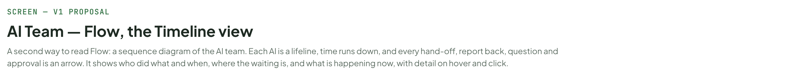
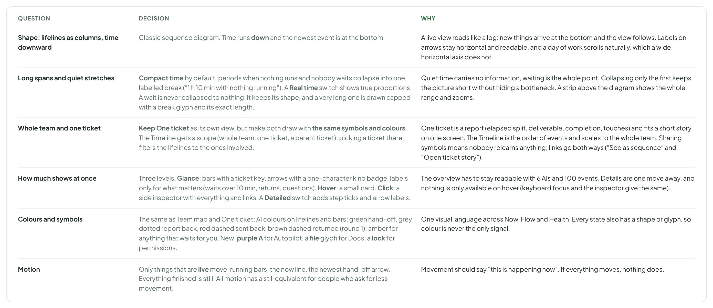
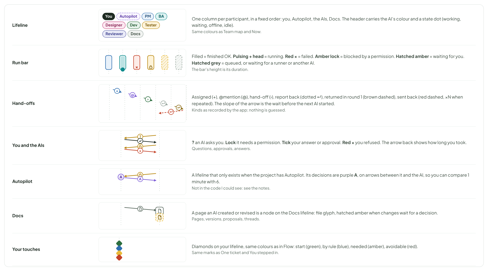

# AI Team — Flow, the Timeline view

> SCREEN — V1 PROPOSAL · source: [`AiTimeline.dc.html`](../source/AiTimeline.dc.html) · canvas `1793424114-497f` · sha256 `7fab94cba4f5eceb5b6666f89d1f403bcebfca4f56dfcf732ae41e53a185c1cc`

A second way to read Flow: a sequence diagram of the AI team. Each AI is a lifeline, time runs down, and every hand-off, report back, question and approval is an arrow. It shows who did what and when, where the waiting is, and what is happening now, with detail on hover and click.

Source: [AiTimeline.dc.html](../source/AiTimeline.dc.html) › header ("SCREEN — V1 PROPOSAL", "AI Team — Flow, the Timeline view" and the intro)

---

## A. What I decided, and why

You asked me to choose. Each row is a decision with the reason in a line or two.

Source: [AiTimeline.dc.html](../source/AiTimeline.dc.html) › block "A. What I decided, and why"

- Text in the frames: "QUESTION" · "DECISION" · "WHY" · "Shape: lifelines as columns, time downward" · "Classic sequence diagram. Time runs down and the newest event is at the bottom." · "A live view reads like a log: new things arrive at the bottom and the view follows. Labels on arrows stay horizontal and readable, and a day of work scrolls naturally, which a wide horizontal axis does not." · "Long spans and quiet stretches" · "Compact time by default: periods when nothing runs and nobody waits collapse into one labelled break (“1 h 10 min with nothing running”). A Real time switch shows true proportions. A wait is never collapsed to nothing: it keeps its shape, and a very long one is drawn capped with a break glyph and its exact length." · "Quiet time carries no information, waiting is the whole point. Collapsing only the first keeps the picture short without hiding a bottleneck. A strip above the diagram shows the whole range and zooms." · "Whole team and one ticket" · "Keep One ticket as its own view, but make both draw with the same symbols and colours. The Timeline gets a scope (whole team, one ticket, a parent ticket); picking a ticket there filters the lifelines to the ones involved." · "One ticket is a report (elapsed split, deliverable, completion, touches) and fits a short story on one screen. The Timeline is the order of events and scales to the whole team. Sharing symbols means nobody relearns anything; links go both ways (“See as sequence” and “Open ticket story”)." · "How much shows at once" · "Three levels. Glance: bars with a ticket key, arrows with a one-character kind badge, labels only for what matters (waits over 10 min, returns, questions). Hover: a small card. Click: a side inspector with everything and links. A Detailed switch adds step ticks and arrow labels." · "The overview has to stay readable with 6 AIs and 100 events. Details are one move away, and nothing is only available on hover (keyboard focus and the inspector give the same)." · "Colours and symbols" · "The same as Team map and One ticket: AI colours on lifelines and bars; green hand-off, grey dotted report back, red dashed sent back, brown dashed returned (round 1); amber for anything that waits for you. New: purple A for Autopilot, a file glyph for Docs, a lock for permissions." · "One visual language across Now, Flow and Health. Every state also has a shape or glyph, so colour is never the only signal." · "Motion" · "Only things that are live move: running bars, the now line, the newest hand-off arrow. Everything finished is still. All motion has a still equivalent for people who ask for less movement." · "Movement should say “this is happening now”. If everything moves, nothing does."

---

## B. The Timeline, whole team, live

The second way to read Flow, next to Team map and One ticket. Each AI (and you, Autopilot and Docs) is a lifeline; time runs down; a bar on a lifeline is a run; an arrow is a hand-off, a question, an approval or a report back. Reading it top to bottom is reading what happened in order. The bottom is now: the running bars grow, the dot on the now line pulses, and the view follows it unless you scroll up. Here the BA has been waiting for an answer for 41 minutes (amber), the Tester is queued behind an offline runner (grey), and the Dev’s approval for an AI took Autopilot 1 minute but is taking you 6.

Source: [AiTimeline.dc.html](../source/AiTimeline.dc.html) › block "B. The Timeline, whole team, live"

![B. The Timeline, whole team, live: The second way to read Flow, next to Team map and One ticket. Each AI (and you, Autopilot and Docs) is a lifeline; time runs down; a bar on a lifeline is a run; an arrow is a hand-off, a question, an approval or a report back. Reading it top to bottom is reading what happened in order. The bottom is now: the running bars grow, the dot on the now line pulses, and the view follows it unless you scroll up. Here the BA has been waiting for an answer for 41 minutes (amber), the Tester is queued behind an offline runner (grey), and the Dev’s approval for an AI took Autopilot 1 minute but is taking you 6.](../images/ai-team-timeline/04-b-the-timeline-whole-team-live.png)

- Text in the frames: "KANBAN" · "PROJECTS" · "Kanban Board" · "KAN" · "Mobile App" · "MOB" · "Marketing Site" · "MKT" · "Settings" · "Members" · "4 · 7 AI" · "Recycle Bin" · "3" · "Board" · "List" · "Timeline" · "Docs" · "AI Team" · "4" · "Pause all AI" · "New Ticket" · "Now" · "Flow" · "You stepped in" · "27" · "Health" · "Live · updated 4 s ago" · "Team map" · "One ticket" · "Each AI is a lifeline, time runs down, every hand-off, question and approval is an arrow" · "Whole team" · "All tickets" · "Show: all" · "Compact" · "Detailed" · "Compact time" · "Real time" · "Today" · "Following live" · "08:00" · "The range at a glance: drag the box to move it, drag an edge to zoom. Hatched: nothing running (collapsed below)" · "now" · "08:10" · "1 h 10 min with nothing running" · "08:20" · "09:30" · "09:45" · "10:00" · "10:15" · "10:30" · "You" · "Autopilot" · "PM" · "BA" · "DS" · "Designer" · "DV" · "Dev" · "TS" · "Tester" · "RV" · "Reviewer" · "KAN-205" · "›" · "moved to Done" · "KAN-215" · "@" · "?" · "question on KAN-215" · "waiting for you 41 min" · "KAN-207" · "↵" · "×3" · "sent back, 3rd time" · "A" · "approved npm test, 1 min" · "offline" · "queued 38 min, runner offline" · "KAN-208" · "KAN-212" · "edited KAN-212" · "waited 13 min" · "KAN-214" · "KAN-213" · "2 changes wait 9 min" · "now 10:42" · "BA · waiting for you" · "Export tickets to CSV" · "Asked at 10:01 · 41 min so far" · "“Should the export include archived tickets?”" · "Click for the full question and Answer" · "+ assigned" · "@ @mention" · "› hand-off" · "↵ report back (dotted)" · "↵ sent back (red dashed)" · "? asks you" · "A Autopilot decided" · "Hatched amber: waiting for you · hatched grey: waiting for an AI or a runner"

---

## C. Reading the diagram: the symbols

Every mark has a shape or a glyph as well as a colour, and each one is the same in Team map, One ticket and here.

Source: [AiTimeline.dc.html](../source/AiTimeline.dc.html) › block "C. Reading the diagram: the symbols"

- Text in the frames: "Lifeline" · "You" · "Autopilot" · "PM" · "BA" · "Designer" · "Dev" · "Tester" · "Reviewer" · "Docs" · "One column per participant, in a fixed order: you, Autopilot, the AIs, Docs. The header carries the AI’s colour and a state dot (working, waiting, offline, idle)." · "Same colours as Team map and Now." · "Run bar" · "×" · "Filled = finished OK. Pulsing + head = running. Red × = failed. Amber lock = blocked by a permission. Hatched amber = waiting for you. Hatched grey = queued, or waiting for a runner or another AI." · "The bar’s height is its duration." · "Hand-offs" · "+" · "@" · "›" · "↵" · "Assigned (+), @mention (@), hand-off (›), report back (dotted ↵), returned in round 1 (brown dashed), sent back (red dashed, ×N when repeated). The slope of the arrow is the wait before the next AI started." · "Kinds as recorded by the app; nothing is guessed." · "You and the AIs" · "?" · "✓" · "? an AI asks you. Lock it needs a permission. Tick your answer or approval. Red × you refused. The arrow back shows how long you took." · "Questions, approvals, answers." · "A" · "A lifeline that only exists when the project has Autopilot. Its decisions are purple A, on arrows between it and the AI, so you can compare 1 minute with 6." · "Not in the code I could see: see the notes." · "A page an AI created or revised is a node on the Docs lifeline: file glyph, hatched amber when changes wait for a decision." · "Pages, versions, proposals, threads." · "Your touches" · "Diamonds on your lifeline, same colours as in Flow: start (green), by rule (blue), needed (amber), avoidable (red)." · "Same marks as One ticket and You stepped in."

---

## D. Detail on demand: glance, hover, click, and a Detailed switch

At a glance the diagram carries only what answers “who, when, how long, in what order”. Everything else sits one move away. Hover shows a small card; click opens a side inspector (the same content is reachable by keyboard: Tab through the marks, Enter opens, Esc closes). Detailed adds step ticks along bars and a label on every arrow, for when you are investigating one stretch.

Source: [AiTimeline.dc.html](../source/AiTimeline.dc.html) › block "D. Detail on demand: glance, hover, click, and a Detailed switch"

- Text in the frames: "HOVER CARDS" · "DV" · "Dev · run #3" · "Working" · "KAN-212" · "Show cost on run cards" · "Started 10:28 · 14 min so far · step 19" · "Editing RunCard.tsx · 3 files" · "38k tokens in, 6k out · $0.41" · "Click for the steps" · "Hand-off · Designer to Dev" · "layout done" · "Sent 10:15 · Dev started 10:28" · "Waited 13 min, queued behind another run" · "Kind: hand-off" · "Waiting for you · 6 min" · "Dev wants to change the assignee of KAN-212 to Tester" · "Risk low · the run keeps going, this step waits" · "Approve Deny" · "Approved by Autopilot · 1 min" · "Dev asked to run npm test" · "Autopilot rule: allow test commands in this project" · "Decided 09:50 · Open the rule" · "Docs · UX design" · "Designer proposed 2 changes (v3)" · "Waiting for you 9 min" · "Review changes" · "CLICK: THE INSPECTOR FOR A RUN" · "DV Dev · run #3 on" · "14 min" · "step 19" · "38k in / 6k out" · "$0.41" · "LATEST STEPS" · "10:42" · "Edited RunCard.tsx" · "10:41" · "Read runCost.ts" · "10:38" · "Asked to change assignee, waiting" · "10:35" · "Ran npm test: 2 failed" · "10:33" · "Edited RunCard.css" · "STARTED BY" · "Designer, hand-off at 10:15 · queued 13 min" · "Open the run" · "Open the ticket" · "Pause" · "CLICK: THE INSPECTOR FOR A QUESTION" · "Question from BA" · "“Should the export include archived tickets?”" · "Asked 10:01 · waiting 41 min · blocks" · "KAN-215" · "SUGGESTED ANSWERS (FROM THE AI)" · "Yes, include them" · "No, active only" · "Type an answer…" · "Answer" · "DETAILED SWITCH ON: STEP TICKS AND A LABEL ON EVERY ARROW" · "10:00" · "10:04" · "10:08" · "10:12" · "You" · "BA" · "Dev" · "Docs" · "?" · "asks you: archived tickets?" · "wrote notes.md, v1"
