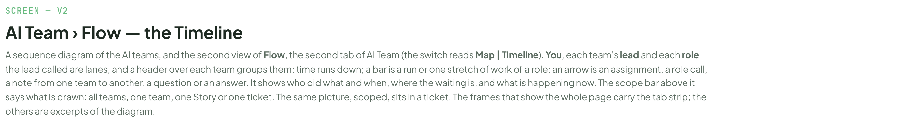
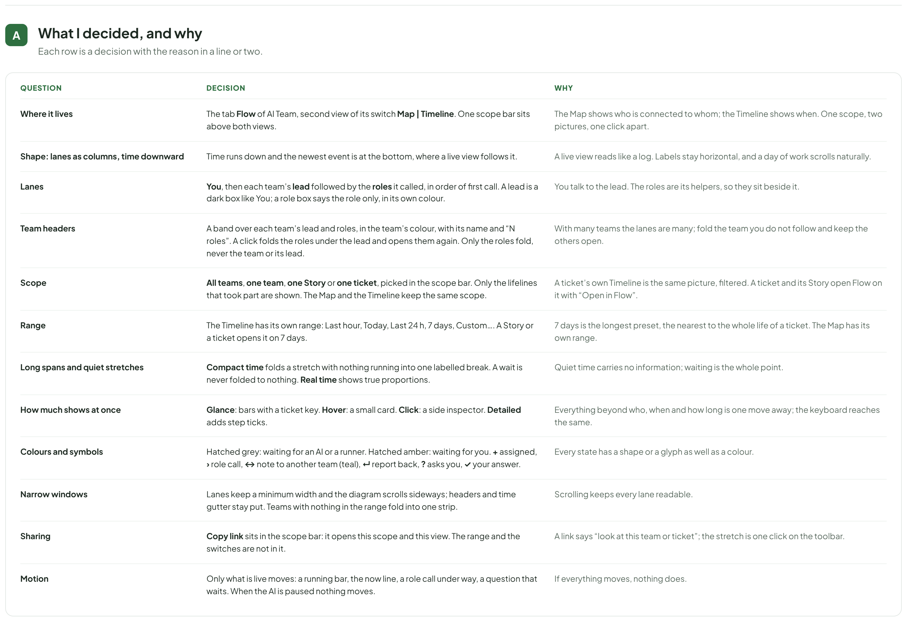
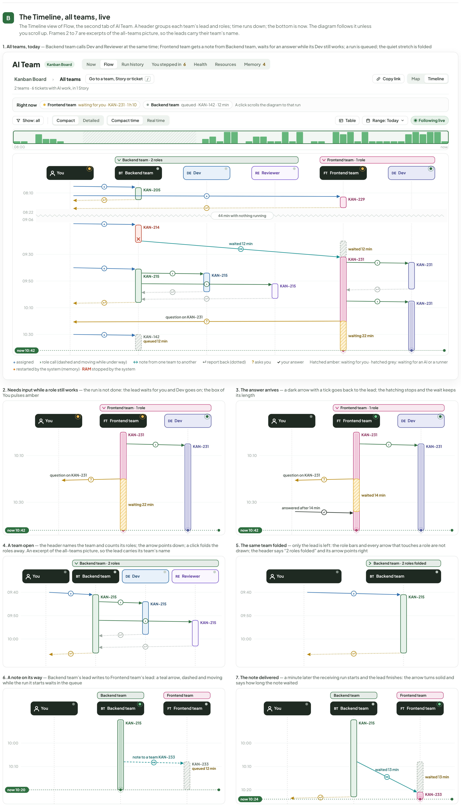
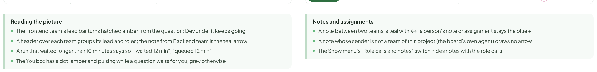
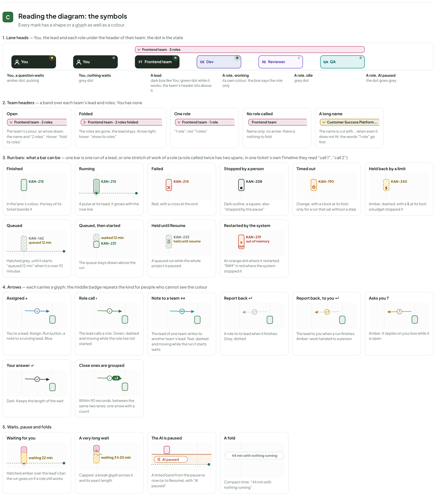
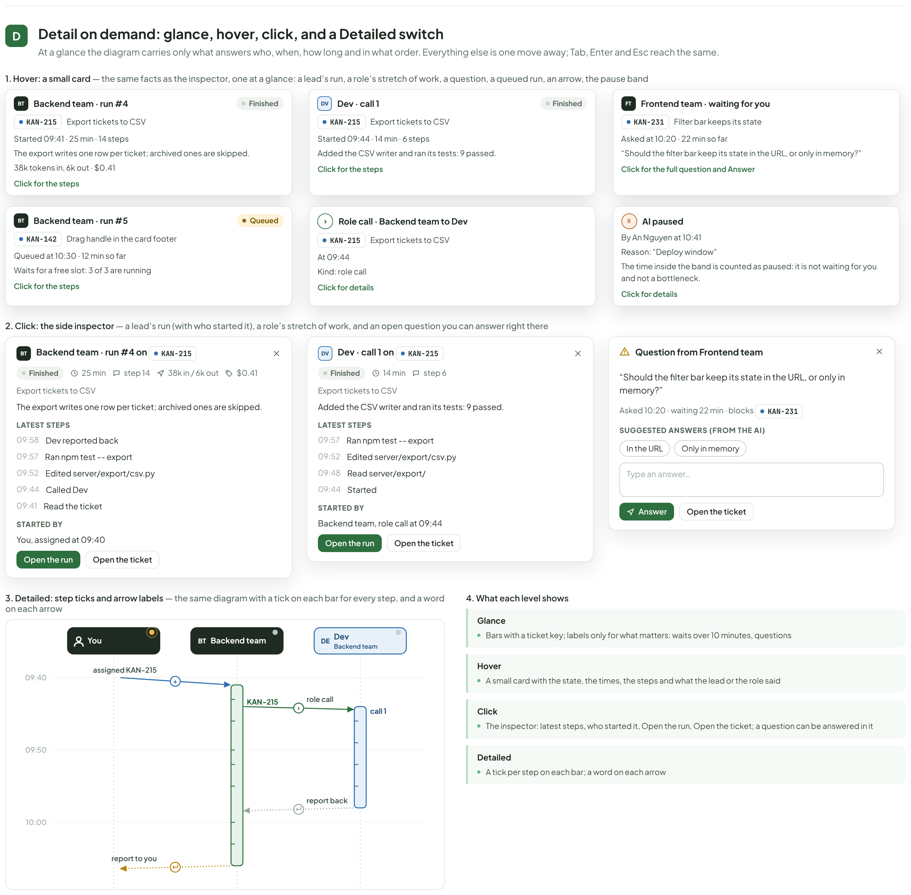

# AI Team — Flow: the Timeline view

> Redrawn for AI v2 · source: [`AiTimeline.dc.html`](../source/AiTimeline.dc.html) · canvas `1794108209-3be9` · sha256 `6a1cf199fabec229af9a99e02c5a01bece8609f93b6e9edc03bd8a39ab3ab07e`

> Words, states and conditions follow the code of branch `claude/ai-team-architecture-7a1efc`; the layout is designed here and is not the layout of the current screens. Names, ids, costs and times in the mock-ups are sample data. **Check the code before building from this: the file named in each part is the truth, not the picture.**

## SCREEN — V2

- Text in this part: "SCREEN — V2" · "AI Team › Flow — the Timeline" · "A sequence diagram of the AI teams, and the second view of Flow, the second tab of AI Team (the switch reads Map | Timeline). You, each team’s lead and each role the lead called are lanes, and a header over each team groups them; time runs down; a bar is a run or one stretch of work of a role; an arrow is an assignment, a role call, a note from one team to another, a question or an answer. It shows who did what and when, where the waiting is, and what is happening now. The scope bar above it says what is drawn: all teams, one team, one Story or one ticket. The same picture, scoped, sits in a ticket. The frames that show the whole page carry the tab strip; the others are excerpts of the diagram."

---

## What I decided, and why

- Text in this part: "A" · "What I decided, and why" · "Each row is a decision with the reason in a line or two." · "QUESTION" · "DECISION" · "WHY" · "Where it lives" · "The tab Flow of AI Team, second view of its switch Map | Timeline. One scope bar sits above both views." · "The Map shows who is connected to whom; the Timeline shows when. One scope, two pictures, one click apart." · "Shape: lanes as columns, time downward" · "Time runs down and the newest event is at the bottom, where a live view follows it." · "A live view reads like a log. Labels stay horizontal, and a day of work scrolls naturally." · "Lanes" · "You, then each team’s lead followed by the roles it called, in order of first call. A lead is a dark box like You; a role box says the role only, in its own colour." · "You talk to the lead. The roles are its helpers, so they sit beside it." · "Team headers" · "A band over each team’s lead and roles, in the team’s colour, with its name and “N roles”. A click folds the roles under the lead and opens them again. Only the roles fold, never the team or its lead." · "With many teams the lanes are many; fold the team you do not follow and keep the others open." · "Scope" · "All teams, one team, one Story or one ticket, picked in the scope bar. Only the lifelines that took part are shown. The Map and the Timeline keep the same scope." · "A ticket’s own Timeline is the same picture, filtered. A ticket and its Story open it with “Open in Timeline”." · "Range" · "The Timeline has its own range: Last hour, Today, Last 24 h, 7 days, Custom…. A Story or a ticket opens it on 7 days." · "7 days is the longest preset, the nearest to the whole life of a ticket. The Map has its own range." · "Long spans and quiet stretches" · "Compact time folds a stretch with nothing running into one labelled break. A wait is never folded to nothing. Real time shows true proportions." · "Quiet time carries no information; waiting is the whole point." · "How much shows at once" · "Glance: bars with a ticket key. Hover: a small card. Click: a side inspector. Detailed adds step ticks." · "Everything beyond who, when and how long is one move away; the keyboard reaches the same." · "Colours and symbols" · "Hatched grey: waiting for an AI or a runner. Hatched amber: waiting for you. + assigned, › role call, ↔ note to another team (teal), ↵ report back, ? asks you, ✓ your answer." · "Every state has a shape or a glyph as well as a colour." · "Narrow windows" · "Lanes keep a minimum width and the diagram scrolls sideways; headers and time gutter stay put. Teams with nothing in the range fold into one strip." · "Scrolling keeps every lane readable." · "Sharing" · "Copy link sits in the scope bar: it opens this scope and this view. The range and the switches are not in it." · "A link says “look at this team or ticket”; the stretch is one click on the toolbar." · "Motion" · "Only what is live moves: a running bar, the now line, a role call under way, a question that waits. When the AI is paused nothing moves." · "If everything moves, nothing does."

---

## The Timeline, all teams, live

- Text in this part: "B" · "The Timeline, all teams, live" · "The Timeline view of Flow, the second tab of AI Team. A header groups each team’s lead and roles; time runs down; the bottom is now. The diagram follows it unless you scroll up. Frames 2 to 7 are excerpts of the all-teams picture, so the leads carry their team’s name." · "1. All teams, today — Backend team calls Dev and Reviewer at the same time; Frontend team gets a note from Backend team, waits for an answer while its Dev still works; a run is queued; the quiet stretch is folded" · "AI Team" · "Kanban Board" · "Now" · "Flow" · "Run history" · "You stepped in" · "6" · "Health" · "Resources" · "Memory" · "4" · "›" · "All teams" · "Go to a team, Story or ticket" · "/" · "Copy link" · "Map" · "Timeline" · "2 teams · 6 tickets with AI work, in 1 Story" · "Right now" · "Frontend team" · "waiting for you · KAN-231 · 1 h 10" · "Backend team" · "queued · KAN-142 · 12 min" · "A click scrolls the diagram to that run" · "Show: all" · "Compact" · "Detailed" · "Compact time" · "Real time" · "Table" · "Range: Today" · "Following live" · "08:00" · "now" · "Backend team · 2 roles" · "Frontend team · 1 role" · "You" · "BT" · "DE" · "Dev" · "RE" · "Reviewer" · "FT" · "08:10" · "09:30" · "09:50" · "10:10" · "10:30" · "44 min with nothing running" · "08:22" · "09:06" · "waited 12 min" · "waiting 22 min" · "+" · "↵" · "?" · "question on KAN-231" · "KAN-205" · "KAN-229" · "KAN-214" · "KAN-231" · "KAN-215" · "KAN-142" · "queued 12 min" · "now 10:42" · "+ assigned" · "› role call (dashed and moving while under way)" · "↔ note from one team to another" · "↵ report back (dotted)" · "? asks you" · "✓ your answer" · "Hatched amber: waiting for you · hatched grey: waiting for an AI or a runner" · "• restarted by the system (memory) · RAM stopped by the system" · "2. Needs input while a role still works — the run is not done: the lead waits for you and Dev goes on; the box of You pulses amber" · "3. The answer arrives — a dark arrow with a tick goes back to the lead; the hatching stops and the wait keeps its length" · "waited 14 min" · "✓" · "answered after 14 min" · "4. A team open — the header names the team and counts its roles; the arrow points down; a click folds the roles away. An excerpt of the all-teams picture, so the lead carries its team’s name" · "09:40" · "10:00" · "5. The same team folded — only the lead is left: the role bars and every arrow that touches a role are not drawn; the header says “2 roles folded” and its arrow points right" · "Backend team · 2 roles folded" · "6. A note on its way — Backend team’s lead writes to Frontend team’s lead: a teal arrow, dashed and moving while the run it starts waits in the queue" · "10:20" · "note to a team KAN-233" · "KAN-233" · "now 10:20" · "7. The note delivered — a minute later the receiving run starts and the lead finishes: the arrow turns solid and says how long the note waited" · "waited 13 min" · "now 10:24" · "Reading the picture" · "The Frontend team’s lead bar turns hatched amber from the question; Dev under it keeps going" · "A header over each team groups its lead and roles; the note from Backend team is the teal arrow" · "A run that waited longer than 10 minutes says so: “waited 12 min”, “queued 12 min”" · "The You box has a dot: amber and pulsing while a question waits for you, grey otherwise" · "Notes and assignments" · "A note between two teams is teal with ↔; a person’s note or assignment stays the blue +" · "A note whose sender is not a team of this project (the board’s own agent) draws no arrow" · "The Show menu’s “Role calls and notes” switch hides notes with the role calls"

---

## Reading the diagram: the symbols

- Text in this part: "C" · "Reading the diagram: the symbols" · "Every mark has a shape or a glyph as well as a colour." · "1. Lane heads — You, the lead and each role under the header of their team; the dot is the state" · "Frontend team · 3 roles" · "You" · "FT" · "Frontend team" · "DE" · "Dev" · "RE" · "Reviewer" · "QA" · "You, a question waits" · "amber dot, pulsing" · "You, nothing waits" · "grey dot" · "A lead" · "dark box like You; green dot while it works; the team’s header sits above it" · "A role, working" · "its own colour; the box says the role only" · "A role, idle" · "A role, AI paused" · "the dot goes grey" · "2. Team headers — a band over each team’s lead and roles; You has none" · "Open" · "Frontend team · 2 roles" · "The team’s colour, an arrow down, the name and “2 roles”. Hover: “fold its roles”" · "Folded" · "Frontend team · 2 roles folded" · "The roles are gone, the lead stays. Arrow right; hover: “show its roles”" · "One role" · "Frontend team · 1 role" · "“1 role”, not “1 roles”" · "No role called" · "Name only, no arrow: there is nothing to fold" · "A long name" · "Customer Success Platform …" · "The name is cut with … when even it does not fit; the words “1 role” go first" · "3. Run bars: what a bar can be — one bar is one run of a lead, or one stretch of work of a role (a role called twice has two spans; in one ticket’s own Timeline they read “call 1”, “call 2”)" · "Finished" · "KAN-215" · "In the lane’s colour; the key of its ticket beside it" · "Running" · "A pulse at its head; it grows with the now line" · "Failed" · "KAN-214" · "Red, with a cross at the end" · "Stopped by a person" · "KAN-208" · "Dark outline, a square; also “stopped by the pause”" · "Timed out" · "KAN-190" · "Orange, with a clock at its foot; only for a run that sat without a step" · "Held back by a limit" · "$" · "KAN-240" · "Amber, dashed, with a $ at its foot: a budget stopped it" · "Queued" · "KAN-142" · "queued 12 min" · "Hatched grey, until it starts; “queued 12 min” when it is over 10 minutes" · "Queued, then started" · "waited 12 min" · "KAN-231" · "The queue stays drawn above the run" · "Held until Resume" · "KAN-233" · "held until resume" · "A queued run while the whole project is paused" · "Restarted by the system" · "RAM" · "KAN-219" · "out of memory" · "An orange dot where it restarted; “RAM” in red where the system stopped it" · "4. Arrows — each carries a glyph; the middle badge repeats the kind for people who cannot see the colour" · "Assigned +" · "+" · "You to a lead: Assign, Run button, a note to a running lead. Blue" · "Role call ›" · "›" · "The lead calls a role. Green; dashed and moving while the role has not started" · "Note to a team ↔" · "The lead of one team writes to another team’s lead. Teal; dashed and moving while the run it starts waits" · "Report back ↵" · "↵" · "A role to its lead when it finishes. Grey, dotted" · "Report back, to you ↵" · "The lead to you when a run finishes. Amber: work handed to a person" · "Asks you ?" · "?" · "Amber. It ripples on your box while it is open" · "Your answer ✓" · "✓" · "Dark. Keeps the length of the wait" · "Close ones are grouped" · "×3" · "Within 90 seconds, between the same two lanes: one arrow with a count" · "5. Waits, pause and folds" · "Waiting for you" · "waiting 22 min" · "Hatched amber over the lead’s bar; the run goes on if a role still works" · "A very long wait" · "waiting 3 h 20 min" · "Capped: a break glyph across it and its exact length" · "The AI is paused" · "AI paused" · "A tinted band from the pause to now (or to Resume), with “AI paused”" · "A fold" · "44 min with nothing running"

---

## Detail on demand: glance, hover, click, and a Detailed switch

- Text in this part: "D" · "Detail on demand: glance, hover, click, and a Detailed switch" · "At a glance the diagram carries only what answers who, when, how long and in what order. Everything else is one move away; Tab, Enter and Esc reach the same." · "1. Hover: a small card — the same facts as the inspector, one at a glance: a lead’s run, a role’s stretch of work, a question, a queued run, an arrow, the pause band. A team’s header only has a tip: “Backend team: fold its roles”" · "BT" · "Backend team · run #4" · "Finished" · "KAN-215" · "Export tickets to CSV" · "Started 09:41 · 25 min · 14 steps" · "The export writes one row per ticket; archived ones are skipped." · "38k tokens in, 6k out · $0.41" · "Click for the steps" · "DV" · "Dev · call 1" · "Started 09:44 · 14 min · 6 steps" · "Added the CSV writer and ran its tests: 9 passed." · "FT" · "Frontend team · waiting for you" · "KAN-231" · "Filter bar keeps its state" · "Asked at 10:20 · 22 min so far" · "“Should the filter bar keep its state in the URL, or only in memory?”" · "Click for the full question and Answer" · "Backend team · run #5" · "Queued" · "KAN-142" · "Drag handle in the card footer" · "Queued at 10:30 · 12 min so far" · "›" · "Role call · Backend team to Dev" · "At 09:44" · "Kind: role call" · "Click for details" · "↔" · "Note to a team · Backend team to Frontend team" · "Sent 09:20 · Frontend team started 09:32" · "Waited 12 min" · "By Backend team" · "Kind: note to a team" · "Dev · call 2" · "Running" · "Started 10:05 · 37 min · step 11" · "Running the tests of the filter store." · "Role call · Backend team to Reviewer" · "At 09:52" · "AI paused" · "By An Nguyen at 10:41" · "Reason: “Deploy window”" · "The time inside the band is counted as paused: it is not waiting for you and not a bottleneck." · "2. Click: the side inspector — a lead’s run (with who started it), a role’s stretch of work, and an open question you can answer right there" · "Backend team · run #4 on" · "25 min" · "step 14" · "38k in / 6k out" · "$0.41" · "LATEST STEPS" · "09:58" · "Dev reported back" · "09:57" · "Ran npm test -- export" · "09:52" · "Edited server/export/csv.py" · "09:44" · "Called Dev" · "09:41" · "Read the ticket" · "STARTED BY" · "You, assigned at 09:40" · "Open the run" · "Open the ticket" · "Dev · call 1 on" · "14 min" · "step 6" · "09:48" · "Read server/export/" · "Started" · "Backend team, role call at 09:44" · "Question from Frontend team" · "Asked 10:20 · waiting 22 min · blocks" · "SUGGESTED ANSWERS (FROM THE AI)" · "In the URL" · "Only in memory" · "Type an answer…" · "Answer" · "3. Detailed: step ticks and arrow labels — the same diagram with a tick on each bar for every step, and a word on each arrow" · "Backend team · 1 role" · "You" · "Backend team" · "DE" · "Dev" · "09:40" · "09:50" · "10:00" · "+" · "assigned KAN-215" · "role call KAN-215" · "↵" · "report back KAN-215" · "4. What each level shows" · "Glance" · "Bars with a ticket key; labels only for what matters: waits over 10 minutes, questions" · "Hover" · "A small card with the state, the times, the steps and what the lead or the role said" · "Click" · "The inspector: latest steps, who started it, Open the run, Open the ticket; a question can be answered in it" · "Detailed" · "A tick per step on each bar; a word on each arrow"

---

## Todo rows, differences from the code, and what was not checked

AiTimeline 1480x6995, AiTimelineCases 1480x9850. Rows done: A-093..A-102, A-205, A-215 (team headers), A-216 (note arrow, teal, with a disc), A-214 (scope bar as it sits above the Timeline; picker not drawn), A-218 (7 days on a Story/ticket), A-219 + B-11 + B-43 (Open in Timeline from ticket AI tab and Story page), B-13, B-30 kept. Not done: A-217 (Flow empty states, other worker), picker popup, Resources strip in the ticket drawn compact.
Code vs todo: A-093 says Whole team / One ticket; A-214 and code have All teams, a team, a Story, a ticket (followed code). A-216 says two heads; code draws one head at the receiver plus a disc glyph. B-11 says no filters row in the ticket's Timeline; code (compactChrome) only hides the scope menu (drew code). Todo words over code: Show menu "Hand-offs" drawn "Role calls and notes"; "newest 500 hand-offs" drawn "newest 500 events"; hover/inspector "Role call" where code says "Hand-off". Note arrow's sender lane is drawn even if the sender had no run in the range (timeline.py).
Drawn differently from the code (code must change): role box says the role only under a team header; lead says "Lead" when one team is on show, else the team name; folded team header band is 92 px in code ("Frontend ..." cut, count lost), drawn wider with "N roles folded"; "Kanban Board > All teams" separator; scope bar in narrow frames in two rows; Story scope bars keep ticket keys (code "run N"); arrow label above the line; vector disc glyph; white halo on bar keys.
Not checked: dark theme, keyboard order, which Show switch hides notes, hover of a team header (caption only), "7 days" opening range, ticket tab at real modal width. Drawn from text only: note arrow in a real run, fold/unfold, Story/ticket opening on 7 days, Story-scope bars. Measure.js flags elements near the right edge in Cases (8-lane diagram in an overflow-hidden frame): not checked individually.

### Review

The canvas was read once by an independent reviewer subagent that got the result and the todo rows, not the builder's conclusions; the findings were fixed except where noted above. The reviewer was not run again after the fixes. The app was not run.
