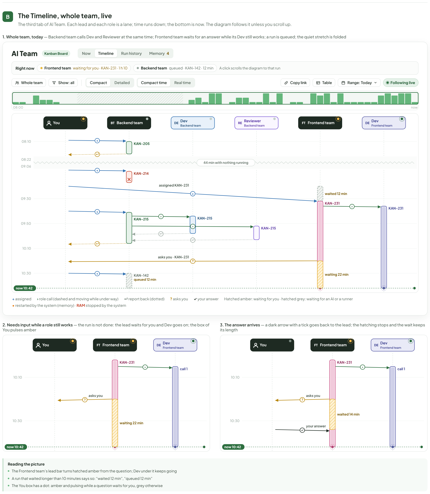

# AI Team — Flow: the Timeline view

> Redrawn for AI v2 · source: [`AiTimeline.dc.html`](../source/AiTimeline.dc.html) · canvas `1794099567-d725` · sha256 `20e235bc485346b519163693a1b829624a73104802d16c92451984237eb00000`

> Words, states and conditions follow the code of branch `claude/ai-team-architecture-7a1efc`; the layout is designed here and is not the layout of the current screens. Names, ids, costs and times in the mock-ups are sample data. **Check the code before building from this: the file named in each part is the truth, not the picture.**

## SCREEN — V2

- Text in this part: "SCREEN — V2" · "AI Team — the Timeline" · "A sequence diagram of the AI teams. You, each team’s lead and each role the lead called are lanes; time runs down; a bar is a run or one stretch of work of a role; an arrow is an assignment, a role call, a question or an answer. It shows who did what and when, where the waiting is, and what is happening now. It is the third tab of AI Team and the same picture, scoped, sits in a ticket."

---

## What I decided, and why

- Text in this part: "A" · "What I decided, and why" · "Each row is a decision with the reason in a line or two." · "QUESTION" · "DECISION" · "WHY" · "Shape: lanes as columns, time downward" · "Time runs down and the newest event is at the bottom, where a live view follows it." · "A live view reads like a log. Labels stay horizontal, and a day of work scrolls naturally." · "Lanes" · "You, then each team’s lead followed by the roles it called, in order of first call. A lead is a dark box like You; a role has its own colour." · "You talk to the lead. The roles are its helpers, so they sit beside it." · "Scope" · "Whole team or One ticket. Picking a ticket keeps only the lanes that took part." · "A ticket’s story is the same picture, filtered. The ticket opens it with “Open in Timeline”." · "Long spans and quiet stretches" · "Compact time folds a stretch with nothing running into one labelled break. A wait is never folded to nothing. Real time shows true proportions." · "Quiet time carries no information; waiting is the whole point." · "How much shows at once" · "Glance: bars with a ticket key. Hover: a small card. Click: a side inspector. Detailed adds step ticks." · "Everything beyond who, when and how long is one move away; the keyboard reaches the same." · "Colours and symbols" · "Hatched grey: waiting for an AI or a runner. Hatched amber: waiting for you. + assigned, › role call, ↵ report back, ? asks you, ✓ your answer." · "Every state has a shape or a glyph as well as a colour." · "Narrow windows" · "Lanes keep a minimum width and the diagram scrolls sideways; headers and time gutter stay put. Teams with nothing in the range fold into one strip." · "Scrolling keeps every lane readable." · "Sharing a range" · "Copy link only: it restores the range, the scope and the switches." · "A link is cheap and covers “look at this stretch”." · "Motion" · "Only what is live moves: a running bar, the now line, a role call under way, a question that waits. When the AI is paused nothing moves." · "If everything moves, nothing does."

---

## The Timeline, whole team, live

- Text in this part: "B" · "The Timeline, whole team, live" · "The third tab of AI Team. Each lead and each role is a lane; time runs down; the bottom is now. The diagram follows it unless you scroll up." · "1. Whole team, today — Backend team calls Dev and Reviewer at the same time; Frontend team waits for an answer while its Dev still works; a run is queued; the quiet stretch is folded" · "AI Team" · "Kanban Board" · "Now" · "Timeline" · "Run history" · "Memory" · "4" · "Right now" · "Frontend team" · "waiting for you · KAN-231 · 1 h 10" · "Backend team" · "queued · KAN-142 · 12 min" · "A click scrolls the diagram to that run" · "Whole team" · "Show: all" · "Compact" · "Detailed" · "Compact time" · "Real time" · "Copy link" · "Table" · "Range: Today" · "Following live" · "08:00" · "now" · "You" · "BT" · "DE" · "Dev" · "RE" · "Reviewer" · "FT" · "08:10" · "09:30" · "09:50" · "10:10" · "10:30" · "44 min with nothing running" · "08:22" · "09:06" · "KAN-205" · "KAN-214" · "waited 12 min" · "KAN-231" · "KAN-215" · "KAN-142" · "queued 12 min" · "waiting 22 min" · "+" · "↵" · "assigned KAN-231" · "›" · "?" · "asks you · KAN-231" · "now 10:42" · "+ assigned" · "› role call (dashed and moving while under way)" · "↵ report back (dotted)" · "? asks you" · "✓ your answer" · "Hatched amber: waiting for you · hatched grey: waiting for an AI or a runner" · "• restarted by the system (memory) · RAM stopped by the system" · "2. Needs input while a role still works — the run is not done: the lead waits for you and Dev goes on; the box of You pulses amber" · "call 1" · "asks you" · "3. The answer arrives — a dark arrow with a tick goes back to the lead; the hatching stops and the wait keeps its length" · "waited 14 min" · "✓" · "your answer" · "Reading the picture" · "The Frontend team’s lead bar turns hatched amber from the question; Dev under it keeps going" · "A run that waited longer than 10 minutes says so: “waited 12 min”, “queued 12 min”" · "The You box has a dot: amber and pulsing while a question waits for you, grey otherwise"

---

## Reading the diagram: the symbols

- Text in this part: "C" · "Reading the diagram: the symbols" · "Every mark has a shape or a glyph as well as a colour." · "1. Lane heads — You, the lead and each role; the dot is the state" · "You" · "FT" · "Frontend team" · "DE" · "Dev" · "RE" · "Reviewer" · "QA" · "You, a question waits" · "amber dot, pulsing" · "You, nothing waits" · "grey dot" · "A lead" · "dark box like You; green dot while it works" · "A role, working" · "its own colour, with the team under its name" · "A role, idle" · "A role, AI paused" · "the dot goes grey" · "2. Run bars: what a bar can be — one bar is one run of a lead, or one stretch of work of a role (“call 1”, “call 2”: a role called twice has two spans)" · "Finished" · "KAN-215" · "In the lane’s colour; the key of its ticket beside it" · "Running" · "A pulse at its head; it grows with the now line" · "Failed" · "KAN-214" · "Red, with a cross at the end" · "Stopped by a person" · "KAN-208" · "Dark outline, a square; also “stopped by the pause”" · "Timed out" · "KAN-190" · "Orange; only for a run that sat without a step" · "Held back by a limit" · "KAN-240" · "Amber, dashed: a budget stopped it" · "Queued" · "KAN-142" · "queued 12 min" · "Hatched grey, until it starts; “queued 12 min” when it is over 10 minutes" · "Queued, then started" · "waited 12 min" · "KAN-231" · "The queue stays drawn above the run" · "Held until Resume" · "KAN-233" · "held until resume" · "A queued run while the whole project is paused" · "Restarted by the system" · "KAN-219" · "out of memory" · "An orange dot where it restarted; red when it stopped" · "3. Arrows — each carries a glyph; the middle badge repeats the kind for people who cannot see the colour" · "Assigned +" · "+" · "You to a lead: Assign, Run button, a note to a running lead. Blue" · "Role call ›" · "›" · "The lead calls a role. Green; dashed and moving while the role has not started" · "Report back ↵" · "↵" · "A role to its lead when it finishes. Grey, dotted" · "Report to you ↵" · "The lead to you when a run finishes. Amber: work handed to a person" · "Asks you ?" · "?" · "Amber. It ripples on your box while it is open" · "Your answer ✓" · "✓" · "Dark. Keeps the length of the wait" · "Close ones are grouped" · "×3" · "Within 90 seconds, between the same two lanes: one arrow with a count" · "4. Waits, pause and folds" · "Waiting for you" · "waiting 22 min" · "Hatched amber over the lead’s bar; the run goes on if a role still works" · "A very long wait" · "waiting 3 h 20 min" · "Capped: a break glyph across it and its exact length" · "The AI is paused" · "AI paused" · "A tinted band from the pause to now (or to Resume), with “AI paused”" · "A fold" · "44 min with nothing running" · "00:16" · "00:44" · "Compact time: “44 min with nothing running”"

---

## Detail on demand: glance, hover, click, and a Detailed switch

- Text in this part: "D" · "Detail on demand: glance, hover, click, and a Detailed switch" · "At a glance the diagram carries only what answers who, when, how long and in what order. Everything else is one move away; Tab, Enter and Esc reach the same." · "1. Hover: a small card — the same facts as the inspector, one at a glance: a lead’s run, a role’s stretch of work, a question, a queued run, an arrow, the pause band" · "BT" · "Backend team · run #4" · "Finished" · "KAN-215" · "Export tickets to CSV" · "Started 09:41 · 25 min · 14 steps" · "The export writes one row per ticket; archived ones are skipped." · "38k tokens in, 6k out · $0.41" · "Click for the steps" · "DV" · "Dev · call 1" · "Started 09:44 · 14 min · 6 steps" · "Added the CSV writer and ran its tests: 9 passed." · "FT" · "Frontend team · waiting for you" · "KAN-231" · "Filter bar keeps its state" · "Asked at 10:20 · 22 min so far" · "“Should the filter bar keep its state in the URL, or only in memory?”" · "Click for the full question and Answer" · "Backend team · run #5" · "Queued" · "KAN-142" · "Drag handle in the card footer" · "Queued at 10:30 · 12 min so far" · "Waits for a free slot: 3 of 3 are running" · "›" · "Role call · Backend team to Dev" · "At 09:44" · "Kind: role call" · "Click for details" · "AI paused" · "By An Nguyen at 10:41" · "Reason: “Deploy window”" · "The time inside the band is counted as paused: it is not waiting for you and not a bottleneck." · "2. Click: the side inspector — a lead’s run (with who started it), a role’s stretch of work, and an open question you can answer right there" · "Backend team · run #4 on" · "25 min" · "step 14" · "38k in / 6k out" · "$0.41" · "LATEST STEPS" · "09:58" · "Dev reported back" · "09:57" · "Ran npm test -- export" · "09:52" · "Edited server/export/csv.py" · "09:44" · "Called Dev" · "09:41" · "Read the ticket" · "STARTED BY" · "You, assigned at 09:40" · "Open the run" · "Open the ticket" · "Dev · call 1 on" · "14 min" · "step 6" · "09:48" · "Read server/export/" · "Started" · "Backend team, role call at 09:44" · "Question from Frontend team" · "Asked 10:20 · waiting 22 min · blocks" · "SUGGESTED ANSWERS (FROM THE AI)" · "In the URL" · "Only in memory" · "Type an answer…" · "Answer" · "3. Detailed: step ticks and arrow labels — the same diagram with a tick on each bar for every step, and a word on each arrow" · "You" · "Backend team" · "DE" · "Dev" · "09:40" · "09:50" · "10:00" · "call 1" · "+" · "assigned KAN-215" · "role call" · "↵" · "report back" · "report to you" · "4. What each level shows" · "Glance" · "Bars with a ticket key; labels only for what matters: waits over 10 minutes, questions" · "Hover" · "A small card with the state, the times, the steps and what the lead or the role said" · "Click" · "The inspector: latest steps, who started it, Open the run, Open the ticket; a question can be answered in it" · "Detailed" · "A tick per step on each bar; a word on each arrow"

---

Rows, differences from the code and open points for this group are in [ai-team.md](ai-team.md).
