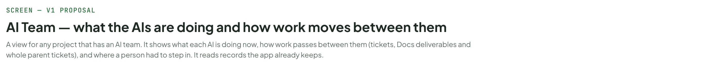

# AI Team — what the AIs are doing and how work moves between them

> SCREEN — V1 PROPOSAL · source: [`AiTeam.dc.html`](../source/AiTeam.dc.html) · canvas `1793385597-3e85` · sha256 `fc190c770ee3a9901e9effe1e63d6b6c0cee159c7c1926037292c2376af2e981`

A view for any project that has an AI team. It shows what each AI is doing now, how work passes between them (tickets, Docs deliverables and whole parent tickets), and where a person had to step in. It reads records the app already keeps.

Source: [AiTeam.dc.html](../source/AiTeam.dc.html) › header ("SCREEN — V1 PROPOSAL", "AI Team — what the AIs are doing and how work moves between them" and the intro)

---

## A. Four questions, four tabs

A new view, AI Team, next to Board, List, Timeline and Docs in the project top bar. A small amber number on it counts the things waiting for you. It adds no new tracking: everything is worked out from records the app already keeps, so it works for any project that has AI members and for any date range, not only for a test.

Source: [AiTeam.dc.html](../source/AiTeam.dc.html) › block "A. Four questions, four tabs"

- Text in the frames: "QUESTION" · "TAB" · "WHAT YOU SEE" · "WHERE IT COMES FROM" · "What is each AI doing, and what has it done?" · "Now" · "One card per AI: working, waiting for you, queued, idle, offline. What it is on, how long, what it finished last. A strip of everything that needs you, including Docs changes waiting for a decision." · "Runs (state, steps, summary), members (health, paused), approvals, questions, Docs pages and threads" · "How does work pass between the AIs, start to finish?" · "Flow" · "A map of hand-offs for the whole team (by kind: assigned, @mention, hand-off, report back), one ticket from the first assignment to Done, a Docs deliverable with its review threads, and a parent ticket with its children." · "Run trigger and chain (assign, mention, handoff, report_back, schedule), assignee and status changes, the activity log" · "Where did a person have to step in?" · "You stepped in" · "Every manual touch: answers, approvals, runs started by hand, config changes, edits while an AI worked, stops. Each one marked By rule, Needed or Avoidable." · "Answers, approvals, run triggers, the audit log, edits made during a run, stop codes" · "Is the AI feature healthy?" · "Health" · "A verdict, five measures, a row per AI and a short list of what to fix, each with its evidence." · "All of the above, plus usage and the ratings people give answers"

---

## B. Now: what each AI is doing

The first tab. At the top, everything that cannot move without you, oldest first, each with what it is blocking. Below, one card per AI. The point is that a glance answers three things for every AI: is it working, is it stuck on me, or is it down. Cards update live; opening a run goes to the run view that already exists.

Source: [AiTeam.dc.html](../source/AiTeam.dc.html) › block "B. Now: what each AI is doing"

- Text in the frames: "KANBAN" · "PROJECTS" · "Kanban Board" · "KAN" · "Mobile App" · "MOB" · "Marketing Site" · "MKT" · "Settings" · "Members" · "4 · 7 AI" · "Recycle Bin" · "3" · "Board" · "List" · "Timeline" · "Docs" · "AI Team" · "4" · "Pause all AI" · "New Ticket" · "Now" · "Flow" · "You stepped in" · "27" · "Health" · "Live · updated 4 s ago" · "Working 2" · "Waiting for you 1" · "Offline 1" · "Idle 2" · "6 AI members · Kanban Board" · "Needs you · 4" · "Oldest first. Each one is something an AI cannot continue without." · "BA asks a question" · "BA on" · "KAN-215" · "“Should the export include archived tickets?”" · "waiting 41 min · blocks KAN-215" · "Answer" · "Dev wants to change an assignee" · "Dev on" · "KAN-212" · ": assign to Tester when done. Risk low." · "waiting 6 min · the run goes on, this step waits" · "Approve" · "Deny" · "Tester is offline" · "Tester is not logged in to its local runner since 09:58." · "offline 42 min · 2 tickets waiting" · "Fix connection" · "Designer proposed 2 changes to a page" · "Designer on UX design (Docs, v3) for" · "KAN-213" · "waiting 9 min · blocks the review of KAN-213" · "Review changes" · "PM" · "Sonnet · local runner" · "Idle" · "Nothing assigned." · "Last: finished" · "KAN-214" · "prepared the ticket" · "12 min ago · $0.08" · "TODAY" · "5 runs · 5 ok · $0.41" · "Open last run" · "BA" · "Waiting for you" · "On" · "Export tickets to CSV" · "Asked 41 min ago · run is paused, nothing is lost" · "3 runs · 2 ok · $0.36" · "Open run" · "DS" · "Designer" · "Opus · API key" · "Working" · "Empty state for Schedules" · "Step 7: drawing the layout" · "6 min of 20" · "4 runs · 4 ok · $4.00 / $5.00" · "Pause" · "DV" · "Dev" · "Sonnet · API key" · "Show cost on run cards" · "Step 19: editing RunCard.tsx · 3 files so far" · "14 min of 30" · "Next in line:" · "KAN-216" · "(queued behind this run)" · "6 runs · 5 ok · $1.94" · "TS" · "Tester" · "Offline" · "Not logged in to the local runner" · "Since 09:58. Queued:" · "KAN-209" · "," · "KAN-211" · "." · "Last run finished 09:41 · passed" · "2 runs · 2 ok · $0.22" · "RV" · "Reviewer" · "Antigravity · local runner" · "Nothing in Review." · "Last: reviewed" · "KAN-208" · "2 comments" · "38 min ago · 14k tokens, no cost reported" · "Connection unknown" · "3 runs · 3 ok · 41k tokens" · "Recent hand-offs" · "See the flow" · "needs a spec" · "@mention" · "58 min ago" · "You" · "Question on" · "asked you" · "41 min ago" · "layout done" · "hand-off" · "27 min ago" · "reviewed" · "report back" · "38 min ago" · "KAN-207" · "sent back: criterion 4" · "sent back" · "1 h ago" · "Today so far" · "RUNS TODAY" · "23" · "19 ok · 2 failed · 2 running" · "SPENT TODAY" · "$6.84" · "of $25.00 daily cap for the team"

---

## C. Flow, team map: how work moves between the AIs

One picture of the team. Each box is an AI, each arrow a hand-off with how many times it happened and how long the next AI waited. Red arrows show work sent back after the first review round, which is where a team usually loses time. A hand-off is when the AI holding a ticket changes. The app records its kind exactly: an assignment, an @mention, a hand-off between AIs, or a report back to whoever delegated the work. A report back is expected and never counts against anyone, so a PM that delegates a lot does not look like the bottleneck.

Source: [AiTeam.dc.html](../source/AiTeam.dc.html) › block "C. Flow, team map: how work moves between the AIs"

![C. Flow, team map: how work moves between the AIs: One picture of the team. Each box is an AI, each arrow a hand-off with how many times it happened and how long the next AI waited. Red arrows show work sent back after the first review round, which is where a team usually loses time. A hand-off is when the AI holding a ticket changes. The app records its kind exactly: an assignment, an @mention, a hand-off between AIs, or a report back to whoever delegated the work. A report back is expected and never counts against anyone, so a PM that delegates a lot does not look like the bottleneck.](../images/ai-team/06-c-flow-team-map-how-work-moves-between-the-ais.png)

- Text in the frames: "AI Team" · "Kanban Board" · "Now" · "Flow" · "You stepped in" · "27" · "Health" · "Last 7 days" · "Team map" · "One ticket" · "18 tickets with AI work in the last 7 days · the number on an arrow is how many hand-offs, the time under it the average wait before the next AI started" · "15 report back to the PM (expected, not counted as sent back)" · "4 skip BA and Designer" · "PM" · "18 tickets" · "avg run 6 min" · "asked you: 1" · "BA" · "12 tickets" · "avg run 11 min" · "asked you: 2" · "Designer" · "7 tickets" · "avg run 14 min" · "asked you: 0" · "Dev" · "avg run 21 min" · "Tester" · "16 tickets" · "avg run 9 min" · "asked you: 3" · "Reviewer" · "14 tickets" · "avg run 8 min" · "12" · "4 min" · "7" · "9 min" · "3 min" · "16" · "2 min" · "14" · "6 sent back" · "3 sent back" · "HAND-OFFS" · "68" · "assigned 21, @mention 14, hand-off 18, report back 15" · "SENT BACK" · "9" · "13% · returned after the first review round. Tester 6, Reviewer 3" · "PING-PONG" · "1" · "one ticket sent back 3 times: KAN-207" · "WAITING FOR YOU" · "27%" · "of the time until completed" · "Green arrow a normal hand-off. Thicker means more." · "Red dashed work sent back." · "Purple a step skipped." · "Grey dotted report back, expected." · "The first return from a review (11 this week) is normal and is not counted as sent back."

---

## D. Flow, one ticket: from the first assignment to Done

Pick a ticket and see its whole life. One lane per AI plus a lane for you, bars for runs, arrows for hand-offs, diamonds for every time a person stepped in. The strip above the chart splits the elapsed time into AI working, waiting for you and gaps between runs, which is usually the quickest way to see where time went. Above it, what was delivered and when the ticket counted as completed: when its last run finished and the deliverable exists, or when a person accepted it, so tickets whose AIs may not go as far as Review are not counted as failures. This works the same for a ticket that is still running.

Source: [AiTeam.dc.html](../source/AiTeam.dc.html) › block "D. Flow, one ticket: from the first assignment to Done"

![D. Flow, one ticket: from the first assignment to Done: Pick a ticket and see its whole life. One lane per AI plus a lane for you, bars for runs, arrows for hand-offs, diamonds for every time a person stepped in. The strip above the chart splits the elapsed time into AI working, waiting for you and gaps between runs, which is usually the quickest way to see where time went. Above it, what was delivered and when the ticket counted as completed: when its last run finished and the deliverable exists, or when a person accepted it, so tickets whose AIs may not go as far as Review are not counted as failures. This works the same for a ticket that is still running.](../images/ai-team/08-d-flow-one-ticket-from-the-first-assignment-to-d.png)

- Text in the frames: "AI Team" · "Kanban Board" · "Now" · "Flow" · "You stepped in" · "27" · "Health" · "Last 7 days" · "Team map" · "One ticket" · "Find a ticket" · "KAN-210" · "Show cost on run cards" · "Done · 4 h 08 · 4 touches · $2.06" · "KAN-212" · "Cost estimate on the card" · "In progress · 2 touches" · "KAN-207" · "Retry webhook delivery" · "Review · bounced 3 times · 5 touches" · "KAN-205" · "Fix timezone drift" · "Done · 1 h 40 · 0 touches" · "KAN-202" · "Import CSV" · "Done · 6 h 12 · 2 touches" · "Tue Oct 28 · started by Hoa Mai" · "DELIVERABLE" · "branch feat/cost-badge" · "3 files, tests pass" · "COMPLETED" · "13:10, Reviewer approved and Hoa Mai accepted it" · "ELAPSED" · "4 h 08" · "09:02 to 13:10" · "AIS WORKING" · "2 h 51" · "9 runs" · "WAITING FOR YOU" · "1 h 10" · "3 waits + marking Done" · "BETWEEN RUNS" · "7 min" · "hand-off gaps" · "HAND-OFFS" · "7" · "1 returned, round 1" · "YOU STEPPED IN" · "4" · "3 expected, 1 avoidable" · "COST" · "$2.06" · "You" · "PM" · "BA" · "Designer" · "Dev" · "Tester" · "Reviewer" · "09:00" · "10:00" · "11:00" · "12:00" · "13:00" · "waiting 23m" · "Dev #2" · "Tester #1" · "Dev #3" · "#2" · "waiting 25m" · "@mention" · "approved by you" · "assigned" · "moved to Test" · "returned (round 1)" · "moved to Review" · "1" · "2" · "3" · "5" · "◆ Start" · "◆ By rule" · "◆ Needed" · "◆ Avoidable" · "Hatched bar: waiting for you" · "Red bar: failed" · "Brown dashed arrow: returned in review round 1 (normal)" · "Red dashed: sent back after round 1" · "Grey dotted: report back" · "TOUCHES: THE START AND FOUR TIMES YOU STEPPED IN" · "09:02" · "You created the ticket and assigned it to PM" · "Start" · "09:31" · "You answered PM: “Show cost for Ask-only runs too.”" · "Needed" · "10:05" · "You approved BA changing the assignee to Designer" · "By rule" · "You raised the Dev time limit to 60 min and ran it again after the first run timed out at 30" · "Avoidable" · "13:10" · "You moved the ticket to Done (the AIs may go up to Review)" · "SELECTED" · "DV" · "Dev · run #1" · "Timed out" · "10:23 to 10:53 · 30 min, the member’s limit · $0.61 · 41 steps" · "Summary" · "Was editing RunCard.tsx and the cost helper, 3 of 5 criteria done when time ran out." · "WHAT FOLLOWED" · "You raised the limit to 60 min and started run #2 at 11:00. Run #2 finished in 42 min." · "Open the full run" · "Click any bar, arrow or diamond to see this card for it."

---

## E. Flow, a Docs deliverable: versions and review threads

Much of what an AI team delivers is a Docs page, not a branch. The ticket journey shows the page, each version published, and its review threads (resolved, open, or orphaned when the text under them changed). A review loop of one round is normal and shown as returned; only a second return counts as sent back. Resolving threads and accepting a proposal are touches like any other.

Source: [AiTeam.dc.html](../source/AiTeam.dc.html) › block "E. Flow, a Docs deliverable: versions and review threads"

- Text in the frames: "AI Team" · "Kanban Board" · "Now" · "Flow" · "You stepped in" · "27" · "Health" · "Last 7 days" · "KAN-222" · "UX design" · "Docs deliverable" · "Wed Oct 29 · part of" · "KAN-220" · "ELAPSED" · "1 h 58" · "09:02 to 11:00" · "AIS WORKING" · "1 h 40" · "7 runs" · "WAITING FOR YOU" · "7 min" · "1 wait" · "BETWEEN RUNS" · "11 min" · "hand-off gaps" · "HAND-OFFS" · "6" · "1 returned, 1 sent back, 1 report back" · "YOU STEPPED IN" · "3" · "1 needed, 1 by rule, plus the start" · "COST" · "$0.62" · "Reviewer: 74k tokens, no cost reported" · "You" · "PM" · "Designer" · "Reviewer" · "09:00" · "10:00" · "11:00" · "Designer #1" · "Reviewer #1" · "Designer #2" · "Rev. #2" · "#3" · "hand-off" · "to review" · "returned (round 1)" · "sent back (round 2)" · "report back" · "v1" · "v2" · "v3" · "1" · "2" · "● thread resolved" · "● thread open" · "○ thread orphaned (its text changed)" · "v2 page version published" · "Brown dashed: returned, round 1 (normal)" · "Red dashed: sent back" · "Grey dotted: report back" · "TOUCHES: THE START AND TWO TIMES YOU STEPPED IN" · "09:02" · "You assigned the epic to PM, who delegated this page to Designer" · "Start" · "10:50" · "You resolved 3 review threads that Designer had fixed in v2" · "Needed" · "10:52" · "You accepted 2 of the 3 changes Designer proposed" · "By rule" · "DELIVERABLE" · "Published · v3" · "v1 09:40 Designer · v2 10:25 after review round 1 · v3 10:52 after you accepted a proposal" · "6 review threads: 3 resolved, 1 open, 2 orphaned" · "Delivered. 3 threads need a person" · "Open the page" · "Open the threads" · "The ticket counts as completed when the last run finished and the page exists. Open or orphaned threads do not block that; they show here and in Needs you."

---

## F. Flow, a parent ticket: a whole lifecycle in one view

A PM-led project is a parent ticket with a child per deliverable. The roll-up shows every child with its deliverable, who holds it, whether it is delivered, and what blocks the rest, on one time line. The PM’s own row shows the report backs that woke it. Open any child to get its journey (section D or E).

Source: [AiTeam.dc.html](../source/AiTeam.dc.html) › block "F. Flow, a parent ticket: a whole lifecycle in one view"

- Text in the frames: "AI Team" · "Kanban Board" · "Now" · "Flow" · "You stepped in" · "27" · "Health" · "Last 7 days" · "KAN-220" · "Todo list app: from brief to release" · "Parent ticket" · "PM" · "led by PM" · "CHILDREN" · "6" · "2 delivered, 2 waiting for you or blocked, 2 not started" · "BLOCKED" · "1" · "KAN-224, by 2 changes waiting for you" · "ELAPSED" · "4 d 1 h" · "Mon 09:00 to now" · "WAITING FOR YOU" · "5 h 20" · "of the time so far" · "YOU STEPPED IN" · "9" · "7 expected, 2 avoidable" · "COST" · "$9.80" · "+ 210k tokens, no cost reported" · "KAN-224" · "Build is blocked. Its design," · "KAN-223" · ", has 2 changes proposed by Dev that need you. Nothing else is holding it." · "Review changes" · "CHILD TICKET" · "DELIVERABLE" · "HELD BY" · "STATE" · "Mon 26" · "Tue 27" · "Wed 28" · "Thu 29" · "Fri 30" · "KAN-221" · "Brief" · "Docs · Brief v2" · "BA" · "Delivered" · "You answered 1 question" · "KAN-222" · "UX design" · "Docs · UX design v3" · "DS" · "Designer" · "Delivered, 3 threads need you" · "1 open, 2 orphaned" · "Technical design" · "Docs · Technical design v2" · "DV" · "Dev" · "Changes waiting for you" · "Dev proposed 2 changes to the page" · "Build" · "Branch feat/todo" · "Blocked" · "waits for KAN-223: 2 proposed changes need you" · "KAN-225" · "Test" · "Test report" · "TS" · "Tester" · "Not started" · "waits for KAN-224" · "KAN-226" · "Release notes" · "Docs · Release notes" · "waits for KAN-225" · "The PM, woken by report backs" · "7 so far, expected" · "A report back is not a bounce" · "Bars: who held the ticket, in their colour" · "Hatched amber: waiting for you" · "Hatched red: blocked" · "Black line: now"
