# AI Team — what the AIs are doing and how work moves

> Redrawn for AI v2 · source: [`AiTeam.dc.html`](../source/AiTeam.dc.html) · canvas `1794099567-d725` · sha256 `87b6d3651705208f0d051bf1c37176e29d19a82bfdf7ed4c465ce3a3c006da5f`

> Words, states and conditions follow the code of branch `claude/ai-team-architecture-7a1efc`; the layout is designed here and is not the layout of the current screens. Names, ids, costs and times in the mock-ups are sample data. **Check the code before building from this: the file named in each part is the truth, not the picture.**

## SCREEN — V2

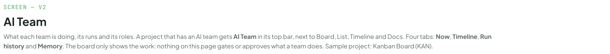

- Text in this part: "SCREEN — V2" · "AI Team" · "What each team is doing, its runs and its roles. A project that has an AI team gets AI Team in its top bar, next to Board, List, Timeline and Docs. Four tabs: Now, Timeline, Run history and Memory. The board only shows the work: nothing on this page gates or approves what a team does. Sample project: Kanban Board (KAN)."

---

## The page and its four tabs

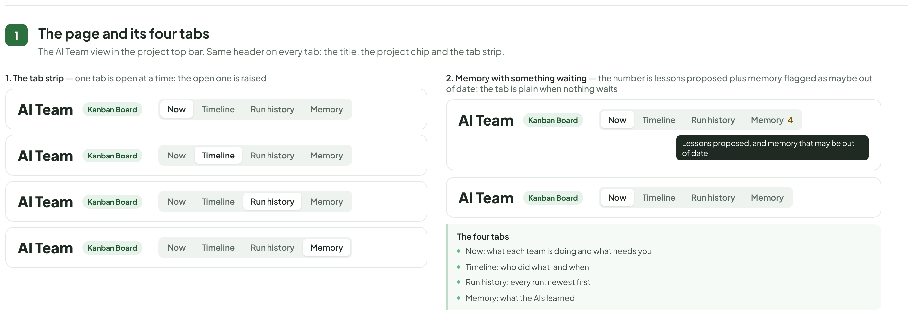

- Text in this part: "1" · "The page and its four tabs" · "The AI Team view in the project top bar. Same header on every tab: the title, the project chip and the tab strip." · "1. The tab strip — one tab is open at a time; the open one is raised" · "AI Team" · "Kanban Board" · "Now" · "Timeline" · "Run history" · "Memory" · "2. Memory with something waiting — the number is lessons proposed plus memory flagged as maybe out of date; the tab is plain when nothing waits" · "4" · "Lessons proposed, and memory that may be out of date" · "The four tabs" · "Now: what each team is doing and what needs you" · "Timeline: who did what, and when" · "Run history: every run, newest first" · "Memory: what the AIs learned"

---

## The first tab. A glance answers: does anything wait for me, who is working on what, what j

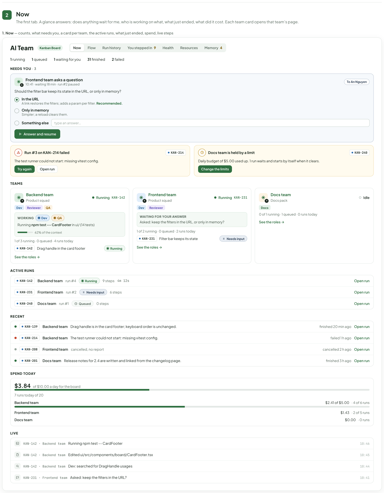

- Text in this part: "2" · "Now" · "The first tab. A glance answers: does anything wait for me, who is working on what, what just ended, what did it cost. Each team card opens that team’s page." · "1. Now — counts, what needs you, a card per team, the active runs, what just ended, spend, live steps" · "AI Team" · "Kanban Board" · "Timeline" · "Run history" · "Memory" · "4" · "1 running" · "1 queued" · "1 waiting for you" · "31 finished" · "2 failed" · "NEEDS YOU · 3" · "Frontend team asks a question" · "10:41 · waiting 18 min · run #2 paused" · "To An Nguyen" · "Should the filter bar keep its state in the URL, or only in memory?" · "In the URL" · "A link restores the filters; adds a param per filter. Recommended." · "Only in memory" · "Simpler; a reload clears them." · "Something else" · "type an answer…" · "Answer and resume" · "Run #3 on KAN-214 failed" · "KAN-214" · "The test runner could not start: missing vitest config." · "Try again" · "Open run" · "Docs team is held by a limit" · "KAN-240" · "Daily budget of $5.00 used up. 1 run waits and starts by itself when it clears." · "Change the limits" · "TEAMS" · "Backend team" · "Product squad" · "Running" · "KAN-142" · "Dev" · "Reviewer" · "QA" · "WORKING" · "Running npm test -- CardFooter in ui/ (14 tests)" · "62% of the context" · "1 of 3 running · 0 queued · 4 runs today" · "Drag handle in the card footer" · "See the roles →" · "Frontend team" · "KAN-231" · "WAITING FOR YOUR ANSWER" · "Asked: keep the filters in the URL, or only in memory?" · "1 of 2 running · 0 queued · 2 runs today" · "Filter bar keeps its state" · "Needs input" · "Docs team" · "Docs pack" · "Idle" · "Docs" · "0 of 1 running · 1 queued · 0 runs today" · "ACTIVE RUNS" · "run #4" · "9 steps" · "4m 12s" · "run #2" · "6 steps" · "run #1" · "Queued" · "0 steps" · "RECENT" · "KAN-139" · "Drag handle is in the card footer; keyboard order is unchanged." · "finished 20 min ago" · "failed 1 h ago" · "KAN-208" · "cancelled, no report" · "cancelled 2 h ago" · "KAN-201" · "Release notes for 2.4 are written and linked from the changelog page." · "finished 3 h ago" · "SPEND TODAY" · "$3.84" · "of $10.00 a day for the board" · "7 runs today of 20" · "$2.41 of $5.00" · "· 4 of 6 runs" · "$1.43" · "· 2 of 5 runs" · "$0.00" · "· 0 runs" · "LIVE" · "KAN-142 · Backend team" · "Running npm test -- CardFooter" · "10:46" · "Edited ui/src/components/board/CardFooter.tsx" · "10:45" · "Dev: searched for DragHandle usages" · "10:44" · "KAN-231 · Frontend team" · "Asked: keep the filters in the URL?" · "10:41"

---

## Now: nothing, loading, and what waits for you

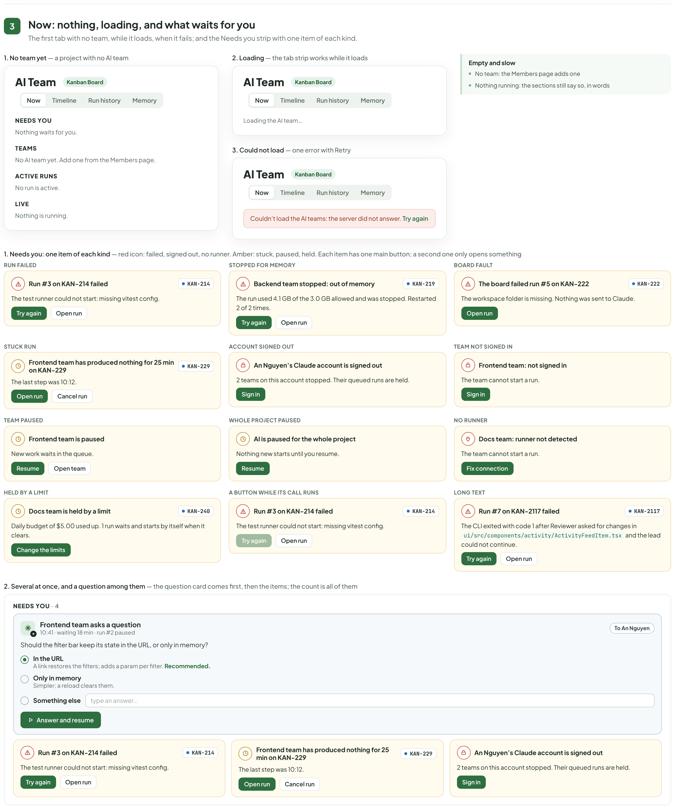

- Text in this part: "3" · "Now: nothing, loading, and what waits for you" · "The first tab with no team, while it loads, when it fails; and the Needs you strip with one item of each kind." · "1. No team yet — a project with no AI team" · "AI Team" · "Kanban Board" · "Now" · "Timeline" · "Run history" · "Memory" · "NEEDS YOU" · "Nothing waits for you." · "TEAMS" · "No AI team yet. Add one from the Members page." · "ACTIVE RUNS" · "No run is active." · "LIVE" · "Nothing is running." · "2. Loading — the tab strip works while it loads" · "Loading the AI team…" · "3. Could not load — one error with Retry" · "Couldn’t load the AI teams: the server did not answer. Try again" · "Empty and slow" · "No team: the Members page adds one" · "Nothing running: the sections still say so, in words" · "1. Needs you: one item of each kind — red icon: failed, signed out, no runner. Amber: stuck, paused, held. Each item has one main button; a second one only opens something" · "RUN FAILED" · "Run #3 on KAN-214 failed" · "KAN-214" · "The test runner could not start: missing vitest config." · "Try again" · "Open run" · "STOPPED FOR MEMORY" · "Backend team stopped: out of memory" · "KAN-219" · "The run used 4.1 GB of the 3.0 GB allowed and was stopped. Restarted 2 of 2 times." · "BOARD FAULT" · "The board failed run #5 on KAN-222" · "KAN-222" · "The workspace folder is missing. Nothing was sent to Claude." · "STUCK RUN" · "Frontend team has produced nothing for 25 min on KAN-229" · "KAN-229" · "The last step was 10:12." · "Cancel run" · "ACCOUNT SIGNED OUT" · "An Nguyen’s Claude account is signed out" · "2 teams on this account stopped. Their queued runs are held." · "Sign in" · "TEAM NOT SIGNED IN" · "Frontend team: not signed in" · "The team cannot start a run." · "TEAM PAUSED" · "Frontend team is paused" · "New work waits in the queue." · "Resume" · "Open team" · "WHOLE PROJECT PAUSED" · "AI is paused for the whole project" · "Nothing new starts until you resume." · "NO RUNNER" · "Docs team: runner not detected" · "Fix connection" · "HELD BY A LIMIT" · "Docs team is held by a limit" · "KAN-240" · "Daily budget of $5.00 used up. 1 run waits and starts by itself when it clears." · "Change the limits" · "A BUTTON WHILE ITS CALL RUNS" · "LONG TEXT" · "Run #7 on KAN-2117 failed" · "KAN-2117" · "The CLI exited with code 1 after Reviewer asked for changes in ui/src/components/activity/ActivityFeedItem.tsx and the lead could not continue." · "2. Several at once, and a question among them — the question card comes first, then the items; the count is all of them" · "NEEDS YOU · 4" · "Frontend team asks a question" · "10:41 · waiting 18 min · run #2 paused" · "To An Nguyen" · "Should the filter bar keep its state in the URL, or only in memory?" · "In the URL" · "A link restores the filters; adds a param per filter. Recommended." · "Only in memory" · "Simpler; a reload clears them." · "Something else" · "type an answer…" · "Answer and resume"

---

## Now: teams, recent runs and spend, in every state

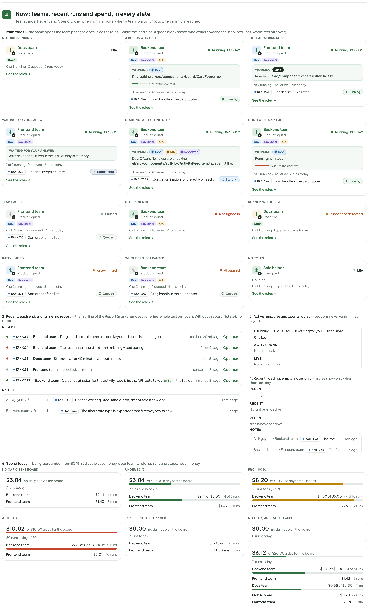

- Text in this part: "4" · "Now: teams, recent runs and spend, in every state" · "Team cards, Recent and Spend today when nothing runs, when a team waits for you, when a limit is reached." · "1. Team cards — the name opens the team page; so does “See the roles”. While the lead runs, a green block shows who works now and the step (two lines, whole text on hover)" · "NOTHING RUNNING" · "Docs team" · "Docs pack" · "Idle" · "Docs" · "0 of 1 running · 0 queued · 3 runs today" · "See the roles →" · "A ROLE IS WORKING" · "Backend team" · "Product squad" · "Running" · "KAN-142" · "Dev" · "Reviewer" · "QA" · "WORKING" · "Dev: editing ui/src/components/board/CardFooter.tsx" · "38% of the context" · "1 of 3 running · 0 queued · 4 runs today" · "Drag handle in the card footer" · "THE LEAD WORKS ALONE" · "Frontend team" · "KAN-231" · "Lead" · "Reading ui/src/components/filters/FilterBar.tsx" · "1 of 2 running · 0 queued · 1 run today" · "Filter bar keeps its state" · "WAITING FOR YOUR ANSWER" · "Asked: keep the filters in the URL, or only in memory?" · "1 of 2 running · 0 queued · 2 runs today" · "Needs input" · "STARTING, AND A LONG STEP" · "KAN-2117" · "Dev, QA and Reviewer are checking ui/src/components/activity/ActivityFeedItem.tsx against the new pagination contract and the cursor handling in the API route that was changed earlier today" · "1 of 3 running · 0 queued · 5 runs today" · "Cursor pagination for the activity feed with a very long title that does not fit" · "Starting" · "CONTEXT NEARLY FULL" · "Running npm test" · "94% of the context" · "1 of 3 running · 0 queued · 6 runs today" · "TEAM PAUSED" · "Paused" · "0 of 2 running · 2 queued · 2 runs today" · "KAN-233" · "Sort order of the list" · "Queued" · "NOT SIGNED IN" · "Not signed in" · "0 of 3 running · 1 queued · 4 runs today" · "RUNNER NOT DETECTED" · "Runner not detected" · "0 of 1 running · 1 queued · 5 runs today" · "RATE-LIMITED" · "Rate-limited" · "0 of 2 running · 1 queued · 6 runs today" · "WHOLE PROJECT PAUSED" · "AI paused" · "0 of 3 running · 2 queued · 4 runs today" · "NO ROLES" · "Solo helper" · "Blank pack" · "No roles" · "0 of 1 running · 0 queued · 0 runs today" · "2. Recent: each end, a long line, no report — the first line of the Report (marks removed, one line, whole text on hover). Without a report: “{state}, no report”" · "RECENT" · "KAN-139" · "Drag handle is in the card footer; keyboard order is unchanged." · "finished 20 min ago" · "Open run" · "KAN-214" · "The test runner could not start: missing vitest config." · "failed 1 h ago" · "KAN-190" · "Stopped after 40 minutes without a step." · "timed out 5 h ago" · "KAN-208" · "cancelled, no report" · "cancelled 2 h ago" · "Cursor pagination for the activity feed is in: the API route takes after, the list loads 50 at a time, and the old offset parameter still works for one release so that the mobile app keeps working until it is updated and released next week…" · "finished 3 h ago" · "NOTES" · "An Nguyen → Backend team" · "Use the existing DragHandle icon, do not add a new one." · "12 min ago" · "Backend team → Frontend team" · "The filter state type is exported from filters/types.ts now." · "1 h ago" · "3. Active runs, Live and counts, quiet — sections never vanish: they say so" · "0 running" · "0 queued" · "0 waiting for you" · "12 finished" · "0 failed" · "ACTIVE RUNS" · "No run is active." · "LIVE" · "Nothing is running." · "4. Recent: loading, empty, notes only — notes show only when there are any" · "Loading…" · "No run has ended yet." · "5. Spend today — bar: green, amber from 80 %, red at the cap. Money is per team; a role has runs and steps, never money" · "NO CAP ON THE BOARD" · "$3.84" · "no daily cap on the board" · "7 runs today"

---

## A team’s page

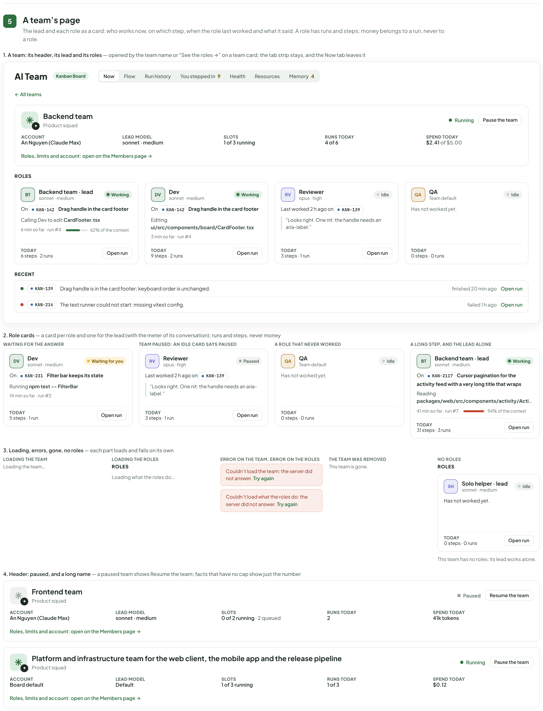

- Text in this part: "5" · "A team’s page" · "The lead and each role as a card: who works now, on which step, when the role last worked and what it said. A role has runs and steps; money belongs to a run, never to a role." · "1. A team: its header, its lead and its roles — opened by the team name or “See the roles →” on a team card; the tab strip stays, and the Now tab leaves it" · "AI Team" · "Kanban Board" · "Now" · "Timeline" · "Run history" · "Memory" · "4" · "← All teams" · "Backend team" · "Product squad" · "Running" · "Pause the team" · "ACCOUNT" · "An Nguyen (Claude Max)" · "LEAD MODEL" · "sonnet · medium" · "SLOTS" · "1 of 3 running" · "RUNS TODAY" · "4 of 6" · "SPEND TODAY" · "$2.41 of $5.00" · "Roles, limits and account: open on the Members page →" · "ROLES" · "BT" · "Backend team · lead" · "Working" · "On" · "KAN-142 Drag handle in the card footer" · "Calling Dev to edit CardFooter.tsx" · "6 min so far · run #4" · "62% of the context" · "TODAY" · "6 steps · 2 runs" · "Open run" · "DV" · "Dev" · "Editing ui/src/components/board/CardFooter.tsx" · "3 min so far · run #4" · "9 steps · 2 runs" · "RV" · "Reviewer" · "opus · high" · "Idle" · "Last worked 2 h ago on" · "KAN-139" · "“Looks right. One nit: the handle needs an aria-label.”" · "3 steps · 1 run" · "QA" · "Team default" · "Has not worked yet." · "0 steps · 0 runs" · "RECENT" · "Drag handle is in the card footer; keyboard order is unchanged." · "finished 20 min ago" · "KAN-214" · "The test runner could not start: missing vitest config." · "failed 1 h ago" · "2. Role cards — a card per role and one for the lead (with the meter of its conversation); runs and steps, never money" · "WAITING FOR THE ANSWER" · "Waiting for you" · "KAN-231 Filter bar keeps its state" · "Running npm test -- FilterBar" · "14 min so far · run #2" · "5 steps · 1 run" · "TEAM PAUSED: AN IDLE CARD SAYS PAUSED" · "Paused" · "A ROLE THAT NEVER WORKED" · "A LONG STEP, AND THE LEAD ALONE" · "KAN-2117 Cursor pagination for the activity feed with a very long title that wraps" · "Reading packages/web/src/components/activity/ActivityFeedItem.tsx and the API route that serves the next page of the feed, to find where the cursor is built" · "41 min so far · run #7" · "94% of the context" · "31 steps · 3 runs" · "3. Loading, errors, gone, no roles — each part loads and fails on its own" · "LOADING THE TEAM" · "Loading the team…" · "LOADING THE ROLES" · "Loading what the roles do…" · "ERROR ON THE TEAM, ERROR ON THE ROLES" · "Couldn’t load the team: the server did not answer. Try again" · "Couldn’t load what the roles do: the server did not answer. Try again" · "THE TEAM WAS REMOVED" · "This team is gone." · "NO ROLES" · "SH" · "Solo helper · lead" · "This team has no roles: its lead works alone." · "4. Header: paused, and a long name — a paused team shows Resume the team; facts that have no cap show just the number" · "Frontend team" · "Resume the team" · "0 of 2 running · 2 queued" · "2" · "41k tokens" · "Platform and infrastructure team for the web client, the mobile app and the release pipeline" · "Board default" · "Default" · "1 of 3" · "$0.12"

---

## Run history

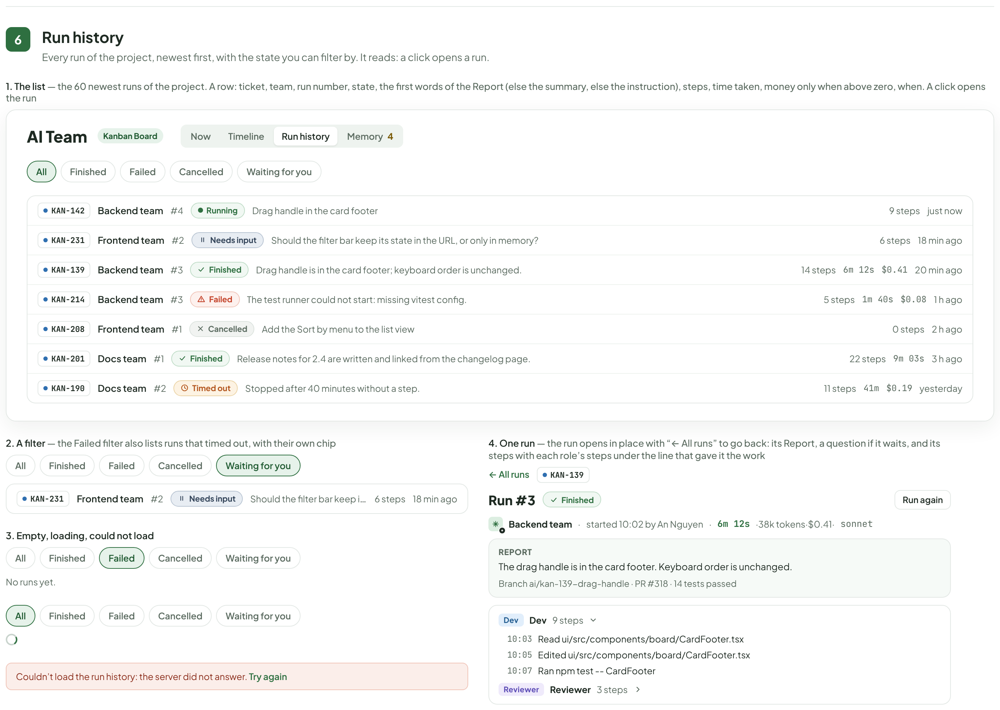

- Text in this part: "6" · "Run history" · "Every run of the project, newest first, with the state you can filter by. It reads: a click opens a run." · "1. The list — the 60 newest runs of the project. A row: ticket, team, run number, state, the first words of the Report (else the summary, else the instruction), steps, time taken, money only when above zero, when. A click opens the run" · "AI Team" · "Kanban Board" · "Now" · "Timeline" · "Memory" · "4" · "All" · "Finished" · "Failed" · "Cancelled" · "Waiting for you" · "KAN-142" · "Backend team" · "#4" · "Running" · "Drag handle in the card footer" · "9 steps" · "just now" · "KAN-231" · "Frontend team" · "#2" · "Needs input" · "Should the filter bar keep its state in the URL, or only in memory?" · "6 steps" · "18 min ago" · "KAN-139" · "#3" · "Drag handle is in the card footer; keyboard order is unchanged." · "14 steps" · "6m 12s" · "$0.41" · "20 min ago" · "KAN-214" · "The test runner could not start: missing vitest config." · "5 steps" · "1m 40s" · "$0.08" · "1 h ago" · "KAN-208" · "#1" · "Add the Sort by menu to the list view" · "0 steps" · "2 h ago" · "KAN-201" · "Docs team" · "Release notes for 2.4 are written and linked from the changelog page." · "22 steps" · "9m 03s" · "3 h ago" · "KAN-190" · "Timed out" · "Stopped after 40 minutes without a step." · "11 steps" · "41m" · "$0.19" · "yesterday" · "2. A filter — the Failed filter also lists runs that timed out, with their own chip" · "3. Empty, loading, could not load" · "No runs yet." · "Couldn’t load the run history: the server did not answer. Try again" · "4. One run — the run opens in place with “← All runs” to go back: its Report, a question if it waits, and its steps with each role’s steps under the line that gave it the work" · "← All runs" · "Run #3" · "Run again" · "·" · "started 10:02 by An Nguyen" · "·38k tokens·$0.41·" · "sonnet" · "REPORT" · "The drag handle is in the card footer. Keyboard order is unchanged." · "Branch ai/kan-139-drag-handle · PR #318 · 14 tests passed" · "Dev" · "10:03" · "Read ui/src/components/board/CardFooter.tsx" · "10:05" · "Edited ui/src/components/board/CardFooter.tsx" · "10:07" · "Ran npm test -- CardFooter" · "Reviewer" · "3 steps"

---

## Memory

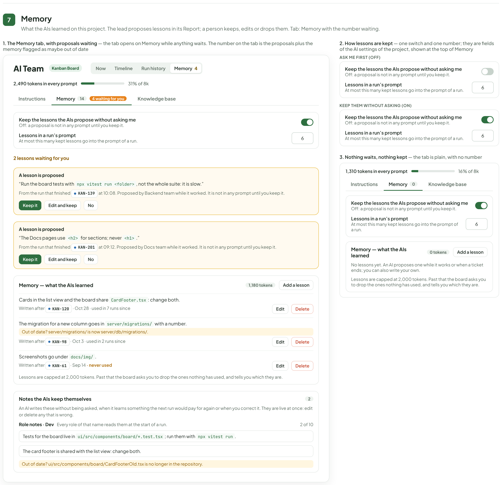

- Text in this part: "7" · "Memory" · "What the AIs learned on this project. The lead proposes lessons in its Report; a person keeps, edits or drops them. Tab: Memory with the number waiting." · "1. The Memory tab, with proposals waiting — the tab opens on Memory while anything waits. The number on the tab is the proposals plus the memory flagged as maybe out of date" · "AI Team" · "Kanban Board" · "Now" · "Timeline" · "Run history" · "4" · "2,490 tokens in every prompt" · "31% of 8k" · "Instructions" · "14" · "4 waiting for you" · "Knowledge base" · "Keep the lessons the AIs propose without asking me" · "Off: a proposal is not in any prompt until you keep it." · "Lessons in a run’s prompt" · "At most this many kept lessons go into the prompt of a run." · "6" · "2 lessons waiting for you" · "A lesson is proposed" · "“Run the board tests with npx vitest run <folder>, not the whole suite: it is slow.”" · "From the run that finished" · "KAN-139 at 10:08. Proposed by Backend team while it worked. It is not in any prompt until you keep it." · "Keep it" · "Edit and keep" · "No" · "“The Docs pages use <h2> for sections; never <h1>.”" · "KAN-201 at 09:12. Proposed by Docs team while it worked. It is not in any prompt until you keep it." · "Memory — what the AIs learned" · "1,180 tokens" · "Add a lesson" · "Cards in the list view and the board share CardFooter.tsx: change both." · "Written after" · "KAN-120 · Oct 28 · used in 7 runs since" · "Edit" · "Delete" · "The migration for a new column goes in server/migrations/ with a number." · "Out of date? server/migrations/ is now server/db/migrations/." · "KAN-98 · Oct 3 · used in 2 runs since" · "Screenshots go under docs/img/." · "KAN-61 · Sep 14 · never used" · "Lessons are capped at 2,000 tokens. Past that the board asks you to drop the ones nothing has used, and tells you which they are." · "Notes the AIs keep themselves" · "2" · "An AI writes these without being asked, when it learns something the next run would pay for again or when you correct it. They are live at once: edit or delete any that is wrong." · "Role notes · Dev" · "Every role of that name reads them at the start of a run." · "2 of 10" · "Tests for the board live in ui/src/components/board/*.test.tsx; run them with npx vitest run." · "The card footer is shared with the list view: change both." · "Out of date? ui/src/components/board/CardFooterOld.tsx is no longer in the repository." · "2. How lessons are kept — one switch and one number; they are fields of the AI settings of the project, shown at the top of Memory" · "ASK ME FIRST (OFF)" · "KEEP THEM WITHOUT ASKING (ON)" · "3. Nothing waits, nothing kept — the tab is plain, with no number" · "1,310 tokens in every prompt" · "16% of 8k" · "0" · "0 tokens" · "No lessons yet. An AI proposes one while it works or when a ticket ends; you can also write your own."

---

## C. Flow, team map: how work moves between the AIs

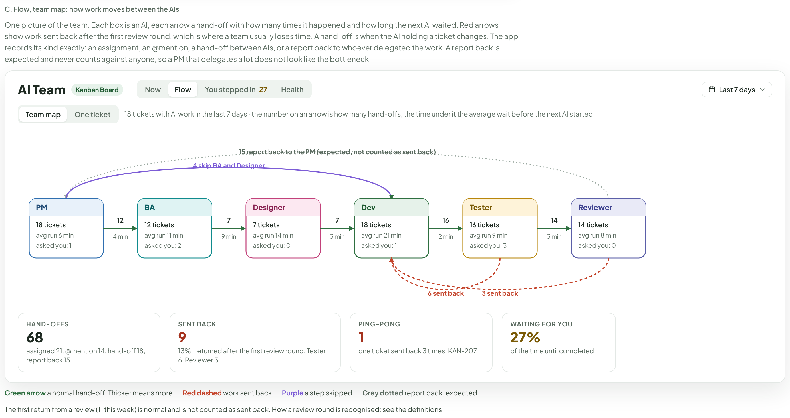

- Text in this part: "C. Flow, team map: how work moves between the AIs" · "One picture of the team. Each box is an AI, each arrow a hand-off with how many times it happened and how long the next AI waited. Red arrows show work sent back after the first review round, which is where a team usually loses time. A hand-off is when the AI holding a ticket changes. The app records its kind exactly: an assignment, an @mention, a hand-off between AIs, or a report back to whoever delegated the work. A report back is expected and never counts against anyone, so a PM that delegates a lot does not look like the bottleneck." · "AI Team" · "Kanban Board" · "Now" · "Flow" · "You stepped in" · "27" · "Health" · "Last 7 days" · "Team map" · "One ticket" · "18 tickets with AI work in the last 7 days · the number on an arrow is how many hand-offs, the time under it the average wait before the next AI started" · "15 report back to the PM (expected, not counted as sent back)" · "4 skip BA and Designer" · "PM" · "18 tickets" · "avg run 6 min" · "asked you: 1" · "BA" · "12 tickets" · "avg run 11 min" · "asked you: 2" · "Designer" · "7 tickets" · "avg run 14 min" · "asked you: 0" · "Dev" · "avg run 21 min" · "Tester" · "16 tickets" · "avg run 9 min" · "asked you: 3" · "Reviewer" · "14 tickets" · "avg run 8 min" · "12" · "4 min" · "7" · "9 min" · "3 min" · "16" · "2 min" · "14" · "6 sent back" · "3 sent back" · "HAND-OFFS" · "68" · "assigned 21, @mention 14, hand-off 18, report back 15" · "SENT BACK" · "9" · "13% · returned after the first review round. Tester 6, Reviewer 3" · "PING-PONG" · "1" · "one ticket sent back 3 times: KAN-207" · "WAITING FOR YOU" · "27%" · "of the time until completed" · "Green arrow a normal hand-off. Thicker means more." · "Red dashed work sent back." · "Purple a step skipped." · "Grey dotted report back, expected." · "The first return from a review (11 this week) is normal and is not counted as sent back. How a review round is recognised: see the definitions."

---

## D. Flow, one ticket: from the first assignment to Done

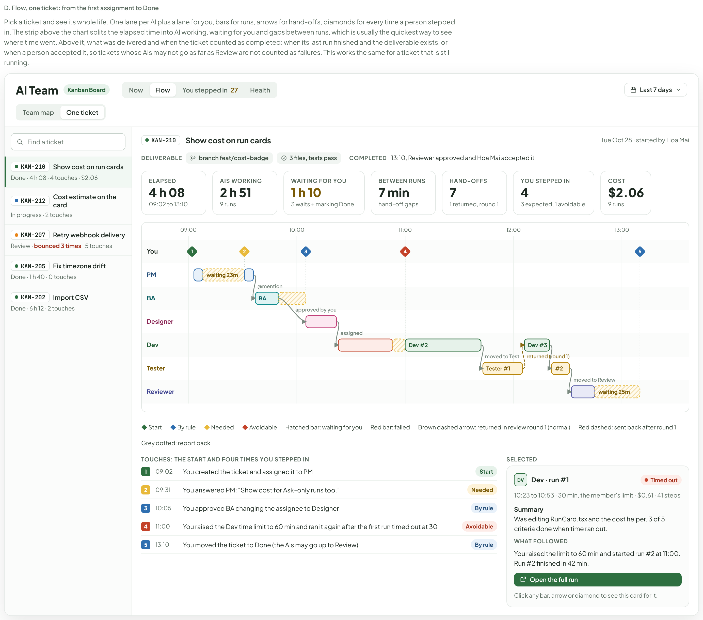

- Text in this part: "D. Flow, one ticket: from the first assignment to Done" · "Pick a ticket and see its whole life. One lane per AI plus a lane for you, bars for runs, arrows for hand-offs, diamonds for every time a person stepped in. The strip above the chart splits the elapsed time into AI working, waiting for you and gaps between runs, which is usually the quickest way to see where time went. Above it, what was delivered and when the ticket counted as completed: when its last run finished and the deliverable exists, or when a person accepted it, so tickets whose AIs may not go as far as Review are not counted as failures. This works the same for a ticket that is still running." · "AI Team" · "Kanban Board" · "Now" · "Flow" · "You stepped in" · "27" · "Health" · "Last 7 days" · "Team map" · "One ticket" · "Find a ticket" · "KAN-210" · "Show cost on run cards" · "Done · 4 h 08 · 4 touches · $2.06" · "KAN-212" · "Cost estimate on the card" · "In progress · 2 touches" · "KAN-207" · "Retry webhook delivery" · "Review · bounced 3 times · 5 touches" · "KAN-205" · "Fix timezone drift" · "Done · 1 h 40 · 0 touches" · "KAN-202" · "Import CSV" · "Done · 6 h 12 · 2 touches" · "Tue Oct 28 · started by Hoa Mai" · "DELIVERABLE" · "branch feat/cost-badge" · "3 files, tests pass" · "COMPLETED" · "13:10, Reviewer approved and Hoa Mai accepted it" · "ELAPSED" · "4 h 08" · "09:02 to 13:10" · "AIS WORKING" · "2 h 51" · "9 runs" · "WAITING FOR YOU" · "1 h 10" · "3 waits + marking Done" · "BETWEEN RUNS" · "7 min" · "hand-off gaps" · "HAND-OFFS" · "7" · "1 returned, round 1" · "YOU STEPPED IN" · "4" · "3 expected, 1 avoidable" · "COST" · "$2.06" · "You" · "PM" · "BA" · "Designer" · "Dev" · "Tester" · "Reviewer" · "09:00" · "10:00" · "11:00" · "12:00" · "13:00" · "waiting 23m" · "Dev #2" · "Tester #1" · "Dev #3" · "#2" · "waiting 25m" · "@mention" · "approved by you" · "assigned" · "moved to Test" · "returned (round 1)" · "moved to Review" · "1" · "2" · "3" · "5" · "◆ Start" · "◆ By rule" · "◆ Needed" · "◆ Avoidable" · "Hatched bar: waiting for you" · "Red bar: failed" · "Brown dashed arrow: returned in review round 1 (normal)" · "Red dashed: sent back after round 1" · "Grey dotted: report back" · "TOUCHES: THE START AND FOUR TIMES YOU STEPPED IN" · "09:02" · "You created the ticket and assigned it to PM" · "Start" · "09:31" · "You answered PM: “Show cost for Ask-only runs too.”" · "Needed" · "10:05" · "You approved BA changing the assignee to Designer" · "By rule" · "You raised the Dev time limit to 60 min and ran it again after the first run timed out at 30" · "Avoidable" · "13:10" · "You moved the ticket to Done (the AIs may go up to Review)" · "SELECTED" · "DV" · "Dev · run #1" · "Timed out" · "10:23 to 10:53 · 30 min, the member’s limit · $0.61 · 41 steps"

---

## E. Flow, a Docs deliverable: versions and review threads

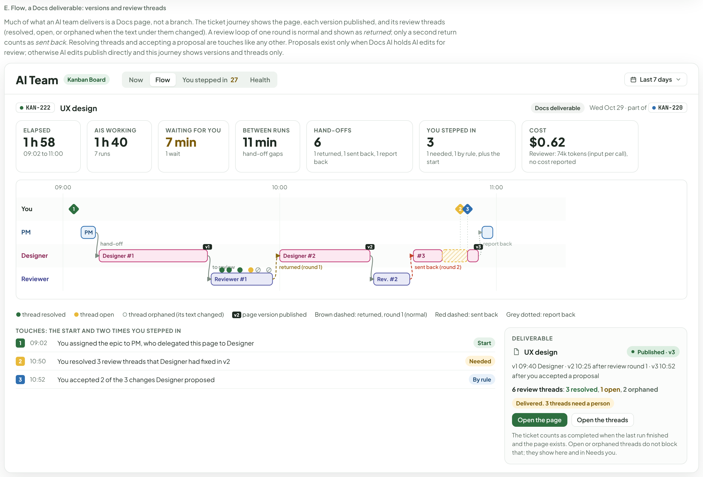

- Text in this part: "E. Flow, a Docs deliverable: versions and review threads" · "Much of what an AI team delivers is a Docs page, not a branch. The ticket journey shows the page, each version published, and its review threads (resolved, open, or orphaned when the text under them changed). A review loop of one round is normal and shown as returned; only a second return counts as sent back. Resolving threads and accepting a proposal are touches like any other. Proposals exist only when Docs AI holds AI edits for review; otherwise AI edits publish directly and this journey shows versions and threads only." · "AI Team" · "Kanban Board" · "Now" · "Flow" · "You stepped in" · "27" · "Health" · "Last 7 days" · "KAN-222" · "UX design" · "Docs deliverable" · "Wed Oct 29 · part of" · "KAN-220" · "ELAPSED" · "1 h 58" · "09:02 to 11:00" · "AIS WORKING" · "1 h 40" · "7 runs" · "WAITING FOR YOU" · "7 min" · "1 wait" · "BETWEEN RUNS" · "11 min" · "hand-off gaps" · "HAND-OFFS" · "6" · "1 returned, 1 sent back, 1 report back" · "YOU STEPPED IN" · "3" · "1 needed, 1 by rule, plus the start" · "COST" · "$0.62" · "Reviewer: 74k tokens (input per call), no cost reported" · "You" · "PM" · "Designer" · "Reviewer" · "09:00" · "10:00" · "11:00" · "Designer #1" · "Reviewer #1" · "Designer #2" · "Rev. #2" · "#3" · "hand-off" · "to review" · "returned (round 1)" · "sent back (round 2)" · "report back" · "v1" · "v2" · "v3" · "1" · "2" · "● thread resolved" · "● thread open" · "○ thread orphaned (its text changed)" · "v2 page version published" · "Brown dashed: returned, round 1 (normal)" · "Red dashed: sent back" · "Grey dotted: report back" · "TOUCHES: THE START AND TWO TIMES YOU STEPPED IN" · "09:02" · "You assigned the epic to PM, who delegated this page to Designer" · "Start" · "10:50" · "You resolved 3 review threads that Designer had fixed in v2" · "Needed" · "10:52" · "You accepted 2 of the 3 changes Designer proposed" · "By rule" · "DELIVERABLE" · "Published · v3" · "v1 09:40 Designer · v2 10:25 after review round 1 · v3 10:52 after you accepted a proposal" · "6 review threads: 3 resolved, 1 open, 2 orphaned" · "Delivered. 3 threads need a person" · "Open the page" · "Open the threads" · "The ticket counts as completed when the last run finished and the page exists. Open or orphaned threads do not block that; they show here and in Needs you."

---

## F. Flow, a parent ticket: a whole lifecycle in one view

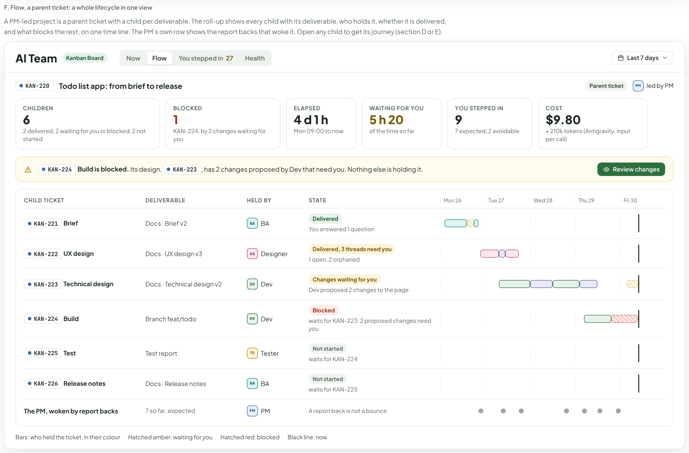

- Text in this part: "F. Flow, a parent ticket: a whole lifecycle in one view" · "A PM-led project is a parent ticket with a child per deliverable. The roll-up shows every child with its deliverable, who holds it, whether it is delivered, and what blocks the rest, on one time line. The PM’s own row shows the report backs that woke it. Open any child to get its journey (section D or E)." · "AI Team" · "Kanban Board" · "Now" · "Flow" · "You stepped in" · "27" · "Health" · "Last 7 days" · "KAN-220" · "Todo list app: from brief to release" · "Parent ticket" · "PM" · "led by PM" · "CHILDREN" · "6" · "2 delivered, 2 waiting for you or blocked, 2 not started" · "BLOCKED" · "1" · "KAN-224, by 2 changes waiting for you" · "ELAPSED" · "4 d 1 h" · "Mon 09:00 to now" · "WAITING FOR YOU" · "5 h 20" · "of the time so far" · "YOU STEPPED IN" · "9" · "7 expected, 2 avoidable" · "COST" · "$9.80" · "+ 210k tokens (Antigravity, input per call)" · "KAN-224" · "Build is blocked. Its design," · "KAN-223" · ", has 2 changes proposed by Dev that need you. Nothing else is holding it." · "Review changes" · "CHILD TICKET" · "DELIVERABLE" · "HELD BY" · "STATE" · "Mon 26" · "Tue 27" · "Wed 28" · "Thu 29" · "Fri 30" · "KAN-221" · "Brief" · "Docs · Brief v2" · "BA" · "Delivered" · "You answered 1 question" · "KAN-222" · "UX design" · "Docs · UX design v3" · "DS" · "Designer" · "Delivered, 3 threads need you" · "1 open, 2 orphaned" · "Technical design" · "Docs · Technical design v2" · "DV" · "Dev" · "Changes waiting for you" · "Dev proposed 2 changes to the page" · "Build" · "Branch feat/todo" · "Blocked" · "waits for KAN-223: 2 proposed changes need you" · "KAN-225" · "Test" · "Test report" · "TS" · "Tester" · "Not started" · "waits for KAN-224" · "KAN-226" · "Release notes" · "Docs · Release notes" · "waits for KAN-225" · "The PM, woken by report backs" · "7 so far, expected" · "A report back is not a bounce" · "Bars: who held the ticket, in their colour" · "Hatched amber: waiting for you" · "Hatched red: blocked" · "Black line: now"

---

## Todo rows, differences from the code, and what was not checked

Files: AiTeam.dc.html (finalH 14490), AiTimeline.dc.html (finalH 5281), AiTimelineCases.dc.html (finalH 6631). All rebuilt from scratch with the shared helpers (generators in this folder: gc.py, team1-3.py, tl*.py, build_team.py, tlmain.py, tlcmain.py).
Word check run on the final HTML: no Antigravity, API key, Claude API, GPT, Gemini, Llama, handoff, mention intent, Autopilot, approval, review gate, AI member, In AI review, Open in terminal, Local runner. "held" appears only as "held by a limit" (B-49) and "held until resume" (a queued run while the whole project is paused; both are in the code).

## AiTeam.dc.html
| Row | Done | Notes |
|---|---|---|
| A-041 | drawn | New eyebrow, h1 "AI Team", intro: what each team is doing, its runs and roles |
| A-042 | drawn | Section A: tab strip Now / Timeline / Run history / Memory, Memory with the number and its tooltip |
| A-043 | drawn | Section B/C: counts line, Needs you, Teams, Active runs, Recent, Spend today, Live; all states |
| A-044..A-047 | left untouched (KBM-20 Flow is being built) | Original boards C, D, E, F copied verbatim (HTML and the css rules they use) after my sections. My sections are numbered 1 to 7 (badges) so they do not clash with the Flow letters C to F |
| A-048 | drawn | Run history (E) and Memory (F) |
| A-204 | drawn | Team cards (B/C) and the team page (D) |
| A-205 | drawn | in AiTimeline / AiTimelineCases |
| A-206 | drawn | E: list, filter, empty, loading, error, one run. Search, export, retention and the other filters not drawn (the code has none) |
| A-207 | drawn | F: Memory tab with the number, a waiting proposal, flags, notes, the lessons settings with one switch and one number |
| A-208 | drawn as four tabs | The strip has four tabs; the Flow boards stay only because KBM-20 owns them. You stepped in, Decided for you, Health, the Away card are not drawn |
| B-20 | drawn | empty project, loading, error, each part |
| B-49 | drawn | one item of each kind (12 variants), several at once, question among them, disabled button, long text |
| B-50 | drawn | team page: header (running, paused, long name), lead + role cards (working, waiting, paused, never worked, long step), loading, errors, gone, no roles |
| B-51 | drawn | team card states (9) |
| B-52 | drawn | Recent: each end, long line, no report, loading, empty, notes, notes with no run |
| B-53 | drawn | Spend: no cap, under 80 %, from 80 %, at cap, tokens only, no team, many teams |
| B-14 | not drawn on the cards, see below; drawn on the Timeline (question open while Dev still works) |

Left untouched / not drawn: Resources tab and every Resources row (KBM-19). AiResources.dc.html (A05) was not touched. Flow, You stepped in, Health, Docs AI: not on these canvases.

## AiTimeline.dc.html
| Row | Done | Notes |
|---|---|---|
| A-093 | drawn | intro and the decisions table (A) rewritten: lanes You, lead, roles; scope Whole team / One ticket |
| A-094 | drawn | B: full page, tab strip Now, Timeline, Run history, Memory; Right now strip; toolbar; strip; lanes You / Backend team / Dev / Reviewer / Frontend team / Dev; fold; queued bar with "queued 12m", "waited 12m"; ask arrow |
| A-095 | drawn | C: lane heads, bar states, arrows (assigned, role call, report back, report to you, asks you, your answer, grouped), waits, pause band, fold |
| A-096 | drawn | D: hover cards (lead run, role span, question, queued, arrow, pause band), inspectors (lead run, role span, question with Answer), Detailed |
| B-13 | drawn | lead with two roles in parallel, role called twice (call 1, call 2 in the scoped view), queued bar, queued-then-started, needs input while a role runs, answer, fold, run ended with a role open is closed at the end (data section) |
| B-30 | drawn | dark Lead box, You dot amber/grey, 2/4/8 lanes wide and narrow (Cases I7), arrow level with now (Cases G6), ask arrow open vs answered |

## AiTimelineCases.dc.html
| Row | Done | Notes |
|---|---|---|
| A-097 | drawn | E: fold, real time, capped wait, strip, 7 days, custom range, range and Show menus; sample lanes You, Backend team, Dev |
| A-098 | drawn | F: scope menu and a one-ticket Timeline. Parent scope, Open ticket story, loop box removed; "Only the lifelines that took part are shown." kept |
| A-099 | drawn | G: now line, running bar, new run queued, role call under way, question waits, failure, following / scrolled back / paused. "Repeat ×N" removed |
| A-100 | drawn | H: state table across surfaces and the ticket AI tab (run card + scoped Timeline + "Open in Timeline"). Team map and One ticket rows removed |
| A-101 | drawn | I: loading, empty, lots of events, server out of reach, paused, one team, narrow, table, quiet teams |
| A-102 | drawn | J: rewritten with ai_run, ai_run_agent (+ ai_run_step markers), ai_run_message; a11y text kept |
| A-205 extras | drawn | notice "close ones are grouped (×N)", the 500 notice, custom range panel with "Show this range", "Showing events up to 10:14", "AI paused since" |

## Rows not done
- B-14 as chip/card line "waiting for your answer · Dev still working": not drawn on cards (code: `WorkingNow` hides the role chips while waiting, the run chip says "Needs input", a role card shows "Waiting for you"). Drawn where the code does it: the Timeline (lead hatched amber, Dev bar still running).
- Resources strip inside the ticket's AI tab (A-100 says "under run card + Resources"): not drawn (KBM-19).
- A-206 search / export / retention: not in the code, not drawn; the A-206 sentence "delete from AiOperations F" is for the integrator (AiOperations not mine).

## Todo vs code
- Now tab heading is "Live", not "Live steps"; section titles are "Teams", "Active runs", "Recent", "Spend today", "Live".
- A-205 Show menu "Hand-offs": the server has no hand-offs between members, only assigned, role call (kind `handoff`), report back, ask, answer. Drawn "Role calls".
- A-205 / empty range: "Open the team map" only appears when `onMap` is passed; AiTeamView does not pass it. Not drawn.
- Pauses: server sends `by: null`, so the card says "By someone at 10:41"; drawn "By An Nguyen".
- A-096 role card "what it was asked": no such field; a role bar's summary is what the role said when it reported. Drawn that.
- Inspector "Started by": code prints "{lane}, {arrow word} at {time}"; drawn "Run button by An Nguyen at 09:40" and "Lead called Dev at 09:44".
- `tokensLine` prints "Not metered: a local runner reports no cost" (v1 wording); not drawn, cut it.
- `NotesPanel` titles "A member's own notes" and "Every member of the role reads them": drawn "Role notes" only; reword or drop.
- `proposedByLine` still has "a light model" / "a diagnosis": drawn "Proposed by Backend team while it worked."
- The Stopped-for-memory item body text is invented (it comes from the notification row).

## Where I deliberately drew differently (the code must change)
- Timeline lane heads are 116 to 144 px wide with the role name and the team under it ("Dev / Backend team"); code: a 92 px box with "Dev (Backend team)" cut off. Folded strip reads "2 quiet teams" (code "2 quiet AIs").
- Legend and notices say "role call" and "events" ("Showing the newest 500 events") instead of "hand-off(s)".
- Arrow labels sit above the line, not on it.
- Needs-you question card is drawn once, in the strip, with the same card as the ticket (A01); other items as in code.
- Team page header: facts in a five-column row; Pause the team / Resume the team next to the status.
- Run history one-run view is a compact mock (back link, run header, Report, steps by role); the real thing is RunView (A01).

## Not checked
Narrow window of the Now tab and the team page; dark theme; tab keyboard order; the exact word on the waiting chip (drawn "Waiting for you" from teamUi STATE_LOOK); which period the Now counts cover; whether a timed-out run can still occur (drawn only in the swatch and one history row).

## Review round
Fixed: B-13 two roles in parallel (Reviewer called while Dev works) and a run ended with a role open (Cases G5, role span closed with the run); B-20 card statuses (Not signed in, Runner not detected, Rate-limited, AI paused; "Over budget" and "Signed out" removed); B-49 "Frontend team: not signed in" item; B-30 lane counts 1, 3 and 8 AI lanes, wide and narrow; Timeline footer legend strip, "Couldn't load the Timeline.", "Right now Nobody is working."; load error now "Couldn't load {what}: {error}. Try again"; Running status shows the ticket id; no-runner title "Docs team: runner not detected"; notification titles from the server ("Run #3 on KAN-214 failed", "The board failed run #5 on KAN-222", "{name} has produced nothing for 25 min on KAN-229", "{account} is signed out" with "2 teams ... Their queued runs are held"); question card has "To An Nguyen" and "Recommended." and no ticket chip; Slots shows "queued" only above 0; timed-out history row has the "Timed out" chip, a running row has no duration; one-run header ("Run #3", "{team} · started 10:02 by An Nguyen · 6m 12s · 38k tokens · $0.41 · sonnet"); durations "12 min", "3 h 20 min"; lane initials DE and RE; inspector "(from the AI)", "step 14", "Started by" in the code's form ("You, assigned at 09:40"; "Backend team, role call at 09:44"); sample data (counts, Frontend step, ui/src path); header no longer wraps in narrow frames; section badges numbered 1 to 7 in reading order and sub-frames numbered in order; duplicate Live heading removed; quiet-teams strip no longer clipped; lane head dot no longer touches the name; key labels moved off arrows; custom range panel fits; menu bottom padding; empty area under I3 reduced.
Kept: "role call" and "Role calls" instead of the code's "Hand-offs" (the todo asks for it; the code string must change). "Showing the newest 500 events" instead of "500 hand-offs". Lane heads wider than 92 px with the team name under a role.
Cannot / design-only: the "AI offline" Needs-you item is removed from the canvas (no server emitter); the server still says "AI member(s) on this account" in the signed-out notification, drawn with "teams" (server wording must change). Timeline hover card "Started by" in the todo wording (Run button by ...) was not drawn: the code prints "{lane}, {arrow word}".
