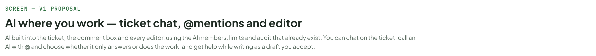
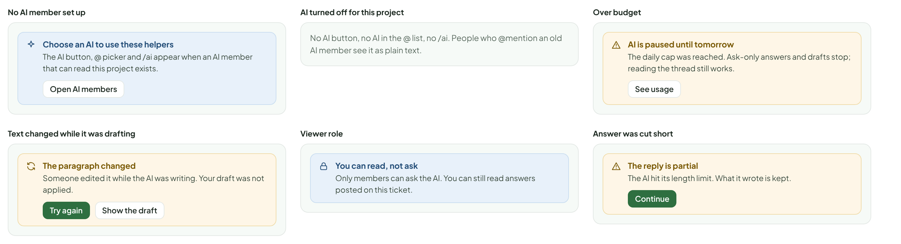
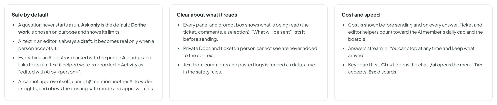

# AI where you work — ticket chat, @mentions and editor

> SCREEN — V1 PROPOSAL · source: [`AiEverywhere.dc.html`](../source/AiEverywhere.dc.html) · canvas `1793295530-5588` · sha256 `567d8b0a57df9c42b3bc44dd6035c732162a9143fd0ddf352bc8d64aa006db6e`

AI built into the ticket, the comment box and every editor, using the AI members, limits and audit that already exist. You can chat on the ticket, call an AI with @ and choose whether it only answers or does the work, and get help while writing as a draft you accept.

Source: [AiEverywhere.dc.html](../source/AiEverywhere.dc.html) › header ("SCREEN — V1 PROPOSAL", "AI where you work — ticket chat, @mentions and editor" and the intro)

---

## A. What exists and what this board adds

The AI boards already cover AI members, the Board AI dock, safety and cost. This board brings AI to where people are working: on the ticket, in the comment box, and in the editor. It reuses the same AI members, permissions, budgets and audit log; nothing here is a new kind of AI.

Source: [AiEverywhere.dc.html](../source/AiEverywhere.dc.html) › block "A. What exists and what this board adds"

- Text in the frames: "NEED" · "ALREADY DESIGNED" · "THIS BOARD ADDS" · "Talk to AI about a ticket" · "Menu “AI › Ask about this ticket” opens the shared chat dock, scoped to the ticket." · "A chat on the ticket itself, docked in its page. It remembers this ticket, shows what it read, and sits next to the work." · "Call an AI in a comment" · "AI members can be @mentioned. A mention starts a run that stops at Review." · "A proper @ picker, a choice between Ask only and Do the work, and clear states while it is queued, thinking, waiting for approval, or done." · "Help while writing" · "Docs editor only: Ask AI in the toolbar and the selection bar." · "The same help in every editor: ticket descriptions, comments, acceptance criteria, ideas, Debug notes. A /ai command and a selection bar, with a diff you accept." · "Who sees what the AI said" · "Chat is private to the person who asked." · "Chat is private by default. One click posts an answer as a comment, with the AI badge, so the team sees it." · "Doing the work" · "Assign the ticket to an AI member." · "Same, but also a button in the ticket chat: Start a run on this ticket, with the same limits (stops at Review, needs approval for risky steps)."

---

## B. A chat on the ticket

Opens from an AI button in the ticket header, docked on the right, like Debug and Test. It is already scoped: it shows exactly what it is reading. It can answer, draft (as drafts you apply), post an answer as a comment, or, in “Do the work” mode, start a run. The conversation is saved on the ticket and is private until you share an answer.

Source: [AiEverywhere.dc.html](../source/AiEverywhere.dc.html) › block "B. A chat on the ticket"

- Text in the frames: "KAN-251" · "Feature" · "In progress" · "Debug" · "Test" · "AI" · "Show cost on every AI run card" · "Problem" · "People ask what an AI run cost before they start it. Today the cost is only on the Members page." · "Acceptance criteria" · "☐ A cost estimate shows on the run card" · "☐ The real cost replaces it when the run ends" · "COMMENTS · 2" · "HM" · "Hoa Mai" · "1h ago" · "The card gets taller when the badge shows. Is that OK for the board layout?" · "Claude Code" · "40 min ago · asked by Hoa Mai" · "The badge fits on the existing footer line, so the height does not change. Only a long title that already wraps to two lines would push it to a third. I checked RunCard.tsx and the card styles." · "Run #14" · "Answer only · $0.02 · 41s" · "Local runner · online" · "Chat" · "Runs 2" · "Reading" · "Description" · "2 comments" · "1 linked Doc" · "branch feat/cost-badge" · "Which files would this touch?" · "Three, all in the run card area: RunCard.tsx (show the badge), runCost.ts (the estimate, from the price table) and RunCard.module.css. About 40 lines." · "Post as comment" · "Copy" · "Add acceptance criteria for the estimate." · "Here are two, as a draft:" · "DRAFT · 2 ACCEPTANCE CRITERIA" · "☐ The estimate uses the current price table" · "☐ A run with no price shows “cost unknown”, not $0" · "Add both" · "Edit" · "Dismiss" · "Ask only" · "Do the work" · "Private to you" · "Ask about KAN-251…" · "About $0.01 per answer" · "Enter send · CtrlJ close"

---

## C. Calling an AI from a comment

Type @ and the AI members show up beside the people, with what each can do and whether it is available. After picking one, the box says plainly what will happen. The default is Ask only, so a question never starts a run by accident. The answer comes back as a normal comment with an AI badge and a link to the run.

Source: [AiEverywhere.dc.html](../source/AiEverywhere.dc.html) › block "C. Calling an AI from a comment"

- Text in the frames: "1. Type @ and pick" · "Can you check @cl" · "PEOPLE" · "LP" · "Linh Pham" · "Owner" · "AI MEMBERS" · "Claude Code" · "Local runner · online · can edit code" · "Reviewer (Claude API)" · "API · online · reads and comments" · "Local Llama" · "Paused by Linh Pham" · "Paused" · "2. Choose what it should do" · "Does this change the card height?" · "CLAUDE CODE WILL…" · "Ask only" · "Do the work" · "Ask only: reads the ticket and replies in a comment. Changes nothing." · "Do the work: starts a run on this ticket. Can edit code in the linked repository. Stops at Review." · "About $0.02" · "Cancel" · "Comment" · "3. While it works (shown in the thread, under your comment)" · "QUEUED" · "Waiting for the local runner to be free" · "READING" · "Claude Code is reading the ticket and the code…" · "Stop" · "NEEDS YOUR OK" · "Wants to run npm test. Waiting for an approver." · "Review" · "DID NOT START" · "The runner is offline. Nothing was sent." · "Try again" · "4. The answer is an ordinary comment, marked as AI" · "HM" · "Hoa Mai" · "1 min ago" · "Does this change the card height? @Claude Code" · "AI" · "just now" · "No. The badge sits on the footer line the card already has. Only a title that wraps to two lines would add a line." · "Run #14" · "Answer only · $0.02 · 41s" · "Helpful" · "Reply"

---

## D. AI in every editor

The same help, in the same place, in every text box that uses the editor. It is never automatic: you ask by selecting text or typing /ai. The result appears as a draft over the text, with what changed marked. Nothing is saved until you accept, and undo takes it back.

Source: [AiEverywhere.dc.html](../source/AiEverywhere.dc.html) › block "D. AI in every editor"

- Text in the frames: "1. Type /ai (or press Ctrl+J in the editor)" · "The estimate comes from the price table." · "/ai" · "Ask AI…" · "Write from a prompt, with this page as context" · "Continue writing" · "Carry on from the cursor" · "Summarise" · "The text above, as a short list" · "Draft acceptance criteria" · "From this description (tickets only)" · "Draw a diagram" · "From a description, as an editable draw.io diagram" · "Translate…" · "The paragraph above" · "2. Select text" · "The badge is put on the card and it is shown when there is a price and the run is over and the person has the right to see costs. Otherwise nothing is shown." · "Improve" · "Shorten" · "Fix spelling" · "Explain" · "Ask…" · "3. The result is a draft you accept" · "The badge is put on the card and it is shown when there is a price and the run is over and the person has the right to see costs." · "Otherwise nothing is shown." · "The badge appears on the card only when a price exists, the run has ended, and the viewer may see costs. In every other case nothing is shown." · "Improve · $0.002" · "Accept Tab" · "Discard Esc" · "Try again" · "4. Ask AI to write" · "Explain how the estimate falls back when there is no price" · "This ticket" · "Selected text" · "What will be sent ⓘ" · "$0.01" · "Generate" · "5. Where it works" · "Ticket description" · "Selection bar, /ai, all actions" · "Acceptance criteria" · "Improve, split, draft more" · "Comment box" · "Selection bar and @. /ai shows Improve, Translate and Summarise only" · "Docs page" · "Everything, plus Draw a diagram and links" · "Idea page" · "Everything, plus Shape with AI" · "Debug notes" · "Improve, Summarise, Translate"

---

## E. States

Source: [AiEverywhere.dc.html](../source/AiEverywhere.dc.html) › block "E. States"

- Text in the frames: "No AI member set up" · "Choose an AI to use these helpers" · "The AI button, @ picker and /ai appear when an AI member that can read this project exists." · "Open AI members" · "AI turned off for this project" · "No AI button, no AI in the @ list, no /ai. People who @mention an old AI member see it as plain text." · "Over budget" · "AI is paused until tomorrow" · "The daily cap was reached. Ask-only answers and drafts stop; reading the thread still works." · "See usage" · "Text changed while it was drafting" · "The paragraph changed" · "Someone edited it while the AI was writing. Your draft was not applied." · "Try again" · "Show the draft" · "Viewer role" · "You can read, not ask" · "Only members can ask the AI. You can still read answers posted on this ticket." · "Answer was cut short" · "The reply is partial" · "The AI hit its length limit. What it wrote is kept." · "Continue"

---

## F. Rules

Proposed.

Source: [AiEverywhere.dc.html](../source/AiEverywhere.dc.html) › block "F. Rules"

- Text in the frames: "Safe by default" · "A question never starts a run. Ask only is the default; Do the work is chosen on purpose and shows its limits." · "AI text in an editor is always a draft. It becomes real only when a person accepts it." · "Everything an AI posts is marked with the purple AI badge and links to its run. Text it helped write is recorded in Activity as “edited with AI by <person>”." · "AI cannot approve itself, cannot @mention another AI to widen its rights, and obeys the existing safe mode and approval rules." · "Clear about what it reads" · "Every panel and prompt box shows what is being read (the ticket, comments, a selection). “What will be sent” lists it before sending." · "Private Docs and tickets a person cannot see are never added to the context." · "Text from comments and pasted logs is fenced as data, as set in the safety rules." · "Cost and speed" · "Cost is shown before sending and on every answer. Ticket and editor helpers count toward the AI member’s daily cap and the board’s." · "Answers stream in. You can stop at any time and keep what arrived." · "Keyboard first: Ctrl+J opens the chat, /ai opens the menu, Tab accepts, Esc discards."
