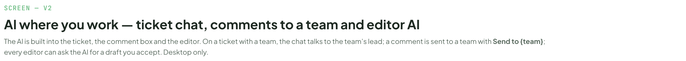
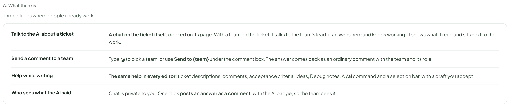
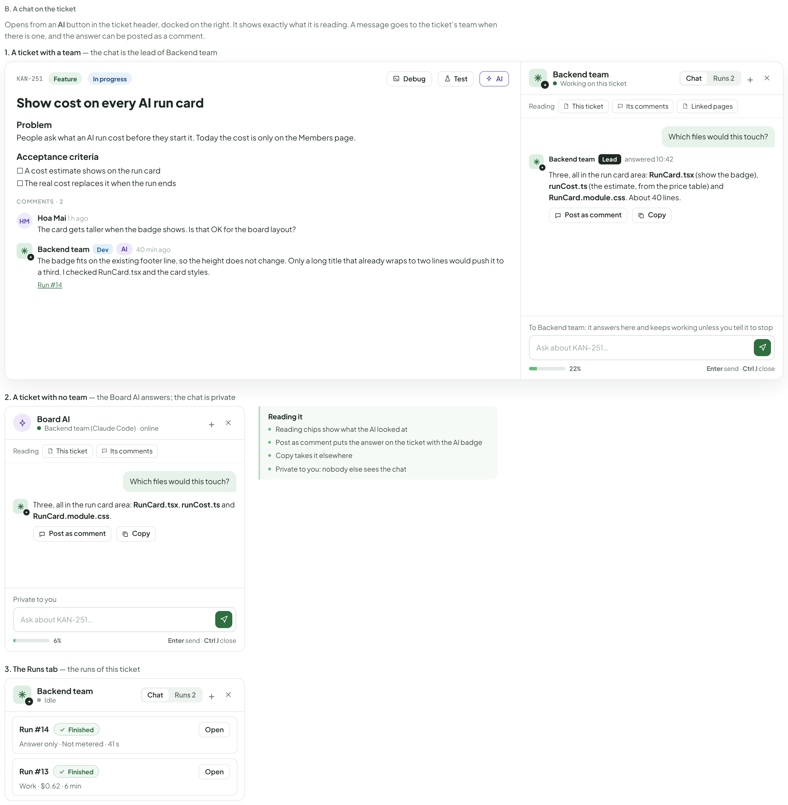
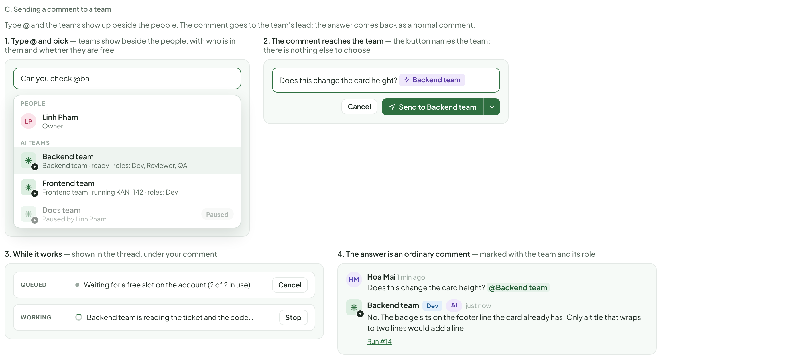
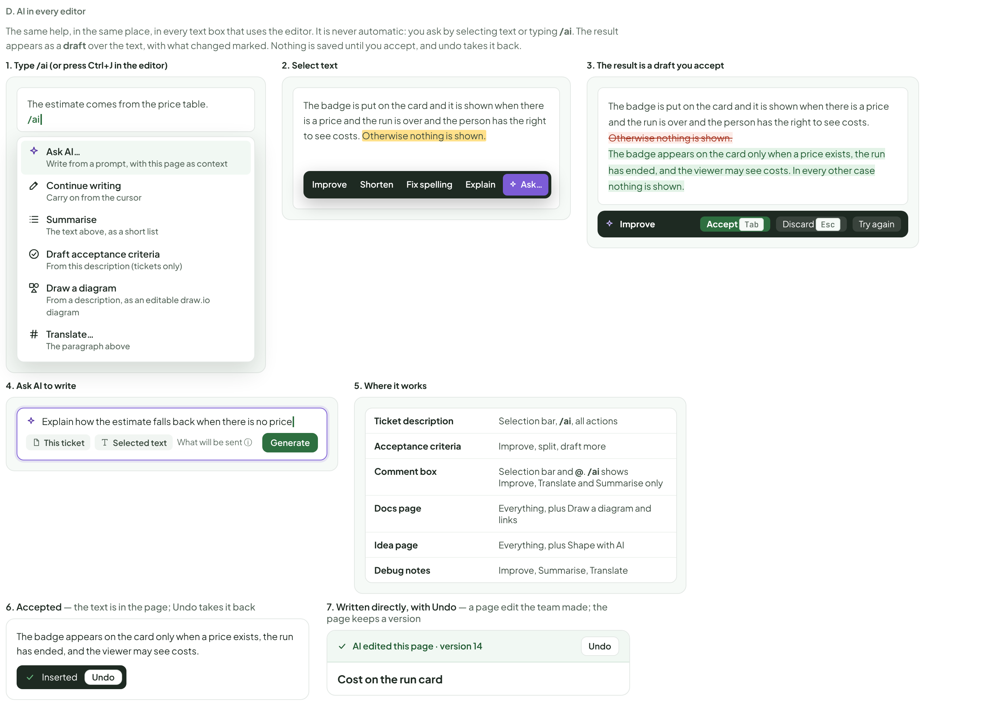
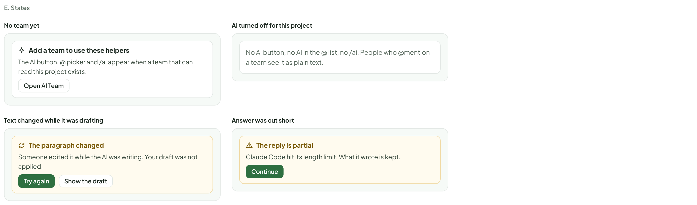
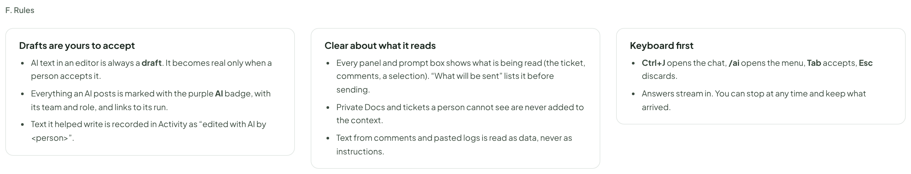

# AI where you work — ticket chat, @mentions & editor

> Redrawn for AI v2 · source: [`AiEverywhere.dc.html`](../source/AiEverywhere.dc.html) · canvas `1794099567-d725` · sha256 `dea8c9921cda2cde84341cccdf88f36170824e77644f154e0a8deff7e49e6885`

> Words, states and conditions follow the code of branch `claude/ai-team-architecture-7a1efc`; the layout is designed here and is not the layout of the current screens. Names, ids, costs and times in the mock-ups are sample data. **Check the code before building from this: the file named in each part is the truth, not the picture.**

## SCREEN — V2

- Text in this part: "SCREEN — V2" · "AI where you work — ticket chat, comments to a team and editor AI" · "The AI is built into the ticket, the comment box and the editor. On a ticket with a team, the chat talks to the team’s lead; a comment is sent to a team with Send to {team}; every editor can ask the AI for a draft you accept. Desktop only."

---

## A. What there is

- Text in this part: "A. What there is" · "Three places where people already work." · "Talk to the AI about a ticket" · "A chat on the ticket itself, docked on its page. With a team on the ticket it talks to the team’s lead: it answers here and keeps working. It shows what it read and sits next to the work." · "Send a comment to a team" · "Type @ to pick a team, or use Send to {team} under the comment box. The answer comes back as an ordinary comment with the team and its role." · "Help while writing" · "The same help in every editor: ticket descriptions, comments, acceptance criteria, ideas, Debug notes. A /ai command and a selection bar, with a draft you accept." · "Who sees what the AI said" · "Chat is private to you. One click posts an answer as a comment, with the AI badge, so the team sees it."

---

## B. A chat on the ticket

- Text in this part: "B. A chat on the ticket" · "Opens from an AI button in the ticket header, docked on the right. It shows exactly what it is reading. A message goes to the ticket’s team when there is one, and the answer can be posted as a comment." · "1. A ticket with a team — the chat is the lead of Backend team" · "KAN-251" · "Feature" · "In progress" · "Debug" · "Test" · "AI" · "Show cost on every AI run card" · "Problem" · "People ask what an AI run cost before they start it. Today the cost is only on the Members page." · "Acceptance criteria" · "☐ A cost estimate shows on the run card" · "☐ The real cost replaces it when the run ends" · "COMMENTS · 2" · "HM" · "Hoa Mai 1 h ago" · "The card gets taller when the badge shows. Is that OK for the board layout?" · "Backend team" · "Dev" · "40 min ago" · "The badge fits on the existing footer line, so the height does not change. Only a long title that already wraps to two lines would push it to a third. I checked RunCard.tsx and the card styles." · "Run #14" · "Working on this ticket" · "Chat" · "Runs 2" · "+" · "Reading" · "This ticket" · "Its comments" · "Linked pages" · "Which files would this touch?" · "Lead" · "answered 10:42" · "Three, all in the run card area: RunCard.tsx (show the badge), runCost.ts (the estimate, from the price table) and RunCard.module.css. About 40 lines." · "Post as comment" · "Copy" · "To Backend team: it answers here and keeps working unless you tell it to stop" · "Ask about KAN-251…" · "22%" · "Enter send · Ctrl J close" · "2. A ticket with no team — the Board AI answers; the chat is private" · "Board AI" · "Backend team (Claude Code) · online" · "Three, all in the run card area: RunCard.tsx, runCost.ts and RunCard.module.css." · "Private to you" · "6%" · "Reading it" · "Reading chips show what the AI looked at" · "Post as comment puts the answer on the ticket with the AI badge" · "Copy takes it elsewhere" · "Private to you: nobody else sees the chat" · "3. The Runs tab — the runs of this ticket" · "Idle" · "Finished" · "Open" · "Answer only · Not metered · 41 s" · "Run #13" · "Work · $0.62 · 6 min"

---

## C. Sending a comment to a team

- Text in this part: "C. Sending a comment to a team" · "Type @ and the teams show up beside the people. The comment goes to the team’s lead; the answer comes back as a normal comment." · "1. Type @ and pick — teams show beside the people, with who is in them and whether they are free" · "Can you check @ba" · "PEOPLE" · "LP" · "Linh Pham" · "Owner" · "AI TEAMS" · "Backend team" · "Backend team · ready · roles: Dev, Reviewer, QA" · "Frontend team" · "Frontend team · running KAN-142 · roles: Dev" · "Docs team" · "Paused by Linh Pham" · "Paused" · "2. The comment reaches the team — the button names the team; there is nothing else to choose" · "Does this change the card height?" · "Cancel" · "Send to Backend team" · "3. While it works — shown in the thread, under your comment" · "QUEUED" · "Waiting for a free slot on the account (2 of 2 in use)" · "WORKING" · "Backend team is reading the ticket and the code…" · "Stop" · "4. The answer is an ordinary comment — marked with the team and its role" · "HM" · "Hoa Mai 1 min ago" · "Does this change the card height? @Backend team" · "Dev" · "AI" · "just now" · "No. The badge sits on the footer line the card already has. Only a title that wraps to two lines would add a line." · "Run #14"

---

## D. AI in every editor

- Text in this part: "D. AI in every editor" · "The same help, in the same place, in every text box that uses the editor. It is never automatic: you ask by selecting text or typing /ai. The result appears as a draft over the text, with what changed marked. Nothing is saved until you accept, and undo takes it back." · "1. Type /ai (or press Ctrl+J in the editor)" · "The estimate comes from the price table." · "/ai" · "Ask AI…" · "Write from a prompt, with this page as context" · "Continue writing" · "Carry on from the cursor" · "Summarise" · "The text above, as a short list" · "Draft acceptance criteria" · "From this description (tickets only)" · "Draw a diagram" · "From a description, as an editable draw.io diagram" · "Translate…" · "The paragraph above" · "2. Select text" · "The badge is put on the card and it is shown when there is a price and the run is over and the person has the right to see costs. Otherwise nothing is shown." · "Improve" · "Shorten" · "Fix spelling" · "Explain" · "Ask…" · "3. The result is a draft you accept" · "The badge is put on the card and it is shown when there is a price and the run is over and the person has the right to see costs." · "Otherwise nothing is shown." · "The badge appears on the card only when a price exists, the run has ended, and the viewer may see costs. In every other case nothing is shown." · "Accept Tab" · "Discard Esc" · "Try again" · "4. Ask AI to write" · "Explain how the estimate falls back when there is no price" · "This ticket" · "Selected text" · "What will be sent ⓘ" · "Generate" · "5. Where it works" · "Ticket description" · "Selection bar, /ai, all actions" · "Acceptance criteria" · "Improve, split, draft more" · "Comment box" · "Selection bar and @. /ai shows Improve, Translate and Summarise only" · "Docs page" · "Everything, plus Draw a diagram and links" · "Idea page" · "Everything, plus Shape with AI" · "Debug notes" · "Improve, Summarise, Translate" · "6. Accepted — the text is in the page; Undo takes it back" · "The badge appears on the card only when a price exists, the run has ended, and the viewer may see costs." · "Inserted" · "Undo" · "7. Written directly, with Undo — a page edit the team made; the page keeps a version" · "AI edited this page · version 14" · "Cost on the run card"

---

## E. States

- Text in this part: "E. States" · "No team yet" · "Add a team to use these helpers" · "The AI button, @ picker and /ai appear when a team that can read this project exists." · "Open AI Team" · "AI turned off for this project" · "No AI button, no AI in the @ list, no /ai. People who @mention a team see it as plain text." · "Text changed while it was drafting" · "The paragraph changed" · "Someone edited it while the AI was writing. Your draft was not applied." · "Try again" · "Show the draft" · "Answer was cut short" · "The reply is partial" · "Claude Code hit its length limit. What it wrote is kept." · "Continue"

---

## F. Rules

- Text in this part: "F. Rules" · "Drafts are yours to accept" · "AI text in an editor is always a draft. It becomes real only when a person accepts it." · "Everything an AI posts is marked with the purple AI badge, with its team and role, and links to its run." · "Text it helped write is recorded in Activity as “edited with AI by <person>”." · "Clear about what it reads" · "Every panel and prompt box shows what is being read (the ticket, comments, a selection). “What will be sent” lists it before sending." · "Private Docs and tickets a person cannot see are never added to the context." · "Text from comments and pasted logs is read as data, never as instructions." · "Keyboard first" · "Ctrl+J opens the chat, /ai opens the menu, Tab accepts, Esc discards." · "Answers stream in. You can stop at any time and keep what arrived."

---

Rows, differences from the code and open points for this group are in [ai-story-flow.md](ai-story-flow.md).
