# Canvas — boards, notes and comments on one large plane

> SCREEN — V1 PROPOSAL · source: [`Canvas.dc.html`](../source/Canvas.dc.html) · canvas `1793469596-c902` · sha256 `3d8e46e752b1a2b1852371b855a13896ac709fb73958a08541119ff326e092ce`

> A peer of [Sketch](sketch-tool.md) and [Diagrams](diagrams-drawio.md): it appears wherever they do. Desktop and web. All names, boards and text in the mock-ups are illustrative. Open points are in section M.

A Canvas is a third drawing object next to Sketch and Diagram: design boards (HTML pages, images, Sketches, Diagrams) side by side on one large plane, with notes and arrows. It appears wherever they appear, and can also live as its own Docs page. This board shows where you start one, the editor, how people and AI change boards and comment, how it looks in ticket descriptions, comments, ideas and Docs, how to view and present it full screen, versions, files in and out, and what happens when something goes wrong.

Source: [Canvas.dc.html](../source/Canvas.dc.html) › header ("SCREEN — V1 PROPOSAL", "Canvas — boards, notes and comments on one large plane" and the intro)

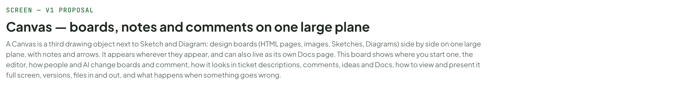

---

## A. What Canvas is, in one table

The decisions the rest of this board follows. Open points are in section M.

Source: [Canvas.dc.html](../source/Canvas.dc.html) › block "A. What Canvas is, in one table"

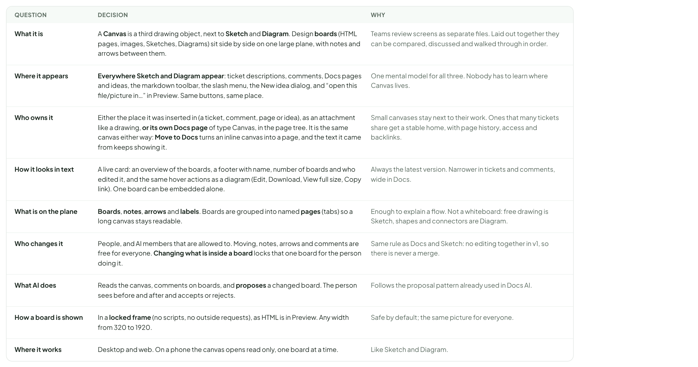

- Text in the frames: "QUESTION" · "DECISION" · "WHY" · "What it is" · "A Canvas is a third drawing object, next to Sketch and Diagram. Design boards (HTML pages, images, Sketches, Diagrams) sit side by side on one large plane, with notes and arrows between them." · "Teams review screens as separate files. Laid out together they can be compared, discussed and walked through in order." · "Where it appears" · "Everywhere Sketch and Diagram appear: ticket descriptions, comments, Docs pages and ideas, the markdown toolbar, the slash menu, the New idea dialog, and “open this file/picture in…” in Preview. Same buttons, same place." · "One mental model for all three. Nobody has to learn where Canvas lives." · "Who owns it" · "Either the place it was inserted in (a ticket, comment, page or idea), as an attachment like a drawing, or its own Docs page of type Canvas, in the page tree. It is the same canvas either way: Move to Docs turns an inline canvas into a page, and the text it came from keeps showing it." · "Small canvases stay next to their work. Ones that many tickets share get a stable home, with page history, access and backlinks." · "How it looks in text" · "A live card: an overview of the boards, a footer with name, number of boards and who edited it, and the same hover actions as a diagram (Edit, Download, View full size, Copy link). One board can be embedded alone." · "Always the latest version. Narrower in tickets and comments, wide in Docs." · "What is on the plane" · "Boards, notes, arrows and labels. Boards are grouped into named pages (tabs) so a long canvas stays readable." · "Enough to explain a flow. Not a whiteboard: free drawing is Sketch, shapes and connectors are Diagram." · "Who changes it" · "People, and AI members that are allowed to. Moving, notes, arrows and comments are free for everyone. Changing what is inside a board locks that one board for the person doing it." · "Same rule as Docs and Sketch: no editing together in v1, so there is never a merge." · "What AI does" · "Reads the canvas, comments on boards, and proposes a changed board. The person sees before and after and accepts or rejects." · "Follows the proposal pattern already used in Docs AI." · "How a board is shown" · "In a locked frame (no scripts, no outside requests), as HTML is in Preview. Any width from 320 to 1920." · "Safe by default; the same picture for everyone." · "Where it works" · "Desktop and web. On a phone the canvas opens read only, one board at a time." · "Like Sketch and Diagram."

---

## B. Where you start a canvas

Same starting points as Sketch and Diagram, plus one for files and one in the Docs tree. All of them end in the same place: the canvas editor, with the first board already on it.

Source: [Canvas.dc.html](../source/Canvas.dc.html) › block "B. Where you start a canvas"

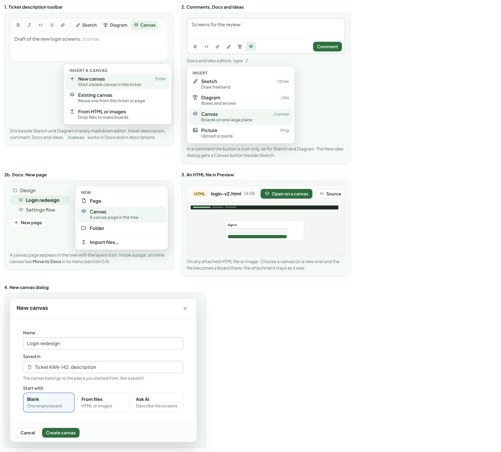

- Text in the frames: "1. Ticket description toolbar" · "Sketch" · "Diagram" · "Canvas" · "Draft of the new login screens: /canvas" · "INSERT A CANVAS" · "New canvas" · "Start a blank canvas in this ticket" · "Enter" · "Existing canvas" · "Reuse one from this ticket or page" · "From HTML or images" · "Drop files to make boards" · "Sits beside Sketch and Diagram in every markdown editor: ticket description, comment, Docs and ideas. /canvas works in Docs and in descriptions." · "2. Comments, Docs and ideas" · "Screens for the review:" · "Comment" · "Docs and idea editors: type /" · "INSERT" · "Draw freehand" · "/draw" · "Boxes and arrows" · "/dia" · "Boards on one large plane" · "/canvas" · "Picture" · "Upload or paste" · "/img" · "In a comment the button is icon only, as for Sketch and Diagram. The New idea dialog gets a Canvas button beside Sketch." · "2b. Docs: New page" · "Design" · "Login redesign" · "Settings flow" · "New page" · "NEW" · "Page" · "A canvas page in the tree" · "Folder" · "Import files…" · "A canvas page appears in the tree with the layers icon. Inside a page, an inline canvas has Move to Docs in its menu (section C4)." · "3. An HTML file in Preview" · "HTML" · "login-v2.html" · "14 KB" · "Open on a canvas" · "Source" · "Sign in" · "On any attached HTML file or image. Choose a canvas (or a new one) and the file becomes a board there; the attachment stays as it was." · "4. New canvas dialog" · "Name" · "Saved in" · "Ticket KAN-142, description" · "The canvas belongs to the place you started from, like a sketch." · "Start with" · "Blank" · "One empty board" · "From files" · "HTML or images" · "Ask AI" · "Describe the screens" · "Cancel" · "Create canvas"

---

## C. The canvas editor

Source: [Canvas.dc.html](../source/Canvas.dc.html) › block "C. The canvas editor"

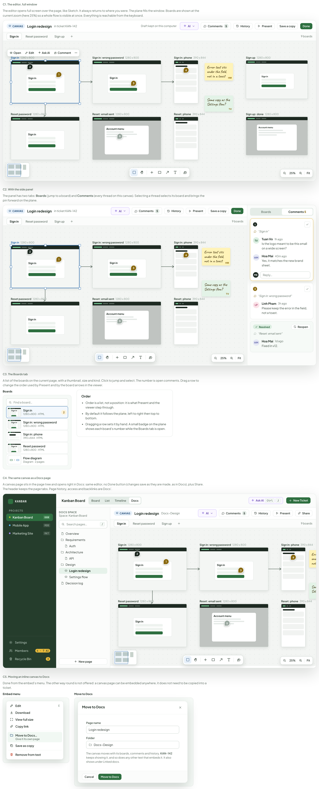

- Text in the frames: "C1. The editor, full window" · "The editor opens full screen over the page, like Sketch. It always returns to where you were. The plane fills the window. Boards are shown at the current zoom (here 25%) so a whole flow is visible at once. Everything is reachable from the keyboard." · "CANVAS" · "Login redesign" · "in ticket KAN-142" · "Draft kept on this computer" · "AI" · "Comments" · "5" · "History" · "Present" · "Save a copy" · "Done" · "Sign in" · "Reset password" · "Sign up" · "9 boards" · "1280 x 800" · "1" · "2" · "Open" · "Edit" · "Ask AI" · "Comment" · "Sign in: wrong password" · "3" · "Sign in: phone" · "390 x 844" · "4" · "Reset: email sent" · "Account menu" · "Reset: phone" · "Sign up: done" · "Error text sits under the field, not in a toast" · "HM" · "Same copy as the Settings flow?" · "TV" · "25%" · "Fit" · "C2. With the side panel" · "The panel has two tabs: Boards (jump to a board) and Comments (every thread on this canvas). Selecting a thread selects its board and brings the pin forward on the plane." · "Boards" · "Comments 5" · "“Sign in”" · "Tuan Vo" · "1h ago" · "Is the logo meant to be this small on a wide screen?" · "Hoa Mai" · "40m ago" · "Yes, it matches the new brand sheet." · "ME" · "Reply…" · "“Sign in: wrong password”" · "LP" · "Linh Pham" · "3h ago" · "Please keep the error in the field, not a toast." · "Resolved" · "Reopen" · "“Reset: email sent”" · "1d ago" · "Fixed in v12." · "C3. The Boards tab" · "A list of the boards on the current page, with a thumbnail, size and kind. Click to jump and select. The number is open comments. Drag a row to change the order used by Present and by the board arrows in the viewer." · "Find a board…" · "1280 x 800 · HTML" · "390 x 844 · HTML" · "Flow diagram" · "Diagram · 2 pages" · "Order" · "Order is a list, not a position: it is what Present and the viewer step through." · "By default it follows the plane, left to right then top to bottom." · "Dragging a row sets it by hand. A small badge on the plane shows each board’s number while the Boards tab is open." · "C4. The same canvas as a Docs page" · "A canvas page sits in the page tree and opens right in Docs: same editor, no Done button (changes save as they are made, as in Docs), plus Share. The header keeps the page tabs. Page history, access and backlinks are Docs’." · "KANBAN" · "PROJECTS" · "Kanban Board" · "KAN" · "Mobile App" · "MOB" · "Marketing Site" · "MKT" · "Settings" · "Members" · "4 · 7 AI" · "Recycle Bin" · "Board" · "List" · "Timeline" · "Docs" · "Ctrl" · "J" · "New Ticket" · "DOCS SPACE" · "Space: Kanban Board" · "Search pages…" · "/" · "Overview" · "Requirements" · "Auth" · "Architecture" · "API" · "Design" · "Settings flow" · "Decision log" · "New page" · "Docs › Design" · "Share" · "C5. Moving an inline canvas to Docs" · "Done from the embed’s menu. The other way round is not offered: a canvas page can be embedded anywhere, it does not need to be copied into a ticket." · "Embed menu" · "E" · "Download" · "View full size" · "Copy link" · "Move to Docs…" · "Give it its own page" · "Save as copy" · "Remove from text" · "Move to Docs" · "Page name" · "Folder" · "The canvas moves with its boards, comments and history. KAN-142 keeps showing it, and so does any other text that embeds it. It also shows under Linked docs." · "Cancel"

---

## D. What is on the plane

Source: [Canvas.dc.html](../source/Canvas.dc.html) › block "D. What is on the plane"

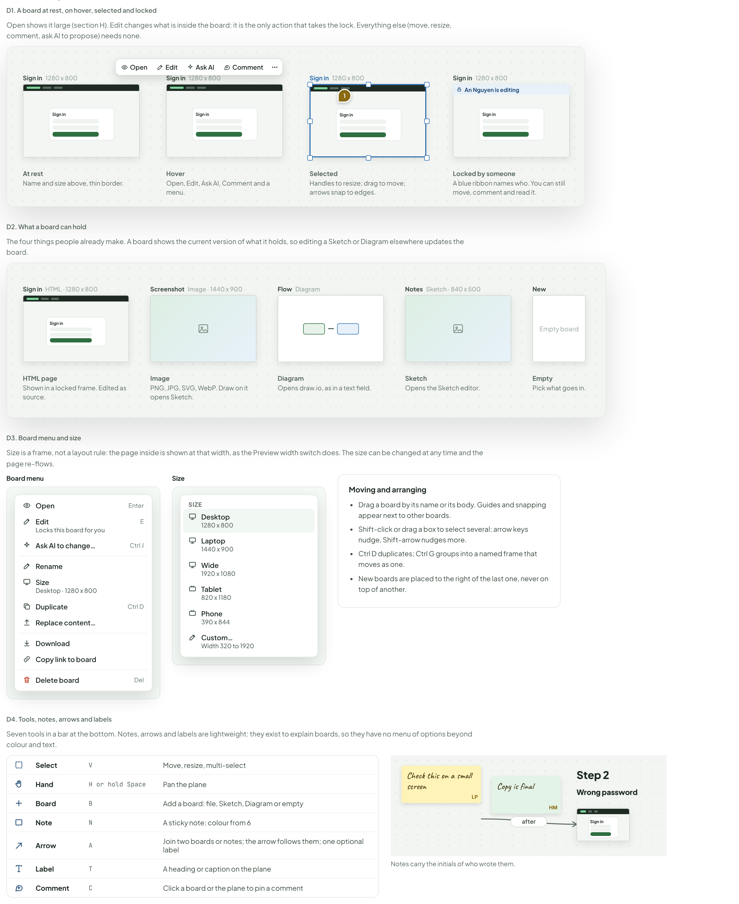

- Text in the frames: "D1. A board at rest, on hover, selected and locked" · "Open shows it large (section H). Edit changes what is inside the board; it is the only action that takes the lock. Everything else (move, resize, comment, ask AI to propose) needs none." · "Sign in" · "1280 x 800" · "Open" · "Edit" · "Ask AI" · "Comment" · "1" · "An Nguyen is editing" · "At rest" · "Name and size above, thin border." · "Hover" · "Open, Edit, Ask AI, Comment and a menu." · "Selected" · "Handles to resize; drag to move; arrows snap to edges." · "Locked by someone" · "A blue ribbon names who. You can still move, comment and read it." · "D2. What a board can hold" · "The four things people already make. A board shows the current version of what it holds, so editing a Sketch or Diagram elsewhere updates the board." · "HTML · 1280 x 800" · "Screenshot" · "Image · 1440 x 900" · "Flow" · "Diagram" · "Notes" · "Sketch · 840 x 500" · "New" · "Empty board" · "HTML page" · "Shown in a locked frame. Edited as source." · "Image" · "PNG, JPG, SVG, WebP. Draw on it opens Sketch." · "Opens draw.io, as in a text field." · "Sketch" · "Opens the Sketch editor." · "Empty" · "Pick what goes in." · "D3. Board menu and size" · "Size is a frame, not a layout rule: the page inside is shown at that width, as the Preview width switch does. The size can be changed at any time and the page re-flows." · "Board menu" · "Enter" · "Locks this board for you" · "E" · "Ask AI to change…" · "Ctrl J" · "Rename" · "Size" · "Desktop · 1280 x 800" · "Duplicate" · "Ctrl D" · "Replace content…" · "Download" · "Copy link to board" · "Delete board" · "Del" · "SIZE" · "Desktop" · "Laptop" · "1440 x 900" · "Wide" · "1920 x 1080" · "Tablet" · "820 x 1180" · "Phone" · "390 x 844" · "Custom…" · "Width 320 to 1920" · "Moving and arranging" · "Drag a board by its name or its body. Guides and snapping appear next to other boards." · "Shift-click or drag a box to select several; arrow keys nudge, Shift-arrow nudges more." · "Ctrl D duplicates; Ctrl G groups into a named frame that moves as one." · "New boards are placed to the right of the last one, never on top of another." · "D4. Tools, notes, arrows and labels" · "Seven tools in a bar at the bottom. Notes, arrows and labels are lightweight: they exist to explain boards, so they have no menu of options beyond colour and text." · "Select" · "V" · "Move, resize, multi-select" · "Hand" · "H or hold Space" · "Pan the plane" · "Board" · "B" · "Add a board: file, Sketch, Diagram or empty" · "Note" · "N" · "A sticky note; colour from 6" · "Arrow" · "A" · "Join two boards or notes; the arrow follows them; one optional label" · "Label" · "T" · "A heading or caption on the plane" · "C" · "Click a board or the plane to pin a comment" · "after" · "Check this on a small screen" · "LP" · "Copy is final" · "HM" · "Step 2" · "Wrong password" · "Notes carry the initials of who wrote them."

---

## E. Changing a board, and asking AI

Source: [Canvas.dc.html](../source/Canvas.dc.html) › block "E. Changing a board, and asking AI"

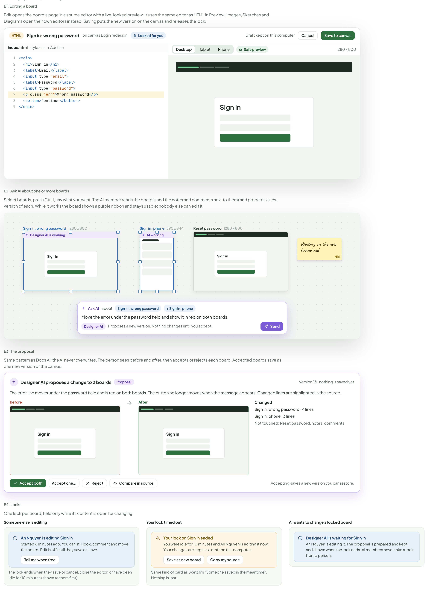

- Text in the frames: "E1. Editing a board" · "Edit opens the board’s page in a source editor with a live, locked preview. It uses the same editor as HTML in Preview; images, Sketches and Diagrams open their own editors instead. Saving puts the new version on the canvas and releases the lock." · "HTML" · "Sign in: wrong password" · "on canvas Login redesign" · "Locked for you" · "Draft kept on this computer" · "Cancel" · "Save to canvas" · "index.html" · "style.css" · "+ Add file" · "1" · "<main>" · "2" · "<h1>Sign in</h1>" · "3" · "<label>Email</label>" · "4" · "<input type="email">" · "5" · "<label>Password</label>" · "6" · "<input type="password">" · "7" · "
Wrong password
" · "8" · "<button>Continue</button>" · "9" · "</main>" · "Desktop" · "Tablet" · "Phone" · "Safe preview" · "1280 x 800" · "Sign in" · "E2. Ask AI about one or more boards" · "Select boards, press Ctrl J, say what you want. The AI member reads the boards (and the notes and comments next to them) and prepares a new version of each. While it works the board shows a purple ribbon and stays usable; nobody else can edit it." · "Designer AI is working" · "Sign in: phone" · "390 x 844" · "AI working" · "Reset password" · "Waiting on the new brand red" · "HM" · "Ask AI" · "about" · "+ Sign in: phone" · "Move the error under the password field and show it in red on both boards." · "Designer AI" · "Proposes a new version. Nothing changes until you accept." · "Send" · "E3. The proposal" · "Same pattern as Docs AI: the AI never overwrites. The person sees before and after, then accepts or rejects each board. Accepted boards save as one new version of the canvas." · "Designer AI proposes a change to 2 boards" · "Proposal" · "Version 13 · nothing is saved yet" · "The error line moves under the password field and is red on both boards. The button no longer moves when the message appears. Changed lines are highlighted in the source." · "Before" · "After" · "Changed" · "Sign in: wrong password · 4 lines" · "Sign in: phone · 3 lines" · "Not touched: Reset password, notes, comments" · "Accept both" · "Accept one…" · "Reject" · "Compare in source" · "Accepting saves a new version you can restore." · "E4. Locks" · "One lock per board, held only while its content is open for changing." · "Someone else is editing" · "An Nguyen is editing Sign in" · "Started 6 minutes ago. You can still look, comment and move the board. Edit is off until they save or leave." · "Tell me when free" · "The lock ends when they save or cancel, close the editor, or have been idle for 10 minutes (shown to them first)." · "Your lock timed out" · "Your lock on Sign in ended" · "You were idle for 10 minutes and An Nguyen is editing it now. Your changes are kept as a draft on this computer." · "Save as new board" · "Copy my source" · "Same kind of card as Sketch’s “Someone saved in the meantime”. Nothing is lost." · "AI wants to change a locked board" · "Designer AI is waiting for Sign in" · "An Nguyen is editing it. The proposal is prepared and kept, and shown when the lock ends. AI members never take a lock from a person."

---

## F. Comments

Comments are pinned to a board (or to the plane), live in threads, and can be resolved. They behave like Docs comments, and belong to the canvas, so they follow it when it moves to Docs.

Source: [Canvas.dc.html](../source/Canvas.dc.html) › block "F. Comments"

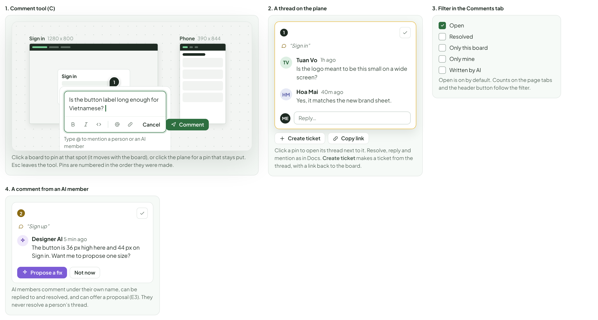

- Text in the frames: "1. Comment tool (C)" · "Sign in" · "1280 x 800" · "1" · "Phone" · "390 x 844" · "Is the button label long enough for Vietnamese?" · "Cancel" · "Comment" · "Type @ to mention a person or an AI member" · "Click a board to pin at that spot (it moves with the board), or click the plane for a pin that stays put. Esc leaves the tool. Pins are numbered in the order they were made." · "2. A thread on the plane" · "“Sign in”" · "TV" · "Tuan Vo" · "1h ago" · "Is the logo meant to be this small on a wide screen?" · "HM" · "Hoa Mai" · "40m ago" · "Yes, it matches the new brand sheet." · "ME" · "Reply…" · "Create ticket" · "Copy link" · "Click a pin to open its thread next to it. Resolve, reply and mention as in Docs. Create ticket makes a ticket from the thread, with a link back to the board." · "3. Filter in the Comments tab" · "Open" · "Resolved" · "Only this board" · "Only mine" · "Written by AI" · "Open is on by default. Counts on the page tabs and the header button follow the filter." · "4. A comment from an AI member" · "2" · "“Sign up”" · "Designer AI 5 min ago" · "The button is 36 px high here and 44 px on Sign in. Want me to propose one size?" · "Propose a fix" · "Not now" · "AI members comment under their own name, can be replied to and resolved, and can offer a proposal (E3). They never resolve a person’s thread."

---

## G. How a canvas appears in text

Source: [Canvas.dc.html](../source/Canvas.dc.html) › block "G. How a canvas appears in text"

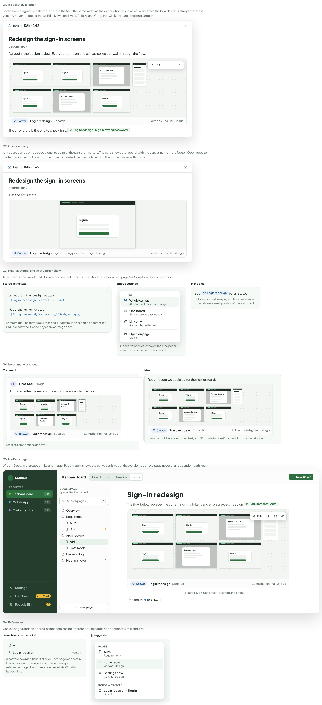

- Text in the frames: "G1. In a ticket description" · "Looks like a diagram or a sketch: a card in the text, the same width as the description. It shows an overview of the boards and is always the latest version. Hover (or focus) shows Edit, Download, View full size and Copy link. Click the card to open it large (H1)." · "Task" · "KAN-142" · "Redesign the sign-in screens" · "DESCRIPTION" · "Agreed in the design review. Every screen is on one canvas so we can walk through the flow:" · "Edit" · "Sign in" · "Account menu" · "Canvas" · "Login redesign" · "6 boards" · "Edited by Hoa Mai · 2h ago" · "The error state is the one to check first:" · "Login redesign › Sign in: wrong password" · "G2. One board only" · "Any board can be embedded alone, to point at the part that matters. The card shows that board, with the canvas name in the footer; Open goes to the full canvas, at that board. If the board is deleted the card falls back to the whole canvas with a note." · "Just the error state:" · "Sign in: wrong password · Login redesign" · "G3. How it is stored, and what you can show" · "An embed is one line of markdown. Choose what it shows: the whole canvas (current page tab), one board, or only a chip." · "Stored in the text" · "Agreed in the design review:" · "" · "" · "Same image-line form as a Sketch and a Diagram. In an export it becomes the PNG overview, so it works anywhere an image does." · "Embed settings" · "SHOW" · "Whole canvas" · "All boards of the current page" · "One board" · "Sign in: wrong password ▾" · "Link only" · "A small chip in the line" · "Open on page" · "Opens from the card: hover, then the pencil menu; or click the card in edit mode." · "Inline chip" · "See" · "Login redesign for all states." · "Link only: a chip like a page or ticket reference. Hover shows a small preview of the first board." · "G4. In comments and ideas" · "Comment" · "HM" · "Hoa Mai" · "2h ago" · "Updated after the review. The error now sits under the field." · "Smaller, same actions on hover." · "Idea" · "Rough layout we could try for the new run card:" · "Run card ideas" · "3 boards" · "Edited by An Nguyen · 1d ago" · "Ideas can hold a canvas in their text, and “Promote to ticket” carries it into the description." · "G5. In a Docs page" · "Wide in Docs, with a caption like any image. Page history shows the canvas as it was at that version, so an old page never changes underneath you." · "KANBAN" · "PROJECTS" · "Kanban Board" · "KAN" · "Mobile App" · "MOB" · "Marketing Site" · "MKT" · "Settings" · "Members" · "4 · 7 AI" · "Recycle Bin" · "3" · "Board" · "List" · "Timeline" · "Docs" · "New Ticket" · "DOCS SPACE" · "Space: Kanban Board" · "Search pages…" · "/" · "Overview" · "Requirements" · "Auth" · "Billing" · "Architecture" · "API" · "Data model" · "Decision log" · "Meeting notes" · "New page" · "Sign-in redesign" · "The flow below replaces the current sign-in. Tokens and errors are described on" · "Requirements › Auth." · "Figure 1. Sign in and reset, desktop and phone." · "Tracked in" · "." · "G6. References" · "Canvas pages and the boards inside them can be referenced like pages and sections: with [[ and a #." · "Linked docs on the ticket" · "canvas" · "A canvas shown in a ticket (inline or Docs page) appears in Linked docs with the layers icon, the same way a referenced page does. The canvas page lists KAN-142 in its backlinks." · "[[ suggester" · "PAGES" · "Canvas · Design" · "Settings flow" · "INSIDE A CANVAS" · "Login redesign › Sign in"

---

## H. Looking at it large

Source: [Canvas.dc.html](../source/Canvas.dc.html) › block "H. Looking at it large"

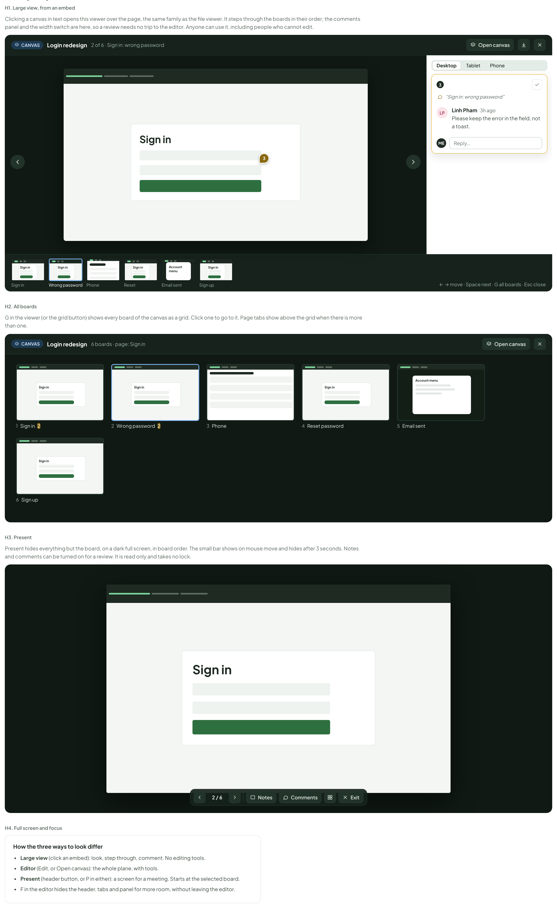

- Text in the frames: "H1. Large view, from an embed" · "Clicking a canvas in text opens this viewer over the page, the same family as the file viewer. It steps through the boards in their order; the comments panel and the width switch are here, so a review needs no trip to the editor. Anyone can use it, including people who cannot edit." · "CANVAS" · "Login redesign" · "2 of 6 · Sign in: wrong password" · "Open canvas" · "Sign in" · "3" · "Desktop" · "Tablet" · "Phone" · "“Sign in: wrong password”" · "LP" · "Linh Pham" · "3h ago" · "Please keep the error in the field, not a toast." · "ME" · "Reply…" · "Wrong password" · "Reset" · "Account menu" · "Email sent" · "Sign up" · "← → move · Space next · G all boards · Esc close" · "H2. All boards" · "G in the viewer (or the grid button) shows every board of the canvas as a grid. Click one to go to it. Page tabs show above the grid when there is more than one." · "6 boards · page: Sign in" · "1" · "2" · "4" · "Reset password" · "5" · "6" · "H3. Present" · "Present hides everything but the board, on a dark full screen, in board order. The small bar shows on mouse move and hides after 3 seconds. Notes and comments can be turned on for a review. It is read only and takes no lock." · "2 / 6" · "Notes" · "Comments" · "Exit" · "H4. Full screen and focus" · "How the three ways to look differ" · "Large view (click an embed): look, step through, comment. No editing tools." · "Editor (Edit, or Open canvas): the whole plane, with tools." · "Present (header button, or P in either): a screen for a meeting. Starts at the selected board." · "F in the editor hides the header, tabs and panel for more room, without leaving the editor."

---

## I. Moving around

Pan and zoom like any canvas. Everything has a key, and the list is in the editor under the question mark.

Source: [Canvas.dc.html](../source/Canvas.dc.html) › block "I. Moving around"

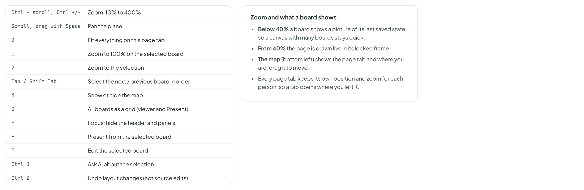

- Text in the frames: "Ctrl + scroll, Ctrl +/-" · "Zoom, 10% to 400%" · "Scroll, drag with Space" · "Pan the plane" · "0" · "Fit everything on this page tab" · "1" · "Zoom to 100% on the selected board" · "2" · "Zoom to the selection" · "Tab / Shift Tab" · "Select the next / previous board in order" · "M" · "Show or hide the map" · "G" · "All boards as a grid (viewer and Present)" · "F" · "Focus: hide the header and panels" · "P" · "Present from the selected board" · "E" · "Edit the selected board" · "Ctrl J" · "Ask AI about the selection" · "Ctrl Z" · "Undo layout changes (not source edits)" · "Zoom and what a board shows" · "Below 40% a board shows a picture of its last saved state, so a canvas with many boards stays quick." · "From 40% the page is drawn live in its locked frame." · "The map (bottom left) shows the page tab and where you are; drag it to move." · "Every page tab keeps its own position and zoom for each person, so a tab opens where you left it."

---

## J. History

Source: [Canvas.dc.html](../source/Canvas.dc.html) › block "J. History"

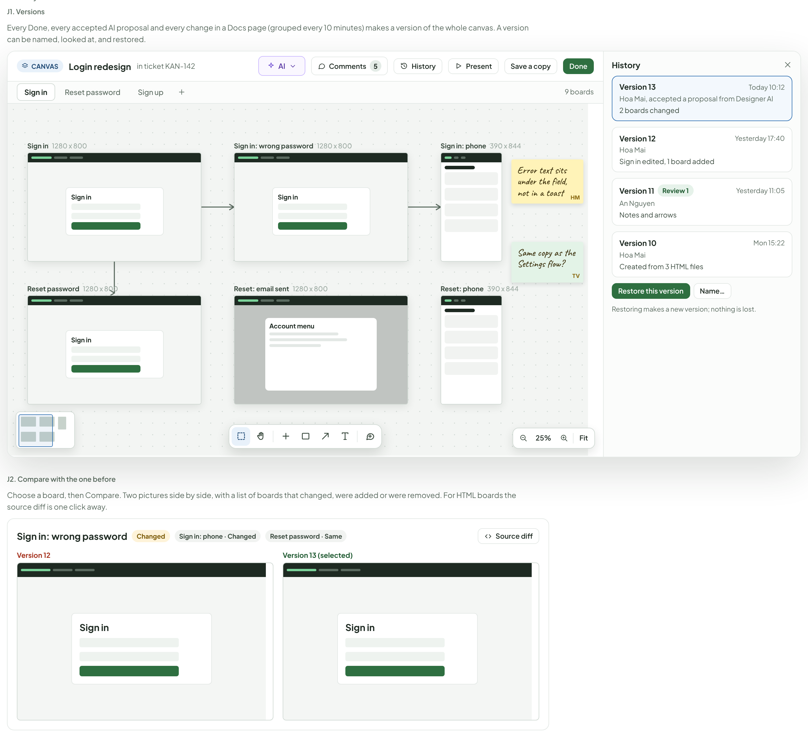

- Text in the frames: "J1. Versions" · "Every Done, every accepted AI proposal and every change in a Docs page (grouped every 10 minutes) makes a version of the whole canvas. A version can be named, looked at, and restored." · "CANVAS" · "Login redesign" · "in ticket KAN-142" · "AI" · "Comments" · "5" · "History" · "Present" · "Save a copy" · "Done" · "Sign in" · "Reset password" · "Sign up" · "9 boards" · "1280 x 800" · "Sign in: wrong password" · "Sign in: phone" · "390 x 844" · "Reset: email sent" · "Account menu" · "Reset: phone" · "Error text sits under the field, not in a toast" · "HM" · "Same copy as the Settings flow?" · "TV" · "25%" · "Fit" · "Version 13" · "Today 10:12" · "Hoa Mai, accepted a proposal from Designer AI" · "2 boards changed" · "Version 12" · "Yesterday 17:40" · "Hoa Mai" · "Sign in edited, 1 board added" · "Version 11" · "Review 1" · "Yesterday 11:05" · "An Nguyen" · "Notes and arrows" · "Version 10" · "Mon 15:22" · "Created from 3 HTML files" · "Restore this version" · "Name…" · "Restoring makes a new version; nothing is lost." · "J2. Compare with the one before" · "Choose a board, then Compare. Two pictures side by side, with a list of boards that changed, were added or were removed. For HTML boards the source diff is one click away." · "Changed" · "Sign in: phone · Changed" · "Reset password · Same" · "Source diff" · "Version 13 (selected)"

---

## K. Sharing and getting files in and out

Access is the owner’s: whoever can see the ticket, page or idea can see the canvas, and whoever can edit it can edit the canvas. A link to a canvas page follows the page’s own access. There is no public link in v1.

Source: [Canvas.dc.html](../source/Canvas.dc.html) › block "K. Sharing and getting files in and out"

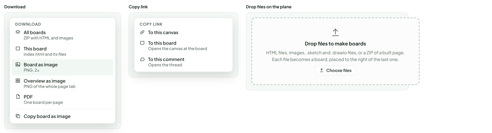

- Text in the frames: "Download" · "DOWNLOAD" · "All boards" · "ZIP with HTML and images" · "This board" · "index.html and its files" · "Board as image" · "PNG, 2x" · "Overview as image" · "PNG of the whole page tab" · "PDF" · "One board per page" · "Copy board as image" · "Copy link" · "COPY LINK" · "To this canvas" · "To this board" · "Opens the canvas at the board" · "To this comment" · "Opens the thread" · "Drop files on the plane" · "Drop files to make boards" · "HTML files, images, .sketch and .drawio files, or a ZIP of a built page. Each file becomes a board, placed to the right of the last one." · "Choose files"

---

## L. States and problems

Source: [Canvas.dc.html](../source/Canvas.dc.html) › block "L. States and problems"

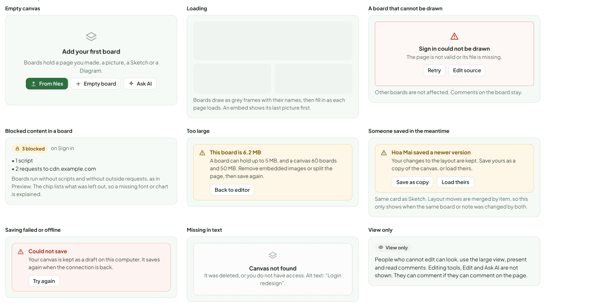

- Text in the frames: "Empty canvas" · "Add your first board" · "Boards hold a page you made, a picture, a Sketch or a Diagram." · "From files" · "Empty board" · "Ask AI" · "Loading" · "Boards draw as grey frames with their names, then fill in as each page loads. An embed shows its last picture first." · "A board that cannot be drawn" · "Sign in could not be drawn" · "The page is not valid or its file is missing." · "Retry" · "Edit source" · "Other boards are not affected. Comments on the board stay." · "Blocked content in a board" · "3 blocked" · "on Sign in" · "• 1 script" · "• 2 requests to cdn.example.com" · "Boards run without scripts and without outside requests, as in Preview. The chip lists what was left out, so a missing font or chart is explained." · "Too large" · "This board is 6.2 MB" · "A board can hold up to 5 MB, and a canvas 60 boards and 50 MB. Remove embedded images or split the page, then save again." · "Back to editor" · "Someone saved in the meantime" · "Hoa Mai saved a newer version" · "Your changes to the layout are kept. Save yours as a copy of the canvas, or load theirs." · "Save as copy" · "Load theirs" · "Same card as Sketch. Layout moves are merged by item, so this only shows when the same board or note was changed by both." · "Saving failed or offline" · "Could not save" · "Your canvas is kept as a draft on this computer. It saves again when the connection is back." · "Try again" · "Missing in text" · "Canvas not found" · "It was deleted, or you do not have access. Alt text: “Login redesign”." · "View only" · "People who cannot edit can look, use the large view, present and read comments. Editing tools, Edit and Ask AI are not shown. They can comment if they can comment on the page."

---

## M. Where the data comes from, and what to confirm

A canvas is a small file that points at boards stored the way attachments already are. Most of the work is the plane (move, zoom, select), the locked frame (it exists in Preview) and the proposal flow (it exists in Docs AI).

Source: [Canvas.dc.html](../source/Canvas.dc.html) › block "M. Where the data comes from, and what to confirm"

- Text in the frames: "PIECE" · "HOLDS" · "WHERE IT COMES FROM" · "Canvas" · "name, owner (ticket, comment, Docs page, idea, or itself when it is a Docs page), page tabs, current version" · "a record plus one file; shown in text as a canvas: image line" · "Board" · "name, size, kind (HTML, image, Sketch, Diagram, empty), what it holds, position, tab, order" · "its content is stored as attachment files (an HTML board is one folder), the position and order live in the canvas file" · "Note, arrow, label" · "text, colour, position; arrows hold two ends and an optional label" · "in the canvas file" · "Comment" · "board or plane point, thread, author, resolved" · "belongs to the canvas, so it moves with it; same record shape as Docs comments" · "Version" · "author, time, name, what changed, a frozen copy of the canvas file and the boards that changed" · "created on Done, on accepting a proposal, and every 10 minutes of a Docs page" · "Lock" · "board, person, since, last activity" · "in memory with a time limit; not a version" · "To confirm before building" · "The word “board”. The app already has a Board view (Board, List, Timeline). Boards on a canvas could be confused with it. Recommended: call them frames everywhere in the UI. This design uses “board” so the proposal reads like the canvas the team already knows; changing the word is text only." · "Both an object and a Docs page. This design lets a canvas be inline (an attachment of its owner) or a Docs page, and moves one into the other with Move to Docs. Confirm the second form is wanted in v1, or ship inline first." · "Page history of a page that embeds a canvas. Showing the canvas as it was at that page version needs a frozen copy per page version. Cheaper: always show the latest and say so in the history." · "Limits. 60 boards, 5 MB per board, 50 MB per canvas, 10 page tabs are proposals. Sketch is 10 MB and Diagram 2 MB." · "HTML boards. One file, or a folder with its CSS, images and fonts? This design assumes a folder, with the same locked frame as Preview (no scripts, no outside requests). A ZIP of a built page then works." · "Lock time. 10 minutes idle, shown to the person first. A different value is only a number." · "Sketch and Diagram boards are live. A board that holds one shows its latest version, so editing the Sketch elsewhere changes the board." · "AI. AI members need the same permission as for editing Docs, and read the canvas as boards, notes and comments. Cost shown as for other AI work. They never take a lock from a person." · "Realtime. No live cursors or editing together in v1. Layout changes (moves, notes, arrows) merge by item, so two people can arrange at once; only the same item changing twice conflicts." · "Present and the large view are read only and take no lock. Whether Present needs a person to hold the keys (shared screen, remote control) is not designed." · "Export of a Docs page that holds a canvas writes its overview PNG, as sketches and diagrams do."
