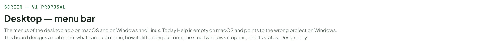
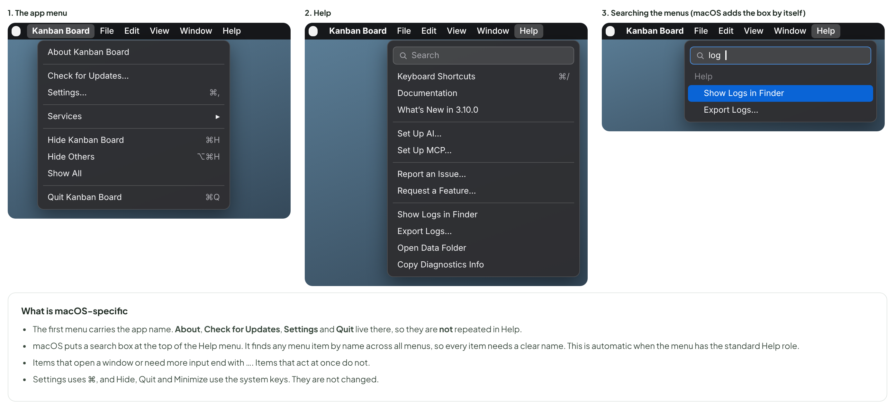
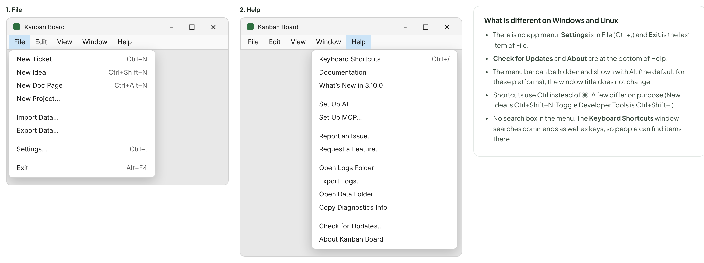
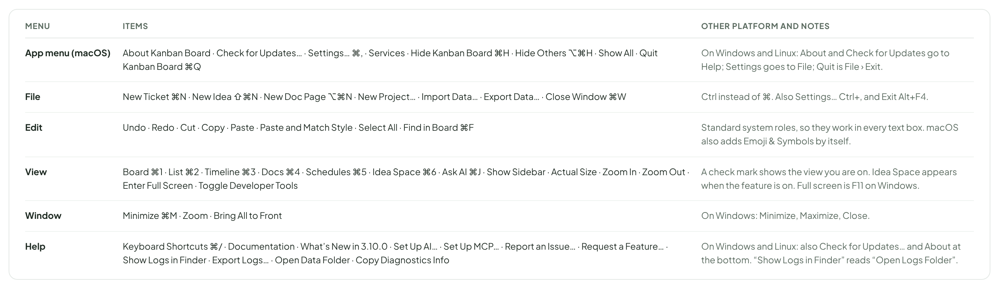
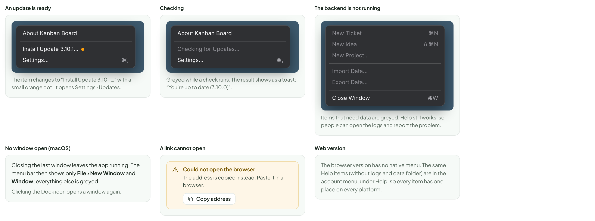
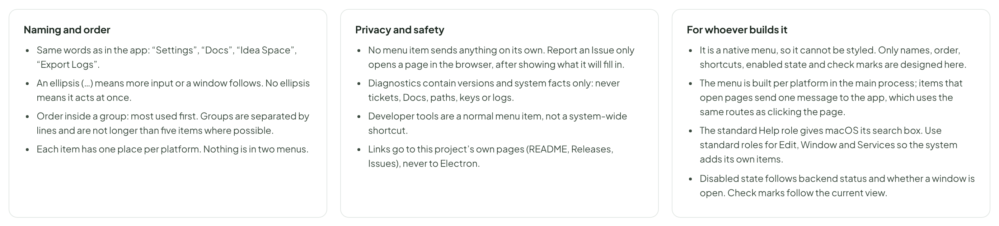
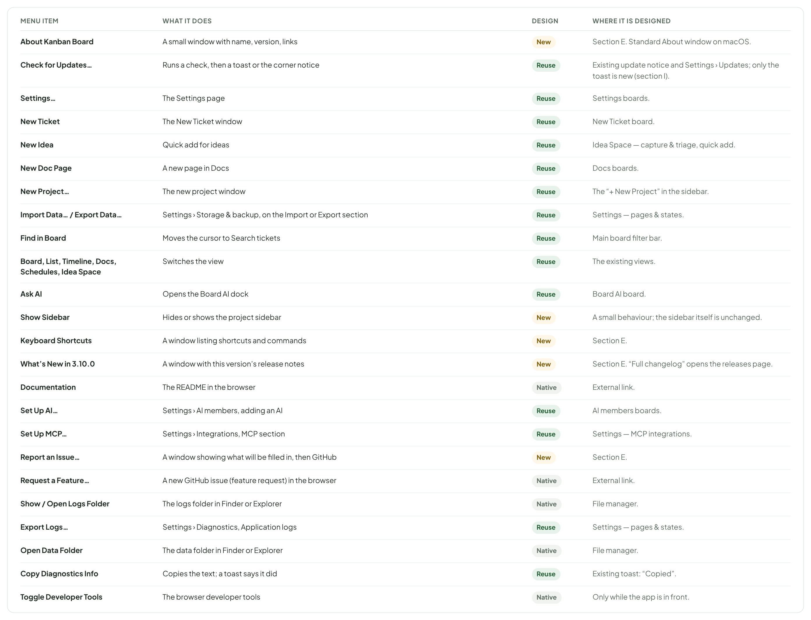

# Desktop — menu bar

> SCREEN — V1 PROPOSAL · source: [`DesktopMenu.dc.html`](../source/DesktopMenu.dc.html) · canvas `1793314497-f4b9` · sha256 `fde1924f3ea6a2a696dda365917a4987020dd810e239318a664b11560605bfb4`

The menus of the desktop app on macOS and on Windows and Linux. Today Help is empty on macOS and points to the wrong project on Windows. This board designs a real menu: what is in each menu, how it differs by platform, the small windows it opens, and its states. Design only.

Source: [DesktopMenu.dc.html](../source/DesktopMenu.dc.html) › header ("SCREEN — V1 PROPOSAL", "Desktop — menu bar" and the intro)

---

## A. What is wrong today and what changes

The desktop app has no menu of its own. It shows the default Electron menu, so Help is empty on macOS and points to the wrong project on Windows. A real menu bar is also where people look for shortcuts, settings and ways to get help. This board is only the design of the menus and the small windows they open; it does not change the app.

Source: [DesktopMenu.dc.html](../source/DesktopMenu.dc.html) › block "A. What is wrong today and what changes"

- Text in the frames: "WHERE" · "TODAY" · "PROPOSED" · "Help on macOS" · "Only the system search box and “(empty)”. Nothing to click." · "14 useful items: shortcuts, docs, what’s new, setup guides, report an issue, logs, data folder." · "Help on Windows and Linux" · "Links to the Electron project (Learn More, Documentation, Community, Search Issues). They have nothing to do with this app." · "The same items as macOS, plus Check for Updates and About (these live in the app menu on macOS)." · "The app menu on macOS" · "The default one: About, Services, Hide, Quit. No Settings, no update check." · "Adds Check for Updates… and Settings… (⌘,), where Mac users look for them." · "File, View, Window" · "Only the generic Electron items." · "Real actions: new ticket, idea, doc page; switch view; Ask AI; zoom; import and export." · "Developer tools" · "Cmd/Ctrl+Shift+I is registered as a global shortcut, so it works (and steals the keys) even when another app is in front." · "A normal menu item, View › Toggle Developer Tools, active only while this app is in front."

---

## B. macOS

Menus sit at the top of the screen, are always visible, and follow the Mac order: app menu, File, Edit, View, Window, Help. The other menus are shown in the table in section D.

Source: [DesktopMenu.dc.html](../source/DesktopMenu.dc.html) › block "B. macOS"

- Text in the frames: "1. The app menu" · "Kanban Board" · "File" · "Edit" · "View" · "Window" · "Help" · "About Kanban Board" · "Check for Updates…" · "Settings…" · "⌘," · "Services" · "▸" · "Hide Kanban Board" · "⌘H" · "Hide Others" · "⌥⌘H" · "Show All" · "Quit Kanban Board" · "⌘Q" · "2. Help" · "Search" · "Keyboard Shortcuts" · "⌘/" · "Documentation" · "What’s New in 3.10.0" · "Set Up AI…" · "Set Up MCP…" · "Report an Issue…" · "Request a Feature…" · "Show Logs in Finder" · "Export Logs…" · "Open Data Folder" · "Copy Diagnostics Info" · "3. Searching the menus (macOS adds the box by itself)" · "log" · "What is macOS-specific" · "The first menu carries the app name. About, Check for Updates, Settings and Quit live there, so they are not repeated in Help." · "macOS puts a search box at the top of the Help menu. It finds any menu item by name across all menus, so every item needs a clear name. This is automatic when the menu has the standard Help role." · "Items that open a window or need more input end with …. Items that act at once do not." · "Settings uses ⌘, and Hide, Quit and Minimize use the system keys. They are not changed."

---

## C. Windows and Linux

The menu bar is part of the window, under the title. Help is longer here because it also holds the items macOS keeps in the app menu.

Source: [DesktopMenu.dc.html](../source/DesktopMenu.dc.html) › block "C. Windows and Linux"

- Text in the frames: "1. File" · "Kanban Board" · "– ☐ ✕" · "File" · "Edit" · "View" · "Window" · "Help" · "New Ticket" · "Ctrl+N" · "New Idea" · "Ctrl+Shift+N" · "New Doc Page" · "Ctrl+Alt+N" · "New Project…" · "Import Data…" · "Export Data…" · "Settings…" · "Ctrl+," · "Exit" · "Alt+F4" · "2. Help" · "Keyboard Shortcuts" · "Ctrl+/" · "Documentation" · "What’s New in 3.10.0" · "Set Up AI…" · "Set Up MCP…" · "Report an Issue…" · "Request a Feature…" · "Open Logs Folder" · "Export Logs…" · "Open Data Folder" · "Copy Diagnostics Info" · "Check for Updates…" · "About Kanban Board" · "What is different on Windows and Linux" · "There is no app menu. Settings is in File (Ctrl+,) and Exit is the last item of File." · "Check for Updates and About are at the bottom of Help." · "The menu bar can be hidden and shown with Alt (the default for these platforms); the window title does not change." · "Shortcuts use Ctrl instead of ⌘. A few differ on purpose (New Idea is Ctrl+Shift+N; Toggle Developer Tools is Ctrl+Shift+I)." · "No search box in the menu. The Keyboard Shortcuts window searches commands as well as keys, so people can find items there."

---

## D. All the menus

Names and shortcuts below are proposals. Before building, check each shortcut against the keys the app already uses inside the page (for example / focuses search, and the editors use Ctrl/Cmd+S and Ctrl/Cmd+Shift+M).

Source: [DesktopMenu.dc.html](../source/DesktopMenu.dc.html) › block "D. All the menus"

- Text in the frames: "MENU" · "ITEMS" · "OTHER PLATFORM AND NOTES" · "App menu (macOS)" · "About Kanban Board · Check for Updates… · Settings… ⌘, · Services · Hide Kanban Board ⌘H · Hide Others ⌥⌘H · Show All · Quit Kanban Board ⌘Q" · "On Windows and Linux: About and Check for Updates go to Help; Settings goes to File; Quit is File › Exit." · "File" · "New Ticket ⌘N · New Idea ⇧⌘N · New Doc Page ⌥⌘N · New Project… · Import Data… · Export Data… · Close Window ⌘W" · "Ctrl instead of ⌘. Also Settings… Ctrl+, and Exit Alt+F4." · "Edit" · "Undo · Redo · Cut · Copy · Paste · Paste and Match Style · Select All · Find in Board ⌘F" · "Standard system roles, so they work in every text box. macOS also adds Emoji & Symbols by itself." · "View" · "Board ⌘1 · List ⌘2 · Timeline ⌘3 · Docs ⌘4 · Schedules ⌘5 · Idea Space ⌘6 · Ask AI ⌘J · Show Sidebar · Actual Size · Zoom In · Zoom Out · Enter Full Screen · Toggle Developer Tools" · "A check mark shows the view you are on. Idea Space appears when the feature is on. Full screen is F11 on Windows." · "Window" · "Minimize ⌘M · Zoom · Bring All to Front" · "On Windows: Minimize, Maximize, Close." · "Help" · "Keyboard Shortcuts ⌘/ · Documentation · What’s New in 3.10.0 · Set Up AI… · Set Up MCP… · Report an Issue… · Request a Feature… · Show Logs in Finder · Export Logs… · Open Data Folder · Copy Diagnostics Info" · "On Windows and Linux: also Check for Updates… and About at the bottom. “Show Logs in Finder” reads “Open Logs Folder”."

---

## E. The windows the menu opens

Most items open something the app already has (Settings pages, Export Data, the Diagnostics page) or a link in the browser. Four small windows are new. They look like the rest of the app, not like system dialogs, except About, which uses the system About window on macOS.

Source: [DesktopMenu.dc.html](../source/DesktopMenu.dc.html) › block "E. The windows the menu opens"

- Text in the frames: "Keyboard Shortcuts (Help)" · "Keyboard Shortcuts" · "Search shortcuts and commands…" · "GO TO" · "Board" · "⌘" · "1" · "List" · "2" · "Timeline" · "3" · "Docs" · "4" · "Idea Space" · "6" · "SEARCH" · "Search tickets" · "/" · "Find in board" · "F" · "CREATE" · "New ticket" · "N" · "New idea" · "⇧" · "New doc page" · "⌥" · "AI AND EDITOR" · "Ask AI" · "J" · "Save draft" · "S" · "Publish" · "⏎" · "Toggle Markdown" · "M" · "On Windows and Linux the keys show as Ctrl, Shift and Alt." · "Close" · "About (the standard About window on macOS; the same content on Windows)" · "Kanban Board" · "Version 3.10.0 · Backend 3.10.0 · Electron 39" · "A local Kanban board with Docs, ideas and AI members. Your data stays on this computer." · "Release notes" · "Copy diagnostics" · "© 2026 Cao Minh Tiến · MIT licence" · "What’s New (the release notes of the version you are running)" · "What’s new in 3.10.0" · "Released 29 Oct 2026" · "Docs brought in line with the design." · "Added" · "Who can edit pages (Everyone, Members, Admins)" · "Request access to Docs" · "Editor shortcuts: save draft, Publish, Markdown view" · "Comments over several lines" · "Changed" · "Search shows match counts and a Create page option" · "Full changelog" · "Report an Issue… (shows what will be filled in)" · "Report an issue" · "This opens a new GitHub issue in your browser. Nothing is sent until you press Create issue there." · "App 3.10.0 · Backend running" · "macOS 15.1 (arm64) · Electron 39" · "Window 1400 × 900 · Language en" · "Included: versions, system, window size" · "Never included: tickets, Docs, file paths, keys, logs" · "Logs can help; attach them yourself with Export Logs…" · "Cancel" · "Copy text" · "Open GitHub"

---

## F. States

Source: [DesktopMenu.dc.html](../source/DesktopMenu.dc.html) › block "F. States"

- Text in the frames: "An update is ready" · "About Kanban Board" · "Install Update 3.10.1…" · "Settings…" · "⌘," · "The item changes to “Install Update 3.10.1…” with a small orange dot. It opens Settings › Updates." · "Checking" · "Checking for Updates…" · "Greyed while a check runs. The result shows as a toast: “You’re up to date (3.10.0)”." · "The backend is not running" · "New Ticket" · "⌘N" · "New Idea" · "⇧⌘N" · "New Project…" · "Import Data…" · "Export Data…" · "Close Window" · "⌘W" · "Items that need data are greyed. Help still works, so people can open the logs and report the problem." · "No window open (macOS)" · "Closing the last window leaves the app running. The menu bar then shows only File › New Window and Window; everything else is greyed." · "Clicking the Dock icon opens a window again." · "A link cannot open" · "Could not open the browser" · "The address is copied instead. Paste it in a browser." · "Copy address" · "Web version" · "The browser version has no native menu. The same Help items (without logs and data folder) are in the account menu, under Help, so every item has one place on every platform."

---

## G. Rules

Proposed.

Source: [DesktopMenu.dc.html](../source/DesktopMenu.dc.html) › block "G. Rules"

- Text in the frames: "Naming and order" · "Same words as in the app: “Settings”, “Docs”, “Idea Space”, “Export Logs”." · "An ellipsis (…) means more input or a window follows. No ellipsis means it acts at once." · "Order inside a group: most used first. Groups are separated by lines and are not longer than five items where possible." · "Each item has one place per platform. Nothing is in two menus." · "Privacy and safety" · "No menu item sends anything on its own. Report an Issue only opens a page in the browser, after showing what it will fill in." · "Diagnostics contain versions and system facts only: never tickets, Docs, paths, keys or logs." · "Developer tools are a normal menu item, not a system-wide shortcut." · "Links go to this project’s own pages (README, Releases, Issues), never to Electron." · "For whoever builds it" · "It is a native menu, so it cannot be styled. Only names, order, shortcuts, enabled state and check marks are designed here." · "The menu is built per platform in the main process; items that open pages send one message to the app, which uses the same routes as clicking the page." · "The standard Help role gives macOS its search box. Use standard roles for Edit, Window and Services so the system adds its own items." · "Disabled state follows backend status and whether a window is open. Check marks follow the current view."

---

## H. What each item opens

Almost every item opens something the app already has. Reuse = already designed, only the menu entry is new. New = a small new window or behaviour (drawn in section E). Native = the system does it (browser, file manager).

Source: [DesktopMenu.dc.html](../source/DesktopMenu.dc.html) › block "H. What each item opens"

- Text in the frames: "MENU ITEM" · "WHAT IT DOES" · "DESIGN" · "WHERE IT IS DESIGNED" · "About Kanban Board" · "A small window with name, version, links" · "New" · "Section E. Standard About window on macOS." · "Check for Updates…" · "Runs a check, then a toast or the corner notice" · "Reuse" · "Existing update notice and Settings › Updates; only the toast is new (section I)." · "Settings…" · "The Settings page" · "Settings boards." · "New Ticket" · "The New Ticket window" · "New Ticket board." · "New Idea" · "Quick add for ideas" · "Idea Space — capture & triage, quick add." · "New Doc Page" · "A new page in Docs" · "Docs boards." · "New Project…" · "The new project window" · "The “+ New Project” in the sidebar." · "Import Data… / Export Data…" · "Settings › Storage & backup, on the Import or Export section" · "Settings — pages & states." · "Find in Board" · "Moves the cursor to Search tickets" · "Main board filter bar." · "Board, List, Timeline, Docs, Schedules, Idea Space" · "Switches the view" · "The existing views." · "Ask AI" · "Opens the Board AI dock" · "Board AI board." · "Show Sidebar" · "Hides or shows the project sidebar" · "A small behaviour; the sidebar itself is unchanged." · "Keyboard Shortcuts" · "A window listing shortcuts and commands" · "Section E." · "What’s New in 3.10.0" · "A window with this version’s release notes" · "Section E. “Full changelog” opens the releases page." · "Documentation" · "The README in the browser" · "Native" · "External link." · "Set Up AI…" · "Settings › AI members, adding an AI" · "AI members boards." · "Set Up MCP…" · "Settings › Integrations, MCP section" · "Settings — MCP integrations." · "Report an Issue…" · "A window showing what will be filled in, then GitHub" · "Request a Feature…" · "A new GitHub issue (feature request) in the browser" · "Show / Open Logs Folder" · "The logs folder in Finder or Explorer" · "File manager." · "Export Logs…" · "Settings › Diagnostics, Application logs" · "Open Data Folder" · "The data folder in Finder or Explorer" · "Copy Diagnostics Info" · "Copies the text; a toast says it did" · "Existing toast: “Copied”." · "Toggle Developer Tools" · "The browser developer tools" · "Only while the app is in front."

---

## I. Check for Updates…: what you see

The update flow is already built in the app: a card in the corner (Download, Later, Skip this version, What’s new) and the Updates section in Settings. The canvas did not show the corner card, so it is drawn here as it is today. The menu item adds only one thing: a toast that answers when the check was started by hand. The automatic checks (at start and every 6 hours) stay silent unless an update exists.

Source: [DesktopMenu.dc.html](../source/DesktopMenu.dc.html) › block "I. Check for Updates…: what you see"

- Text in the frames: "Menu › Check for Updates…" · "item greys: “Checking for Updates…”" · "up to date → toast (1)" · "or" · "newer version → corner notice (3)" · "failed → toast (2)" · "1. Up to date: a toast" · "You’re up to date" · "Kanban Board 3.10.0 is the latest version." · "2. The check failed: a toast with a way out" · "Couldn’t check for updates" · "GitHub rate limit reached, try again later." · "Open releases page" · "3. An update exists: the corner notice (already built)" · "Version 3.10.1 is available" · "3.10.1" · "• Fix: the Idea Space list no longer jumps when a ticket moves." · "• Docs search keeps the filter when you go back." · "Download" · "Later" · "Skip this version" · "What’s new" · "4. Downloading" · "5. Ready (macOS)" · "Downloaded. Open the disk image, then drag Kanban Board to Applications." · "Open installer" · "6. Ready (Windows and Linux)" · "Downloaded. Kanban Board will close and the installer will start." · "Install and restart" · "7. Download failed" · "Download failed (503)" · "Try again" · "Settings › Updates shows the same result" · "Updates" · "Installed version: 3.10.0 · Last checked just now" · "Check for updates" · "✓ You’re on the latest version." · "✓ Version 3.10.1 is available. Download it from the notice in the corner." · "✗ Couldn’t check for updates: GitHub rate limit reached, try again later."

---

## Implementation notes (3.15.0)

Where the built menu (`desktop/menu.js`, tested in `desktop/tests/menu.test.js`) differs from the proposal above.

- **Find in Board is Ctrl/⌘+Shift+F**, not ⌘F: Ctrl/⌘+F already opens Find in page in Docs, and a menu accelerator would take the key before the page. (Checked against the keys the page uses; all other proposed shortcuts were free. Ctrl/⌘+Alt+M, comment on the selection, and Alt+N, quick add an idea, are different keys from New Doc Page, Ctrl/⌘+Alt+N.)
- **No Show Sidebar item.** The project sidebar cannot be hidden today, so there is nothing to show or hide.
- **Search tickets has no `/` key on the Board** (it works in the Idea Space and in Settings). The shortcut list (`ui/src/components/shortcuts/shortcuts.json`) and the Keyboard Shortcuts window list only keys that exist in the code, each with its source.
- **Close Window stays enabled** while the backend is down (it needs no data). Settings, Set Up AI…, Set Up MCP… and Export Logs… are greyed with the rest, since they read from the backend.
- **The Idea Space is always in View** (there is no switch for the feature).
- **The Windows and Linux menu bar stays visible** (Electron's default). It is not hidden until Alt is pressed.
- **The update dot** on “Install Update x.y.z…” cannot be drawn in a native menu; the label changes instead.
- **About** is the system About window on macOS (`app.setAboutPanelOptions`) and a small window in the page elsewhere. The four small windows are built in the page, in the app’s own style, and receive the menu’s `app-command` message.
- **Documentation** opens the project README on GitHub (the open question in issue #207 assumed this).
- **Report an Issue** opens `issues/new?template=bug_report.md` with the facts as the body. **Request a Feature…** opens the feature request template.
- A link that cannot open copies its address and shows a toast, as in section F.
- Not run yet in a packaged app: the template is tested as data per platform. Electron’s own default menu on Windows and Linux was not compared, since it is replaced entirely.
