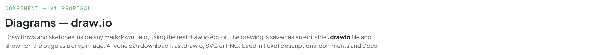
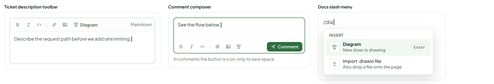
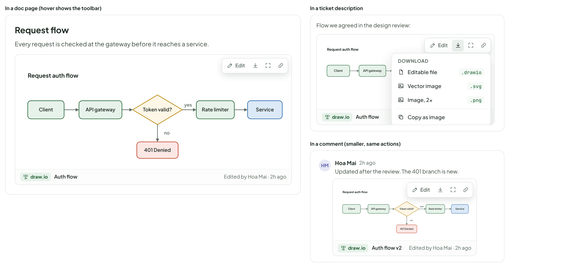
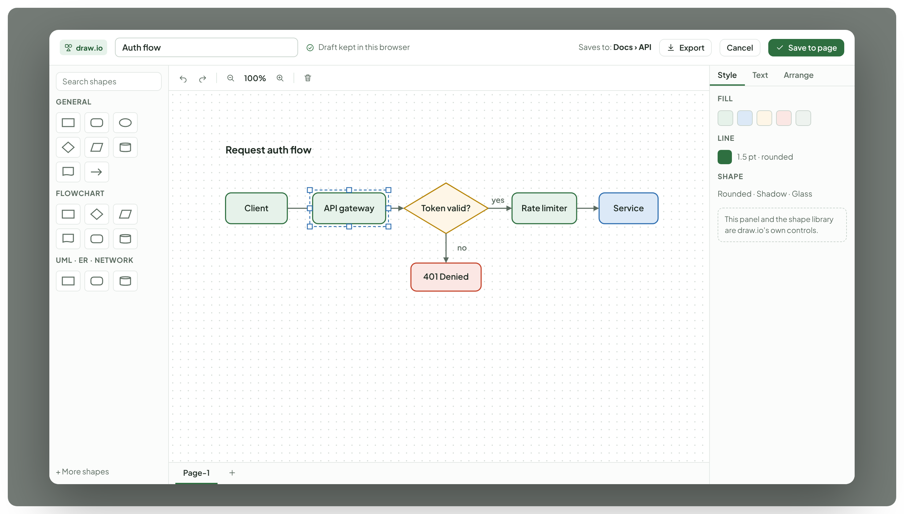
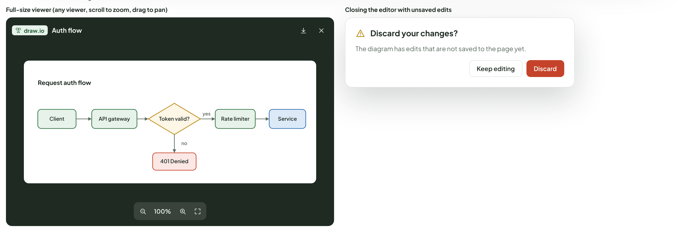
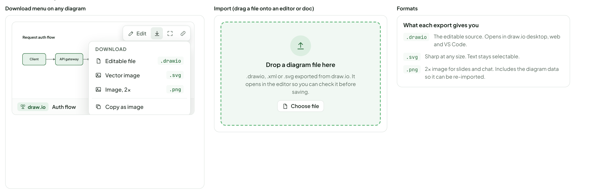
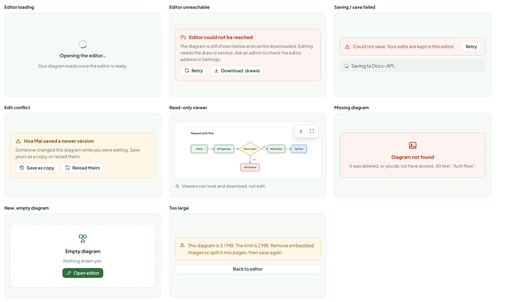
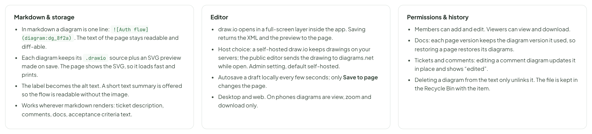

# Diagrams — draw.io

> COMPONENT — V1 PROPOSAL · source: [`Diagrams.dc.html`](../source/Diagrams.dc.html) · canvas `1793195406-cc1c` · sha256 `66a3c664e48c8fabea8e72a773fef99ffab5ed28ede1d9ae438b4ebdf9d286bf`

Draw flows and sketches inside any markdown field, using the real draw.io editor. The drawing is saved as an editable .drawio file and shown on the page as a crisp image. Anyone can download it as .drawio, SVG or PNG. Used in ticket descriptions, comments and Docs.

Source: [Diagrams.dc.html](../source/Diagrams.dc.html) › header ("COMPONENT — V1 PROPOSAL", "Diagrams — draw.io" and the intro)

---

## A. Where you start a drawing

Same Diagram action in every markdown editor. Docs also has a slash command.

Source: [Diagrams.dc.html](../source/Diagrams.dc.html) › block "A. Where you start a drawing"

- Text in the frames: "Ticket description toolbar" · "Diagram" · "Markdown" · "Describe the request path before we add rate limiting." · "Comment composer" · "See the flow below." · "Comment" · "In comments the button is icon-only to save space." · "Docs slash menu" · "/dia" · "INSERT" · "New draw.io drawing" · "Enter" · "Import .drawio file" · "Also drop a file onto the page"

---

## B. How a diagram looks once inserted

Hover (or focus) shows Edit, Download, View full size and Copy link. The size adapts to the space: wide in docs, narrower in tickets and comments.

Source: [Diagrams.dc.html](../source/Diagrams.dc.html) › block "B. How a diagram looks once inserted"

- Text in the frames: "In a doc page (hover shows the toolbar)" · "Request flow" · "Every request is checked at the gateway before it reaches a service." · "Edit" · "Client" · "API gateway" · "Token valid?" · "Rate limiter" · "Service" · "401 Denied" · "yes" · "no" · "Request auth flow" · "draw.io" · "Auth flow" · "Edited by Hoa Mai · 2h ago" · "In a ticket description" · "Flow we agreed in the design review:" · "DOWNLOAD" · "Editable file" · ".drawio" · "Vector image" · ".svg" · "Image, 2x" · ".png" · "Copy as image" · "In a comment (smaller, same actions)" · "HM" · "Hoa Mai" · "2h ago" · "Updated after the review. The 401 branch is new." · "Auth flow v2"

---

## C. The editor

Opens over the page. The shape library, canvas and format panel are draw.io itself, so people who know it need no relearning. Only the header bar is ours.

Source: [Diagrams.dc.html](../source/Diagrams.dc.html) › block "C. The editor"

- Text in the frames: "draw.io" · "Auth flow" · "Draft kept in this browser" · "Saves to: Docs › API" · "Export" · "Cancel" · "Save to page" · "Search shapes" · "GENERAL" · "FLOWCHART" · "UML · ER · NETWORK" · "+ More shapes" · "100%" · "Client" · "API gateway" · "Token valid?" · "Rate limiter" · "Service" · "401 Denied" · "yes" · "no" · "Request auth flow" · "Page-1" · "Style" · "Text" · "Arrange" · "FILL" · "LINE" · "1.5 pt · rounded" · "SHAPE" · "Rounded · Shadow · Glass" · "This panel and the shape library are draw.io's own controls."

---

## D. Full-size viewer and leaving the editor

Source: [Diagrams.dc.html](../source/Diagrams.dc.html) › block "D. Full-size viewer and leaving the editor"

- Text in the frames: "Full-size viewer (any viewer, scroll to zoom, drag to pan)" · "draw.io" · "Auth flow" · "Client" · "API gateway" · "Token valid?" · "Rate limiter" · "Service" · "401 Denied" · "yes" · "no" · "Request auth flow" · "100%" · "Closing the editor with unsaved edits" · "Discard your changes?" · "The diagram has edits that are not saved to the page yet." · "Keep editing" · "Discard"

---

## E. Download and import

Source: [Diagrams.dc.html](../source/Diagrams.dc.html) › block "E. Download and import"

- Text in the frames: "Download menu on any diagram" · "Edit" · "DOWNLOAD" · "Editable file" · ".drawio" · "Vector image" · ".svg" · "Image, 2x" · ".png" · "Copy as image" · "Client" · "API gateway" · "Token valid?" · "Rate limiter" · "Service" · "401 Denied" · "yes" · "no" · "Request auth flow" · "draw.io" · "Auth flow" · "Edited by Hoa Mai · 2h ago" · "Import (drag a file onto an editor or doc)" · "Drop a diagram file here" · ".drawio, .xml or .svg exported from draw.io. It opens in the editor so you can check it before saving." · "Choose file" · "Formats" · "What each export gives you" · "The editable source. Opens in draw.io desktop, web and VS Code." · "Sharp at any size. Text stays selectable." · "2x image for slides and chat. Includes the diagram data so it can be re-imported."

---

## F. States

Source: [Diagrams.dc.html](../source/Diagrams.dc.html) › block "F. States"

- Text in the frames: "Editor loading" · "Opening the editor…" · "Your diagram loads once the editor is ready." · "Editor unreachable" · "Editor could not be reached" · "The diagram is still shown below and can be downloaded. Editing needs the draw.io service. Ask an admin to check the editor address in Settings." · "Retry" · "Download .drawio" · "Saving / save failed" · "Could not save. Your edits are kept in this editor." · "Saving to Docs › API…" · "Edit conflict" · "Hoa Mai saved a newer version" · "Someone changed this diagram while you were editing. Save yours as a copy, or reload theirs." · "Save as copy" · "Reload theirs" · "Read-only viewer" · "Client" · "API gateway" · "Token valid?" · "Rate limiter" · "Service" · "401 Denied" · "yes" · "no" · "Request auth flow" · "Viewers can look and download, not edit." · "Missing diagram" · "Diagram not found" · "It was deleted, or you do not have access. Alt text: “Auth flow”." · "New, empty diagram" · "Empty diagram" · "Nothing drawn yet." · "Open editor" · "Too large" · "This diagram is 3.1 MB. The limit is 2 MB. Remove embedded images or split it into pages, then save again." · "Back to editor"

---

## G. Rules

Proposed. The main choice to confirm is where the editor runs.

Source: [Diagrams.dc.html](../source/Diagrams.dc.html) › block "G. Rules"

- Text in the frames: "Markdown & storage" · "In markdown a diagram is one line: . The text of the page stays readable and diff-able." · "Each diagram keeps its .drawio source plus an SVG preview made on save. The page shows the SVG, so it loads fast and prints." · "The label becomes the alt text. A short text summary is offered so the flow is readable without the image." · "Works wherever markdown renders: ticket description, comments, docs, acceptance criteria text." · "Editor" · "draw.io opens in a full-screen layer inside the app. Saving returns the XML and the preview to the page." · "Host choice: a self-hosted draw.io keeps drawings on your servers; the public editor sends the drawing to diagrams.net while open. Admin setting, default self-hosted." · "Autosave a draft locally every few seconds; only Save to page changes the page." · "Desktop and web. On phones diagrams are view, zoom and download only." · "Permissions & history" · "Members can add and edit. Viewers can view and download." · "Docs: each page version keeps the diagram version it used, so restoring a page restores its diagrams." · "Tickets and comments: editing a comment diagram updates it in place and shows “edited”." · "Deleting a diagram from the text only unlinks it. The file is kept in the Recycle Bin with the item."
