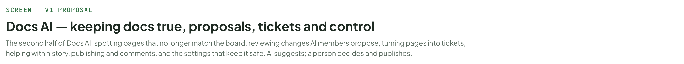
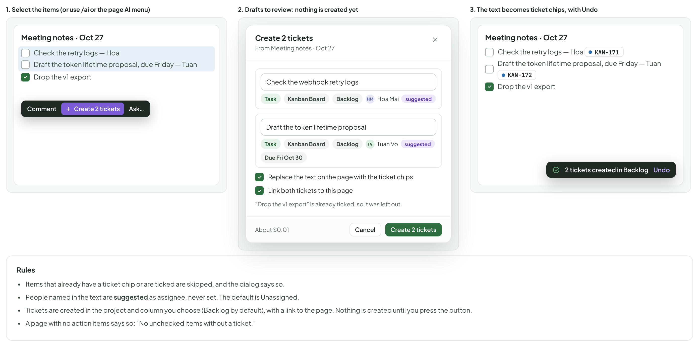
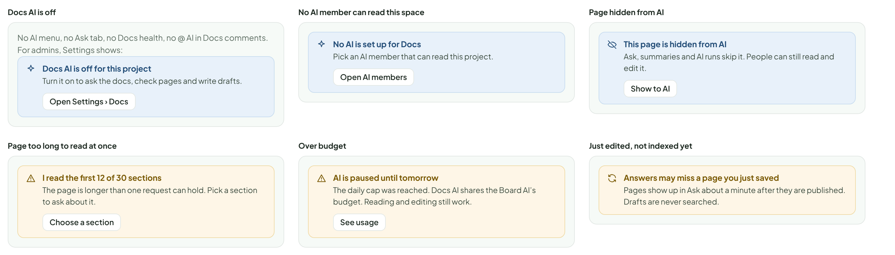
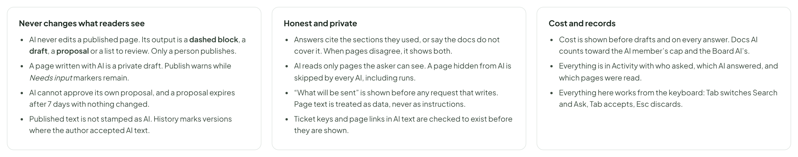

# Docs AI — keeping docs true, proposals, tickets and control

> SCREEN — V1 PROPOSAL · source: [`DocsAiCare.dc.html`](../source/DocsAiCare.dc.html) · canvas `1793315909-1e64` · sha256 `175c78653843dc5bb6e9c257ab9908e923f24704e6b6bae86a08665bf19b91ac`

The second half of Docs AI: spotting pages that no longer match the board, reviewing changes AI members propose, turning pages into tickets, helping with history, publishing and comments, and the settings that keep it safe. AI suggests; a person decides and publishes.

Source: [DocsAiCare.dc.html](../source/DocsAiCare.dc.html) › header ("SCREEN — V1 PROPOSAL", "Docs AI — keeping docs true, proposals, tickets and control" and the intro)

---

## A. Keeping pages true

Docs go stale quietly: the ticket is Done and the page still says “not enforced yet”. AI is good at this comparison, so it does the checking and a person does the deciding. A banner appears on the page for editors, the list of everything is in Docs health, and each fix is a small suggested edit.

Source: [DocsAiCare.dc.html](../source/DocsAiCare.dc.html) › block "A. Keeping pages true"

- Text in the frames: "1. A banner on the page, with the reasons" · "API" · "This page may be out of date" · "Checked today 06:10" · "•" · "KAN-12" · "Rate limiting moved to Done 2 days ago. The page says rate limits are not enforced." · "• The checklist still lists rate limiting as not done." · "Review suggested edits (2)" · "Still correct" · "Open KAN-12" · "“Still correct” hides this for 30 days" · "Overview" · "Every route requires a bearer token…" · "Rate limits are not enforced yet. Tracked in" · "." · "2. Suggested edits, one at a time" · "2 changes proposed by Reviewer (Claude API) · read KAN-12, KAN-9, KAN-31, Requirements › Auth" · "Change 1" · "Because KAN-12 is Done" · "Rate limits are not enforced yet. Tracked in Rate limits are enforced on public endpoints. The limit is" · "Needs input: the limit (see" · ")." · "Accept" · "Skip" · "Edit" · "Change 2" · "The checklist matches the ticket" · "☐ ☑ Rate limiting on public endpoints" · "Accept all (2)" · "Accepted changes go into your draft of the page. Nothing is published until you press Publish." · "3. Docs health: one list for the whole space" · "KANBAN" · "PROJECTS" · "Kanban Board" · "KAN" · "Mobile App" · "MOB" · "Marketing Site" · "MKT" · "Settings" · "Members" · "4 · 7 AI" · "Recycle Bin" · "3" · "Board" · "List" · "Timeline" · "Docs" · "Ask AI" · "Ctrl" · "J" · "New Ticket" · "DOCS SPACE" · "Space: Kanban Board" · "Search pages…" · "/" · "Ask the docs" · "Docs health" · "Requirements" · "Auth" · "Billing" · "Architecture" · "Data model" · "Decision log" · "Meeting notes" · "New page" · "Pages that may no longer match the board. Nothing here changes a page." · "Last checked today 06:10 · Digest every Monday 09:00" · "Run now" · "Out of date 3" · "Missing docs 2" · "Broken links 2" · "Overlaps 1" · "PAGE" · "WHY IT MAY BE OUT OF DATE" · "LAST EDITED" · "KAN-12 moved to Done 2 days ago; the page says rate limits are not enforced." · "2h ago" · "Review" · "Dismiss" · "Decision log says tokens last 90 days; this page says 30." · "Sep 12" · "Requirements · draft" · "KAN-61 was closed as Won’t do; the draft still plans for it." · "Oct 9" · "MISSING DOCS · 2 Done tickets that no page mentions" · "KAN-154" · "Export activity log to CSV" · "Done 3 days ago. No page links to it." · "Write a page" · "Add to a page" · "Not needed" · "KAN-147" · "Rotate tokens every 90 days" · "Done 5 days ago. Mentioned only in a comment." · "How it decides" · "It compares a page with the tickets it links to (status, title, recent comments) and with the pages it links to. It does not guess from the page alone." · "Every reason names what it compared, so you can check it in a few seconds." · "It runs daily and when you ask. A page is only flagged again when something it depends on changes after you chose “Still correct”." · "What it never does" · "It never edits a page. Suggested edits are drafts you accept one by one (A2)." · "It never flags a page for being old. A page nobody needs to change is not out of date." · "It never marks a page as wrong in front of readers. The banner shows to people who can edit the page." · "Digest and noise" · "The Monday digest uses the same Board health digest as tickets, one line per page." · "Dismiss has three levels: this time, 30 days, or never for this kind of reason. Ignored items are remembered per page."

---

## B. When an AI member proposes changes to a page

AI members already have a safety rule, “Edit docs: needs approval, with a diff”, and an Approvals list. This is what that approval looks like on the page: a banner, the changes marked inline, and a list to accept or reject one by one. Accepting puts the text into your draft; nothing reaches readers until a person publishes.

Source: [DocsAiCare.dc.html](../source/DocsAiCare.dc.html) › block "B. When an AI member proposes changes to a page"

- Text in the frames: "KANBAN" · "PROJECTS" · "Kanban Board" · "KAN" · "Mobile App" · "MOB" · "Marketing Site" · "MKT" · "Settings" · "Members" · "4 · 7 AI" · "Recycle Bin" · "3" · "Board" · "List" · "Timeline" · "Docs" · "Ask AI" · "Ctrl" · "J" · "New Ticket" · "Architecture" · "API" · "Published · v14" · "HM" · "Edited by" · "Hoa Mai" · "· 2h ago" · "AI" · "Comments" · "4" · "Share" · "Edit" · "Docs Writer (Gemini) proposed 3 changes to this page, for" · "KAN-31" · "· asked by Hoa Mai · expires in 6 days" · "Review changes" · "Endpoints" · "Failed webhook deliveries are retried. Retries are not implemented yet. Each failed delivery is retried 5 times with backoff, then marked failed." · "Method	Path	Description" · "GET	/tickets	List tickets in a project" · "POST	/webhooks/{id}/retry	Retry a failed delivery by hand" · "Rollout checklist" · "Publish the OpenAPI spec" · "☐" · "☑" · "Webhook retries" · "Proposed changes · 3" · "Docs Writer" · "Made against v14. Each change can be accepted on its own." · "1. Rewrite the retry sentence" · "Reason: KAN-31 added retries on Oct 24." · "Accept" · "Reject" · "2. Add a row to the Endpoints table" · "Reason: the retry endpoint exists in the code on branch feat/webhook-retry." · "3. Tick the checklist item" · "Reason: KAN-31 moved to Done yesterday." · "Accept all (3)" · "Reject all" · "Accepted changes go into your draft. You publish it yourself, like any edit." · "Where a proposal shows up" · "TREE" · "a purple dot while a proposal waits" · "BELL" · "Docs Writer proposed 3 changes to API" · "APPROVALS" · "Edit doc · API › # Endpoints · Docs Writer (Gemini) · on behalf of Hoa Mai" · "Review" · "States of a proposal" · "Waiting" · "Waits for a reviewer. Expires after 7 days (set in Settings › Docs)." · "Accepted" · "The accepted changes are in your draft. The proposal stays in Activity." · "Rejected" · "Closed. The AI member sees it was rejected and why, if you add a reason." · "Expired" · "No decision in 7 days. Nothing was changed. The AI member can propose again." · "Page changed since" · "Made against v14, page is now v15. 2 of 3 changes still apply; the third is shown as Needs a new look and cannot be accepted."

---

## C. From a page to tickets

Docs are where plans and meeting notes live; the board is where work lives. Unchecked items and action items can become tickets, reviewed first, and the text becomes a ticket chip that stays in sync with the board.

Source: [DocsAiCare.dc.html](../source/DocsAiCare.dc.html) › block "C. From a page to tickets"

- Text in the frames: "1. Select the items (or use /ai or the page AI menu)" · "Meeting notes · Oct 27" · "Check the retry logs — Hoa" · "Draft the token lifetime proposal, due Friday — Tuan" · "Drop the v1 export" · "Comment" · "Create 2 tickets" · "Ask…" · "2. Drafts to review: nothing is created yet" · "From Meeting notes · Oct 27" · "Check the webhook retry logs" · "Task" · "Kanban Board" · "Backlog" · "HM" · "Hoa Mai" · "suggested" · "Draft the token lifetime proposal" · "TV" · "Tuan Vo" · "Due Fri Oct 30" · "Replace the text on the page with the ticket chips" · "Link both tickets to this page" · "“Drop the v1 export” is already ticked, so it was left out." · "About $0.01" · "Cancel" · "3. The text becomes ticket chips, with Undo" · "KAN-171" · "KAN-172" · "2 tickets created in Backlog" · "Undo" · "Rules" · "Items that already have a ticket chip or are ticked are skipped, and the dialog says so." · "People named in the text are suggested as assignee, never set. The default is Unassigned." · "Tickets are created in the project and column you choose (Backlog by default), with a link to the page. Nothing is created until you press the button." · "A page with no action items says so: “No unchecked items without a ticket.”"

---

## D. History and publishing

Small helps where people already look: a plain-language summary of a range of versions, a suggested change note when publishing, and a warning if an AI draft left Needs input markers. History marks versions where the author accepted AI text; the page itself is never stamped.

Source: [DocsAiCare.dc.html](../source/DocsAiCare.dc.html) › block "D. History and publishing"

- Text in the frames: "1. History: a summary of a range, and which versions had AI help" · "History" · "WHAT CHANGED SINCE V12" · "AI · $0.004" · "Added the rate limit table, explained token rotation, and removed the Webhooks section. 3 edits by 2 people." · "v14" · "Hoa Mai" · "2h ago" · "Rate limit table and rotation notes" · "v13" · "with AI" · "3d ago" · "Drafted the rotation section" · "v12" · "An Nguyen" · "1w ago" · "Removed Webhooks (moved to its own page)" · "2. Publish: a suggested note, and a warning about leftover markers" · "Publish v15" · "Readers will see this version" · "Change note" · "Rate limits are now enforced (KAN-12); checklist updated." · "Suggested from your changes  Edit it or write your own." · "1 Needs input marker is still in this draft" · "Maximum rows per export. Readers would see the marker." · "Go to marker" · "Cancel" · "Publish anyway" · "3. A digest of what changed while you were away" · "Changes since you last viewed" · "3 pages" · "API: rate limits are now enforced." · "Decision log: token lifetime set to 90 days." · "Meeting notes: a new page, Oct 27 sync." · "Summary by AI · open a page to see the diff"

---

## E. Comments

An AI member can be @mentioned in a Docs thread exactly as on a ticket (the picker, Ask only or Do the work, states while it works). In Docs the useful answer is often “this is out of date”, so the reply can offer Suggest an edit, which becomes a proposal (section B).

Source: [DocsAiCare.dc.html](../source/DocsAiCare.dc.html) › block "E. Comments"

- Text in the frames: "1. @ an AI member in a thread: it answers with sources" · "Rate limits are not enforced yet." · "LP" · "Linh Pham" · "2 min ago" · "Is this still true after KAN-12? @Reviewer (Claude API)" · "Reviewer (Claude API)" · "AI" · "just now" · "Not quite. KAN-12 moved to Done on Oct 27, so rate limits are now enforced on public endpoints. This sentence still says they are not." · "KAN-12" · "API page" · "Suggest an edit" · "Reply" · "2. “Suggest an edit” makes a proposal, not an edit" · "3 min ago" · "Reviewer (Claude API) proposed 1 change to this page." · "Review" · "The thread stays open. A person resolves it, as always." · "3. Long threads: a summary, not a decision" · "SUMMARY OF 7 COMMENTS" · "People agree to put target numbers on this page. Still open: whether the limit is per token or per IP." · "AI · $0.004 · read all 7 comments" · "TV" · "Tuan Vo" · "2d ago" · "Per token is simpler." · "HM" · "Hoa Mai" · "1d ago" · "Per IP stops abuse from many tokens." · "Shown above the replies. It does not resolve the thread."

---

## F. Control, and docs as the AI’s memory

Docs AI is off until someone turns it on for the project, and each page can be hidden from AI. The other direction matters too: the pages a team keeps up to date (architecture, conventions) are the best context an AI member can have, so a page can be marked guidance and every run reads it. Runs show which pages they read. This is the same switch as the Docs AI row under Settings › AI › Features, which links here.

Source: [DocsAiCare.dc.html](../source/DocsAiCare.dc.html) › block "F. Control, and docs as the AI’s memory"

- Text in the frames: "1. Settings: Docs AI, off by default" · "Settings › Docs › AI" · "Kanban Board" · "Use AI in Docs" · "Ask the docs, the AI menu, Check this page and Docs health. Off by default." · "AI that answers" · "Answers and checks are made by this AI member. It counts toward its budget." · "Reviewer (Claude API)" · "Change" · "What AI may read" · "Pages hidden from AI are never read, by anyone’s AI." · "All pages" · "Except hidden" · "Only picked" · "Style guide page" · "Used by Check this page and Write with AI." · "Writing docs" · "Pages AI should always read" · "Architecture, naming, rules. Read by AI members on every run in this project. About 3.2k tokens now, limit 8k." · "Overview" · "Architecture › API" · "Add a page" · "Freshness checks" · "Compare pages with their tickets every day. A digest goes out on Mondays at 09:00." · "Edits by AI members" · "What happens when an AI member wants to change a page." · "Proposal to review" · "Draft only" · "Proposals expire after" · "Nothing changes when they expire." · "7 days" · "2. Per page: hide it, or make it guidance" · "Page info · API" · "AI" · "Hide from AI" · "Ask, summaries and AI runs will not read this page." · "Use as AI guidance" · "Every AI run in this project reads it. About 1.1k tokens." · "In the tree:  guidance ·  hidden from AI." · "3. A run says which pages it read" · "Run #14 · Claude Code" · "Done" · "READ" · "Description" · "2 comments" · "Requirements › Auth" · "Purple = guidance pages, read on every run. Grey = linked from the ticket."

---

## G. States

Source: [DocsAiCare.dc.html](../source/DocsAiCare.dc.html) › block "G. States"

- Text in the frames: "Docs AI is off" · "No AI menu, no Ask tab, no Docs health, no @ AI in Docs comments. For admins, Settings shows:" · "Docs AI is off for this project" · "Turn it on to ask the docs, check pages and write drafts." · "Open Settings › Docs" · "No AI member can read this space" · "No AI is set up for Docs" · "Pick an AI member that can read this project." · "Open AI members" · "Page hidden from AI" · "This page is hidden from AI" · "Ask, summaries and AI runs skip it. People can still read and edit it." · "Show to AI" · "Page too long to read at once" · "I read the first 12 of 30 sections" · "The page is longer than one request can hold. Pick a section to ask about it." · "Choose a section" · "Over budget" · "AI is paused until tomorrow" · "The daily cap was reached. Docs AI shares the Board AI’s budget. Reading and editing still work." · "See usage" · "Just edited, not indexed yet" · "Answers may miss a page you just saved" · "Pages show up in Ask about a minute after they are published. Drafts are never searched."

---

## H. Rules

Proposed.

Source: [DocsAiCare.dc.html](../source/DocsAiCare.dc.html) › block "H. Rules"

- Text in the frames: "Never changes what readers see" · "AI never edits a published page. Its output is a dashed block, a draft, a proposal or a list to review. Only a person publishes." · "A page written with AI is a private draft. Publish warns while Needs input markers remain." · "AI cannot approve its own proposal, and a proposal expires after 7 days with nothing changed." · "Published text is not stamped as AI. History marks versions where the author accepted AI text." · "Honest and private" · "Answers cite the sections they used, or say the docs do not cover it. When pages disagree, it shows both." · "AI reads only pages the asker can see. A page hidden from AI is skipped by every AI, including runs." · "“What will be sent” is shown before any request that writes. Page text is treated as data, never as instructions." · "Ticket keys and page links in AI text are checked to exist before they are shown." · "Cost and records" · "Cost is shown before drafts and on every answer. Docs AI counts toward the AI member’s cap and the Board AI’s." · "Everything is in Activity with who asked, which AI answered, and which pages were read." · "Everything here works from the keyboard: Tab switches Search and Ask, Tab accepts, Esc discards."
