# Docs AI — keeping docs true, Send to AI & control

> Redrawn for AI v2 · source: [`DocsAiCare.dc.html`](../source/DocsAiCare.dc.html) · canvas `1794108858-2696` · sha256 `b706d3065a99d946e8ec2de32203e1f810e63e73111dd1a2f51deac09a538665`

> Words, states and conditions follow the code of branch `claude/ai-team-architecture-7a1efc`; the layout is designed here and is not the layout of the current screens. Names, ids, costs and times in the mock-ups are sample data. **Check the code before building from this: the file named in each part is the truth, not the picture.**

## SCREEN — V2

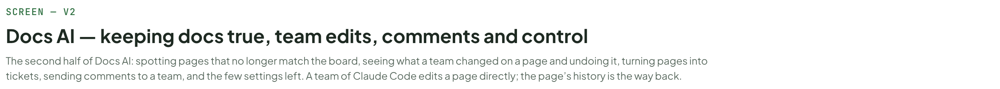

- Text in this part: "SCREEN — V2" · "Docs AI — keeping docs true, team edits, comments and control" · "The second half of Docs AI: spotting pages that no longer match the board, seeing what a team changed on a page and undoing it, turning pages into tickets, sending comments to a team, and the few settings left. A team of Claude Code edits a page directly; the page’s history is the way back."

---

## A. Keeping pages true

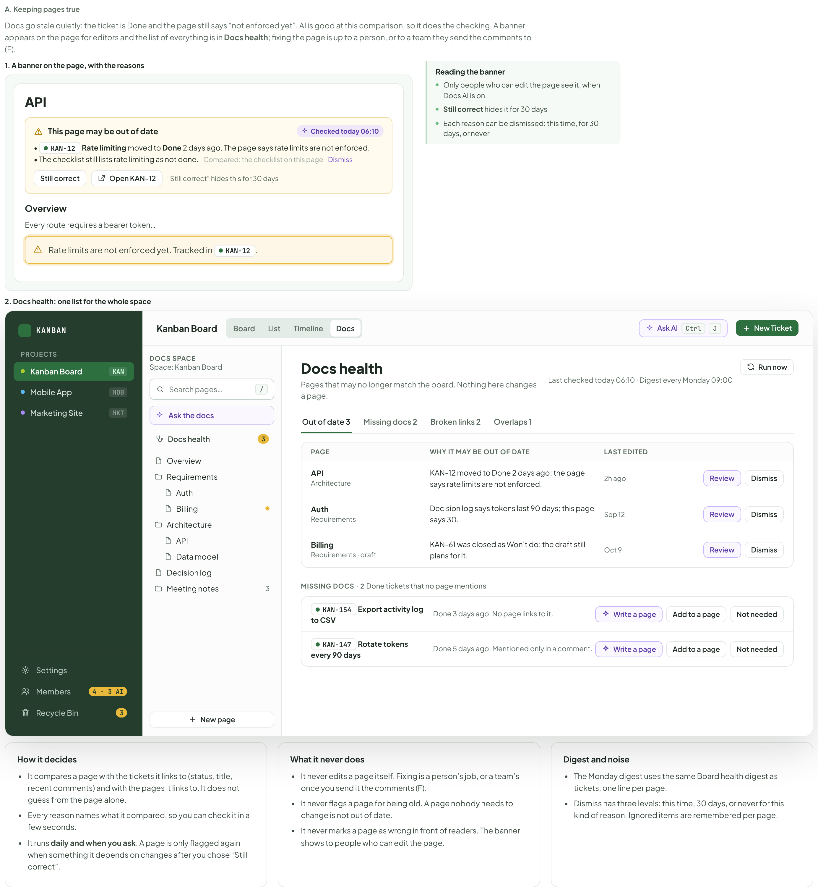

- Text in this part: "A. Keeping pages true" · "Docs go stale quietly: the ticket is Done and the page still says “not enforced yet”. AI is good at this comparison, so it does the checking. A banner appears on the page for editors and the list of everything is in Docs health; fixing the page is up to a person, or to a team they send the comments to (F)." · "1. A banner on the page, with the reasons" · "API" · "This page may be out of date" · "Checked today 06:10" · "•" · "KAN-12" · "Rate limiting moved to Done 2 days ago. The page says rate limits are not enforced." · "• The checklist still lists rate limiting as not done.Compared: the checklist on this pageDismiss" · "Still correct" · "Open KAN-12" · "“Still correct” hides this for 30 days" · "Overview" · "Every route requires a bearer token…" · "Rate limits are not enforced yet. Tracked in" · "." · "Reading the banner" · "Only people who can edit the page see it, when Docs AI is on" · "Still correct hides it for 30 days" · "Each reason can be dismissed: this time, for 30 days, or never" · "2. Docs health: one list for the whole space" · "KANBAN" · "PROJECTS" · "Kanban Board" · "KAN" · "Mobile App" · "MOB" · "Marketing Site" · "MKT" · "Settings" · "Members" · "4 · 3 AI" · "Recycle Bin" · "3" · "Board" · "List" · "Timeline" · "Docs" · "Ask AI" · "Ctrl" · "J" · "New Ticket" · "DOCS SPACE" · "Space: Kanban Board" · "Search pages…" · "/" · "Ask the docs" · "Docs health" · "Requirements" · "Auth" · "Billing" · "Architecture" · "Data model" · "Decision log" · "Meeting notes" · "New page" · "Pages that may no longer match the board. Nothing here changes a page." · "Last checked today 06:10 · Digest every Monday 09:00" · "Run now" · "Out of date 3" · "Missing docs 2" · "Broken links 2" · "Overlaps 1" · "PAGE" · "WHY IT MAY BE OUT OF DATE" · "LAST EDITED" · "KAN-12 moved to Done 2 days ago; the page says rate limits are not enforced." · "2h ago" · "Review" · "Dismiss" · "Decision log says tokens last 90 days; this page says 30." · "Sep 12" · "Requirements · draft" · "KAN-61 was closed as Won’t do; the draft still plans for it." · "Oct 9" · "MISSING DOCS · 2 Done tickets that no page mentions" · "KAN-154" · "Export activity log to CSV" · "Done 3 days ago. No page links to it." · "Write a page" · "Add to a page" · "Not needed" · "KAN-147" · "Rotate tokens every 90 days" · "Done 5 days ago. Mentioned only in a comment." · "How it decides" · "It compares a page with the tickets it links to (status, title, recent comments) and with the pages it links to. It does not guess from the page alone." · "Every reason names what it compared, so you can check it in a few seconds." · "It runs daily and when you ask. A page is only flagged again when something it depends on changes after you chose “Still correct”." · "What it never does" · "It never edits a page itself. Fixing is a person’s job, or a team’s once you send it the comments (F)." · "It never flags a page for being old. A page nobody needs to change is not out of date." · "It never marks a page as wrong in front of readers. The banner shows to people who can edit the page." · "Digest and noise" · "The Monday digest uses the same Board health digest as tickets, one line per page." · "Dismiss has three levels: this time, 30 days, or never for this kind of reason. Ignored items are remembered per page."

---

## B. When a team changes a page

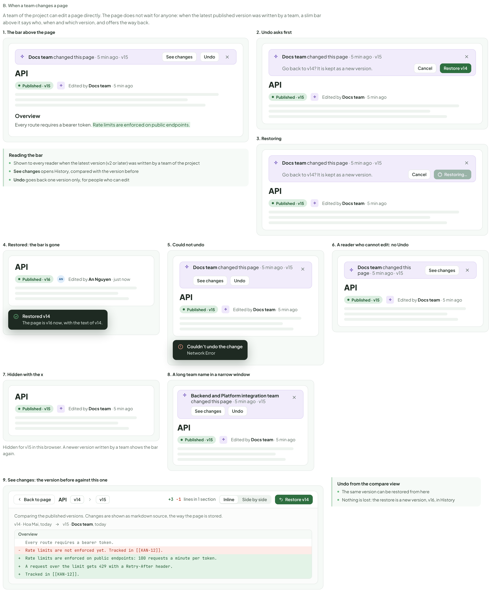

- Text in this part: "B. When a team changes a page" · "A team of the project can edit a page directly. The page does not wait for anyone: when the latest published version was written by a team, a slim bar above it says who, when and which version, and offers the way back." · "1. The bar above the page" · "Docs team changed this page · 5 min ago · v15" · "See changes" · "Undo" · "API" · "Published · v15" · "Edited by Docs team · 5 min ago" · "Overview" · "Every route requires a bearer token. Rate limits are enforced on public endpoints." · "Reading the bar" · "Shown to every reader when the latest version (v2 or later) was written by a team of the project" · "See changes opens History, compared with the version before" · "Undo goes back one version only, for people who can edit" · "2. Undo asks first" · "Go back to v14? It is kept as a new version." · "Cancel" · "Restore v14" · "3. Restoring" · "Restoring…" · "4. Restored: the bar is gone" · "Published · v16" · "AN" · "Edited by An Nguyen · just now" · "Restored v14" · "The page is v16 now, with the text of v14." · "5. Could not undo" · "Couldn’t undo the change" · "Network Error" · "6. A reader who cannot edit: no Undo" · "7. Hidden with the x" · "Hidden for v15 in this browser. A newer version written by a team shows the bar again." · "8. A long team name in a narrow window" · "Backend and Platform integration team changed this page · 5 min ago · v15" · "9. See changes: the version before against this one" · "Back to page" · "v14" · "v15" · "+3 −1 lines in 1 section" · "Inline" · "Side by side" · "Comparing the published versions. Changes are shown as markdown source, the way the page is stored." · "v14 · Hoa Mai, today" · "→" · "v15 · Docs team, today" · "Every route requires a bearer token." · "−" · "Rate limits are not enforced yet. Tracked in [[KAN-12]]." · "+" · "Rate limits are enforced on public endpoints: 100 requests a minute per token." · "A request over the limit gets 429 with a Retry-After header." · "Tracked in [[KAN-12]]." · "Undo from the compare view" · "The same version can be restored from here" · "Nothing is lost: the restore is a new version, v16, in History"

---

## C. From a page to tickets

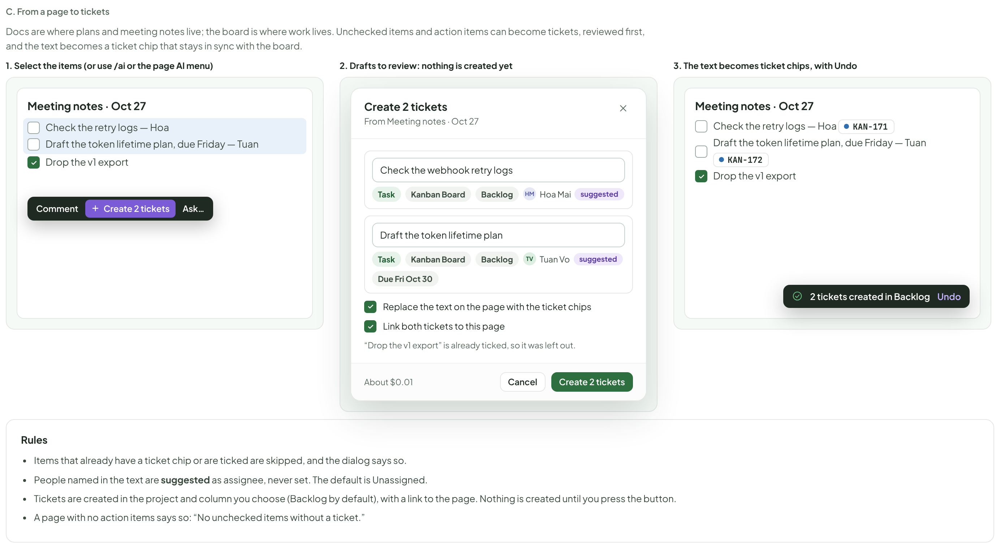

- Text in this part: "C. From a page to tickets" · "Docs are where plans and meeting notes live; the board is where work lives. Unchecked items and action items can become tickets, reviewed first, and the text becomes a ticket chip that stays in sync with the board." · "1. Select the items (or use /ai or the page AI menu)" · "Meeting notes · Oct 27" · "Check the retry logs — Hoa" · "Draft the token lifetime plan, due Friday — Tuan" · "Drop the v1 export" · "Comment" · "Create 2 tickets" · "Ask…" · "2. Drafts to review: nothing is created yet" · "From Meeting notes · Oct 27" · "Check the webhook retry logs" · "Task" · "Kanban Board" · "Backlog" · "HM" · "Hoa Mai" · "suggested" · "Draft the token lifetime plan" · "TV" · "Tuan Vo" · "Due Fri Oct 30" · "Replace the text on the page with the ticket chips" · "Link both tickets to this page" · "“Drop the v1 export” is already ticked, so it was left out." · "About $0.01" · "Cancel" · "3. The text becomes ticket chips, with Undo" · "KAN-171" · "KAN-172" · "2 tickets created in Backlog" · "Undo" · "Rules" · "Items that already have a ticket chip or are ticked are skipped, and the dialog says so." · "People named in the text are suggested as assignee, never set. The default is Unassigned." · "Tickets are created in the project and column you choose (Backlog by default), with a link to the page. Nothing is created until you press the button." · "A page with no action items says so: “No unchecked items without a ticket.”"

---

## D. History and publishing

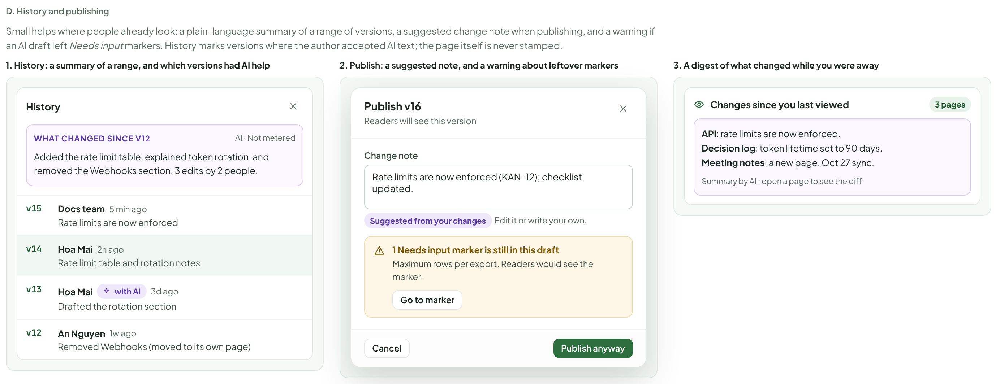

- Text in this part: "D. History and publishing" · "Small helps where people already look: a plain-language summary of a range of versions, a suggested change note when publishing, and a warning if an AI draft left Needs input markers. History marks versions where the author accepted AI text; the page itself is never stamped." · "1. History: a summary of a range, and which versions had AI help" · "History" · "WHAT CHANGED SINCE V12" · "AI · Not metered" · "Added the rate limit table, explained token rotation, and removed the Webhooks section. 3 edits by 2 people." · "v15" · "Docs team" · "5 min ago" · "Rate limits are now enforced" · "v14" · "Hoa Mai" · "2h ago" · "Rate limit table and rotation notes" · "v13" · "with AI" · "3d ago" · "Drafted the rotation section" · "v12" · "An Nguyen" · "1w ago" · "Removed Webhooks (moved to its own page)" · "2. Publish: a suggested note, and a warning about leftover markers" · "Publish v16" · "Readers will see this version" · "Change note" · "Rate limits are now enforced (KAN-12); checklist updated." · "Suggested from your changes  Edit it or write your own." · "1 Needs input marker is still in this draft" · "Maximum rows per export. Readers would see the marker." · "Go to marker" · "Cancel" · "Publish anyway" · "3. A digest of what changed while you were away" · "Changes since you last viewed" · "3 pages" · "API: rate limits are now enforced." · "Decision log: token lifetime set to 90 days." · "Meeting notes: a new page, Oct 27 sync." · "Summary by AI · open a page to see the diff"

---

## E. Comments

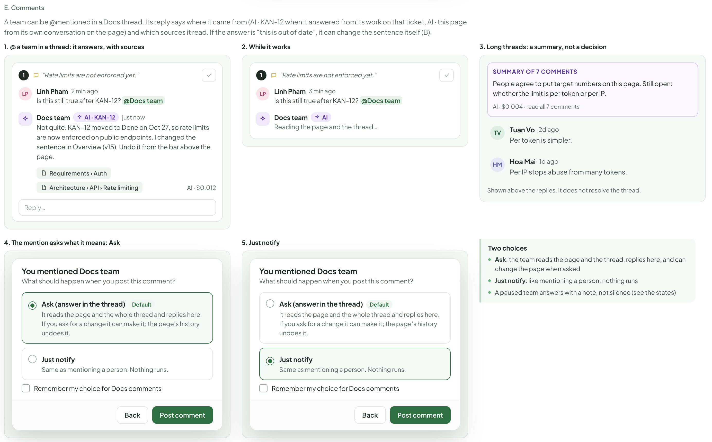

- Text in this part: "E. Comments" · "A team can be @mentioned in a Docs thread. Its reply says where it came from (AI · KAN-12 when it answered from its work on that ticket, AI · this page from its own conversation on the page) and which sources it read. If the answer is “this is out of date”, it can change the sentence itself (B)." · "1. @ a team in a thread: it answers, with sources" · "1" · "“Rate limits are not enforced yet.”" · "LP" · "Linh Pham" · "2 min ago" · "Is this still true after KAN-12? @Docs team" · "Docs team" · "AI · KAN-12" · "just now" · "Not quite. KAN-12 moved to Done on Oct 27, so rate limits are now enforced on public endpoints. I changed the sentence in Overview (v15). Undo it from the bar above the page." · "Requirements › Auth" · "Architecture › API › Rate limiting" · "AI · $0.012" · "Reply…" · "2. While it works" · "3 min ago" · "AI" · "Reading the page and the thread…" · "3. Long threads: a summary, not a decision" · "SUMMARY OF 7 COMMENTS" · "People agree to put target numbers on this page. Still open: whether the limit is per token or per IP." · "AI · $0.004 · read all 7 comments" · "TV" · "Tuan Vo" · "2d ago" · "Per token is simpler." · "HM" · "Hoa Mai" · "1d ago" · "Per IP stops abuse from many tokens." · "Shown above the replies. It does not resolve the thread." · "4. The mention asks what it means: Ask" · "You mentioned Docs team" · "What should happen when you post this comment?" · "Ask (answer in the thread)Default" · "It reads the page and the whole thread and replies here. If you ask for a change it can make it; the page’s history undoes it." · "Just notify" · "Same as mentioning a person. Nothing runs." · "Remember my choice for Docs comments" · "Back" · "Post comment" · "5. Just notify" · "Two choices" · "Ask: the team reads the page and the thread, replies here, and can change the page when asked" · "Just notify: like mentioning a person; nothing runs" · "A paused team answers with a note, not silence (see the states)"

---

## F. Send comments to an AI

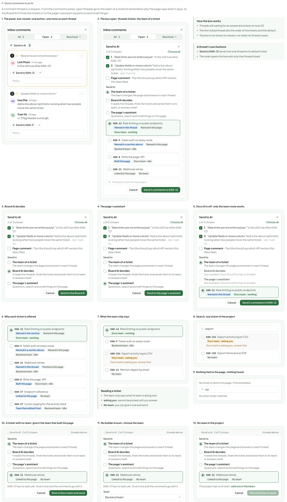

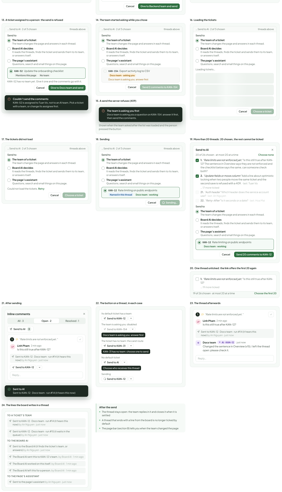

- Text in this part: "F. Send comments to an AI" · "A comment thread is a request. From the comments panel, open threads go to the team of a ticket (it remembers why the page says what it says), to the Board AI (it finds the ticket) or to the page’s assistant (questions and small things)." · "1. The panel, box closed: one button, one more on each thread" · "Inline comments" · "All · 3" · "Open · 2" · "Resolved · 1" · "Send to AI" · "3" · "1" · "“Rate limits are not enforced yet.”" · "LP" · "Linh Pham" · "2 min ago" · "Is this still true after KAN-12?" · "Send to KAN-12" · "Reply…" · "2" · "“Update fields or move column”" · "HM" · "Hoa Mai" · "2d ago" · "Add a line about optimistic locking when two people move the same ticket." · "TV" · "Tuan Vo" · "+1, ETag header is enough." · "Send to KAN-9" · "2. The box open: threads ticked, the team of a ticket" · "2 of 3 chosen" · "Choose all" · "1. “Rate limits are not enforced yet.” Is this still true after KAN-12?" · "2. “Update fields or move column” Add a line about optimistic locking when two people move the same ticket. · last: Tuan Vo" · "Page comment · The title should say which API version this describes." · "Send to" · "The team of a ticket" · "The team changes the page and answers in each thread." · "Board AI decides" · "It reads the threads, finds the ticket and sends them to its team, or answers itself." · "The page’s assistant" · "Questions, search and small things on this page." · "KAN-12" · "Rate limiting on public endpoints" · "Named in this thread" · "Named in this page" · "Docs team · working" · "KAN-9" · "Token auth on every route" · "Named in a section above" · "Backend team · idle" · "KAN-8" · "Write the page: API" · "Built this page" · "Docs team · idle" · "KAN-31" · "Webhook retries" · "Linked to this page" · "No team" · "Find any ticket of the project" · "Cancel" · "Send 2 comments to KAN-12" · "How the box works" · "Threads still waiting for an answer are ticked, at most 20" · "The first ticked thread sets the order of the tickets and the default" · "The box is not shown to viewers, nor when no thread is open" · "A thread’s own buttons" · "Send to KAN-12 sends that one thread to its default ticket" · "The caret opens this box with only that thread ticked" · "3. Board AI decides" · "Send to the Board AI" · "4. The page’s assistant" · "Send to the page’s assistant" · "5. Docs AI is off: only the team route works" · "Not available: Docs AI is off or has no AI team." · "6. Why each ticket is offered" · "Named in this section" · "Mentions this page" · "KAN-17" · "Endpoint reference" · "KAN-27" · "Cursor paging for the activity feed" · "Team that edited it last" · "7. What the team chip says" · "KAN-154" · "Export activity log to CSV" · "Docs team · asking you" · "Docs team is asking you: answer first" · "KAN-61" · "Mention digest by email" · "Reading a ticket" · "The team chip says what its team is doing now" · "asking you: cannot be picked until you answer" · "No team: you can use “Give it to a team and send”" · "8. Search: any ticket of the project" · "export" · "KAN-102" · "Export the board as PDF" · "9. Nothing tied to the page, nothing found" · "No ticket is tied to this page. Find one below." · "zzz" · "No other ticket matches." · "10. A ticket with no team: give it the team that built the page" · "… Send to AI · 2 of 3 chosen" · "threads above" · "KAN-31 has no team yet. Give it one and the comments go with it." · "Give to Docs team and send" · "11. No builder known: choose the team" · "Team" · "Backend team" · "Give to Backend team and send" · "12. No team in the project"

---

## G. The ticket’s linked docs

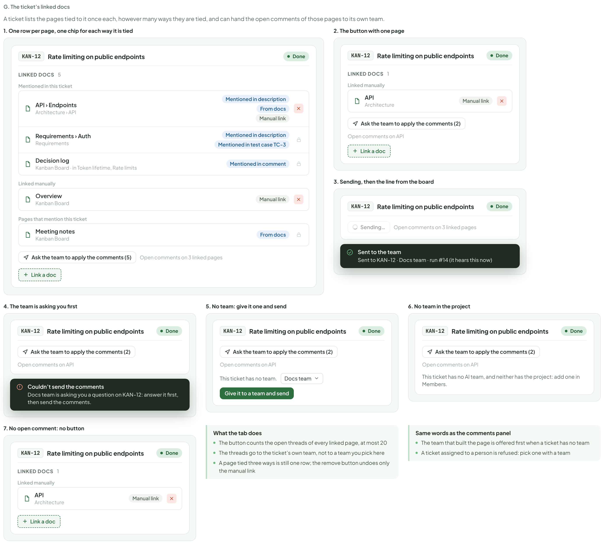

- Text in this part: "G. The ticket’s linked docs" · "A ticket lists the pages tied to it once each, however many ways they are tied, and can hand the open comments of those pages to its own team." · "1. One row per page, one chip for each way it is tied" · "KAN-12" · "Rate limiting on public endpoints" · "Done" · "LINKED DOCS" · "5" · "Mentioned in this ticket" · "API › Endpoints" · "Architecture › API" · "Mentioned in description" · "From docs" · "Manual link" · "Requirements › Auth" · "Requirements" · "Mentioned in test case TC-3" · "Decision log" · "Kanban Board · in Token lifetime, Rate limits" · "Mentioned in comment" · "Linked manually" · "Overview" · "Kanban Board" · "Pages that mention this ticket" · "Meeting notes" · "Ask the team to apply the comments (5)" · "Open comments on 3 linked pages" · "Link a doc" · "2. The button with one page" · "1" · "API" · "Architecture" · "Ask the team to apply the comments (2)" · "Open comments on API" · "3. Sending, then the line from the board" · "Sending…" · "Sent to the team" · "Sent to KAN-12 · Docs team · run #14 (it hears this now)" · "4. The team is asking you first" · "Couldn’t send the comments" · "Docs team is asking you a question on KAN-12: answer it first, then send the comments." · "5. No team: Give it to a team and send" · "This ticket has no team." · "Docs team" · "Give it to a team and send" · "6. No team in the project" · "This ticket has no AI team, and neither has the project: add one in Members." · "7. No open comment: no button" · "What the tab does" · "The button counts the open threads of every linked page, at most 20" · "The threads go to the ticket’s own team, not to a team you pick here" · "A page tied three ways is still one row; the remove button undoes only the manual link" · "Same words as the comments panel" · "The team that built the page is offered first when a ticket has no team" · "A ticket assigned to a person is refused: pick one with a team"

---

## H. Control

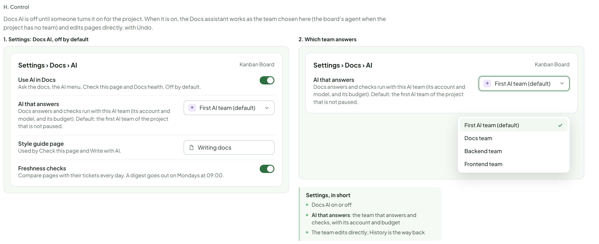

- Text in this part: "H. Control" · "Docs AI is off until someone turns it on for the project. When it is on, the Docs assistant works as the team chosen here (the board’s agent when the project has no team) and edits pages directly, with Undo." · "1. Settings: Docs AI, off by default" · "Settings › Docs › AI" · "Kanban Board" · "Use AI in Docs" · "Ask the docs, the AI menu, Check this page and Docs health. Off by default." · "AI that answers" · "Docs answers and checks run with this AI team (its account and model, and its budget). Default: the first AI team of the project that is not paused." · "First AI team (default)" · "Style guide page" · "Used by Check this page and Write with AI." · "Writing docs" · "Freshness checks" · "Compare pages with their tickets every day. A digest goes out on Mondays at 09:00." · "2. Which team answers" · "Docs team" · "Backend team" · "Frontend team" · "Settings, in short" · "Docs AI on or off" · "AI that answers: the team that answers and checks, with its account and budget" · "The team edits directly; History is the way back"

---

## I. States

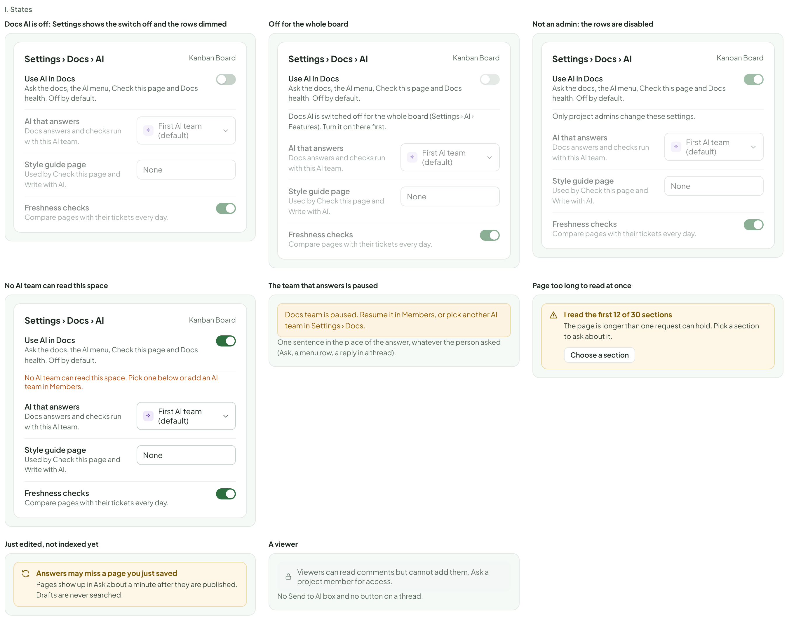

- Text in this part: "I. States" · "Docs AI is off: Settings shows the switch off and the rows dimmed" · "Settings › Docs › AI" · "Kanban Board" · "Use AI in Docs" · "Ask the docs, the AI menu, Check this page and Docs health. Off by default." · "AI that answers" · "Docs answers and checks run with this AI team." · "First AI team (default)" · "Style guide page" · "Used by Check this page and Write with AI." · "None" · "Freshness checks" · "Compare pages with their tickets every day." · "Off for the whole board" · "Docs AI is switched off for the whole board (Settings › AI › Features). Turn it on there first." · "Not an admin: the rows are disabled" · "Only project admins change these settings." · "No AI team can read this space" · "No AI team can read this space. Pick one below or add an AI team in Members." · "The team that answers is paused" · "Docs team is paused. Resume it in Members, or pick another AI team in Settings › Docs." · "One sentence in the place of the answer, whatever the person asked (Ask, a menu row, a reply in a thread)." · "Page too long to read at once" · "I read the first 12 of 30 sections" · "The page is longer than one request can hold. Pick a section to ask about it." · "Choose a section" · "Just edited, not indexed yet" · "Answers may miss a page you just saved" · "Pages show up in Ask about a minute after they are published. Drafts are never searched." · "A viewer" · "Viewers can read comments but cannot add them. Ask a project member for access." · "No Send to AI box and no button on a thread."

---

## J. Rules

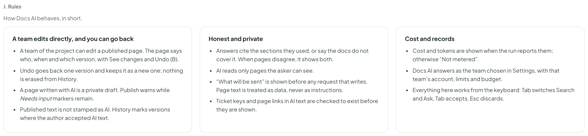

- Text in this part: "J. Rules" · "How Docs AI behaves, in short." · "A team edits directly, and you can go back" · "A team of the project can edit a published page. The page says who, when and which version, with See changes and Undo (B)." · "Undo goes back one version and keeps it as a new one; nothing is erased from History." · "A page written with AI is a private draft. Publish warns while Needs input markers remain." · "Published text is not stamped as AI. History marks versions where the author accepted AI text." · "Honest and private" · "Answers cite the sections they used, or say the docs do not cover it. When pages disagree, it shows both." · "AI reads only pages the asker can see." · "“What will be sent” is shown before any request that writes. Page text is treated as data, never as instructions." · "Ticket keys and page links in AI text are checked to exist before they are shown." · "Cost and records" · "Cost and tokens are shown when the run reports them; otherwise “Not metered”." · "Docs AI answers as the team chosen in Settings, with that team’s account, limits and budget." · "Everything here works from the keyboard: Tab switches Search and Ask, Tab accepts, Esc discards."

---

## Todo rows, differences from the code, and what was not checked

DocsAi 1480x6058; DocsAiCare 1480x12703 (was 6340); Notifications unchanged (A-212 already applied in branch design-ai-v2).
DocsAi: A-182, A-183 updated (AI members text, approval/proposal row, guidance row, never-does card, Hide lock removed; two new rows: a team changing a page, hand comments to a team); A-184 cost wording and sidebar chip; B-60 a,b new section G (On this page scrolls, narrow popover max height, table short columns). A-189, A-191..A-193 left.
DocsAiCare: A-186 banner without "Review suggested edits", frame A2 deleted; A-185 proposals removed; A-190(1)/B-59 new section B (bar, See changes, Undo, question and Restore, Restoring, Restored toast, error toast, reader without Undo, hidden after x, long team name, compare view); A-187 and B-60 d section E (answer with sources, "AI - KAN-12" badge, no "Suggest an edit", working placeholder, thread summary kept, mention dialog Ask and Just notify); B-57 new section F (22 frames); B-58 new section G (7 frames); A-188 and B-60 c settings reduced (Use AI in Docs, AI that answers, Style guide page, Freshness checks), paused team and viewer states. B-61 not drawn (no screen). A-190(2) "Suggest first" not drawn (C-21 says drop it).
Drawn from code text only: everything in DocsAiCare B, F, G. Error toast body "Could not reach the server. Try again." is invented.
Code vs todo: "the ticket's Docs tab" is the "Linked docs" section (TicketDocsSection); B-57 "small menu" per thread is a caret that opens the box with that thread ticked; Ask-the-team returns nothing at 0 open threads (drawn as no button).
Drawn differently from code (code must change): box uses a segmented control + one hint line (code three radio rows; needs ~410 px panel); confirm line of bar on a second row; code says "AI member" in "Not available: Docs AI is off or has no AI member.", "No AI member can read this space. Open AI members.", Docs settings text; problemLine() in utils/pageAiRules.ts prefixes "AI is paused until tomorrow." (v1 budget wording); paused tile has "Open Members" button the code does not have; menu footer "About $0.01" kept on AI menu / Write with AI / Create tickets (code always shows estimate; A-183 says cost only when metered: decide); Docs mention dialog keeps Ask and Just notify as A-187/B-60 d say. Code leftovers not drawn: "Hide from AI" tooltip in WriteWithAi, "hidden from AI, so not summarised" in SinceViewedDigest.
Not checked: app not run; whether real panel (392 px default) fits the 410 px box; server error bodies other than handoff.py. Suggest: consider splitting section F (Send to AI) into its own canvas.

## After the review round (saved by the main session)
Final heights: DocsAi 6081, DocsAiCare 13785 (not split; F frames 10-17 show the lower half of the box). Destinations are stacked radio rows with the code titles. Wording "AI team" instead of the code's "AI member" in "Not available: Docs AI is off or has no AI team.", "No AI team can read this space", "opens Members": code must change. Paused tile: one sentence, no button; the code prefixes "AI is paused until tomorrow." (v1 wording). Settings states: off, off for the whole board, not an admin, no AI team. Cost "About $0.01" vs "Not metered": decision for the owner (A-183 says cost only when metered; code always prints the estimate). Not done (22): "it" widow in the menu hint, "Publish the page first" disabled row, hover title on the bar, 300-ticket search limit (text verbatim from code). Designer copy not in code: "AI team" wording, paused sentence without the prefix, "Network Error" toast, v15 History row sample, ~6,200 tokens, "threads above" crop strip, Settings state tiles.

### Review

The canvas was read once by an independent reviewer subagent that got the result and the todo rows, not the builder's conclusions; the findings were fixed except where noted above. The reviewer was not run again after the fixes. The app was not run.
