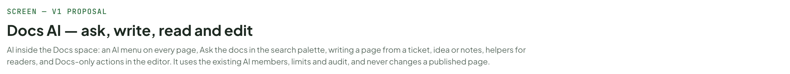
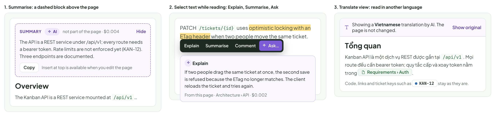

# Docs AI — ask, write, read and edit

> SCREEN — V1 PROPOSAL · source: [`DocsAi.dc.html`](../source/DocsAi.dc.html) · canvas `1793315909-1e64` · sha256 `62d5c43801116643f3da83422efda94f2ebc6acd05b8eddf9a31ca8977bbf761`

AI inside the Docs space: an AI menu on every page, Ask the docs in the search palette, writing a page from a ticket, idea or notes, helpers for readers, and Docs-only actions in the editor. It uses the existing AI members, limits and audit, and never changes a published page.

Source: [DocsAi.dc.html](../source/DocsAi.dc.html) › header ("SCREEN — V1 PROPOSAL", "Docs AI — ask, write, read and edit" and the intro)

---

## A. What exists and what this board adds

Some Docs AI is already drawn, in the Board AI board (§G) and in the editor board (/ai). But the Docs boards themselves show none of it, it is limited to writing help, and it is off by default. This board puts AI into the Docs space as a whole. It uses the same AI members, permissions, budgets and audit log; nothing here is a new kind of AI. This board covers asking, writing, reading and the editor; the second Docs AI board covers keeping docs true, proposals, tickets and control.

Source: [DocsAi.dc.html](../source/DocsAi.dc.html) › block "A. What exists and what this board adds"

![A. What exists and what this board adds: Some Docs AI is already drawn, in the Board AI board (§G) and in the editor board (/ai). But the Docs boards themselves show none of it, it is limited to writing help, and it is off by default. This board puts AI into the Docs space as a whole. It uses the same AI members, permissions, budgets and audit log; nothing here is a new kind of AI. This board covers asking, writing, reading and the editor; the second Docs AI board covers keeping docs true, proposals, tickets and control.](../images/docs-ai/02-a-what-exists-and-what-this-board-adds.png)

- Text in the frames: "NEED" · "TODAY" · "THIS BOARD ADDS" · "Understand a page" · "Board AI §G: summary, ask this page. The Docs boards do not show it, and “Docs AI” is off by default in Settings." · "An AI menu on every page (ask, summarise, check, translate view), shown only when Docs AI is on for the project." · "Find an answer" · "Docs search: keywords, scopes, filters. You read the pages yourself." · "Ask the docs: the search palette gets an Ask mode that answers in a few lines and cites the sections it used, or says the docs do not cover it." · "Start a page" · "Templates and Import Markdown." · "Write a page with AI from a ticket, an idea, pasted notes or a prompt. It opens as a private draft with the gaps marked, never published." · "Write well" · "/ai, the selection bar and a diff you accept, in every editor (AI where you work)." · "The same tools, plus Docs-only actions: summary at the top, table from a list, explain code, Check this page." · "Keep pages true" · "Nothing. A page can say “not enforced yet” long after the ticket is Done." · "Freshness checks against linked tickets and a Docs health list (out of date, missing docs, broken links, overlaps)." · "Turn pages into work" · "Ticket chips and [[ links, typed by hand." · "Create tickets from a page: unchecked items and action items become drafts you review, then link back as chips." · "AI members editing docs" · "MCP docs_write, with “Edit docs: needs approval” in the safety rules. No view of the proposal on the page." · "A proposed changes review on the page itself, change by change, expiring after 7 days." · "Use docs as AI memory" · "AI runs read linked docs only." · "Pages marked as AI guidance (architecture, conventions) are read by AI members on every run in the project, and shown as sources."

---

## B. One AI menu on every page

In the reader, the page header gets an AI button beside Comments and Share. It lists what AI can do with this page, says what it reads and what it costs, and starts nothing until you pick a row. The tree gets two rows above the page list: Ask the docs and Docs health.

Source: [DocsAi.dc.html](../source/DocsAi.dc.html) › block "B. One AI menu on every page"

- Text in the frames: "KANBAN" · "PROJECTS" · "Kanban Board" · "KAN" · "Mobile App" · "MOB" · "Marketing Site" · "MKT" · "Settings" · "Members" · "4 · 7 AI" · "Recycle Bin" · "3" · "Board" · "List" · "Timeline" · "Docs" · "Ask AI" · "Ctrl" · "J" · "New Ticket" · "DOCS SPACE" · "Space: Kanban Board" · "Search pages…" · "/" · "Ask the docs" · "Docs health" · "Overview" · "Requirements" · "Auth" · "Billing" · "Architecture" · "API" · "Data model" · "Decision log" · "Meeting notes" · "New page" · "Published · v14" · "HM" · "Edited by" · "Hoa Mai" · "· 2h ago" · "AI" · "Comments" · "4" · "Share" · "Edit" · "The Kanban API is a REST service mounted at /api/v1. Every route requires a bearer token; the rules for issuing and rotating tokens live in" · "Requirements › Auth. Entity shapes are described on" · "Data model." · "Rate limits are not enforced yet. Tracked in" · "KAN-12" · "." · "Endpoints" · "Method	Path	Description	Auth" · "GET	/tickets	List tickets in a project	Token" · "POST	/tickets	Create a ticket	Token" · "PATCH	/tickets/{id}	Update fields or move column	Token" · "Rollout checklist" · "Publish the OpenAPI spec" · "Token auth on every route" · "KAN-9" · "Rate limiting on public endpoints" · "Webhook retries" · "KAN-31" · "Ask this page" · "Questions about this page and the tickets it links to" · "CtrlJ" · "Summarise" · "A short summary above the page. Not saved unless you insert it" · "Check if up to date" · "Compare with KAN-9, KAN-12, KAN-31 and 2 linked pages" · "Create tickets from this page" · "Finds items that have no ticket yet" · "Suggest links" · "Pages and tickets mentioned in the text" · "Translate view…" · "Read it in another language. The page is not changed" · "Edit with AI…" · "Opens the editor with /ai ready" · "Reads" · "This page" · "3 tickets" · "2 linked pages" · "About $0.01" · "Where AI shows up in Docs" · "The tree: Ask the docs (also Tab in the search palette) and Docs health with a count." · "The page header: one AI menu, next to Comments and Share. It is the same button on every page." · "The editor: /ai, the selection bar and Check this page." · "Comments: @ an AI member in a thread." · "The project top bar: Ask AI (the Board AI dock) stays as it is." · "What the menu never does" · "Nothing here changes a page by itself. Summaries are shown above the page and are not part of it." · "Everything that writes (Edit with AI, Check, Create tickets) opens a draft or a list to review first." · "A person who cannot edit the page still sees Ask, Summarise, Check and Translate. Edit with AI and Create tickets are hidden for viewers." · "When it is hidden" · "The whole menu disappears when Docs AI is off for the project. Nothing is greyed out and nothing says “upgrade”." · "With no AI member that can read the project, the menu shows one row that opens AI members." · "On a page marked Hide from AI the menu shows a lock and a one-line reason."

---

## C. Ask the docs

Search finds pages; Ask answers a question using them. It lives inside the search palette people already know, so there is nothing new to find. Every answer shows its sources, and an honest “not covered” is a normal result, with a way to fix the gap.

Source: [DocsAi.dc.html](../source/DocsAi.dc.html) › block "C. Ask the docs"

- Text in the frames: "1. An answer with its sources" · "How do I rotate a token without downtime?" · "Search" · "Ask" · "Esc" · "In:" · "This space" · "This page" · "All my projects" · "You can rotate a token at any time from Settings. The old token keeps working for 24 hours, so integrations are not interrupted1. Rotate it, then update the integration before the 24 hours are up1. The API page points to these rules2." · "SOURCES" · "1" · "Requirements › Auth" · "# Rotation" · "Tokens can be rotated at any time from Settings. The old token keeps working for 24 hours." · "2" · "Architecture › API" · "# Overview" · "…the rules for issuing and rotating tokens live in Requirements › Auth." · "Open as chat" · "Copy" · "Was this right?" · "Read 4 pages, cited 2, all visible to you" · "Index updated 2 min ago · $0.01" · "How Ask works" · "In the Docs search palette, Tab switches between Search and Ask. Search stays the default; Ask is never run automatically." · "It answers only from pages you can see, quotes the section it used, and says “the docs do not say” instead of guessing." · "When pages disagree it shows both, with their dates. It does not pick a winner." · "The footer says how many pages it read and how fresh the index is. A page you just published can take about a minute to show up." · "Open as chat continues in the Board AI dock, with the same sources attached." · "2. Not covered: it says so and offers a next step" · "How do service accounts get tokens?" · "The docs do not say. No page describes how service accounts get tokens. The closest pages mention tokens only for people." · "CLOSEST PAGES" · "·" · "# Token rules" · "All routes use bearer authentication…" · "Every route requires a bearer token…" · "Search these words" · "Draft a page from this question" · "Read 6 pages" · "$0.01" · "3. Pages disagree: it shows both" · "How long does a token last?" · "Two pages disagree. Auth says tokens expire after 30 days1. The Decision log says 90 days2, and is newer." · "Tokens expire after 30 days and can be rotated from Settings. Edited Sep 12" · "Decision log" · "# Token lifetime" · "Tokens expire after 90 days. Edited Oct 2" · "Report Auth as out of date" · "Adds it to Docs health. Nothing is edited." · "Read 3 pages"

---

## D. Write a page with AI

The new-page dialog gets a Write with AI group next to the templates. The AI writes only from the sources you pick, shows what will be sent, and opens the result as a private draft. Where the sources do not say something, it leaves a visible Needs input marker and lists the gaps; Publish warns while markers remain.

Source: [DocsAi.dc.html](../source/DocsAi.dc.html) › block "D. Write a page with AI"

- Text in the frames: "1. New page › Write with AI" · "New page" · "START FROM" · "Blank page" · "Spec" · "Decision record" · "Meeting notes" · "WRITE WITH AI" · "From a ticket" · "From an idea" · "From pasted notes" · "From a prompt" · "Ticket" · "KAN-154" · "Export activity log to CSV" · "What kind of page" · "How-to" · "Release note" · "Also read" · "The ticket description and 4 comments" · "2 linked pages" · "Requirements › Auth, Data model" · "The code changes on branch feat/csv-export" · "Adds code to what is sent. Off unless you turn it on" · "Title and place" · "Activity export" · "Under Architecture" · "What will be sent ⓘ" · "4 comments" · "2 pages" · "About $0.03" · "The draft is private to you until you publish it." · "Cancel" · "Write draft" · "2. It opens as a draft, with the gaps marked" · "Draft" · "Drafted with AI" · "from KAN-154 · only you see it" · "Discard" · "Publish" · "What it does" · "Project members can export the Activity log as CSV, filtered by date and actor. Large exports stream in chunks1." · "Limits" · "An export is limited to" · "Needs input: maximum rows and is rate-limited to" · "Needs input: exports per hour." · "Who can export" · "Members of the project; viewers cannot2." · "GAPS · 2" · "I could not find these in the sources, so I left them empty instead of guessing:" · "• Maximum rows per export" · "• Exports allowed per hour" · "SOURCES" · "1" · "description" · "Export streams in chunks." · "2" · "Requirements" · "# Auth" · "Viewers have read-only access." · "3. From pasted notes: summary, decisions, actions" · "YOUR NOTES" · "weekly sync oct 27" · "hoa: webhooks retry still flaky, will fix this week" · "linh: ok to drop v1 export, nobody uses it" · "tuan: need decision on token lifetime by fri" · "- hoa to check retry logs" · "- tuan to draft lifetime proposal" · "DRAFT PAGE · MEETING NOTES" · "Summary" · "Webhook retries are still unreliable. The v1 export can be dropped. The token lifetime is undecided." · "Decisions" · "Drop the v1 export (Linh)." · "Action items" · "Check the retry logs — Hoa" · "Draft the token lifetime proposal, due Friday — Tuan" · "4. Import Markdown: tidy with AI" · "handbook.md" · "· 48 KB · 6 top-level sections" · "TIDY WHILE IMPORTING (OPTIONAL)" · "Split into one page per top-level section" · "6 pages instead of 1 long page" · "Turn ticket keys into chips" · "KAN-12 found 6 times, KAN-31 twice" · "Turn “see Auth” into [[links]]" · "4 found. Shown for review before they are added" · "Fix heading levels" · "Starts at ## as the editor expects" · "Nothing is imported until you press Import. The result list shows what changed in each page."

---

## E. While reading

Three small helpers for people who only read. None of them edits the page: a summary sits above it as a dashed block, an explanation is a small card, and a translation is a view that can be switched off.

Source: [DocsAi.dc.html](../source/DocsAi.dc.html) › block "E. While reading"

- Text in the frames: "1. Summarise: a dashed block above the page" · "SUMMARY" · "AI" · "not part of the page · $0.004" · "Hide" · "The API is a REST service under /api/v1; every route needs a bearer token. Rate limits are not enforced yet (KAN-12). Three endpoints are documented." · "Copy" · "Insert at top is available when you edit the page" · "Overview" · "The Kanban API is a REST service mounted at /api/v1…" · "2. Select text while reading: Explain, Summarise, Ask" · "PATCH /tickets/{id} uses optimistic locking with an ETag header when two people move the same ticket." · "Explain" · "Summarise" · "Comment" · "Ask…" · "If two people drag the same ticket at once, the second save is refused because the ETag no longer matches. The client reloads the ticket and tries again." · "From this page · Architecture › API · $0.002" · "3. Translate view: read in another language" · "Showing a Vietnamese translation by AI. The page is not changed." · "Show original" · "Tổng quan" · "Kanban API là một dịch vụ REST được gắn tại /api/v1. Mọi route đều cần bearer token; quy tắc cấp và xoay token nằm trong" · "Requirements › Auth." · "Code, links and ticket keys such as" · "KAN-12" · "stay as they are."

---

## F. In the editor

The /ai menu and the selection bar are the same as in every editor (diff, Accept with Tab, Esc discards). Docs pages get extra rows, and Check this page, which reads the page and the project’s style guide page (chosen in Settings) and lists problems. Fixing one makes a normal draft to accept; ignoring it hides it for that page.

Source: [DocsAi.dc.html](../source/DocsAi.dc.html) › block "F. In the editor"

- Text in the frames: "1. Type /ai in a Docs page" · "Webhook retries are tracked separately." · "/ai" · "Ask AI…" · "Write from a prompt, with this page as context" · "Continue writing" · "Carry on from the cursor" · "DOCS ONLY" · "Summary at the top" · "A short summary block, as a draft" · "Table from this list" · "Turns the list above into a table" · "Explain this code block" · "Plain-language notes under the code" · "Draw a diagram" · "From this section, as an editable draw.io diagram" · "Create tickets from this list" · "Drafts to review first" · "Check this page" · "Unclear text, gaps, broken or unknown references" · "2. Check this page: findings, then drafts you accept" · "Draft · based on v14" · "Saved 12:41" · "API" · "Overview" · "Tokens are handled as described elsewhere. The Kanban API is a REST service mounted at /api/v1." · "Endpoints" · "Entity shapes follow [[Billing#Plans]]." · "Rollout checklist" · "Webhook retries" · "KAN-31" · "3 findings" · "Read this page and the style guide page Writing docs. Nothing is changed." · "Unclear" · "“Tokens are handled as described elsewhere”" · "Which page? Name it or link it." · "Fix as draft" · "Ignore" · "Missing" · "Whole page" · "“Rollout checklist”" · "Webhook retries (KAN-31) has no explanation on this page." · "Unknown link" · "“[[Billing#Plans]]”" · "No section Plans in Billing. Closest: Billing › Pricing." · "About $0.01" · "Esc close"
