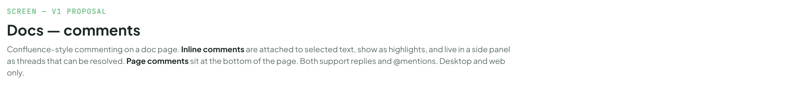
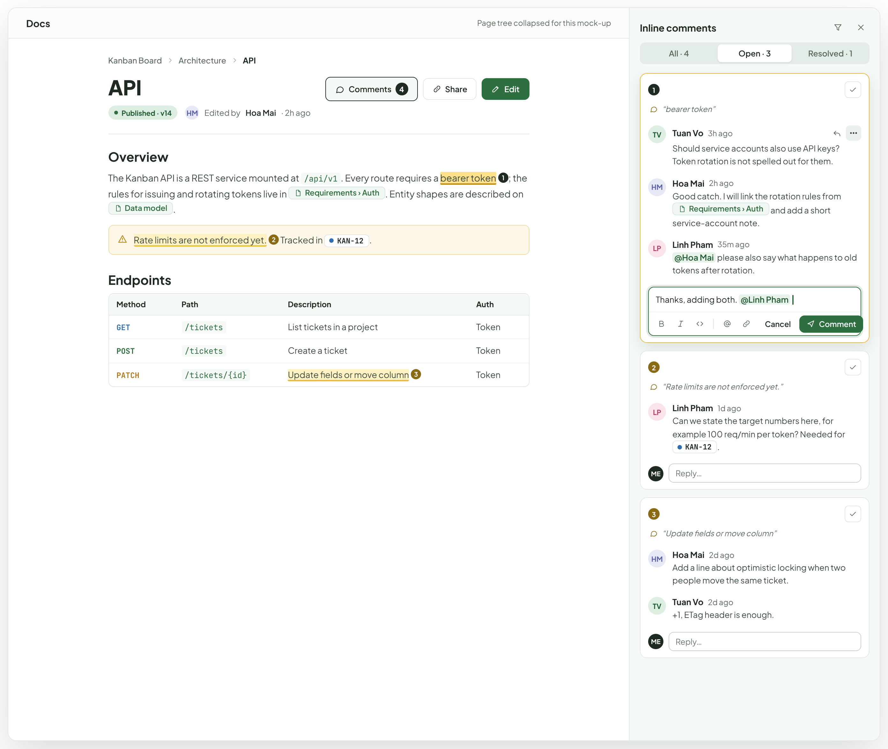
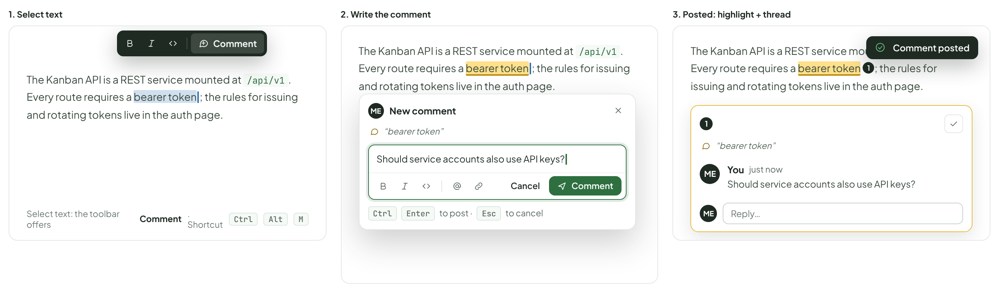
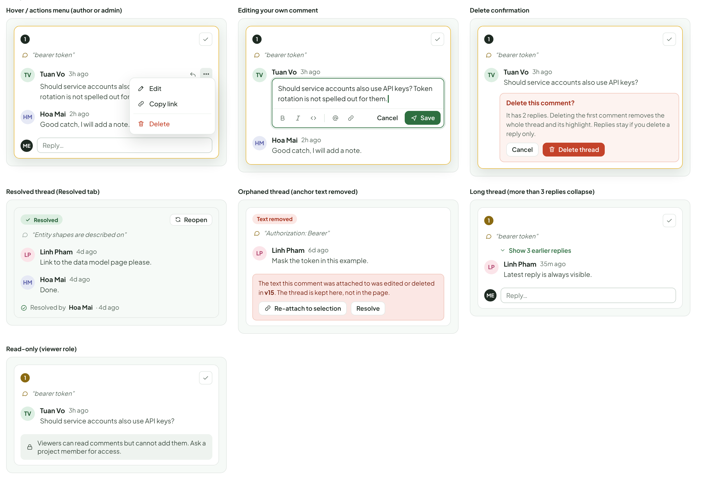
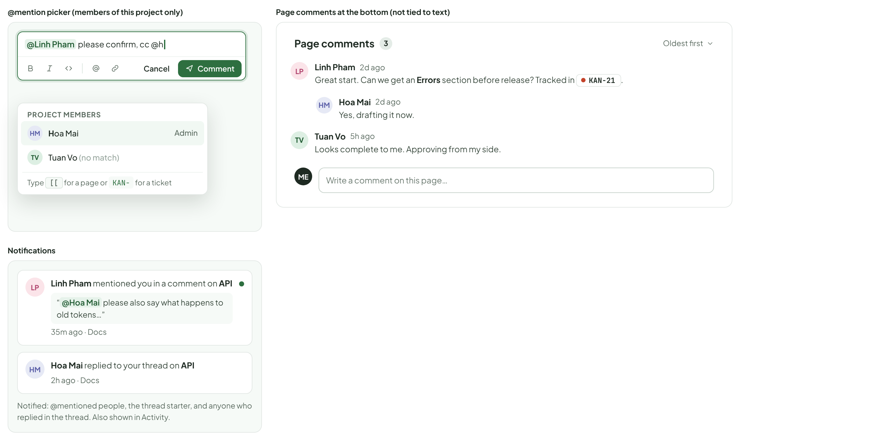
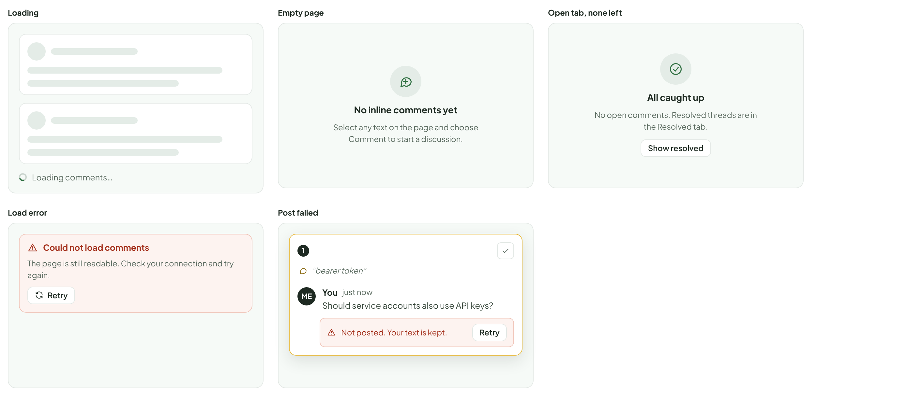
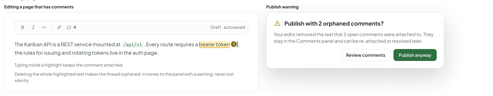
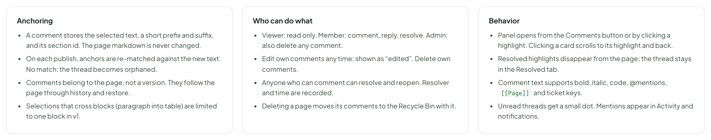

# Docs — comments

> SCREEN — V1 PROPOSAL · source: [`DocsComments.dc.html`](../source/DocsComments.dc.html) · canvas `1793195406-cc1c` · sha256 `c5f2b69b986f694128d6fd774512e4033b1607885b9f76dfe06b17e6bb49a1ed`

Confluence-style commenting on a doc page. Inline comments are attached to selected text, show as highlights, and live in a side panel as threads that can be resolved. Page comments sit at the bottom of the page. Both support replies and @mentions. Desktop and web only.

Source: [DocsComments.dc.html](../source/DocsComments.dc.html) › header ("SCREEN — V1 PROPOSAL", "Docs — comments" and the intro)

---

## A. Page view with the Comments panel open

The Comments button in the page header toggles the panel and shows the total. Highlights carry a number that matches the card in the panel; the selected thread is stronger on both sides.

Source: [DocsComments.dc.html](../source/DocsComments.dc.html) › block "A. Page view with the Comments panel open"

- Text in the frames: "Docs" · "Page tree collapsed for this mock-up" · "Kanban Board" · "Architecture" · "API" · "Published · v14" · "HM" · "Edited by" · "Hoa Mai" · "· 2h ago" · "Comments" · "4" · "Share" · "Edit" · "Overview" · "The Kanban API is a REST service mounted at /api/v1. Every route requires a bearer token1; the rules for issuing and rotating tokens live in" · "Requirements › Auth. Entity shapes are described on" · "Data model." · "Rate limits are not enforced yet.2 Tracked in" · "KAN-12" · "." · "Endpoints" · "Method	Path	Description	Auth" · "GET	/tickets	List tickets in a project	Token" · "POST	/tickets	Create a ticket	Token" · "PATCH	/tickets/{id}	Update fields or move column3	Token" · "Inline comments" · "All · 4" · "Open · 3" · "Resolved · 1" · "1" · "“bearer token”" · "TV" · "Tuan Vo" · "3h ago" · "Should service accounts also use API keys? Token rotation is not spelled out for them." · "2h ago" · "Good catch. I will link the rotation rules from" · "Requirements › Auth and add a short service-account note." · "LP" · "Linh Pham" · "35m ago" · "@Hoa Mai please also say what happens to old tokens after rotation." · "Thanks, adding both. @Linh Pham" · "Cancel" · "Comment" · "2" · "“Rate limits are not enforced yet.”" · "1d ago" · "Can we state the target numbers here, for example 100 req/min per token? Needed for" · "ME" · "Reply…" · "3" · "“Update fields or move column”" · "2d ago" · "Add a line about optimistic locking when two people move the same ticket." · "+1, ETag header is enough."

---

## B. Adding an inline comment

Selecting text in view mode or edit mode shows the selection toolbar with a Comment action. The composer opens next to the selection and the highlight appears once posted.

Source: [DocsComments.dc.html](../source/DocsComments.dc.html) › block "B. Adding an inline comment"

- Text in the frames: "1. Select text" · "Comment" · "The Kanban API is a REST service mounted at /api/v1. Every route requires a bearer token; the rules for issuing and rotating tokens live in the auth page." · "Select text: the toolbar offers" · ". Shortcut" · "Ctrl" · "Alt" · "M" · "2. Write the comment" · "ME" · "New comment" · "“bearer token”" · "Should service accounts also use API keys?" · "Cancel" · "Enter" · "to post ·" · "Esc" · "to cancel" · "3. Posted: highlight + thread" · "The Kanban API is a REST service mounted at /api/v1. Every route requires a bearer token1; the rules for issuing and rotating tokens live in the auth page." · "1" · "You" · "just now" · "Reply…" · "Comment posted"

---

## C. Thread states

Every card in the panel is one of these. Actions follow the author and role rules in section G.

Source: [DocsComments.dc.html](../source/DocsComments.dc.html) › block "C. Thread states"

- Text in the frames: "Hover / actions menu (author or admin)" · "1" · "“bearer token”" · "TV" · "Tuan Vo" · "3h ago" · "Should service accounts also use API keys? Token rotation is not spelled out for them." · "Edit" · "Copy link" · "Delete" · "HM" · "Hoa Mai" · "2h ago" · "Good catch, I will add a note." · "ME" · "Reply…" · "Editing your own comment" · "Cancel" · "Save" · "Delete confirmation" · "Should service accounts also use API keys?" · "Delete this comment?" · "It has 2 replies. Deleting the first comment removes the whole thread and its highlight. Replies stay if you delete a reply only." · "Delete thread" · "Resolved thread (Resolved tab)" · "Resolved" · "Reopen" · "“Entity shapes are described on”" · "LP" · "Linh Pham" · "4d ago" · "Link to the data model page please." · "Done." · "Resolved by" · "· 4d ago" · "Orphaned thread (anchor text removed)" · "Text removed" · "“Authorization: Bearer”" · "6d ago" · "Mask the token in this example." · "The text this comment was attached to was edited or deleted in v15. The thread is kept here, not in the page." · "Re-attach to selection" · "Resolve" · "Long thread (more than 3 replies collapse)" · "Show 3 earlier replies" · "35m ago" · "Latest reply is always visible." · "Read-only (viewer role)" · "Viewers can read comments but cannot add them. Ask a project member for access."

---

## D. @mentions, notifications and page comments

Mentions only list members of the project. Notifications reuse the existing Activity feed.

Source: [DocsComments.dc.html](../source/DocsComments.dc.html) › block "D. @mentions, notifications and page comments"

- Text in the frames: "@mention picker (members of this project only)" · "@Linh Pham please confirm, cc @h" · "Cancel" · "Comment" · "PROJECT MEMBERS" · "HM" · "Hoa Mai" · "Admin" · "TV" · "Tuan Vo (no match)" · "Type [[ for a page or KAN- for a ticket" · "Notifications" · "LP" · "Linh Pham mentioned you in a comment on API" · "“@Hoa Mai please also say what happens to old tokens…”" · "35m ago · Docs" · "Hoa Mai replied to your thread on API" · "2h ago · Docs" · "Notified: @mentioned people, the thread starter, and anyone who replied in the thread. Also shown in Activity." · "Page comments at the bottom (not tied to text)" · "Page comments" · "3" · "Oldest first" · "Linh Pham" · "2d ago" · "Great start. Can we get an Errors section before release? Tracked in" · "KAN-21" · "." · "Yes, drafting it now." · "Tuan Vo" · "5h ago" · "Looks complete to me. Approving from my side." · "ME" · "Write a comment on this page…"

---

## E. Panel states

Source: [DocsComments.dc.html](../source/DocsComments.dc.html) › block "E. Panel states"

- Text in the frames: "Loading" · "Loading comments…" · "Empty page" · "No inline comments yet" · "Select any text on the page and choose Comment to start a discussion." · "Open tab, none left" · "All caught up" · "No open comments. Resolved threads are in the Resolved tab." · "Show resolved" · "Load error" · "Could not load comments" · "The page is still readable. Check your connection and try again." · "Retry" · "Post failed" · "1" · "“bearer token”" · "ME" · "You" · "just now" · "Should service accounts also use API keys?" · "Not posted. Your text is kept."

---

## F. Editing a page that has comments

Source: [DocsComments.dc.html](../source/DocsComments.dc.html) › block "F. Editing a page that has comments"

- Text in the frames: "Editing a page that has comments" · "4" · "Draft · autosaved" · "The Kanban API is a REST service mounted at /api/v1. Every route requires a bearer token1; the rules for issuing and rotating tokens live in the auth page." · "Typing inside a highlight keeps the comment attached." · "Deleting the whole highlighted text makes the thread orphaned: it moves to the panel with a warning, never lost silently." · "Publish warning" · "Publish with 2 orphaned comments?" · "Your edits removed the text that 2 open comments were attached to. They stay in the Comments panel and can be re-attached or resolved later." · "Review comments" · "Publish anyway"

---

## G. Rules

Proposed behavior to confirm before building. Nothing here changes how the page markdown is stored.

Source: [DocsComments.dc.html](../source/DocsComments.dc.html) › block "G. Rules"

- Text in the frames: "Anchoring" · "A comment stores the selected text, a short prefix and suffix, and its section id. The page markdown is never changed." · "On each publish, anchors are re-matched against the new text. No match: the thread becomes orphaned." · "Comments belong to the page, not a version. They follow the page through history and restore." · "Selections that cross blocks (paragraph into table) are limited to one block in v1." · "Who can do what" · "Viewer: read only. Member: comment, reply, resolve. Admin: also delete any comment." · "Edit own comments any time; shown as “edited”. Delete own comments." · "Anyone who can comment can resolve and reopen. Resolver and time are recorded." · "Deleting a page moves its comments to the Recycle Bin with it." · "Behavior" · "Panel opens from the Comments button or by clicking a highlight. Clicking a card scrolls to its highlight and back." · "Resolved highlights disappear from the page; the thread stays in the Resolved tab." · "Comment text supports bold, italic, code, @mentions, [[Page]] and ticket keys." · "Unread threads get a small dot. Mentions appear in Activity and notifications."
