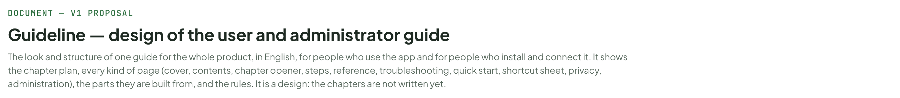
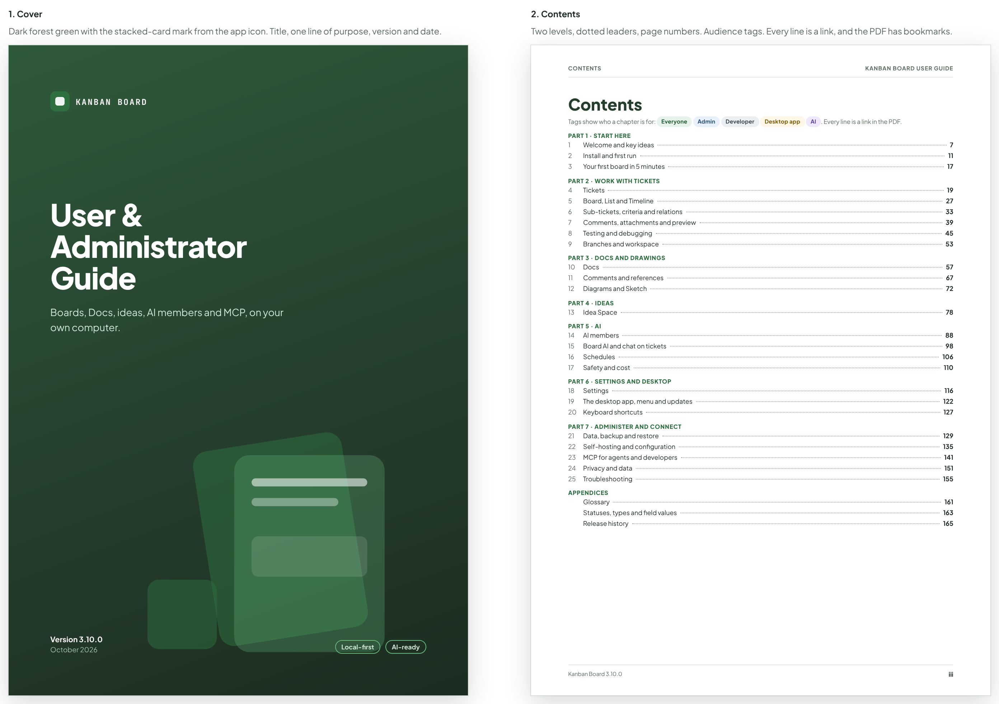
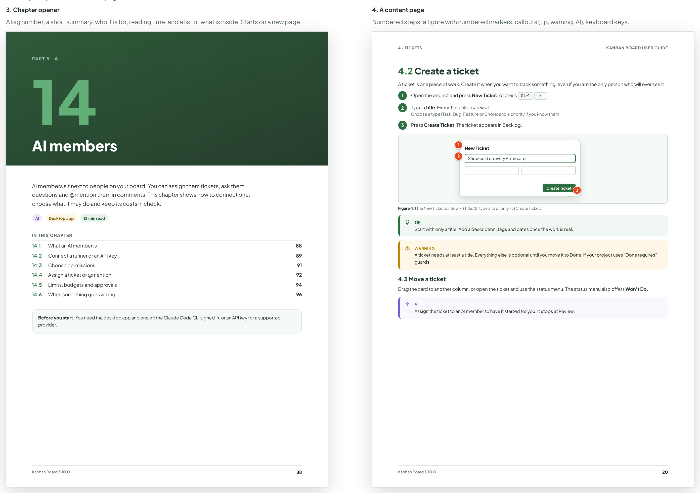
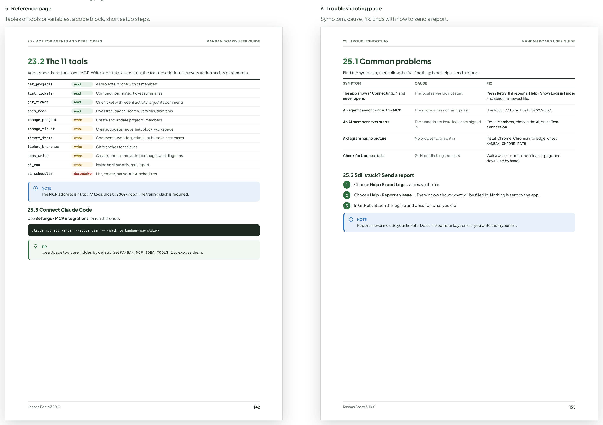
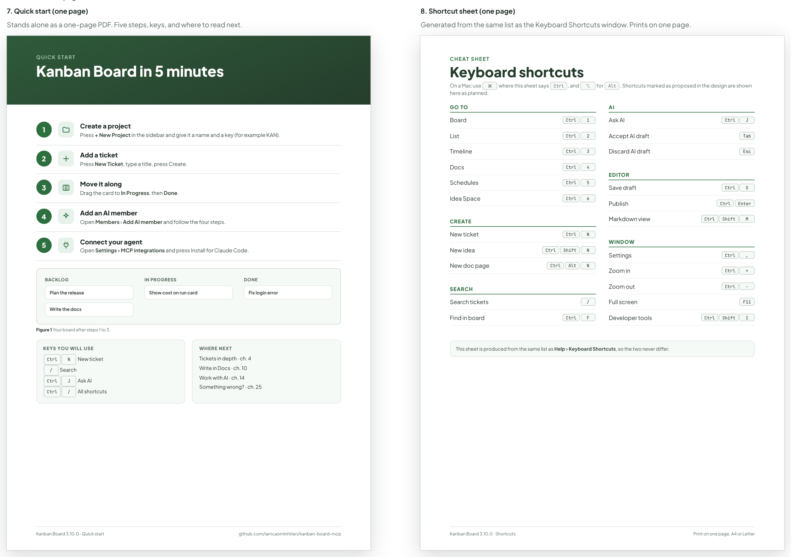
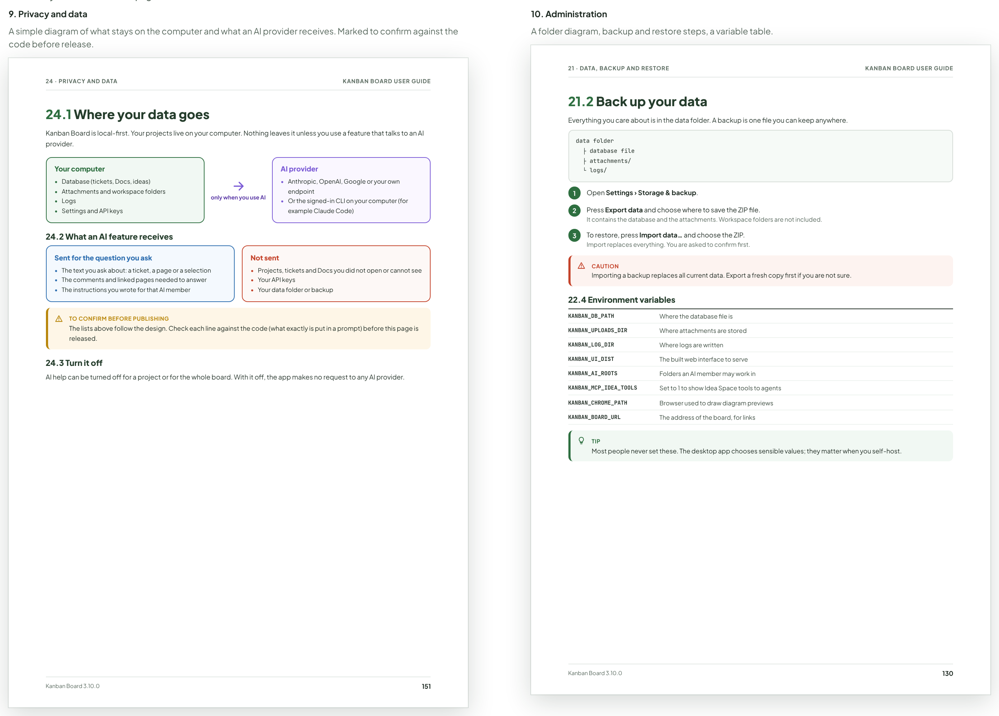
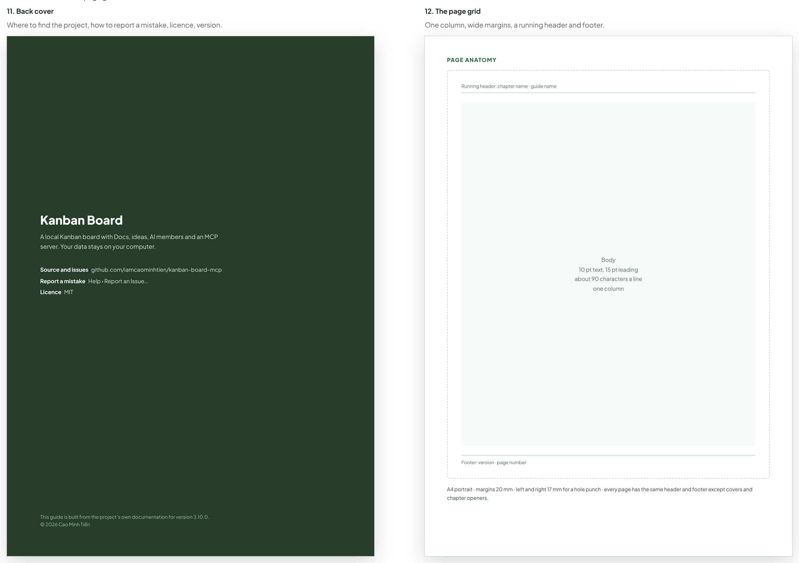
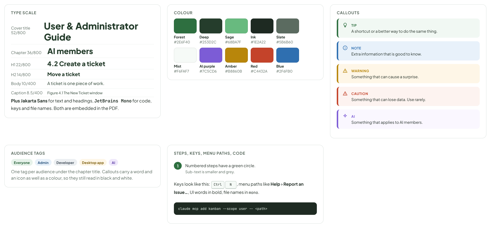
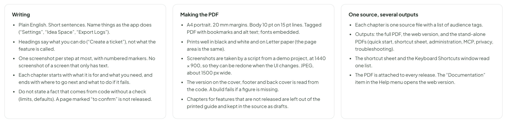

# Guideline — design of the user and administrator guide

> DOCUMENT — V1 PROPOSAL · source: [`GuidelineDesign.dc.html`](../source/GuidelineDesign.dc.html) · canvas `1793315125-cd46` · sha256 `97e1ac2fd0b0b1f38cbbb99faf3e423842ae7ead505f669932485f86d4b7e905`

The look and structure of one guide for the whole product, in English, for people who use the app and for people who install and connect it. It shows the chapter plan, every kind of page (cover, contents, chapter opener, steps, reference, troubleshooting, quick start, shortcut sheet, privacy, administration), the parts they are built from, and the rules. It is a design: the chapters are not written yet.

Source: [GuidelineDesign.dc.html](../source/GuidelineDesign.dc.html) › header ("DOCUMENT — V1 PROPOSAL", "Guideline — design of the user and administrator guide" and the intro)

---

## A. What the guide is, and its shape

One guide, in English, for people who use the app and for people who install and connect it. About 166 pages (A4), in seven parts. Each chapter carries tags (Everyone, Admin, Developer, Desktop app, AI) so readers can skip what is not for them. The same source also produces a web version, and six short companions: a one-page quick start, a one-page shortcut sheet, and guides for administrators, MCP, privacy and troubleshooting, which are chapters here and also stand-alone PDFs. Page counts are a budget, not a promise.

Source: [GuidelineDesign.dc.html](../source/GuidelineDesign.dc.html) › block "A. What the guide is, and its shape"

![A. What the guide is, and its shape: One guide, in English, for people who use the app and for people who install and connect it. About 166 pages (A4), in seven parts. Each chapter carries tags (Everyone, Admin, Developer, Desktop app, AI) so readers can skip what is not for them. The same source also produces a web version, and six short companions: a one-page quick start, a one-page shortcut sheet, and guides for administrators, MCP, privacy and troubleshooting, which are chapters here and also stand-alone PDFs. Page counts are a budget, not a promise.](../images/guideline-design/02-a-what-the-guide-is-and-its-shape.png)

- Text in the frames: "PART 1 · START HERE" · "1" · "Welcome and key ideas" · "Everyone" · "4 pp." · "from p. 7" · "2" · "Install and first run" · "6 pp." · "from p. 11" · "3" · "Your first board in 5 minutes" · "2 pp." · "from p. 17" · "PART 2 · WORK WITH TICKETS" · "4" · "Tickets" · "8 pp." · "from p. 19" · "5" · "Board, List and Timeline" · "from p. 27" · "6" · "Sub-tickets, criteria and relations" · "from p. 33" · "7" · "Comments, attachments and preview" · "from p. 39" · "8" · "Testing and debugging" · "from p. 45" · "9" · "Branches and workspace" · "Developer" · "from p. 53" · "PART 3 · DOCS AND DRAWINGS" · "10" · "Docs" · "10 pp." · "from p. 57" · "11" · "Comments and references" · "5 pp." · "from p. 67" · "12" · "Diagrams and Sketch" · "from p. 72" · "PART 4 · IDEAS" · "13" · "Idea Space" · "from p. 78" · "PART 5 · AI" · "14" · "AI members" · "AI" · "from p. 88" · "15" · "Board AI and chat on tickets" · "from p. 98" · "16" · "Schedules" · "from p. 106" · "17" · "Safety and cost" · "from p. 110" · "PART 6 · SETTINGS AND DESKTOP" · "18" · "Settings" · "from p. 116" · "19" · "The desktop app, menu and updates" · "Desktop app" · "from p. 122" · "20" · "Keyboard shortcuts" · "from p. 127" · "PART 7 · ADMINISTER AND CONNECT" · "21" · "Data, backup and restore" · "Admin" · "from p. 129" · "22" · "Self-hosting and configuration" · "from p. 135" · "23" · "MCP for agents and developers" · "from p. 141" · "24" · "Privacy and data" · "from p. 151" · "25" · "Troubleshooting" · "from p. 155" · "APPENDICES" · "Glossary" · "from p. 161" · "Statuses, types and field values" · "from p. 163" · "Release history" · "from p. 165"

---

## B1. Cover and contents

Every page type, at 80% of A4 so that the text can be read here. The pages use the app’s own colours and type, so the guide looks like part of the product.

Source: [GuidelineDesign.dc.html](../source/GuidelineDesign.dc.html) › block "B1. Cover and contents"

- Text in the frames: "1. Cover" · "Dark forest green with the stacked-card mark from the app icon. Title, one line of purpose, version and date." · "KANBAN BOARD" · "User &" · "Administrator" · "Guide" · "Boards, Docs, ideas, AI members and MCP, on your own computer." · "Version 3.10.0" · "October 2026" · "Local-first" · "AI-ready" · "2. Contents" · "Two levels, dotted leaders, page numbers. Audience tags. Every line is a link, and the PDF has bookmarks." · "CONTENTS" · "KANBAN BOARD USER GUIDE" · "Contents" · "Tags show who a chapter is for: Everyone Admin Developer Desktop app AI. Every line is a link in the PDF." · "PART 1 · START HERE" · "1" · "Welcome and key ideas" · "7" · "2" · "Install and first run" · "11" · "3" · "Your first board in 5 minutes" · "17" · "PART 2 · WORK WITH TICKETS" · "4" · "Tickets" · "19" · "5" · "Board, List and Timeline" · "27" · "6" · "Sub-tickets, criteria and relations" · "33" · "Comments, attachments and preview" · "39" · "8" · "Testing and debugging" · "45" · "9" · "Branches and workspace" · "53" · "PART 3 · DOCS AND DRAWINGS" · "10" · "Docs" · "57" · "Comments and references" · "67" · "12" · "Diagrams and Sketch" · "72" · "PART 4 · IDEAS" · "13" · "Idea Space" · "78" · "PART 5 · AI" · "14" · "AI members" · "88" · "15" · "Board AI and chat on tickets" · "98" · "16" · "Schedules" · "106" · "Safety and cost" · "110" · "PART 6 · SETTINGS AND DESKTOP" · "18" · "Settings" · "116" · "The desktop app, menu and updates" · "122" · "20" · "Keyboard shortcuts" · "127" · "PART 7 · ADMINISTER AND CONNECT" · "21" · "Data, backup and restore" · "129" · "22" · "Self-hosting and configuration" · "135" · "23" · "MCP for agents and developers" · "141" · "24" · "Privacy and data" · "151" · "25" · "Troubleshooting" · "155" · "APPENDICES" · "Glossary" · "161" · "Statuses, types and field values" · "163" · "Release history" · "165" · "Kanban Board 3.10.0" · "iii"

---

## B2. Chapter opener and a content page

Source: [GuidelineDesign.dc.html](../source/GuidelineDesign.dc.html) › block "B2. Chapter opener and a content page"

- Text in the frames: "3. Chapter opener" · "A big number, a short summary, who it is for, reading time, and a list of what is inside. Starts on a new page." · "PART 5 · AI" · "14" · "AI members" · "AI members sit next to people on your board. You can assign them tickets, ask them questions and @mention them in comments. This chapter shows how to connect one, choose what it may do and keep its costs in check." · "AI" · "Desktop app" · "12 min read" · "IN THIS CHAPTER" · "14.1" · "What an AI member is" · "88" · "14.2" · "Connect a runner or an API key" · "89" · "14.3" · "Choose permissions" · "91" · "14.4" · "Assign a ticket or @mention" · "92" · "14.5" · "Limits, budgets and approvals" · "94" · "14.6" · "When something goes wrong" · "96" · "Before you start. You need the desktop app and one of: the Claude Code CLI signed in, or an API key for a supported provider." · "Kanban Board 3.10.0" · "4. A content page" · "Numbered steps, a figure with numbered markers, callouts (tip, warning, AI), keyboard keys." · "4 · TICKETS" · "KANBAN BOARD USER GUIDE" · "4.2 Create a ticket" · "A ticket is one piece of work. Create it when you want to track something, even if you are the only person who will ever see it." · "1" · "Open the project and press New Ticket, or press CtrlN." · "2" · "Type a title. Everything else can wait." · "Choose a type (Task, Bug, Feature or Chore) and a priority if you know them." · "3" · "Press Create Ticket. The ticket appears in Backlog." · "New Ticket" · "Show cost on every AI run card" · "Create Ticket" · "Figure 4.1 The New Ticket window. (1) Title, (2) type and priority, (3) Create Ticket." · "TIP" · "Start with only a title. Add a description, tags and dates once the work is real." · "WARNING" · "A ticket needs at least a title. Everything else is optional until you move it to Done, if your project uses “Done requires” guards." · "4.3 Move a ticket" · "Drag the card to another column, or open the ticket and use the status menu. The status menu also offers Won’t Do." · "Assign the ticket to an AI member to have it started for you. It stops at Review." · "20"

---

## B3. Reference and troubleshooting pages

Source: [GuidelineDesign.dc.html](../source/GuidelineDesign.dc.html) › block "B3. Reference and troubleshooting pages"

- Text in the frames: "5. Reference page" · "Tables of tools or variables, a code block, short setup steps." · "23 · MCP FOR AGENTS AND DEVELOPERS" · "KANBAN BOARD USER GUIDE" · "23.2 The 11 tools" · "Agents see these tools over MCP. Write tools take an action; the tool description lists every action and its parameters." · "get_projects" · "read" · "All projects, or one with its members" · "list_tickets" · "Compact, paginated ticket summaries" · "get_ticket" · "One ticket with recent activity, or just its comments" · "docs_read" · "Docs tree, pages, search, versions, diagrams" · "manage_project" · "write" · "Create and update projects, members" · "manage_ticket" · "Create, update, move, link, block, workspace" · "ticket_items" · "Comments, work log, criteria, sub-tasks, test cases" · "ticket_branches" · "Git branches for a ticket" · "docs_write" · "Create, update, move, import pages and diagrams" · "ai_run" · "Inside an AI run only: ask, report" · "ai_schedules" · "destructive" · "List, create, pause, run AI schedules" · "NOTE" · "The MCP address is http://localhost:8000/mcp/. The trailing slash is required." · "23.3 Connect Claude Code" · "Use Settings › MCP integrations, or run this once:" · "claude mcp add kanban --scope user -- <path to kanban-mcp-stdio>" · "TIP" · "Idea Space tools are hidden by default. Set KANBAN_MCP_IDEA_TOOLS=1 to expose them." · "Kanban Board 3.10.0" · "142" · "6. Troubleshooting page" · "Symptom, cause, fix. Ends with how to send a report." · "25 · TROUBLESHOOTING" · "25.1 Common problems" · "Find the symptom, then follow the fix. If nothing here helps, send a report." · "SYMPTOM" · "CAUSE" · "FIX" · "The app shows “Connecting…” and never opens" · "The local server did not start" · "Press Retry. If it repeats, Help › Show Logs in Finder and send the newest file." · "An agent cannot connect to MCP" · "The address has no trailing slash" · "Use http://localhost:8000/mcp/." · "An AI member never starts" · "The runner is not installed or not signed in" · "Open Members, choose the AI, press Test connection." · "A diagram has no picture" · "No browser to draw it in" · "Install Chrome, Chromium or Edge, or set KANBAN_CHROME_PATH." · "Check for Updates fails" · "GitHub is limiting requests" · "Wait a while, or open the releases page and download by hand." · "25.2 Still stuck? Send a report" · "1" · "Choose Help › Export Logs… and save the file." · "2" · "Choose Help › Report an Issue…. The window shows what will be filled in. Nothing is sent by the app." · "3" · "In GitHub, attach the log file and describe what you did." · "Reports never include your tickets, Docs, file paths or keys unless you write them yourself." · "155"

---

## B4. The two one-page sheets

Source: [GuidelineDesign.dc.html](../source/GuidelineDesign.dc.html) › block "B4. The two one-page sheets"

- Text in the frames: "7. Quick start (one page)" · "Stands alone as a one-page PDF. Five steps, keys, and where to read next." · "QUICK START" · "Kanban Board in 5 minutes" · "1" · "Create a project" · "Press + New Project in the sidebar and give it a name and a key (for example KAN)." · "2" · "Add a ticket" · "Press New Ticket, type a title, press Create." · "3" · "Move it along" · "Drag the card to In Progress, then Done." · "4" · "Add an AI member" · "Open Members › Add AI member and follow the four steps." · "5" · "Connect your agent" · "Open Settings › MCP integrations and press Install for Claude Code." · "BACKLOG" · "Plan the release" · "Write the docs" · "IN PROGRESS" · "Show cost on run card" · "DONE" · "Fix login error" · "Figure 1 Your board after steps 1 to 3." · "KEYS YOU WILL USE" · "CtrlN New ticket" · "/ Search" · "CtrlJ Ask AI" · "Ctrl/ All shortcuts" · "WHERE NEXT" · "Tickets in depth · ch. 4" · "Write in Docs · ch. 10" · "Work with AI · ch. 14" · "Something wrong? · ch. 25" · "Kanban Board 3.10.0 · Quick start" · "github.com/iamcaominhtien/kanban-board-mcp" · "8. Shortcut sheet (one page)" · "Generated from the same list as the Keyboard Shortcuts window. Prints on one page." · "CHEAT SHEET" · "Keyboard shortcuts" · "On a Mac use ⌘ where this sheet says Ctrl, and ⌥ for Alt. Shortcuts marked as proposed in the design are shown here as planned." · "GO TO" · "Board" · "Ctrl" · "List" · "Timeline" · "Docs" · "Schedules" · "Idea Space" · "6" · "CREATE" · "New ticket" · "N" · "New idea" · "Shift" · "New doc page" · "Alt" · "SEARCH" · "Search tickets" · "/" · "Find in board" · "F" · "AI" · "Ask AI" · "J" · "Accept AI draft" · "Tab" · "Discard AI draft" · "Esc" · "EDITOR" · "Save draft" · "S" · "Publish" · "Enter" · "Markdown view" · "M" · "WINDOW" · "Settings" · "," · "Zoom in" · "+" · "Zoom out" · "-" · "Full screen" · "F11" · "Developer tools" · "I" · "This sheet is produced from the same list as Help › Keyboard Shortcuts, so the two never differ." · "Kanban Board 3.10.0 · Shortcuts" · "Print on one page, A4 or Letter"

---

## B5. Privacy and administration pages

Source: [GuidelineDesign.dc.html](../source/GuidelineDesign.dc.html) › block "B5. Privacy and administration pages"

- Text in the frames: "9. Privacy and data" · "A simple diagram of what stays on the computer and what an AI provider receives. Marked to confirm against the code before release." · "24 · PRIVACY AND DATA" · "KANBAN BOARD USER GUIDE" · "24.1 Where your data goes" · "Kanban Board is local-first. Your projects live on your computer. Nothing leaves it unless you use a feature that talks to an AI provider." · "Your computer" · "•" · "Database (tickets, Docs, ideas)" · "Attachments and workspace folders" · "Logs" · "Settings and API keys" · "only when you use AI" · "AI provider" · "Anthropic, OpenAI, Google or your own endpoint" · "Or the signed-in CLI on your computer (for example Claude Code)" · "24.2 What an AI feature receives" · "Sent for the question you ask" · "The text you ask about: a ticket, a page or a selection" · "The comments and linked pages needed to answer" · "The instructions you wrote for that AI member" · "Not sent" · "Projects, tickets and Docs you did not open or cannot see" · "Your API keys" · "Your data folder or backup" · "TO CONFIRM BEFORE PUBLISHING" · "The lists above follow the design. Check each line against the code (what exactly is put in a prompt) before this page is released." · "24.3 Turn it off" · "AI help can be turned off for a project or for the whole board. With it off, the app makes no request to any AI provider." · "Kanban Board 3.10.0" · "151" · "10. Administration" · "A folder diagram, backup and restore steps, a variable table." · "21 · DATA, BACKUP AND RESTORE" · "21.2 Back up your data" · "Everything you care about is in the data folder. A backup is one file you can keep anywhere." · "data folder" · "├ database file" · "├ attachments/" · "└ logs/" · "1" · "Open Settings › Storage & backup." · "2" · "Press Export data and choose where to save the ZIP file." · "It contains the database and the attachments. Workspace folders are not included." · "3" · "To restore, press Import data… and choose the ZIP." · "Import replaces everything. You are asked to confirm first." · "CAUTION" · "Importing a backup replaces all current data. Export a fresh copy first if you are not sure." · "22.4 Environment variables" · "KANBAN_DB_PATH" · "Where the database file is" · "KANBAN_UPLOADS_DIR" · "Where attachments are stored" · "KANBAN_LOG_DIR" · "Where logs are written" · "KANBAN_UI_DIST" · "The built web interface to serve" · "KANBAN_AI_ROOTS" · "Folders an AI member may work in" · "KANBAN_MCP_IDEA_TOOLS" · "Set to 1 to show Idea Space tools to agents" · "KANBAN_CHROME_PATH" · "Browser used to draw diagram previews" · "KANBAN_BOARD_URL" · "The address of the board, for links" · "TIP" · "Most people never set these. The desktop app chooses sensible values; they matter when you self-host." · "130"

---

## B6. Back cover and the page grid

Source: [GuidelineDesign.dc.html](../source/GuidelineDesign.dc.html) › block "B6. Back cover and the page grid"

- Text in the frames: "11. Back cover" · "Where to find the project, how to report a mistake, licence, version." · "Kanban Board" · "A local Kanban board with Docs, ideas, AI members and an MCP server. Your data stays on your computer." · "Source and issues   github.com/iamcaominhtien/kanban-board-mcp" · "Report a mistake   Help › Report an Issue…" · "Licence   MIT" · "This guide is built from the project’s own documentation for version 3.10.0." · "© 2026 Cao Minh Tiến" · "12. The page grid" · "One column, wide margins, a running header and footer." · "PAGE ANATOMY" · "Running header: chapter name · guide name" · "Body" · "10 pt text, 15 pt leading" · "about 90 characters a line" · "one column" · "Footer: version · page number" · "A4 portrait · margins 20 mm · left and right 17 mm for a hole punch · every page has the same header and footer except covers and chapter openers."

---

## C. The kit

Small parts the whole guide is built from. If a page needs something that is not here, the kit grows first, so pages stay consistent.

Source: [GuidelineDesign.dc.html](../source/GuidelineDesign.dc.html) › block "C. The kit"

- Text in the frames: "TYPE SCALE" · "Cover title 52/800" · "User & Administrator Guide" · "Chapter 36/800" · "AI members" · "H1 22/800" · "4.2 Create a ticket" · "H2 14/800" · "Move a ticket" · "Body 10/400" · "A ticket is one piece of work." · "Caption 8.5/400" · "Figure 4.1 The New Ticket window" · "Plus Jakarta Sans for text and headings, JetBrains Mono for code, keys and file names. Both are embedded in the PDF." · "COLOUR" · "Forest" · "#2E6F40" · "Deep" · "#253D2C" · "Sage" · "#68BA7F" · "Ink" · "#1E2A22" · "Slate" · "#5B6B60" · "Mist" · "#F6FAF7" · "AI purple" · "#7C5CD6" · "Amber" · "#B8860B" · "Red" · "#C4432A" · "Blue" · "#2F6FB0" · "CALLOUTS" · "TIP" · "A shortcut or a better way to do the same thing." · "NOTE" · "Extra information that is good to know." · "WARNING" · "Something that can cause a surprise." · "CAUTION" · "Something that can lose data. Use rarely." · "AI" · "Something that applies to AI members." · "AUDIENCE TAGS" · "Everyone" · "Admin" · "Developer" · "Desktop app" · "One tag per audience under the chapter title. Callouts carry a word and an icon as well as a colour, so they still read in black and white." · "STEPS, KEYS, MENU PATHS, CODE" · "1" · "Numbered steps have a green circle." · "Sub-text is smaller and grey." · "Keys look like this: CtrlN, menu paths like Help › Report an Issue…, UI words in bold, file names in mono." · "claude mcp add kanban --scope user -- <path>"

---

## D. Rules for writing and building

Proposed.

Source: [GuidelineDesign.dc.html](../source/GuidelineDesign.dc.html) › block "D. Rules for writing and building"

- Text in the frames: "Writing" · "Plain English. Short sentences. Name things as the app does (“Settings”, “Idea Space”, “Export Logs”)." · "Headings say what you can do (“Create a ticket”), not what the feature is called." · "One screenshot per step at most, with numbered markers. No screenshot of a screen that only has text." · "Each chapter starts with what it is for and what you need, and ends with where to go next and what to do if it fails." · "Do not state a fact that comes from code without a check (limits, defaults). A page marked “to confirm” is not released." · "Making the PDF" · "A4 portrait. 20 mm margins. Body 10 pt on 15 pt lines. Tagged PDF with bookmarks and alt text; fonts embedded." · "Prints well in black and white and on Letter paper (the page area is the same)." · "Screenshots are taken by a script from a demo project, at 1440 × 900, so they can be redone when the UI changes. JPEG, about 1500 px wide." · "The version on the cover, footer and back cover is read from the code. A build fails if a figure is missing." · "Chapters for features that are not released are left out of the printed guide and kept in the source as drafts." · "One source, several outputs" · "Each chapter is one source file with a list of audience tags." · "Outputs: the full PDF, the web version, and the stand-alone PDFs (quick start, shortcut sheet, administration, MCP, privacy, troubleshooting)." · "The shortcut sheet and the Keyboard Shortcuts window read one list." · "The PDF is attached to every release. The “Documentation” item in the Help menu opens the web version."
