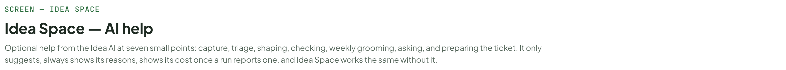
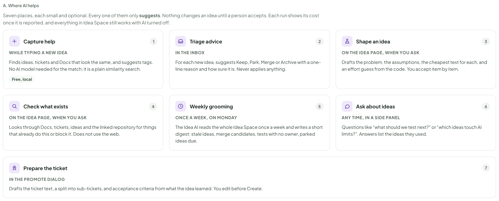
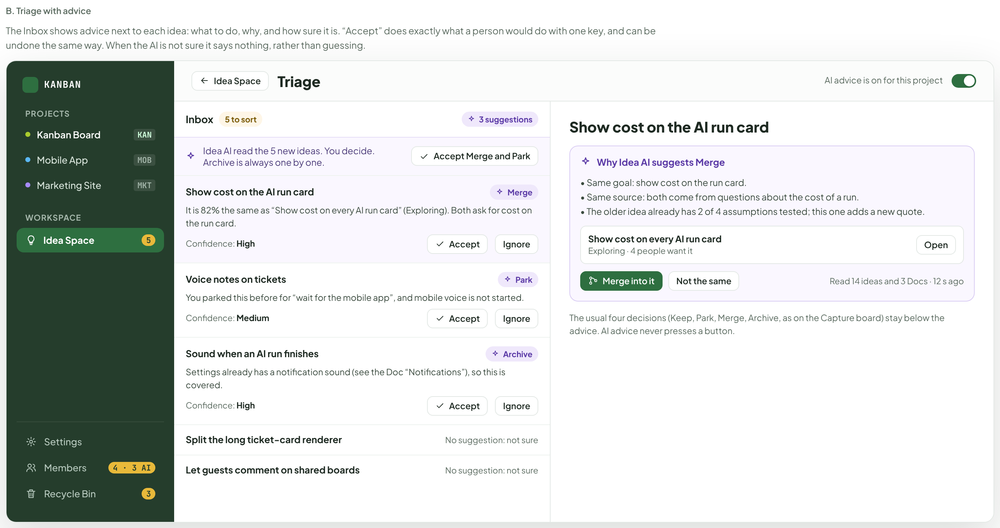
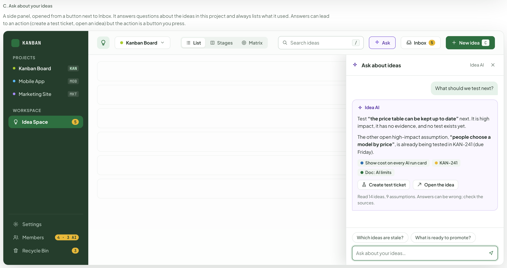
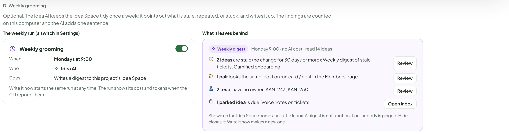
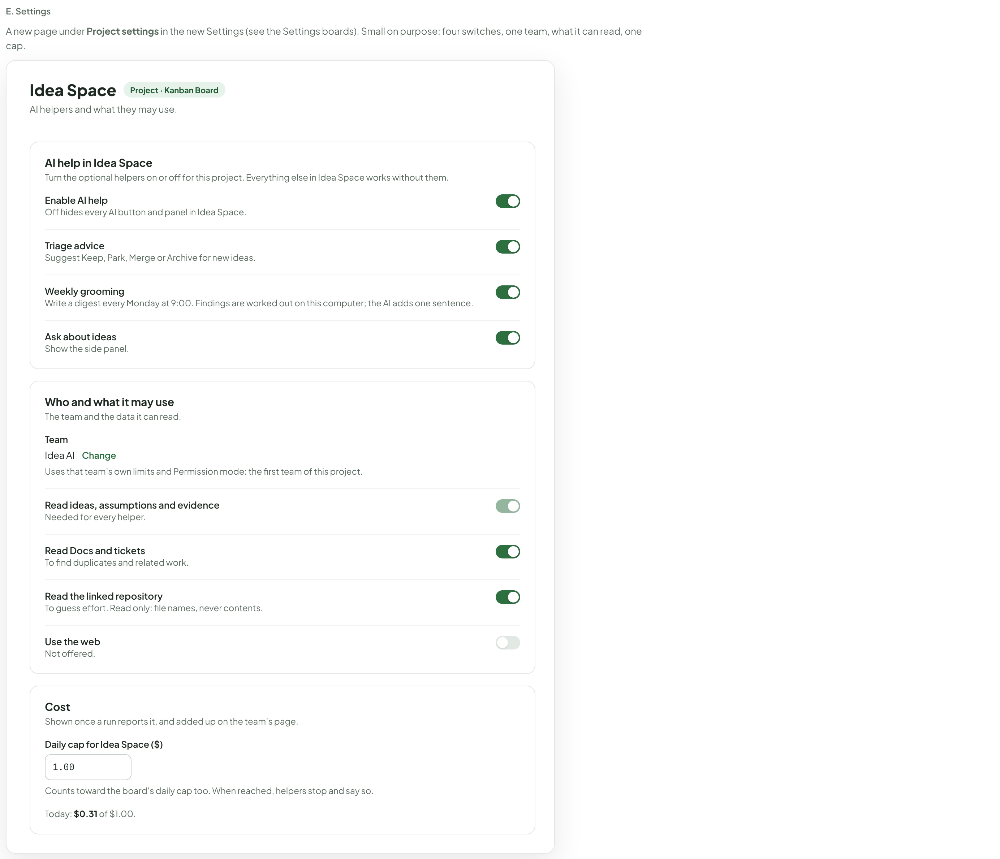
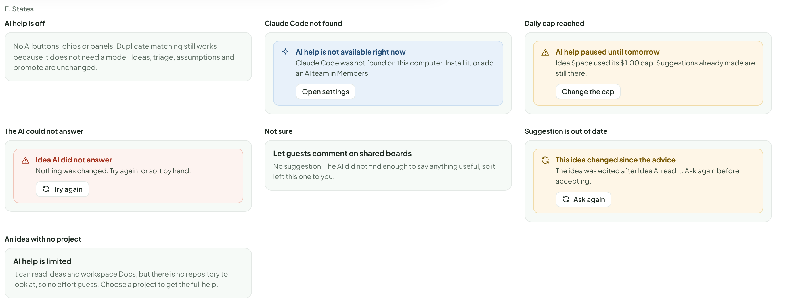
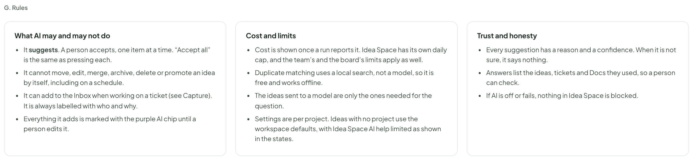

# Idea Space — AI help

> Redrawn for AI v2 · source: [`IdeaAi.dc.html`](../source/IdeaAi.dc.html) · canvas `1794099567-d725` · sha256 `75dd4bb7c4e1d7540afd7c92497c80a580b056929a9545b196ab54b374a71024`

> Words, states and conditions follow the code of branch `claude/ai-team-architecture-7a1efc`; the layout is designed here and is not the layout of the current screens. Names, ids, costs and times in the mock-ups are sample data. **Check the code before building from this: the file named in each part is the truth, not the picture.**

## SCREEN — IDEA SPACE

- Text in this part: "SCREEN — IDEA SPACE" · "Idea Space — AI help" · "Optional help from the Idea AI at seven small points: capture, triage, shaping, checking, weekly grooming, asking, and preparing the ticket. It only suggests, always shows its reasons, shows its cost once a run reports one, and Idea Space works the same without it."

---

## A. Where AI helps

- Text in this part: "A. Where AI helps" · "Seven places, each small and optional. Every one of them only suggests. Nothing changes an idea until a person accepts. Each run shows its cost once it is reported, and everything in Idea Space still works with AI turned off." · "Capture help" · "1" · "WHILE TYPING A NEW IDEA" · "Finds ideas, tickets and Docs that look the same, and suggests tags. No AI model needed for the match; it is a plain similarity search." · "Free, local" · "Triage advice" · "2" · "IN THE INBOX" · "For each new idea, suggests Keep, Park, Merge or Archive with a one-line reason and how sure it is. Never applies anything." · "Shape an idea" · "3" · "ON THE IDEA PAGE, WHEN YOU ASK" · "Drafts the problem, the assumptions, the cheapest test for each, and an effort guess from the code. You accept item by item." · "Check what exists" · "4" · "Looks through Docs, tickets, ideas and the linked repository for things that already do this or block it. Does not use the web." · "Weekly grooming" · "5" · "ONCE A WEEK, ON MONDAY" · "The Idea AI reads the whole Idea Space once a week and writes a short digest: stale ideas, merge candidates, tests with no owner, parked ideas due." · "Ask about ideas" · "6" · "ANY TIME, IN A SIDE PANEL" · "Questions like “what should we test next?” or “which ideas touch AI limits?”. Answers list the ideas they used." · "Prepare the ticket" · "7" · "IN THE PROMOTE DIALOG" · "Drafts the ticket text, a split into sub-tickets, and acceptance criteria from what the idea learned. You edit before Create."

---

## B. Triage with advice

- Text in this part: "B. Triage with advice" · "The Inbox shows advice next to each idea: what to do, why, and how sure it is. “Accept” does exactly what a person would do with one key, and can be undone the same way. When the AI is not sure it says nothing, rather than guessing." · "KANBAN" · "PROJECTS" · "Kanban Board" · "KAN" · "Mobile App" · "MOB" · "Marketing Site" · "MKT" · "WORKSPACE" · "Idea Space" · "5" · "Settings" · "Members" · "4 · 3 AI" · "Recycle Bin" · "3" · "Triage" · "AI advice is on for this project" · "Inbox" · "5 to sort" · "3 suggestions" · "Idea AI read the 5 new ideas. You decide. Archive is always one by one." · "Accept Merge and Park" · "Show cost on the AI run card" · "Merge" · "It is 82% the same as “Show cost on every AI run card” (Exploring). Both ask for cost on the run card." · "Confidence: High" · "Accept" · "Ignore" · "Voice notes on tickets" · "Park" · "You parked this before for “wait for the mobile app”, and mobile voice is not started." · "Confidence: Medium" · "Sound when an AI run finishes" · "Archive" · "Settings already has a notification sound (see the Doc “Notifications”), so this is covered." · "Split the long ticket-card renderer" · "No suggestion: not sure" · "Let guests comment on shared boards" · "Why Idea AI suggests Merge" · "• Same goal: show cost on the run card." · "• Same source: both come from questions about the cost of a run." · "• The older idea already has 2 of 4 assumptions tested; this one adds a new quote." · "Show cost on every AI run card" · "Exploring · 4 people want it" · "Open" · "Merge into it" · "Not the same" · "Read 14 ideas and 3 Docs · 12 s ago" · "The usual four decisions (Keep, Park, Merge, Archive, as on the Capture board) stay below the advice. AI advice never presses a button."

---

## C. Ask about your ideas

- Text in this part: "C. Ask about your ideas" · "A side panel, opened from a button next to Inbox. It answers questions about the ideas in this project and always lists what it used. Answers can lead to an action (create a test ticket, open an idea) but the action is a button you press." · "KANBAN" · "PROJECTS" · "Kanban Board" · "KAN" · "Mobile App" · "MOB" · "Marketing Site" · "MKT" · "WORKSPACE" · "Idea Space" · "5" · "Settings" · "Members" · "4 · 3 AI" · "Recycle Bin" · "3" · "List" · "Stages" · "Matrix" · "Search ideas" · "/" · "Ask" · "Inbox" · "New idea" · "C" · "Ask about ideas" · "Idea AI" · "What should we test next?" · "Test “the price table can be kept up to date” next. It is high impact, it has no evidence, and no test exists yet." · "The other open high-impact assumption, “people choose a model by price”, is already being tested in KAN-241 (due Friday)." · "Show cost on every AI run card" · "KAN-241" · "Doc: AI limits" · "Create test ticket" · "Open the idea" · "Read 14 ideas, 9 assumptions. Answers can be wrong; check the sources." · "Which ideas are stale?" · "What is ready to promote?" · "Ask about your ideas…"

---

## D. Weekly grooming

- Text in this part: "D. Weekly grooming" · "Optional. The Idea AI keeps the Idea Space tidy once a week: it points out what is stale, repeated, or stuck, and writes it up. The findings are counted on this computer and the AI adds one sentence." · "The weekly run (a switch in Settings)" · "Weekly grooming" · "When" · "Mondays at 9:00" · "Who" · "Idea AI" · "Does" · "Writes a digest to this project’s Idea Space" · "Write it now starts the same run at any time. The run shows its cost and tokens when the CLI reports them." · "What it leaves behind" · "Weekly digest" · "Monday 9:00 · no AI cost · read 14 ideas" · "2 ideas are stale (no change for 30 days or more): Weekly digest of stale tickets, Gamified onboarding." · "Review" · "1 pair looks the same: cost on run card / cost in the Members page." · "2 tests have no owner: KAN-243, KAN-250." · "1 parked idea is due: Voice notes on tickets." · "Open Inbox" · "Shown on the Idea Space home and in the Inbox. A digest is not a notification; nobody is pinged. Hide closes it; Write it now makes a new one."

---

## E. Settings

- Text in this part: "E. Settings" · "A new page under Project settings in the new Settings (see the Settings boards). Small on purpose: four switches, one team, what it can read, one cap." · "Idea Space" · "Project · Kanban Board" · "AI helpers and what they may use." · "AI help in Idea Space" · "Turn the optional helpers on or off for this project. Everything else in Idea Space works without them." · "Enable AI help" · "Off hides every AI button and panel in Idea Space." · "Triage advice" · "Suggest Keep, Park, Merge or Archive for new ideas." · "Weekly grooming" · "Write a digest every Monday at 9:00. Findings are worked out on this computer; the AI adds one sentence." · "Ask about ideas" · "Show the side panel." · "Who and what it may use" · "The team and the data it can read." · "Team" · "Idea AI" · "Change" · "Uses that team’s own limits and Permission mode: the first team of this project." · "Read ideas, assumptions and evidence" · "Needed for every helper." · "Read Docs and tickets" · "To find duplicates and related work." · "Read the linked repository" · "To guess effort. Read only: file names, never contents." · "Use the web" · "Not offered." · "Cost" · "Shown once a run reports it, and added up on the team’s page." · "Daily cap for Idea Space ($)" · "1.00" · "Counts toward the board’s daily cap too. When reached, helpers stop and say so." · "Today: $0.31 of $1.00."

---

## F. States

- Text in this part: "F. States" · "AI help is off" · "No AI buttons, chips or panels. Duplicate matching still works because it does not need a model. Ideas, triage, assumptions and promote are unchanged." · "Claude Code not found" · "AI help is not available right now" · "Claude Code was not found on this computer. Install it, or add an AI team in Members." · "Open settings" · "Daily cap reached" · "AI help paused until tomorrow" · "Idea Space used its $1.00 cap. Suggestions already made are still there." · "Change the cap" · "The AI could not answer" · "Idea AI did not answer" · "Nothing was changed. Try again, or sort by hand." · "Try again" · "Not sure" · "Let guests comment on shared boards" · "No suggestion. The AI did not find enough to say anything useful, so it left this one to you." · "Suggestion is out of date" · "This idea changed since the advice" · "The idea was edited after Idea AI read it. Ask again before accepting." · "Ask again" · "An idea with no project" · "AI help is limited" · "It can read ideas and workspace Docs, but there is no repository to look at, so no effort guess. Choose a project to get the full help."

---

## G. Rules

- Text in this part: "G. Rules" · "What AI may and may not do" · "It suggests. A person accepts, one item at a time. “Accept all” is the same as pressing each." · "It cannot move, edit, merge, archive, delete or promote an idea by itself, including on a schedule." · "It can add to the Inbox when working on a ticket (see Capture). It is always labelled with who and why." · "Everything it adds is marked with the purple AI chip until a person edits it." · "Cost and limits" · "Cost is shown once a run reports it. Idea Space has its own daily cap, and the team’s and the board’s limits apply as well." · "Duplicate matching uses a local search, not a model, so it is free and works offline." · "The ideas sent to a model are only the ones needed for the question." · "Settings are per project. Ideas with no project use the workspace defaults, with Idea Space AI help limited as shown in the states." · "Trust and honesty" · "Every suggestion has a reason and a confidence. When it is not sure, it says nothing." · "Answers list the ideas, tickets and Docs they used, so a person can check." · "If AI is off or fails, nothing in Idea Space is blocked."

---

## Todo rows, differences from the code, and what was not checked

Files (this folder): IdeaAi.dc.html, Canvas.dc.html, Notifications.dc.html, PreviewTypes.dc.html, TicketComments.dc.html.
Not changed, no file: PreviewViewer.dc.html, AiDatabases.dc.html, DocsAi*.dc.html (left).
The edited canvases keep their original root id (`board-root`); `measure.js` here reads either id. Generators: do_*.py (bs4 edit scripts on the repo sources).

| Canvas | width | finalH |
|---|---|---|
| IdeaAi | 1480 | 4837 |
| Canvas | 1480 | 19302 (was 19845) |
| Notifications | 1480 | 14464 (was 13745) |
| PreviewTypes | 1480 | 8768 (was 8630) |
| TicketComments | 1180 | 9571 (was 7877) |

## IdeaAi (A20, Idea assistant rows)
| Row | Done | Notes |
|---|---|---|
| A-191 | drawn (edited) | "AI member" is now the project's Board AI (first team, shown as "Backend team"); cost chips ("About $0.002 per idea") and "Off by default" chips removed, cost only where a run reports it (triage "why", Ask footer, digest); weekly grooming: no Budget/Cannot rows, only "Does"; "Write it now" noted; no audit-log line; "No AI member set up" is now "No team yet" (see below); settings: Team row, cost card "Shown once a run reports it", "Today: $0.31 of $1.00" (code), switches all on (code default), "Not offered in v1" -> "Not offered". |
| A-192 | left | Triage advice and Ask panel kept (names refreshed only). |
| A-182..A-190 | left | Docs AI rows: DocsAi.dc.html and DocsAiCare.dc.html are being built by someone else. |

## Canvas (A21 + B-45)
| Row | Done | Notes |
|---|---|---|
| A-193 | edited | Tag "Screen — AI v2"; A-table "Who changes it" and "What AI does" now: an AI team changes an HTML board directly, the canvas keeps the version before it (like Docs AI). |
| A-194 | removed | Third start "Ask AI" (and prompt) gone from the New canvas dialog. |
| A-195 | removed | All four "AI" top-bar buttons (C1, C2, J1...), "Ask AI" in the hover toolbar (x2), "Ask AI to change... Ctrl J" in the board menu, Ctrl J row in the key list, E2 (panel, purple ribbon, waiting card), "Ask AI" in the empty-canvas state and in the View-only text. Re-flowed, no gap. The "Ask AI Ctrl J" in the app header of other mock-ups is the Board AI dock and stays. |
| A-196 | removed | E3 "The proposal" gone; E4 renumbered E3. |
| A-197 | edited | AI comment keeps its own name ("Frontend team"), no "Propose a fix / Not now"; text says people reply and resolve, a team never resolves. Composer hint "Type @ to mention a person or a team". |
| B-45 | drawn | New E2 "When an AI changes a board": the plane with the changed boards (green outline + purple "Backend team" chip, designed, not in code) next to History with Version 14, "Backend team" + AI chip, the AI's note as summary. New E3 cards: "A team asks for a board you are editing" (lock ribbon "You are editing", no AI ribbon, no notice), "A team saved while you were editing" (source editor banner "Backend team saved a newer version", Back to editor / Save as new board, text from `canvases.py`). Section M and History text reworded (no proposals; "created on Done, when an AI team saves a board"). |

## Notifications (A22, B-31)
| Row | Done | Notes |
|---|---|---|
| A-198 | removed | The approval row in the panel (and bell/tab count 5 -> 4), the D2 and settings (L) rows, the F2 row. |
| A-199 | edited, kept | Signed-out row kept, reworded ("3 AI teams on this account stopped. Their queued runs wait.", chip "3 teams"). Needs the user's decision whether the row is still sent (not checked in code; `account_signed_out` is still in `notifications.py`). |
| A-200 | drawn | New F3 "Answer where you are": corner notice with Answer; ticket opens on the card with the cursor in the field; ticket open on "AI activity" goes back to the main tab first; answered ("Answer sent", thread line). New K frame: toast "KAN-215 is muted / Questions still reach you." (this canvas had no such toast). |
| B-31 | drawn | Same F3 frames (notice -> focused field, other tab, answered). Thread card and chat banner are on the AiTicketWork canvas, not repeated. |
| extra | edited | Also removed (not in the todo rows): "An AI was blocked by a permission" and "A page proposal from an AI" rows (no matrix; Docs proposals deleted per A.20). All v1 words swept: AI member -> team, AI safety, Rin/Gem/Quy/Bao samples -> Backend/Frontend/Docs team, AGT -> KAN, "AI summary ready for review" -> first line of a Report, "Review first" -> "Open first", Board assistant -> Board AI. |

## PreviewTypes (A23) and PreviewViewer
| Row | Done | Notes |
|---|---|---|
| A-201 | redrawn | J: PowerPoint "slides drawn from the file" (notice text exact from `OfficeReader.tsx`, "Show the outline", thumbnails drawn, drawn slide with title, bullets, chart, gradient+shadow shape, arrow, table; Speaker notes; Previous / Slide 3 of 12 / Next) and "outline" (a choice, "Show the slides", slide with no title box shows its biggest text, "No notes on this slide."). Server wording deleted. Word notice fixed to the code ("pictures are not shown"). |
| A-202 | redrawn | I: Excel frame replaced by the formatted sheet (fills, merged title, number/date formats, negative red, colour scale, data bars, frozen lines, search hits "1 of 2", tab colours); new frames: chart + picture; long sheet with "Show 500 more rows" / "Showing the first 500 rows of 12,480." "Frozen header" and "Copy range" removed (not in code); footer is "Formulas show their last saved result." CSV frame left. |
| A-203 | left | PDF reader VALID (code has thumbnails, zoom, jump, search, Fit). The mock-up's floating bottom bar differs from the code's top toolbar. |
| extra | edited | Board O: XLSX/DOCX/PPTX rows and intro said "needs a converter"; now "Built" (code reads all three in the app). |
| PreviewViewer | left | A.23 has no row for it ("viewer ... untouched"); its tag still says "Component — v1 proposal" and Rules start with "Proposed." (no AI content). |

## TicketComments (B-33, B-38), width 1180
New sections only; the rest untouched (tag "Screen — v1" -> "Screen").
- H (B-33): video plays in place (first frame, controls, file card under it); a video the player cannot take (.mkv etc.: card only); picture + PDF + XLSX cards for comparison; short callout.
- I (B-38): report by "Backend team" (Lead chip) with one picture; with a video; with three files (PDF, XLSX, DOCX); with no files.

## AiDatabases (A19)
Confirmed: VALID, not touched. The only item in A-181 is refreshing sample table names in D; the canvas names `ai_run`, `ai_ticket_step`, `ai_run_transcript`, not the v2 `ai_team`, `ai_run_step`, `ai_run_agent`. A P3 text change, not needed to publish.

## Left (not mine)
A-182..A-190 (DocsAi, DocsAiCare, KBM-24).

## Todo vs code, and drawn differently from the code
- "No AI member" state: code has no `no_member` state in `assistant/ideas.py`; with no team the engine falls back to "Board AI", and only a missing CLI gives `unavailable` ("Claude Code was not found on this computer. Install it, or add an AI team in Members."). Drawn with the todo's caption "No team yet" and the code's message and title "AI help is not available right now" (button "Open settings"). `IdeaAiPanel.tsx` still has the strings "Choose an AI member" / "Open AI members" and `IdeaSpaceSettings.tsx` "AI member", "Not offered in v1" (stale).
- Idea settings: code defaults are all on and has no "Off by default" text; canvas now matches. The Cost card has no "last 7 days" in code ("Today: $x of $y").
- Canvas code still has stale text: `HistoryPanel.tsx` ("every accepted AI proposal", reason `proposal`; an AI save has reason `ai`, no label), `CommentsPanel.tsx` placeholder "Write @Name to ask a person or an AI member", `EditorParts.tsx` doc comment "Ask AI". The History row of an AI save (AI chip, who, note) is designed here; the code shows only `actorName` and the note. The "changed by" chip on the plane and any notice are not in code (B-45: undecided).
- B-33: the code keeps the `<video>` for an unplayable .mp4 (browser decides what it shows); only non-mp4/webm/mov names get the card alone. Drawn as the todo says (card only) for the .mkv case.
- Notifications: server `KINDS` still lists approval, blocked, page_proposal, auto_trip, offline ("An AI member went offline") and the row action "Review"; I removed approval, blocked and page_proposal from the canvas only. Check these with the developer. The panel keeps "Pause all AI".
- Notifications "Updates" row wording "{n} AI finished work" is the code's label; kept.
- Excel: code has no "Frozen header" or "Copy range" (C-28); frozen panes are drawn as the file has them.

## Not checked
No run of the app. Excel/PowerPoint pictures are mock-ups of what the renderers do, not exports. Notification counts (Unread 12, Updates 23) not recalculated after removing the approval row. The CSV frame and the Word body picture were not compared with the code beyond the Word notice. Whether `account_signed_out` is emitted in v2 (A-199).

## Review round
New finalH: IdeaAi 4817, Canvas 19219, Notifications 14901, PreviewTypes 8805, TicketComments 9574 (1180 wide), AiDatabases unchanged size.

Fixed
- AiDatabases.dc.html: only A-181 (`ai_run_transcript` -> `ai_run_step`, `ai_ticket_step` -> `ai_run_agent`; `ai_run` stays).
- Tags: "Component — v1 proposal" (PreviewTypes) and "Screen — v1" (TicketComments) restored as they were.
- Sidebar pill is "4 · 3 AI" (code format) in IdeaAi, Canvas, Notifications.
- IdeaAi: AI is "Idea AI" (the code's `status.member`); Team row is static text with a Change link; the "No team yet" state replaced by "Claude Code not found" (the only real unavailable state); costs ($0.002, $0.01, $0.04) removed (digest says "no AI cost"); only the daily-cap line stays (code).
- Canvas: History drawer, "Version 14", AI chip and the AI note removed from E2 and J1 (an AI save makes no version in code); E2 and J1 text and section M no longer say "keeps the version before it" or "undo through versions"; E3 lock ribbon names another holder ("An Nguyen is editing"); "reloads" dropped (no reload event in ui/src).
- Notifications: F3 question card uses the code's words (subtitle "12:50 · waiting 2 min · run #3 paused", "To An Nguyen", "Something else", "type an answer…"); tab strip is the "Ticket | AI activity" switch; frame 4 shows the answer comment, "Needs input -> Starting" and "Answer sent to the lead"; new frames 5 (chat banner, the same card) and 6 (thread and chat at once); "Open first" removed (only "Show all N"); "are held" restored; `safety.notify()`, `useAiSafetyNotifications`, "AI Team panel/section", "another AI answers", "The AI asks" reworded; "eight AI events" count dropped; project filter fourth project renamed "Marketing Site"; the After-you-answer callout no longer passes the content edge.
- PreviewTypes: board N converter state removed; Excel "one sheet" frame has no tab strip; summary: XLSX, DOCX, PPTX built, and a row "XLS, DOC, PPT (old formats): file facts, Download, Open in app"; PDF board redrawn with the code's top toolbar (page jump, zoom, Fit, Search).
- TicketComments: invented "Lead" chip and "$0.31" removed; reports show the AI badge and the "AI summary" chip and the usage line `Run #3 · N tokens · model` in ``; badge "XLSX"; new state: an .mp4 the browser cannot play (player kept, card under it).

Kept / designer's proposal (no code basis)
- Canvas E2: green outline and "Backend team" chip on changed boards (designer's proposal). The history mock in J1 keeps only what exists.
- Notifications F3 frame 6 caption "answering in either closes both" is read from `answerFocus.ts`/the run state, not seen on screen; the chat panel header text is a placeholder.
- Excel/PowerPoint pictures are mock-ups of the renderers.

Cannot / unverified
- B-45: no canvas reload event in `ui/src`; whether an AI save appears in History is unverified (`put_board_content` never calls `_version`; `reason="ai"` has no label in HistoryPanel).
- Code must change (stale): `KINDS` in `notifications.py` and ui/src still define approval, blocked, page_proposal (and auto_trip, offline "AI member"); the Settings table is generated from them. Removed from the canvas only.
- A-203: the old PDF mock had a floating bottom bar; code has a top toolbar; the board now follows the code.
