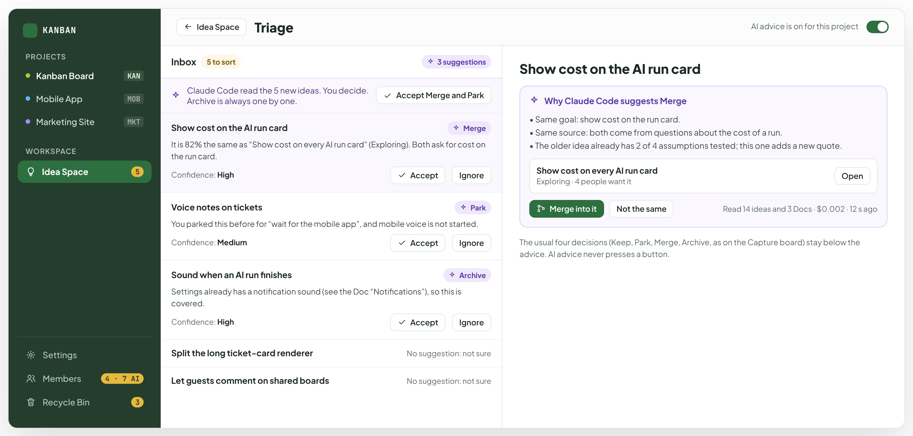
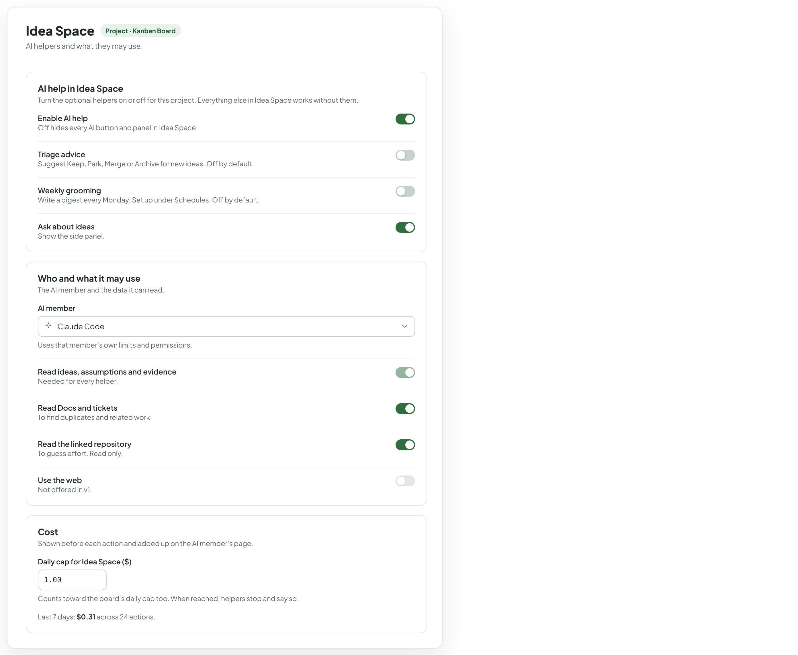
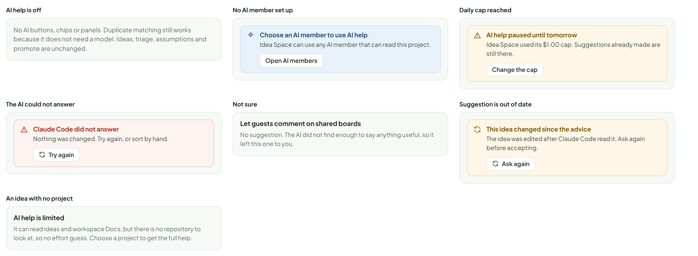
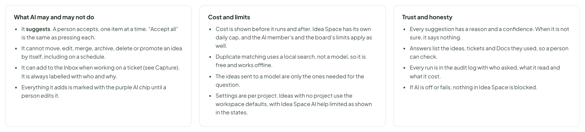

# Idea Space — AI help

> SCREEN — V1 PROPOSAL · source: [`IdeaAi.dc.html`](../source/IdeaAi.dc.html) · canvas `1793295530-5588` · sha256 `410829ab5b84d0e849b329195a3785121d31d7eb70049d17b3030881b84c4b4c`

Optional help from an AI member at seven small points: capture, triage, shaping, checking, weekly grooming, asking, and preparing the ticket. It only suggests, always shows its reasons and its cost, and Idea Space works the same without it.

Source: [IdeaAi.dc.html](../source/IdeaAi.dc.html) › header ("SCREEN — V1 PROPOSAL", "Idea Space — AI help" and the intro)

---

## A. Where AI helps

Seven places, each small and optional. Every one of them only suggests. Nothing changes an idea until a person accepts. Each shows what it costs, and everything in Idea Space still works with AI turned off. The costs on this board are examples, not measured prices.

Source: [IdeaAi.dc.html](../source/IdeaAi.dc.html) › block "A. Where AI helps"

- Text in the frames: "Capture help" · "1" · "WHILE TYPING A NEW IDEA" · "Finds ideas, tickets and Docs that look the same, and suggests tags. No AI model needed for the match; it is a plain similarity search." · "Free, local" · "Triage advice" · "2" · "IN THE INBOX" · "For each new idea, suggests Keep, Park, Merge or Archive with a one-line reason and how sure it is. Never applies anything." · "About $0.002 per idea" · "Off by default" · "Shape an idea" · "3" · "ON THE IDEA PAGE, WHEN YOU ASK" · "Drafts the problem, the assumptions, the cheapest test for each, and an effort guess from the code. You accept item by item." · "About $0.03 per idea" · "Check what exists" · "4" · "Looks through Docs, tickets, ideas and the linked repository for things that already do this or block it. Does not use the web." · "About $0.02" · "Weekly grooming" · "5" · "ON A SCHEDULE YOU SET" · "An AI member reads the whole Idea Space once a week and writes a short digest: stale ideas, merge candidates, tests with no owner, parked ideas due." · "About $0.05 per week" · "Ask about ideas" · "6" · "ANY TIME, IN A SIDE PANEL" · "Questions like “what should we test next?” or “which ideas touch AI limits?”. Answers list the ideas they used." · "About $0.01 per question" · "Prepare the ticket" · "7" · "IN THE PROMOTE DIALOG" · "Drafts the ticket text, a split into sub-tickets, and acceptance criteria from what the idea learned. You edit before Create."

---

## B. Triage with advice

The Inbox shows advice next to each idea: what to do, why, and how sure it is. “Accept” does exactly what a person would do with one key, and can be undone the same way. When the AI is not sure it says nothing, rather than guessing.

Source: [IdeaAi.dc.html](../source/IdeaAi.dc.html) › block "B. Triage with advice"

- Text in the frames: "KANBAN" · "PROJECTS" · "Kanban Board" · "KAN" · "Mobile App" · "MOB" · "Marketing Site" · "MKT" · "WORKSPACE" · "Idea Space" · "5" · "Settings" · "Members" · "4 · 7 AI" · "Recycle Bin" · "3" · "Triage" · "AI advice is on for this project" · "Inbox" · "5 to sort" · "3 suggestions" · "Claude Code read the 5 new ideas. You decide. Archive is always one by one." · "Accept Merge and Park" · "Show cost on the AI run card" · "Merge" · "It is 82% the same as “Show cost on every AI run card” (Exploring). Both ask for cost on the run card." · "Confidence: High" · "Accept" · "Ignore" · "Voice notes on tickets" · "Park" · "You parked this before for “wait for the mobile app”, and mobile voice is not started." · "Confidence: Medium" · "Sound when an AI run finishes" · "Archive" · "Settings already has a notification sound (see the Doc “Notifications”), so this is covered." · "Split the long ticket-card renderer" · "No suggestion: not sure" · "Let guests comment on shared boards" · "Why Claude Code suggests Merge" · "• Same goal: show cost on the run card." · "• Same source: both come from questions about the cost of a run." · "• The older idea already has 2 of 4 assumptions tested; this one adds a new quote." · "Show cost on every AI run card" · "Exploring · 4 people want it" · "Open" · "Merge into it" · "Not the same" · "Read 14 ideas and 3 Docs · $0.002 · 12 s ago" · "The usual four decisions (Keep, Park, Merge, Archive, as on the Capture board) stay below the advice. AI advice never presses a button."

---

## C. Ask about your ideas

A side panel, opened from a button next to Inbox. It answers questions about the ideas in this project and always lists what it used. Answers can lead to an action (create a test ticket, open an idea) but the action is a button you press.

Source: [IdeaAi.dc.html](../source/IdeaAi.dc.html) › block "C. Ask about your ideas"

- Text in the frames: "KANBAN" · "PROJECTS" · "Kanban Board" · "KAN" · "Mobile App" · "MOB" · "Marketing Site" · "MKT" · "WORKSPACE" · "Idea Space" · "5" · "Settings" · "Members" · "4 · 7 AI" · "Recycle Bin" · "3" · "List" · "Stages" · "Matrix" · "Search ideas" · "/" · "Ask" · "Inbox" · "New idea" · "C" · "Ask about ideas" · "Claude Code" · "What should we test next?" · "Test “the price table can be kept up to date” next. It is high impact, it has no evidence, and no test exists yet." · "The other open high-impact assumption, “people choose a model by price”, is already being tested in KAN-241 (due Friday)." · "Show cost on every AI run card" · "KAN-241" · "Doc: AI limits" · "Create test ticket" · "Open the idea" · "Read 14 ideas, 9 assumptions. $0.01. Answers can be wrong; check the sources." · "Which ideas are stale?" · "What is ready to promote?" · "Ask about your ideas…"

---

## D. Weekly grooming

Optional. An AI member keeps the Idea Space tidy on a schedule: it points out what is stale, repeated, or stuck, and writes it up. It is a normal schedule, so it already has budgets, a read-only mode, logs and the rule that it can never change status.

Source: [IdeaAi.dc.html](../source/IdeaAi.dc.html) › block "D. Weekly grooming"

- Text in the frames: "The schedule (in the Schedules tab and in Settings)" · "Idea grooming" · "When" · "Mondays at 9:00" · "Who" · "Claude Code" · "reads only" · "Does" · "Writes a digest to this project’s Idea Space" · "Cannot" · "Move, edit, merge, archive or promote" · "Budget" · "$0.10 per run" · "Uses the same Schedules as tickets. It shows in the Schedules tab with its runs and costs." · "What it leaves behind" · "Weekly digest" · "Monday 9:00 · $0.04 · read 14 ideas" · "2 ideas are stale (no change for 30 days or more; proposed): Weekly digest of stale tickets, Gamified onboarding." · "Review" · "1 pair looks the same: cost on run card / cost in the Members page." · "2 tests have no owner: KAN-243, KAN-250." · "1 parked idea is due: Voice notes on tickets." · "Open Inbox" · "Shown on the Idea Space home and in the Inbox. A digest is not a notification; nobody is pinged."

---

## E. Settings

A new page under Project settings in the new Settings (see the Settings boards). Small on purpose: four switches, one AI member, what it can read, one cap.

Source: [IdeaAi.dc.html](../source/IdeaAi.dc.html) › block "E. Settings"

- Text in the frames: "Idea Space" · "Project · Kanban Board" · "AI helpers and what they may use." · "AI help in Idea Space" · "Turn the optional helpers on or off for this project. Everything else in Idea Space works without them." · "Enable AI help" · "Off hides every AI button and panel in Idea Space." · "Triage advice" · "Suggest Keep, Park, Merge or Archive for new ideas. Off by default." · "Weekly grooming" · "Write a digest every Monday. Set up under Schedules. Off by default." · "Ask about ideas" · "Show the side panel." · "Who and what it may use" · "The AI member and the data it can read." · "AI member" · "Claude Code" · "Uses that member’s own limits and permissions." · "Read ideas, assumptions and evidence" · "Needed for every helper." · "Read Docs and tickets" · "To find duplicates and related work." · "Read the linked repository" · "To guess effort. Read only." · "Use the web" · "Not offered in v1." · "Cost" · "Shown before each action and added up on the AI member’s page." · "Daily cap for Idea Space ($)" · "1.00" · "Counts toward the board’s daily cap too. When reached, helpers stop and say so." · "Last 7 days: $0.31 across 24 actions."

---

## F. States

Source: [IdeaAi.dc.html](../source/IdeaAi.dc.html) › block "F. States"

- Text in the frames: "AI help is off" · "No AI buttons, chips or panels. Duplicate matching still works because it does not need a model. Ideas, triage, assumptions and promote are unchanged." · "No AI member set up" · "Choose an AI member to use AI help" · "Idea Space can use any AI member that can read this project." · "Open AI members" · "Daily cap reached" · "AI help paused until tomorrow" · "Idea Space used its $1.00 cap. Suggestions already made are still there." · "Change the cap" · "The AI could not answer" · "Claude Code did not answer" · "Nothing was changed. Try again, or sort by hand." · "Try again" · "Not sure" · "Let guests comment on shared boards" · "No suggestion. The AI did not find enough to say anything useful, so it left this one to you." · "Suggestion is out of date" · "This idea changed since the advice" · "The idea was edited after Claude Code read it. Ask again before accepting." · "Ask again" · "An idea with no project" · "AI help is limited" · "It can read ideas and workspace Docs, but there is no repository to look at, so no effort guess. Choose a project to get the full help."

---

## G. Rules

Proposed.

Source: [IdeaAi.dc.html](../source/IdeaAi.dc.html) › block "G. Rules"

- Text in the frames: "What AI may and may not do" · "It suggests. A person accepts, one item at a time. “Accept all” is the same as pressing each." · "It cannot move, edit, merge, archive, delete or promote an idea by itself, including on a schedule." · "It can add to the Inbox when working on a ticket (see Capture). It is always labelled with who and why." · "Everything it adds is marked with the purple AI chip until a person edits it." · "Cost and limits" · "Cost is shown before it runs and after. Idea Space has its own daily cap, and the AI member’s and the board’s limits apply as well." · "Duplicate matching uses a local search, not a model, so it is free and works offline." · "The ideas sent to a model are only the ones needed for the question." · "Settings are per project. Ideas with no project use the workspace defaults, with Idea Space AI help limited as shown in the states." · "Trust and honesty" · "Every suggestion has a reason and a confidence. When it is not sure, it says nothing." · "Answers list the ideas, tickets and Docs they used, so a person can check." · "Every run is in the audit log with who asked, what it read and what it cost." · "If AI is off or fails, nothing in Idea Space is blocked."
